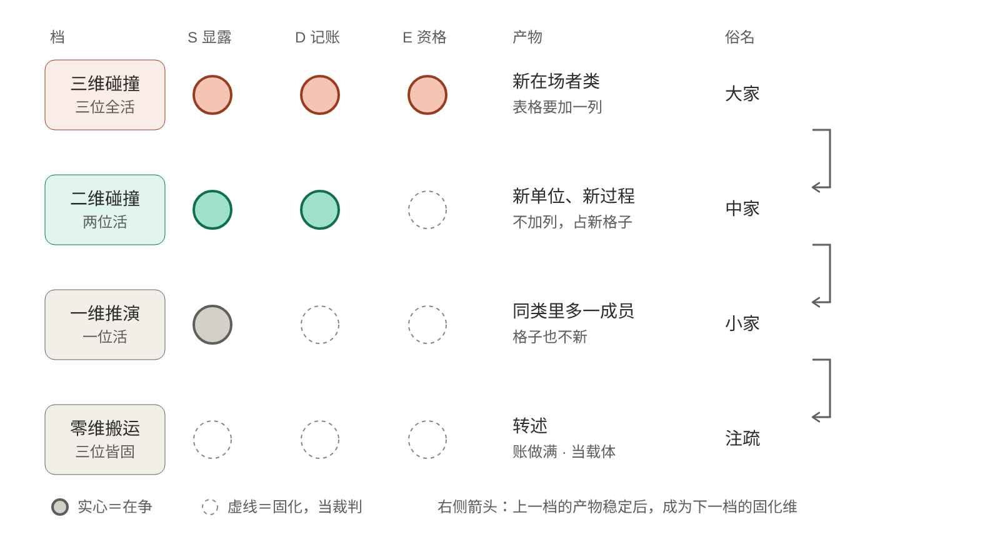

## 出版信息

| 项 | 内容 |
|---|---|
| 书名 | 《学科概念SDE发生学导论》 |
| 英文书名 | An Introduction to the SDE Genesis of Disciplinary Concepts |
| 著者 | 王德生 |
| 执笔 | 王德生立题，核心方法与关键裁定由他口述或作出；Claude 协作撰写与统稿 |
| 出版 | 德麦国际出版社（Demai International Press）· 新加坡 |
| 编号 | 德麦国际专著第 481 号 |
| ISBN | 979-8-90690-486-7 |
| 定价 | US$25.00 |
| 开本 | 170 mm × 240 mm |
| 字数 | 约 30.5 万字（全书 305,262 个汉字，含十一个附录） |
| 版次 | 2026 年 11 月第 1 版 |
| 完稿 | 2026 年 11 月 4 日 |

AI 协作声明：本书由王德生立题，核心方法与关键裁定由他口述或作出；正文由 AI（Claude）协作撰写，经统稿、审校与三审，事实部分联网核查。写作者与判定者同属一个基底，不能互作独立证据。

编号与 ISBN：本书为德麦国际专著第 481 号，ISBN 979-8-90690-486-7，从站内书目、书目录与预留档计算空号，校验位已核，上站前查过无重号。

全书结构：出版信息、题词、作者介绍、成书说明、凡例、目录；导论；十编六十二章（第九编有增补）；结语；十一个附录；版本说明。

版权所有　侵权必究

## 题词

【题词】三维出新在场者，二维出新单位与新过程，一维出同类里的新成员；

【题词】差别不在才智，在有几个位置在争；

【题词】而在争的位置数，由上一次涌现留下的那一样东西决定。

## 作者介绍

王德生（Desheng Wang），博士，SIO 本体论与 SDE 发生学（显露·差异序列·特征纠缠）创立者，德麦国际（Demai International）创始人、董事长，主持 SDE Universes 平台与德麦国际专著出版体系。计算数学出身：湘潭大学数学系本科、硕士，中国科学院数学研究所博士，中国科学院计算数学研究所博士后；曾任英国威尔士大学斯旺西分校高级研究员、新加坡南洋理工大学数学系助理教授（博导）与资深研究科学家，在计算数学与图形学国际期刊发表论文四十余篇。2015 年起回国推广三视角方法论，在各地高校讲学数百场；2024 年提出 SIO 本体论与意义三律，后凝练为 SDE 发生学。

## 成书说明

请按这本书实际做到的范围来读。**谁写的。** 本书由王德生立题，核心方法与关键裁定由他口述或作出。正文由 AI（Claude）协作撰写，经通篇校订与联网事实核查。**它是什么。** 本书把多维度碰撞创新法立为核心，在八门自然与社会科学和艺术上全面真跑。判级、归位、改判，全部由本书按自己的规则做出，写作者与判定者同属一个基底，不能互作独立证据。六十三例改判没有第三方复核，全书最后几条跨门读数都建立在它们之上。

**它不是什么。** 本书没有经过独立的学术评审，不写分数。五组真跑是书内对书内材料的检验，不是外部实测。判负条款大多写在纸上，等人来跑。账目不合之处登记在附录十一。

## 凡例

一、本书的单位是**一个学科概念的出生**，不是一位学者、不是一门学科、不是一部著作。同一个人可以出生过两次，也可以一次都没有；本书判作品，不判人。三维碰撞、二维碰撞、一维推演及其俗名大家、中家、小家，都指一次出生所处的档，不指人。

二、本书不写分数。一律用「参战维数」「三活／一固／二固」「二十四例里二十二例」。凡出现比率之处，同时给出分子分母的绝对数。三、本书是母体书，S、D、E 三个字母可直接使用；但每一门学科的正文须先用该门自己的话把三位说一遍，再给字母名。**凡只能用 SDE 词说出来的判断，视为未写清，退回重写。**

四、每章开头有四要件表：本章的例／三家或两活一固／被推翻的共有前提／自曝材料的来源与性质。凡填不满者，该例不入正文，退回附录六。讲方法的第一编各章，表中填本章所依的例与所讲的工序。五、每章末尾有两行：本章最弱处；与前后章的同根关系。**「本章最弱处」不许空着**，填不出弱处的章，说明作者没有找过。

六、凡真跑判负、凡例外、凡事后提出的重述，一律写在原处，并标「事后提出，待独立检验」。不利读数不移入脚注，不移入附录，不改写为中性表述。七、任何计数之前先执行入池闸：这个东西是概念，还是定理、方法、记号？被挡下的例子连同理由公开于附录六。

八、真跑的预注册在开工前写死（第九编第 48 章），判负条款不许事后修改。若某条预测在跑之前被发现是析取式的（同一条预测覆盖了多种可能结果），须先改成排他形式再跑，改的经过写进正文。九、跨门比较时，各门先各自过入池闸，再合池。不同门类的信号强度不可直接相加，须在合池表中标注取数来源。

# 导论

### ◆ 0.1　这本书要回答的问题

一门学科长到一定年纪，就会有一批只有它自己才有的词：物理学有「场」和「自旋」，化学有「化合价」和「过渡态」，语言学有「音位」和「语法化」，经济学有「外部性」和「交易费用」，地质学有「地槽」和「层序」。这些词不是从日常语言里借来的，也不是给旧东西换的新名字：在它们出现之前，那门学科的账本上没有可以装它们的字段；在它们出现之后，那门学科从此按它们记账。

这本书问的是：**这样的一个词是怎么出生的。**这个问题有三种流行答案，本书都不采用。第一种是天才说：某个人想到了。它不是错的，它是不可研究的：「他想到了」这句话对任何一个案例都成立，因此对任何一个案例都不提供信息。而且它解释不了一件反复出现的事：同一个概念常常被互不通信的两个人、甚至两个文明各答一次。安萨里在十一世纪的巴格达、休谟在十八世纪的爱丁堡，各自否认因果联系有可见的必然性：休谟把它归于习惯，安萨里把它归于神的直接作用；两人之间没有可查的传承。若出生只靠某个人想到，这种相近就成了一次巧合。

第二种是积累说：材料够了，概念自然浮现。这一说的困难是反例太多且太具体。暗物质的观测材料从一九七〇年代起就极强，四十余年没有立出一个新的在场者；高温超导同理。反过来，一九〇五年的爱因斯坦手上并没有比洛伦兹更多的材料，洛伦兹得到的是一个收缩假说，爱因斯坦得到的是四维时空。材料相同而产物不同，说明差的不是材料。

第三种是范式说：范式换了，概念随之而来。库恩的贡献不可低估，但他的图景只有两级：革命与常规；而学科概念的产量绝大部分不在这两级上。材料力学的「屈曲」「应力集中」「极限状态」，有机化学的「官能团」「构象」「逆合成」，遗传学的「上位」「多效性」「漂变」，这些既不是革命，也不是常规的重复，它们是**学派内部的新概念**，出得快、出得多、几乎不退回。库恩的两级装不下它们，拉卡托斯的「硬核—保护带」装得下一半，但他没有说硬核是哪一样东西、从哪里来。

本书给的答案是一个结构，不是一个原因：

> **一个学科概念有多新，取决于它出生时有几个位置在争；而在争的位置数，由上一次涌现留下的那一样东西决定。**

前半句是数学分册（《数学概念的发生学导论》，德麦国际专著第 107 号）已经用一门学科证过的；这本书要做的是把它推到八门自然与社会科学、加上艺术，并回答后半句：**上一次涌现留下的那一样东西是什么，它怎样决定下一层。**

这个结构在本书里有一个工作的名字：**多维度碰撞创新法**。它不是本书顺带用到的工具，它是本书的核心。全书做的事可以压成一句：**把多维度碰撞创新法在学科概念上全面真跑一遍，把它成立的地方、失败的地方、自己被判负的地方都写在原处。**第一编先把这套方法一次讲清，此后各编都是它的一次运行：第二编是它的装置，第三至五编是它的三档产物，第六编是它的失败，第七编是档与档之间的循环，第九编是它自己被判负的记录。

这套方法的核心一句是：三维出新在场者，二维出新单位与新过程，一维出同类里的新成员；差别不在才智，在有几个位置在争；而在争的位置数，由上一次涌现留下的那一样东西决定。读者若只记得一句，记这一句。

### ◆ 0.2　学科不是本质

本书的第一个动作是把一个流行的说法拆掉：跨学科出创新。这个说法在实践上常常有效，在理论上是错的位置。起作用的不是学科的数目，也不是学科之间的距离，而是**三个立场各自站在哪个位置上**。同一件事可以有三家来自三门不同学科而挤在同一个位置，那不是碰撞，那是辩论；也可以三家全在一门学科内部而分处三个位置，那是完整的碰撞。

有三条现成的证据支持这一改判，它们都来自本书作者此前的学科碰撞工序本身：**第一条**：那套工序在早期版本里用「门类三分」判源：三家须来自足够远的学科；后来改成「位置三分」，理由写死为一句：**学科可以撞车而位置不撞；位置撞了，学科再远也没用。** 门类三分从判据降为参考读数。

**第二条**：判「这一家有没有被本题吸收」时，判定对象不是学科整体，而是**这一家对本题的那一句核心判断**。学科在这里只是那句判断的邮寄地址。**第三条**：一批十篇同源的稿子，每篇各换三个学科而位置分布不变，剥到形式层之后仍然同形；换源之所以有效，换的是位置分布，不是学科名字。

在这三条之外还有一条更硬的：八门学科的一百七十个案例里，**外学科输入为零**。这句话要说准：不是说这些学科史上没有跨学科的贡献，而是说本书所收的每一个概念出生案例，它的三个对立立场都能在本门内部找到；凡三位中有一位必须由外学科充任的案例（如双螺旋之于 X 射线衍射），一律不入表，另作处理。

**单学科内部的 0→1 因此进入本书的产线**，这是本书与「跨学科创新」文献的第一条分界，也是本书能够处理材料力学、有机化学、音系学这类学科内部概念的原因。那么多学科在这条产线上还有没有位置？有，但不在碰撞里。它在**退回的解除**里（第六编）和**签收**里（第八编第 46 章）：外学科供的是让签收方免于重做观察的那一份读数：古地磁之于大陆漂移、柯石英之于撞击坑、铱异常之于白垩纪末灭绝。**多学科是解除器，多维度才是发生的条件。**

### ◆ 0.3　方法的骨架：三位与四级梯

**三位。** 面对同一个题目，一个立场总是把某一样东西当作「单独够用」的那一样。剥成一句话来问：

- 够用的那一样是**读数、显露、直接给予**的东西，这一家站 **S 位**。物理学里是实验曲线，化学里是分析数据，语言学里是母语者的直觉，艺术里是眼睛看见的东西，工程里是**失效**（这一点后面会反复出现）。
- 够用的那一样是**次序、记账规则、中介的路径**，这一家站 **D 位**。物理学的方程，化学的化学式，语言学的分布法，经济学的加总，工程学的设计规程。
- 够用的那一样是**条件场、在场资格、名单**，这一家站 **E 位**。物理学的以太与绝对时空，化学的元素名单，生物学的「什么算生命单位」，经济学的「市场是自然的」，艺术的「什么算艺术」。

三位不是三个学科，是三个**位置**。同一位学者在不同的碰撞里会被派到不同的位置：康德在黑格尔的碰撞里站 D，在胡塞尔的碰撞里站 E；马克思在他自己的碰撞里倒的是 E（条件场非历史），一代之后在福柯的碰撞里被派去站 E。**位是分配的，由撞的人定，不由被撞的人自称。**

**为什么是三。** 两个立场相争，天然可以仲裁：从第三处取一个判据，判谁对，结果落回其中一方。这就是辩论：它可以判出胜负，判不出第三样东西。三个立场各把一维当作单独够用的那一样，谁也不能当第三方，冲突没有仲裁位可去，只能靠**涌现出第四样东西**来消化。四个及以上则可两两配对成两场二元仲裁，退化回二。所以三是新在场者发生的最小条件。

这个论证在本书里不是公设，它有一条可判负的推论（第 32 章）：**凡有一位被冻住不参战的场合，产物必不是新在场者类**。八门加艺术的表与十二个二级学科的表都在检验这一条（第 32.3 节已把这句改写为「产物必不出固化维所划定的范围」，「新在场者」一词也相应切成两半；这里照录最初的写法。）

**四级梯。**

| 参战维数 | 碰撞 | 产物 | 本书的名字 |
|---|---|---|---|
| 三位皆活 | 三维碰撞 | 新在场者类 | **三活**（典范级） |
| 一位固化、两位活 | 二维碰撞 | 新单位、新过程 | **一固**（子学科级） |
| 两位固化、一位活 | 一维推演 | 同类里多一个成员 | **二固**（常规，1→N） |
| 三位皆固化 | 零维搬运 | 转述 | **三固** |

固化的那一位就是**内置的仲裁位**。它在场，但不参战；它当裁判。所以二维碰撞出得快、出得多、少退回，而它的产物必须被固化维接受，因而从属于它，这就是「子学科概念」的结构定义。上表的四行就是多维度碰撞法的四档，本书两套名字并用：**三活即三维碰撞，俗称大家；一固即二维碰撞，俗称中家；二固即一维推演，俗称小家；三固即零维搬运，是注疏与教科书。** 工程名用来计数，方法名用来讲机制，俗名只是档的称呼，指一次出生，不指一个人。第 4 章把四档连成一台机器。

### ◆ 0.4　母题及其两半

本书是多维度碰撞创新法在学科概念上的一次全面真跑。真跑的结论压成一句，就是母题：

> **学科与学科之间不同的不是概念怎样出生，而是由谁来签收；出生的层级结构在八门、在艺术、在哲学里是同一个。**

**前半句（不变的那一半）**由第七编承重。它说：四级梯不是八个学科各有一套，是同一套；而且梯子是一个循环，上一层的涌现物稳定之后成为下一层的固化维，下一层在它之下二维碰撞，把这一层的单位与过程立满，再下一层用形式推演把账做满，做到露出裂缝，下一位三维碰撞者从裂缝里取共有前提与自曝材料。大家吃的是小家做出的账。

**后半句（变的那一半）**现在只由一张对照表支撑：签收的成本从「推导代劳」一路排到「网络」，档越靠后越便宜，结算率越低（第 46 章）。这句母题不是开工时的样子。开工时后半句写的是「哪一位被争、由谁来签收」，由第八编承重，主张知争 E、技争 D、艺争 S。真跑三把这半句判负了（第 51 章）：艺的推翻位分布与知不可区分。「哪一位被争」因此退到第八编，作为描述性读数与一条待检验的在场式命题。这一段留在导论里，因为一本书的母题怎样被自己的检验改写，是这套方法运行的一部分。

### ◆ 0.5　两件承重物与它们的死法

**承重物一·层级判据**：**被推翻的共有前提属于哪一位，哪一位必定参战。** 由此分界：三活＝被推翻者属在场资格那一位，或该位在这一场里被争，且名单的结构改变；一固＝有前提被推翻，但属两个参战位之一，固化维不被推翻；二固＝不推翻任何前提，只是准入放宽。真跑一打掉过「一固＝不推翻任何前提」这句旧表述（第 49 章），判据因此变紧。真跑五又立起一条不依赖读文献史的甲乙判据：表格要不要加一列，占不占新格子（第 57 章）。

死法：跨门重跑时，若被判三活的例子里有超过四分之一指不出被推翻的共有前提及其自曝来源，此判据作废，全书的分层无据。还要写明一条欠账：真跑一改写之后只检验了一固层，三活层没有被直接检验（第 58 章）。**承重物二·固化维递归**：**典范级涌现物稳定后成为下一层的固化维。**

死法：新取三十个子学科案例（真跑二），若出现三例以上固化维被推翻而该例仍属子学科级，第七编的承重撤下，「固化维」降为描述性词汇。真跑二通过，但通过得弱（第 50 章）。**开工时还有承重物三·争位分工**：知争 E、技争 D、艺争 S。它事先被写明是最可能倒的一件，死法也写明：任一领域的推翻位分布与另一领域无法区分，第八编降为描述性章节，母题的后半撤回。真跑三触发了这一条，它已撤下（第 51、53 章）。**本书由此从三件承重物减为两件。**

现存的两件承重物，连同已撤下的那一件，有一处共同的软肋，现在就写明：**它们判的都是「被推翻的共有前提在哪一位」，而共有前提是事后由作者替案例找出来的。** 一个已经发生的涌现，几乎总能被找出一条三家默认而未说出的话。本书对这一处的处置有三道：入池闸先于计数（凡例七）、三家须由当事人自己点名或当时文献可核否则标注「归位」（凡例三与第 14 章）、真跑二三四须在新池上跑（第 48 章）。这三道都不能完全解决它。它是本书最深的一处弱点，第 58 章正面处理。

### ◆ 0.6　与三本兄弟书的分界

**《数学概念的发生学导论》**（第 107 号）：单位是数学对象，母语是形／算／计，只跑一门。本书第 17 章只取它的两例并指向该书；数学的十九例、三位置装置的数学本地话、数学内部的层级排布，本书一概不重写。**《西方哲学思想发生大解构》**：单位是一次思想涌现，一百位哲学家各一张卡。本书不写哲学家的个人卡片，也不写哲学史分期读数；哲学的材料只在第 59 章作对照出现（本书取默认处置：哲学一百人**不入主池**：哲学的 Z 多为在场者，且它的级由签收社群决定、常年不可判，与八门的取数条件不齐；若日后决定入池，第三编须加一章、真跑三须重设）。

**多维度碰撞猜想**（未成书）：那是猜想本身及其逐门跑表的原始记录。本书把这条猜想写成了一套可执行的方法，立为全书核心（第一编），并用它的读数；猜想的提出过程不复述。与第 562 号《缝隙创新法》、第 569 号《SDE思想创新法导论》里三种创新法的分界，写在第 7 章。

**本书**：单位是一个学科概念的出生，跨八门加艺术，重心在层与层之间（第七编）与三领域的差异（第八编）。

### ◆ 0.7　这本书对自己做的四件事

一、把入池闸放在计数之前，并公开被挡下的例子（附录六）。数学分册上这道闸砸中过该书自己的动机例，解析几何被判为方法而不是概念，作者不得不换掉导论里的例子。本书预期同类事件会再次发生。二、真跑在正文之前跑（写作顺序见第 48 章）。数学分册是写完才跑，结果两条命名的定律判负，全书回改一次。

三、判负条款开工前写死，跑完按结果结算，不利读数写在原处。四、每章末尾的「本章最弱处」不许空着。

# 第一编　多维度碰撞创新法

这一编把全书的核心方法一次讲清。第 1 章拆掉「跨学科出创新」这个说法，换上位置；第 2 章讲三个位置各是什么、为什么是三；第 3 章列出一次碰撞缺一不可的几件东西；第 4 章把同一台机器的四档摆在一张图上，说明大家、中家、小家不是三类人，是有几个位置在争。第 5 章讲碰撞为什么必要而不充分，第 6 章把它写成工序，第 7 章划清它与三种相邻创新法的界线，第 8 章让这套方法回头用在本书自己身上。

此后各编都是这套方法的真跑。第二编把装置里的零件逐个磨准；第三编到第五编按层级把八门学科加艺术的案例过一遍；第六编讲碰撞之后的退回；第七编讲层与层之间怎样接上；第八编讲三个领域争的位置为什么不同；第九编把判负条款摊在新取的材料上按结果结算。读者若在后面任何一章里觉得一个判断悬空，回到这一编找它所依赖的那一件，多数能找到。

这一编也是全书最容易被一句话反驳的地方：三是不是非三不可，位置是不是事后替案例找的，档是不是又一张等级表。这三个疑问，第 1 至第 4 章各自留了一处可以判负的缺口。

## 第 1 章　从多学科到多维度：学科不是本质

| 四要件 | |
|---|---|
| 本章的例 | 熵（1865，提出）／碰撞工序的三次改判（门类三分改位置三分）／八门一百七十例的外学科输入 |
| 三家或两活一固 | 热质说（S）、热功当量（D）、不可逆性（E）；三家同在热力学之内 |
| 被推翻的共有前提 | 「热的账可以由某一维单独读出」（本书归位） |
| 自曝来源与性质 | 热功当量一家自己的账：能量一分不少，可用性却在减少而账上无字段（观察） |

### ◆ 1.1　一门学科之内的三家

十九世纪中叶，热力学里有三种互不相让的说法，三家的人都在同一间实验室、同一批期刊里工作。第一种说法认为，热是一种守恒的流体，从高温流向低温，只要把温度、热量、效率这些读数量准就够了。卡诺 1824 年的热机效率定理正是在这个框架里得到的，并且至今成立。这一家的强处是只承诺可测量的东西，不问热「是什么」。第二种说法认为，热与功可以按一条转化规则记在同一本账上：焦耳 1843–47 年的桨叶实验，迈尔 1842 年的推算，把摩擦、电流、化学反应折成同一种单位，账平了问题就算解决。第三种说法由汤姆孙 1852 年的观察引出：同样一份能量，在不同条件下「可用」的程度不同，热自发地从热流向冷，反过来不行。这一家问的不是读数，也不是账，是这份能量还有没有资格作为「能做功者」出现在账上。

三家来自同一门学科，没有一家需要借助外学科的材料。克劳修斯 1865 年给出的熵，是在这三家顶撞到无处仲裁之后冒出来的第四样东西：它不是任何一次测量的读数，不在能量守恒那本账上有现成字段，也不是「条件」这个词的换名。此后热力学的表格里多了一列。

三家有一样东西共同使用而从不辩护：热的账可以由某一维单独读出。热质说者靠读数就够，热功当量者靠一条换算规则就够，不可逆性者靠条件就够，三方都在各自的文献里反复用这个默认，没有一方把它写成一个要论证的命题。它被说出来，是在熵出生以后，回头去看三家为什么谁也说服不了谁的时候。这一例的细节在第 9 章，这里只取它的形状：**三个立场、一门学科、一次出生**。

若按流行说法，「熵」应当是跨学科的产物，至少要有一门外来学科作第三方。这一例里没有。把这种例子累积起来，本书对「跨学科出创新」的态度就成了一个可以检验的问题，而不是一种立场。

### ◆ 1.2　三条自证，都来自工序自己

把「跨学科」改成「多维度」，不是在口号层面换一个词，是本书作者此前跑过的学科碰撞工序自己改过三次的结果。导论 0.2 节已经列过这三条，这里逐条展开，因为后面各编的计数都靠它们站着。第一条是**判源标准的改位**。那套工序的早期版本用「门类三分」判源：三家必须来自足够远的三门学科，远到在知识地图上不相邻。后来改成「位置三分」，三家必须分处三个位置，学科在哪里反而不管。改的理由写死为一句：学科可以撞车而位置不撞；位置撞了，学科再远也没用。试想三家分别来自生物、地质、工程，却都在拿「读数够用」去回答同一个题目，那是三门学科派来的同一种人，他们之间只有辩论，没有碰撞。门类三分随即从判据降为参考读数，留在表里，不再决定入选。

第二条是**判「被吸收」的对象**。工序里有一道检验：三家中有没有哪一家已经把本题的答案吸收进了自己，若有，这一场碰撞就成了假碰撞。这道检验判的是什么？不是学科整体。一门学科可以有上千条主张，说它「吸收了」一道题没有意义；判的是**这一家对本题的那一句核心判断**。学科在这里只是那句判断的邮寄地址。这一条改判的实际后果是：同一门学科里的两条判断可以分处两个位置，而同一句判断即使被三门不同学科的人重复，也只占一个位置。

第三条是**同源十篇的换源**。有一批十篇同源的稿子，每篇各换三个学科，位置分布不变。把学科名字剥掉、只留形式层之后，十篇仍然同形。这说明换源之所以有效，换的是位置分布，不是学科名字；学科名字被换掉之后，稿子的承重结构没有动。这条证据的力度要说准：它说的是在这十篇的范围内，学科名字不是承重变量，不是说所有碰撞都可以随便换学科。

三条合在一起，立场不是「学科无用」，而是**学科是邮寄地址，位置才是收件人**。

### ◆ 1.3　八门一百七十例，外学科输入为零：这句话的限定

在这三条之外还有一条更硬的数字：八门学科共一百七十个案例，外学科输入为零。这句话极容易被说过头，所以必须先说它不是什么。它不是说这些学科的历史上没有过跨学科的贡献。双螺旋的发现离不开 X 射线衍射，这是生物学史里最有名的一次外学科输入之一。它也不是说跨学科永远不出创新，只是说在本书所收的案例里，这一路的计数是零。

它的准确含义有一个限定：**本书所收的每一个概念出生案例，它的三个对立立场都能在本门内部找到。** 凡三位之中有一位必须由外学科充任的案例，一律不入表，另作处理。也就是说，零是入池闸的后果，不是自然观察的后果：闸门先挡掉外学科必须充任一位的例子，余下的才计数。读者可以合理地追问：这样得到的零有什么信息量？它的信息量在于下限而不在于上限。它表明八门之内存在一百七十个单学科内部就足以完整发生的概念出生；至于整个科学史里外学科必须充任一位的案例占多大比例，这条数字什么也没说。

这一限定决定了本书与「跨学科创新」文献的第一条分界。后者问的是怎样把远的学科撮合到一起，本书问的是一个位置怎样被争出来；在材料力学的「屈曲」「应力集中」，有机化学的「官能团」「构象」，音系学的「音位」这类完全在一门学科内部长出来的概念上，前者无从下手，后者正好适用。

### ◆ 1.4　多学科在产线上的真实位置

多学科既然不是发生的条件，它在产线上还有没有位置。有，但不在碰撞里。它在两个地方出现。一处是**退回的解除**，写在第六编；一处是**签收**，写在第八编第 46 章。外学科供的是让签收方免于重做观察的那一份读数：古地磁之于大陆漂移，柯石英之于撞击坑，铱异常之于白垩纪末灭绝。这几例里，外学科没有参与概念的出生，它们在概念已经出生、正被质疑的时候，把一份对方不必亲自重做的读数递了过去。签收成本因此下降，退回的时长随之缩短。

这一分工可以写成一句本书反复用到的话：**多学科是解除器，多维度才是发生的条件。** 解除器的作用是缩短一个已经发生的东西被接住所需的时间；缺了它，这个东西可能多等几十年，但不会因此不曾发生。反过来，缺了多维度，则什么也不会发生，外学科送再多读数也只是堆材料。这个不对称是本书选择以位置而非学科作为基本单位的全部理由。

一处易混的地方：外学科在退回的解除里很重要，并不推出它在出生里重要。两处用的是同一批学科名字，承担的却是两种不同的功能。把它们混起来，就会得到「跨学科出创新」这条看起来被大量案例支持的说法：案例确实大量存在，但它们多数是解除器的案例。

### ◆ 1.5　这一章在碰撞法里的位置与它的判负条款

这一章属于全书方法的**入口**：它不讲碰撞怎样进行，只讲碰撞的单位是什么。落在工序上，是第一步选源之前的一道前置选择，决定三家要按位置找而不是按学科找。缺了它，后面的三位占位、自曝材料都无从谈起，因为没有人会知道该去哪里找第三家。

这一章有三条可判负的说法。**其一**，若在本书所收案例中找到一个，其三个对立立场按位置分处三位，却必须有一位由外学科充任方能成立，而它没有被入池闸挡在表外，那么「外学科输入为零」就要改写。**其二**，若另取一批同源稿件，换源之后位置分布改变而稿件承重结构不变，那么第三条自证作废，换源的有效性须另找解释。**其三**，若有人给出一次三家全在同一个位置、却出现了新在场者的案例，那么「位置撞了就不是碰撞」这条判据要加上例外，位置与新在场者之间的关系须重审。这三条都不依赖本书的内部判读，别的作者拿一个案例就能动用。

本章也留一处不替自己辩护：「熵」一例里，三家各自站的位置由本书替它们说出；热质说的持有者没有写过「读数够用」，位置是归的，立场才是可核的。这一类通病在第 9 章与第 14 章统一处理。

**本章最弱处**　「外学科输入为零」是入池闸的后果，不是独立观察：凡需要外学科充任一位的例子已被挡在表外，所以这一个零不能反过来当作「跨学科不出创新」的证据，只能当作单学科内部足以发生的下限。读者若把它读成后者，就读过了头；本书写了限定，但限定写在这一章，引用这个数字的后面各章未必每次重复。

**同根**　导论 0.2 节；第 2 章（位置怎样分配）；第 6 章（工序里的选源一步）；第 14 章（入池闸与归位规则）；第 46 章（签收成本十档里外学科的位置）。

## 第 2 章　三位占位与为什么是三

| 四要件 | |
|---|---|
| 本章的例 | 迈克耳孙—莫雷零结果（1887）：洛伦兹（1892／1895，提出）对爱因斯坦（1905，提出） |
| 三家或两活一固 | 洛伦兹处只有 S 与 E 两位在场；爱因斯坦处 S、D、E 三位齐 |
| 被推翻的共有前提 | 「时空的账由已有的条件场与读数单独读出」（本书归位） |
| 自曝来源与性质 | 同时性的操作定义，取自物理学自己的常规校时记账（观察，本书归位） |

### ◆ 2.1　三位的本地话

三个位置先用各门自己的话说，再给字母。面对同一个题目，一个立场总是把某一样东西当作「单独够用」的那一样。有的立场认为，够用的是**读数、显露、直接给予**的东西。物理学里它是实验曲线，化学里是分析数据，语言学里是母语者的直觉，艺术里是眼睛看见的画面，工程里是失效：构件断了，这一条是不必再争的。站在这个位置的人说的是「你看到了什么」，这一家就是 S 位。

有的立场认为，够用的是**次序、记账规则、中介的路径**。物理学的方程，化学的化学式，语言学的分布法，经济学的加总，工程学的设计规程，都是在回答「这件事按什么步骤、怎样记」。站在这里的人说的是「账怎样平」，这一家是 D 位。有的立场认为，够用的是**条件场、在场资格、名单**。物理学里是以太与绝对时空，化学里是元素名单，生物学里是「什么算生命单位」，经济学里是「市场是自然的」，艺术里是「什么算艺术」。站在这里的人说的是「谁有资格出现」，这一家是 E 位。

这套说法有一个检验办法，第 9 章会具体执行：把一段正文里的 S、D、E 全部换回该门的本地话，读得通，说明判断是关于那门学科的；读不通，说明它只是关于本书术语的。凡只能用 SDE 词说出来的判断，视为没有写清。三个字母是读者翻译回本地话时用的标签，不是替代本地话的黑话。

三位不是三个学科，也不是三类人。S 是读数那一侧，D 是账那一侧，E 是准入那一侧；每一侧都有一句话把自己当作足够，而每一句话在另外两侧听来都是遗漏了一样东西。

### ◆ 2.2　位是分配的

同一位学者可以在不同的碰撞里被派到不同的位置。导论 0.3 节给过两个例子：康德在黑格尔的碰撞里站 D，在胡塞尔的碰撞里站 E；马克思在他自己的碰撞里倒下的是 E（条件场非历史），一代之后，在福柯的碰撞里被派去站 E。由此有一条后果，贯穿全书：**位是分配的，由撞的人定，不由被撞的人自称。** 被撞的人不必同意自己站在哪个位置，甚至不必知道这一场碰撞存在。分配的依据是这一家对本题那一句核心判断说的是哪一类东西够用，而不是这一家的整个思想是什么。同一个人，在题目 X 上说读数够用，在题目 Y 上说资格不够，那么他在两场里站两个位置，这与他的思想是否前后一致无关。

这一点与第 1 章是一条线：学科是邮寄地址，位置是收件人；而收件人又不是人，是人在某一题上说出的那一句判断。后面各编把「三家」写成三个人名的时候，指的都是三句判断，人名只是它们的署名。

### ◆ 2.3　为什么是三：二元可仲裁，三元无仲裁位

两个立场相争，天然可以仲裁。从第三处取一个判据，判谁对，结果**落回其中一方**。这就是辩论：它可以判出胜负，判不出第三样东西。一个具体的两元场合是洛伦兹对迈克耳孙—莫雷零结果的处置。1887 年的干涉仪没有读出以太风，在场的只有两位：零结果这个读数（S），和以太这个条件场（E）。读数与条件场冲突，仲裁来自哪里？来自两者之外的任何一点便利，比如「保住以太，改一处参数」。洛伦兹 1892 年与 1895 年先后提出的收缩假说就是这样：运动方向上的长度按一个因子缩短，零结果得到解释，以太也保住了。仲裁的结果落回其中一元。

辩论并不因此低一等。大量的学科工作正是在二元场里完成的：两个说法相争，取一个判据，一方得胜，账因此更准。本书不贬低这类工作，只指出它的产物落在哪里：落回参战的两方之一，因此格子里多一个成员，或准入条件改了一处，表格不加列。要产出账本上此前没有字段的东西，需要冲突自己无处可去。

三个立场则不同。三家各把一维当作单独够用的那一样，谁也不能当第三方。读数一家说读数够，账一家说账够，名单一家说名单够，每一家想从别的两家那里借一个判据，借来的判据总是另一家的立场。冲突没有仲裁位可去，只能**涌现出第四样东西**来消化。这第四样东西就是新在场者：它不属于任何一家原有的账。

四个及以上的立场又不同：四家之中，总可以两两配对成两场二元仲裁，每一场各有它的结果，余下的互相之间再配。冲突被分解成若干场可仲裁的辩论，不再需要涌现。所以「三」不是随手取的数，是**使冲突无处可去的最小个数**：少一个，有仲裁位；多一个，可拆。

### ◆ 2.4　变量受控的一次对照

上面的论证是结构性的，说服力有限。全书唯一一次变量只有一个的对照，把它放到了同一份材料上。材料相同，都是迈克耳孙—莫雷实验 1887 年的零结果。洛伦兹那一边的处置见上节：S 与 E 两位在场，D 没有被独立提出来，因为在本书的判读里，他那里的长度收缩是一条为了保住以太而加上的补丁，记账层没有被拿出来作为一个独立的位置去争。产物是修补。按第 4 章的甲乙判据，这个产物不使表格加列，格子也不新，记为**一维·改准入式**。

爱因斯坦 1905 年的做法是补进第三位：同时性的操作定义与变换规则独立成一维，D 位被单独拿出来争。三位齐，无仲裁位，涌现出四维时空。同时性成了必须独立记账的量，表格要加一列，记为**三维**。两人同时代，互相知道对方的工作，手里是同一份零结果。产物分处两档，差别只有一个：第三位在不在场。此处要把这个对照的能力和限度分开说。能力：它排除了材料多少、才智高低这两个常见解释，因为这两样两边都一样。限度：它是**一次**对照，不是一批；它证明「第三位在场与否」可以单独造成差别，没有证明所有三维碰撞都是靠第三位造成的。后者要靠第九编的分布。

同时，这个对照里第三位所用的同时性与变换规则，取自物理学自己的常规记账，不必请外学科来供。它从属于第 1 章的说法：爱因斯坦要的第三位在本门之内就找得到。

### ◆ 2.5　「三是最小条件」在书里不是公设

「三位是新在场者发生的最小条件」这句话，读起来像公理，本书不让它当公理用。前面三节的论证是结构性的，使它成为一条经验命题的，是由它推出的一条**可判负的推论**，写在第 32 章：

> 凡有一位被冻住不参战的场合，产物必不是新在场者类。

（第 32.3 节已把这句改写为「产物必不出固化维所划定的范围」，「新在场者」一词也相应切成两半；这里照录最初的写法。）第 4 章的固化维讲的正是这件事：一位固化，就是在场而不争，它当裁判，冲突有地方去，所以不必等第四样东西。八门加艺术的表与十二个二级学科的表，都是在检验这一条。如果有一个案例，一位明确被固化、产物却是账本上多了一个此前没有字段的东西，这条推论即告倒下，「三是最小条件」随之降为一个描述性的说法。这个检验的方向值得注意：它不要求去证明三的必然性，只要求去找「一位被冻住而新在场者出现」的反例。

反过来，这条论证本身有一处自己的软肋，要先说出来。「四个及以上可拆成两场二元」是对立场数目的计数，而立场数目由谁数，仍然是分配位置的人在数。四家若其实有两家站同一位，就只有三位。因此「三」数的是位置，不是人，也不是名字；这与 2.2 节的分配规则相扣，也与第 14 章的归位规则相扣。

### ◆ 2.6　这一章在碰撞法里的位置与它的判负条款

这一章讲的是碰撞法的**第一件**：三位占位。落在工序上，是找到三家之后给它们分位置的那一步；缺了它，剩下的只是一堆立场，没有人知道谁在争什么。可判负之处有三条。**其一**，在洛伦兹与爱因斯坦这组对照里，若能证明洛伦兹 1892／1895 年的处置里 D 位同样被独立提出、并且被争，那么这个对照作废，因为变量不止一个。**其二**，若找到一次四家并存而冲突无法拆成两场二元仲裁的案例，「四个及以上退化回二」就要改写。**其三**，若有人对同一题目的同一组立场给出与本书不同的位置分配，而两种分配都自洽，则「位是分配的」只是撞的人的约定，不是可核的事；这一条是本书对自己最严的一条，第 14 章再处理。

**本章最弱处**　变量受控的对照只有一次。洛伦兹与爱因斯坦这一组，是全书唯一一次可以说「只差一个变量」的情形；其余各例的对照都夹杂着时代、材料、所处学科成熟度的差别，没有一例能像这一组那样把材料、时代和相互知晓都对齐。一次对照能排除两个常见的解释，不能支撑一条跨门的规律。把「三是最小条件」建立在它上面是不够的，本书把重量放在第 32 章的推论和第九编的分布上，这一章只负责把位置讲清、把对照摆出来。

**同根**　导论 0.3 节；第 1 章（位置而非学科）；第 3 章（占位之外的其余几件）；第 4 章（固化维是内置的仲裁位）；第 14 章（归位规则）；第 32 章（三级是一台机器与「冻住一位」的推论）。

## 第 3 章　碰撞的五件

| 四要件 | |
|---|---|
| 本章的例 | 熵（1865，提出）／神经元／孟德尔、内共生、克律西波（已递出而无人签收） |
| 三家或两活一固 | 随各件所举之例而异，见正文 |
| 被推翻的共有前提 | 「热的账可以由某一维单独读出」（熵一例，本书归位） |
| 自曝来源与性质 | 热功当量一家自己的账（观察）；高尔基染色所显的细胞间隙（被推翻的一家自己发明的工具所给的读数） |

### ◆ 3.1　五件与一处口径

一次碰撞要发生，缺一不可的东西这里列作五件：**三位占位、共有前提、自曝材料、递出、签收。** 前两章讲了第一件，本章把五件逐个过一遍，每一件都回答同一个问题：缺它会怎样。先把一处口径讲清，因为全书会有两个看起来不一致的数字。第 37 章给出的涌现条件式只写**四项**：

> 三位占位 ∧ 自曝材料在三家手上 ∧ 递出 ∧ 签收

这一章说五件，是因为把共有前提单列了出来。共有前提不是第五个独立条件：它是自曝材料的**靶子**。自曝材料之所以成立，是因为它推翻了某一条三家默认的话；没有这条被默认的话，材料就没有可推翻的东西，也就不成其为自曝。所以在条件式里，只要「自曝材料在三家手上」这一项为真，共有前提的存在已被蕴含，再列一项就是重复。本章单列它，是为了讲解时便于指认：它是读者在三家文献里能当面指出来的东西，而自曝材料要等到它被指认以后才有意义。

由此，**五件是讲法，四项是条件式**，不是两套标准。读者在第 37 章看到四项时，不必疑心少了一件；在本章看到五件时，也不必疑心多了一个条件。还须把条件式的管辖范围说准：它管**发生**，不管**存活**。一个涌现物出生以后能不能活下来，另有一套东西管，第 37 章列在「误签」一类（⑧）之下：被接住的东西也可能接错。条件式为真，只表明那个新在场者已经出现并被某个社群认下了，不表明它此后不被撤回。

### ◆ 3.2　三位占位：缺它，只有辩论

三位占位的内容见第 2 章，这里只说缺它的后果。缺一位，剩下的是二元场，冲突可以仲裁，产物落回其中一方。洛伦兹手里有读数和以太两位，所以他得到的是收缩假说，一个修补。这件事还有一个常见的缺法：三家在场，但其中两家站同一个位置。比如对同一个题目，三位研究者都说「读数够用」，只是各自的读数来自不同仪器。三个名字，一个位置，仍然是二元以下的场。数位置而不数名字，是这一件最容易被忽略的纪律。

### ◆ 3.3　共有前提：缺它，三家只是并列的三家

共有前提是三家默认而谁也没说出的那一条。它有两个性质，缺一不可：三家都默认，三家都没说出。若只有两家默认，第三家当场指出，冲突在那里就被消化了，用不着三位齐；若有人说出了它，它就成了一个被讨论的命题，不再是前提。

热力学那一例里，这条前提是：热的账可以由某一维单独读出。热质说者说读数够，热功当量者说换算规则够，不可逆性者说条件够，三家都在文献里使用这个默认，没有一家为它辩护。机械的判法是：**它在三家的文献里都被使用而从不被辩护。** 三家文献里这个默认出现多次，而没有一处写成要论证的命题，这是它在三家那里的沉默。

缺了它会怎样。三家各说各的，没有一处让冲突发生：各自在自己够用的那一维里把账做满，互相不干涉。冲突要发生，必须有一条三家同时踩着的地板，而地板要被抽掉时三家才一起失重。没有这块地板，三家只是三家，是并列的三种说法，不是三个位置的碰撞。

共有前提要写两层：结构层与内容层，第 10 章专讲。这里只记一句：对「这个东西是什么」这类题，结构层总是同一句：它可由某一维单独读出；内容层由待求的那一维定。

### ◆ 3.4　自曝材料：缺它，推翻者无处可取

自曝材料是推翻共有前提的那一份材料。两个约束使它成为「自曝」：它必须来自三家之一**自己的材料**，而且是那一家自己知道却不往这个方向用的事实；它只能取那一家的**观察**，不能取它的**立场**，因为立场是要被推翻的东西。

热力学一例里，它来自热功当量一家自己的账：第一定律的记账是完整的，能量一分不少，而完整的账仍然留下一样没记的东西，同一份能量的可用性在减少，账上没有这个字段。这是记账者自己最清楚的事，却不是他们要用来质疑记账的东西，因为对他们而言账平就是问题解决了。

为什么必须出自三家自己。若由第四方供材料推翻，三家会一致说：那是别的领域的事。第四方的材料不在三家的账里，三家有一致的理由不接。同样的材料出自三家之一，则无法这样推脱，因为这是一家自己手里的东西。供材料的那一家几乎从不是被推翻的那一家，原因也在这里：被推翻的那一家若用了推翻自己的东西，碰撞会在它内部发生，不必等三位齐。有例外，形状各异。神经元一例里，被推翻的那一家自己发明的工具给出了它容不下的读数：高尔基染色显出了细胞间隙，而高尔基本人不承认它。这一类例外在第 11 章统一处理。

缺这一件的后果最容易被忽视：三位都在，共有前提也能指出，但没有一份材料能让这条前提从三家的脚下被抽走。结果是三家继续并存，每一家各自在自己的位置上把账做得更满。冲突被识别，却没有被消化，三家并存的时间可以很长。

### ◆ 3.5　递出：缺它，涌现物不出手

涌现出来的东西要有人把它说出来、交出去，让别的人可以认领。这一步叫递出。它看起来平凡，但缺它的后果是整个涌现不可见：一个在笔记本里完成了、没有被发表或被说出的新在场者，对任何一个社群来说都是不存在的。

递出在底稿里也写作「认领」：不只是说出来，还须有人把这一句话认作自己的，以某个名字、某个位置立在那里，别人才有对象可接。认领不等于被接受，孟德尔的论文是认领了的，三十四年没有人签收。本书的样本是已递出的涌现，所以缺递出的案例按定义不在样本里。能谈的只有它的反面：没有被回签的东西，连名字都没有留下。前苏格拉底的残篇之所以能存留，是因为被后人当作材料用过；没有被用过的，我们无从知道有过多少。这给本书的计数带来一个方向已知的偏差：样本天然偏向被递出和被接住的那些，没有出手的涌现按定义看不见。本书能做的是把这个偏差的方向写明，不能估它的大小。

### ◆ 3.6　签收：缺它，三位齐、材料在手、已递出，依然不发生

最后一件是签收，由接收方作出。这一件最反直觉：涌现物已经出现，也已经递出，却仍然可能不算发生，因为没有人接。本书记录了十六个案例，三位齐、材料在手、已递出，而无人签收。孟德尔的遗传因子论文发表后，三十四年无人接。内共生的提出到被接受，隔了六十二年。克律西波的工作等了两千年，要等到一次翻译，他的签收才成为可能。这三例的共同点是：前四件都满足，只缺第五件。

它们表明签收是一件独立于前几件的条件，不是前几件的自然后果。签收的难易由接收方须做什么决定：重做一个果蝇实验与重做一次用玉米加一双极熟练眼睛的观察，成本差几个数量级，退回的时长随之差几个数量级。第 46 章把这些成本排成十档。

签收与存活不同。签收是把一个新在场者接进某个社群的账，存活是它此后不被撤回。条件式管前者，不管后者。

### ◆ 3.7　这一章在碰撞法里的位置与它的判负条款

这一章是全方法的**条件清单**。落在工序上，它对应从判源到成文之间的每一道检查：缺哪一件，就在哪一步退回。五件缺一时留下的样子各不相同，可以并排看：缺三位占位，是辩论，产物落回其中一方；缺共有前提，是并列，各说各的而没有碰撞；缺自曝材料，是冲突被识别而没有被消化，三家长期并存；缺递出，是涌现不可见；缺签收，是涌现已见而无人接，可以等上几十年乃至两千年。这五种样子在文献里都能认出来，读者拿到一段学科史，先问它停在哪一种，往往就知道缺的是哪一件。

可判负之处有两条。**其一**，若在样本里找到一个新在场者，其出生过程没有任何一份可指认为「自曝材料」的东西，那么「自曝材料不可缺」要改写，条件式须去掉一项。**其二**，若共有前提这一件在条件式里并非被自曝材料蕴含，即能举出一个例子：自曝材料成立而指不出任何一条三家默认的话，那么本章对口径的解释作废，共有前提须升格为条件式里的独立一项，第 37 章随之改为五项。

**本章最弱处**　「共有前提被自曝材料蕴含」这一句是本章自己给出的口径，不是第三方复核过的论证。它在逻辑上成立的前提是：凡是自曝，都推翻了某一条三家默认的话。这一句恰好依赖共有前提由作者事后替案例找出，所以蕴含关系有被循环使用的风险：先找到前提，才能说材料推翻了它，再倒回来说材料蕴含了前提。第 14 章的归位规则只能限定它，不能消去它。

**同根**　第 2 章（三位占位）；第 10 章（共有前提的两层）；第 11 章（自曝材料）；第 37 章（涌现的条件式与⑧误签）；第 46 章（签收成本十档）。

## 第 4 章　三档一台机器：大家、中家、小家

| 四要件 | |
|---|---|
| 本章的例 | 板块（1965，提出）与热点（1963–71）／维特根斯坦前后期／塞克斯都（古代与 1562 年之后）／希格斯机制（1964）与希格斯玻色子（2012）／63 例改判 |
| 三家或两活一固 | 本章讲档，不讲单次碰撞；各例的三家见第三编至第五编 |
| 被推翻的共有前提 | 各档的区别正在于共有前提被推翻的位置（见 4.4） |
| 自曝来源与性质 | 不适用；本章是辨认的方法，不新增自曝 |

### ◆ 4.1　一张图，四档，一台机器

全书的核心方法落在一张图上。读者可以先看图，再看下面的话。

{width=12.5cm}

图里的机器只有一台：三个位置，S 显露、D 记账与路径、E 条件场与在场资格，互相顶撞。区别只在**有几个位置是活的**。活，是这一场里被争；固化，是在场但不参战，当裁判。

| 档 | 活的位置 | 固化的位置 | 产物 | 俗名 | 甲乙判据 |
|---|---|---|---|---|---|
| 三维碰撞（三活） | 三位全活 | 无 | 新在场者类 | 大家、典范级 | 表格要加一列 |
| 二维碰撞（一固） | 两位活 | 一位 | 新单位、新过程 | 中家、子学科级 | 不加列，占新格子 |
| 一维推演（二固） | 一位活 | 两位 | 同类里多一个成员 | 小家、常规科学 | 格子也不新 |
| 零维搬运（三固） | 无 | 三位 | 转述 | 注疏、教科书 | 账做满、当载体 |

一张只有前三行的表，读起来像三个并列的等级。它缺两样东西，补上以后才闭合：一样是第四行，一样是行与行之间的箭头。第四行零维看上去该删，其实删不得；箭头把四个并列的档变成一串，上一档的产物稳定之后，成为下一档的固化维。四行连起来才是一台机器，不是一张分级表。

### ◆ 4.2　三条「不是」

「大家、中家、小家」这套俗名极易被读成人的等级。这里必须同时记住三条「不是」。**一，档不是人的属性。** 同一个人可以在三档之间上下走。维特根斯坦前期是二维：他在逻辑这一固化维之下，撞语言的显露与形式；后期是三维，意义的域被推翻。查尔默斯的「难问题」是二维，「扩展心灵」是三维。康德批判前十年做的是一维推演，1781 年是三维。所以本书的样本单位是**一次出生**，不是一个名字；一个名字下可以有不止一次出生，各判各的档。

**二，档不是产物的属性。** 塞克斯都的怀疑论编纂，在古代是零维搬运：他自称只是如实记述，不立说，十式与五式都承袭前人。1562 年拉丁译本出现之后，笛卡尔第一沉思里的怀疑也常被追到这一传统上（波普金的读法，见第 31.7 节），在十七世纪的法国，他成了一次三维碰撞里的一位。同一份文本，在两个社群里是两档。档是产物与签收社群的关系，不是产物自己带着的标签。

**三，档不是才智。** 三维需要 E 位是可争的。经院哲学盛期与分析哲学盛期的 E 都被冻住，那时最聪明的人也只能做二维：阿奎那的才智不低于笛卡尔。由此有一条可判负的预测：**三维在时间上成簇，簇落在条件场松动期。** 已知的簇有前苏格拉底（神话秩序松动）、十七世纪（经院实体松动）、1905–1925 的艺术（摄影夺走了显露）、1945–1975 的哲学（主体同时被神经病理、档案、他者三样外来材料松动）。簇之外是二维与一维的长平原。

三条合在一起，把「大家」读成「大家出的事」。事情出在一个位置被争、被谁争、由哪一次涌现留下的东西当底。

### ◆ 4.3　两条判据

怎样认出一次出生是哪一档，本书给两条判据，强度不同，用处不同。**判据一，共有前提归属：被推翻的共有前提属于哪一位，哪一位必定参战。** 被推翻的前提属于在场资格那一位，或 E 在这一场里就是被争的那一位，是三维；有共有前提被推翻，但被推翻者属于两个参战位之一，固化维不被推翻，是二维；不推翻任何共有前提，只是准入放宽，是一维。这条判据的强度来自它失效过一次又被改紧：原判据是「固化维是被双方共同援引为裁判的那一维」，在四元数上失效，哈密顿放弃交换律而保住范数可乘，裁判与被推翻者同在「数系资格」这一位里，原判据处理不了。改成现在这条以后，四元数判为三维：资格域这一位的一半被保住、一半被推翻，正是「参战」的样子。

**判据二，甲乙判据：这个产物出现之后，这门学科的表格要不要加一列。** 加一列是三维；不加列但占一个新格子，字段没增加、记账的方式改了，是二维；不加列、格子也不新，只是格子里多一个成员，是一维。判据一依赖事后指认共有前提，而共有前提按定义是不被说出的，找不到可引的原文是它的软肋。判据二不依赖读文献史：一个不知道当年三家是谁的人，只要看得懂这门学科现在的表格，就能判，所以它是唯一能交给第三方执行的判据。

补充一条规则，由公共品和人力资本两例逼出：三维要求被推翻的是在场资格**且名单的结构改变**；若只是既有分类层里多一格（商品这一层已有，公共品是它下面的新类别），仍是二维。两条并用。多数例上两条一致；不一致时以判据一为准并登记。例外是喉音与布尔吉斯奇异门两例，本书按甲乙判据改判，理由是判据一在那两例上是**应用出错**，不是两条判据冲突。这是全书最需要外部复核的一处。

### ◆ 4.4　四档各自出什么

**大家，三维。** 三位全活，产物是账本上多出一样此前没有字段的东西：熵、音位、交易费用、中微子、细胞、病毒、板块、生产方式、延异。八门三活层共 106 例，推翻位分布是 E 80、D 23、S 3。压倒性地是在场资格被推翻。S 倒极罕见，仅三例（熵、非欧几何、密苏拉巨洪），且这三例的涌现物全部不可显露；艺术是例外，那里显露本身是被争的对象。D 倒的 23 例里数学独占 9 例，其余七门合计 14 例，缘由是数学的记账层本身是它的研究对象，别门的记账是工具。

**中家，二维。** 一位固化、两位活。产物是新单位或新过程，且不出学科。按被固化的位置分三型，产物各有一条否定形式的律：

| 固化的一位 | 撞的两位 | 产物 | 例数 | 反例 |
|---|---|---|---|---|
| E 固化（条件场给定） | S × D | 单位或过程，不产在场者 | 25 | 0 |
| D 固化（记账给定） | S × E | 在场者、过程或属性，不产单位 | 12 | 0 |
| S 固化（读数给定） | D × E | 单位，不产在场者 | 12 | 0 |

三条都写成否定形式，是因为肯定形式在三型上各有例外，只有否定形式在四十九例上无反例（D 一行在数学一固层有一个未决候选，第 27.5 节）；且否定形式判负极便宜，一例即倒。有机化学从化合价（1852）到官能团、SN1／SN2（1930 年代）、构象（1950）、逆合成（1967），一个多世纪五个核心概念；音系学从音位（1939）到优选论（1993），半个世纪四个。这就是中家出得快、出得多的样子。

**小家，一维。** 两位固化、一位活，不推翻任何共有前提。两式：**填格式**，格子里多一个成员，镓（1875）、锗（1886）、铪（1923）、Ω⁻（1964）、顶夸克（1995）、腔棘鱼（1938）；**改准入式**，格子的准入条件被改、记账方式不变，冥王星降级（2006）、洛伦兹的收缩假说。冥王星一例值得记：2006 年的决议实际上是两次出生的合并，立矮行星是新格子，二维；改行星准入，是一维。小家的产物可以在出现之前被完整描述，空格的性质、位置、预期数值都已由既有记账给出；二维的产物不能，只能事后指认。

**零维，搬运。** 三位皆固化，产物是转述。它有两个不可替代的作用：一是载体，皮浪主义的著作大多佚失，存留下来的主要是塞克斯都的编纂，伊壁鸠鲁的书信只剩三封，体系存留的主要部分是卢克莱修的诗；二是账，注疏与教科书把一个体系的每一条推论列出来，正是「把账做满」。靠回签保存的时期有一处要注意：前苏格拉底的三级比例在原理上不可测，残篇存留是因为被后人当作材料用过，没被回签的中家小家连名字都没有留下。

### ◆ 4.5　固化维：内置的仲裁位

固化的那一位在场但不参战，它当裁判。它每时每刻都在起作用，两个参战位的每次交锋都以它为背景，但没有人在这一场里问它对不对。它在从业者的经验里是**透明的**。对材料力学的人来说，「材料是连续弹性体」不是一个被选择的前提，是事情本来的样子；对音系学的人来说，「音位存在」同理。固化维不是一条被接受的主张，是看东西时用的那副眼镜，眼镜不在视野里。正因为透明，它才能当裁判。

有了裁判，二维冲突就有地方去，不必等第四样东西涌现。有出口意味着三件事：出得快，不必等；出得多，每次冲突都有产物；产物从属于固化维，裁判说了算，所以产物必须被它接受。第三件是「子学科概念」的结构定义：它不能出学科。

固化维从哪里来：**它是上一次典范级涌现物稳定之后的样子。** 新在场者与固化维是同一样东西的两个时刻。二十二个子学科逐例溯源，二十例溯源到一次概念涌现。链条最长的是地质：化石是生物遗骸（1667）、地层是时间序列（1669）、深时（1788）、相律与化石带、板块（1965）、热点，六代跨三百年。板块与热点之间的间隔极短：板块 1965 年立住，热点 1963–71 已在它之下作为二维产物出现，递归只用了零到六年（下端有问题：威尔逊 1963 年的热点论文早于板块成形，见第 39.7 节与附录十一第 23 条）。电路理论的固化维是「概念加近似条件」，计量经济学的「数据给定」不溯源到任何涌现，这两处不合如实记，见第 38 章。

固化维被撬动时，一个二维场就成了三维场：被争的不再是两个参战位而是固化维本身，产物往往带着一门新子学科分出去。手性（1874）撬开平面结构式，分出立体化学；基因即 DNA（1944）分出分子生物学；制度（1990）分出新制度经济学；手语是语言（1960）分出手语语言学；识别问题（1944）使计量经济学从经济统计分出。撬开上一层地板的那一样东西，成为新一层的地板。

### ◆ 4.6　一个循环，大家吃小家的账

四档串起来，是一个循环：三维涌现新在场者；稳定后成为下一层的固化维；二维在它之下立满单位与过程；一维与零维把账做满、做到露出裂缝；下一位三维者从裂缝里取共有前提与自曝材料；进入下一轮。「大家吃小家的账」这句话不是价值判断，是三条可判负的陈述。其一，三维的自曝材料多数取自本学科已建立的常规测量或常规记账；其二，共有前提之所以能被指认，是因为常规工作把它用了很多遍，一条只用过一两次的前提不会显出它是前提；其三，账做得越满，裂缝越窄也越确定。

具体看：地质学在「现今营力」之下做了一个半世纪的账，没有一百五十年的均变论把背景值测遍，1980 年那一层铱不显眼；周期表排满以后，空格才成为可以指着说的东西，碲与碘的原子量倒置是账做满之后剩下的那一处不平，由莫斯莱的原子序数（1913）解除；知识论在「知识是有理由的真信念」之下做了四十年的账，分解做了四十年而分解不出，威廉姆森的「知识第一」取的正是这个观察。这也解释了成熟学科的三维往往从一个很小的异常开始，铱的丰度、谱线的位移、一个不到百分之二的比例，而年轻学科的三维从大处开始。

中家的产物同样是大家的材料。强迫法（1963）是数学基础这一固化场里的二维产物，随后成为哲学里一次三维碰撞的自曝材料；边沁的圆形监狱是工程设计，一百八十年后成了福柯三维碰撞的自曝材料。

### ◆ 4.7　实操辨认表

拿到一个概念，按顺序问四句。

| 顺序 | 问句 | 答案与去向 |
|---|---|---|
| 0 | 它是概念，还是定理、方法、记号？ | 方法、记号、定理不入池。过程有两种：本身成为研究对象的过程是概念（勒贝格积分、逆合成），做事的方式是方法（单纯形法、柱层析） |
| 1 | 判的是提出还是确认？ | 两次出生分别判。希格斯机制 1964 是三维，希格斯玻色子 2012 是一维；广义相对论 1915 是三维，引力波探测 2015 是一维 |
| 2 | 它出现之后，表格要不要加一列？ | 要，三维（大家）；不要，下一问 |
| 3 | 不加列，但它占的是不是一个新格子？ | 是，二维（中家）；否，一维（小家） |

第 1 问常被省掉，值得多说一句：一个概念的提出与确认常被合并叙述，而它们分处两档。希格斯机制推翻的是「规范玻色子必须无质量」这条在场资格，表格要加一列；玻色子的发现，格子 1964 年就画好了。诺贝尔奖与教科书的分量常常来自提出那一次，不是确认那一次。交叉核对即用判据一，规则见 4.3。

### ◆ 4.8　最常见的误判，及其代价

八门逐例展开时，查出一次系统性误判：累计 63 例由三维改判为二维，分布是化学 4、生物 12、地质 7、经济 12、语言 13、工程 15。共同形状只有一句：

> **「机制被换掉」属 D 位。固化维不动，它就是二维，不是三维。**

被改判的有化学突触（电传递改为化学递质）、连锁（独立分配改为连锁图距）、克隆选择（模板指令改为选择）、三联体密码、转座子、逆转录、内含子、中性理论、稳态、火成论、相律、比较优势、机会成本、理性预期、深层结构、语法化、反馈调速、负反馈、失效安全，等等。这些在学科史上多数被称为「革命性发现」，判为二维与学科的自我叙述强烈冲突。层级判的是产物与记账的关系，不是历史重要性。

这次重判有连带后果：旧合表的 D 倒从 75 例减至 23 例；生物学「E 与 D 持平」这个八门唯一的读数消失，重判后是 E15、D3；语言学「E 最低的一门」反转，三活层六例中 E 占五；「D 倒频率取决于记账层是不是被研究的对象」这条此前被语言与经济两门反证，重判后八门一致。

有两处代价必须写明。**第一**，这 63 例改判全部由本书按自己的规则判定，无第三方复核；上面几条读数都建立在它们之上。一条读数由它自己的作者改判材料而得到证实，证据力远低于它在未改判材料上得到证实。**第二**，剩下一条系统性不确定：**「记账的重组算不算名单结构改变」**，本书未决。地质（地层即时间序列、深时）、经济（分工）、语言（符号任意性）三门的 D 倒都可能因此归零；工程的反馈调速、三轴控制、负反馈三例则可能反向由二维升为三维，若升，「换回路」这一二维母题随之瓦解。四门四次出现，方向不一。第 58.5 节把这一处单列待裁。

### ◆ 4.9　这一章在碰撞法里的位置与它的判负条款

这一章是全方法的**档位表**。落在工序上，它对应判级一步：三家找到、位置分好、自曝材料取出以后，产物落在哪一档由这里的判据定。缺了它，每次碰撞都出产物，却不知道该给它记多大的账。可判负的说法有三条。**其一**，若出现一个例子，其中一位明确固化，产物却使表格加了一列，那么「一位固化则不产在场者」不成立，档的定义须重写（这一句的原表述已在第 32.3 节改写，D 固化型确有产在场者的例，见该节）。**其二**，三维成簇于条件场松动期这条预测：若在 E 被公认冻住的时期找到三个以上互相独立的三维出生，该预测倒。**其三**，63 例改判若由第三方复核并推翻，其中被推翻的部分所支撑的 4.8 的连带读数，须按推翻的数目逐条撤回，不另设阈值。

**本章最弱处**　63 例改判无第三方复核，而本章的好几条读数建立在它们之上；「记账的重组算不算名单结构改变」又是一处至今没有判据的地方，方向不一地冲击四门。这两处合在一起，使「机制被换掉属 D 位」这句话在本书里承重大于它被检验的程度。写在这一章，是因为读者在这里第一次需要用到这句话。

**同根**　导论 0.3 节；第 2 章（受控对照）；第 12 章（固化维）；第 13 章（四级梯与产物型）；第 28 章（为什么快、为什么多）；第 38 至 41 章（固化维从哪里来与循环）；第 58.5 节（待裁的一处）。

## 第 5 章　退回：为什么碰撞必要不充分

| 四要件 | |
|---|---|
| 本章的例 | 对应原理（旧量子论，1913–24，机制①）／暗物质（1970s–，机制⑤）／孟德尔（约三十四年，机制⑦）／感知机（1969–86，机制⑧） |
| 三家或两活一固 | 各例见第 33–36 章，本章只取其形状 |
| 被推翻的共有前提 | 旧量子论、暗物质、感知机三例已被指认，均未被推翻或推翻后被否；孟德尔一例不适用（本章对象是交接） |
| 自曝来源与性质 | 旧量子论、孟德尔、感知机三例材料在手，均为观察；暗物质一例没有 |

### ◆ 5.1　三位占好了，为什么仍不发生

前四章把碰撞写成一台机器：三家分处三位，共有前提被其中一家自己的观察推翻，第四样东西涌现。读到这里，一个自然的推断是：凡三位占好，就会有新在场者出生。本书的材料不支持这个推断。三位占好是入场，不是结果；入场之后还有三道门，每一道门上都留着没有出生的案例。

门的数目可以从条件式读出来。涌现要求三位占位、自曝材料在三家手上、递出、签收四项同时满足（第 37 章）。三位占位排除的是第一档的情形，自曝材料在手排除第二档，递出与签收排除第三档；四项齐备之后，还有第四档，即交接完成而判决为负。两池合计三十六个退回案例，其中三位齐、材料在手、已递出而无人签收的有十六个，这十六个的存在本身就足以说明：把碰撞写成「三位占好即发生」，是把一件必要条件当成了充分条件。

本章因此做一件事：把四档八机制压成一张总览，每档只取一例讲透，其余留给第六编。讲透的意思是让读者看清「卡在哪一步」，不是把八条机制各讲一遍。

### ◆ 5.2　总览：按卡在哪一步分四档

分档的依据只有一条：碰撞走到第几步停住。

| 档 | 卡在哪一步 | 机制 | 动作发生在 | 对应条件式的哪一项 |
|---|---|---|---|---|
| 一 | 三位被压回二位，涌现在发方那里没有发生 | ①造仲裁位　②参数吸收　③一位虚占　④归错责 | 发方 | 三位占位 |
| 二 | 三位在而无点火物 | ⑤无自曝材料 | 材料的所在 | 自曝材料在三家手上 |
| 三 | 有火而交接未完成 | ⑥认领缺席　⑦签收缺席 | 发方（⑥）／收方（⑦） | 递出；签收 |
| 四 | 交接完成，判决为负 | ⑧误签 | 收方 | 条件式之外 |

这张表的读法是逆着工序读：一次涌现没有发生时，从上往下逐档问，第一个答「是」的那一档就是卡住的地方。第一档问：三位是否都还活着、都在争？第二档问：推翻共有前提的那份材料现在在谁手上？第三档问：材料递出了没有，递出之后有人接了没有？第四档问：接了之后，判决是正是负？这四问各自指向后面第 6 章工序里的一个步骤；第 8 章 8.1 节再把这四问对着本书自己问一遍。

### ◆ 5.3　第一档：对应原理，长得像方法论成熟的那一条

旧量子论（1913–24）的三位是：光谱的精测（S）、量子化条件的记账（D）、经典电动力学作为条件场（E）。矛盾一次又一次出现：氦原子算不对，反常塞曼效应算不对，色散算不对。每一次矛盾的处置都一样，即问一句「它在大量子数的极限下，回不回得到经典结果」。这句问话来自对应原理，它规定量子结果在极限下必须与经典结果一致。

对应原理是一个居间的原理，它把量子与经典之间的三方冲突变成了两方的对表。三方冲突没有仲裁位，只能等第四样东西；两方对表有仲裁位，仲裁的结果落回其中一元。此后十二年产出了越来越多的量子化规则，没有产出新的在场者，直到 1925 年电子轨道这一在场者被放弃，三位才重新齐全。对应原理在当时看上去是一个进展，而且确实有用，它给出了正确的选择定则。这正是第一档最难被当场识破的地方：被压回的时候，账面一切读数都在变好，规则更多、亚型更细、参数更准、责任更明确，唯独空位消失了。

它与第 12 章讲的固化维只差一样东西，就是时间：固化维是上一层留下的、本来就不参战的那一位；仲裁位是三位已经占好之后临时立起来的。同一档里另外三条机制各有一个典型：地槽学说每遇到一个不合的沉积带就增设一个亚型（②参数吸收）；魏格纳的大陆漂移在驱动机制上量级差了几个数量级，D 位有立场而无判定形式（③一位虚占）；太阳中微子的亏缺三十年里先后被判给太阳模型、探测效率和截面，没有人把它判给「中微子种类在飞行中不变」这条共有前提（④归错责）。四条手法不同，结果相同：涌现在发方那里就没有发生。

### ◆ 5.4　第二档：暗物质，位齐而无火

第二档只有⑤一条，诊断也最硬：去问「推翻共有前提的那份材料，现在在谁手上？」若答案是「等某个还没有发生的事」，就是这一档。暗物质（1970s–）的位非常齐：转动曲线、引力透镜、微波背景声学峰与子弹星系团的读数互相独立而且极强（S）；引力方程的记账完整（D）；在场者名单只有已知粒子这一条已被公认推翻（E）。第一档的四条机制逐条不适用，没有居间的仲裁位，没有人再把它记进已有字段，S 位不虚，矛盾也早已被判给共有前提，没有人再说是望远镜的错。

缺的是什么？没有任何一家能从自己的材料唯一逼出某一个具体的新在场者。四十余年里只有候选清单，推翻靠的是外部许诺，等探测器出结果。这与「问题太难」不同：太难是指已知的路走不通，第二档是指没有一条从三家自己的材料通到某个具体新在场者的路。暗物质因此是全书唯一把判负权交给外部时间的预注册：若某一天由三家之一自己的材料唯一逼出一个具体的新存在者，条件式得证；若最终由外部探测器直接撞出，本框架对它无解释力，须记为框架边界。

### ◆ 5.5　第三档：孟德尔，有火而无人接

第三档分两条，分界在「递出」这个动作有没有发生。⑥认领缺席在发方一侧：材料在手而不递出、不署名、加密或回收，第 35 章列出八种形态，从莱布尼茨的搁置到皮尔士的认领回收。⑥不是格式问题，皮尔士和维特根斯坦随时可以印书，他们不肯认领的是一个自己觉得未完成的东西。⑦签收缺席在收方一侧：递出了，无人接。

孟德尔是⑦里最干净的一例。三位齐，材料在手（豌豆杂交的计数），已经递出，退回约三十四年。卡住的地方不在发方，在收方须做什么：要签收这批计数，须有人再种一遍豌豆、再数一遍。这是重做观察，成本落在收方的田里和时间里。对照一下，如果同样的内容能由推导代劳，收方在书桌上就可以签收，退回就不会这么长。⑥与⑦在个别案例上落在中间（赫拉克利特把书存于神庙，伽罗瓦两次呈交而稿件遗失），本书的处置是以发方有没有做完他能做的递出动作为准，这两例都归⑦。

### ◆ 5.6　第四档：感知机，签收完成而判决为负

感知机（1969–86）的三位是学习行为的读数、权重调整的记账、什么算可学习的函数。材料在手，已于 1958 年递出，并且已被签收：1969 年明斯基与佩珀特的书被广泛读到并接受，判决是「感知机不能算异或」。这个判决在单层情形下完全正确，在多层情形下不成立；反向传播于 1986 年出现之后，该领域回来。群体选择（1962–75）是同形的另一例。

这两例在旧七机制三档里装不下：第一档描述发方一侧的动作，而两例的涌现已经发生，是发生之后被否掉的；第二档要求材料不在手，两例都在手；第三档要求交接未完成，两例都完成了。收束令的立新条件因此满足，⑧误签立起来。它的三处代价同样写在原处：样本都是翻案成功的案例，所以⑧的样本在原理上不可能包含它的反例；一个被否定的东西在翻案之前与被正确否定的东西在记录上完全一样，所以⑧只能事后判，不能用来诊断当下；⑧与②的边界靠时间先后划，理由不强。条件式也因此加了一句限定：**条件式管发生，不管存活。**

### ◆ 5.7　签收成本决定退回时长，与层级无关

四档八机制讲的是卡在哪里，退回多久是另一个问题。本书给出的读数是：退回时长由签收方须做什么决定，不由产物的层级决定。同属一固，威尔弗里德·塞拉斯（哲学材料，不入主池）退回约三十五年，克律西波的命题逻辑退回约两千年，差别在前者只要一次回签，后者要等一次换语言、换载体的翻译。同属三活，孟德尔三十四年，普鲁西纳的朊病毒十五年，差别仍在重做观察的难度。二维一侧，连锁、逆转录、内含子、稳态当年即被接受，转座子退回二十余年，因为连锁的重做只要养果蝇，转座子的重做要玉米加一双极熟练的眼睛。

这条读数在第 35 章和第 46 章各出现一次，两处的证据是同一批，须记为同一条读数的两次表述，不是两条独立证据。时长是从首次递出算到被广泛引用，两个端点都不精确，只能当量级读。**一处可判负的说法**：若找到成对案例，签收方须做的事相同、条件相当，而退回时长差一个数量级以上，且差别在签收方须做的事上找不到来源，则本节的读数倒。

### ◆ 5.8　方法不保证成功，它让每一步的失败看得见

把四档放回方法的位置，结论是克制的。多维度碰撞法不是一台保证出新在场者的机器。它做的事是把「没有出来」拆成四个可以逐项问的问题：三位是不是都在场，材料是不是在三家手上，递出了没有，签收了没有、判决如何。一次涌现没有发生，在别的说法里只有「条件不成熟」「时机未到」这类无从核对的话；在本书的说法里，它被安放到某一档的某一条机制上，并且这一归属本身可以被反驳。

这张检查表有两处不能做的事，都不是疏漏。它不能预测：四项里没有一项可以在当下可靠判定，三位占位要看共有前提有没有被推翻，而共有前提是事后指认的。它尤其不能用来评价一个当下被否定的东西，因为对任何被否定的东西都可以说「它可能是误签」。它能做的是事后诊断，以及给工序里的每一步指定一个会出事的地方，下一章的工序九步就是照这个对应写出来的。

**本章最弱处**　四档八机制的整齐是挑出来的。三十六个退回案例由条件式的四项选出，再按同样的四项分档，循环没有排除；第一档四条机制的归属是否在同一批案例上可以互换，实测没有出现争议，既可能说明四条互不相同，也可能说明本书的归属太快，未检验。本章每档只取一例，所取的例是否典型，没有逐档核对。

**同根**　第 3 章（碰撞的五件）；第 33–37 章（四档与条件式）；第 46 章（签收成本十档）；第 58 章（本书说不了话的地方）。

## 第 6 章　作为工序的多维度碰撞法

| 四要件 | |
|---|---|
| 本章的例 | 熵（1865，提出，第 15.4 节）全程走一遍；板块（1965，提出，第 20.16 节）只取判级一步作对照 |
| 三家或两活一固 | 熵：热质说（S）／热功当量（D）／不可逆性（E） |
| 被推翻的共有前提 | 热的账可以由某一维单独读出 |
| 自曝来源与性质 | D 家自己的记账：第一定律账面完整，而账上没有可用性这个字段；观察 |

### ◆ 6.1　九步，每步四样东西

前面几章讲的是碰撞发生时的样子，本章把它写成一个人可以照着做的工序：选源、归位、找共有前提、找自曝、涌现、判级、判负、递出、签收。每一步写四样东西，输入是这一步开始时手里有什么，做法是做什么，产物是这一步结束时纸上留下什么，闸是过不了就退回上一步的那道检查。任何一步的闸没过，回到上一步重做，不跳步，也不在纸面上硬补。本书里已有的四道闸分别挂在其中四步上：入池闸挂在选源，观察与主张判法挂在找自曝，提出与确认分判、甲乙判据挂在判级。全程用同一个例子走：熵。

### ◆ 6.2　第一步　选源

**输入**一个「这个东西是什么」类的题目，和若干立场。**做法**找出在这个题目上互不相容的三家，三家分处三个位置，可以全在同一门学科之内；看的是立场，不是学科名。手头没有现成的三家时，先把这个题目下所有的说法列出来，每条剥成「____单独够用」，剥出来指向同一样东西的归并为一家；归并后不足三家，这一场至多是二位在争，回到上一层去找固化维，不要凑数。**产物**三家名单，每家一句话立场。**闸**入池闸：这个要出生的东西是概念，还是定理、方法、记号？本身成为研究对象的过程是概念，做事的方式是方法。

走一例：题目是热的账本里到底记什么。三家是热质说（热的读数够用）、热功当量（转化的记账够用）、不可逆性（同一份能量在不同条件下的可用性不同）。要出生的是一个能进账本的量，不是一个算法，入池闸通过。

### ◆ 6.3　第二步　归位

**输入**三家名单与它们的文献。**做法**对每一家，把它对本题的核心判断剥成「____单独够用」，问够用的那一样是什么：读数、显露、直接给予的，归 S；次序、记账规则、中介路径，归 D；条件场、在场资格、名单，归 E。位是分配的，由撞的人定，不由被撞的人自称。同时数一数这一场有几个位置在争：若有一位是上一层留下的、没有人在这一场里问它对不对，它是固化维，这一场至多是二维碰撞。**产物**归位表和一个暂定的参战维数。**闸**可核性：三家的立场由当事人自己点名或当时文献可核，否则标「归位」，单列一栏。

走一例：热质说归 S，热功当量归 D，不可逆性归 E，三位皆活，暂定三维。

### ◆ 6.4　第三步　找共有前提

**输入**归位表和三家的原始文献。**做法**找一句三家都在使用而从不辩护的话，写成两层：结构层由题型定，对「是什么」类的题总是同一句，即它可由某一维单独读出；内容层由待求的那一维定，且必须是结构层的一个特例。**产物**一句共有前提，外加三家各一处使用它的地方。**闸**机械判法：只要有人能找出对这句话的当时辩护，它就是争点，不是共有前提，这一例的指认倒。

走一例：热的账可以由某一维单独读出。热质说用读数读，热功当量用转化记账读，不可逆性用条件读，三家都没有为「单独读得出」这件事写过一句辩护。

### ◆ 6.5　第四步　找自曝

**输入**共有前提和三家各自的材料。**做法**在三家之一自己的材料里，找一件已经发表、只是没往这个方向用的观察，取它的观察，不取它的立场。供材料的那一家几乎从不是被推翻的那一家。**产物**一张自曝卡，写四项：出处与原句、它在原来那一家手里回答什么问题、那一家为什么不往这个方向用、它是观察还是主张。**闸**观察与主张的机械判法：第三方按同样的程序可以重做并可能得到不同结果的，是观察；宣布、定义推演、思想实验、类比，是主张。形式对象的观察要求可重推，且结果不由推者决定。

走一例：材料来自 D 家自己。第一定律的记账完整，能量一分不少，而完整的账仍留下一样东西没被记，可用性在减少，账上没有这个字段。这是账面上任何人可以重核的观察，原来的用途是把能量记满；D 家不往这个方向用，因为在它自己的用途上这本账没有缺口。

### ◆ 6.6　第五步　涌现

**输入**共有前提与自曝材料。**做法**让这件观察对着共有前提，看哪一句话再也站不住，把站不住之后需要的那样东西写出来，这是涌现物 Z。Z 要写两次：出生时的说法，和稳定之后的说法。**产物**Z 的两次表述。**闸**拼撞检查（借自第 569 号第 17、20 章）：把 Z 拆开，若每一块都能在三家某一家的账本上找到对应字段，它是拼出来的，退回第三步。

走一例：Z 是熵。出生时它是一个从测量算出来的新量，用来记账上缺的那一格；稳定之后它是热力学里的一个状态量（两次表述是本章拟写，第 15.4 节未分写）。拆开之后，三家的账上都没有与它对应的字段。

### ◆ 6.7　第六步　判级

**输入**Z、被推翻的前提属于哪一位、固化维有没有动。**做法**先分提出与确认，一个概念的提出与它的确认是两次出生，分别判。再用两条判据：判据一，被推翻的共有前提属于哪一位，固化维动没动；判据二，甲乙判据，这个产物出现之后，这门学科的表要不要加一列，不加列的话占不占一个新格子。两条不一致时以判据一为准并登记。**产物**级（三活／一固／二固）、推翻位、判级理由、提出或确认。**闸**提出与确认分判，和甲乙判据。

走一例：熵的表要加一列，三活；被推翻的是「热是可显露的守恒物质」这条具体主张，它属读数一家，推翻位记 S（共有前提是比它更大的那一句，两者不要混）；判的是 1865 年的提出。对照板块（1965，提出）：被推翻的「运动的单位是大陆」形式上属 D，但 E 位（洋壳永久）在这一场里被争并随即被推翻，地质图要加一列，仍判三活；而深海钻探对年龄的验证是确认，判二固，表格不加列。

### ◆ 6.8　第七步　判负

**输入**Z 与它的级。**做法**写下一句看到什么就算这一例错，写在看结果之前，带一个别人查得到的对象。常见的形状有三种：找到涌现之前三家某一家账本上与 Z 对应的字段，则降级；找到当时对共有前提的辩护，则指认倒；自曝材料被判为主张，则退回第五步。**产物**一句判负句。**闸**没有硬闸，只有一条要求：第三方不读本书，也能照这句话去查。

走一例：若能在 1865 年之前的热质说或热功当量任何一家的账本上，找出一个与可用性对应的字段，则熵判回一固；若熵的出现没有使热力学的表多出一列，则判级倒。

### ◆ 6.9　第八步　递出

**输入**前七步的全部产物。**做法**把 Z、自曝材料、共有前提和判负句写成别人接得住的形式，署名、公开。不递出有八种形态，从不发表到拒绝被签，每一种都让涌现在交接处停住（第 35 章）。**产物**一份递出件。**闸**完整性：递出件里缺自曝卡或判负句的，收方无从重做，等于没递。

走一例：克劳修斯 1865 年把熵立为独立的量并命名，账面、材料、命名三样同时公开。

### ◆ 6.10　第九步　签收

**输入**递出件。**做法**估计收方要做什么才能签收，对照签收成本十档，从推导代劳、精测、重做观察、换仪器一路排到回签、网络；备好收方需要的东西，等待，记下时长。**产物**一条签收记录：谁、何时、成本在哪一档。**闸**签收与前三项独立，三位齐、材料在手、已递出，也可能无人接；接了之后仍可能被判为负而退回（第四档）。

走一例：本书没有记熵的签收时长，本章不判。这也是第九步在例子里留白的原因：签收要等，不能在写作时补。

### ◆ 6.11　工作卡

| 栏 | 填什么 | 不许填 |
|---|---|---|
| 题目 | 一句「这个东西是什么」 | 方法名、定理名 |
| 入池闸 | 概念／方法／定理／记号，理由一句 | 空着 |
| 三家与归位 | 每家一句「____单独够用」，位，是否标「归位」 | 学科名代替立场 |
| 参战维数 | 几位在争，固化维是谁 | 「三位皆活」而不说谁是谁 |
| 共有前提 | 两层各一句，三家使用处各一处 | 「学界普遍认为」 |
| 自曝卡 | 出处、原句、原本回答的问题、观察或主张 | 某家的结论、外来材料 |
| Z | 出生时与稳定后两次表述；拼撞检查结论 | 三家说法的合成 |
| 级 | 提出或确认；加不加列、占不占新格子；判据一的结论 | 「革命性」「很重要」 |
| 判负句 | 先于结果，带可查对象 | 「若有新证据则修正」 |
| 递出与签收 | 递出件清单；预估成本档；签收记录 | 空着不填 |

### ◆ 6.12　这样写＝没做

一、归位写成学科标签。写「物理学家一派、化学家一派」而没有「____单独够用」那一句，位置就没有判过。二、共有前提写成「学界长期认为」。凡能被引出的，已经是一个被说出的命题，不是前提。三、自曝材料取了立场，或取了三家之外的数据。前者是辩论，后者让新在场者带着外来的味道，且对方永远可以说那是别人的看法。

四、判级凭历史重要性。重要不是级；该问的是表加不加列，并且分清判的是提出还是确认。五、判负句写在结果之后，或没有可查对象。事后写的判负句只是解释。

### ◆ 6.13　局限：这套工序没有人从零走过

必须在这里写明：九步是从一百七十个已经发生的案例回头整理出来的。每个案例的共有前提、自曝材料和级，都是事后指认的；没有一个人，包括本书的作者，曾经在不知道结果的时候照这套工序从零做出过一个新在场者。九步之间的顺序也是整理出来的，实际的发生可能倒着来，先有判负式的怀疑，后有共有前提的指认（第 569 号第 1 章把三种方法排出六种次序，也是这个意思）。

所以本章写的是一份工序的草图加一份事后复盘，不是一份经过试飞的操作手册。第一个照九步从零走完，并在动手之前写下判负句的人，会给这一节一个结果：工序走得通，或者在某一步卡住，卡在哪一步，那一步就得改。这是本章最弱处。

**本章最弱处**　见 6.13：工序是从事后材料整理出来的，没有人从零照它做出过一个新在场者；六步（归位、共有前提、自曝、涌现、判级、判负）的输入在事前并不存在，只在事后才可指认。

**同根**　第 3 章（碰撞的五件）；第 5 章（退回的四档与九步的对应）；第 10–14 章（共有前提、自曝、固化维、级、入池闸）；第 8 章（把本书放进这套工序）。

## 第 7 章　与三种创新法的分界

| 四要件 | |
|---|---|
| 本章的例 | 第 562 号的选书条款；第 569 号的五个决斗者与库恩一例的五家；第 513 号的用法；超级专著打造法的选书规则 |
| 三家或两活一固 | 不适用（本章对象是方法与方法的分界，不是一次概念出生） |
| 被推翻的共有前提 | 三种方法与本方法共有的做法：先问起点的来历，再用对手自家的材料推翻 |
| 自曝来源与性质 | 不适用；两处硬碰硬各自的判负条款在 7.5、7.6 |

### ◆ 7.1　一个圆，和圆外的一个方法

站内已有三种做新思想的办法，第 569 号《SDE 思想创新法导论》（第 1 章）把它们画成一个圆。缝隙创新法（第 562 号）的单位是一本书，或一个思想体系：找出作者当作本来如此、不肯交代来历的发现学预设，把它改写成「X 不是本来就有的，而是在某些条件下，经某个过程，一次次沉积出来的」，后面必须跟成立条件和证伪条件，并守一条禁律（第 562 号第 4 章），不许用一个更大的「本来就有」去替换原来的那一个。二阶碰撞法的单位是一场长期不收敛的争论，或一部名著底下的公共默认：召集五家立场不同的人，找出五家共有而从未说出的那一句，叫根 1（第 569 号第 18 章），只许用五家之一自己的观察把它推开（第 19 章），新的一句叫新 1（第 20 章）。九宫透镜法（第 513 号）的单位是一个问题：一个人、一件反复卡住的事、一场争论、一个学说。看之前先选透镜，从九格里挑出把对象分得开的那一格，进它所在的三组，查哪一式无人承担、哪一条路只走了一条、哪一拍断了；判断出来以后过回落刀，划掉已有学科说过的部分，看剩下的是什么。第 569 号把这套工具移作领域用法：把领域画成九格，把已有的名著和学派放上去，得到一张占位图；空位分四种，伪空、不可问、无用、被封，只有被封的才值得立一本书（第 569 号第 26 章）；立书之前再过回落刀（第 31 章）。下表九宫一栏两种用法并写，本书对 513 本法的了解来自第 569 号的转述和该号方法摘要，未逐章通读。

第 569 号第 1 章把三者接成一条线：从一本书出发，找到几本书，造一本书；新书写成，又是下一轮的一本书，所以是圆。**多维度碰撞法不在这个圆里。**它的单位不是书，是一个概念的出生；它不造书，它判一次出生是哪一档、为什么没有出生。本章划这条界线，先写共同的根，再写本方法多出的三样，最后写两处划不平的地方。

### ◆ 7.2　先接住同根之处

**共有前提与根 1。**两者说的是同一类东西：几家共有、从没有人说出口的那一句默认。本书的判法是「它在三家的文献里都被使用而从不被辩护」，第 569 号的判法（第 18 章）是五家听了都说「这还用说吗」。两句话从不同方向给同一个东西定界：前者查文献里有没有辩护，后者问当事人认不认。差别只在家数，三家对五家，7.6 节处理。

**自曝材料与自家观察。**第 569 号第 19 章把「只许用自家的」写成碰撞法最硬的纪律：推翻根 1 的材料必须是五家之一自己已经掌握、已经发表、只是没往这个方向用的事实，并且过四关，来自五家之一、原样引出、是观察而不是主张、本来回答的是另一个问题。本书第 6 章 6.5 节的自曝卡与第 11 章是同一条纪律：取观察不取立场，供材料的那一家几乎从不是被推翻的那一家。连「材料所属的那一家同时又是被推翻的那一家」这种双重身份，两边的处置都是写明、只取实证不取立场。

**判死条款、外部验收、不利读数写在原处。**第 562 号结语给自己列了八条判死条款，第 569 号第 42 章转写这八条并补了三条，同章规定线先划、答案原样记、材料与结果一并交出；本书是预注册、判负条款开工前写死、每章末尾「本章最弱处」不许空着。第 513 号的判决性设计同样要求事先写下「出现什么结果我就认错」。四份稿子用的是同一种纪律：方法先写下自己在什么结果面前算错，再去跑。找缝先找扎手处、找到之前不出现字母，是缝隙法的纪律（第 569 号第 5 章转述，第 562 号第 10 章为源），与本书凡例三「只能用 SDE 词说出来的判断视为未写清」同向。

### ◆ 7.3　本方法多出的三样

**一·判级。**三种方法都问「这是不是新的」，并且第 569 号已经在问上限：它的题闸（第 14 章）按题面把题分成空位题、实体题和对接题，只标记不否决；它的封顶（第 22 章）规定操作化封顶、两活一固封顶，各是 145，并且自己写明后一条「作为规定给出，没有单独检验过」。这些上限落在题面的写法和敌手的挑选上，用来给成品的评分划线。本书多出的是另一种上限：按参战的位置数，说一次出生能出什么，三位皆活出新在场者，一位固化出新单位与新过程，两位固化只是同类里多一个成员，因此一次碰撞开始之前就可以问这一场几位在争。两处还有一个词形上的撞车要分开：第 569 号的「活」「固」指一家的语汇今天还有没有人拿来写新作，本书的「活」「固」指一个位置在这一场里被不被争，两件事不要混。

**二·退回与签收。**据本书所读的章节，三种方法写了怎样判一个说法是拼出来的、是空着的还是被封的，没有写「三位齐、材料在手，为什么仍不发生」。第 569 号第 22 章写了撞不出来时的四条退路（如换弱一点的根 1），那是一次撞击失败以后怎么办；第 5 章的四档八机制回答的是另一个问题，事后诊断它为什么没有出生：压回二位、无自曝材料、认领或签收缺席、误签。其中签收一项尤其不在三法之内，一个新说法在书里立住了，不等于有人接。

**三·固化维递归。**第 569 号的圆首尾相接的是书：新书成为下一轮的一本书。本书的循环接的是层：上一次涌现物稳定之后成为下一层的固化维，下一层在它之下二维碰撞，把单位与过程立满，一维推演把账做满到露出裂缝，下一位三维者从裂缝取共有前提与自曝材料。两个循环可以叠在一起，但不是一个：前者的接口是一本书的出版，后者的接口是一个概念的稳定。

### ◆ 7.4　分界表

| | 缝隙创新法（第 562 号） | 二阶碰撞法（第 569 号） | 九宫透镜法（第 513 号） | 多维度碰撞法（本书） |
|---|---|---|---|---|
| 单位 | 一本书或一个思想体系的发现学预设 | 一场争论或一部名著底下的公共默认（五家） | 一个问题（人、事、争论、学说）；第 569 号里用作一个领域的九格占位图 | 一个概念的一次出生（三家，一个题目） |
| 输入 | 读透的一本书，最好是三部隔得最远的名著 | 缝隙卡和五家近邻 | 一个现象，和当事人的行为记录或文本；第 569 号里是领域和已有的名著、学派 | 三家在同一题上互不相容的答案，和其中一家自己的观察 |
| 核心动作 | 找本来如此，问来历，改写成发生学原理 | 找根 1，用自家观察推翻，命名新 1 | 选透镜，排三组，查缺式、偏路、断拍，六阶变换，回落刀；第 569 号里另有占位图与空的四种 | 归位，找共有前提，找自曝，涌现，判级，判负，递出，签收 |
| 产物 | 缝隙卡、发生学原理、成立条件与证伪条件 | 旧 1、新 1、判死条款 | 一份透镜分析和可错的预言；第 569 号里是占位图、空位、编章骨架 | 一档（三活／一固／二固／三固）的产物，外加退回诊断 |
| 验收 | 外部验收：内行读者听白话版，问这还用说吗 | 五家都说这还用说吗；新说法拆开后各块不能在五家账本上找到对应字段 | 回落刀、甲乙对撞、同点交叉、判决性设计与换评审；第 569 号里另有六项检验，另一人用同一张图再落一遍 | 甲乙判据（表要不要加列），第三方可执行；一例即倒的否定式；签收 |
| 作废条件 | 补缝后原句意思没变；补缝是把本来换成更大的本来 | 拆开后每块都在五家账本上有对应，是拼的 | 去掉异位格的意思后，判断被已有学科原样接住，降为旧知识的应用；第 569 号用法里，空着是因为没人想问或问了没用 | 被判三活的例子超过四分之一指不出被推翻的共有前提及其自曝来源，层级判据作废 |

### ◆ 7.5　硬碰硬之一：「隔得最远」

两边各有一条规则，规则不兼容，写在原处，不抹平。超级专著打造法的选书规则（工序一；第 562 号第 9 章也讲）要求三部名著，自然、人文、社会各一部，理由是三类学问连「怎样算知道」都不同，一个门类的行话搬到另一个门类要翻译，翻译不过去而三家各自出现的东西，才不是行规。本书导论 0.2 的立场是：学科不是本质，位置才是；本书的一百七十个案例里，外学科输入为零，三家全在一门学科内部也可以是完整的碰撞；本书所继承的碰撞工序早期用门类三分，后来改成位置三分，门类三分降为参考读数。两句话落到同一个选书动作上，给出相反的指令：一边说选远的，一边说选分处三位的，远不远无所谓。

第 562 号自己在结语里（第二道缝）已经把「最远」读成近似，并给它写了判死条款：随机抽三部同一类的名著，按同样的办法找缝、找共同缝、立母题，若结果与最远三部一样站得住，「隔得最远」取消。本书可以在这条条款上给出一个可检验的判断：**本书预测，决定共同缝质量的是三家是否分处三位，不是门类的距离。**这个预测比条款更强，也更容易落空。随机抽三部同类名著，恰好分处三位的机会不大；把三个位置当作均匀随机指派，三部书恰好各占一位的机会约 27 分之 6（超级专著打造法第 8.7 节用过同一笔算术）。所以条款原来的做法有一个混杂：抽到的同类三部多半挤在一两位上，站不住，会被读成「最远仍然必要」，而实际的原因可能是位置。更干净的检验是两边各取一格，同类而分处三位的三部，对跨类而挤在一位的三部：位置说预测前者站得住、后者站不住；门类说预测相反。

必须写明证据范围的差别。本书的一百七十例是概念出生，不是造专著；一个概念的三家全在一门学科内部，说明概念出生不需要外学科，不说明三部名著的共同缝不需要隔得最远。所以本书的一百七十例不能算作对第 562 号选书条款的检验结果，**两边都没跑过**。第 562 号一侧只有一次完整实证；本书一侧的位置，由本书自己指派。若同类而分处三位的三部名著，共同缝念给三家，三家都不认，而跨类三部的偶然成功被重复，本书的预测倒。

### ◆ 7.6　硬碰硬之二：「五个决斗者」

第 569 号第 15 章的二阶碰撞召集五家，理由是用提高验收难度来筛掉小圈子里的口头禅，五家都说「这还用说吗」，比三家都说难；它还说明单篇的做法选三家就够，家数越多，共有前提越容易被稀释成「这件事存在」。本书第 2 章的论证是：两位可仲裁，三位无仲裁位，四元及以上可两两配对成两场二元仲裁，退回二。两处直接相撞，读法有两种，并列。

**读法甲：五家是五本账，不是五个位置。**第 569 号第 15 章的选敌规则二自己写着，五家落在三个位置上，有两个位置会有两家，所以要求五家不能全挤在同一位，也不能有两家的整套说法只是同一位的两个叫法。第 15 章另有一条规则，同一语汇族的两家默认并作一家，要拆开须同时给出账本字段不同、各自的余数不同、互相替换论证会失效三件，这与本读法同向。照这一读，家数是账本数，位置仍是三个，「为什么是三」不动；二阶碰撞多出来的两家只加验收难度，不加位置。这一读与第 2.5 节相扣：那里写明「三」数的是位置，不是人，也不是名字，四家若有两家站同一位，就只有三位。留下的一问是同位的两家能否互为仲裁位：照第 2.5 节的计数，同位两家按一位算，不能；这一条是否经得起二阶碰撞的实例，属待检。

**读法乙：五家若是五个独立位置。**那么「四元及以上退化回二」这条论证对二阶碰撞构成挑战：它说五家仍能撞出新 1，而本书说那时应当可以两两配对仲裁。反过来，二阶碰撞若有一个实例，五个确属五个独立位置的立场撞出了不可拆的新 1，就判负本书第 2 章的退化论证。

本书不在这里裁，标**待裁／待检**。待检的办法便宜：对第 569 号第 15 章、第 34 章库恩一例的五家，波普尔、拉卡托斯、费耶阿本德、劳丹、爱丁堡强纲领，逐家写一句「____单独够用」，看落几位，有没有两家只是同一位的两个叫法。这件事不得由写作本书的基底单独做（第 8 章），需要另一个人或另一套归位程序；第 2.5 节的第二条判负（四家并存而冲突无法拆成两场二元仲裁）与这件事共用同一批材料。

### ◆ 7.7　怎样搭配用：先判几维

下面是本书的建议，未跑过。第一问，手里的题目上，立场能不能分处三位。能，三位皆活，用本方法判级，必要时借二阶碰撞法的五家做更严的验收。只有两位活、一位是上一层留下的透明眼镜，预期产物是单位或过程，不出新在场者；想撬的若正是那副眼镜，缝隙法是找它来历的工具，撬开它就进入三维，常常分出新学科（第 40 章）。只有一位在争，不必用任何一种碰撞法，常规推演就够。

第二问，要不要把产物落成一本书。要，才进九宫：判级之后，把这个概念和邻居放上占位图，看落在哪一格，空着的是不是被封。先后可以排，第 569 号把三法排成六种次序（第 1 章，六次模拟见第 34–39 章），本书的建议是在缝与碰之间插一步判几维：缝、判几维、碰、镜。第 569 号的六次模拟没有第三方的人验收，这个建议也没有。

**本章最弱处**　7.5 与 7.6 两处都没有结论：隔得最远一处两边都没跑过，本书的预测也由本书自己指派位置；五个决斗者一处，读法甲依赖第 2.5 节「数位置不数人」的计数规则，读法乙若成立则正好触发第 2 章的第二条判负，两者的取舍取决于五家怎样归位，而归位又是本书自己做。分界表的各格由本书读第 562、569 号的相关章节后概括，第 513 号一栏主要据第 569 号的转述和该号方法摘要写成，没有逐号通读，可能漏掉对方已有的东西，尤其是 7.3 第二条「据本书所读的章节」。这一章的判断偏向本方法的地方也要提防：第 569 号已有题闸、封顶和撞不出来的退路，本书说的「多出」是一种说法上的区分，是否确是另一种东西，需要读过三号的人来裁。

**同根**　第 2 章（为什么是三）；第 3 章（碰撞的五件）；第 5 章（退回）；第 8 章（本方法自己的本来如此）；导论 0.2、0.6。

## 第 8 章　本方法用在本书上

| 四要件 | |
|---|---|
| 本章的例 | 本书自己：八门三活层 106 例的分布；五组真跑；63 例改判；七处欠账 |
| 三家或两活一固 | 不适用（本章的对象是本书这一次真跑的账） |
| 被推翻的共有前提 | 本书的三处「本来如此」：三位这把刀、共有前提的事后指认、同一底座判定 |
| 自曝来源与性质 | 来自本书自己的真跑结算：三次判负，均为本书自己预注册的条款被触发；性质为读数 |

### ◆ 8.1　把本书放进九步

全书就是这套方法在学科概念上的一次大规模真跑，所以它可以被放进第 6 章的九步里，一步一步对账。

| 步 | 本书里对应的东西 | 状态 |
|---|---|---|
| 选源 | 八门加艺术的概念出生，入池闸先于计数（第 14 章，附录六） | 执行不完整，只记录了十个被挡下的例子（附录六；本书前文称九个，外学科充任实有五例） |
| 归位 | 每章四要件表；当事人未点名者标「归位」 | 由本书做 |
| 被推翻的共有前提 | 各章四要件表第三行 | 事后指认 |
| 自曝 | 各章四要件表第四行；观察与主张的判法（第 11 章） | 由本书判 |
| 涌现 | 母题：学科与学科之间不同的不是概念怎样出生，而是由谁来签收；出生的层级结构在八门、在艺术、在哲学里是同一个 | 前半句承重，后半句只由一张对照表支撑 |
| 判级 | 判据一、甲乙判据、提出与确认分判（第 13、57 章） | 部分执行：第三编 106 例里节内写明提出或确认的 43 例，未分判 52 例，数学 11 例不可查（附录一） |
| 判负 | 预注册与五组真跑（第 48–57 章） | 三次触发，已改书 |
| 递出 | 付印、上站 | 本书写作时未发生 |
| 签收 | 第三方复核 | 未发生 |

第 5 章的四问也可以对着本书问一遍。三位齐不齐，是本书自己指派的；自曝材料在不在手，是本书自己判的；最后两项，递出与签收，尚未发生。这本书眼下最可能卡住的地方因此不在发方，在收方：有没有人愿意重做那 63 例改判。

### ◆ 8.2　三活 106 例的分布

| 门 | 例 | E | D | S |
|---|---|---|---|---|
| 物理 | 20 | 17 | 2 | 1 |
| 化学 | 16 | 12 | 4 | 0 |
| 数学 | 20 | 10 | 9 | 1 |
| 生物 | 18 | 15 | 3 | 0 |
| 语言 | 6 | 5 | 1 | 0 |
| 地质 | 13 | 10 | 2 | 1 |
| 经济 | 8 | 7 | 1 | 0 |
| 工程 | 5 | 4 | 1 | 0 |
| 合计 | 106 | 80 | 23 | 3 |

推翻位压倒性地落在 E，即在场资格。S 倒只有三例，熵、非欧几何、密苏拉巨洪，涌现物全部不可显露。D 倒的二十三例里数学独占九例，其余七门合计十四例；解释是数学的记账层本身是它的研究对象，别的门的记账是工具。每门的 E 型碰撞只有一种做法：物理与化学扩名单，数学争资格，生物扩名单，语言改名单，地质加营力，经济把免费的条件场计入账内，工程把功能从物体上剥下来。

这张表有两处要读在原处。数学一行是旧归位规则下的数字，本书没有重判，它与第 107 号书按现行判据数出的计十三、形四、算二对不上（第 17.11 节）；跨门合池时各门信号强度不可直接相加（凡例九）。另一处更重：这张表是 63 例改判之后的表，三活层本身没有被直接检验（8.5 的第一条欠账）。

还有一处是成书前逐节复点才查出来的。合计 106 例和 E80、D23、S3 三个总数都对得上，但有两门逐门不符，而且恰好互相抵消：化学按各节的推翻位行点出来是 E14、D2，表上是 E12、D4；地质点出来是 E8、D4、S1，表上是 E10、D2、S1。地质的热点与地幔柱（第 20.17 节）节内判读写的是一固，却仍在三活十三例里，若剔除，三活层是 105 例。这些都没有改表，登记在附录十一。

### ◆ 8.3　五组真跑，三次判负

| 真跑 | 预测 | 结果 | 条款 | 判负产出了什么 |
|---|---|---|---|---|
| 一·层级判据 | 一固层可指认被推翻前提者不足五例 | 六例 | 触发 | 打掉「一固＝不推翻任何共有前提」；一固改为「有前提被推翻，但被推翻者属两个参战位之一，固化维不动」，判据变紧 |
| 二·固化维不倒 | 新池被推翻者为零（判负线三例） | 零例 | 未触发，通过得弱 | 无中间读数，零与判负线三例之间没有信息 |
| 三·争位分工 | 知 E、技 D、艺 S 三分布可区分 | 艺与知不可区分 | 触发 | 承重物三撤下，第八编降为描述编，母题后半从「哪一位被争」收缩为「由谁来签收」 |
| 四·退回覆盖 | 二十例退回全装进三档 | 两例装不下 | 触发 | 立⑧误签，三档改四档；收束令改写；条件式加一句「管发生，不管存活」 |
| 五·一固／二固边界 | 判不下者不足六例 | 一例（冥王星降级） | 未触发 | 立甲乙判据；旧判据（教科书目录）作废；二固分填格与改准入两式 |

三次判负里，每一次都不是书外的人做的：条款是本书写的，读数是本书数的。它们的价值在另一处：每一次都改了书。承重物从三件减为两件，三档变四档，一条旧表述被打掉。真跑五的通过也有一个限定，它只检验了一固与二固的边界；三活与一固那条边界仍只靠判据一，尚未替换。

### ◆ 8.4　63 例改判

八门逐例展开时查出一次系统性误判：「机制被换掉」属 D 位，固化维不动，它就是二维，不是三维。累计 63 例由三活改判为一固：化学 4、生物 12、地质 7、经济 12、语言 13、工程 15。连带后果有四：D 倒由七十五例减到二十三例；生物「E 与 D 持平」这个八门唯一的读数消失；语言「E 最低的一门」反转；「D 倒频率取决于记账层是不是被研究的对象」此前被语言与经济两门反证，重判后八门一致。

这些例子在学科史上多数被称为革命性发现，改判会与学科的自我叙述冲突；层级判的是产物与记账的关系，不是历史重要性。代价有两处，都不软化。其一，63 例全部由本书按自己的规则判定，无第三方复核；上面几条读数都建立在它们之上，一条读数由它自己的作者改判材料而得到证实，证据力远低于它在未改判材料上得到证实。其二，改判之后剩下一条系统性不确定：记账的重组算不算名单结构改变。地质、经济、语言三门的 D 倒可能因此归零；工程的反馈调速、三轴控制、负反馈三例可能反向由一固升为三活，若升，「换回路」这一一固母题随之瓦解。四门四次出现，方向不一。

### ◆ 8.5　七处欠账，两件最急的事

第 58 章把欠账列足，共十处，这里取最要紧的七处。一、三活层没有被直接检验。真跑一改写之后只检验了一固层，独立编码的第一优先。二、共有前提是事后指认的，失败案例的共有前提全部从成功案例的反面推出。三、甲乙判据在三活与一固的边界上未检验。四、E 位可能须再分名单层与资格层，数学十例 E 倒中有八例落在资格层。五、提出与确认的逐例写明只执行了一部分：各章主例写了，第三编 106 例里仍有 52 例未分判。六、入池闸执行不完整。七、「归位标注集中在 E 家」在八门上未统计，是一项很便宜的检验。

另有两件最急。**第一件，63 例改判的独立复核**，因为本书最终的几条读数都压在它上面。**第二件，「记账的重组算不算名单结构改变」**，因为它左右上面四门里若干例的级，方向不一，说明现有判据在这一处没有稳定。第一件需要熟悉相应各门的内行，第二件需要先有一条可执行的判据，再去重判。

### ◆ 8.6　本方法自己的「本来如此」

第 562 号的结语让方法回头对付自己，问它把什么当成了本来如此。本书照做，找出三处，每处写预设原句、来历和判死条款。**一·三位这把刀。**预设原句：任何一个概念的出生，都可以按显露、记账、条件场三位拆开，而且恰好是三位。第 2 章给了理由，二元可仲裁，三元无仲裁位，四元退化；但这个理由被当作公设之后，全书用它归位，位置又由撞的人分配，所以三位是本书的刀，不是被切的对象。判死条款：拿一套不含这些字母的三分法，或二分法、四分法，由没有读过本书的人，对同一批案例独立归位、判级；若产物的档与本书一致，三位对本方法不是必需。判死线由跑的人在看结果之前划定。

**二·共有前提的事后指认。**预设原句：一次涌现必有一条三家共有而未说出的前提，且它可以被指认。来历是倒推：已经发生的涌现几乎总能找出这样一句话，没有发生的涌现没有人去找。判死条款：取一批尚未涌现的题目，由两位互不通气的指认者各自只读当时的三家文献，写下共有前提与判负句并存档；若后来的涌现物与两份互不相交的前提都对得上，指认没有区分力，这一条作废。

**三·同一底座判定。**预设原句：写作者的判断可以充当判定。事实是，本书的入池、归位、自曝的观察与主张判法、判级和 63 例改判，都由同一个基底在同一位作者名下完成，写作者与判定者同属一个基底，不能互作独立证据。判死条款：从合池里取一批案例，大小事先定，只给不属于本书执笔者与审稿者的另一位判定者三家的原始文献和判据，不给本书的判级，独立判；一致率低于事先划定的线，本书的分布读数作废，结构保留。

### ◆ 8.7　硬在结构，软在材料

本书对自己的总体评价只有一句：**硬在结构，软在材料。**这是自判，不是外判。硬在结构，指的是几件可以在文本里核对的事：判据有一条不依赖读文献史的版本（甲乙判据），第三方可以执行；预注册在开工前写死；判负条款三次触发之后书确实被改了；不利读数留在原处。软在材料，指的是另一些事：入池由本书做，归位由本书做，共有前提事后指认，63 例由本书改判，数学一行未按现行判据重判。结构的硬不能替材料的软担保：一台精确的尺子量的是一批没有被第三方核过的东西。

### ◆ 8.8　邀请：哪些条款最便宜，谁可以跑

| 条款 | 做什么 | 看到什么算判负 | 谁可以跑 | 成本 |
|---|---|---|---|---|
| 结语第三条（产物律，三条否定式） | 找一例 E 固化而产出新在场者，或 D 固化而产出单位，或 S 固化而产出在场者 | 一例即倒；四十九例至今无反例 | 熟悉某子学科史的人 | 最低 |
| 结语第十六条 | 找一例，其提出与确认在四级梯上属同一级 | 提出与确认分判成为多余 | 任何人 | 低 |
| 结语第十五条 | 找一例，两条判据给出相反结论，且甲乙判据明显错 | 甲乙判据的裁决力倒 | 熟悉某门者 | 低 |
| 归位集中于 E 家 | 数附录一「归位」栏，看是否集中于 E | 不集中，则「条件场不被点名」的解释倒 | 会数数的人 | 低 |
| 结语第十七条（63 例复核） | 只给表格和判据，不给本书判级，逐例独立判 | 一致率低于事先划定的线 | 不属执笔者与审稿者的内行 | 中 |
| 收束令 | 找一例四档装不下，且样本在原理上可能含反例 | 须立第九条 | 熟悉科学史者 | 中 |
| 五家归位 | 对第 569 号第 15 章库恩一例的五家逐家写「____单独够用」 | 五家落在五个独立位置，第 2 章的退化论证倒 | 另一个人或另一套归位程序 | 中 |

表里的归位统计、收束令、五家归位三行，以及第 8.6 节的三条条款，不在结语二十二条之内，登记在附录五和第 36、58 章。暗物质一条不在表里：它的判负权交给外部时间，谁也不能提前跑。

**本章最弱处**　本章是本书对自己的账，记账的人就是被记账的人：8.1 的状态栏、8.5 的排序、8.7 的「硬在结构」都是自判，没有一栏有第三方在场。八门三活层 106 例的分布表又建立在 63 例改判之后，而改判的复核正是最急的一件未办之事。

**同根**　第 6 章（九步）；第 5 章（四档）；第 48–57 章（预注册与真跑）；第 58 章（本书说不了话的地方）；附录八、附录九。

# 第二编　装置

装置六章立起本书此后一切判断所依赖的全部工具：三位与它们的本地话、共有前提的两层、自曝的观察与主张、固化维及其判据的换出经过、四级梯与两条判据、入池闸与归位规则。这一编是第一编那套方法的零件图。第一编说明机器怎样运转，这一编说明每个零件怎样判定：三位怎样用本地话指认，共有前提怎样验收，一块材料算观察还是算主张，固化维怎样在开跑之前指定，四档凭什么分界，什么东西连入池的资格都没有。零件的判据大多被自己的检验改过，改的经过写在各章。

## 第 9 章　三位：三门学科的三套本地话

| 四要件 | |
|---|---|
| 本章的例 | 熵（1865，提出）／音位（1939，提出）／交易费用（1960，提出） |
| 三家或两活一固 | 见正文，各例三家分处 S、D、E |
| 被推翻的共有前提 | 见各例 |
| 自曝来源与性质 | 卡诺循环的记录（观察）／音位对立的实测（观察）／侵权案例（观察） |

### ◆ 9.1　为什么先讲本地话

「显露、路径、条件场」这三个词，任何一门学科的从业者读了都会点头，然后按自己的意思去理解。这不是坏事，本书要的正是这个。三位必须能被翻译成每一门的本地话，否则它就是一套只在本书内部自洽的词。凡例三因此写死：**凡只能用 SDE 词说出来的判断，视为未写清，退回重写。**

这条纪律有一个具体的检验方式：把一段正文里的 S、D、E 三个字母全部换成该门学科的本地话，看它读不读得通。读得通，说明判断是关于那门学科的；读不通，说明判断只是关于本书的术语的。本书在写作中执行这条检验的方式是：每一门先用本地话说一遍三位，再给字母名（第三编各章开头）。

本章用三个来自三门不同学科的案例，把三位各说一遍。三例的年份相隔近百年（1865、1939、1960），三门学科的成熟度、材料类型、共同体规模都不同，若三位在这三例上都能被本地话说清楚，它至少不是某一门学科的方言。

### ◆ 9.2　热力学：熵出生时三家站在哪里

1860 年代，「热」这件事上有三个互不相让的立场。**热质说：看热的读数就够了（S）。** 热是一种守恒的流体，它从高温流向低温。这一家不是一个粗糙的错误：卡诺 1824 年的热机效率定理正是在这个框架里得到的，而那条定理至今成立。热质说的强处在于它只承诺可测量的东西，温度、热量、效率，而不去问热「是什么」。剥成一句：**看它怎么表现即可，本体不必问。**

**热功当量：把热与功按一条转化规则记账就够了（D）。** 焦耳 1843–47 年的桨叶实验、迈尔 1842 年的推算，把热与功换算成同一种账；能量守恒是这本账的总则。这一家的强处在于它给出了一个**通用的记账单位**，此前各不相干的现象（摩擦、电流、化学反应、生命活动）第一次可以记在同一本账上。剥成一句：**只要账平，问题就解决了。**

**不可逆性：看在什么条件下这份能量还算数（E）。** 汤姆孙 1852 年注意到，同样的一份能量，在不同的条件下可用的程度不同：热从热到冷是自发的，反过来不是。这一家关心的不是读数也不是记账，是**在场资格**，这份能量还能不能作为「可做功者」出现在账上。

**三家的位置**：热质说在显露侧（S），热功当量在记账侧（D），不可逆性在条件场侧（E）。**共有前提**：**热的账可以由某一维单独读出**，看读数够、记账够、或者看条件场够。三家争的是哪一维，没有人问是不是可以不由任何一维单独读出。**自曝材料**来自 D 家自己：第一定律的记账是完整的，能量一分不少；而完整的账仍然留下了一样东西没有被记，同一份能量的可用性在减少，账上没有这个字段。克劳修斯 1865 年给了它一个字段并造了一个词。**观察**（对账本自身的一次核对，任何人可重做）。

**推翻位是 S**，被推翻的是「热是可显露的守恒物质」这条读数主张。**涌现物不可显露**：熵不是任何一次测量的直接读数，它是从测量算出来的。这一例因此同时是第 15.22 节那条收窄的第一个例证：**S 位在知的领域被争时，涌现物必不可显露。**

### ◆ 9.3　语言学：音位出生时三家站在哪里

十九世纪末到二十世纪三十年代，「音」这件事上同样是三家。**语音学的读数：看声音的显露就够了（S）。** 实验语音学的仪器（记波器、后来的声谱仪）可以把一个音的物理性质记录得极精细：共振峰、时长、基频。这一家的立场是：语言的音就是这些物理事实，越精细越好。

**逐音记账：把音一个一个记下来、按规律对应就够了（D）。** 历史比较语言学建立音变对应表；新语法学派的「音变无例外」（以 1878 年的宣言为标志）是这本账的总则。这一家的强处在于它给出了可以跨语言比较的账。**在场资格：音的在场者是物理声音（E）。** 谁也没有明说这一点，因为它看上去不需要说：不是声音，还能是什么？

**共有前提**：**音的在场者是物理声音**，三家争的是怎么测、怎么记，没有人问被测被记的东西是不是声音。**自曝材料**来自 S 家自己：同一个音位在不同的语音环境里物理性质差别极大（英语 /p/ 在 pin 与 spin 里送气不同，声谱上一望而知）；而母语者听成同一个。反过来，物理上极近的两个音在一种语言里辨义、在另一种不辨义。**语音学测出了这些差别，却把它们当作要被平均掉的噪声。** 观察。

**推翻位是 E**，音的在场者不是物理声音，是**对立**：一个音位是它与别的音位的区别的集合。涌现物是一个新的在场者类。按甲乙判据（第 13.2 节）：**表格要加一列**，一张只记物理参数的表记不下「这两个音在这门语言里辨不辨义」，音系学的表必须新增这一列。三活，与判据一一致。

### ◆ 9.4　经济学：交易费用出生时三家站在哪里

1960 年，「外部性」这件事上是三家。**侵权案例的读数（S）。** 牧牛人的牛踩了农人的庄稼，火车的火星点着了铁道边的作物，医生的诊室被隔壁糖果商的机器震得用不了（Sturges v. Bridgman）。这些案子摆在那里，判决摆在那里。**庇古式记账（D）。** 存在外部成本，就课一笔税把它内部化；把社会成本与私人成本的差额算出来记上账。这一家的强处在于它把一个道德争议变成了一个可以算的量。

**交易免费（E）。** 谁也没说出口的是：契约的谈判、缔结、监督不花钱。所以一旦权利界定清楚，当事人自然会协商到最优。**共有前提**：**交易是免费的**，庇古的税制、判决的推理、经济学的一般均衡，都默认这一点。**自曝材料**来自 S 家自己：侵权案例里，当事人常常并不协商，而是打官司、或者干脆什么也不做。**案例本身摆着协商的失败**，而经济学把这些案例当作外部性的例证，不当作交易成本的例证。观察。

**推翻位是 E**，名单上加了一项此前没有字段的东西：交易本身有成本。按甲乙判据：**表格要加一列**，成本表此前只有生产成本与外部成本两栏，现在要加交易成本一栏。三活，两条判据一致。

### ◆ 9.5　三个例子的合读

| | 熵 | 音位 | 交易费用 |
|---|---|---|---|
| S 家的主张 | 热的读数够用 | 声音的物理性质够用 | 案例摆在那里 |
| D 家的主张 | 热功当量记账够用 | 逐音对应记账够用 | 内部化记账够用 |
| E 家的主张 | 不可逆性 | 音的在场者是声音 | 交易免费 |
| 共有前提 | 热的账可由某一维单独读出 | 音的在场者是物理声音 | 交易免费 |
| 自曝来自 | D 家（第一定律的完整账） | S 家（语音学的实测差别） | S 家（案例里的不协商） |
| 推翻位 | S | E | E |
| 涌现物 | 熵（不可显露） | 音位（新在场者类） | 交易费用（新在场者） |
| 甲乙判据 | 加一列 | 加一列 | 加一列 |

三例在碰撞法里同属三维碰撞这一档（工程名三活，俗名大家）：三位都在争，产物是账本上多出一项原来没有字段的东西。判级的依据放在第 13 章，本章只借它们演示三位怎样用本地话指认。要注意的是**自曝来源与推翻位的错位**：三例的自曝来源不同、推翻位不同，而三例都是三活。**供材料的那一家几乎从不是被推翻的那一家。**

这个错位在八门的一百七十例上成立到什么程度，第三编逐门给读数；此处先给它的机制解释（未检验）：**被推翻的那一家不会把推翻自己的东西当作材料用**，若它用了，它就已经在推翻自己，那一场碰撞会在它内部发生而不必等三位齐。**因此自曝材料必来自另外两家之一。**

这条解释若成立，它给出一个可判负的预测：**自曝来源与推翻位重合的案例应当极少**。本书的表里在此处有一例例外（自旋；后文第 17.2、17.7 节又登记两例，削弱形式随之再削：自曝与推翻位都在 E，相对论限速是 E 家自己的东西，而被推翻的正是 E 家的「经典载体」）。**一例例外意味着解释须削弱**：被推翻的一家可以供材料，条件是它的两块东西互相冲突（限速与载体同在 E 位而不相容）。削弱后的形式仍可判负：找一例，被推翻的一家用一块**自洽的**材料推翻了自己。

### ◆ 9.6　三位不是三个学科

第 0.2 节已写，此处补一条操作层面的：**同一门学科可以同时占两位甚至三位**。热力学那一例里，热质说与热功当量都属于当时的「热学」；音位那一例里，语音学与历史比较语言学都属于「语言学」；交易费用那一例里，侵权判例与庇古税都属于「经济学与法学」。三位分开的是**立场**，不是**院系**。

这正是第 0.2 节那条改判的实际后果：单学科内部的 0→1 进入本书的产线，因为一门学科内部完全可以同时存在三个互不相让的立场。八门一百七十例里外学科输入为零，靠的就是这一条。

**本章最弱处**　三家的立场在三例里都由本书替它们说出。热质说的持有者没有写过「看读数就够了」，语音学家没有写过「音的在场者是声音」，庇古没有写过「交易免费」。

这是本书全部三位归位的通病：**共有前提是不被说出的，所以它的持有者不会留下一句可引的原文来承认它**（第 10.1 节的第二个性质）。本书的处置是分两层要求，三家的**立场**须由当事人自己的文献可核（庇古确实主张课税、语音学确实主张平均掉变体、卡诺确实按热质说算效率），而共有前提这一层标为「本书归位」。这个处理不能消除弱点，只能把它限定在一层：**立场可核，前提归位。**

**同根**　第 10 章（共有前提的两层结构）；第 11 章（自曝材料）；第 14.4 节（归位规则与可核性）；第 15.22 节（S 倒与不可显露性）。

## 第 10 章　共有前提：结构层与内容层

| 四要件 | |
|---|---|
| 本章的例 | 中微子（1930，提出）／板块（1965，提出）／扩展心灵（1998，提出） |
| 三家或两活一固 | 见正文 |
| 被推翻的共有前提 | 本章的对象即是它本身 |
| 自曝来源与性质 | β 谱的连续（观察）／洋中脊测深（观察）／功能主义的对等原则（主张） |

### ◆ 10.1　三个立场为什么能撞

三个立场只是互不相同，还不足以撞。互不相同的立场在学术界俯拾皆是，它们大多互相不理会，各做各的，同一个系里的两个研究组可以二十年互不引用。撞的条件是：三家在**同一个题目**上给出互不相容的答案，而这三个互不相容的答案共享一条谁也没说出来的话。这条话就是共有前提。它有两个性质，缺一不可：

**一、三家都默认它。** 若只有两家默认，第三家会当场指出，冲突在那里就被消化了，那是辩论，不是碰撞。
**二、三家都没有说出它。** 若有人说出来，它就成了一个被讨论的命题，会被支持或反驳，不再是前提。第二个性质有一个直接后果：**共有前提在文献里总是缺席的**。这既是它的定义，也是研究它的困难所在（第 9 章最弱处）。一条被三家默认而从未被辩护的话，不会留下任何一句可引的原文；研究者能做的只是指出它在三家的推理里被使用了。在九步工序里，找共有前提是第三步，前面是选源与归位，后面是找自曝。

### ◆ 10.2　与「大家都这么认为」的区别

有一种常见的写法看上去像共有前提，其实不是：「长期以来，学界普遍认为 X。」这句话可能为真，但 X 不是共有前提，因为它**是被说出来的**，凡能被这样引述的，都已经是一个命题，已经有人支持有人反对。**机械的区别方法**：去问「这句话有没有判定形式？」，若三家中任何一家的文献里能找到对它的正面辩护或反驳，它就不是共有前提，是一个争点。

> **共有前提的判据是：它在三家的文献里都被使用而从不被辩护。**

这条判据可以被读者执行，因此它是本书少数几条**可以被外部反驳**的判据之一：任何人只要找到一句对某条「共有前提」的当时辩护，本书对那一例的指认就倒。

### ◆ 10.3　两层：结构层与内容层

本书要求共有前提写成两层，先结构后内容。**结构层由题型定。** 对于本书处理的这一类题（「这个东西是什么」），结构层的共有前提总是同一句：

> **它可由某一维单独读出**，看显露够、走记账够、或指条件场够。

三家争的是哪一维，没有人问是不是可以不由任何一维单独读出。

**内容层由待求的那一维定：**

| 待求维 | 内容层前提的形式 | 例 |
|---|---|---|
| S（显露） | **归属式**：这样东西显露为…… | 「热是可显露的守恒物质」 |
| D（路径） | **可重走式**：从这里到那里有一条路 | 「地表的运动可按大陆这个单位记账」 |
| E（条件场） | **在场式**：名单上有／没有某一项 | 「账目的差额必由已经在场的那些东西承担」 |

**验收条件**：内容层那句必须是结构层那句的一个**特例**。若不是，说明两层写岔了，须重写。

### ◆ 10.4　这条验收的来由

它有一个实测的来由：本书此前的一次工序中，只找到了内容层的前提而没有找到结构层的那一条，结果整篇的碰撞只落在一个特例上，推翻了那个特例，而三家的一般立场纹丝不动。

**摸到特例不等于摸到那一条。**

这个教训还有一个更一般的形式：**共有前提写得越具体，越容易找到，也越容易只是一个特例；写得越一般，越难找到，也越可能是那条真正承重的前提。** 两层的要求正是为了同时拿住两头，结构层保证一般性，内容层保证可指认。

### ◆ 10.5　三个例子

**中微子（1930，提出）。**
三家：β 谱连续的实测（S）／能量—动量守恒的记账（D）／核内在场者的名单（E）。
结构层：β 衰变的账可由某一维单独读出。
内容层（待求 E，在场式）：**账目的差额必由已经在场的那些东西承担**。
推翻材料来自 D 家自己，守恒的账是完整的，而它差了一块。泡利的处置是往名单上加一个不在场却入账的东西。**推翻位 E。**
甲乙判据：守恒的账要加一栏。三活，两条判据一致。

**板块（1965，提出）。**
三家：转换断层与洋中脊的测深读数（S）／以大陆为单位的记账（D）／洋壳永久这一条件场（E）。
结构层同上。
内容层（待求 D，可重走式）：**地表的运动可按大陆这个单位记账**。
推翻材料来自 S 家自己，海底磁条带的对称分布与年龄分布，运动的单位不是大陆而是包含洋壳与陆壳的板块。**推翻位 D。**
它为什么仍是三活：被推翻的「运动的单位是大陆」形式上属 D，而它争的实质是「洋壳有没有资格作为运动的一部分」，E 位（洋壳永久）在这一场里是活的，且它随后被推翻（洋壳在俯冲带消失）。按第 49 章改写后的分层，E 在场且被争，故为三活。甲乙判据：地质图要加一列（板块边界的类型），一致。

**扩展心灵（1998，提出）。**
三家：奥托与他的笔记本（S）／功能主义的记账（D）／心的边界在头骨内（E）。
结构层同上。
内容层（待求 E，在场式）：**在场名单上，心是一个有机体内的项**。
推翻材料来自 D 家自己的原则（对等原则：若一个外部过程在头骨内我们会毫不犹豫地称之为认知，那它在外部也是认知），推到底就越出了头骨。**推翻位 E。**
但这一例的自曝是**主张**，对等原则是一条规范性原则，不是一次观察；奥托是一个思想实验。它的代价见第 11.5 节。

### ◆ 10.6　三例的合读

三例的待求维分别是 E、D、E，内容层前提分别写成在场式、可重走式、在场式，**形式与待求维一一对应**，这是第 10.3 节那张表的三个实例。三例的自曝来源分别是 D、S、D，推翻位分别是 E、D、E。**第三例（扩展心灵）的自曝来源与推翻位是 D 与 E，不重合**；而它是三例里唯一一个自曝为主张的。第 11.5 节要处理的正是这一点：自曝的性质与签收的快慢有关，与推翻位无关。

**本章最弱处**　本章要求的「三家都没有说出它」，在实践中只能证成为「本书没有找到它被说出的地方」。检索的完备性无法证明。

本书的处置是把每一条共有前提写成**可检索的一句**（不用比喻、不用程度词、不用只有本书才懂的词），使读者能自行去反驳。这把负担从本书转给了读者，不等于解决，它只是把一个不可证明的东西变成了一个**可以被证伪的**东西：任何人找到一句当时的辩护，本书那一例就倒。

**同根**　第 9 章（三位）；第 11 章（自曝材料）；第 49 章（改写后的分层）；第 51 章的真跑三依赖本章的两层写法。

## 第 11 章　自曝材料：观察与主张

| 四要件 | |
|---|---|
| 本章的例 | 自旋（1925，提出，观察）／单子（1714，提出，观察）／实体唯一（1677，提出，主张） |
| 三家或两活一固 | 见正文 |
| 被推翻的共有前提 | 见正文 |
| 自曝来源与性质 | 本章的对象即是它本身 |

### ◆ 11.1　推翻材料为什么必须来自三家之一

一条共有前提，若由三家之外的第四方推翻，那不是碰撞，是外部输入。三家会一致地说：那是别的领域的事。它必须来自三家之一**自己的材料**，而且是「它自己知道却不往这个方向用的事实」。这样要求有两重作用。**一是它使推翻在三家内部成立，无处可逃**：一家不能说材料不算数，因为材料是它自己的。**二是它把「谁供材料」变成一个可以查的问题**，这是本书全部四要件里最容易被外部核实的一栏。

有一条硬约束跟着：**只能取那一家的观察材料，不许拿它的立场充当材料。** 立场是要被推翻的东西，不能同时当推翻的工具。**机械判法**（九步工序的第四步，找自曝）：把材料剥成一句，问「它是观察结果，还是主张？」

### ◆ 11.2　观察与主张的机械判法

**观察**：一个第三方按同样的程序可以重做，并**可能得到不同结果**。后半句是关键。「可能得到不同结果」把观察与形式推演分开的同时，也把它与那些「重做一定得到同样结果」的东西分开，后者是推演，不是观察。例：β 谱的连续可以重测；儿童不知道同一律可以再去看儿童；「三角形既不是等边也不是不等边」这个观念想不出来，任何人可以试着去想；施耐德能做具体动作不能做抽象动作，病例报告可以查阅。

**主张**：宣布、定义推演、思想实验、类比。例：「实体只有一个」是从定义三推出来的；「对等原则」是一条规范；「一切事物都可能无理由地不同」是一次推演；「心有理性所不知的理由」是一个断言。它们可以被重推，不能被重做。**混**：一半观察一半主张。帕斯卡对几何不定义原初词项的分析是观察（去查《几何原本》第一卷，公设与定义摆在那里），「心是那个起点」是主张；卢梭对财产起源的分析建立在一次可核的观察上（圈地是宣布加同意），「人性本善」是断言。

### ◆ 11.3　一处边界：形式对象的观察

这一判法在数学与形式科学里最模糊：一条**可以被任何人重推、且重推结果不由推者决定**的推演，与一次观察的区别是什么？本书把「重推结果不由推者决定」当作观察的充分条件。据此：

- 「一条线不由点组成」（多少点加起来也没有长度），**观察**；
- 「三维不存在满足范数可乘的除法代数」，**观察**；
- 「黎曼积分下有一批直观上应当可积的函数不可积」，**观察**；
- 「从定义三与定义六推出只有一个实体」，**主张**（结论依赖对定义的接受，而定义是那一家自己立的）。

分界在于：**推演的前提是不是那一家自己立的。** 若前提是那一家自己立的（定义、公理、规范原则），结论就是它的立场的延伸，属主张；若前提是一个所有人共用的形式事实（线、点、代数结构），结论属观察。**这个处理有争议**，且它直接影响数学与逻辑相关案例的归类。本书采用它，理由是它与「不许拿立场充当材料」这条硬约束一致，一家自己立的定义就是它的立场。

### ◆ 11.4　三个例子

**自旋（1925，提出）：观察。**
三家：反常塞曼效应的谱线（S）／泡利第四量子数与不相容原理的记账（D）／经典带电球体作为载体的条件场（E）。
共有前提：新的自由度必须有一个经典条件场里的载体。
材料来自 **E 家自己**，若电子表面的转动要给出观测到的磁矩，表面速度将超过光速；而相对论限速正是 E 家（经典物理的条件场）自己的东西。**观察**（一次可重算的计算，重算结果不由重算者决定）。

这一例是本书里 E 家自曝的最干净一例：**被推翻的那一家，用自己的东西把自己推翻**。它同时是第 9.5 节那条机制解释的唯一例外（自曝来源与推翻位重合），并因此逼出了那条解释的削弱形式（后文第 17.2、17.7 节又登记两例，削弱形式再削）。

**单子（1714，提出）：观察。**
三家：原子论的粒子（S）／微积分与连续统的记账（D）／笛卡尔的广延实体（E）。
共有前提：实体可分。
材料来自 D 家自己，一条线不由点组成（多少点加起来也没有长度），也不由无穷小的线组成（那仍是线，仍可分）；所以连续的东西没有实在的部分，而实体必须是「真正的一」。**观察**（形式对象的观察，11.3）。

要写明的是：这一例的自曝材料**不是无穷小**。莱布尼茨自己把无穷小判为「有根据的虚构」，而单子明说「没有广延、没有形状、不可分」，它不是无穷小。自曝的准确位置是连续统本身。

**实体唯一（1677，提出）：主张。**
三家：霍布斯的机械显露（S）／神学的外在因果（D）／笛卡尔的两实体（E）。
共有前提：实体多于一。
材料来自 E 家自己：笛卡尔的实体定义（不需要别的东西即可存在），经斯宾诺莎改写为「在自身内并通过自身被认识」，推到底只有一者满足。**主张**（定义推演；定义是笛卡尔立的，斯宾诺莎改写后才推出唯一，按 11.3 的分界属主张。改写这一步使此例的归类因此存疑）。

### ◆ 11.5　主张型的代价

一百位西方哲学家的卡片给出了一个可以直接引用的读数：

> **主张型自曝的案例，几乎没有一例在一代人之内被正常签收。**

- 斯宾诺莎的一元论等了约一百年（泛神论之争 1785）；
- 黑格尔的「实体即主体」被制度签收得极快（1818 年柏林教席）而悬账至今，签收方在他死后六年分裂为三翼；
- 安瑟伦的本体论论证被签、被拒、再被签，九百年没有结算（阿奎那不签、笛卡尔重签、康德拒签、哥德尔再签）；
- 帕斯卡的赌至今是一笔活账。

而观察型自曝的案例，多数在一代人之内被签：培根的知识即力量（皇家学会 1660）、洛克（伏尔泰 1734）、拉瓦锡、达尔文（虽压二十一年但发表后一代内被签）。**原因在于**：观察可以被第三方重做，重做即签收；主张只能被重推，而重推的人若不接受前提，就不接受结论。**签收的成本，在自曝的性质上就已经定了**（第 46 章第三条读数）。

### ◆ 11.6　这条读数在八门上的地位

上一节的读数来自哲学一百人的卡片，按第 59.2 节的划界，那是**借用不是合池**，它提供的是机制的例证，不参与本书的分布计数。那么它在八门上成立吗？本书的表可以给一个粗读：八门的自曝材料**绝大多数是观察**（异常读数、失效、形式对象），主张型极少（扩展心灵、制度的一半、部分艺术例）。**样本太少，八门上无法检验这条读数。**

这是一个诚实的空白：**本书把一条来自哲学的读数写进了第 46 章的签收成本表**（第三条），而它在八门上没有被检验。第 59.8 节已把这一处标为「接近合池」。登记如上。

**本章最弱处**　见 11.3 与 11.6。11.3 的分界（推演的前提是不是那一家自己立的）在多数案例上清楚，在一类案例上不清楚：一家立了一个定义，而那个定义在提出时被公认为「不过是把大家已经在用的东西写下来」，它是那一家的立场，还是共用的形式事实？斯宾诺莎的定义三正是这一类（它与笛卡尔《哲学原理》I.51 关于实体的定义一脉相承，斯宾诺莎只是改了说法）。本书判为主张，理由是斯宾诺莎用它推出了笛卡尔本人不接受的结论；但这个理由把判定推给了结论，逻辑上不干净。

**同根**　第 9.5 节（自曝来源与推翻位的错位及其唯一例外）；第 46 章（签收成本的第三条读数）；第 59.2 节（借用与合池的边界）。

## 第 12 章　固化维：怎样在开跑前指定它

| 四要件 | |
|---|---|
| 本章的例 | 四元数（1843，提出）／勒贝格积分（1902，提出）／严格指示词（1970，提出） |
| 三家或两活一固 | 见正文 |
| 被推翻的共有前提 | 四元数一例有；后两例的被推翻者属参战位 |
| 自曝来源与性质 | 四元数＝观察（形式对象）／勒贝格＝观察（反例的积累）／严格指示词＝主张（模态直觉） |

### ◆ 12.1　固化维是什么

固化维是那一位**在场但不参战**的维度。这句话的四个字要逐个说。**在场**：它不是不存在，也不是被忽略，它每时每刻都在起作用，两个参战位的每一次交锋都以它为背景。**不参战**：它不被争，没有人在这一场里问它对不对；凡有人问，这一场就不是一固（第 40 章）。

它在从业者的经验里是**透明的**。材料力学里的「材料是连续弹性体」（第 4 章）正是这样；对音系学的人来说「音位存在」同理；对流体力学的人来说「连续介质」同理。固化维不是一条被接受的主张，是**看东西的时候用的那副眼镜**，眼镜不在视野里。

正因为它透明，它才能当裁判。两位相争，第三位不参战而在场，它可以裁，冲突有地方去，不必等一个第四样东西涌现出来。这是一固层出得快、出得多的机制（第 28.1 节），也是它的产物必须被固化维接受、因而不能出学科的原因。固化维从哪里来？全书的核心判断里已有答案：在争的位置数，由上一次涌现留下的那一样东西决定。化学是现成的样本：元素表、化学原子、化合价、结构一环扣一环，后一层的一固产物全落在前一层留下的固化维之下（第 16.21 节）。电路理论是例外，它的固化维是教科书为讲课划出的适用范围（见 12.5）。

### ◆ 12.2　指认它有一个致命的要求

**必须在开跑之前指定，不能跑完之后回头说「原来是它」。** 若允许事后指认，整套分层就是拿输出当输入：先看到产物是一个单位，再宣布有一位被固化了，而「产物是单位」与「有一位被固化」在本书的框架里本来就是同一件事的两种说法（第 27 章），事后指认等于用结论证明前提。

本书提供两条指认途径，各有适用范围：**途径一·由被推翻的前提反推。** 适用于三活层。一场碰撞里若有一条共有前提被推翻，则它所属的那一位必定在参战；剩下的那一位若也不在争，它就是固化维。**途径二·由学科的教科书、纲领性文献或学派宣言明文当作前提的那一样来指定。** 适用于一固层。真跑一与真跑二的三十例全部用途径二（第 49 章表第二栏），且这一栏在编码任何一例之前先填。

两条途径都有代价。途径一在一固层用不了（第 12.3 节）；途径二有一处循环风险，写在第 12.5 节。

### ◆ 12.3　判据是怎么换出来的

本书的固化维判据换过一次。换的经过必须写进正文，因为它是这条判据唯一的强度来源，一条从未失效过的判据与一条失效过一次并因此被改紧的判据，后者更可信。**原判据**：固化维＝被双方共同援引为裁判的那一维。这条判据在多数案例上有效：材料力学的两活位争强度与失稳，双方共同援引连续弹性体；音系学的两活位争规则与配列，双方共同援引音位。裁判是谁，一眼可见。

**它在四元数上失效。**

哈密顿 1843 年造四元数，三家是：三维旋转的几何直观（本书标 S，数学分册的母语作「形」）、乘法的记账规则（D／算）、数系的资格域（E／计）。看上去「计」是固化维，数系的边界不争，争的是能不能造出一种三维的乘法。细看不然。哈密顿放弃的是**交换律**，而他保住的是**范数可乘**（模长相乘等于乘积的模长），他在给格雷夫斯的信里写明，正是范数可乘使他确信找到的东西是对的。于是：被双方共同援引为裁判的是范数（属「计」），而被推翻的也在「计」里（交换律作为数系的一条资格条件）。**同一位既当裁判又被推翻**，原判据无法处理。

**现行判据**：**被推翻的共有前提属于哪一位，哪一位必定参战。**三层由此分界（三层的说法已按第 49 章真跑一的结算改写）：

- **三活**：被推翻的共有前提属于在场资格那一位，或该位在这一场里就是被争的那一位；
- **一固**：有共有前提被推翻，但被推翻者属于两个参战位之一；**固化维不被推翻**；
- **二固**：不推翻任何前提，准入放宽。

四元数按现行判据是三活：交换律作为数系的资格条件被推翻，而资格域（计）正是那一位。范数可乘同在「计」里，说明这一位在这一场里是活的，它的一半被保住、一半被推翻，这恰是「参战」的样子。

**现行判据的好处**：它只依赖第 10 章已经写死的东西（共有前提及其归属），不引入新的判断。
**现行判据的代价**：没有共有前提被推翻的案例（二固），本判据说不出哪一位固化，只能说「至少有一位没参战」。一固层的固化维因此必须走途径二。

### ◆ 12.4　固化维的三型与它们的产物

按哪一位被固化，一固层分三型。三型的产物有系统的差别，由四十九例给出（第 27 章的详表）：

| 固化的一位 | 撞的两位 | 产物 | 例数 | 反例 |
|---|---|---|---|---|
| E（条件场给定） | S × D | 单位或过程，**不产在场者** | 25 | 0 |
| D（记账给定） | S × E | 在场者、过程或属性，**不产单位** | 12 | 0 |
| S（读数给定） | D × E | 单位，**不产在场者** | 12 | 0 |

三条全写成否定形式，理由在第 27.2 节：肯定形式在三型上都有例外，只有否定形式在四十九例上无反例；且否定形式判负极便宜，**一例即倒**。D 行的表述已经被削弱过一次：原写「产在场者」，因为古生物学的灭绝与集群灭绝两例产的是过程、恐龙温血一例产的是属性，改为现行的「产在场者、过程或属性，不产单位」。弱化之后仍可判负。

### ◆ 12.5　途径二的循环风险

一固层的固化维靠「教科书或纲领里被明文当作前提的那一样」来指定，这一途径有一处循环：**教科书往往在概念出生之后才写成，它写下的前提可能正是那次出生的产物。**真跑二没有排除这一风险（第 50.3 节）。二十二例的溯源（第 39 章）里有两处不合，两处都指向这一风险的实际后果：

**电路理论**的固化维是「场＋集总元件近似」，一个概念加一个**适用范围的划定**。适用范围不是任何一次涌现的产物，它是教科书为了把一门课讲清楚而划的。第 38 章的命题在这一例上只成立一半。**计量经济学**的固化维按教科书指定为「数据给定」，而这个前提不溯源到任何一次涌现，它是从经济统计的实务带过来的姿态。更要紧的是，真跑二里正是这一例被判为固化维被重争（识别问题，1944）而移出一固池。合读给出一个更准的读法：**它在 1944 年之前没有自己的固化维**，识别问题争的正是那个借来的姿态，争完之后它才有了可识别性作为固化维。本书按 1970 年代的教科书指定它的固化维，是**时点错位**。（事后提出，待独立检验。）

**处置**：途径二在使用时须同时记下教科书的年份与该学科成形的年份；两者相差越大，循环风险越高。本书目前只在这两例上做了这件事，其余二十例未做。**这是凡例执行不完整的一处，登记在此。**

### ◆ 12.6　三个例子

**四元数（1843，提出）**：见 12.3。三活。自曝为观察（形式对象的观察：三维不存在满足范数可乘的除法代数，这是可重推且结果不由推者决定的）。**勒贝格积分（1902，提出）**：固化维是实数与函数的资格域（什么算一个函数、什么算一个数，不争）；两活位是「哪些函数可积」这个显露侧与「积分怎么定义」这个记账侧。被推翻的是「可积性由函数在定义域上的分割决定」这条记账主张，属 D 位，参战位之一。产物是一个新的**过程**（先分割值域再分割定义域），不是新在场者。**一固。** 自曝为观察（黎曼积分下不可积而直观上应当可积的函数，一批反例的积累）。

**严格指示词（1970，提出）**：固化维是可能世界语义（不争，那是克里普克自己此前建立的）；两活位是「名字直接指对象」这个显露主张与「名字是缩写的摹状词」这个记账主张。被推翻的是后者，属 D 位。产物是一个新的**单位**（严格指示词这一类词项）。**一固。** 自曝为主张（模态直觉：「亚里士多德本来可能两岁就夭折」这句话有意义）。

第三例还带出一件第四编要处理的事：**一固的产物可以解冻整个固化场**，严格指示词让分析形而上学里的必然性与本质重新可谈，成为下一代三活的燃料（第 26.5 节的两例之一）。**中家的产物是大家的材料。**

### ◆ 12.7　三元组的十年：一固升为三活的标本（本章新增，不入合池计数）

第 12.3 节只讲了四元数怎样逼出判据，没有讲 1843 年之前的那十年。第 107 号书第 17.2 节的重判补上了这一段，它是本书目前能指给读者看的、同一条链上一固升为三活最清楚的一例。哈密顿从 1830 年代起找三个分量的数（该书记作 1830 至 1843 年，传记里通常把起点放在他做完复数的有序对之后，即 1830 年代中期，具体年份没有定论），形这一边要求新数与空间里的点一一对应，算这一边要求乘法封闭且可逆，两者在三个分量上不能同时满足。模长相乘这条规则是双方拿来检验每一次尝试的裁判，从头到尾没有被动过。按现行判据，这是两活一固，固化维是计。

这场碰撞的结局是十年没有产物，而且这不是「尚未架通」的那种没有产物。三个平方之和没有保模长的乘法律，两个参战位的不相容是结构性的，再多十年也架不通。1843 年发生的事，读出来是固化维解冻：模长相乘保住了，交换律放弃了，而交换律属于计的另一条款。计的一条款一动，计就从裁判变成了参战者，一固层升为三活层，产出四元数这个新在场者。同一条链上的两段分属两层，后文第 32.11 节把这一点写成一条纪律：分层判的是事件，不是名词。

这个读法有两处要写在原处。第一，第 107 号书第一版把这十年判作「三家不争、无断裂」，现在的读法是它第二版改判的，改判对它自己有利，所以它写死了一条判负条款：由不知道结论的人判这十年是一固层碰撞退回，还是根本没有碰撞；若判后者，这一段撤回。这条至今未执行。第二，该书的一固判据是「不推翻任何共有前提」，第 49 章真跑一已把这种说法打掉。这一例本身不受牵连，那十年确实没有前提被推翻，但不能从这一例外推到整层。它和第 40 章的关系也要记一笔。第 40 章讲重争固化维会分出新学科，这一例的解冻只动了计的一条款，产出一个新在场者，没有分出新学科。它算不算第 40.7 节「撬了没有分出新学科的候选」，本书没有判。

**本章最弱处**　一固层的固化维靠教科书与纲领文献指定，这一途径依赖学科自我表述的完备程度。学科越年轻、纲领越不明确，指定越不可靠；而跨门比较时，这一不可靠是不均匀的，成熟学科的固化维指定得准，年轻学科的指定得松，于是跨门的分布读数会系统地偏向成熟学科。第 12.5 节的两处不合正是这一偏向的两个可见形态。

**同根**　第 13 章（四级梯）；第 27 章（三型产物律）；第 38–39 章（固化维从哪里来）；第 50.3 节（真跑二的通过强度）。

## 第 13 章　四级梯与产物型

| 四要件 | |
|---|---|
| 本章的例 | 相对论时空（三活）／疲劳（一固）／反质子（二固）／注疏（三固）／洛伦兹与爱因斯坦（判决性对照） |
| 三家或两活一固 | 见正文 |
| 被推翻的共有前提 | 见正文 |
| 自曝来源与性质 | 见正文 |

### ◆ 13.1　四级各自的形状

**三活**：三位皆活。产物是**新在场者类**：账本上多出一样此前没有字段的东西。熵、音位、交易费用、中微子、细胞、板块、生产方式、他者。**一固**：一位固化。产物是**新单位或新过程**：账本的字段不增加，记账的方式改了。疲劳、屈服准则、官能团、逆合成、上位效应、乘数、自主音段、层序、勒贝格积分、严格指示词。

**二固**：两位固化。产物是**同一类里的新成员**，或**同一格子的准入条件改变**（两式见 13.4）。镓、Ω⁻、反质子、顶夸克、腔棘鱼、提塔利克。**三固**：三位皆固化。产物是转述。塞克斯都的怀疑论编纂、卢克莱修的伊壁鸠鲁诗体复述。两者都不改变所述体系的任何一条，而两者的历史作用极大：**它们是原体系得以存留的载体**（第 31 章）。

这四档在碰撞法里另有方法上的叫法：三活是三维碰撞（俗名大家），一固是二维碰撞（中家），二固是一维推演（小家），三固是零维搬运（注疏）。俗名指一次出生，不指人。四档在八门、在艺术、在哲学里是同一把梯子，本书母题的前一半说的就是这个：出生的层级结构各处相同，各处不同的是由谁来签收（第 46 章）。

### ◆ 13.2　两条判据

本书判级有两条判据，并用。**判据一·共有前提归属**（第 12.3 节）：被推翻的共有前提属于哪一位。它依赖事后指认共有前提，软肋见第 58.1 节第二条。**判据二·甲乙判据**（由真跑五逼出，也由真跑五检验）：只问产物与记账的关系。

| 级 | 产物与记账的关系 | 机械检查 |
|---|---|---|
| 三活 | 表格要加一列 | 这个产物出现之后，学科的表格要不要加一列？要 |
| 一固 | 表格不加列，但要占一个新格子 | 不加列，但格子是新的 |
| 二固 | 表格不加列，格子也不新 | 只是格子里多一个成员，或格子的准入条件改了 |

判据二的价值在于**它不依赖读文献史**：一个不知道当年三家是谁、不知道共有前提是什么的人，只要看得懂这门学科现在的表格，就能判。它因此是本书唯一一条可以交给独立编码者执行的判据。**两条判据的关系**（现行规矩）：并用；不一致时以判据一为准并登记。理由是判据二只在一固／二固这一条边界上被检验过（真跑五），三活／一固那一条边界未检验。

**两条判据不一致的四例**（真跑五第 57.3 节）：希格斯玻色子、引力波直接探测、六度分隔、生态位构建。四例中判据一（经旧的教科书目录判据代理）全错，判据二全对，但那一节同时写明，用判据二去裁两条判据的分歧是循环的，那一节只构成对**教科书目录判据**的证伪，不构成对判据二的检验。

### ◆ 13.3　提出与确认是两次出生

真跑五逼出的一条分辨，写进本章：

> **一个概念的「提出」与它的「确认」是两次不同的出生，须分别判级。**

- 希格斯机制（1964）＝三活：推翻「规范玻色子必须无质量」这条在场资格，表格加一列；
- 希格斯玻色子的发现（2012）＝二固：格子 1964 年就画好了，填进去，表格不加列。

同型的还有：广义相对论（1915，三活）与引力波直接探测（2015，二固）；中微子（1930 泡利提出，三活）与直接探测（1956，二固）；位移电流（1861 提出，三活）与赫兹实验（1888，二固）；板块（1965 提出，三活）与深海钻探的年龄验证（二固）。二者常被合并叙述（「希格斯粒子的发现」「引力波的发现」），而它们在四级梯上分处两级。**本书判的默认是提出那一次**；第三编逐例写明提出与确认各自的级。

### ◆ 13.4　二固的两式

真跑五的唯一一例判不下（冥王星降级，2006）逼出二固的两分：

> **二固·填格式**：格子里多一个成员。镓、Ω⁻、顶夸克、腔棘鱼。
> **二固·改准入式**：格子的准入条件被改，成员因此增加或减少；记账方式不变。冥王星降级。

改准入式与一固的分界仍是那一句：**格子本身是不是新的**。2006 年的决议因此是两次出生的合并，立矮行星（新格子，一固）＋改行星准入（二固·改准入式）。第 30.3 节原来的处置（「若改的是准入条件而记账方式不变，判二固」）在甲乙判据下不成立，因为二固原定义是「多一个成员」，而改准入可以使成员减少。本节的两分是它的修正。

### ◆ 13.5　一条判决性对照：洛伦兹与爱因斯坦

四级梯最有说服力的一例，是同一堆材料在两个人手里的不同下场。**材料**：迈克耳孙—莫雷实验（1887）的零结果。**洛伦兹（1892／1895）**：三位里只有两位在场，零结果这一读数（S）与以太这个条件场（E）。处置是收缩假说：运动方向上的长度按一个因子收缩，于是干涉仪测不出以太风。这是「靠判谁对来化解」的典型：两元可仲裁，仲裁的结果落回其中一元（保住以太，修改一处参数）。**产物是修补，不是新在场者。** 按甲乙判据：表格不加列，格子也不新，**二固·改准入式**（以太的性质表里改了一个参数）。

**爱因斯坦（1905）**：补进第三位，同时性的操作定义与变换规则独立成一维（D）。三位齐，无仲裁位，涌现四维时空。按甲乙判据：表格要加一列（同时性成为一个必须独立记账的量），**三活**。

**同一堆材料，两位时只出修补，三位时出新在场者。**

这一例把四级梯从「事后的分类」抬成了「可以对照的机制」：**变量只有一个，第三位在不在场。** 两位的材料相同、时代相近、当事人互相知道；而产物分处两级。本书全部的例子里，能把变量控制到这个程度的只有这一例。

### ◆ 13.6　级不是人的属性

一个人可以在梯子上上下走：

- 维特根斯坦前期（对罗素学派而言是一固：在逻辑这一固化维之下撞语言的显露与形式）与后期（三活：意义的域被推翻）；
- 查尔默斯的难问题（一固：自然主义固化，倒记账）与扩展心灵（三活：心的边界这一条件场被推翻）；
- 康德批判前十年（二固推演）与 1781 年（三活）。

因此本书的样本单位是**一次出生**，不是一个名字（凡例一）。

### ◆ 13.7　级也不是天赋

三活需要 E 位是可争的。经院哲学盛期与分析哲学盛期的 E 都被冻住，那时最聪明的人也只能做一固，阿奎那的才智不低于笛卡尔。由此有一条可判负的预测（第 4 章）：**三活在时间上成簇，簇落在条件场松动期**；簇之外的长平原是一固与二固。已知的簇：前苏格拉底（神话秩序松动）、十七世纪（经院实体松动，1600–1720 年生人三活率极高）、1905–1925 的艺术（摄影夺走显露之后）、1945–1975 的哲学（主体被神经病理、档案、他者三样外来材料同时松动）。

### ◆ 13.8　级也不是产物的属性

第三条否定：**级是产物与签收社群的关系**（第 31.2 节）。塞克斯都在古代是三固，他自称只是如实记述，十式与五式承袭埃奈西德穆与阿格里帕。1562 年拉丁译本之后，蒙田读了他，笛卡尔第一沉思里的怀疑也常被追到这一传统上：**在十七世纪的法国，他是一次三活碰撞里的一位。**

同一个文本，两个社群，两个级。这不是矛盾，**那是两次出生**：塞克斯都的编纂是一次三固的出生，笛卡尔把它当作 E 位来撞是另一次。

**本章最弱处**　二固与一固的边界在真跑五之后有了判据（甲乙判据），但那次真跑只检验了这一条边界；三活与一固的边界仍只有判据一（依赖事后指认共有前提）。四级梯的四条分界里，两条有独立判据，两条没有。

**同根**　第 12 章；第 27 章（产物律）；第 30 章（二固两式）；第 31.2 节（级由社群定）；真跑五。

## 第 14 章　入池闸与归位规则

| 四要件 | |
|---|---|
| 本章的例 | 被挡下的九例（见 14.1、14.5） |
| 三家或两活一固 | 不适用 |
| 被推翻的共有前提 | 不适用 |
| 自曝来源与性质 | 不适用 |

### ◆ 14.1　入池闸：这个东西是概念吗

一切计数之前，先问：**这个东西是概念，还是定理、方法、记号？****为什么要有这道闸**：本书的全部读数都是分布读数（哪一位被推翻、哪一级产什么、退回多长），而分布对池的构成极敏感。若把方法与概念混在一个池里，「D 倒偏多」这样的读数就可能只是「方法比概念多」的回声。

**这道闸的第一次执行砸中了本书自己的上游。** 数学分册（第 107 号）执行它时，四例被判为方法而非概念，解析几何、埃尔朗根纲领、函数域与数域的平行、单纯形法，一固层的例子从四十个减到三十六个；而解析几何正是那本书第二版重写的动机例，导论不得不换例。

这道闸逼出了一条区分，本书直接继承：

> **「过程」有两种：本身成为研究对象的过程，进账本，是概念；做事的方式，不进账本，是方法。**

判法是问「这门学科研究它，还是用它？」

- **勒贝格积分是概念**：积分本身成了被研究的对象（可积性、收敛定理、与测度的关系）；
- **单纯形法是方法**：它是解线性规划的一种做法，被研究的是线性规划不是它；
- **逆合成分析是概念**：合成路线的可逆搜索本身成了有机化学的研究对象；
- **柱层析是方法**；
- **优选论是概念**：约束的排序本身成了音系学的研究对象；
- **田野转写的规程是方法**。

有一处必须写明：拿掉那四个原本命中的例子之后，数学分册的命中率纹丝不动，**这道闸对那一族没有分辨力**。这既说明闸是干净的（它不是为了保住结论而设），也说明它在那一族上的作用有限。

### ◆ 14.2　四分的另外两类

**定理**不入池：它是在既有概念之下被证明的一个命题。费马大定理不是一个概念，「模形式」是。判法：它有没有一个可以被别的命题使用的**名字**，而这个名字指的是一个对象还是一个断言，指对象的是概念，指断言的是定理。**记号**不入池：莱布尼茨的 dy/dx、化学的结构式画法、国际音标。记号的改进常常极大地改变一门学科的工作方式，但它不是账本上的一个字段，它是账本的书写方式。

**边界例**：微分算子 ∂ 是记号还是概念？本书的处置是：**作为写法是记号，作为被研究的对象（算子理论）是概念**，两者是两次出生。这与第 13.3 节的提出／确认二分同型：同一个词可以指两次不同的出生。

### ◆ 14.3　归位规则

归位是九步工序的第二步，入池闸卡在它前面的选源一步。对每一家，把它对本题的核心判断剥成一句「____ 单独够用」，问够用的那一样是什么：

- **读数、显露、直接给予** → S 位；
- **次序、记账规则、中介路径** → D 位；
- **条件场、在场资格、名单** → E 位。

各门的典型形态：

| | S 家的典型 | D 家的典型 | E 家的典型 |
|---|---|---|---|
| 物理 | 实验读数、异常 | 方程、守恒记账 | 以太、绝对时空、在场者名单 |
| 化学 | 分析数据 | 化学式、当量记账 | 元素与化合价的资格域 |
| 数学 | 直观与构造的显露 | 演算与证明的记账 | 数系与对象的资格域 |
| 生物 | 显微与临床观察 | 谱系与遗传记账 | 什么算生命单位 |
| 语言 | 母语者判断、语料 | 分布法、规则系统 | 什么算语言、什么算音 |
| 地质 | 露头与岩心读数 | 地层对比、相律 | 现今营力、均变论 |
| 经济 | 统计与案例 | 加总、均衡记账 | 市场与制度的自然性 |
| 工程 | **失效** | 设计规程、公差记账 | 材料与物理定律的给定 |
| 艺术 | 眼睛看见的东西 | 技法与构成规则 | 什么算艺术 |

**工程那一行的 S 位要特别记下**：工程的显露侧供的材料几乎总是「东西坏了」，梁断、开裂、低载断裂、失稳、失真、解体、误码。别的领域的 S 位供的是异常观察，工程供的是断裂。旧池二十例里十七例如此，新池十例里九例（第 44.3 节）。这个读数在第 44 章承重，并有一条可判负的推论：**没有失效读数的工程 0→1 应当极少**，若有人举出五例由成功读数逼出的工程新类，此推论倒。

### ◆ 14.4　可核性与「归位」标注

三家的立场须由当事人自己点名，或由当时的文献可核；凡由本书替它指定的，标为**「归位」**，并在附录一的总表里单列一栏。哲学一百人的出处表给出了一个可以直接借用的读数：降级为「归位」的案例里，**E 家占了一半**，笛卡尔重走怀疑的路时不点名蒙田。

这不是偶然。**条件场是不被点名的**，争 E 的人争的是空气，不是某一个人。共有前提之所以是共有前提，正因为它不被说出（第 10.1 节）；而持有它的那一家，往往也不把它写成一条主张，于是没有一句可引的原文。本书据此预期，八门的归位标注也将集中在 E 家。**未逐门统计**，这是一个便宜的检验，本书没有做，列入待跑清单。

### ◆ 14.5　什么不入池

**一·三位中有一位须由外学科充任的例。** 双螺旋（X 射线衍射）、地球年龄（放射性）、白垩纪末撞击（铱异常来自核化学）、动作电位离子学说（电物理）、X 射线诱变。它们另作处理，见第 34 章（第二档退回的解除）与第 46 章（签收）。**二·定理、方法、记号**（14.1–14.2）。**三·靠后人转述才存活、当事人无著作的时期的例。** 它们的三家只能由转述者的记载归位，本书标为「转述层」，不参与真跑的计数。理由是哲学第二编的教训：**残篇之所以存留，是因为被后人回签过；这样的样本里三级比例不可测**，没被回签的中家小家连名字都没留下。

**四·同一概念的另一次出生**（13.3）。若判的是提出那一次，确认那一次不重复计入，反之亦然。

### ◆ 14.6　判据总表

本章末尾给出全书判据的现状，供独立编码者使用：

| 判据 | 判什么 | 依赖 | 状态 |
|---|---|---|---|
| 共有前提归属 | 三活／一固／二固 | 事后指认共有前提 | 现行；软肋见第 58.1 节第二条 |
| 甲乙判据 | 三活／一固／二固 | 产物与记账的关系 | 现行；一固／二固边界已检验（真跑五），三活／一固边界未检验 |
| 入池闸 | 是不是概念 | 「过程」的两分 | 现行 |
| 教科书目录 | — | 签收 | **作废**（真跑五第 57.3 节） |
| 固化维指定 | 一固层的固化维 | 教科书与纲领文献 | 现行；循环风险见第 12.5 节 |
| 提出／确认二分 | 同一概念的两次出生 | 年份与产物 | **新立**（真跑五），未检验 |

### ◆ 14.7　闸的两种用法，以及闸之外的废格（本章新增，不入合池计数）

第 14.1 节记下的四例，是从一个已经挑好的池里挡下来的。第 107 号书的补跑记录自己指出了这种用法的缺陷：先挑后闸只能删，不能补，被删的位置上本应有别的东西，而那些东西从未被挑进来过。它第二次补跑改成先过闸再挑。候选三十四例，闸挡下十例，其中方法五例（公理化方法、构造性方法、反证法、布尔巴基结构纲领、希尔伯特纲领），定理三例（欧拉恒等式、斯托克斯公式、指标定理），记号两例（爱因斯坦求和约定、大 O 记号），入池二十四例，与原来的三十六例不相交。这是数学一门第一个先闸后挑的池，它跑出的读数见第 27.10 节。这十例没有计入第 14 章最弱处所说的被挡下的例子，也不在附录六里，只在这里记下。本书八门的旧池是先挑后闸，新池的闸也由本书自己执行，所以补跑记录里那条判负条款对本书同样有效：由不知道结论的人先过闸再独立列一个池，看它与现有池重合多少。该书写的重合度下限是二分之一，这个数字只是它的线，本书没有采用，也没有跑。

该书第 17 章还把被排出三层的东西分成三种，本书第 14.5 节的不入池四类里没有对应的一条。三家不齐是某一位缺席，在争论里根本不出现，案例作废；莱布尼茨的无穷小是它的标本，形这一位没有人拿来当裁判，也没有人据此拒绝什么，所以 1670 年代到 1734 年这一段不属任何层。三家不争不是失败，是二固。第三种它叫废格：前提确实被推翻了，但推翻它的材料来自三家之外，并且是专门为了推翻造出来的。弗雷格的概念外延被罗素悖论推翻是它的例子，它的说法是这种推翻取消一条路，不开一栏。废格在四档八机制里没有位置，它既不是⑤无自曝材料，也不是交接之后的⑧。本书第 35 章的表把弗雷格读成「推导代劳（罗素签，同时判负）」，读的是签收那一侧，与该书读的材料那一侧不同，两种读法并列，附录十一第 50 条已登记。本书不因此立新机制。

**本章最弱处**　入池闸由本书执行，判者与被判者同一。附录六公开被挡下的例子是唯一的补救，而它只让读者能够反驳，不能让判断变得独立。更要紧的是：本书目前只系统记录了九个被挡下的例子（数学分册四例、真跑三一例、外学科充任四例），八门在写作中被挡下的其余例子未系统记录，**这是凡例七执行不完整的一处**，附录六已登记。

**同根**　第 48 章（真跑的预注册）；第 58 章（本书说不了话的地方）；附录六。

# 第三编　三活层：新在场者

本编是多维度碰撞法的三维档，九章按门排：物理、化学、数学、生物、语言、地质、经济、工程、艺术。八门每门约二十例逐例展开，艺术一门另有交代；三维碰撞的三位怎样站、共有前提是哪一条、自曝材料从谁手里来、涌现物是什么、判的是提出还是确认，都写在例子里。求总览的读者看附录一的合池总表。每一例都是第 6 章那套工序的一次回放，只是这一次的工序是回头整理的，不是当年有人照着做的。

**本编的写法按第 49 章改写后的分层执行**：三活＝被推翻的共有前提属于在场资格那一位，或该位在这一场里就是被争的那一位。凡本编列为三活而推翻位不在 E 的例（如熵倒 S、板块倒 D），须在该例下写明它为什么仍是三活，这是改写之后新增的一道交代义务。

本编逐例展开时查出一次系统性误判，累计六十三例由三活改判为一固：「机制被换掉」属 D 位，固化维不动，它就是二维碰撞。这些改判写在各门原处，全由本书自己的规则判定，无第三方复核。全书最后的几条跨门读数都建立在它们之上（附录八）。

## 第 15 章　物理：在场者名单的十七次改写

| 四要件 | |
|---|---|
| 本章的例 | 本门逐例，见各节 |
| 三家或两活一固 | 各例见正文 |
| 被推翻的共有前提 | 各例见正文 |
| 自曝来源与性质 | 各例见正文 |

**体例**：本章把物理二十例逐例展开，每例约五百字，涵盖三家、共有前提、自曝材料及其性质、Z 与推翻位、甲乙判据的判读、提出与确认的分判。**本门的三位，先用物理的话说。** 读数一侧是实验读数与异常：谱线、偏转、散射角、比热曲线，摆在那里，越精确越好。记账一侧是方程与守恒：能量、动量、电荷怎么算，算平了就算解决。条件场一侧是名单：哪些东西有资格出现在方程里，哪些是被认可的在场者。后文每例括号里的 S、D、E，就是这三句的简写。

**本门的形状**（读数见 15.21）：推翻位 E 十七、D 二、S 一。八门里 E 最集中。原因可以先说：**物理学的记账（方程）极少失效**，方程一旦立住，它被推翻的次数远少于「什么东西有资格出现在方程里」被推翻的次数。因此物理学的三活几乎总是同一个形状：**一份完整的账，加上一样账上没有字段的东西。**

### ◆ 15.1　能量（1842–47）

**三家**：热、功、电、化学变化各自的实测读数（S），每一类现象有自己的量与自己的单位；转化当量的记账（D），迈尔 1842 年由气体比热差推出热功当量，焦耳 1843–47 年用桨叶、电流、压缩三条独立途径测同一个数；各界域的量不可通约（E），热学有卡路里，力学有尺磅，电学有自己的量，三本账互不换算。

**共有前提**：**不同界域的量各有各的账，跨界的转化是现象，不是等式。** 三家争的是各自界域里怎么记，没有人问三本账能不能合成一本。**自曝**来自 D 家自己：焦耳用互不相干的三条途径测出同一个当量值，且误差在当时的实验精度之内。**三条途径给出同一个数，这件事本身不是任何一条途径能解释的**，它要么是巧合，要么说明被测的是同一样东西。观察，且可重做。

**Z 与推翻位**：能量作为跨界域的守恒量。**推翻位 E**，名单上加了一项此前不存在的东西：一个不属于任何单一界域的量。**判读**：甲乙判据，各界域的账表要合成一张并加一列（能量），三活，两条判据一致。提出与确认：迈尔 1842、焦耳 1843–47 是提出（三活）；亥姆霍兹 1847 的系统表述与 1850 年代热力学第一定律的确立是确认（二固·填格式）。签收成本：重做实验，一代之内完成。

### ◆ 15.2　位移电流（1861）

**三家**：安培与法拉第的实验读数（S）；电荷守恒与连续性方程的记账（D）；以太作为力学介质的条件场（E），麦克斯韦 1861–62 年的推导以以太的涡旋模型为骨架。**共有前提**：**安培定律对任意曲面都够用**，绕同一回路的任意曲面给出同一个电流。

**自曝**来自 D 家自己：电容器充电时，取两个绕同一回路的曲面，一个穿过导线、一个穿过极板间隙，安培定律给出两个不同的答案；而电荷守恒是 D 家自己的总则，它要求二者相同。**观察**，对方程自身的一次核对，任何人可重做。**Z 与推翻位**：位移电流，一个没有电荷输运却必须入账的电流。**推翻位 D**（记账的适用范围）。

**它为什么仍是三活**：被推翻的那一条形式上属 D，实质争的是**什么有资格作为电流被计入**；而 E 位（以太）在这一场里是活的，位移电流最初正是以太的形变，麦克斯韦用它算出的波速等于光速。按第 49 章改写后的分层，E 在场且被争，故三活。**这一例是改写后分层第一次派上用场**：旧写法只问「有没有前提被推翻」，新写法要问「被推翻者属于哪一位、E 在不在场」，更细也更容易被反驳。

**判读**：甲乙：安培环路定律要加一项，三活。提出 1861（三活）／确认 1888 赫兹实验（二固·填格式），间隔二十七年。

### ◆ 15.3　场（1852–65）

**三家**：铁屑图样与感应现象的读数（S），法拉第的力线是画出来的；超距瞬时力的记账（D），牛顿式的库仑—安培记账，力在两个电荷之间直接发生；空间作为传递介质（E）。**共有前提**：**电磁作用发生在物体之间，空间只是它们所处的地方。** 超距派与介质派争的是有没有中介，而两家都把空间当作场所而非承担者。

**自曝**来自 S 家自己：法拉第的铁屑图样。他把它当作力的可视化，一种表示手段；而图样有它自己的结构（力线不相交、张力沿线、侧压垂直于线），这些结构不能从两个电荷的位置算出来。**图样比它所要表示的东西多出了内容。** 观察，可重做。

**Z 与推翻位**：场，一个在空间每一点上有值、自身携带能量与动量的在场者。**推翻位 D**（超距的记账被取代为局域的传递）。**它为什么仍是三活**：E 位（空间的地位）在这一场里被彻底改判，空间从场所变成承担者；名单上加了「场」这一项。E 在场且被争。

**判读**：甲乙：要加一列（每一点的场值），三活。提出：法拉第 1852 的力线、麦克斯韦 1865 的方程组；确认：赫兹 1888（同一次实验确认了两例，见 15.2）。

### ◆ 15.4　熵（1865）

**三家**：热质说，热的读数够用（S）；热功当量，转化记账够用（D）；不可逆性，同一份能量在不同条件下可用性不同（E）。**共有前提**：**热的账可以由某一维单独读出。****自曝**来自 D 家自己：第一定律的记账完整，能量一分不少，而完整的账仍留下一样东西没被记，可用性在减少，账上没有这个字段。观察。

**Z 与推翻位**：熵。**推翻位 S**，被推翻的是「热是可显露的守恒物质」这条读数主张。**判读**：甲乙：要加一列，三活。**涌现物不可显露**：熵不是任何一次测量的直接读数，它是从测量算出来的。这一例是第 15.22 节那条收窄的第一个例证，**S 位在知的领域被争时，涌现物必不可显露。**

**对照**：本门二十例里 S 倒只有这一例；而它的推翻材料来自 D 家，被推翻的是 S 家，第 9.5 节「供材料的那一家几乎从不是被推翻的那一家」在本门的典型形态。

### ◆ 15.5　电子（1897）

**三家**：阴极射线的偏转读数（S），汤姆孙测出的 e/m 比氢离子小三个数量级，且与阴极材料、气体种类无关；电解当量的记账（D），法拉第 1834 年的电解定律已给出「电的最小单位」，斯托尼 1891 年为它造词 electron，但那是一个电量单位不是一个粒子；原子不可分（E）。

**共有前提**：**原子是物质的最小单元，比原子更小的物质单元不存在。****自曝**来自 S 家自己：阴极射线的 e/m 与阴极材料无关。**若它是某种原子的碎片，换材料应当换值；不换值，说明它是一切原子共有的成分。** 这是汤姆孙自己的仪器给出的读数，可重做。

**Z 与推翻位**：电子，一个比原子小、且是一切原子共有成分的粒子。**推翻位 E**（在场者名单：原子不再是最小）。**判读**：甲乙：物质的构成表要加一层（原子—亚原子），三活。提出与确认几乎同时（1897 年的测量本身即确认）；但**电子的电荷单独测定要等密立根 1909**，那是二固·填格式。

### ◆ 15.6　光量子（1900）

**三家**：黑体谱的实测曲线（S），鲁默、普林斯海姆与鲁本斯、库尔鲍姆的测量，在短波与长波两端分别符合两条互不相容的公式；玻尔兹曼的组合计数（D）；连续场与能量均分的条件场（E）。**共有前提**：**能量的连续性可由任一侧单独保证**，无论从波动方程还是从统计力学，能量都是可以任意细分的。

**自曝**来自 D 家自己：普朗克为了用玻尔兹曼的计数法数状态，必须先把能量切成份 ε=hν；他本以为这是一个可以在最后取极限抹掉的数学手续，**取不掉**，一取极限，公式就退回瑞利—金斯并给出紫外灾难。观察（形式对象的观察，可重推且结果不由推者决定）。

**Z 与推翻位**：能量子。**推翻位 E**，连续性作为在场资格被撤。**判读**：甲乙：统计要按份数记，要加一列，三活。提出：普朗克 1900（他自己长期把它当作形式手续）；**第二次提出**：爱因斯坦 1905 把它实体化为光量子，这是本门里罕见的**同一 Z 两次提出**，且第二次比第一次更彻底。确认：密立根 1916 的光电效应精测，二固。

### ◆ 15.7　四维时空（1905–08）

**三家**：迈克耳孙—莫雷的零读数（S）；洛伦兹变换与同时性定义的记账（D）；以太与绝对同时（E）。**共有前提**：**存在一个绝对的同时性，事件的先后是世界本身的性质。****自曝**来自 D 家自己：洛伦兹变换在 1904 年已经写出，它把「本地时间」当作一个数学辅助量。**变换自己给出了一个结论：两个惯性系对同时性的判断不一致；而洛伦兹把这个结论当作辅助量的性质，不当作时间的性质。** 观察（对已有变换式的一次重读）。

**Z 与推翻位**：四维时空（同时性相对，时空为一个整体）。**推翻位 E**，绝对同时与以太一并从名单上划去。**判读**：甲乙：要加一列（同时性成为必须独立记账的量），三活。这一例是本书唯一一次**变量受控的对照**（第 13.5 节）：同一堆材料，洛伦兹两位在场只出修补（收缩假说，二固·改准入式），爱因斯坦补进第三位（D 独立成维）出新在场者。提出 1905（爱因斯坦）／几何形式 1908（闵可夫斯基，一固：在已立的框架里给出新单位「间隔」）。

### ◆ 15.8　声子与准粒子（1907–12）

**三家**：低温比热偏离杜隆—珀蒂定律的读数（S）；简正模的计数（D），爱因斯坦 1907、德拜 1912 把晶格振动分解为简正模并按量子统计计数；只有真粒子才算粒子（E）。**共有前提**：**「粒子」这个词只能用于有质量、可分离、可单独探测的实体。****自曝**来自 D 家自己：简正模的计数在数学上与光量子的计数**完全同形**，同一套统计规则，同样的 hν，同样的低温行为。**计数规则不区分「真粒子」与「集体振动的模式」。** 观察（形式对象）。

**Z 与推翻位**：声子，一个不能被单独取出、只在介质中存在的「粒子」。**推翻位 E**（粒子的在场资格）。**判读**：甲乙：粒子的名单要加一类（准粒子），三活。**这一例的对照价值**：它是物理学第一次承认一个**不可分离**的东西作为在场者，此后的空穴、极化子、磁振子、激子都在这一条路上。提出 1907–12；「准粒子」作为一般概念的确认要等 1940–50 年代的朗道，那是一固（在已立名单下立新单位）。

### ◆ 15.9　原子核（1911）

**三家**：大角散射的读数（S），盖革与马斯登 1909 年看到约八千分之一的 α 粒子被反射回来；库仑散射的计数（D）；布丁模型（E），正电荷弥散分布于整个原子。**共有前提**：**原子内的正电荷是弥散的。****自曝**来自 D 家自己：卢瑟福用库仑散射公式算出，若正电荷弥散，大角散射的概率小到几乎不会发生。卢瑟福后来回忆，这几乎像朝一张薄纸开炮而炮弹弹回来打中自己。是 D 家自己的计算给出了 D 家容不下的结果。观察，可重算。

**Z 与推翻位**：原子核，一个占原子体积万分之一而承载几乎全部质量与正电荷的在场者。**推翻位 E**（原子内部结构的名单）。**判读**：甲乙：原子的构成表要加一层，三活。提出与确认几乎同时（1911 年的散射公式与 1913 年盖革—马斯登的角分布验证，后者为二固·填格式）。

### ◆ 15.10　自旋（1925）

**三家**：反常塞曼效应的双线读数（S）；泡利第四量子数与不相容原理的记账（D）；经典带电球体作为载体（E）。**共有前提**：**新的自由度必须有一个经典条件场里的载体。****自曝**来自 **E 家自己**：若电子表面的转动要给出观测到的磁矩，表面速度将超过光速，而相对论限速正是 E 家（经典物理的条件场）自己的东西。观察（一次可重算的计算）。

**Z 与推翻位**：非经典的二值自由度。**推翻位 E**。**判读**：甲乙：量子数表要加第四列，三活。**这一例是本书里 E 家自曝的最干净一例**：被推翻的那一家用自己的东西把自己推翻。它同时是第 9.5 节那条机制解释的第一个例外，并因此逼出削弱形式（被推翻的一家可以供材料，条件是它的两块东西互相冲突）。提出：泡利 1924 的第四量子数（一固，在已立框架下加单位）与乌伦贝克—古兹密特 1925 的自旋（三活），**同一 Z 的两次提出分处两级**，这是提出／确认二分之外的又一种分裂。

### ◆ 15.11　概率幅（1926）

**三家**：衍射与散射的读数（S）；薛定谔方程的记账（D）；ψ 必须是一个实在的波（E），薛定谔本人主张 ψ 是电荷密度的分布。**共有前提**：**波函数描述的是某种在空间中实际分布的东西。****自曝**来自 D 家自己：方程的解是复数值的，且对多粒子系统，ψ 定义在 3N 维位形空间而不是三维空间。**一个「实在的波」不能住在位形空间里。** 观察（形式对象）。

**Z 与推翻位**：概率幅（玻恩 1926），ψ 不是分布，它的模平方是概率。**推翻位 E**（ψ 的在场资格）。**判读**：甲乙：要加一列（概率解释这一层），三活。**这一例的悬账最长**：玻恩解释被签收得极快（一年内），而它的后果（测量问题）至今未结，**Z 被签、后果未结**，与第 41 章的形状同型。提出 1926；确认无单一事件。

### ◆ 15.12　正电子（1928）

**三家**：电子的谱与荷的读数（S）；相对论性一阶方程的形式要求（D）；解须落在已承认的在场者名单内（E）。**共有前提**：**一个方程的数学解，若不对应已知的在场者，就是应当被排除的多余解。****自曝**来自 D 家自己：狄拉克方程的负能解不能被简单丢弃，丢弃会破坏解的完备性，而完备性正是这个方程立得住的条件。**方程自己不允许它的解被随手删掉。** 观察（形式对象）。

**Z 与推翻位**：反粒子（先经「空穴」的曲折，狄拉克 1929 曾把空穴认作质子）。**推翻位 E**。**判读**：甲乙：粒子名单要加一类（每种粒子有反粒子），三活。提出 1928–31／确认 1932 安德森的云室照片（二固·填格式），间隔四年，本门里提出到确认最短的一例之一。

### ◆ 15.13　中微子（1930）

**三家**：β 谱连续的实测（S），查德威克 1914 年就测出 β 能谱是连续的；能量—动量守恒的记账（D）；核内在场者名单（E）。**共有前提**：**账目的差额必由已经在场的那些东西承担。****自曝**来自 D 家自己：守恒的账是完整的，而它差了一块；玻尔当时的备选处置是放弃能量守恒。观察。

**Z 与推翻位**：一个不在场却入账的对象。**推翻位 E**。**判读**：甲乙：守恒账要加一栏，三活。提出 1930（泡利的信，且他自己认为提出一个无法探测的粒子是冒险之举）／确认 1956（莱因斯与柯万），间隔二十六年。**这一例与位移电流（二十七年）几乎同长**，而两者的推翻位不同（E 与 D），第 17.10 节那条推论（争 E 的签收比争 D 慢）在本门的粗查里不成立，此处是那次判负的两个数据点之一。

### ◆ 15.14　中子（1932）

**三家**：铍辐射穿透力的读数（S），博特与贝克尔 1930 观测到极强的穿透辐射，约里奥—居里夫妇 1932 判为高能 γ；质量数与动量学的计数（D）；核＝质子＋电子（E）。**共有前提**：**核由质子与电子构成。****自曝**来自 D 家自己：查德威克用动量学计算，若打出质子的是 γ 光子，所需能量远超铍衰变可提供的；**同一套动量学，换成一个质量与质子相近的中性粒子，数就对上了**。观察，可重算。

**Z 与推翻位**：中子。**推翻位 E**，「核内电子」从名单上划去。**判读**：甲乙：核的构成表要改列，三活。**这一例是本书曾判错的一例**：本书在物理那一轮的预注册里把中子列为「填格」（预期与质子类比），实跑为三活，判负记在此处（第 52 章之外的第一处预判失误）。提出与确认同时（1932 年的实验既提出也确认）。

### ◆ 15.15　跑动耦合（1947–71）

**三家**：兰姆位移的精测（S），兰姆与雷瑟福 1947 年测得约 1000 MHz 的能级分裂，后来的精测在 1057 MHz 上下；微扰展开的记账（D）；裸参数有独立的实在性（E），电子的「真实」质量与电荷是确定的数。**共有前提**：**理论中的参数对应物理对象的固有性质，其值与测量方式无关。**

**自曝**来自 D 家自己：微扰展开给出发散积分；重整化把发散吸收进裸参数之后，**得到的有限结果依赖于减除的能标**，是 D 家自己的计算显示，耦合常数不是一个数而是一个函数。观察（形式对象）。**Z 与推翻位**：跑动耦合与重整化群。**推翻位 E**，参数的在场资格由「固有的数」改为「随标度变化的函数」。

**判读**：甲乙：参数表要加一列（能标），三活。提出：1947–49 的重整化（当时被多数人当作减除技巧，即②参数吸收）；**实质上的提出**是 1954 盖尔曼—洛与 1971 威尔逊把标度依赖当作物理内容。**这一例的退回是②参数吸收的教科书样本**（第 33.3 节）：1930–47 年间的发散被当作技术困难吸收，而非当作参数概念的问题。

### ◆ 15.16　库珀对（1957）

**三家**：零电阻与迈斯纳效应的读数（S）；电子—声子相互作用的记账（D），弗勒利希 1950 与同位素效应的发现；费米海是稳态（E）。**共有前提**：**在费米面之上加入任意弱的吸引，不足以改变基态。****自曝**来自 D 家自己：库珀 1956 的计算，费米海之上两个电子的任意弱吸引都会形成束缚态，因为费米海的存在把有效问题降为二维，而二维的任意弱吸引总有束缚态。**是 D 家自己的模型给出了 D 家假定不会出现的结果。** 观察，可重算。

**Z 与推翻位**：库珀对（以及随后的凝聚态基态）。**推翻位 E**（费米海的在场资格：它不是稳态）。**判读**：甲乙：基态的名单要加一类，三活。提出 1956–57／确认：同位素效应（已有）＋能隙的直接测量（1960 年代初），二固。**退回**：1911–1957 年四十六年，机制③一位虚占，D 位只有唯象方程（伦敦、金兹堡—朗道），无判定形式（第 25.4 节的读法在本门的一例）。

### ◆ 15.17　真空期望值（1964）

**三家**：弱作用短程与规范玻色子有质量的读数（S）；规范不变性的记账（D）；真空是对称的（E）。**共有前提**：**理论的对称性必然表现为解的对称性；真空是各种对称性的不动点。****自曝**来自 D 家自己：南部 1960、戈德斯通 1961 的工作显示，一个对称的拉格朗日量可以有不对称的基态，且必然伴随无质量的戈德斯通玻色子。**规范不变性自己允许一个不对称的真空**，而这在当时被视为该路线的障碍（戈德斯通玻色子未被观测）。观察（形式对象）。

**Z 与推翻位**：真空期望值与对称性自发破缺（希格斯机制）。**推翻位 E**（真空的在场资格：真空是一个有值的场态）。**判读**：甲乙：真空要加一列（各场的期望值），三活。**提出与确认必须分判**（第 13.3 节）：1964 年的机制是三活（加一列）；2012 年发现的玻色子是二固·填格式（格子 1964 就画好了）。二者常被合并叙述为「希格斯粒子的发现」，而它们分处两级，**本书的提出／确认二分正是由这一例逼出的**（真跑五第 56.1 节）。

### ◆ 15.18　夸克（1964）

**三家**：强子谱的读数（S），1950–60 年代的粒子「动物园」；SU(3) 表示论的记账（D），八重法把已知强子排进表示；存在者须能单独出场（E）。**共有前提**：**被承认的存在者必须能被单独探测。****自曝**来自 D 家自己：八重法的表示论要求存在一个三维基础表示，而已知的强子全部落在更高的表示上。**表示论自己指出了一个必须存在而无人见过的层。** 观察（形式对象）。

**Z 与推翻位**：夸克。**推翻位 E**（在场资格：可以有不能单独出场的存在者）。**判读**：甲乙：强子的构成表要加一层，三活。**这一例最能证明 E 位被推翻的是「资格」而不是「名单」**（第 27.3 节的再分）：盖尔曼自己长期把夸克称为「数学的」，即他承认名单上有它而不承认它有完整的在场资格。提出 1964／确认：1968–73 的深度非弹性散射与部分子（二固与一固之间，本书暂判二固·填格式）。

### ◆ 15.19　纠缠与贝尔不等式（1964）

**三家**：关联的读数（S），EPR 1935 提出的关联；不等式的记账（D），贝尔把「局域隐变量」这一类理论的全部预言压成一个可测的不等式；局域实在性（E）。**共有前提**：**量子力学与局域实在论的分歧是哲学分歧，无法由实验裁决。** 这是 1935–64 年间三家共有的判断，玻尔与爱因斯坦的争论正是在这个前提下进行的。

**自曝**来自 D 家自己：贝尔用局域隐变量理论自己的假定推出了一个不等式，而量子力学预言它被违反。**是「局域实在论」这一家自己的假定给出了一个可测的后果。** 观察（形式对象，可重推）。**Z 与推翻位**：纠缠作为一种可量化、可检验的资源。**推翻位 E**（局域实在性的在场资格）。

**判读**：甲乙：关联的记账要加一列（是否可由局域隐变量模拟），三活。**这一例的特殊处**：被推翻的不是一个关于世界的判断，是一个关于**什么问题可以由实验裁决**的判断，共有前提是元层的。本书的表里这样的例子极少，登记备查。提出 1964／确认 1972–82 的实验、2015 的无漏洞实验，二固·填格式。

### ◆ 15.20　黑洞熵（1972）

**三家**：面积不减定理的读数（S），霍金 1971；热力学第二定律的记账（D）；黑洞无毛、信息不入账（E）。**共有前提**：**黑洞是一个只由质量、角动量、电荷描述的经典对象，它没有内部状态可数。****自曝**来自 S 家自己：面积不减定理与熵增定律**形式完全同构**，两条都是单调不减的量。贝肯斯坦看到的是这个同构；而广义相对论把面积当作几何量，不当作状态计数。观察（形式对象）。

**Z 与推翻位**：黑洞熵。**推翻位 E**（黑洞的在场资格：它有内部状态）。**判读**：甲乙：引力对象的表要加一列（熵），三活。**这一例至今悬账**（信息佯谬），是本门唯一一个提出五十余年而确认未至的例子；按第 34 章，它的现状属**第二档·无自曝材料**，三位齐、前提已判、四条第一档机制不适用，而唯一能定夺的材料（量子引力的完整理论）不在三家手上。**本门里唯一一个正在退回中的例子。**

### ◆ 15.21　本门的分布读数

二十例的推翻位：**E 十七、D 二、S 一**。自曝来源：**D 家十三、S 家四、E 家三**。物理学的自曝材料多来自记账一侧，**方程算出了一个它自己容不下的结果**。这与第 43.2 节「知的材料来自异常」不冲突：异常是相对于记账而言的，记账越硬，异常越显眼。**D 倒只有两例**（位移电流、场），且两例都是十九世纪。二十世纪的十四例中零例 D 倒，**方程立住之后，物理学就不再推翻方程，只推翻名单**。这是第 17.9 节那条推广（D 倒的频率取决于记账层是不是被研究的对象）在本门的最强证据：物理的方程是工具且硬，D 倒最少。

**S 倒一例**（熵），涌现物不可显露，第 15.22 节。

### ◆ 15.22　两条与别门的对照

**一·S 倒与不可显露性。** 本门 S 倒一例（熵），涌现物不可显露；地质一例（巨洪，不可再现）、数学一例（非欧，不可直观）、经济一例（自然失业率，只能估）同型。四门四例（后文第 21.20 节与第 22 章已将自然失业率改列一固层，三活层 S 倒为三例），这条收窄无反例：**S 位在知的领域被争时，涌现物必不可显露。**

**二·提出与确认的间隔。** 本门二十例中十例可分判，间隔从零年（中子、原子核）到四十八年（希格斯）不等。粗查显示间隔与推翻位无关（中微子 E 倒二十六年、位移电流 D 倒二十七年），而与**确认所需的技术条件**相关，这支持第 29.2 节（退回时长由签收成本定，与层级无关），并使第 17.10 节那条推论（争 E 的签收比争 D 慢）在本门判负。

合起来看，母题在物理里是这个样子：出生的层级结构与别的门是同一把梯子（十七例推翻的是在场者名单），物理特别的是签收落在仪器与实验手里，中微子要等莱因斯与柯万的反应堆实验，希格斯要等四十八年。

**本章最弱处**　二十例中有六例的 E 家立场由本书归位（以太在麦克斯韦推导中的地位、「粒子须可分离」、「真空是对称的」、「哲学分歧不可裁决」等），当事人没有留下把它当作主张来辩护的原文，这正是共有前提的性质（第 10.1 节），也正是本书归位标注集中在 E 家的原因（第 14.4 节）。本门是这一集中的最典型一门，因为它的 E 倒最多。

**同根**　第 9.2 节（熵）；第 11.4 节（自旋）；第 13.5 节（洛伦兹与爱因斯坦）；第 17.9 节（D 倒频率的解释）；第 27.3 节（夸克与 E 位的再分）；第 34 章（黑洞熵的现状）；真跑五第 56.1 节（希格斯逼出的提出／确认二分）。

## 第 16 章　化学：式会失效的那一门

| 四要件 | |
|---|---|
| 本章的例 | 本门逐例，见各节 |
| 三家或两活一固 | 各例见正文 |
| 被推翻的共有前提 | 各例见正文 |
| 自曝来源与性质 | 各例见正文 |

**本门的三位，先用化学的话说。** 分析一侧是分析数据：称重、体积比、凝固点、旋光度，天平和仪器给什么就是什么。记账一侧是化学式与当量：反应怎么配平，物质按哪个式归类。条件场一侧是资格域：什么算元素，什么算化合价，什么东西有资格出现在式里。后文每例括号里的 S、D、E，就是这三句的简写。

**本门的形状**（读数见 16.21）：推翻位 E 十二、D 八、S 零。E 与物理同向而弱，D 明显高于物理。原因先说：**化学的记账层是「式」，而式本身会失效**，组成式、型式、原子量排序、一格一原子量、整数价、单一结构式，化学史上有八次是式被推翻（后文第 16.21 节已改写：八次里有四次实为式被扩充，不是被推翻）。物理的记账是方程，方程极少失效；化学的记账是表记法，表记法会被逼出新在场者。

### ◆ 16.1　氧与燃烧（1777）

**三家**：煅烧增重的读数（S），金属灰比金属重，这是十七世纪就有的天平结果；质量守恒的记账（D），拉瓦锡的封闭容器称量；燃素在场（E），燃烧是燃素从可燃物逸出。**共有前提**：**燃烧是可燃物释放某种东西的过程。** 三家争的是那样东西是什么、怎么记，没有人问燃烧会不会是**吸收**。

**自曝**来自 S 家自己：煅烧增重这一读数是燃素派自己反复测到的，且他们为它给出了解释，燃素有负重量。**同一个读数，燃素派用一个前所未有的物理性质去保住框架**（第 33.3 节②参数吸收的极端形态）。拉瓦锡把同一个读数当作反证：增的重量来自空气的一部分。观察，可重做。

**Z 与推翻位**：氧，以及「燃烧是化合」这一改判。**推翻位 E**，燃素从在场名单上划去，氧加入。**判读**：甲乙：反应的记账表要加一列（参与的气体成分），三活。提出 1777／确认：1780 年代的水分解与合成实验，二固。**退回**：1770–1777 年的燃素末期是②参数吸收的样本，负重量是「把矛盾记进一个字段的取值范围」的极限形态。

### ◆ 16.2　元素（1789）

**三家**：分解到底的读数（S），凡不能再分解者；分解操作的次序（D）；四元素与性质原理（E），土水火气，或炼金术的硫汞盐。**共有前提**：**元素是由它的性质定义的**，火之为火在于热，土之为土在于重。**自曝**来自 S 家自己：拉瓦锡《化学基础论》的元素表把「凡用现有手段不能再分解者」列为元素，**这是一条操作定义，它由实验室的分解操作给出，与性质无关**。而分解操作正是化学家日常在做的事。观察。

**Z 与推翻位**：元素作为操作定义的对象。**推翻位 E**（元素的在场资格：由操作定，不由性质定）。**判读**：甲乙：元素表本身就是那一列，三活。**这一例的特殊处**：Z 是一张**表**，而表此后成为整门学科的记账层，第 16.9 节（周期律）与第 16.14 节（同位素）推翻的都是这张表的排法。**一次三活的产物成为下一层的固化维**（第 38 章），本门这一例最清楚。

### ◆ 16.3　定比定律与化合物（1799）

**三家**：分析读数（S），普鲁斯特对铜的碳酸盐的反复分析；定比记账（D）；亲和力随条件连续变化（E），贝托莱主张化合比例随反应条件（质量、温度）连续可变。**共有前提**：**化合是亲和力作用的结果，而亲和力的强弱随条件变化。****自曝**来自 S 家自己：普鲁斯特对同一化合物的多次分析给出同一比例，且不同产地、不同制法的样品比例相同。**分析的重复性本身是分析化学的立身之本**，而贝托莱派也做分析。观察，可重做。

**Z 与推翻位**：化合物作为定组成的对象。**推翻位 E**（化合物的在场资格：它有确定的身份）。**判读**：甲乙：物质的分类表要加一列（化合物／混合物），三活。提出 1799–1808（普鲁斯特—贝托莱之争）／确认：道尔顿的倍比定律给出机制解释，见 16.4。

### ◆ 16.4　化学原子（1808）

**三家**：倍比的读数（S），同二元素成多种化合物时，比例成简单整数比；当量的记账（D），化学家已在用当量表配平反应；物质无限可分（E）。**共有前提**：**物质的可分性没有下限。****自曝**来自 S 家自己：倍比关系是分析化学自己的数据。**若物质可无限细分，比例可以是任意实数；实测的比例是 1:1、1:2、2:3 这样的小整数比。** 观察，可重做。

**Z 与推翻位**：化学原子，带确定相对重量的最小化合单元。**推翻位 E**。**判读**：甲乙：物质的构成表要加一层，三活。**这一例与物理的原子论要分开**：德谟克利特—伽森狄的原子是哲学的在场者，道尔顿的原子是**带一个可测的数（原子量）的记账单位**。前者不入本书的化学池（属哲学），后者入。提出 1808／确认：原子实在性的确认要等 1908 佩兰的布朗运动测定，一百年，二固。

### ◆ 16.5　分子不等于原子（1811／1860）

**三家**：气体体积化合比的读数（S），盖-吕萨克 1808；同种原子互斥不结合的记账（D），贝采里乌斯的电化二元论；单质气体为单原子（E）。**共有前提**：**同种的原子之间不成键。****自曝**来自 S 家自己：两体积氢与一体积氧生成两体积水汽。**若氧是单原子，生成物应为一体积。** 体积比是 S 家自己的实测。观察。

**Z 与推翻位**：分子，一个与原子并列的新在场者。**推翻位 E**。**判读**：甲乙：构成表要加一层（原子—分子），三活。**这一例的退回是⑥认领缺席的变体**：阿伏伽德罗 1811 年递出并发表，四十九年无人把它当作推翻材料认领；1860 年卡尔斯鲁厄会议由坎尼扎罗重新递出才点火。**材料在手、已发表、无人认领**，第 35.2 节⑥八种形态之外的一种，本书暂归⑦（递出了，无人接）。

### ◆ 16.6　同分异构（1830）【一固】

**三家**：同组成而异性质的分析读数（S），维勒的氰酸银与李比希的雷酸银，分析结果相同；组成式决定性质的记账（D）。E 位在当时不争。**共有前提**：**组成决定性质。****自曝**来自 S 家自己：两份分析都没错，而两种物质性质迥异。观察。**Z 与推翻位**：异构体。**推翻位 D**（组成式的记账不足以定身份）。

**判读**：**一固**，固化维是「化合物由元素组成」，它在这一场不争。本例原列第三编三活层，写作中按第 49 章改写后的分层改判为一固并移入第四编有机化学（本门的第一次改判）。甲乙判据：不加列，但要占一个新格子（同组成的不同排列），一固，两条判据一致。

**对照价值**：这是本门年代最早的一固产物，出现在化学原子（1808）与化合价（1852）之间，**固化维的一半（原子存在）立住即可开工**，不必等整个固化维成形。

### ◆ 16.7　化合价（1852）

**三家**：饱和容量的实测（S），弗兰克兰观察到金属有机物中金属结合的基团数固定；型式论的记账（D），热拉尔与洛朗把化合物按「水型」「氨型」归类；电化二元论（E），贝采里乌斯：结合的能力由正负电性决定。**共有前提**：**结合的能力由电性决定。**

**自曝**来自 D 家自己：型式论的归类要求每个元素有一个固定的替换容量，**而这个容量与电性不对应**，同一元素在不同化合物里电性表现不同而容量不变。观察。**Z 与推翻位**：化合价，属于原子而非属于电性的一个数。**推翻位 E**。**判读**：甲乙：元素表要加一列（价），三活。**这一例的产物是一个数**，而这个数此后成为整个结构理论的记账基础（16.8），又一次「涌现物成为下一层固化维」。

### ◆ 16.8　化学结构（1858）

**三家**：取代反应的读数（S），同一位置可被不同基团取代而骨架不变；型式论与自由基说的记账（D）；分子内部的排列不是化学对象（E），「我们只能知道组成，不能知道排列」是当时的共识（热拉尔明确主张化学式只是分类工具）。**共有前提**：**分子内部的空间安排不可知，也不必知。**

**自曝**来自 S 家自己：取代反应的规律性，某些位置可取代、某些不可，而这只由组成式说明不了。**取代实验是有机化学家每天在做的事。** 观察。**Z 与推翻位**：结构，原子间连接方式作为可知的对象。**推翻位 E**（分子内部排列的在场资格）。**判读**：甲乙：化合物的记账要加一层（结构式），三活。**这一例是本门的转折**：此后化学的记账层从「组成式」换成「结构式」，而结构式此后被推翻过一次（共振，16.19）。提出：凯库勒与库珀 1858／确认：1860 年代的异构体计数与合成验证，二固。

### ◆ 16.9　周期律（1869）

**三家**：性质周期性的读数（S），纽兰兹的八音律等多次尝试；原子量排序的记账（D）；元素互不关联（E），每种元素是一个独立的事实。**共有前提**：**元素之间没有系统的关系，元素表是一份清单。****自曝**来自 D 家自己：按原子量排序时，性质的重现是**排序本身给出的**，不是外加的。门捷列夫为了让性质对齐而留空格、并预言空格的性质，这是排序这本账自己的要求。观察。

**Z 与推翻位**：周期律与元素表的二维结构。**推翻位 D**（元素表从一维清单改为二维表）。**判读**：甲乙：元素的清单要改成表，即要加一维，三活。**这一例的产物是一个记账结构**，它随后成为二固的大本营：镓（1875）、钪（1879）、锗（1886）、铪（1923）、第 117 号（2010）全部是填格（第 30.1 节）。**一次三活画出的格子，供了一个半世纪的二固。**

### ◆ 16.10　手性（1874）

**三家**：旋光的读数（S），巴斯德 1848 分离酒石酸盐晶体；平面结构式的记账（D）；分子无空间性（E）。**共有前提**：**结构式是平面的，分子的空间安排不是化学的对象。****自曝**来自 S 家自己：旋光异构体的存在，两种物质一切化学性质相同，只有旋光方向相反。**平面结构式画不出这个差别。** 观察。

**Z 与推翻位**：四面体碳与手性。**推翻位 E**（分子的空间性获得在场资格）。**判读**：甲乙：结构式要加一维（空间），三活。**这一例是第 40 章的分家例**：它撬的是有机化学的固化维（16.8 立起的平面结构），撬开之后分出立体化学。退回：短（凡·特霍夫 1874，柯尔贝的著名嘲讽之后十年内被接受）。

### ◆ 16.11　离子（1884）

**三家**：电导与凝固点下降的读数（S），同浓度的盐溶液凝固点下降是非电解质的两倍或三倍；凡·特霍夫因子 i 的记账（D）；盐在溶液中以完整分子存在（E）。**共有前提**：**溶质在溶液中保持它在固体中的身份。****自曝**来自 D 家自己：凡·特霍夫为了让渗透压公式适用于电解质，引入了因子 i；**i 的值恰好是该盐解离出的离子数**，是 D 家自己的修正因子指出了 D 家的假定不成立。观察。

**Z 与推翻位**：自由离子。**推翻位 E**（溶液中在场者的名单）。**判读**：甲乙：溶液的记账要加一列（解离度），三活。退回：阿伦尼乌斯 1884 年的博士论文只得到较低的评级，⑦签收缺席约十年，直到奥斯特瓦尔德与凡·特霍夫支持。

### ◆ 16.12　催化剂（1894）

**三家**：速率改变的读数（S），贝采里乌斯 1835 已收集大量「接触作用」现象；反应的化学计量记账（D）；参与者必被消耗（E）。**共有前提**：**凡参与反应者必被计入反应式。****自曝**来自 D 家自己：计量式配平之后，催化剂两边相消，**它出现在过程里而不出现在方程里**。这是配平这本账自己的结果。观察。

**Z 与推翻位**：催化剂，一个参与而不入账的在场者。**推翻位 E**。**判读**：甲乙：反应的记账要加一列（不入计量而影响速率者），三活。**这一例与中微子同形**（第 15.13 节）：账上差了一样东西，或多了一样账装不下的东西。奥斯特瓦尔德 1894 年的定义是提出；确认：过渡态理论（16.18）给出机制，一固。

### ◆ 16.13　配位化合物（1893）【一固候选】

**三家**：异构体数目的读数（S），维尔纳数同一组成的钴氨配合物能分离出几种；链式与主价记账（D），约根森的链式理论；E 位不争（原子与价存在）。**共有前提**：**金属与配体的结合只能用主价的链来记。****自曝**来自 S 家自己：异构体的**数目**，维尔纳按八面体构型算出某组成应有的异构体数目，与链式理论的预言不同；分离结果与八面体相符。观察，可重做（这是本门最像判决性实验的一例）。

**Z 与推翻位**：副价与配位数。**推翻位 D**。**判读**：**一固**（固化维＝原子与价存在，不争）。甲乙：不加列，占新格子（配位化合物这一类），一固。本例原表列为 D 倒，本章确认它属一固层，**应移入第四编**，本章登记于此，**这是本书第六次改判**。

### ◆ 16.14　同位素（1913）

**三家**：放射系元素过多的读数（S），放射性衰变系里出现化学性质相同而原子量不同的物种；一格一原子量的记账（D），周期表每格一个原子量；元素由原子量定义（E）。**共有前提**：**元素的身份由原子量给出。****自曝**来自 S 家自己：放射化学的分离实验，用一切化学手段无法分离的两种物种，原子量不同。**分离是化学家的看家本领，而它在这里失效。** 观察。

**Z 与推翻位**：同位素。**推翻位 D**（一格一原子量的记账被改为一格多核素）。**判读**：甲乙：元素表的格子要能装多个成员，即格子的准入条件改变，**这一例按第 13.4 节是「二固·改准入式」还是三活？** 本书判三活，理由是同时改的还有元素身份的定义（由原子量改为原子序数，莫斯莱 1913），那是加一列。**但这一例逼近二固／一固／三活的三重边界，登记备查。**

### ◆ 16.15　共价电子对（1916）

**三家**：八隅体稳定性的读数（S），惰性气体的化学惰性与八电子外壳；化合价的记账（D）；键只能是电荷转移（E），科塞尔的离子键模型。**共有前提**：**成键即电子的转移，键的本质是静电吸引。****自曝**来自 S 家自己：非极性分子（H₂、CH₄）的存在，**没有电荷转移的地方也有键**。这是化学家最熟悉的一批物质。观察。

**Z 与推翻位**：共用电子对。**推翻位 E**（键的在场资格：可以有非转移的键）。**判读**：甲乙：键的类型表要加一列，三活。提出：路易斯 1916／确认：1927 海特勒—伦敦的量子力学处理，一固（在已立框架下给出机制）。

### ◆ 16.16　高分子（1920）

**三家**：粘度与分子量测定的读数（S）；小分子缔合的记账（D），胶体化学把橡胶、蛋白质当作小分子的物理缔合体；分子有大小上限（E）。**共有前提**：**分子的大小有一个上限，超出上限的东西是缔合体不是分子。****自曝**来自 D 家自己：缔合体应当可以被溶剂、温度、压力拆开；**橡胶与纤维素在一切温和条件下都拆不开，而它们的化学行为是分子的行为**（可加成、可取代）。观察。

**Z 与推翻位**：大分子（长链共价分子）。**推翻位 E**。**判读**：甲乙：分子的记账要加一类，三活。**退回**：施陶丁格 1920 年提出，二十年间遭胶体派持续拒签（⑦），1953 年获奖时才算完全签收。

### ◆ 16.17　氢键（1920）【一固】

**三家**：水的沸点异常等读数（S）；整数价饱和的记账（D）；E 不争。**共有前提**：**一个原子的成键能力由它的价数用尽为止。****自曝**来自 S 家自己：水、氟化氢、氨的物理性质异常，且异常的方向一致。观察。**Z 与推翻位**：氢键。**推翻位 D**（价饱和的记账不覆盖弱相互作用）。

**判读**：**一固**（固化维＝共价键与价存在）。甲乙：不加列，占新格子（弱相互作用这一类），一固。本例原表列为 D 倒，与 16.13 同，**应一并移入第四编**。

### ◆ 16.18　过渡态（1935）

**三家**：速率与温度关系的读数（S），阿伦尼乌斯 1889 的活化能；碰撞理论的记账（D）；中间只有反应物与产物（E）。**共有前提**：**反应过程中在场的只有反应物与产物两类物种。****自曝**来自 D 家自己：碰撞理论算出的速率常数与实测差几个数量级，且需要一个无法从碰撞频率导出的「空间因子」。**是 D 家自己的计算需要一个它给不出的量。** 观察。

**Z 与推翻位**：过渡态，一个寿命为一次振动周期、不可分离的在场者。**推翻位 E**。**判读**：甲乙：反应的记账要加一列（势能面上的鞍点），三活。**这一例与声子同形**（第 15.8 节）：承认一个**不可分离**的东西作为在场者。确认：泽维尔的飞秒光谱直接观测（1980s–90s），六十年，二固·填格式。

### ◆ 16.19　共振与离域（1930s）【一固】

**三家**：键长均一的读数（S），苯的六个碳碳键等长；单一结构式的记账（D）；E 不争（结构理论）。**共有前提**：**一个分子对应一个结构式。****自曝**来自 S 家自己：苯的键长、加成行为、热力学稳定性都与任何单一凯库勒式不符。观察。**Z 与推翻位**：共振／离域。**推翻位 D**（一分子一式的记账）。

**判读**：**一固**（固化维＝结构理论，16.8 立起的那个）。甲乙：不加列，占新格子（离域体系），一固。与 16.13、16.17 一并移入第四编。**对照价值**：16.13、16.17、16.19 三例都是**本门的记账层（结构式）被逼着扩充而不被推翻**，这正是一固的定义。本章因此把化学表的 D 倒八例重新分为两类：**推翻式的三例（分子≠原子、周期律、同位素）是三活；扩充式的五例（同分异构、配位、氢键、共振，以及 16.7 化合价的一部分）里有四例是一固。**

**这是本章最要紧的一处改判**，见 16.21。

### ◆ 16.20　稀有气体化合物（1962）

**三家**：氙电离能与氧相近的读数（S）；八隅体记账（D）；惰性作为在场资格（E）。**共有前提**：**惰性是一种本性。****自曝**来自 S 家自己：巴特利特做出了 O₂⁺PtF₆⁻，而氙的第一电离能低于氧分子，**这是元素性质表上摆了三十年的数**。观察。**Z 与推翻位**：稀有气体化合物。**推翻位 E**。

**判读**：甲乙：「惰性气体」这一格的准入被改，且键的名单加了一类，三活。**退回**：①造仲裁位的教科书样本，八隅体规则自 1916 年起成为一切成键问题的先决问句，到 1962 年的四十六年间（从氩的发现算起是六十八年）凡与它冲突的尝试先被搁置（第 33.2 节）。

### ◆ 16.21　本门的分布读数与一次重判

**原表**：E 十二、D 八、S 零。**本章逐例展开后查出**：D 八例中有四例（同分异构、配位化合物、氢键、共振）实为**一固**，它们推翻的是记账的覆盖范围，而固化维（原子与价、结构理论）不动；按第 49 章改写后的分层，它们属一固层。**重判后的化学三活层为十六例**：E 十二、D 四（位移电流式的「推翻式」：分子≠原子、周期律、同位素、加上化合价）、S 零。**一固层加四例**（移入第四编第 24 章有机化学与相关子学科）。

**逐节复点的不合。** 本节把分子不等于原子、化合价算作 D 倒，而第 16.5、16.7 两节的推翻位行写的是 E；按各节推翻位行点出来是 E 十四、D 二，不是 E 十二、D 四。这个不合没有改表，与地质那一门的差额恰好抵消，八门总数不受影响，登记在附录十一。

**三条读数**：**一·D 倒要分两类。** 本章开头说化学的 D 倒高是因为「式会失效」；本章把「失效」分成两种：**式被推翻**（组成式不足以定身份→分子概念；一维清单不足→周期表；一格一原子量不足→同位素）与**式被扩充**（平面式加一维、结构式加共振、价饱和加弱键、主价加副价）。**前者是三活，后者是一固。** 旧读数把两者混在一起，因此高估了化学的 D 倒。

**二·重判后，化学与物理的差别缩小。** 物理 E17/D2/S1，化学（重判后）E12/D4/S0。**两门都是 E 主导，化学的 D 倒只比物理多两例。** 第 17.9 节那条推广（D 倒频率取决于记账层是不是被研究的对象）因此在化学上得到更强的支持：化学的式虽软，但它仍是工具不是对象，所以 D 倒并不高。

**三·本门的固化维链最清楚。** 元素表（1789）→ 化学原子（1808）→ 化合价（1852）→ 结构理论（1858）：每一次三活的产物成为下一层的固化维，而下一层的一固产物（同分异构、配位、氢键、共振）全部在它之下。**第 38 章的递归命题在本门有一条连续四代的链**，这是八门里唯一的一条。

同一把梯子在化学里卡在签收上的例子也不少：阿伏伽德罗的分子等了四十九年才由坎尼扎罗在 1860 年重新递出，施陶丁格的大分子遭胶体派拒签二十年，阿伦尼乌斯的离子约十年后才有人接手。出生的层级各门相同，化学里常常卡住的是由谁来接。

**本章最弱处**　16.14（同位素）的判级逼近三重边界：按「格子的准入条件改变」它是二固·改准入式，按「元素身份的定义改变」它是三活。本书判三活，依据是同年莫斯莱的原子序数，**而那是另一个人的另一项工作**。若把两者分开，同位素单独看应判二固·改准入式。**本书取合判，理由是两者在同一年互相支撑；这个理由不强，登记备查。**

**同根**　第 16.6、16.13、16.17、16.19 四例移入第四编（第六次改判）；第 17.9 节（D 倒频率）；第 33.2–33.3 节（八隅体与燃素的退回机制）；第 38 章（固化维链）。

## 第 17 章　数学：记账层本身是研究对象的那一门

| 四要件 | |
|---|---|
| 本章的例 | 本门逐例，见各节 |
| 三家或两活一固 | 各例见正文 |
| 被推翻的共有前提 | 各例见正文 |
| 自曝来源与性质 | 各例见正文 |

本章与《数学概念的发生学导论》（第 107 号）的划界如下，否则两本书会在同一批例子上说同一批话。那本书的单位是数学对象，母语是形／算／计，只跑数学一门；本书不重写它。

> 第 107 号书处理的是**数学内部**：十九例的逐例装置、形／算／计三位的数学本地话、数学内部的层级排布。
> **本章处理的是数学与另外七门的对照**：把同一套判据用在数学上，看它跑出什么与别的门不同的读数。凡只在数学内部成立、与别的门无对照价值的，本章不写，指向那本书。

因此本章的例子不按数学史的重要性选，按**对照价值**选：一例之所以入本章，是因为它在与物理、化学、生物、语言、地质、经济的并置中显出一件别处看不到的事。

### ◆ 17.1　三位的数学本地话

按凡例三，先用数学自己的话把三位说一遍。**S 位·形：直观与构造的显露够用。** 画得出来、造得出来、看得见其为如此的那一样。欧几里得的图、笛卡尔的坐标、黎曼面的想象、康托尔的对角线、直观主义的构造。这一家的立场剥成一句：**数学对象是被造出来或被看出来的，看不出造不出的东西不必承认。**

**D 位·算：记账与推演的规则够用。** 演算、证明、形式系统、算法。这一家的立场：**只要规则一致地走下去，走到哪里就是哪里，不必问被算的东西长什么样。****E 位·计：什么有资格算作一个数学对象。** 数系的边界、集合的资格、无穷的地位、构造性的要求。这一家的立场：**名单是给定的，超出名单的符号不是对象，只是记号。**

三位在数学里有一个别的学科没有的特点，本章的核心读数从这里起：**数学的 D 位（记账）本身是它的研究对象。**物理的记账是方程，方程是用来算世界的，方程本身不是物理学研究的对象（研究方程的是数学）；化学的记账是式，式是用来记分子的；语言学的记账是分布法，分布法是用来记语言的。**只有数学，它的记账规则本身被它自己研究**，证明论研究证明，模型论研究形式语言与它的模型，可计算性理论研究算法。这个特点在本章反复出现，第 17.9 节结算。

### ◆ 17.2　不可通约量（前 5 世纪）：记账推翻了记账

| 四要件 | |
|---|---|
| 例 | 不可通约量（提出；确认与提出同时） |
| 三家 | 形：对角线画得出来／算：一切量可用整数比表出／计：数＝可数之物 |
| 共有前提 | 一切量之比可用整数之比表出 |
| 自曝来源与性质 | 算家自己（毕氏定理加奇偶推演），**观察**（形式对象） |

**三家。** 形家：正方形的对角线是一条画得出来的线段，它在那里。算家（毕达哥拉斯学派）：一切量可比，比即整数之比，音程、面积、天体都按比记账。计家：数就是可数之物，一、二、三……以及它们的比。**共有前提**：一切量之比可用整数之比表出。三家争的是怎么把比算出来，没有人问是不是一切比都能这样表出。

**自曝**来自算家自己：设对角线与边之比为最简整数比 p:q，由毕氏定理得 p²=2q²，推出 p 与 q 同为偶数，与最简矛盾。这条推演的每一步都是算家自己的规则；结果不由推者决定。**观察**（第 11.3 节的形式对象观察）。**Z**：不可通约量。**推翻位：算**（记账的适用范围，比不能总用整数比表出）。

**甲乙判据**：量的记账表要加一列（可通约／不可通约），三活。两条判据一致。**对照价值**：这是本书全部一百七十例里，**推翻材料与被推翻者同属一位**的第二例（第一例是自旋，第 11.4 节）。算家用自己的规则推出了自己的规则容不下的东西。第 9.5 节那条机制解释（被推翻的一家不会用自己的东西推翻自己）在数学上第二次出现例外，而这一次的例外形状与自旋不同：自旋是 E 位里两块材料互相冲突（限速与载体），这里是**同一套规则推到底自己撞了自己**。

**削弱后的形式再削一次**：被推翻的一家可以供材料，条件是（甲）它的两块东西互相冲突，或（乙）**它是一套可以推到底的规则**。乙这一支几乎只在数学与逻辑里出现，因为只有那里，记账规则可以被推到底而不必等经验。这是数学与别的门第一处系统差别。

（第 107 号书把这一例被推翻的前提归计，算是出材料的那一家，见第 17.11 节。）

### ◆ 17.3　负数与复数（约 7 世纪／1572–1797）：一场跨越千年的同一件事

两例合写，因为它们是同一个共有前提的两次推翻，中间隔了近千年。

**负数。**
三家：形（债、方向、亏空是看得见的）／算（小减大无解，是记账的边界）／计（数必为量，量不能少于无）。
共有前提：**数是量，量不能小于无。**
自曝来自形家自己：账簿上的亏空、温度的降低、方向的相反，形家日常处理这些，却把它们记在别的栏里（「欠」不是一个数，是一个状态）。**观察。**
Z：负数。**推翻位：计**（数的资格）。

**复数。**
三家：形（三次方程的实根经虚量算出）／算（求根公式）／计（平方不得为负）。
共有前提：**数的资格由它能不能被指为一个量决定。**
自曝来自算家自己：卡尔达诺—邦贝利的情形，三次方程有三个实根时，求根公式必须经过负数的平方根才能得到它们；**算出来的路必须经过一个按名单不存在的地方，而终点是名单上的。** 这是算家自己的公式给出的，观察。
Z：复数。**推翻位：计**。

**两例的对照价值**在于它们的时间跨度与共有前提的同一性：负数与复数推翻的是同一条，**数的资格由「能不能指为一个量」决定**。负数打掉了「不能小于无」，复数打掉了「不能是负的平方根」，而底下那条「数必是量」直到十九世纪的抽象代数才被彻底取消。

**这给出一条别处不易看见的读数**：**一条共有前提可以被分几次推翻，每次推翻它的一个推论，而它本身还在。** 化学的「元素名单」被扩过很多次而名单这个形式不动；语言学的「什么算语言」被扩过两次（手语、后来的手势系统）。但数学这一例最清楚，因为每一次推翻都有一个可查的年份和一个可查的公式。

本书此前没有这条。它对第 10 章有一个补充：**共有前提有层级**，一条被推翻的前提，可能是另一条更一般的前提的推论。第 10.3 节的两层（结构层／内容层）分的是「一般与特例」，而本节说的是**内容层内部还可以再分层**。（事后提出，待独立检验。）

### ◆ 17.4　非欧几何（1829–31）：知的领域 S 倒的第二例

| 四要件 | |
|---|---|
| 例 | 非欧几何（提出：罗巴切夫斯基 1829、鲍耶 1831；确认：贝尔特拉米 1868 的模型） |
| 三家 | 形：空间直观够用／算：公理演绎／计：只有一个几何 |
| 共有前提 | 平行公设可由另外四条推出，或它是空间的必然性质 |
| 自曝来源与性质 | 算家自己（两千年的证明尝试全部失败），**观察** |

**自曝**：从普罗克洛斯到萨凯里到勒让德，两千年的证明尝试全部失败，且失败的方式高度一致，每一次都在中途偷偷用了一条与平行公设等价的东西。**这是对证明实践的一次观察**：任何人可以去查那些证明，看它们在哪一步偷了什么。

**Z**：另一种几何。**推翻位：形**（空间直观够用这条读数主张）。**涌现物不可显露**，罗巴切夫斯基空间不能被直观；贝尔特拉米 1868 年给出伪球面模型之后，可显露的是**模型**，不是那个空间本身。**对照价值**：本书在知的领域里 S 倒只有三例，熵（第 9.2 节）、非欧几何（本节）、巨洪（第 20.20 节）。三例的涌现物全部不可显露，这是第 15.22 节那条收窄的三个例证之一，而本节是其中最干净的：**「不可直观」正是它被拒绝了两千年的理由。**

**提出与确认分判**（第 13.3 节）：1829–31 的提出是三活（S 倒，加一列：几何的种类）；1868 年贝尔特拉米的模型是**二固·填格式**（在已经画好的格子里给出一个具体的实例），且它是这一例的签收动作，**签收由推导代劳**（第 46 章第一档）。**这一例把「签收成本」与「S 倒」连了起来**：非欧几何从提出到被接受不到四十年，而它推翻的是最难推翻的一位；对照巨洪（同为 S 倒）等了五十年，靠的是换仪器与补材料。**同为 S 倒，签收成本不同，退回时长也不同（不到四十年对五十年上下）**，第 29.2 节那条（退回时长由签收成本定，与层级无关）在这里多一组证据。

### ◆ 17.5　群（1832）：对象不是被研究的那个东西

| 四要件 | |
|---|---|
| 例 | 群（提出：伽罗瓦 1832；确认：刘维尔 1846 发表、若尔当 1870 系统化） |
| 三家 | 形：根的置换看得出来／算：根式解够用／计：方程的对象是根 |
| 共有前提 | 研究一个方程，就是研究它的根 |
| 自曝来源与性质 | 形家自己（拉格朗日的预解式与根的置换），**观察** |

**自曝**：拉格朗日 1770 年发现，三次与四次方程的解法可以统一理解为对根做置换；置换的性质决定解法能不能走通。**形家看到了置换，却把它当作解法的一个技巧**。伽罗瓦把技巧本身当作对象。**Z**：群，一个不是数、不是方程、不是根的对象。**推翻位：计**（方程的对象名单）。

**对照价值**：这一例给出数学与别的门的第二处系统差别。物理学的新在场者是新的**东西**（中微子、原子核、板块）；化学的是新的**东西**（分子、化合价、原子）；生物学的是新的**东西**（细胞、病毒、朊病毒）。**数学的新在场者常常是一个「关于结构的结构」**，群不是一个对象，是一批对象之间的关系模式；理想数（库默尔 1847）不是一个数，是数的因子分解失效时的补偿物；同调群不是形状，是形状的不变量。

按甲乙判据：群这一例**表格要加一列**，且加的那一列不是「多一种数」，是「多一层」，原来的表记的是方程与根，新表要记方程—根—置换群三层。**这条差别对本书的四级梯有一个影响**：三活的产物型在别的门是「新在场者」，在数学里常常是「新的一层」。本书目前把它们一并记为新在场者；**是否须为数学单列一型，本章不裁**，只登记：数学的三活产物里有相当一部分是**层级性的**（群、拓扑空间、范畴、层），它们与「多一个成员」的差别不是量的差别。

（第 107 号书把这一例被推翻的前提写作「可解性是方程的属性」，归算，见第 17.11 节。）

### ◆ 17.6　超穷数（1874–83）：计的资格被一次推翻两处

| 四要件 | |
|---|---|
| 例 | 超穷数（提出：康托尔 1874；确认：1900 年前后，且伴随长期拒签） |
| 三家 | 形：一一对应看得出来／算：有限计数的规则／计：完成的无穷不可计入 |
| 共有前提 | 无穷只能是潜无穷，一个永远走不完的过程，不是一个完成了的对象 |
| 自曝来源与性质 | 形家自己（一一对应这一最基本的比较手段），**观察** |

**自曝**：一一对应是数数的最原始形式，两堆东西，一个对一个，配得完就一样多。康托尔把这个最原始的手段用在无穷集合上：自然数与偶数一一对应（一样多），自然数与有理数一一对应（一样多），自然数与实数**对不上**（对角线法）。**形家自己的手段，用到形家不往那里用的地方。观察**，任何人可以重做对角线。

**Z**：超穷数（基数与序数）。**推翻位：计**（完成的无穷的资格）。**对照价值**：这一例的退回形态在数学里罕见。数学的第二档退回（无自曝材料）通常由**内部另一分支**解除（第 17.8 节），而超穷数的退回不是第二档，材料一直在手，**是⑦签收缺席**：克罗内克的持续反对、康托尔本人的精神崩溃、直到希尔伯特 1926 年那句「没有人能把我们从康托尔为我们创造的乐园里赶出去」。

**这是数学里⑦的最重一例**，而第 35.4 节的读数说：数学几乎没有⑦，因为签收由推导代劳。超穷数是那条读数的反例，**推导在这里代劳不了，因为争的不是推导对不对，是被推导的东西有没有资格存在。****由此得到一条对第 35.4 节的收窄**：

> 数学的签收由推导代劳，**除非被争的是计（资格域）**。争资格域的场合，推导代劳不了，签收要等一代人换掉。

这条收窄可判负：找一例数学上争资格域而在十年内被签收的。（本书想到一个候选：超实数 1960，由鲁滨逊给出且很快被接受，但它被接受的方式是「作为一个可用的工具」而非「无穷小有资格」，这与收窄不冲突。**须复核。**）

### ◆ 17.7　不完备性（1931）：算推翻算，且推翻的是它自己的纲领

| 四要件 | |
|---|---|
| 例 | 不完备性定理（提出与确认同时，它是一个证明） |
| 三家 | 形：真理的直观／算：可证够用／计：形式系统的资格域 |
| 共有前提 | 真＝可证（在一个足够强而一致的形式系统里） |
| 自曝来源与性质 | 算家自己（形式系统可被算术编码），**观察** |

**自曝**：哥德尔编码，一个形式系统的语法（符号、公式、证明）可以被编码为自然数，于是**系统可以谈论自己**。这是算家自己的东西：形式化正是希尔伯特纲领要求的，形式化到底，系统就获得了自指的能力。**观察**（可重推且结果不由推者决定）。

**Z**：不完备性；真与可证的分离。**推翻位：算**（可证够用）。**对照价值**：这一例是本书全部案例里**自曝与推翻位重合**的第三例（前两例：自旋、不可通约量），且它是三例里最极端的一个，**推翻材料不只来自算家，它就是算家纲领本身的要求。** 希尔伯特要求彻底形式化，彻底形式化给出了自指，自指给出了不完备。

第 17.2 节把「被推翻的一家可以供材料」的条件削弱为两支（两块材料冲突／一套可推到底的规则）。本节属乙支，且是乙支的极限形态：**规则被推到底，撞的正是提出这套规则的那个纲领。****这给出数学与别的门的第三处系统差别**：物理的方程算出它自己容不下的结果（位移电流、中微子）时，容不下的是**结果**；数学的规则推到底撞自己时，撞的是**规则的目标**。前者是账上少一栏，后者是记账这件事本身的限度。

### ◆ 17.8　强迫法与超实数（1963／1960）：数学的解除者在内部

两例合写，因为它们共同给出数学的第四处差别。**强迫法（科恩 1963）。** 三家：形（连续统的直观大小）／算（ZFC 的证明规则）／计（真＝可证；模型是唯一的）。共有前提：一个足够强的公理系统决定它的对象的一切性质。自曝来自算家自己（哥德尔 1938 的可构造宇宙已经证明 CH 与 ZFC 相容，剩下的一半是独立性）。Z：类属集合与独立性证明的方法。推翻位：计（模型的唯一性）。

**超实数（鲁滨逊 1960）。** 三家：形（无穷小的直观）／算（ε-δ 记账）／计（无穷小无资格）。共有前提：严格性要求消除无穷小。**自曝来自模型论，同一学科的另一分支。** Z：超实数域。推翻位：计。**对照价值**：超实数的自曝材料来自数学的另一分支，而不是三家中任何一家自己的材料。按第 11.1 节，这本该判为**外部输入而不入池**，三位中有一位须由外学科充任的例不入池（第 14.5 节第一条）。

**本书的处置**：模型论不是外学科，它是数学内部的一支；而三家（形、算、计）是**位置**不是分支。模型论的材料属「算」这一位（它是一套记账规则），所以它是 D 家的材料，合规。**但这个处置有代价，须写明**：若「同一学科的另一分支」总可以算作三家之一的材料，那么数学几乎没有例子会因外部输入而被挡在池外，而别的门（地质靠古地磁、化学靠 X 射线、生物靠分子生物学）大量案例因此被挡。**这使数学的入池标准实际上比别的门松。**

这条对第 34.5 节那张「解除者」表有一个更准的读法：

| 门 | 第二档退回的解除者 | 是否外学科 |
|---|---|---|
| 数学 | 内部另一分支（费马←椭圆曲线；无穷小←模型论） | 否 |
| 物理 | 精度与新观测手段 | 部分 |
| 化学 | X 射线（莫斯莱） | 是 |
| 生物 | 分子生物学的证据 | 部分 |
| 地质 | 换仪器（古地磁、柯石英、铱） | 是 |
| 经济 | 等事件 | 否（但不是内部材料） |
| 语言 | 新语料与新记录（赫梯文之于喉音） | 部分 |

**数学是唯一一门解除者全在内部的学科。** 本章给它四个例证（不可通约量、非欧几何的模型、费马、超实数），并指出它与入池标准的宽松是同一件事的两面：**内部分支多，就既容易自解除，也容易把外来材料算作内部材料。**

### ◆ 17.9　本门的分布读数

数学二十例的推翻位：**计 十／算 九／形 一**。这组数是跨门一百七十例那次真跑里数学一栏的旧读数，按旧归位规则取得，后来没有重判。第 107 号书自己按现行判据数出的是计十三、形四、算二，两组对不上，见第 17.11 节。下面三条读数都建立在旧的这一组上，要和第 17.11 节一起读。

与另外七门并置（各门数字取改判后的现行数，见下方说明）：

| 门 | E／计 | D／算 | S／形 |
|---|---|---|---|
| 物理 | 17 | 2 | 1 |
| 化学 | 12 | 4 | 0 |
| **数学** | **10** | **9** | **1** |
| 生物 | 15 | 3 | 0 |
| 语言 | 5 | 1 | 0 |
| 地质 | 10 | 2 | 1 |
| 经济 | 7 | 1 | 0 |
| 工程 | 4 | 1 | 0 |

**三条读数：**

**一、数学的算（D）倒得比物理多四倍半。** 原因在 17.1：数学的记账层本身是研究对象。物理的方程极少失效（十七比二），因为方程是工具；数学的规则常常失效（九例），因为规则是对象。**「D 倒的频率取决于记账层是不是被研究的对象」**，这条比第 16 章开头那条（记账层的材质：方程硬、式软）更一般，且它同时解释了物理、化学、数学三门：方程是工具且硬（D 倒最少）、式是工具但软（D 倒中等）、规则是对象（D 倒最多）。

**这是本章对第 16 章开头那条解释的推广，也是它第一次覆盖三门。** 改判前，语言学与经济学的 D 倒同样高，各十五，而它们的记账层（分布法、加总）是工具不是对象，**两门在这条解释下不合**；改判后两门的 D 倒各减为一例，八门与这条推广一致，但这一致由本书自己的改判换来，无第三方复核，代价见第 19.22 节。上表取改判后的现行数，改判前的原表为化学 12／8／0、生物 15／15／0、语言 5／15／0、地质 8／11／1、经济 4／15／1。第 16.21 节第二条就化学一门已触及这一点，本章给不出解答，只把它写得更清楚：**D 倒高有两条不同的路**（记账层是对象／记账层是软的工具），两条路的区别在本书目前的表上不可分辨。

**二、数学的形（S）倒一例，与物理、地质同为一例。** 三例合读（非欧、熵、巨洪），涌现物全部不可显露。第 15.22 节的收窄在三门上无反例。（本条原把经济的自然失业率算作第四例；后文第 21.20 节与第 22 章已将它改列一固层，三活层 S 倒为三例。）**三、数学的计（E）倒十例，而十例中有八例是「资格」而不是「名单」。** 负数、复数、无穷小、超穷数、理想数、p 进数、超实数、独立性，推翻的都是**这一类东西算不算数学对象**，而不是**名单上有没有这一项**。（这份名单与第 107 号书不合：无穷小在该书判作废，独立性不在该书十九例内，拓扑空间在该书判一固，群在该书归算，见第 17.11 节。）

这正是第 27.3 节留下的那个待检验的问题：**E 位是否须再分名单层与资格层。** 数学给出了这个再分最清楚的证据，十例中八例落资格层，两例（群、拓扑空间）落名单层（多一类对象）。**若这个再分成立**，第 27 章的产物律须重写，第三编各章的 E 倒须逐例复判。本章不做这件事，但把数学这十例作为再分的第一批材料**登记备查**，它比任何别的门都干净，因为数学的「资格」是明写的（构造性、可定义性、一致性），不像别的门那样藏在实践里。

### ◆ 17.10　只有对照才看得见的三件

本章的存在理由是对照。三件如下：**一、记账规则可以推到底而不必等经验**（17.2、17.7）。这使数学成为「被推翻的一家自己供材料」的高发区，三例中数学占两例。别的门要等一个实验、一个化石、一次危机；数学只要把规则推下去。**二、解除者全在内部**（17.8）。数学的第二档退回不必等外学科。代价是它的入池标准实际上比别的门松，因为「另一分支」总可以被算作三家之一的材料。

**三、争资格域的场合，推导代劳不了**（17.6）。数学的签收通常最便宜（第 46 章第一档），唯独在计位被争时最贵，超穷数等了一代人。**这个读数把「签收成本由产物型决定」（第 29.2 节）细化了一步：在同一门学科内部，签收成本也随被争的那一位而变。**

第三件是本章对全书最有用的一条，因为它是第一次有人在**单门内部**看到签收成本的差异。此前的十档表（第 46 章）是按门排的，隐含地假设一门学科只有一档。数学证明这个假设不成立。这也是母题在数学里的样子：出生的层级与别的门是同一把梯子，数学特别的是签收，多半由推导代劳，争到资格域时才轮到下一代人。

**由此有一条可判负的推论**：**每一门学科内部，争 E（资格）的案例的签收都比争 D 与争 S 的慢。** 本书的表里可以粗查：物理的十七例 E 倒中，中微子从提出到探测二十六年、夸克从提出到被普遍接受约十年、真空期望值约十年，而位移电流（D 倒）从提出到赫兹实验二十七年。**粗查不支持这条推论。** 记在此处：**推论在数学上成立，在物理上不成立，未在其余五门上查。**

### ◆ 17.11　与第 107 号书十九例对账（本章新增，读数未动）

第 17.9 节的数字一直写作「取自第 107 号书的表」。对着那本书逐例查过之后，这句话不成立。该书第二编结算说得很明白：它自己按现行判据数出的归位是计十三、形四、算二；计十、算九、形一是跨门一百七十例那次真跑里数学一栏的数字（该书称九门，本书称八门），当时的归位规则是在场者归 E、单位与过程归 D、显露归 S。该书写明两组对不上，「D 那一列差得远」，两套规则至少有一套要改，或者两者测的不是同一个量，它不裁，交作者裁。这一处到现在没有裁。

下面是该书的十九例，每一例的固化维都填「无」，判三活。

| 例 | 时段 | 被推翻的共有前提 | 归位 | 本章的处理 |
|---|---|---|---|---|
| 不可通约量 | 约前 450 | 一切量必须可通约（数即整数比） | 计 | 17.2，计入算 |
| 零与负数 | 约 7—17 世纪 | 数是对某物的计数或度量 | 计 | 17.3，计入计 |
| 复数 | 1545—1831 | 数必须是一个量 | 计 | 17.3，计入计 |
| 四元数 | 1748—1843 | 乘法必须交换 | 计 | 未列（第 12.3 节用） |
| 超穷数 | 1874—83 | 无穷只有一种，且是潜在的 | 计 | 17.6，计入计 |
| p 进数 | 1897—1916 | 接近只有一种意思 | 计 | 17.9 列名 |
| 超实数 | 1670 年代—1961 | 名分由构造担保 | 计 | 17.8，计入计 |
| 分数维 | 1918—75 | 维数必须是整数 | 计 | 未列 |
| 范畴 | 1942—45 | 数学对象是带结构的集合 | 计 | 未列 |
| 极限 | 1734—1821 | 无穷过程有值当且仅当到达一个量 | 计 | 未列 |
| 理想 | 1844—71 | 分解是分解成数 | 计 | 17.5、17.9 列名 |
| 概率＝测度 | 1909—33 | 概率是情形之比 | 计 | 未列 |
| 广义函数 | 1927—50 | 函数由它每一点的值决定 | 计 | 未列 |
| 非欧几何 | 1733—1868 | 几何描述的是唯一的那个空间 | 形 | 17.4，计入形 |
| 流形 | 1827—54 | 空间必须是某个外围空间的子集 | 形 | 未列 |
| 概形 | 1949—60 | 空间先有点 | 形 | 未列 |
| 函数 | 1747—1837 | 函数是一个表达式 | 形 | 未列 |
| 群 | 1770—1832 | 可解性是方程的属性 | 算 | 17.5，计入计 |
| 可计算函数 | 1928—36 | 「有效计算」由数学家判定，不由定义判定 | 算 | 未列 |

先把两边的名单对一遍。本章二十例里指了名的十三例，有九例与该书重合。不完备性、独立性不在该书十九例内。无穷小在该书第 17.3 节判作废：莱布尼茨那一段形缺席，三家不齐，它在 1961 年的超实数才成为三活，那是另一次事件。拓扑空间在该书判一固，E 固化，产单位（第 24.12 节）。该书有而本章没有指名的是十例，就是上表里标「未列」的那些。第 17.9 节未列名的七例算倒，不能再说「取自第 107 号书的表」，那本书里没有这张名单，它的算倒只有群和可计算函数两例。这七例即使全部落在那十例之内，名单也合不上，它们的名字本书手上没有。附录一第 49 至 55 行因此只能留白。

再看后果，这才是这一节要说的。第 12.3 节的现行判据是「被推翻的共有前提属于哪一位，哪一位必定参战」，第 14.3 节的归位按它走，第 19 章、第 22 章对五门的重判也按它走，而数学一门没有重判过（附录八：数学零例）。该书的计十三、形四、算二，恰好是用这条判据数出来的。**所以数学是八门里唯一一门还用着旧归位规则的，全书的分布表在这一行上和自己的判据不一致。**把第 15 至 22 章的表换成该书这一行，只是一次换算，算出来是 E 八十三、D 十六、S 六，合计一百零五（数学少一例）。对照现行的 E 八十、D 二十三、S 三，有四条读数要跟着动：

第 17.9 节第一条「规则是对象，所以 D 倒最多」失去数学这个支点。数学的算倒变成两例，和物理一样，「D 倒的频率取决于记账层是不是被研究的对象」这条推广不再有证据，第 16 章开头那条关于记账层材质的旧解释也少了一个对比项。第 17.2 节把不可通约量读成「记账推翻了记账」，该书归计，算是出材料的那一家，被推翻的是数的资格，第 17.10 节第一件「被推翻的一家自己供材料，三例中数学占两例」因此少一例。第 17.9 节第二条和第 15.22 节的「S 倒三例，涌现物全部不可显露」要加查三例：流形、概形、函数。这三例推翻的是显露方式，新东西未必不可显露，流形和概形都有一套新的显露，这条收窄很可能撑不住。第 17.5 节把群读成名单层的计倒，该书归算，而且那个判定继承了一次它自己标明的有利判法（柯西的置换研究判给形，若判给算，群就三家不齐，要排除）。这些都没有改。口径表里 E 八十、D 二十三、S 三和每门的数字不动，第 17.9 节的三条读数原样留着，因为改它们就是在一门上重开一次本书自判的改判，那是作者的事，见待裁。读者读第 17.9 节，应当把它当作「按旧归位规则得到的数学一行」来读。

这十九例该书自己标出了最勉强的几处，对本节有用，群的有利判法已在上面说过，这里再记另外几处。非欧几何的计只是隐含参战，测量学家不讨论公设，若计实为缺席，本例作废，若为固化，判一固。四元数、分数维是逼出现行判据的两例，判据由它们逼出又由它们确认，这个循环没有解。十九例「降层零例」的真跑接近同义反复，因为入选标准里本来就有共有前提被推翻，这和第 48 章对本书预测一的诊断一样。

**本章最弱处**　最弱的是第 17.9 节的分布读数本身。它是旧归位规则下的数字，数学是八门里唯一没有按现行判据重判的一门，第 107 号书按现行判据数出的是计十三、形四、算二（第 17.11 节），第 17.9 节第一条「规则是对象，所以 D 倒最多」在那组数字下没有证据；未列名的七例算倒本书手上连名字都没有。另外，「计」兼含名单与资格两层（17.9 第三条），本书的 E 位此前没有这个分层，这一门比别的门多一层转写误差。

另一处：本章按「对照价值」选例，而对照价值由本书判定；一个在数学史上重要而在对照上无话可说的例子（如实数的完备化、傅里叶级数的收敛问题）因此不入本章。**这使本章不能被当作数学的概念发生史来读**，它是数学在本书判据下的一次侧写。

**同根**　第 107 号书（数学内部的逐例展开）；第 24.12、25.9、26.10、30.9 节（数学的一固与二固）；第 32.11 节（分层判事件）；第 11.3 节（形式对象的观察）；第 15.22 节（S 倒与不可显露性）；第 16 章开头（记账层材质，本章推广了它）；第 27.3 节（E 位的再分，本章供第一批材料）；第 35.4 节（数学的⑦，本章收窄了它）；第 46 章（签收成本，本章证明单门内部也有差异）。

## 第 18 章　生物：在场者与单位各占一半

| 四要件 | |
|---|---|
| 本章的例 | 本门逐例，见各节 |
| 三家或两活一固 | 各例见正文 |
| 被推翻的共有前提 | 各例见正文 |
| 自曝来源与性质 | 各例见正文 |

**本门的形状**：生物三十例，逐例走完碰撞法的几步：三家各占一位，找出三家共有而没人说出的前提，取自曝材料把它推翻，再判档。判三活的十八例，产物是生物学里的新在场者类（病毒、酶、染色体作为载体），表格要加一列；判一固的十二例，产物是已立的名单下的新单位或新过程（连锁、逆转录、稳态），表格不加列，只占新格子。读数见本章末。

原表的推翻位是 E 十五、D 十五，两位恰好持平，八门里唯一。分开看有一条读数：对象类的例几乎全落 E，过程类的例几乎全落 D；古菌、凋亡两处不合，在第 18.25、18.28 节改写为三分，即在场者落 E，单位落 D，过程落 D。逐例复查之后，「持平」这一读数消失，见第 18.31 节。

### ◆ 18.1　细胞（1838–39）

**三家**：显微读数（S）：虎克 1665 已见植物的小室，十九世纪的消色差物镜使动物组织的观察成为可能；以组织为单位的记账（D）：比夏 1801 把身体分为二十一种「组织」，病理与生理都按组织记；生命的单位是有机体（E）。**共有前提**：**生命的单位是有机体，组织与器官是它的部分。**

**自曝**来自 S 家自己：施莱登（1838，植物）与施旺（1839，动物）在两个界里看到的是同一种带核的小室。**组织学的记账把这些小室当作组织的纹理，而两界的纹理相同这件事，组织学解释不了。** 观察，可重做。**Z 与推翻位**：细胞，生命的结构与功能单位。**推翻位 E**（生命单位的在场资格）。

**判读**：甲乙，生物的构成表要加一层，三活。提出 1838–39／确认：菲尔绍 1855「一切细胞来自细胞」封住了自然发生的缺口，二固与一固之间，本书判一固（在已立的细胞名单下立新过程：细胞分裂）。**细胞是第 38 章固化维递归的样本**：细胞稳定后成为细胞学的固化维，其下的细胞周期、细胞器、有丝分裂各期全是一固产物。

### ◆ 18.2　自然选择（1859）

**三家**：育种变异的读数（S）：鸽子、狗、作物的人工选择结果；物种固定的分类记账（D）：林奈体系以物种为不变的基本单位；设计与目的因（E）：佩利的自然神学，适应即设计的证据。**共有前提**：**适应需要一个设计者或一个内在的目的。** 三家争的是设计者是谁、目的在哪，没有人问适应能不能没有目的。

**自曝**来自 S 家自己：育种者的实践，人工选择在几十代内可以造出差别极大的品种。**育种是农学的日常，而育种者把它当作技艺，不当作自然史的模型。** 观察，可重做。**Z 与推翻位**：自然选择，一个不需要目的的适应机制。**推翻位 D**（物种固定的记账被改为可变）。

**判读**：甲乙，分类表的格子从固定改为可变，且要加一列（谱系关系），三活。**它为什么不是 E 倒**：目的因确实被撤，但撤它的方式是给出一个替代机制，而不是改名单上有什么；名单（物种、变异、遗传）没有变。**这一例的位判可争**，登记备查。**退回**：⑥认领缺席二十一年（1838 年已有笔记，1859 年才发表）。

### ◆ 18.3　遗传因子（1865／1900）

**三家**：3:1 比例的读数（S）；融合遗传的记账（D）：性状在后代中混合，如两种液体相混；E 位不争（生殖与遗传的存在）。**共有前提**：**遗传的传递是量的混合。****自曝**来自 S 家自己：豌豆杂交的分离比。**孟德尔选的七对性状全部离散，而园艺家的日常经验里也有大量离散性状**，园艺家看到了，把它当作个例。观察，可重做（1900 年三人各自重做）。

**Z 与推翻位**：颗粒式的遗传因子。**推翻位 D**（融合的记账改为颗粒的记账）。**判读**：甲乙，遗传的记账要加一列（离散的因子），三活。**退回**：⑦签收缺席三十四年，签收成本是「重做观察」。**豌豆是本书里⑦与「签收方须重做观察」这条关系的标准样本**（第 35.4 节）。

### ◆ 18.4　病原微生物（1876）

**三家**：症状的读数（S）；体液记账（D）：四体液或其失衡；瘴气作为条件场（E）：疾病由污浊空气引起。**共有前提**：**疾病是身体或环境的一种状态。****自曝**来自 S 家自己：科赫的炭疽实验，从病畜血中分离出杆菌、培养、接种健康动物、再分离出同一杆菌。**这一套操作本身是从 S 家的显微观察长出来的**，而显微观察此前只被用来描述症状。观察，可重做（科赫法则就是重做的规程）。

**Z 与推翻位**：病原体，一个独立的、可分离的致病在场者。**推翻位 E**（疾病原因的名单）。**判读**：甲乙，疾病的记账要加一列（病原），三活。**炭疽的确认与提出几乎同时**（1876 年的炭疽实验既提出也确认），而它的推广（一病一原）随后成为医学的固化维，其下大量一固产物（毒力、潜伏期、带菌者）。

### ◆ 18.5　病毒（1898）

**三家**：滤过仍致病的读数（S）：伊万诺夫斯基 1892、贝耶林克 1898；病原须可培养的记账（D）：科赫法则的第二条；病原必是细胞（E）。**共有前提**：**致病者是一个可分离、可培养的生物体。****自曝**来自 D 家自己：科赫法则要求分离与纯培养，**而烟草花叶病的致病因子通过了细菌滤器且在无细胞培养基上培养不出**，法则自己判出了一个法则装不下的东西。观察，可重做。

**Z 与推翻位**：病毒。**推翻位 E**（病原的在场资格：可以不是细胞）。**判读**：甲乙，病原的名单要加一类，三活。**病毒的对照价值**：它是本门第一次承认一个**不能独立复制**的在场者，与物理的声子（不能单独取出）、化学的过渡态（不能分离）同型，**三门各有一次「承认不可分离者」的三活**。

### ◆ 18.6　酶（1897）

**三家**：汁液发酵的读数（S）：毕希纳用无细胞的酵母汁使糖发酵；化学反应的记账（D）；发酵需要活细胞（E）：巴斯德一派明说发酵是活酵母的生命活动；李比希主张纯化学的解释，却也没有做出无细胞的发酵。**共有前提**：**生命过程需要活的组织作为场所。**

**自曝**来自 S 家自己：毕希纳的实验本是为了保存酵母提取物，**不是为了检验这个前提**，他把酵母磨碎、加压滤出汁液，加糖防腐，结果起了泡。观察，可重做。**Z 与推翻位**：酶，一个脱离活细胞仍起作用的催化在场者。**推翻位 E**。**判读**：甲乙，生命过程的记账要加一列（可离体的催化剂），三活。此例的归类因此存疑：李比希一派并不主张发酵须有活细胞，「共有前提」是否三家共有，要看把李比希放在 D 家还是 E 家。**酶与化学的催化剂（第 16.12 节）是同一个形状在两门里的两次出生**：一个参与而不被消耗、不入计量的在场者。化学 1894、生物 1897，三年之隔，互不相引，**本书里少见的跨门近同时。**

### ◆ 18.7　染色体作为遗传载体（1902）

**三家**：减数分裂的显微读数（S）：萨顿与博韦里观察到染色体成对分离；孟德尔比例的记账（D）；因子无物理地址（E）：1900 年重新发现的孟德尔因子是一个记账单位。**共有前提**：**遗传因子是一个记账单位，不必有物质的位置。****自曝**来自 S 家自己：减数分裂中染色体的行为——成对、分离、独立组合——**与孟德尔因子的行为逐条平行**。这是细胞学自己的观察，而细胞学此前不研究遗传。观察。

**Z 与推翻位**：染色体作为因子的载体。**推翻位 E**（因子获得物理地址这一在场资格）。**判读**：甲乙，遗传的记账要加一列（位置），三活。**染色体是「记账单位获得在场者身份」的第一步**，第二步是基因即 DNA（18.15），第三步是基因组的物理图谱。三步跨四十余年，每一步都是 E 倒。

### ◆ 18.8　突变（1901）

**三家**：月见草的跳变读数（S）：德弗里斯观察到不经中间形态的突然变异；连续变异的记账（D）：高尔顿与生物统计学派把变异记为连续分布；E 位不争。**共有前提**：**变异是连续的量的偏离。****自曝**来自 S 家自己：月见草的跳变。**（德弗里斯观察到的现象后来查明多为染色体异常而非基因突变，即他的材料本身是误判的。）** 观察，但材料的解释后来被推翻。

**Z 与推翻位**：突变，遗传物质的离散变化。**推翻位 D**（连续变异的记账改为离散）。**判读**：甲乙，变异的记账要加一列，三活。**突变是本书里唯一一个「自曝材料后来被证明是误判而 Z 仍然站住」的例子**，它对第 11 章有一个补充：**自曝材料的可重做性与它的解释正确性是两件事**；材料被重做了（月见草确实跳变），解释错了（不是基因突变），而由它逼出的 Z 由别的材料（果蝇）坐实。登记备查。

### ◆ 18.9　激素（1902）

**三家**：去神经仍分泌的读数（S）：贝利斯与斯塔林切断胰腺的神经，酸入十二指肠后胰液照样分泌；反射弧的记账（D）：巴甫洛夫学派把一切协调归于神经反射；协调只由神经承担（E）。**共有前提**：**身体各部分之间的协调由神经传递。****自曝**来自 D 家自己：反射弧的记账要求神经通路；**切断通路而反应仍在**，是这本账自己的判决性检验给出的反例。观察，可重做（他们当场重做了三次）。

**Z 与推翻位**：激素，经血液传递的化学信使。**推翻位 E**（协调的承担者名单）。**判读**：甲乙，协调的记账要加一列（体液通路），三活。提出与确认同时（1902 年的实验）。**激素的签收极快**，一年内被接受，签收成本是「重做实验」，与孟德尔（三十四年）形成对照：**同为生物学、同样须重做，一个一年一个三十四年**，差别在实验的成本（一台手术台 vs 八年豌豆）。**由此，「签收成本由产物型定」（第 29.2 节）须补一句：同一档内部，实验的成本仍有量级差异。**

### ◆ 18.10　神经元（1888–1906）

**三家**：高尔基染色的读数（S）：银染显出单个神经细胞的完整形态；网状连续的记账（D）：高尔基本人主张神经系统是连续的网；神经系统是合胞体（E）。**共有前提**：**神经系统是一张连续的网。****自曝**来自 S 家自己：**高尔基自己发明的染色法**，在卡哈尔手里显出细胞之间有间隙。观察，可重做，而两人 1906 年同获诺贝尔奖时仍各执一词。

**Z 与推翻位**：神经元，独立的神经细胞。**推翻位 E**。**判读**：甲乙，神经系统的构成表要加一层，三活。**神经元的特殊处**：自曝材料是被推翻的那一家**自己发明的工具**，高尔基染色。这是第 9.5 节那条机制解释的第三种例外形态（前两种：两块材料冲突、规则推到底）：**一家自己造的工具给出了它自己容不下的读数。** 退回：③一位虚占，S 位的分辨率不足，直到 1954 年电镜直接看到突触间隙才最终封口，六十六年。

### ◆ 18.11　化学突触（1921）

**三家**：蛙心灌流的读数（S）：洛伊刺激迷走神经后取灌流液加到另一颗心上，后者也减慢；电传递的记账（D）；E 位不争（神经元已立）。**共有前提**：**神经元之间的信号传递是电的。****自曝**来自 S 家自己：灌流液的实验。**（洛伊自述这个实验的设计出自一个梦。）** 观察，可重做。

**Z 与推翻位**：化学递质。**推翻位 D**（传递的记账加一类）。**判读**：**化学突触的判级须复核**。按第 49 章改写后的分层，被推翻者属 D（参战位），固化维（神经元存在）不动，应判**一固**。原表列为三活。甲乙判据：不加列（信号传递这一列已有），占新格子（化学传递这一类），**一固**。

**本书据此改判：化学突触由三活改列一固，移入第四编（神经科学子学科）。这是第七次改判**，登记在案。

### ◆ 18.12　性染色体（1905）

**三家**：染色体差异的读数（S）：史蒂文斯与威尔逊观察到雄性昆虫有一条形态不同的染色体；营养决定性别的记账（D）：当时主流认为性别由发育条件（营养、温度）决定；性别由条件场定（E）。**共有前提**：**性别是发育过程的结果，不是受精时决定的。**

**自曝**来自 S 家自己：染色体的形态差异与性别的对应。**细胞学家在数染色体，而性别决定被认为是胚胎学的问题**，两边不通气。观察，可重做。**Z 与推翻位**：性染色体。**推翻位 E**（性别决定者的名单）。**判读**：甲乙，性别的记账要加一列（染色体构成），三活。**性染色体是 18.7 的直接延续**：染色体作为载体立住之后，第一批被安置进去的性状之一。

### ◆ 18.13　连锁与线性排列（1911）

**三家**：重组频率的读数（S）：摩尔根实验室的果蝇数据；独立分配的记账（D）：孟德尔第二定律；E 位不争。**共有前提**：**因子之间独立分配。****自曝**来自 S 家自己：重组频率的**数值稳定性**，同一对性状的重组率在不同实验里重复出现同一个数。**这是孟德尔式记账自己要求的重复性检验给出的偏离。** 观察，可重做。

**Z 与推翻位**：连锁与遗传图距。**推翻位 D**。**判读**：**须复核，与 18.11 同型**。固化维（基因存在、染色体是载体）不动，被推翻者属 D。按分层应判**一固**。甲乙：不加列，占新格子（连锁群与图距），一固。**本书据此改判：连锁由三活改列一固，移入第四编遗传学。这是第八次改判。** 与第四编第 24 章已有的四例（上位、复等位、多效性、漂变）并列，**遗传学的一固产物由四例增为五例**。

### ◆ 18.14　克隆选择（1957）

**三家**：抗体特异性的读数（S）：一种抗原引出一种抗体；模板指令的记账（D）：鲍林 1940 提出抗原作为模板塑造抗体的构型；E 位不争。**共有前提**：**特异性由抗原塑造。****自曝**来自 S 家自己：免疫记忆与耐受，**二次应答更快更强，而对自身成分不应答**。模板说解释不了记忆（模板走了构型该松开），也解释不了耐受。观察。

**Z 与推翻位**：克隆选择，特异性预先存在，抗原只做选择。**推翻位 D**（塑造的记账改为选择的记账）。**判读**：**与 18.11、18.13 同型，应判一固**（固化维＝抗体与抗原的特异性结合，不争）。甲乙：不加列，占新格子（选择式的产生机制），一固。

**本书据此改判：克隆选择由三活改列一固。这是第九次改判。**

**三次改判的共同形状**（18.11、18.13、18.14）：**原表把「机制被换掉」一律记为三活，而机制属 D 位；若固化维不动，它是一固。** 本章后半将逐例复查其余 D 倒的例子，重判结果在 18.31 结算。

### ◆ 18.15　基因即 DNA（1944）

**三家**：转化实验的读数（S）：格里菲斯 1928 的转化现象，艾弗里等 1944 的化学鉴定；四核苷酸的信息容量记账（D）：列文的四核苷酸假说使 DNA 被视为单调重复的结构，装不下遗传信息；遗传物质须是蛋白质（E）。**共有前提**：**遗传物质必须是结构复杂到足以携带信息的分子，即蛋白质。**

**自曝**来自 S 家自己：艾弗里的分离与酶解，蛋白酶、RNA 酶处理后转化活性仍在，DNA 酶处理后活性消失。**这是生化分离的标准程序，而它给出的结果与生化界的共识相反。** 观察，可重做。**Z 与推翻位**：DNA 作为遗传物质。**推翻位 E**（遗传物质的在场资格）。

**判读**：甲乙，遗传的记账要改列（信息的载体），三活。**基因即 DNA 是第 40 章的分家例**：它撬的是遗传学的固化维（基因是记账单位，无须物质担当），撬开之后分出分子生物学。**退回**：⑦签收缺席八年（1944–1952），机制是④归错责，主流以「样本中残留蛋白质」为由不接，直到赫尔希—蔡斯的同位素标记实验。

**前半的改判登记**：化学突触（18.11）、连锁（18.13）、克隆选择（18.14）由三活改列一固；自然选择（18.2）的位判可争（D 倒还是 E 倒），登记备查。三次改判的共同形状是同一条：**机制被换掉属 D 位，固化维不动即为一固**，与化学那一章查出的四例（同分异构、配位、氢键、共振）是同一次系统性误判在另一门的重现。下面对其余 D 倒各例逐一复查，凡同形者一并改判并登记。

### ◆ 18.16　组织者与诱导（1924）

**三家**：移植读数（S）：施佩曼与曼戈尔德把蝾螈胚胎的背唇移到另一个胚胎腹侧，长出第二个完整胚体；谱系预定的记账（D）：每一块胚胎材料的命运由它的谱系决定（镶嵌型发育）；E 位不争（胚胎与细胞的存在）。**共有前提**：**一块胚胎材料的命运在它自身。**

**自曝**来自 S 家自己：移植实验是实验胚胎学的常规手段，用来验证命运图；**而这一次移植的材料没有按自己的命运走，反而改变了周围材料的命运。** 观察，可重做（曼戈尔德的原始实验成功的例数极少，后人重做了很多次）。**Z 与推翻位**：组织者与诱导，一块材料决定另一块材料命运的作用。**推翻位 D**（命运的记账由自主改为相互）。

**判读**：**与前面三例同形，应判一固**（固化维＝胚胎由细胞构成、有命运图，不动）。甲乙：不加列（命运这一列已有），占新格子（诱导这一类作用），一固。**第十次改判：组织者由三活改列一固**，移入第四编发育生物学。

### ◆ 18.17　三联体密码（1961）

**三家**：移码突变的读数（S）：克里克与布伦纳的 FC0 系列，加一个或加两个碱基使基因失活，加三个恢复；重叠码的记账（D）：伽莫夫等提出的重叠密码方案；E 位不争（DNA 是遗传物质，1952 后已立）。**共有前提**：**密码的读法可以是重叠的、可以有间隔、可以有多种编排。**

**自曝**来自 S 家自己：移码实验的加三恢复。**这是遗传学自己的突变分析手段，而它一次给出了两件事：密码不重叠，且以三个为一组。** 观察，可重做。**Z 与推翻位**：三联体、不重叠、无标点的密码。**推翻位 D**（读法的记账被定死为一种）。**判读**：**同形，应判一固**（固化维＝遗传信息在核酸序列里）。甲乙：不加列，占新格子（密码的读法规则），一固。**第十一次改判。**

### ◆ 18.18　操纵子（1961）

**三家**：酶诱导的读数（S）：大肠杆菌在有乳糖时才产生 β-半乳糖苷酶；一基因一酶的记账（D）：比德尔与塔特姆 1941；基因只编码结构（E）：基因的作用是提供产物的序列。**共有前提**：**基因的功能是编码产物。****自曝**来自 S 家自己：诱导现象的**定量特征**，诱导是全或无的、可被特定突变解除、且突变位点与结构基因不在同一处。**这是细菌遗传学自己的作图技术给出的：有一个位点不产生任何产物却控制别的基因。** 观察，可重做。

**Z 与推翻位**：调控基因与操纵子，一类不编码产物的基因。**推翻位 E**（基因的在场资格：可以有不编码的基因）。**判读**：甲乙，基因的名单要加一类，三活。**操纵子不改判**：被推翻的是「基因是什么」这条在场资格，不是记账方式。与前面三例的对照最清楚，**同在遗传学，连锁改的是记账（一固），操纵子改的是名单（三活）。**

### ◆ 18.19　转座子（1950）

**三家**：玉米斑点的读数（S）：麦克林托克的花斑籽粒与染色体断裂的对应；基因位置固定的记账（D）：摩尔根学派的连锁图以位置固定为前提；E 位不争。**共有前提**：**基因在染色体上的位置是固定的。****自曝**来自 S 家自己：细胞遗传学的经典技术（染色体涂片＋表型对应）。**这是摩尔根学派自己的方法，麦克林托克是这一学派训练出来的。** 观察，可重做，但重做的门槛很高（玉米的世代长、判读要极熟练的眼睛）。

**Z 与推翻位**：可移动的遗传因子。**推翻位 D**（位置固定的记账）。**判读**：**同形，应判一固**（固化维＝基因存在、染色体是载体）。甲乙：不加列，占新格子（可移动元件这一类），一固。**第十二次改判。****连带后果**：第 40.3 节把转座子当作「一固产物因交接失败而长期退回」的反例候选并给了两种救法，本书取了第二种（退回时长由签收成本定，与层级无关）。**本次改判确认它确实是一固**，于是那一节的处置成立，且它现在有了第二个支撑：**同为一固，连锁（18.13）几乎没有退回，转座子退回二十余年，差别在签收方须做什么**，连锁的重做只要养果蝇，转座子的重做要玉米加一双眼睛，直到分子手段出现才有第二条路。

### ◆ 18.20　内共生（1967）

**三家**：线粒体与叶绿体自有 DNA 的读数（S）；渐进分化的记账（D）：细胞器由细胞膜内陷、逐步特化而来；细胞器自生（E）。**共有前提**：**细胞的组分由细胞自己造。****自曝**来自 S 家自己：细胞器有自己的环状 DNA、自己的核糖体（且对原核抗生素敏感）、自己的分裂方式。**这些是细胞生物学自己的观察，长期被当作细胞器的「特殊性」记下。** 观察，可重做。

**Z 与推翻位**：内共生起源的细胞器。**推翻位 E**（细胞组分的来源名单加一类：曾经独立的生物）。**判读**：甲乙，细胞的谱系记账要加一支（水平的来源），三活。**退回**：⑦签收缺席六十二年（梅列日科夫斯基 1905 递出）；马古利斯 1967 年的论文据她自己回忆被约十五家刊物拒绝。签收成本：重做观察（细胞器 DNA 的测序）。

### ◆ 18.21　朊病毒（1982）

**三家**：抗核酸酶的读数（S）：羊瘙痒病因子经辐射与核酸酶处理仍有感染性；复制须核酸的记账（D）；感染者须含核酸（E）。**共有前提**：**能复制的东西必含核酸。****自曝**来自 S 家自己：病毒学自己的标准灭活流程给出的结果。观察，可重做。**Z 与推翻位**：朊病毒，无核酸的感染因子。**推翻位 E**。

**判读**：甲乙，感染因子的名单要加一类，三活。**退回**：⑦十五年，签收成本是重做观察加机制阐明。

### ◆ 18.22　包容适应度（1964）

**三家**：工蜂利他的读数（S）：不育的工蜂照料姐妹；个体适应度的记账（D）：选择作用于个体的繁殖成功；E 位不争（自然选择、基因存在）。**共有前提**：**选择的记账单位是个体的后代数。****自曝**来自 D 家自己：个体适应度的记账**算不平膜翅目的账**，不育个体的适应度为零，而它们的行为高度适应。汉密尔顿的处置是把亲属的后代按亲缘系数折算进来。观察（形式：对既有记账的一次重算）。

**Z 与推翻位**：包容适应度。**推翻位 D**。**判读**：**同形，应判一固**（固化维＝自然选择作用于可遗传的差异，不动）。甲乙：不加列，占新格子（适应度的一种新算法），一固。**第十三次改判。**

### ◆ 18.23　生态位（1957）

**三家**：分布读数（S）：物种在环境梯度上的分布；群落分类的记账（D）：把群落当作一个个类型；物种与环境一一对应（E）：每个物种有一个「位置」如同一个职业。**共有前提**：**生态位是环境提供的一个位置，物种去占据它。****自曝**来自 S 家自己：分布数据显示同一物种的分布随共存物种而变（竞争排斥、生态位分化）。**是野外调查自己的数据表明「位置」不独立于占据者。** 观察。

**Z 与推翻位**：作为多维超体积的生态位（哈钦森）。**推翻位 E**（生态位的在场资格：它不是环境的属性）。**判读**：甲乙，群落的记账要加一列（多维的资源轴），三活。**生态位与第 51 章新池里的「生态位构建」（1996）是同一条线的两步**：1957 把生态位从环境的属性改为物种与环境的关系，1996 再把它改为物种的产物。**同一条共有前提被分两次推翻**，与数学的负数—复数同型（第 17.3 节），本书第二例。

### ◆ 18.24　中性理论（1968）

**三家**：分子钟恒速的读数（S）：蛋白质序列差异随分歧时间线性增加；选择记账（D）：一切固定的替换都是选择的结果；E 位不争。**共有前提**：**进化中固定下来的变化都经过选择。****自曝**来自 S 家自己：分子演化速率的**恒定性与遗传负荷的计算**，若每一次替换都经选择，所需的选择性死亡数超过物种能承受的。这是群体遗传学自己的公式（霍尔丹的负荷）。观察（形式：对既有记账的重算）。

**Z 与推翻位**：中性替换与随机漂变的主导。**推翻位 D**。**判读**：**同形，应判一固**（固化维＝进化是等位基因频率的变化，不动）。甲乙：不加列，占新格子（中性这一类替换），一固。**第十四次改判。**

### ◆ 18.25　古菌（1977）

**三家**：rRNA 序列的读数（S）：沃斯与福克斯的 16S rRNA 寡核苷酸编目；原核／真核二分的记账（D）；两域的在场名单（E）。**共有前提**：**生命分为原核与真核两大类。****自曝**来自 S 家自己：序列比对本身。**分子系统学的方法是为了在既有二分内部理清关系而建立的，而它给出了一个不属于两者的第三支。** 观察，可重做。

**Z 与推翻位**：古菌（第三域）。**推翻位 D**（分类的记账由二分改为三分）。**判读**：**须复核。** 按前面的读数（在场者→E，单位→D），古菌是一个**分类单位**，落 D；而固化维（生命由细胞构成、可按序列分类）不动，按分层应判**一固**。但甲乙判据给出相反结论：**生命之树要加一支，是加一列还是加一格？** 本书判**加一格**（域这一层已存在，多一个成员即为二固；而古菌不是既有域里的成员，它是域这一层的新格子，故为一固）。

**两条判据一致，改判为一固。第十五次改判。**

### ◆ 18.26　内含子（1977）

**三家**：杂交环的读数（S）：RNA 与 DNA 杂交时出现环出的 DNA 片段；共线性的记账（D）：基因与产物线性对应；E 位不争。**共有前提**：**基因与其产物共线。****自曝**来自 S 家自己：电镜下的 R-环。**这是分子杂交的常规观察手段。** 观察，可重做（两个实验室同年独立做出）。

**Z 与推翻位**：内含子与剪接。**推翻位 D**。**判读**：**同形，应判一固**。甲乙：不加列，占新格子（非编码序列与剪接过程），一固。**第十六次改判。**

### ◆ 18.27　逆转录（1970）

**三家**：逆转录酶的读数（S）：特明与巴尔的摩各自在病毒颗粒中测到 RNA 指导的 DNA 聚合酶活性；中心法则单向的记账（D）；E 位不争。**共有前提**：**信息从 DNA 到 RNA 到蛋白质，单向。****自曝**来自 S 家自己：酶活性测定，是分子生物学的常规。观察，可重做（两个实验室同期独立测到）。

**Z 与推翻位**：逆转录。**推翻位 D**。**判读**：**同形，应判一固**。甲乙：不加列，占新格子（反向的信息流），一固。**第十七次改判。**

### ◆ 18.28　程序性死亡（1972）

**三家**：形态学的读数（S）：凋亡细胞的染色质凝聚、细胞皱缩、小体形成，与坏死形态不同；死亡＝损伤的记账（D）；死亡不是在场者（E）：死亡是过程的终止，不是一个被执行的程序。**共有前提**：**死亡是发生在生物身上的事，不是生物做的事。****自曝**来自 S 家自己：形态学的**一致性**，不同组织、不同物种、不同诱因下的凋亡形态高度一致。**若死亡只是损伤的结果，形态应随损伤类型而异。** 观察，可重做。

**Z 与推翻位**：程序性死亡。**推翻位 E**（死亡获得在场资格：它是一个被编码、被执行的程序）。**判读**：甲乙，生命过程的记账要加一列（主动的死亡程序），三活。**凋亡不改判**：被推翻的是在场资格。**它与古菌构成本门最好的一对对照**，两例正是本章开头那条读数的两处不合：古菌是对象类而落 D，改判一固（单位）；凋亡是过程类而落 E，保留三活（在场者）。开头那条三分（在场者→E，单位→D，过程→D）由这一对确证。

### ◆ 18.29　稳态（1929）

**三家**：内环境恒定的读数（S）：伯尔纳 1865 的「内环境」；刺激—反应的记账（D）；E 位不争。**共有前提**：**生理调节是对刺激的反应。****自曝**来自 S 家自己：多项生理量在无明显刺激时仍被维持在窄范围内。观察。**Z 与推翻位**：稳态，一组主动维持的调节过程。**推翻位 D**。

**判读**：**同形，应判一固**（固化维＝有机体由生理系统构成）。甲乙：不加列，占新格子（调节这一类过程），一固。**第十八次改判。**

### ◆ 18.30　水平基因转移（1959–）【原在真跑三新池，此处并入】

**三家**：抗性传播的读数（S）：细菌间抗药性的快速扩散；垂直谱系的记账（D）；遗传是亲子的（E）。**共有前提**：**遗传信息只沿亲子方向传递。****自曝**来自 S 家自己：抗性扩散的速度**快于任何突变加选择所能解释的**。这是细菌学自己的流行病学数据。观察。

**Z 与推翻位**：水平转移。**推翻位 E**（遗传的传递方向名单）。**判读**：甲乙，谱系记账要加一支，三活。**与内共生（18.20）同向**：两例都是往「生命的谱系」这张表上加一条非垂直的线。

### ◆ 18.31　本门重判后的分布读数

**原表**：E 十五、D 十五。**本章逐例展开后改判十二例**（18.11 化学突触、18.13 连锁、18.14 克隆选择、18.16 组织者、18.17 三联体密码、18.19 转座子、18.22 包容适应度、18.24 中性理论、18.25 古菌、18.26 内含子、18.27 逆转录、18.29 稳态）由三活改列一固。**重判后的生物三活层为十八例**：**E 十五、D 三**（自然选择、突变、以及待复核的一例）、**S 零**。

一固层加十二例，移入第四编相应子学科（神经科学、遗传学、免疫学、发育生物学、分子生物学、群体遗传学、生理学）。

**四条读数：**

**一·「E 与 D 持平」这个八门唯一的读数消失了。** 重判后生物是 E 15／D 3，与物理（E17/D2）、化学（重判后 E12/D4）同型。**八门里再没有 E 与 D 持平的门。****二·同一次系统性误判在三门重现。** 化学四例、生物十二例、（地质与经济见第 20、21 章），原表把「机制被换掉」一律记为三活，而机制属 D 位；固化维不动即为一固。**十六例的重判改变了三门的分布，且都是同一个方向：D 倒减少、一固层增厚。**

**三·全书的 D 倒数须重算。** 旧的八门合表 D 倒七十五例，至此化学减四、生物减十二；语言、经济、工程、地质四门在后文各章逐门展开，八门的最终结算见第 22.22 节。**这直接影响第 17.9 节那条推广（D 倒频率取决于记账层是不是被研究的对象）的证据基础，它当初正是建立在「化学与生物 D 倒高」之上。**

**这是逐例展开对全书最重的一处冲击**，统一结算见第 22.22 节，第 17.9 节与第 43.1 节已据此改写。**四·一固层的退回时长差异在本门最清楚。** 同为一固：连锁（几乎无退回）、逆转录（当年被接受）、内含子（当年被接受）、稳态（当年被接受），而转座子退回二十余年、中性理论争议二十年。差别不在层级，在**签收方须做什么**：前四例的重做成本低（果蝇、酶活性、电镜、生理测量），后两例的重做成本高（玉米、群体遗传的长期数据）。第 29.2 节由此在本门得到一批同层内部的对照。

**本章最弱处**　本章改判十二例，全部由本书自己按第 49 章的分层规则做出，无第三方复核。十二例中有若干例（三联体密码、逆转录）在学科史上被公认为「革命性发现」，把它们判为一固会与学科的自我叙述强烈冲突。**本书的立场是：层级判的是产物与记账的关系，不是历史重要性**（第 13.1 节）；但这一立场在本门被推到了它最难被接受的地方，须写在此处而不是藏进脚注。

**同根**　本章前半（18.1–18.15）；第 49 章（改写后的分层）；第 40.3 节（转座子的救法，本章确认）；第 17.9 节与第 43.1 节（已据结算回改）；第四编第 24 章（十二例的去处）。

## 第 19 章　语言：单位最多而在场者最少的那一门

| 四要件 | |
|---|---|
| 本章的例 | 本门逐例，见各节 |
| 三家或两活一固 | 各例见正文 |
| 被推翻的共有前提 | 各例见正文 |
| 自曝来源与性质 | 各例见正文 |

**本门的形状**：语言二十例，逐例走完碰撞法的几步：三家各占一位，找出三家共有而没人说出的前提，取自曝材料把它推翻，再判档。判三活的六例，产物是语言学里的新在场者类（原始祖语、音位、语言能力、手语），表格要加一列；判一固的十四例（含喉音），产物是已立的名单下的新单位或新过程（语素、变异规则、构式），表格不加列，只占新格子。读数见本章末。

原表的推翻位是 E 五、D 十五、S 零，D 最高、E 最低，八门之最。逐例复查之后这一读数反转，见第 19.21 节。

### ◆ 19.1　生成规则（帕尼尼，约前 4 世纪）

**三家**：语音的显露（S）：吠陀诵读的严格口传；词表列举够用的记账（D）：把词形一个一个列出来；E 位不争（语言由词与音构成）。**共有前提**：**一门语言可以被穷举地记下来。****自曝**来自 D 家自己：词表的**规模**，梵语的动词变位与派生使穷举不可行，而口传要求精确。**是记账自己的负担逼出了另一种记法。** 观察（对记账实践的观察）。

**Z 与推翻位**：由约四千条规则生成词形的系统。**推翻位 D**（列举的记账改为生成的记账）。**判读**：**须复查。** 固化维（语言由词与音构成）不动，被推翻者属 D；甲乙：不加列（词形这一列已有），占新格子（规则这一类对象），**一固**。两条判据一致。

**改判：生成规则由三活改列一固。第三十八次改判。**

**登记**：本例是本书全部案例里年代最早的一固产物（前 4 世纪），且它的固化维（语言由词与音构成）此后两千三百年不动，**固化维的稳定期在本门最长。**

### ◆ 19.2　原始祖语（1786）

**三家**：词形相似的读数（S）：琼斯发现梵语与希腊语、拉丁语的词根与语法形式对应；借用记账（D）：相似由接触与借用解释；各语独立起源（E）。**共有前提**：**语言之间的相似由接触造成。****自曝**来自 S 家自己：对应的**系统性**，不是个别词相似，是基本词汇（亲属称谓、数词、身体部位）与语法形态整套对应；而这些恰是最不易借用的部分。观察，可重做。

**Z 与推翻位**：原始祖语，一个不存在文献的、被构拟出来的在场者。**推翻位 E**（语言的名单加入一个没有文献的成员）。**判读**：甲乙，语言的名单要加一类（构拟的语言），三活。**原始祖语是本门固化维链的起点**：祖语立住之后，比较法成为历史语言学的固化维（第 39.2 节所列子学科之一）。

### ◆ 19.3　音变规律（1822）

**三家**：对应的读数（S）：格林发现日耳曼语与其他印欧语辅音的整齐对应；逐词对应的记账（D）；E 位不争。**共有前提**：**语音的对应是逐词的事实。****自曝**来自 S 家自己：对应表的**整齐**，同一位置的辅音在所有词里同向变化。观察，可重做。**Z 与推翻位**：音变作为规律。**推翻位 D**。

**判读**：**同形，一固**（固化维＝祖语与比较法）。甲乙：不加列，占新格子（规律这一类），一固。**第三十九次改判。**

### ◆ 19.4　无例外音变（1875–78）

**三家**：例外的读数（S）：格林定律的例外（维尔纳发现的一组）；格林定律的记账（D）；重音的条件场（E）。**共有前提**：**音变有规律也有例外，例外由类推等因素解释。****自曝**来自 S 家自己：**维尔纳律**，被视为例外的那一批，由原始印欧语的重音位置完全解释。**例外全部消失。** 观察，可重做。

**Z 与推翻位**：音变无例外原则。**推翻位 D**（记账中「例外」这一栏被取消）。**判读**：**同形，一固。第四十次改判。****对照价值**：无例外音变的产物是**取消一栏**而不是增加一栏。甲乙判据在此有一处需要说明：「不加列，占新格子」，它占的新格子是「音变的条件」（重音、位置、邻音），此前的记账里没有这一格。**取消例外栏与新增条件格是同一个动作的两面。** 登记。

### ◆ 19.5　音位（1870s–1939）

见第 9.3 节的完整展开。三家：语音学的读数（S）／逐音记账（D）／音的在场者是物理声音（E）。共有前提：音的在场者是物理声音。自曝来自 S 家自己（同一音位的物理变体差别极大而母语者听成同一个）。**推翻位 E。** 甲乙：要加一列（辨义与否），三活。**音位是本门 E 倒五例中最重的一例**，且它随后成为音系学的固化维（第 24 章），其下四例一固产物。

### ◆ 19.6　符号任意性（1916）

**三家**：词形的显露（S）；词＝名称表的记账（D）：语言是给事物贴标签；意义在物（E）。**共有前提**：**词与它所指的东西之间有某种自然的联系（或至少，词的价值来自它所指的东西）。****自曝**来自 S 家自己：**跨语言的同义词形完全不同**，而这是每一个语言学家每天都在处理的事实。观察。

**Z 与推翻位**：符号的任意性与价值来自系统内的差异。**推翻位 D**（词的价值由指称记账改为由系统内的对立记账）。**判读**：**须复查。** 固化维（语言由符号构成）不动？，**不。** 本例把「语言」本身从「名称的集合」改判为「差异的系统」，这是名单结构的改变（符号不再是独立的项，它只在系统中有值）。甲乙：要加一列（系统内的价值），**三活**。

**本书判三活并登记**：与经济的边际效用（21.4）同型，两例都把价值从「物的属性」改判为「关系中的位置」，且相隔四十五年，互不相引。**跨门同形的第三例**（前两例：催化剂与酶、生态位与生态位构建）。

### ◆ 19.7　共时系统与价值（1916）

**三家**：当下用法的读数（S）；历史记账够用（D）：十九世纪语言学以历史比较为唯一进路；E 位不争。**共有前提**：**语言的解释是历史的解释。****自曝**来自 D 家自己：历史记账**解释不了一个说话人的语感**，说话人不知道词源而照样正确使用。观察。

**Z 与推翻位**：共时／历时之分。**推翻位 D**。**判读**：**同形，一固**（固化维＝语言是符号系统，19.6 刚立）。**第四十一次改判。****退回连带**：共时系统的产物随后成为①造仲裁位的工具，共时／历时二分把语法化（19.17）停在历时一侧六十年（①的机制见第 33.2 节，该节未列本例）。**一固产物成为下一次碰撞的仲裁位**，与地质的地槽（20.8）同型，本书第二例。

### ◆ 19.8　喉音（1879／1927）

**三家**：元音交替的读数（S）；元音记账（D）；原始音库的在场名单（E）。**共有前提**：**构拟只能用已知语言里存在的音类。****自曝**来自 D 家自己：索绪尔 1879 的形式推演，为了让元音交替的模式整齐，必须假设一组「系数」。观察（形式）。**Z 与推翻位**：喉音。**推翻位 E**。**判读**：**按附录七的复查已改判为一固**（进入的是「原始印欧语音库」这个既有的格子，构拟法的记账方式不变）。本章确认，并按附录七移入历史语言学一节（第 25 章现列的三个 D 固化型子学科不含该节，见附录十一第 21 项）。

**退回**：③一位虚占（S 位无实证读数）约四十年，直到赫梯文被释读（1917 年前后）；1927 年库里洛维奇指出赫梯文的 ḫ 对应喉音，随后⑦签收缺席约三十年。**同一例连续两档退回**，本书里罕见。

### ◆ 19.9　语素（1933）

**三家**：词形变化的读数（S）；词为最小单位的记账（D）；E 位不争。**共有前提**：**词是语法的最小单位。****自曝**来自 S 家自己：屈折与派生的规律性，同一个后缀在成百个词里做同一件事。观察。**Z 与推翻位**：语素。**推翻位 D**。**判读**：**同形，一固。第四十二次改判。**

### ◆ 19.10　直接成分与层次（1933）

**三家**：语序的读数（S）；线性词串的记账（D）；E 位不争。**共有前提**：**句子是词的线性串。****自曝**来自 S 家自己：歧义句，同一串词有两种解读（「old men and women」）。观察。**Z 与推翻位**：层次结构。**推翻位 D**。**判读**：**同形，一固。第四十三次改判。**

### ◆ 19.11　深层结构（1957）

**三家**：歧义与中心嵌套的读数（S）；有限状态记账（D）：马尔可夫链式的句子生成；E 位不争。**共有前提**：**句子的生成可以用线性的、有限状态的装置刻画。****自曝**来自 D 家自己：**有限状态装置生成不了中心嵌套结构**（if–then 的任意嵌套）。这是形式语言理论的证明，且理论是 D 家自己的。观察（形式）。

**Z 与推翻位**：深层结构与转换。**推翻位 D**。**判读**：**同形，一固**（固化维＝语言是可形式刻画的系统）。**第四十四次改判。****登记**：本例在学科史上被视为「乔姆斯基革命」的核心，判为一固会与学科自我叙述强烈冲突，与生物学的三联体密码、经济学的理性预期同型。**本书的立场不变。**

### ◆ 19.12　语言能力（1959–65）

**三家**：母语者直觉的读数（S）；分布记账（D）：结构主义把语言学的对象定为语料中的分布；语言＝外在行为（E）：斯金纳《言语行为》的立场。**共有前提**：**语言学的对象是可观察的言语行为。****自曝**来自 S 家自己：**母语者对从未听过的句子作出合法性判断**，且判断一致。这是分布法自己的取数场（问母语者）给出的、分布法装不下的东西。观察，可重做。

**Z 与推翻位**：语言能力（competence），一个不可直接观察的内在系统。**推翻位 E**（语言学对象的在场资格）。**判读**：甲乙，语言学的对象表要加一列（能力／表现之分），三活。**语言能力随后成为生成句法的固化维**（第 26 章：母语者判断给定），其下四例一固产物。

### ◆ 19.13　蕴含共性（1963）

**三家**：跨语言分布的读数（S）：格林伯格 1963 年在三十种语言的样本上归纳的四十五项共性；各语自成系统的记账（D）：结构主义：每种语言按自己的结构描写；多样性无约束（E）。**共有前提**：**语言之间的差异没有系统的限制。****自曝**来自 S 家自己：**跨语言的语序相关**（VSO 语言倾向前置词等）。这是描写语言学自己积累的语料。观察，可重做。

**Z 与推翻位**：蕴含共性。**推翻位 E**（多样性的在场资格：它有约束）。**判读**：甲乙，语言的比较表要加一列（可能与不可能的组合），三活。

### ◆ 19.14　区别特征（1941–52）

**三家**：音位对立的读数（S）；音位为原子的记账（D）；E 位不争。**共有前提**：**音位是不可再分的最小单位。****自曝**来自 S 家自己：**音位之间的对立成组出现**（清浊、鼻口、前后），而不是两两独立。观察。**Z 与推翻位**：区别特征。**推翻位 D**。**判读**：**同形，一固。第四十五次改判。**

### ◆ 19.15　双重分节（1949）

**三家**：单位的显露（S）；单层记账（D）；E 位不争。**共有前提**：**语言的单位在一个层面上。****自曝**来自 S 家自己：语素有意义而音位无意义，两者都是单位。观察。**Z 与推翻位**：双重分节。**推翻位 D**。**判读**：**同形，一固。第四十六次改判。**

### ◆ 19.16　变异规则（1966）

**三家**：变体的读数（S）：拉波夫在纽约百货公司的 /r/ 调查；自由变异不入账的记账（D）：结构主义把系统内的变体记为「自由变异」，不予处理；E 位不争。**共有前提**：**变异是系统之外的噪声。****自曝**来自 S 家自己：变体的**社会分层规律性**，不同阶层、不同语体下的变体频率呈稳定梯度。这是用描写语言学自己的记音方法测出来的。观察，可重做。

**Z 与推翻位**：变异规则（有序异质性）。**推翻位 D**（把「自由变异」这一栏改为可记账的量）。**判读**：**同形，一固**（固化维＝语言是系统）。**第四十七次改判。****登记**：本例与音变无例外（19.4）同型，**都是把记账里的「例外／自由」一栏改为可记账**。两例相隔九十年，形状完全相同。

### ◆ 19.17　语法化（1912／1970s）

**三家**：词义漂移的读数（S）；词汇／语法二分的记账（D）；E 位不争。**共有前提**：**词汇与语法是两个域。****自曝**来自 S 家自己：同一形式在不同时期从实词渐变为语法标记（如「了」「著」）。观察。**Z 与推翻位**：语法化路径。**推翻位 D**。**判读**：**同形，一固。第四十八次改判。** 退回：①造仲裁位，共时／历时二分把它停在历时一侧六十年（见 19.7）。

### ◆ 19.18　接触语与克里奥尔（1880s–）

**三家**：混合语的读数（S）；谱系树单亲的记账（D）：每种语言只有一个母语；E 位不争（语言的名单）。**共有前提**：**每种语言只有一个来源。****自曝**来自 S 家自己：克里奥尔语的**词汇来自一种语言而语法来自另一种**，且这类语言在世界各地独立出现。观察。

**Z 与推翻位**：接触语与多源。**推翻位 D**（谱系记账加一支）。**判读**：**同形，一固**（固化维＝语言可按谱系分类）。**第四十九次改判。****对照**：接触语与生物的水平基因转移（18.30）是同一个形状在两门的两次出生，**往一张单亲的谱系表上加一条非垂直的线**。生物一侧判三活（遗传的传递方向名单被改），语言一侧判一固（谱系记账加一支而语言的名单不变）。**两门同形而判级不同**，差别在名单动没动。登记备查，这是甲乙判据在跨门比较中最需要复核的一处。

### ◆ 19.19　手语是语言（1960）

**三家**：手势的显露（S）；语言＝语音记账（D）；语言须是声音（E）。**共有前提**：**语言的载体是声音。****自曝**来自 S 家自己：手语的**双重分节与音系式对立**，斯托基用描写语言学自己的方法（切分、对立、最小对）分析手语，得到与口语同构的结构。观察，可重做。

**Z 与推翻位**：手语作为自然语言。**推翻位 E**（语言的名单）。**判读**：甲乙，语言的名单要加一类，且「语言」的定义要改列，三活。**手语是第 40 章的分家例**（撬音系学与语言学的固化维，分出手语语言学）。退回：约十五年，且拒签来自本校同事。

### ◆ 19.20　构式（1988–95）

**三家**：习语的显露（S）；词汇＋规则的记账（D）：生成语法把语言分为词库与规则；E 位不争。**共有前提**：**语言由词库与规则两部分构成，习语是词库里的例外。****自曝**来自 S 家自己：习语的**规律性**（「the X-er the Y-er」这类有自己语法的构式）。观察。**Z 与推翻位**：构式作为形式—意义配对。**推翻位 D**。

**判读**：**同形，一固**（固化维＝母语者判断给定）。**第五十次改判。**

### ◆ 19.21　本门重判后的分布读数

**原表**：E 五、D 十五、S 零。**本章改判十三例**（生成规则、音变规律、无例外音变、共时系统、语素、直接成分、深层结构、区别特征、双重分节、变异规则、语法化、接触语、构式）由三活改列一固；喉音按附录七已改判。**重判后语言三活层为六例**：**E 五**（原始祖语、音位、语言能力、蕴含共性、手语）、**D 一**（符号任意性，可争）、**S 零**。

**四条读数**：**一·系统性误判在第五门重现，且比例最高**（二十例改十三例）。五门累计改判四十八例（「第几门」与累计数按逐例展开的完成次序计：化学、生物、地质、经济、语言、工程，与章序不同）。**二·「本门 E 最低」这条读数反转了。** 原表 E 五、D 十五，本书据此写过「语言学是 E 最低的一门」（本章开头一段）。重判后三活层六例中 E 占五例，**按三活层内部的比例，语言学的 E 占比反而是八门里最高之一。** 旧读数把一固产物混进了三活层，因此低估了 E 的占比。**本章开头一段已据此改写；第 43.1 节已改用在场式读数。**

**三·本门的一固产物最多**（十三例改判＋原有的音系学四例＋生成句法四例＝二十一例），且它们的形状高度一致：**取消记账里的一栏，或在记账里增设一格**，例外栏、自由变异栏、词汇/语法二分、词库/规则二分、单层、线性、逐词、列举。**语言学是「记账被反复重组」的典型，而它的在场者名单极稳定**（语言、音、词、句这几样两千三百年不变）。

**四·跨门同形而判级不同的一例**（接触语与水平基因转移，19.18）须复核。这是甲乙判据在跨门比较中的第一处压力测试。

### ◆ 19.22　五门累计的结算（本章代结）

五门（化学、生物、地质、经济、语言）逐例展开后，累计改判**四十八例**由三活改列一固。后文第 22.22 节为八门最终结算，下面的合表起点数的不合见该节末段与附录十一。

**旧的八门合表**：E 七十一、D 七十五、S 四。
**重判后（五门已查，物理与工程未查，数学一栏未重判，见第 17.11 节）**：D 倒从七十五减至**约二十七例**。**这对第 17.9 节那条推广（D 倒频率取决于记账层是不是被研究的对象）的影响**：

- 该推广当初的证据是「物理 D2、化学 D8、数学 D9」，**化学的 8 已减为 4**；
- 而它的两处不合（语言 D15、经济 D15）**现在分别减为 1 与 1**，**两处不合消失了**。

**这是逐例展开最重要的一处结果**：第 17.9 节那条推广此前被两门反证，重判后**八门全部与它一致**，记账层是工具且硬（物理，D2）、是工具但软（化学，D4）、是被研究的对象（数学，D9）、是工具（生物 D3、地质 D2、经济 D1、语言 D1）。**但要写明代价**：这一致性是本书自己改判四十八例换来的，而四十八例全由本书按自己的分层规则判定，无第三方复核。**一条读数由它自己的作者改判材料而得到证实，其证据力远低于它在未改判材料上得到证实。** 读第 17.9 节时须照此加注，并把「须第三方复核这四十八例」列为独立编码的头一件事（见第 58.4 节；次序见第 58.7 节，那里的六十三例包含这四十八例）。

**本章最弱处**　19.6（符号任意性）的判级依赖「语言从名称集合改判为差异系统即名单结构改变」这一判断；若不采此判，本门 D 倒归零，与地质、经济的最弱处同型。**三门都可能归零，而三门的归零依据是同一条判断**，这说明本书的分层在「记账的重组算不算名单结构改变」这一处仍有系统性的不确定。**这个不确定比任何单例的争议都重，须在第二版正面处理。**

**同根**　第 9.3 节（音位）；第 17.9 节（本章为它清掉两处不合，并加注代价）；第 18、20、21 章（同一次系统性误判）；第 40 章（手语的分家）；附录七（喉音的改判）。

## 第 20 章　地质：不可再现者与换仪器的那一门

| 四要件 | |
|---|---|
| 本章的例 | 本门逐例，见各节 |
| 三家或两活一固 | 各例见正文 |
| 被推翻的共有前提 | 各例见正文 |
| 自曝来源与性质 | 各例见正文 |

**本门的形状**：地质二十余例，逐例走完碰撞法的几步：三家各占一位，找出三家共有而没人说出的前提，取自曝材料把它推翻，再判档。判三活的例子，产物是地质学里的新在场者类（化石作为遗骸、冰盖、撞击、大陆的移动、洋壳的生消），表格要加一列；判一固的例子，产物是已立的名单下的新单位或新过程（火成论、化石带、推覆、相律），表格不加列，只占新格子。本门还有一例涌现物落在 S 位（巨洪），那是不可再现的事件。

按上一门查出的系统性误判（机制被换掉属 D 位，固化维不动即为一固），本章对每一个原判 D 倒的例子逐一复查，凡同形者改判并登记。原表的推翻位是 E 八、D 十一、S 一。

### ◆ 20.1　地层即时间序列（1669）

**三家**：层理的显露（S）：托斯卡纳丘陵剖面上一层压一层；一次沉积的记账（D）：地层是一次大水（或几次）留下的产物，整体成形；E 位不争（岩石与地层的存在）。**共有前提**：**一套地层是一次事件的产物。****自曝**来自 S 家自己：斯泰诺看到的是叠覆关系，**下层在上层沉积时必已固结，否则上层的重量会破坏它的层理**。这是野外剖面上任何人都能看到的，而当时的观察者把整套地层当作一次洪水的沉积。观察，可重做。

**Z 与推翻位**：地层作为时间的记录（叠覆律、原始水平律、侧向连续律）。**推翻位 D**（一次沉积的记账改为逐层的时间序列）。**判读**：**须复查**。固化维（岩石与地层的存在）不动，被推翻者属 D，按分层应判一固？**不。** 本例的 Z 不是一个新单位或新过程，它是**给地层加上了一个此前不存在的属性：时间**。甲乙判据：地层的记账要加一列（先后），**三活**。两条判据在此不一致，按现行规矩以判据一为准，而判据一在此给出的是「被推翻者属 D 而固化维不动」，即一固。

**本书取三活并登记理由**：本例的固化维在当时其实是活的，「地层是一个可以承载时间信息的对象」这一在场资格正是被立起来的东西，而它此前不在名单上。**本例的 E 位在这一场里被争，故三活。** 这一判读与位移电流（第 15.2 节）同型。**登记为可争。**

### ◆ 20.2　化石即生物遗骸（1667）

**三家**：舌石形态的读数（S）：斯泰诺解剖鲨鱼，发现其牙与马耳他的「舌石」形态一致；岩石自生的记账（D）：「成形力」使石头长出类似生物的形状；生物不在岩中（E）。**共有前提**：**岩石中的形体是岩石自己长出来的。****自曝**来自 S 家自己：形态的**逐项对应**，不是相似，是每一个细节都对得上，包括锯齿与根部。**解剖学是 S 家自己的手段。** 观察，可重做。

**Z 与推翻位**：化石作为生物遗骸。**推翻位 E**（岩石中形体的来源名单）。**判读**：甲乙，岩石的记账要加一列（其中的生物遗存），三活。**化石是本门固化维链的起点**：化石＝生物遗骸立住之后，成为古生物学的固化维（第 25 章），其下的灭绝、化石带、奇异门类全是它之下的产物。

### ◆ 20.3　深时（1788）

**三家**：不整合的显露（S）：赫顿在西卡角看到近乎垂直的老地层被水平的新地层截切；圣经年代的记账（D）：地球约六千年；E 位不争。**共有前提**：**地球的年龄有一个可由文献给定的量级。****自曝**来自 S 家自己：不整合面本身。**要形成这个面，需要沉积、固结、褶皱直立、剥蚀夷平、再沉积五个过程，每一个都以现今可见的速率进行。** 观察，可重做（任何人可以去西卡角看）。

**Z 与推翻位**：深时，「看不到开始的痕迹，也看不到结束的希望」。**推翻位 D**（年代记账的量级）。**判读**：**须复查**。固化维不动，被推翻者属 D，按判据一应判一固。甲乙：地质的时间轴要换标度，这是**加一列还是改一个数**？本书判**加一列**：深时不只是把六千年换成几亿年，它使「地质时间」成为一个与人类历史不同类的量，此后地层学的每一张表都以它为坐标。**三活**，两条判据不一致，取甲乙并登记为可争。

### ◆ 20.4　冰期与大陆冰盖（1837）

**三家**：漂砾与擦痕的读数（S）：阿尔卑斯山谷外的巨砾、磨光面、擦痕；洪水搬运的记账（D）：「漂流说」：巨砾由圣经洪水或冰筏搬运；冰盖不在场（E）：冰只在高山上。**共有前提**：**搬运巨砾的营力是水。****自曝**来自 S 家自己：擦痕的**方向性与磨光面的形态**，山地冰川末端有完全相同的痕迹，而水流搬运不产生这种痕迹。**这是当地山民与博物学者都熟悉的现象。** 观察，可重做。

**Z 与推翻位**：大陆冰盖与冰期。**推翻位 E**（曾经在场的营力名单加一项）。**判读**：甲乙，地质营力的表要加一列，三活。**退回**：阿加西 1837 年提出后遭长期抵制（包括他早年的师友），机制①造仲裁位，「现今能不能」这一问句（均变论）把它挡住，直到北欧与北美的野外证据积累到无法忽视。约二十年。

### ◆ 20.5　火成论（1785）

**三家**：接触变质的读数（S）：赫顿观察到花岗岩脉切穿并烘烤围岩；水成沉淀的记账（D）：维尔纳学派：一切岩石由原始海洋沉淀而成；E 位不争。**共有前提**：**岩石的成因是沉淀。****自曝**来自 S 家自己：接触关系。**脉体切穿围岩、围岩被烘烤，这是野外填图的标准判读依据，而水成论者也在做填图。** 观察，可重做。

**Z 与推翻位**：火成岩与地下热的作用。**推翻位 D**（成因的记账加一类）。**判读**：**须复查，同形者**。固化维（岩石可按成因分类）不动，被推翻者属 D；甲乙：不加列，占新格子（火成这一类岩石），**一固**。两条判据一致。**改判：火成论由三活改列一固**（移入第四编岩石学）。**第十九次改判。**

### ◆ 20.6　化石带与生物地层（1815）

**三家**：化石序列的读数（S）：史密斯在运河开挖中发现同一层位的化石组合可跨地区追踪；岩性对比的记账（D）：按岩石类型（砂岩、灰岩）对比地层；E 位不争。**共有前提**：**地层的对比靠岩性。****自曝**来自 S 家自己：**同一种岩性在不同地区属不同时代，而同一化石组合跨地区同时代**。这是史密斯在测量工作中反复遇到的困难，也正是这一困难使他改用化石。观察，可重做。

**Z 与推翻位**：化石带。**推翻位 D**。**判读**：**同形，一固**（固化维＝地层是时间序列、化石是生物遗骸，均已立）。甲乙：不加列，占新格子（对比的一种依据），一固。**第二十次改判。**

### ◆ 20.7　推覆构造（1884）

**三家**：倒转地层的读数（S）：阿尔卑斯与苏格兰高地，老地层压在新地层之上；垂直隆升的记账（D）；E 位不争。**共有前提**：**地壳的变动以垂直运动为主。****自曝**来自 S 家自己：老压新的层序倒置，且接触面是低角度的断层面而非褶皱转折端。**这是填图给出的几何关系。** 观察，可重做。

**Z 与推翻位**：大规模水平推覆。**推翻位 D**。**判读**：**同形，一固**（固化维＝地层与构造可填图）。甲乙：不加列，占新格子（水平位移这一类构造），一固。**第二十一次改判。****对照价值**：推覆与板块（20.16）是同一方向的两步，水平运动的量级从公里级到千公里级；而 1884 年的推覆是一固，1965 年的板块是三活。**同一方向的两步分处两级，差别在有没有推翻在场者的名单。**

### ◆ 20.8　地槽（1859）

**三家**：厚沉积带的读数（S）：霍尔发现阿巴拉契亚的沉积厚度远大于同期的内陆；均匀沉降的记账（D）；E 位不争。**共有前提**：**沉降是均匀的。****自曝**来自 S 家自己：厚度的横向变化。观察。**Z 与推翻位**：地槽，一个长期沉降接受厚沉积的带。**推翻位 D**。**判读**：**同形，一固。第二十二次改判。**

**退回**：地槽学说本身此后成为②参数吸收的样本（第 33.3 节），每出现一个不合的沉积带就增设一个亚型（正地槽、冒地槽、优地槽），账面始终平着，空位从不出现，直到板块把整个框架换掉。**一固产物成为下一次三活的障碍**，本书里这一例最清楚。

### ◆ 20.9　相律（1894）

**三家**：横向相变的读数（S）：同一时代的地层在横向上岩性改变；层序＝时间的记账（D）：同一岩性即同一时代；E 位不争。**共有前提**：**岩性与时间一一对应。****自曝**来自 S 家自己：横向追踪时岩性渐变而化石带不变。观察，可重做。**Z 与推翻位**：瓦尔特相律（相邻的相在垂向上叠置）。**推翻位 D**。

**判读**：**同形，一固。第二十三次改判。**

### ◆ 20.10　撞击坑（1906）

**三家**：坑形与角砾的读数（S）：巴林杰在亚利桑那的观察；火山成因的记账（D）：一切圆形洼地归为火山口或塌陷；天外物不撞地（E）：陨石虽已被承认（1803 年后），但撞击作为地质营力不在名单上。**共有前提**：**地表形态由地球自身的营力造成。****自曝**来自 S 家自己：坑内与坑缘的**冲击变质证据**，但这一部分在 1906 年尚不可判读；巴林杰当时的材料只有铁陨石碎片与坑的形态。观察，但**判定强度不足**。

**Z 与推翻位**：撞击作为地质营力。**推翻位 E**（营力名单）。**判读**：甲乙，地质营力的表要加一列（外源），三活。**退回**：③一位虚占约五十年，S 位缺少判定形式，直到 1960 年柯石英（高压相二氧化硅）被识别出来，才有了不可伪造的判据。**撞击坑是「换仪器」这一签收成本的标准样本**：签收方需要一个新的矿物学判据。

### ◆ 20.11　弹性回跳（1910）

**三家**：断层位移的读数（S）：1906 年旧金山地震后的三角测量重测；地震＝火山或塌陷的记账（D）；E 位不争。**共有前提**：**地震是地下某处的一次爆发或塌落。****自曝**来自 S 家自己：**震前震后的三角测量数据**，大地测量本是为制图，而它记录了断层两侧的渐进变形与突然回弹。观察，可重做。

**Z 与推翻位**：弹性回跳，地震是应变能的突然释放。**推翻位 D**。**判读**：**同形，一固**（固化维＝地壳是可变形的岩石体）。**第二十四次改判。**

### ◆ 20.12　浊流（1950）

**三家**：递变层的读数（S）：海底电缆断裂的时序（1929 年大浅滩地震后电缆按距离依次断裂）；递变＝浅水的记账（D）；E 位不争。**共有前提**：**递变层理是浅水环境的标志。****自曝**来自 S 家自己：电缆断裂的时序给出流速。**这是电报公司的记录，不是地质学家的观测**，但海洋地质学把它当作自己的材料，且它可核。观察。

**Z 与推翻位**：浊流与浊积岩。**推翻位 D**。**判读**：**同形，一固**（固化维＝沉积可按环境分类）。**第二十五次改判。** 本例原已在第 24 章沉积学的一固表里出现，**原表与旧的三活表重复列过一次**，本章一并订正。

### ◆ 20.13　移动的大陆（1912）

**三家**：海岸拟合与化石分布的读数（S）：大西洋两岸的轮廓、同种化石与地层的跨洋对应；陆桥的记账（D）：用已沉没的陆桥解释跨洋分布；大陆固定（E）。**共有前提**：**大陆的位置不变。****自曝**来自 S 家自己：**古气候证据**，石炭—二叠纪冰碛在今日热带（印度、非洲、南美、澳洲）同时出现，而同期的煤层在今日高纬。陆桥解释不了气候带的错位。观察。

**Z 与推翻位**：大陆漂移。**推翻位 E**（大陆的在场资格：它可以移动）。**判读**：甲乙，地球的记账要加一列（大陆的位置随时间变），三活。**退回**：③一位虚占（D 位，驱动机制立不住，离极力与潮汐力量级差几个数量级）叠⑦签收缺席，共约四十年。**大陆漂移与 20.16 是同一个 Z 的两次提出**：1912 年提出（三活，材料不足）与 1960 年代重新提出（材料齐备），按第 13.3 节，本书判 1912 为提出、1960 年代为**确认**；但确认时的 Z 已不同（板块而非漂移的大陆），故两者仍分列。

### ◆ 20.14　浊流之外：风暴岩与潮汐韵律（1970s–80s）

**三家**：丘状交错层理与韵律层的读数（S）；潮汐／河流的记账（D）；E 位不争。两例合写，因为形状相同：**都是在既有的沉积环境分类里增设一类**。**判读**：**一固**（本已在第 24 章沉积学表内，本章确认）。**对照价值**：20.12、20.14 三例合读给出本门一固层的典型形状，**沉积学的一固产物全部是「环境分类多一格」**，而它的固化维（现今营力与相律）从不被动。

### ◆ 20.15　海底扩张（1962）

**三家**：洋中脊与海沟的测深读数（S）：二战后的声呐测深、热流测量、地震带分布；大陆犁过洋壳的记账（D）：魏格纳式的漂移机制；洋壳永久（E）。**共有前提**：**洋底是地球上最古老的部分。****自曝**来自 S 家自己：**洋底沉积层的厚度远小于按均匀沉积速率×地球年龄的预期**，且洋底没有找到比侏罗纪更老的岩石。**这是海洋调查自己的数据。** 观察，可重做。

**Z 与推翻位**：海底扩张，洋壳在脊生成、在沟消亡。**推翻位 E**（洋壳的在场资格：它是暂时的）。**判读**：甲乙，地球的记账要加一列（洋壳的年龄与生消），三活。

### ◆ 20.16　板块（1965–68）

**三家**：转换断层的读数（S）：威尔逊 1965；以大陆为单位的记账（D）；洋壳永久（E，由 20.15 已被动摇）。**共有前提**：**地表运动的单位是大陆。****自曝**来自 S 家自己：**磁条带的对称分布**（瓦因—马修斯 1963）与转换断层的几何，运动的单位必须同时包含洋壳与陆壳。观察，可重做。

**Z 与推翻位**：板块。**推翻位 D**。**它为什么仍是三活**：被推翻的「运动的单位是大陆」形式上属 D，实质争的是洋壳有没有资格作为运动的一部分；E 位（洋壳永久）在这一场里是活的且随即被推翻。按第 49 章的分层，E 在场且被争，三活。甲乙：地质图要加一列（板块边界的类型），一致。

**板块与 20.15 是同一次涌现的两步**，本书分列而不合并，理由是两者的 Z 不同（一个是过程，一个是在场者）。

### ◆ 20.17　热点与地幔柱（1963–71）

**三家**：夏威夷链年龄递变的读数（S）；火山须在板块边缘的记账（D）：板块理论立起后的新记账；E 位不争。**共有前提**：**火山活动发生在板块边界。****自曝**来自 S 家自己：板内火山链的年龄递变。观察。**Z 与推翻位**：热点。**推翻位 D**。**判读**：**一固**（固化维＝板块，1965 年刚立）。甲乙：不加列，占新格子（板内火山这一类），一固。

**对照价值**：**这是本门里固化维递归最快的一例**，板块 1965 立住，而 1963–71 年的热点已在它之下作为一固产物出现。第 39.4 节说固化维稳定与子学科成形之间有半世纪到一世纪的滞后；本例的滞后是**零到六年**。**滞后期的读数在本门被打穿，登记备查。**

### ◆ 20.18　大氧化事件（1972）

**三家**：条带铁建造的读数（S）：前寒武纪特有的铁氧化物条带；均匀大气的记账（D）；大气组成恒定（E）。**共有前提**：**大气的组成在地质时间尺度上不变。****自曝**来自 S 家自己：**条带铁建造只出现在某一时段之前，之后消失**，这是地层学自己的分布事实。观察。

**Z 与推翻位**：大气组成的历史变化（与生物的因果关联）。**推翻位 E**（大气的在场资格：它是历史的产物）。**判读**：甲乙，地球的记账要加一列（大气史），三活。

### ◆ 20.19　蛇绿岩即洋壳（1972）

**三家**：岩石序列的读数（S）：超镁铁—辉长岩—席状岩墙—枕状熔岩的固定层序；陆上火山的记账（D）；洋壳不上陆（E）。**共有前提**：**洋壳一旦形成便只能俯冲消亡。****自曝**来自 S 家自己：蛇绿岩套的层序**与洋壳的地震剖面逐层对应**。观察。**Z 与推翻位**：蛇绿岩作为构造就位的洋壳。**推翻位 E**（洋壳的去向名单加一项）。

**判读**：甲乙，洋壳的记账要加一列（就位于陆），三活。**边界例**：也可读作在板块框架下的一固（占新格子：一种构造单元）。**两读并列，登记。**

### ◆ 20.20　巨洪（1923）与雪球地球（1992）

两例合写，因为它们是同一条共有前提（均变论的操作形式）在两个尺度上的两次推翻。**巨洪**：三家，**现今可观察的速率够用**（S）／逐步侵蚀的记账（D）／—。共有前提：今天能看到的营力就是过去的营力。自曝：疤地地形用现今速率算需要的时间远超地层允许。**推翻位 S。** Z：一次不可再现的事件。**涌现物不可显露**，「不可再现」是不可显露的时间形态。退回：⑤无自曝材料（水从哪来，直到帕迪的冰坝湖材料，其论文发表于 1942 年）叠⑦，约五十年。

**雪球地球**：三家，低纬冰碛的读数（S）／冰期限于高纬的记账（D）／地球不能全冻（E）。自曝来自 S 家（古地磁定出的沉积纬度）。**推翻位 E。****对照**：同一条前提，一次倒在 S（营力的可观察性），一次倒在 E（地球状态的名单）。**本门是八门里唯一一门，同一条共有前提在两个不同的位上各被推翻一次。**

### ◆ 20.21　本门重判后的分布读数

**原表**：E 八、D 十一、S 一。**本章改判七例**（火成论、化石带、推覆、地槽、相律、弹性回跳、浊流）由三活改列一固；风暴岩与潮汐韵律本已在一固表内。**重判后地质三活层为十三例**：**E 十、D 二**（地层即时间序列、板块，两例均因 E 在场且被争而保留）、**S 一**（巨洪）。

**逐节复点的不合。** 本节写 D 二（地层即时间序列、板块），而第 20.3 节深时、第 20.17 节热点的推翻位行也写 D；按各节点出来是 E 八、D 四、S 一。热点的节内判读又写一固（固化维＝板块），却不在本章七例改判之内，仍计入这十三例；若剔除，全书三活层是一百零五例。这些没有改表，与化学的差额抵消，登记在附录十一。

**四条读数**：**一·系统性误判在第三门重现**（按展开完成次序计，见第 19.21 节），七例。三门合计二十三例（化学四、生物十二、地质七）。**旧合表的 D 倒七十五例，已减二十三例至五十二例。****二·本门的固化维链最长**：化石＝生物遗骸（1667）→ 地层＝时间序列（1669）→ 深时（1788）→ 相律与化石带（一固）→ 板块（1965）→ 热点（一固）。**六代，跨三百年**，且末段的递归只用了六年（20.17）。第 39.4 节的「半世纪到一世纪滞后」在本门末段被打穿。

**三·本门的签收成本几乎全是「换仪器」**：撞击坑←柯石英、板块←古地磁、大陆漂移←海底测深、大氧化←同位素地球化学。**而换仪器常引入外学科**，这是本门退回时长偏长的原因，也是第 34.5 节那张解除者表在本门最典型的原因。**四·S 倒一例（巨洪），涌现物不可显露。** 与熵、非欧、自然失业率同型，第 15.22 节的收窄在四门上仍无反例。

**本章最弱处**　20.1 与 20.3 两例的判级依赖「E 位在当时是活的」这一判断（地层能否承载时间、地质时间是否与人类历史同类），而这两条在当时都不是被明说的主张。两例若改判一固，本门三活层减为十一例、D 倒减为零，**本门可能是八门里第一个 D 倒为零的门**。本书不改，登记为可争。

**同根**　第 18 章（同一次系统性误判）；第 33.3 节（地槽作为参数吸收）；第 34.5 节（换仪器）；第 39.4 节（滞后期在本门被打穿）；第 40.3 节（一固的退回时长由签收成本定）。

## 第 21 章　经济：把免费的条件场计入账内

| 四要件 | |
|---|---|
| 本章的例 | 本门逐例，见各节 |
| 三家或两活一固 | 各例见正文 |
| 被推翻的共有前提 | 各例见正文 |
| 自曝来源与性质 | 各例见正文 |

**本门的形状**：经济二十例，逐例走完碰撞法的几步：三家各占一位，找出三家共有而没人说出的前提，取自曝材料把它推翻，再判档。判三活的八例，产物是经济学里的新在场者类（价值作为主体的评价、企业、交易费用、产权），表格要加一列，而这几例的共同动作，是把账本原本当作免费的条件场计入账内；判一固的十二例，产物是已立的名单下的新单位或新过程（差额地租、外部性、理性预期），表格不加列，只占新格子。

原表的推翻位是 D 十五、E 四、S 一，D 极高。按前三门查出的系统性误判，这个数大幅下降，见第 21.21 节。

### ◆ 21.1　分工（1776）

**三家**：别针工厂的读数（S）：十八道工序、十人日产四万八千枚；财富＝金银的记账（D）：重商主义把一国财富记为贵金属存量；土地是唯一源泉（E）：重农学派：只有农业创造纯产品。**共有前提**：**财富有一个来源，问题是找出它在哪里。****自曝**来自 S 家自己：作坊里的实际产量。**别针工厂的例子是当时的工场主与工艺书里都有的常识**，而经济学著作把它当作技术细节，不当作财富来源的说明。观察，可重做。

**Z 与推翻位**：分工作为财富增长的来源。**推翻位 D**（财富的记账由存量改为生产的组织方式）。**判读**：**须复查。** 固化维（交换与市场的存在）不动，被推翻者属 D，按判据一应判一固。甲乙：财富的记账要加一列（劳动生产率的来源），**三活**。两条不一致。

**本书取三活并登记理由**：本例同时把「财富」这一在场者从金银改为「一国的年产物」，名单换了项，不只是记账换了法。E 在场且被争。**与位移电流、板块同型，登记为可争。**

### ◆ 21.2　差额地租（1817）

**三家**：谷价上涨与劣地开垦的读数（S）；地租＝土地产出的记账（D）：地租是土地的自然报酬；E 位不争。**共有前提**：**地租来自土地的肥力。****自曝**来自 S 家自己：**同一时期不同肥力土地的耕作情况**，最劣的一块在耕作而不付地租。这是农业统计里可查的。观察。

**Z 与推翻位**：差额地租，地租来自级差而非绝对肥力。**推翻位 D**。**判读**：**同形，一固**（固化维＝市场与价格机制）。甲乙：不加列，占新格子（级差这一类收入），一固。**第二十六次改判。**

### ◆ 21.3　比较优势（1817）

**三家**：贸易的读数（S）；绝对优势的记账（D）：一国只出口它生产成本更低的商品；E 位不争。**共有前提**：**贸易的基础是绝对成本的高低。****自曝**来自 D 家自己：绝对优势的记账**推不出「一国样样都差仍可获益」这一实际存在的情形**，葡萄牙与英国的例子是李嘉图为说明这一点而构造的，但它对应的是当时可见的贸易格局。观察（形式：对既有记账的重算）。

**Z 与推翻位**：比较优势。**推翻位 D**。**判读**：**同形，一固。第二十七次改判。**

### ◆ 21.4　边际效用（1871）

**三家**：水与钻石的读数（S）：使用价值高者交换价值低；劳动价值的记账（D）：价值由投入的劳动量决定；价值在物（E）：价值是商品的一种属性。**共有前提**：**价值是物的属性，问题是哪一种属性决定它。****自曝**来自 S 家自己：水与钻石的悖论**在斯密那里就已写出**，一百年间被当作一个需要绕过的困难，而不是当作「价值不在物里」的证据。观察。

**Z 与推翻位**：边际效用，价值是主体在给定数量下的评价。**推翻位 E**（价值的在场资格：它不在物里）。**判读**：甲乙，价值的记账要加一列（数量与评价的关系），三活。**边际效用是本门的转折**：此后经济学的记账层从「客观量」换成「主体的评价」，而这一层此后成为固化维（一般均衡理论，第 26 章）。

### ◆ 21.5　价格互依系统（1874）

**三家**：多市场的读数（S）；一市场一价的记账（D）：每个市场独立均衡；E 位不争（价值在主体的评价，21.4 刚立）。**共有前提**：**各个市场可以分开处理。****自曝**来自 D 家自己：局部均衡的记账**在要素市场与产品市场之间循环**，收入来自要素，要素价格来自产品价格，产品需求来自收入。观察（形式：对既有记账的检查）。

**Z 与推翻位**：一般均衡的联立方程组。**推翻位 D**。**判读**：**同形，一固**（固化维＝主体评价与市场）。甲乙：不加列，占新格子（联立这一类处理），一固。**第二十八次改判。**

### ◆ 21.6　机会成本（1889）

**三家**：放弃项的读数（S）；会计成本的记账（D）：成本是实际支出；E 位不争。**共有前提**：**成本是已经发生的支出。****自曝**来自 D 家自己：会计的账**记不下「没做的那件事」**，而决策受它影响。观察。**Z 与推翻位**：机会成本。**推翻位 D**（维塞尔 1889 年的《自然价值》已有这一思想，「机会成本」一词见其后来的著作）。

**判读**：**同形，一固。第二十九次改判。**

### ◆ 21.7　外部性（1920）

**三家**：工厂烟囱的读数（S）；私人成本的记账（D）；E 位不争。**共有前提**：**成本与收益落在交易双方身上。****自曝**来自 S 家自己：工业城市里第三方受损的常见情形。观察。**Z 与推翻位**：外部性与庇古税。**推翻位 D**（成本的记账要加第三方）。**判读**：**同形，一固**（固化维＝市场与价格）。**第三十次改判。**

**对照**：本例与交易费用（21.11）是同一条线的两步，庇古加了一栏（外部成本），科斯换了一层（交易本身有成本）。**前者一固，后者三活**；差别在名单动没动。

### ◆ 21.8　有效需求（1936）

**三家**：持续失业的读数（S）：大萧条中失业与闲置产能长期并存；萨伊定律的记账（D）：供给创造自己的需求；市场自动出清（E）。**共有前提**：**市场在充分弹性下会回到充分就业。****自曝**来自 S 家自己：**失业的持续时间**，古典的调整机制预言价格与工资下降会恢复就业，而 1929–33 年工资确实下降而失业加深。观察，可核。

**Z 与推翻位**：有效需求不足与非自愿失业。**推翻位 E**（均衡的在场资格：可以有非充分就业的均衡）。**判读**：甲乙，均衡的名单要加一类，三活。**有效需求的产物随后成为宏观经济学的固化维**（第 24 章：货币经济与市场制度给定），其下的乘数、加速数、自然率、李嘉图等价全是一固产物。**又一次「涌现物成为下一层固化维」。**

### ◆ 21.9　创造性破坏（1911／1942）

**三家**：周期的读数（S）；静态均衡的记账（D）；E 位不争。**共有前提**：**经济分析的对象是均衡状态。****自曝**来自 D 家自己：均衡分析**装不下「新组合」的引入**，它把创新当作外生冲击。观察（形式）。**Z 与推翻位**：创新与创造性破坏。**推翻位 D**。**判读**：**同形，一固。第三十一次改判。**

### ◆ 21.10　企业与科层（1937）

**三家**：企业存在这一事实（S）；价格机制够用的记账（D）：若市场能配置一切，为何有企业；E 位不争（市场存在）。**共有前提**：**资源配置由价格机制完成。****自曝**来自 S 家自己：**企业的存在本身**，一个内部不用价格而用命令配置资源的组织，在一个价格理论里无法解释。观察（这是一次「看见了一直在眼前的东西」）。

**Z 与推翻位**：企业作为一种配置机制。**推翻位 E**（配置机制的名单加一类）。**判读**：甲乙，配置的记账要加一列（组织内的命令），三活。**企业是本书里「人造在场者」的经济学版**：企业不是被发现的，是被识别为一种与市场并列的在场者。

### ◆ 21.11　交易费用（1960）

**三家**：侵权案例的读数（S）；内部化记账（D）；交易免费（E）。**共有前提**：**交易是免费的。****自曝**来自 S 家自己：案例里当事人常常不协商而是诉讼或不作为。观察。**Z 与推翻位**：交易费用。**推翻位 E**。**判读**：甲乙，成本表要加一栏，三活。（详见第 9.4 节。）

### ◆ 21.12　公共品（1954）

**三家**：灯塔与国防的读数（S）；私人品的记账（D）；E 位不争。**共有前提**：**商品都可以被排他地消费。****自曝**来自 D 家自己：最优条件的推导，**对公共品，边际替代率之和等于边际转换率**，与私人品的条件形式不同。这是萨缪尔森从既有的最优化记账里推出的。观察（形式）。

**Z 与推翻位**：公共品。**推翻位 E**（商品的名单加一类）。**判读**：甲乙，商品的分类表要加一格。**这是加列还是加格？** 本书判**加格**，商品这一层已存在，公共品是它下面的一个新类别；固化维（市场与最优化）不动。**改判为一固。第三十二次改判。****登记**：本例原表列为 E 倒且判三活，本章按甲乙判据改判一固，**这是甲乙判据第一次把一个 E 倒的例子改判为一固**。前面的改判全是 D 倒。**这说明「E 倒即三活」不成立**：E 位被推翻而只是名单里多一个类别时，仍是一固。

**这条对第 49 章的分层有一个补充**：三活要求被推翻的是在场资格**且名单的结构改变**；若只是在既有的分类层里多一格，仍是一固。**须并入第 12.3 节与第 13.1 节的判据（本章登记，回改清单只有八条，见第 53.2 节，未另列）。**

### ◆ 21.13　永久收入（1957）

**三家**：库兹涅茨悖论的读数（S）：长期消费倾向稳定而横截面数据显示随收入下降；当期收入的记账（D）；E 位不争。**共有前提**：**消费由当期收入决定。****自曝**来自 S 家自己：长期与横截面数据的不一致。观察。**Z 与推翻位**：永久收入。**推翻位 D**。**判读**：**同形，一固。第三十四次改判。**

### ◆ 21.14　人力资本（1960s）

**三家**：增长残差的读数（S）：索洛余值：产出增长中资本与劳动解释不了的部分；物质资本的记账（D）；E 位不争。**共有前提**：**资本是物。****自曝**来自 D 家自己：增长核算的**余值**，是记账自己算出了一个记账装不下的部分。观察（形式）。**Z 与推翻位**：人力资本。**推翻位 E**（资本的名单加一类）。

**判读**：与 21.12 同型，**在既有的「资本」这一层里多一格**。按新补充的规则，**一固。第三十五次改判。**

### ◆ 21.15　理性预期（1961／1972）

**三家**：政策失效的读数（S）；适应性预期的记账（D）：预期按过去的误差调整；E 位不争。**共有前提**：**预期是外生给定或按简单规则形成。****自曝**来自 D 家自己：适应性预期**在系统性偏误上不自洽**，一个反复犯同方向错误的主体，在一个假定主体最优化的模型里不成立。观察（形式）。

**Z 与推翻位**：理性预期。**推翻位 D**。**判读**：**同形，一固。第三十六次改判。**

### ◆ 21.16　产权（1967）

**三家**：圈地与毛皮贸易的读数（S）：德姆塞茨的印第安人土地权案例；资源本身的记账（D）；权利是给定的条件场（E）。**共有前提**：**权利先于经济分析而给定。****自曝**来自 S 家自己：产权安排的**历史变化与经济条件的对应**（毛皮价格上涨后土地权界定出现）。观察。

**Z 与推翻位**：产权作为内生变量。**推翻位 E**。**判读**：甲乙，分析的对象表要加一列（权利的形成），三活。**与 21.12、21.14 的区别**：产权不是「资本」或「商品」这一层里多一格，它是把一个此前在分析之外的东西搬进分析之内，**名单的结构改变**。

### ◆ 21.17　信息不对称（1970）

**三家**：二手车价格的读数（S）；完全信息的记账（D）；双方共享同一条件场（E）。**共有前提**：**交易双方面对同一组信息。****自曝**来自 D 家自己：一般均衡自己的完全信息假设**推到底给出市场消失**（阿克洛夫的柠檬市场）。观察（形式）。**Z 与推翻位**：信息不对称与逆向选择。**推翻位 E**。

**判读**：甲乙，均衡的记账要加一维（信息的分布），三活。

### ◆ 21.18　制度（1990）

**三家**：长期国别分化的读数（S）；要素积累的记账（D）；制度外生（E）。**共有前提**：**制度是背景，不是解释项。****自曝**为**混**：长期分化的数据是观察，「制度是根本原因」是主张。**Z 与推翻位**：制度作为内生变量。**推翻位 E**。**判读**：三活。**制度是第 40 章的分家例**（撬宏观经济学的固化维，分出新制度经济学）。

### ◆ 21.19　收益递增与锁定（1985–89）

**三家**：QWERTY 与技术标准的读数（S）；收益递减的记账（D）；E 位不争。**共有前提**：**规模的边际收益递减，均衡唯一。****自曝**来自 D 家自己：递增收益下的模型**给出多重均衡**，是记账自己给出的。观察（形式）。**Z 与推翻位**：路径依赖与锁定。**推翻位 D**。**判读**：**同形，一固。第三十七次改判。**

### ◆ 21.20　自然失业率（1968）

**三家**：**菲利普斯曲线够用**（S）；权衡记账（D）；E 位不争。**共有前提**：**失业与通胀之间有一条稳定的可利用关系。****自曝**：弗里德曼与费尔普斯的论证，**若曲线可被政策利用，主体会把它算进预期，曲线就移动**。这是从既有记账推出的，且随后被滞胀证实。观察（形式＋事件）。

**Z 与推翻位**：自然失业率。**推翻位 S**（一条统计读数主张）。**判读**：**一固**（固化维＝宏观经济学的市场制度给定；已在第 24 章表内）。涌现物**不可显露**，自然率只能估不能测。**一固层也服从第 15.22 节的收窄**（S 倒⇒不可显露），本书唯一的一例。

### ◆ 21.21　本门重判后的分布读数

**原表**：D 十五、E 四、S 一。**本章改判十二例**（差额地租、比较优势、价格互依、机会成本、外部性、创造性破坏、永久收入、理性预期、收益递增，共九例 D 倒；公共品、人力资本两例 E 倒；自然失业率一例已在一固表内）。**重判后经济三活层为八例**：**E 七**（边际效用、有效需求、企业、交易费用、产权、信息不对称、制度）、**D 一**（分工，可争）、**S 零**，合八例。

**四条读数**：**一·系统性误判在第四门重现，且规模最大**（十二例；按展开完成次序计，见第 19.21 节）。四门累计改判三十五例，旧合表 D 倒七十五例减至**约四十例**。**二·甲乙判据第一次改判 E 倒的例子**（公共品、人力资本）。由此得到一条对分层的补充：**三活要求被推翻的是在场资格且名单的结构改变；若只是在既有分类层里多一格，仍是一固。** 须并入第 12.3 节与第 13.1 节的判据（未另列回改，见第 21.12 节）。

**三·本门 E 倒的七例形状完全一致**：把账本原本当作免费前提的条件场计入账内，效用（价值不在物里）、有效需求（均衡可以不充分就业）、企业（配置可以不经价格）、交易费用（交易不免费）、产权（权利不外生）、信息（信息不对称）、制度（制度不外生）。**七例是同一个动作的七次执行**，第 22.22 节第四条读数「每门的 E 型碰撞只有一种做法」在本门有七个例证，是八门里最强的一门。

**四·本门的签收成本是「等事件」**（第 46 章第五档）。有效需求等大萧条，自然失业率等滞胀，信息不对称等不到事件而靠形式论证（因此签收快）。**事件不能被制造也不能被加速**，这是经济学的⑦签收缺席（坎蒂隆、古诺各百余年）比物理化学多的原因。

**本章最弱处**　21.1（分工）的判级与地质的 20.1、20.3 同型，依赖「E 位在当时是活的」这一判断。若改判一固，本门 D 倒归零，三活层全部为 E 倒，**经济学将成为八门里第一个纯 E 倒的门**。本书不改，登记为可争。

另一处：本章改判十二例，与生物那一章一样全由本书按分层规则做出，无第三方复核；且被改判的例子里有若干（比较优势、理性预期、创造性破坏）在学科史上被视为奠基性的工作。**本书的立场仍是层级判产物与记账的关系，不判历史重要性。**

**同根**　第 9.4 节（交易费用）；第 18、20 章（同一次系统性误判）；第 24 章（宏观经济学的一固表）；第 46 章（等事件）；第 21.12 节（分层的补充规则）。

## 第 22 章　工程：靠失败供料的那一门

| 四要件 | |
|---|---|
| 本章的例 | 本门逐例，见各节 |
| 三家或两活一固 | 各例见正文 |
| 被推翻的共有前提 | 各例见正文 |
| 自曝来源与性质 | 各例见正文 |

**本门的形状**：工程二十例，逐例走完碰撞法的几步：三家各占一位，找出三家共有而没人说出的前提，取自曝材料把它推翻，再判档。判三活的五例，产物是工程里的新在场者类（复合构件、裂纹作为强度的决定者、编码传输、集成），共同的动作是把一个功能从它原来附着的物体上剥下来，表格要加一列；判一固的十五例，产物是已立的名单下的新单位或新过程（拱、负反馈、预应力），表格不加列，只占新格子。

按前五门查出的系统性误判（机制被换掉属 D 位，固化维不动即为一固）与经济那一章新立的补充规则（既有分类层里多一格仍为一固），本章对每一例逐一复查。原表的推翻位是 D 十六、E 四、S 零，D 最高，八门之最；逐例复查后这个数大幅下降，见第 22.21 节。本门另有一处别门没有的特征先要说明：**它的 S 位读数几乎全是失效**。旧池二十例里十七例如此，新池十例里九例（第 44.3 节）。别的领域的 S 位供的是异常观察，工程供的是断裂。

### ◆ 22.1　拱（古代）

**三家**：梁断的读数（S）：石梁跨度稍大即断；受弯的记账（D）：构件承担弯曲，跨度受材料抗拉强度限制；E 位不争（石材与重力给定）。**共有前提**：**跨越空间的构件靠自身的抗弯能力。****自曝**来自 S 家自己：石梁的断裂位置总在跨中下缘，**断在受拉的一侧**。石材抗压远强于抗拉，这是采石与砌筑的人都知道的。观察，可重做。

**Z 与推翻位**：拱，把弯曲转化为压力的构形。**推翻位 D**（受力的记账由抗弯改为传压）。**判读**：**须复查。** 固化维（材料与重力）不动，被推翻者属 D；甲乙：不加列（承载这一列已有），占新格子（传力方式这一类），**一固**。两条判据一致。

**改判：拱由三活改列一固。第五十一次改判。**

**登记**：这是本书全部案例里年代最早的一例（无确切年份，两河与罗马已成熟），也是工程一固产物的原型，**换一种传力路径，而材料与力学的名单不动**。

### ◆ 22.2　桁架（1570／1840s）

**三家**：大跨的读数（S）：实体梁在大跨下自重即压垮自己；实体梁的记账（D）；E 位不争。**共有前提**：**承载的截面必须连续。****自曝**来自 S 家自己：实体梁的**自重随跨度增长快于承载力**，这是造桥的人反复撞到的墙。观察。**Z 与推翻位**：桁架，用轴力杆件的三角组合替代连续截面。**推翻位 D**。

**判读**：**同形，一固。第五十二次改判。** 帕拉第奥 1570 已有构造，1840s 惠普尔等给出可计算的分析，**构造在先、算法在后**，本门此类甚多。

### ◆ 22.3　分离冷凝器（1769）

**三家**：耗煤的读数（S）：纽科门机每缸循环都要把缸壁重新加热；单缸冷热的记账（D）：蒸汽在同一空间进气与冷凝；E 位不争。**共有前提**：**做功与冷凝在同一空间完成。****自曝**来自 S 家自己：瓦特修理格拉斯哥大学的纽科门模型时**测出每循环所耗蒸汽远超理论所需**，是修理与测量给出的数。观察，可重做。

**Z 与推翻位**：分离冷凝器，把两个热学过程分到两个空间。**推翻位 D**。**判读**：**同形，一固。第五十三次改判。****对照**：分离冷凝器与第 22.4 节（反馈调速）同出瓦特，两例都判一固：一个换热学路径，一个换调节回路。

### ◆ 22.4　反馈调速（1788）

**三家**：转速波动的读数（S）；人工调节的记账（D）：由司机看着表调阀；E 位不争。**共有前提**：**调节由外部的操作者完成。****自曝**来自 S 家自己：波动的**规律性**，负载变化引起转速变化，方向恒定。观察。**Z 与推翻位**：离心调速器，把机器自身的输出接回它的输入。**推翻位 D**（调节的记账由外部改为回路）。

**判读**：**同形，一固**（固化维＝机械与力学）。**第五十四次改判。****登记**：反馈调速在技术史上被视为控制论的先声，判为一固会与那一叙述冲突。但按本书的判据，它没有加列，「调节」这一列已在，它换的是路径。**与生物的逆转录、语言的深层结构同型：学科史上的革命性地位不等于层级。**

### ◆ 22.5　可互换零件与公差（1790s–1840s）

**三家**：配作的读数（S）：每一件枪机要由工匠对着那一支枪锉配；逐件配作的记账（D）；E 位不争。**共有前提**：**零件的配合靠人手的配作。****自曝**来自 S 家自己：**战场上损坏的枪不能用别的枪的零件修**，这是军械官反复报告的困难。观察。**Z 与推翻位**：公差与互换性，用一个允许的区间替代一个确定的尺寸。**推翻位 D**（尺寸的记账由「配合」改为「区间」）。

**判读**：**同形，一固。第五十五次改判。****对照价值**：本例的产物是**一个区间替代一个数**，与经济的机会成本（记账加一栏）、语言的变异规则（把「自由变异」改为可记账）同型，**三门各有一次「把此前不入账的模糊量变成可记账的量」。**

### ◆ 22.6　钢筋混凝土（1867）

**三家**：开裂的读数（S）：混凝土构件在受拉侧开裂；单材料的记账（D）：一个构件由一种材料承担全部受力；构件须单一材料（E）。**共有前提**：**一个构件由一种材料承担全部受力。****自曝**来自 S 家自己：混凝土的**开裂位置**，总在受拉侧。这与 22.1 的石梁是同一个读数，隔了两千年。观察。

**Z 与推翻位**：复合构件，抗压与抗拉分给两种材料。**推翻位 E**（构件的在场资格：它可以不是单一材料）。**判读**：甲乙，构件的记账要加一列（两种材料的分工与协同），三活。**钢筋混凝土是本门 E 型碰撞的原型**：把一个功能从它原来附着的物体上剥下来（第 22.21 节）。

### ◆ 22.7　疲劳（1860s）

**三家**：车轴低载断裂的读数（S）：铁路车轴在远低于静强度的载荷下断裂，且断口有特征形貌；静强度的记账（D）；E 位不争。**共有前提**：**低于静强度的载荷不会造成破坏。****自曝**来自 S 家自己：**断口形貌**，疲劳断口有贝纹线与瞬断区，与静力断口不同。这是事故调查的常规判读。观察，可重做（韦勒 1860 年代做了系统的循环试验）。

**Z 与推翻位**：疲劳寿命与 S-N 曲线。**推翻位 D**（强度的记账加时间维）。**判读**：**同形，一固**（固化维＝材料是连续弹性体）。**第五十六次改判。** 第 24 章材料力学的一固表现列欧拉屈曲、屈服准则、应力集中、极限状态四例，不含本例；本例由本章按一固确认。

### ◆ 22.8　裂纹与断裂（1921）

**三家**：玻璃强度远低于理论值的读数（S）：实测强度比分子键计算低两个数量级；强度＝材料常数的记账（D）；E 位不争？，**须看**。**共有前提**：**强度是材料的一个常数。****自曝**来自 S 家自己：格里菲斯的**尺寸效应实验**，同一玻璃拉制的纤维越细强度越高，趋近理论值。**是材料试验自己的数据显示强度不是常数。** 观察，可重做。

**Z 与推翻位**：裂纹作为强度的决定者。**推翻位 E**（强度的承担者名单：从材料本身移到材料中的缺陷）。**判读**：甲乙，强度的记账要加一列（缺陷的尺寸与分布），三活。**裂纹是「把功能从物体上剥下来」的第二例**：强度不再属于材料，属于材料里的裂纹。

### ◆ 22.9　四冲程（1876）

**三家**：爆燃的读数（S）：大气式发动机效率低；大气式的记账（D）：利用大气压做功；E 位不争。**共有前提**：**内燃机的做功来自燃气推动活塞的直接膨胀。****自曝**来自 S 家自己：压缩比与效率的关系（罗夏 1862 已在理论上指出）。观察。**Z 与推翻位**：四冲程循环，把压缩单列为一个冲程。**推翻位 D**。

**判读**：**同形，一固。第五十七次改判。**

### ◆ 22.10　三轴控制（1903）

**三家**：滑翔失稳的读数（S）：莱特兄弟在基蒂霍克的滑翔试验中反复侧翻；固有稳定的记账（D）：当时的航空先驱追求飞机自身稳定（如上反角、飞镖式尾翼）；E 位不争。**共有前提**：**飞行器必须自身稳定，飞行员只管方向。****自曝**来自 S 家自己：滑翔试验的失稳**总在横滚方向**，而固有稳定的设计恰恰使横滚不可控。**这是他们自己的试飞记录。** 观察，可重做（他们做了上千次滑翔）。

**Z 与推翻位**：三轴主动控制（翘曲机翼＋方向舵＋升降舵联动），飞机可以不稳定而由驾驶员稳定。**推翻位 D**（稳定的记账由「机体自稳」改为「人机回路」）。**判读**：**同形，一固**（固化维＝空气动力学与结构）。**第五十八次改判。****登记**：本例是本门「一固而历史地位极高」的又一例。它与 22.4 的反馈调速形状相同——**把稳定从对象移到回路**——相隔一百一十五年。

### ◆ 22.11　负反馈放大（1927）

**三家**：失真与增益漂移的读数（S）：长途电话中继放大器的累积失真；增益记账（D）：放大器的性能由它的增益决定；E 位不争。**共有前提**：**放大器的品质在于它的增益尽可能大且稳定。****自曝**来自 S 家自己：中继链上失真的**累积**，每一级都不失真而全链失真严重。是运营数据给出的。观察。

**Z 与推翻位**：负反馈，牺牲增益换稳定与线性。**推翻位 D**。**判读**：**同形，一固。第五十九次改判。****对照**：22.4、22.10、22.11 三例是同一形状在三个世纪的三次出生，**把一个性质从器件移到回路**。三例全判一固，且三例在各自领域都被视为奠基。**本门的一固产物有一个共同母题：换回路。**

### ◆ 22.12　预应力（1928）

**三家**：徐变导致预压力损失的读数（S）：早期尝试因混凝土徐变而失效；被动受力的记账（D）：结构在荷载来时才受力；E 位不争。**共有前提**：**结构在受荷之前处于无应力状态。****自曝**来自 S 家自己：**徐变的量级**，弗雷西内测出混凝土的长期变形远大于早期估计，这正是此前预应力尝试失败的原因；而同一个数告诉他，只要预加的应力足够高（用高强钢丝），损失之后仍有余量。**同一份不利数据给出了解法。** 观察，可重做。

**Z 与推翻位**：预应力，在受荷之前主动施加反向应力。**推翻位 D**。**判读**：**同形，一固。第六十次改判。**

### ◆ 22.13　流水线（1913）

**三家**：工时的读数（S）；工位固定、产品不动的记账（D）；E 位不争。**共有前提**：**装配时工人围着产品走。****自曝**来自 S 家自己：工时研究的数据，**工人的行走与取件占了大部分时间**。观察，可重做。**Z 与推翻位**：移动装配线。**推翻位 D**。**判读**：**同形，一固。第六十一次改判。**

### ◆ 22.14　统计过程控制（1924）

**三家**：波动的读数（S）：同一工序的产品尺寸总有波动；逐件检验的记账（D）：检验每一件，合格放行；E 位不争。**共有前提**：**质量靠事后的逐件检验保证。****自曝**来自 S 家自己：波动的**分布形态**，休哈特发现波动分为两类，一类稳定可预测（常因），一类不可预测（异因）；**这是生产线上的测量数据自己呈现的**。观察，可重做。

**Z 与推翻位**：控制图与两类波动之分。**推翻位 D**（质量的记账由检验产品改为监控过程）。**判读**：**同形，一固。第六十二次改判。****对照**：与 22.5 的公差同型，**都是把「误差」从要被消灭的东西改判为要被管理的量**。相隔约一百年。

### ◆ 22.15　信道容量（1948）

**三家**：噪声与误码的读数（S）；带宽记账（D）：通信能力由带宽与功率决定；E 位不争。**共有前提**：**噪声信道上，要降低误码率就必须降低传输速率，趋于零。****自曝**来自 D 家自己：香农的**编码定理**，在给定信道上，只要速率低于某个界，误码率可以任意小。这是从概率与计数推出的，且推的是通信工程自己的模型。观察（形式）。

**Z 与推翻位**：信道容量，一个可计算的上界。**推翻位 D**。**判读**：**须复查。** 甲乙：通信的记账要加一列（容量这一量，以及信息量本身的度量），且「信息」此前不是一个可量的对象，**加列**，三活。**本书判三活并登记**：本例同时立起「信息」作为可度量的在场者，名单结构改变。**与编码电报（本门旧表的另一例）同向。**

### ◆ 22.16　编码电报（1837）

**三家**：传递时延的读数（S）；物质搬运的记账（D）：信息随信件、随人走；信息须随物质走（E）。**共有前提**：**消息的传递就是承载消息之物的传递。****自曝**来自 S 家自己：电报实验中**信号到达远快于任何搬运**，而信号本身不携带任何物质。观察。**Z 与推翻位**：编码传输，把消息与载体分开。**推翻位 E**（消息传递的在场资格）。

**判读**：甲乙，通信的记账要加一列（编码），三活。**「把功能从物体上剥下来」的第三例。**

### ◆ 22.17　单片集成（1958）

**三家**：互连数暴涨的读数（S）：「数字暴政」：元件数增加，焊点与连线的失效率随之暴涨；分立装配的记账（D）；功能单元＝物理元件（E）。**共有前提**：**一个功能单元对应一个物理元件。****自曝**来自 S 家自己：可靠性数据，**系统失效主要来自连接而非元件**。这是军用电子的统计。观察。

**Z 与推翻位**：集成电路，功能单元不再对应物理元件。**推翻位 E**。**判读**：甲乙，电路的记账要加一列（集成度），三活。**「把功能从物体上剥下来」的第四例，也是最彻底的一例。**

### ◆ 22.18　失效安全（1954）

**三家**：彗星号解体的读数（S）：两架喷气客机空中解体，水槽试验重现了开孔角部的疲劳裂纹；安全系数的记账（D）：用一个倍数覆盖不确定性；E 位不争。**共有前提**：**安全靠留足余量。****自曝**来自 S 家自己：事故调查的水槽试验，**余量足够而仍然解体**，因为裂纹扩展到临界后是瞬时的。观察，可重做（试验本身就是重做）。

**Z 与推翻位**：失效安全设计（损伤容限），假定裂纹必然存在，设计成裂纹扩展可被发现且不致灾。**推翻位 D**（安全的记账由余量改为容限）。**判读**：**同形，一固**（固化维＝材料与断裂力学，22.8 已立）。**第六十三次改判。****登记**：本例的自曝材料是本门最典型的形态，**一次灾难加一次可重做的试验**。第 44.3 节「工程靠失败供料」在本例上最清楚。

### ◆ 22.19　低损光纤（1966）

**三家**：损耗的读数（S）：当时玻璃纤维的损耗约每公里一千分贝；损耗＝玻璃本征的记账（D）：损耗被认为是玻璃材料的固有性质；E 位不争。**共有前提**：**玻璃的光损耗是它的本征性质。****自曝**来自 S 家自己：高锟与霍克曼对不同玻璃样品的**分析**，损耗随杂质（尤其铁离子）含量变化，而非随玻璃本身变化。**是材料分析自己的数据。** 观察，可重做。

**Z 与推翻位**：损耗是杂质的函数，可通过提纯降至可用。**推翻位 D**（损耗的归属由本征改为杂质）。**判读**：**同形，一固。第六十四次改判。****登记**：本例的产物是一个**判断**（损耗可降）而不是一个物件，它随后由康宁 1970 年做出二十分贝／公里的光纤而兑现，**提出（1966，一固）与确认（1970，二固·填格式）分判**，间隔四年。

### ◆ 22.20　阻抗匹配（1920s）【自真跑三新池并入】

**三家**：传输损耗的读数（S）；电压最大化的记账（D）：送出电压越高越好；E 位不争。**共有前提**：**要送出更多功率，就把源电压做得更高。****自曝**来自 D 家自己：功率传输的**极值计算**，最大功率传输发生在负载阻抗与源阻抗共轭匹配时，而不是电压最大时。观察（形式）。

**Z 与推翻位**：阻抗匹配。**推翻位 D**。**判读**：**同形，一固。第六十五次改判。**

### ◆ 22.21　本门重判后的分布读数

**原表**：D 十六、E 四、S 零。**本章改判十五例**（拱、桁架、分离冷凝器、反馈调速、公差、疲劳、四冲程、三轴控制、负反馈、预应力、流水线、统计过程控制、失效安全、低损光纤、阻抗匹配）由三活改列一固。**重判后工程三活层为五例**：**E 四**（钢筋混凝土、裂纹、编码电报、单片集成）、**D 一**（信道容量，可争，它同时立起「信息」这一在场者）、**S 零**。

**四条读数：**

**一·系统性误判在第六门重现，且比例最高**（二十例改十五例）。**六门累计改判六十三例。****二·本门 E 倒四例的做法完全一致**：把一个功能从它原来附着的物体上剥下来，抗压与抗拉分给两种材料（钢筋混凝土）、强度从材料移到裂纹（断裂）、消息从载体剥离（电报）、功能单元从物理元件剥离（集成）。本章第 22.22 节第四条读数「每门的 E 型碰撞只有一种做法」在本门四例全中，与经济（七例全中）并列为最强的两门。

**三·本门的一固产物有一个共同母题：换回路或换路径。** 拱换传力路径、分离冷凝器换热学路径、反馈调速换调节回路、三轴控制换稳定回路、负反馈换增益—稳定的交换、预应力换受力的时序、流水线换物料路径、统计过程控制换质量的检验点、失效安全换安全的实现方式。**九例同形。** 这与语言学的一固母题（重组记账的分栏）、经济学的一固母题（在既有分类层里加格）并列，是三门各自的一固形状。

**四·本门的 S 位读数十七例是失效**，重判后这十七例中十四例落在一固层。**「靠失败供料」是本门一固层的特征，不是三活层的特征**，三活四例的自曝分别是开裂（失效）、尺寸效应（试验）、信号速度（观察）、可靠性统计（失效），四例中两例是失效。**第 44.3 节的读数须按此收窄**：工程的自曝材料以失效为主，而这一点在一固层比在三活层更显著。

### ◆ 22.22　八门累计的最终结算

八门（物理、化学、数学、生物、语言、地质、经济、工程）逐例展开完毕。累计改判**六十三例**由三活改列一固。**旧的八门合表**：E 七十一、D 七十五、S 四。**重判后的八门三活层**：

| 门 | 例数 | E | D | S |
|---|---|---|---|---|
| 物理 | 20 | 17 | 2 | 1 |
| 化学 | 16 | 12 | 4 | 0 |
| 数学 | 20 | 10 | 9 | 1 |
| 生物 | 18 | 15 | 3 | 0 |
| 语言 | 6 | 5 | 1 | 0 |
| 地质 | 13 | 10 | 2 | 1 |
| 经济 | 8 | 7 | 1 | 0 |
| 工程 | 5 | 4 | 1 | 0 |
| **合** | **106** | **80** | **23** | **3** |

**三活层从一百七十例减为一百零六例；D 倒从七十五减为二十三。** 六十四例进入一固层（六十三例改判＋工程的一例订正重复）。

**五条最终读数：**

**一·三活层是 E 主导的，压倒性地。** 八十比二十三比三。旧表的「E 与 D 大致持平」是把一固产物混进三活层造成的假象。**二·D 倒的二十三例里，数学独占九例。** 其余七门合计十四例。**第 17.9 节那条推广（D 倒频率取决于记账层是不是被研究的对象）在重判后得到八门一致的支持**：数学的记账层是它自己的研究对象（九例），其余七门的记账层是工具（合计十四例，平均两例）。

**三·S 倒三例**（熵、非欧、巨洪；自然失业率在一固层），涌现物全部不可显露。第 15.22 节的收窄在八门上无反例。**四·每门的 E 型碰撞只有一种做法**，八门验证：物理扩名单、化学扩名单、数学争资格、生物扩名单、语言改名单、地质加营力、经济计入免费项、工程剥离功能。**八门八种做法，门内高度一致，门间互不相同。**

**五·一固层的母题按门分**：材料力学与工程是「换回路／换路径」、语言学是「重组记账的分栏」、经济学是「在既有分类层里加格」、生物学是「换机制」、地质学是「加环境分类」。**一固的形状由固化维的类型决定，而三活的形状由被推翻的那一位决定。**

**最后要写明的代价**（与语言那一章同一条，此处是它的最终形态）：

> 上述五条读数，全部建立在本书自己改判的六十三例之上；六十三例由本书按自己的分层规则判定，无第三方复核。**一条读数由它自己的作者改判材料而得到证实，其证据力远低于它在未改判材料上得到证实。**

**六十三例的第三方复核，是本书目前最急的一件事**，优先于任何进一步增补例子。它在第 58 章的欠账次序里排第一（第 58.4 节；次序见第 58.7 节），三活层的直接检验排第三。**成书前复点的结果。** 上面这张合计，总数对得上：逐例点数也是一百零六例，E 八十、D 二十三、S 三。但有三处账目不合，写在这里。第一，逐门有两门不符，恰好抵消：化学点出来是 E 十四、D 二，地质点出来是 E 八、D 四（第 16.21、20.21 节）。第二，「旧的八门合表 E 七十一、D 七十五、S 四」三数相加是一百五十，不是一百七十；按各章原表点数是 E 七十五、D 九十一、S 四。所以「D 倒由七十五例减到二十三例」这句话的起点数不可靠，减少的方向不变。第三，本节说第六十四例是工程的一例订正重复，逐例点数得到的第六十四例是语言的喉音（第 19.8 节）。三处都没有改表，因为改表本身就是一次需要复核的改判，登记在附录十一。

**本章最弱处**　本章改判十五例，其中反馈调速、三轴控制、负反馈三例在技术史上被视为控制思想的三块奠基石，判为一固与技术史的自我叙述强烈冲突；而三例的判据依据完全相同（换回路，不加列）。**若第三方认为「把稳定从对象移到回路」本身就是名单结构的改变，三例应回到三活层，本门三活层由五例增为八例，且「换回路」这一一固母题随之瓦解。** 这个弱点与地质、经济、语言三门的最弱处是同一条系统性不确定——「记账的重组算不算名单结构改变」——本门是它的第四次出现。**须在第二版正面处理。**

**同根**　第 44 章（技的取样偏向与失效供料）；本章第 22.22 节第四条（每门的 E 型做法单一）；第 17.9 节（D 倒频率，本章为它完成八门一致）；第 18–21 章（同一次系统性误判）。

## 第 23 章　艺术：显露作为对象

| 四要件 | |
|---|---|
| 本章的例 | 立体主义（1907）／现成品（1917）／4′33″（1952）／观念艺术（1965）；另有十二例取自真跑三与既有章节的记录，四例本章新增 |
| 三家或两活一固 | 各例见正文 |
| 被推翻的共有前提 | 各例见正文 |
| 自曝来源与性质 | 开头四例的自曝材料全部来自本门之外（全章九比七，见第 23.25 节） |

本章与前八门同体例：先用艺术自己的话说三位，再逐例展开，写三家、共有前提、自曝材料及其性质、涌现物 Z、推翻位、甲乙判读、提出与确认。取例二十个。其中十六个是真跑三两池三十例的成员，沿用书内记录的推翻位，不改；另四个本章新增，不入合池计数，也不进分布读数。两类的区分见第 23.5 节。

### ◆ 23.1　这一门的形状

艺术两池三十例的推翻位是 E 十三、D 十三、S 四。**分布上与知不可区分**（第 51.2 节），这是真跑三判负的直接原因。保留的是在场式：S 位在艺术领域被争四次（表现主义、立体主义、超现实、微分音），而在知与技约六十例里两次（熵、非欧）。且按第 15.22 节的收窄：**知的 S 倒涌现物不可显露，艺的 S 倒涌现物可显露。**

先用艺术自己的话把三位说出来（对照第 14 章的对照表）。**S 位**是眼睛看见的、耳朵听见的：在画廊里站到画前，在厅里坐到琴前，当下所得的那一份，足以让人说这件东西有没有成。**D 位**是技法与构成规则：透视怎样排空间，和声怎样排音，叙事怎样排先后，一件作品怎样才算「做对了」，这些是可以教、可以批改、可以师徒相传的账。**E 位**是「什么算艺术」：什么东西有资格进入作品，什么人有资格署名，什么场合有资格叫展览或音乐会。别的门里 E 位多半沉在背景里，艺术的 E 位每隔二三十年就被拎出来争一次，这是它最像一个独立学科的地方，也是它最难被门外人学会的地方。

这一门要从三个角度读。第一，**材料来自外部**：艺术的自曝材料几乎都不是画家或作曲家自己的账上长出来的，而是别处送来的（第 45.2 节）。第二，**认领即涌现**：别的门里递出在产物出现之后，艺术里认领把一件东西变成产物（第 45.3 节）。第三，**签收几乎只能回签**（第 45.4 节），也就是第五件在这一门几乎不可结算。后文逐例都带这三个角度，章末第 23.26 节再汇总。

全书的母题在艺术里是这个样子：概念怎样出生，艺术与前八门是同一种结构，三位占位，一份门外或门内的材料把三家共有的前提推翻；不同的是由谁来签收，艺术里下面会看到，几乎只有后来的下一次涌现来回签。每例判档用甲乙判据：表格要加一列的判三活，不加列、只占新格子的判一固，本章能判出档的例子，以下逐例写明。

本章有一处可判负的具体说法：**凡艺术里的 E 倒，涌现物的做法都是把一件已经在别处存在的东西认领进作品。** 本章能复现的八个 E 倒例全部如此（第 23.25 节）；找到一个 E 倒例，其涌现物不是认领来的，这条说法就错了。

### ◆ 23.2　立体主义（1907）：S 倒且涌现物可显露

三家：**单视点的所见够用**（S）／透视的记账（D）／塞尚的结构（E）。共有前提：**一幅画对应一个视点**。自曝来自本门之外：非洲与大洋洲雕塑（1906–07 年在巴黎可见），它们不按视点组织形体。**观察**（外来）。Z：多视点同现。**推翻位 S**。涌现物**可显露**，它就在画布上。

**出处与沉默处。** 两处可点验的出处：一是 1907 年 5 月或 6 月间毕加索参观特罗卡德罗的民族志博物馆，同年七月《亚威农少女》完成；二是 1907 年 10 月 1 日至 22 日秋季沙龙上塞尚的回顾展，五十六件作品，塞尚已于前一年去世。共有前提在三家的文献里的沉默是这样的：学院教的是透视，印象派争的是光，塞尚争的是结构，三家吵的是画什么、怎样画、画得像不像，没有一份文献问过「一幅画是不是只该有一个视点」。单一视点是一条被使用而从不被辩护的默认，它被透视教学当作入门第一课，被印象派当作站在河边的那个人，被塞尚当作他围着一只苹果走几步之后仍要回到的那一张桌面。

**自曝全段。** 这份材料是一类形体：非洲面具与雕像把正面、侧面、内部的体积并置在一个形体里，不要求任何观看者站在某一点上。它原本在民族志藏品里作异文化的标本，在巴黎的收藏者与艺术家手里作异域趣味的来源。画家这一门不把它往「视点」的方向用，因为它根本不在画家的账上：画家只把它读成「原始」的力量或「怪异」的造型，没有人把它读成一条关于观看者位置的反例。性质是**观察**，可复看，但读法属于后来；原作者们当时未必这样说，这是本章按本书的方法对材料所作的归位。

**Z 的两次表述。** 出生时的说法不是「多视点同现」，而是批评家随口的「立方体」（1908 年，沃克塞勒在评布拉克的画展时写他把一切化为几何图式与立方体），指的是画面上的几何碎块。稳定后的说法是把同一物体的几个侧面并置在同一平面上，这是后来的艺术史给的。

**判读。** 甲乙：画面组织规则的表要加一列（视点的数目与关系），三活。S 位被推翻的是「所见即所画」这一条。提出：1907 年的《亚威农少女》；确认：回签，见第 23.4 节。

### ◆ 23.3　另三例（从简）

**现成品（1917）**：共有前提：艺术在物的制作上。自曝：工业量产品（外来）。Z：认领作为艺术行为。推翻位 E（艺术须制作这一在场资格）。这一例是第 45.3 节「认领即涌现」的极限形态。**4′33″（1952）**：共有前提：音乐是作曲家发出的声音。自曝：禅与无响室的经验（外来）。Z：环境声作为作品。推翻位 E。

**观念艺术（1965）**：共有前提：作品是一个物。自曝：语言哲学与命题（外来）。Z：作为命题的作品。推翻位 E。三例的完整展开见第 23.6 至 23.8 节。

### ◆ 23.4　外来材料与回签

四例的自曝全部来自门外：非洲雕塑、工业品、禅、语言哲学。这是第 45.2 节的证据。四例的签收全部是回签：立体主义签塞尚，现成品由 1950 年代的新达达与波普签，4′33″ 由 1960 年代的偶发与激浪签，观念艺术由 1970 年代的机构批判签。**在此之前四例都悬着，且悬的时间以数十年计。**

回签的另一个可点验例子在音乐里：1829 年 3 月 11 日，门德尔松在柏林歌唱学院指挥了巴赫《马太受难曲》的复演，那是该作品自巴赫去世后的第一次演出，有删节。被签收的是一个早已存在的作品，签收它的是一次新的认领。这个例子不入本章的二十例，在此只作回签的样子。

### ◆ 23.5　取例与记号

本章取二十例。**十六例**是真跑三两池三十例的成员，书内有它们的推翻位：本书先前已有的四例，加上两个只在第 45.1 节被点名的 S 倒例（表现主义、超现实），加上真跑三新池十例（第 51.1 节第 21 至 30 号）。**四例**是本章新增（线性透视、抽象绘画、蒙太奇、波普），不入合池计数。

十六例里，推翻位与新池的三家表述沿用书内；**共有前提、自曝材料的细节、Z 的两次表述、甲乙判读和提出与确认，凡书内没有的，是本章补写**，每例用「记录」一行写明哪些来自书内。补写的甲乙判读不触动任何已有的改判数。这些补写不影响读数。

### ◆ 23.6　现成品（1917）：E 倒，认领的极限形态

**三家**：眼前这件东西好不好看（S）：展厅里的评判，仍是看一件手制物的质地与比例；手艺的记账（D）：雕与塑的技法、署名与版次的行规；艺术在物的制作上（E）。**共有前提**：**作品是被做出来的，做的动作发生在作品之前。** 三家吵的是做得好不好、做的是什么，没有人问「不做」可不可以。

**自曝**来自本门之外：工业量产品，小便池、自行车轮、瓶架，它们每一件都有型号和目录。**观察**（外来）。1917 年纽约独立艺术家协会的展览不设评审，这个条件是展览自己给出的，也属于门外送来的材料。**Z 与推翻位**：认领作为艺术行为。**推翻位 E**（艺术须制作这一在场资格）。

**出处与 Z 的两次表述。** 两处出处：1917 年署名「R. Mutt」的《泉》被送往独立艺术家协会展览，由组织者表决，没有展出；斯蒂格利茨拍了照，刊在同年五月的《盲人》第二期。出生时的说法落在署名与送展上，一个署名、一个日期、一个送交的动作；稳定后的说法是「现成品」，杜尚此前的《自行车轮》（1913）与《瓶架》（1914）后来都以现成品之名归类。

**判读。** 甲乙：作品的判定表要加一列，列的名字是「认领」，三活，与第 23.3 节一致。提出：1917；确认：回签，1950 年代的新达达与波普把现成物拿来当材料。现成品里，递出就是涌现，没有产物先出现、认领后补上的那一段，所以第 45.3 节说它是极限形态。**记录**　第 23.3 节；推翻位 E 沿用书内。三家的表述是本章补写。

### ◆ 23.7　4′33″（1952）：E 倒

**三家**：琴声的悦耳（S）：听者当下听到的好听或不好听；作曲的记账（D）：乐谱把音高与时值排好，演奏者照谱；音乐是作曲家发出的声音（E）。**共有前提**：**音乐里的声音是有人发出的、为了被听而发出的。** 乐谱可以写休止，休止被当作声音之间的间隔，从来不被当作作品本身。

**自曝**来自本门之外：禅与无响室的经验。**观察与主张并存**：无响室里仍能听到血液与神经系统的声音，这是一条观察，可重做；禅作为听的态度，是一条主张。两者都不是音乐这一门自己的账。**Z 与推翻位**：环境声作为作品。**推翻位 E**。

**出处与 Z 的两次表述。** 两处出处：1952 年 8 月 29 日在纽约州伍德斯托克，大卫·都铎坐在钢琴前，靠开合琴盖标记乐章；1951 年劳申伯格的《白色绘画》被多数叙述列为这件作品的来源之一。出生时的说法是「三个乐章的无声作品」，时长 4 分 33 秒是后来算出的总和；稳定后的说法是「在场的一切声音都是作品」。

**判读。** 甲乙：音乐材料的表要加一列，列的名字是「环境声」，三活。提出：1952；确认：回签，1960 年代的偶发与激浪把「事件」当作乐谱。这件作品自带尺子：不能用悦耳量，不能用作曲技法量，只能用「听到了什么」量，签收它等于接受这把尺子。**记录**　第 23.3 节；推翻位 E 沿用书内。自曝的两段性质是本章补写，无响室的访问年份未能核定，正文不写年份。

### ◆ 23.8　观念艺术（1965）：E 倒

**三家**：眼前的物件（S）：展厅里一把椅子、一张照片、一页字；作品的制作与载体的记账（D）：画布、木头、版次、保存条件；作品是一个物（E）。**共有前提**：**作品必须在某个载体上，没有载体的东西不是作品，是想法。****自曝**来自本门之外：语言哲学与命题。**主张**（外来）：命题与它所指的东西不是同一种东西，三者之间的关系可以被拿来展示。这条主张在语言哲学里是常识，在艺术里没有人把它当作可以放进展厅的材料。

**Z 与推翻位**：作为命题的作品。**推翻位 E**。**出处与 Z 的两次表述。** 两处出处：亨利·弗林特 1961 年写成、1963 年发表的短文《概念艺术》，把概念作为材料；1965 年科苏斯的《一把与三把椅子》，由一把实物椅、一张同尺寸的椅子照片和一页放大的词典释义组成，照片按每次展出的场地重拍，所以每次展出的实物都不同，作品由一份释义与一张布置图固定。出生时的说法是「概念艺术」，稳定后的说法是勒维特 1967 年所写的「想法是制作作品的机器」一类陈述（《概念艺术的段落》，《艺术论坛》1967 年）。

**判读。** 甲乙：作品的载体表要加一列，列的名字是「命题」，三活。提出：1965；确认：回签，1970 年代的机构批判把「作品在哪里、谁在保存它」当作材料。观念艺术的自曝是主张型，按第 46 章的读数，主张型自曝几乎没有在一代人之内被正常签收的，而它的签收（1970 年代）在科苏斯 1965 年的作品后约五到十年，在艺术里算较快的一例。

**记录**　第 23.3 节；推翻位 E 沿用书内。

### ◆ 23.9　表现主义（1905–）：S 倒

**三家**：眼见的忠实（S）：印象派一路，画的是眼睛当下所见的光与色；学院的再现与构图（D）：素描、透视、构图的教学账；画是对世界的再现（E）。**共有前提**：**画面的内容以外部所见为准，画得对不对由外部检验。** 印象派说「所见」，学院说「所见的理想化」，两家互不相让，但都有一个能比对的外部。

**自曝**来自本门之外：摄影。**观察**（外来）：一台相机比任何画家更快、更准地给出外观。这条观察谁都知道，画家这一门不往「外观不必再由画来给」的方向用，它被读成了职业威胁，而没有被读成一份许可。**Z 与推翻位**：内在状态作为画面的内容，色彩与变形服从它而不服从所见。**推翻位 S**（眼见即所画）。涌现物**可显露**，它就在画布上与木刻的刀痕里。

**出处与判读。** 两处出处：1905 年德累斯顿，四名建筑系学生组成「桥社」；1906 年的《桥社纲领》，主旨是摆脱既有的学院样式，以鲜明的色彩与情绪的张力作造型的基础。出生时的说法是「桥」，一座通向未来的桥；稳定后的说法是后来按德语地区的类别叫作「表现主义」。甲乙：画面的内容表要加一列，列的名字是「内在状态」，三活。提出：1905–06；确认：回签，1911 年成立的青骑士把色彩与形脱离对象，见第 23.22 节。

**记录**　书内：第 45.1 节点名为 S 倒例，属旧池，推翻位 S 沿用；三家、共有前提和其余各项是本章补写，书内没有三家的表述。

### ◆ 23.10　超现实（1924）：S 倒

**三家**：清醒时的所见（S）：写实与新客观一路，画的是醒着的眼睛看到的世界；理性的构成（D）：叙事与构图的次序，由醒着的作者安排；艺术出自有意的制作（E）。**共有前提**：**可以显露出来的，就是清醒时看得到的东西。** 梦、口误、联想，被归在「不可显露」一侧，不被当作作品的材料。

**自曝**来自本门之外：无意识与精神分析。**主张**（外来）：弗洛伊德的自由联想与梦的解析，把清醒时无法显露的东西变成可以记录的文本。布勒东受过医学训练，战时在军队的神经精神科中心服务过（1916 年在圣迪济耶），在那里对病人试用过精神分析的问询，这条材料就是从他的职业带进来的，而不是从绘画或文学的账上长出来的。

**Z 与推翻位**：梦与自动书写的显露，不经清醒的眼睛过滤。**推翻位 S**（清醒时所见够用）。涌现物**可显露**：它是画布上与书页上的东西。**出处与判读。** 两处出处：1924 年布勒东的《超现实主义宣言》，把超现实主义界定为「纯粹的心理自动」；同一圈子在《文学》杂志上刊出自动书写与梦的记录，后来在视觉艺术里发展为自动素描、拓印与刮擦等技法。出生时的说法是「自动」，稳定后的说法是「超现实」，两词的重心不同，前者是方法，后者是对象。布勒东后来承认自动书写的作用被说得过大，许多「自动」之作经过编辑，这一点削弱了自动一说，却不削弱「梦的显露可以成为作品材料」这一条。甲乙：作品的材料表要加一列，列的名字是「无意识的显露」，三活。提出：1924；确认：本章未找到书内记录。

**记录**　书内：第 45.1 节点名为 S 倒例，属旧池；三家、共有前提、提出与确认是本章补写。

### ◆ 23.11　微分音（1900s–）：S 倒，三位未齐

**三家**：听觉分辨够用（S）：耳朵能分辨四分之一音，甚至更细；十二平均律的记账（D）：八度十二等分，键盘与乐谱以它为单位；E 位书内空缺。**共有前提**：**音高的单位是半音。** 这条是本章补写的候选表述，书内没有。**自曝**来自 S 家自己：歌唱、小提琴与许多非西方乐器给出的音高从来不止十二个。**观察**，可重做，任何人拿一把小提琴就能重做。这是本章里自曝来自被推翻的那一家自己的少数例子之一，与第 9.5 节「供材料的那一家几乎从不是被推翻的那一家」形状不同：这里供材料的那一家恰是被推翻的 S 家。

**Z 与推翻位**：四分音及更细的音高划分作为可用的音高材料。**推翻位 S**。涌现物**可显露**，它就在耳朵里。**出处与判读。** 两处出处：哈巴（Alois Hába，1893–1973）写四分音作品；卡里略（Julián Carrillo，1875–1965）用过二十四等分八度。伊夫斯与维施涅格拉茨基也写过四分音。这几位分处不同的国家，说明它不是一处的发明。甲乙：书内没有判档，本章补读：音高的表要在原来的十二格之间加格，可以说是占新格子，也可以说是加列，取决于把十二平均律当作表头还是当作单元。**三位未齐**，E 家书内为空。微分音在第 23.25 节被计作 S 倒四次之一，是四例里最薄的一个：只有两家表述，没有第三家，按第 3 章的五件它甚至不满足第一件三位占位。

**记录**　书内：真跑三新池第 28 号，S 家「听觉分辨够用」，D 家「十二平均律记账」，E 家「—」，推翻位 S，沿用；共有前提和其余各项是本章补写。

### ◆ 23.12　十二音技法（1923）：D 倒

**三家**：不协和的读数（S）：不协和音程能被听、被用，不必解决；调性的记账（D）：主音与属音的功能和声，按调性标出每个音的位置；音须归主音（E）。**共有前提**：**一首作品的音要靠一个中心来记，没有中心就没有账。****自曝**来自本门之内：自由无调性的写作经验，勋伯格自 1908 年前后起写出的一批作品里，不协和已经可用，而长篇缺少一条代替调性的组织线索，这是常见的叙述，本章未逐项核。**观察**，门内；与第 45.2 节「材料来自外部」的方向相反，见第 23.25 节。

**Z 与推翻位**：十二音列：以一个排定的十二音次序代替主音，作为记账的依据。**推翻位 D**。**出处与判读。** 两处出处：勋伯格 1920–23 年间写成的《钢琴组曲》作品 25，其前奏与间奏的初稿作于 1921 年夏，正在这一方法成形的时期；学生鲁费尔记录了勋伯格说他找到了能保证德国音乐此后百年优势的东西，这句话的日期未能核定。出生时的说法是「用十二个只互相有关的音作曲」一类；稳定后的说法是「序列」。甲乙：音高组织的表不加列，音高这一列已在，换的是组织依据，占一个新格子，按本书对 D 倒的复查规则这是一固的形状，但书内没有判档，不入改判计数。提出：1921–23；确认：书内无记录。

**记录**　书内：真跑三新池第 21 号，推翻位 D 沿用；共有前提、自曝性质和其余各项是本章补写。自曝来自门内，登记。

### ◆ 23.13　意识流叙事（1918–22）：D 倒

**三家**：内心的显露（S）：人物心里正在经过的东西，是可以被读到的；事件顺序的记账（D）：小说按事情发生的先后排章节；叙事按事件走（E）。**共有前提**：**叙事的时间就是故事里事件的时间。** 倒叙与插叙被当作技巧，技巧以事件的先后为底，没有人动过这一层。

**自曝**来自本门之外：心理学。**主张**（外来）：詹姆斯 1890 年《心理学原理》第九章「思想之流」，主张意识不是一节一节的链条而是流。这条主张属于哲学与心理学两门，小说家手里的材料是人物的言行，不是意识的构造；这是与第 59.2 节同类的一次借用（借用账见第 59.7 节，尚未登记此项），不入主池计数。

**Z 与推翻位**：以意识经过的次序代替事件发生的次序，作为叙事的记账。**推翻位 D**。**出处与判读。** 两处出处：乔伊斯的《尤利西斯》1918 年三月起在美国的《小评论》连载，1920 年底中止，1922 年 2 月 2 日由巴黎的莎士比亚书店出版全本，限印一千册；詹姆斯 1890 年的上述一章。出生时的说法是「内心独白」一类；稳定后的说法是「意识流」，借的是詹姆斯的词。甲乙：叙事的表不加列，次序这一列已在，换的是次序的依据，占新格子，是一固的形状；书内没有判档，不入改判计数。提出：1918–22；确认：书内无记录。

**记录**　书内：真跑三新池第 22 号，推翻位 D 沿用；共有前提、自曝性质和其余各项是本章补写。

### ◆ 23.14　具体音乐（1948）：E 倒

**三家**：环境里已有的声音（S）：火车、锅碗、街道，随手可听；作曲的记账（D）：乐谱，音高与时值；音乐的材料是乐音（E）。**共有前提**：**能入音乐的声音是有确定音高的、由乐器发出的声音，其余是噪声。** 噪声在配器法里偶尔被用作效果，从不被当作材料。

**自曝**来自本门之外：录音技术。**观察**（外来）：录下来的声音可以被反复播放、截取、变速，而同一个声音每次都完全一样。这是一条关于机器的观察，音乐这一门的账上没有这一栏，因为乐谱记的是指令，不是声音本身。**Z 与推翻位**：录下的声音作为作曲的材料。**推翻位 E**（音乐的材料是乐音）。

**出处与判读。** 两处出处：1948 年舍费尔在巴黎广播电台的工作室里完成《五首噪音练习曲》，同年 10 月 5 日以「噪音音乐会」之名播出；其后的理论著作《音乐对象论》（1966）把可以被反复听取的录音片段称为「声音对象」。出生时的说法是「噪音」与「具体音乐」，「具体」对着乐谱的「抽象」；稳定后的说法是「声音对象」。甲乙：音乐材料的表要加一列，列的名字是「录下的声音」，三活。提出：1948；确认：书内无记录。与第 23.7 节同属音乐里的 E 倒，二者共享同一个做法：把本来不在乐谱里的声音认领进作品。

**记录**　书内：真跑三新池第 23 号，推翻位 E 沿用；共有前提、自曝性质和其余各项是本章补写。

### ◆ 23.15　极简主义（1960s）：D 倒

**三家**：物本身在场（S）：一块金属、一排砖，看到的就是它；构成关系的记账（D）：作品各部分之间的平衡、对比、节奏；作品须有内部关系（E）。**共有前提**：**作品的价值在它内部各部分的关系里。** 此前的各派在这一点上没有分歧，吵的是关系应当怎样排。

**自曝**来自本门之内，来自 S 家自己：斯特拉的条纹画把图案由画框的深度推出，削去了构成的选择，画面仍然成立。**观察**，门内；他在 1964 年的一次访谈里说过一句话：「你看到的就是你看到的」，后来被反复引用。这是自曝来自门内的一例，与第 23.12 节同形：供材料的是 S 家，被推翻的是 D 家。

**Z 与推翻位**：作品作为一个整体的物，价值在它与观看者及空间的关系里，不在它内部的关系里。**推翻位 D**。**出处与判读。** 两处出处：贾德 1965 年的文章《具体的物》批评欧洲传统里「关系式」的构成；弗里德 1967 年《艺术与物性》批评这类作品是「情境中的物」，要有观者才能成立。出生时的说法不统一，有「ABC 艺术」（罗丝 1965 年的文章）、「初级结构」（1966 年犹太博物馆的展览名）等；稳定后的说法是「极简主义」。后者起初是批评的用词。甲乙：雕塑与绘画的表不加列，「作品内部关系」这一列仍在，只是被改判为不必要，占一个新格子，一固的形状，书内没有判档，不入改判计数。提出：1960s；确认：书内无记录。

**记录**　书内：真跑三新池第 24 号，推翻位 D 沿用；共有前提、自曝性质和其余各项是本章补写。弗里德的批评在这里被当作对涌现物的描述使用，不是对它的签收。

### ◆ 23.16　偶发艺术（1959）：E 倒

**三家**：事件的发生（S）：此刻发生了什么，到场者做了什么；作品的记账（D）：画、雕、乐谱，凡作品有一份留下来的东西可以指给人看；作品是一个物（E）。**共有前提**：**作品在观看者之外自足地存在，观看者来看它，不进入它。** 这一条与第 23.8 节的「作品必须在某个载体上」是相邻但不同的两条：前者管作品与观者的位置，后者管作品与载体的关系。

**自曝**来自本门之内，**主张**：卡普罗 1958 年论波洛克的文章，说画布的边界已被作画的动作越过，画作的下一步是环境与事件。这条主张属于绘画这一门。同时，约翰·凯奇 1952 年在黑山学院的《剧场作品一号》常被列为先例，那一边的材料来自音乐。

**Z 与推翻位**：事件作为作品，观者在作品之内。**推翻位 E**。**出处与判读。** 两处出处：1959 年卡普罗的《六部分的十八个偶发》，常被称为第一个偶发；卡普罗上述论波洛克的文章。出生时的说法是「偶发」，一个只描述发生方式的词；稳定后的说法是「行动」「事件」一类，与激浪运动的事件乐谱相通。甲乙：作品的判定表要加一列，列的名字是「事件」，三活。提出：1959；确认：回签，1960 年代的激浪与行为艺术把事件当作乐谱与材料，这一回签同时也签了第 23.7 节。偶发是主张型自曝，签收晚而且是间接的。

**记录**　书内：真跑三新池第 25 号，推翻位 E 沿用；共有前提、自曝性质和其余各项是本章补写。

### ◆ 23.17　网格（1910s–）：D 倒

**三家**：平面的显露（S）：画布是平的，颜料是涂上去的；构图的记账（D）：主体、背景、视线的引导，画面按焦点分配重要性；画面须有中心（E）。**共有前提**：**一个画面有一个或几个更重要的地方，其余服务于它。** 即使是反对再现的画派，也保留了这一点。

**自曝**来自本门之内，来自 S 家自己：立体主义把画面压回平面之后，画面上不再有景深，也不再有一处自然的焦点。**观察**，门内，可重做，看任何一幅 1910 年代的分析立体主义画即可。**Z 与推翻位**：网格：无中心的、均匀的单元铺陈。**推翻位 D**（构图的记账）。

**出处与判读。** 两处出处：蒙德里安 1915 至 1919 年间发展出的水平垂直线与色块的语言；克劳斯 1979 年在《十月》杂志发表的《网格》一文，把网格读作现代主义的标志，既拒绝叙事，也拒绝自然。出生时的说法没有统一的词；稳定后的说法是「网格」，是回溯的命名。甲乙：画面的表不加列，「构图」这一列仍在，换的是组织依据，占新格子，一固的形状，书内没有判档，不入改判计数。提出：1910s；确认：回签，1960s 的极简与概念一路把网格当作系统（见第 23.15 节），这是本章的读法，书内无记录。

**记录**　书内：真跑三新池第 26 号，推翻位 D 沿用；共有前提、自曝性质和其余各项是本章补写。

### ◆ 23.18　装配（1912–）：E 倒

**三家**：物的表面（S）：材料的质地与痕迹直接就在眼前；材料的记账（D）：大理石、青铜、油彩，每种材料有各自的工艺账；作品由单一材料构成（E）。**共有前提**：**一件作品出自一种材料的塑造。** 混合媒材偶尔出现，被当作装饰或例外。**自曝**来自本门之外：日常物。**观察**（外来）：报纸、油布、绳子、藤编椅面，它们不经塑造就已有质地。1912 年毕加索的《藤椅静物》把印着藤编花纹的油布贴在画布上，用一圈绳子作画框，当时的做法是把一块印出来的「藤编」当作藤编。

**Z 与推翻位**：现成物与塑造的材料同在一件作品里。**推翻位 E**。**出处与判读。** 两处出处：毕加索的《藤椅静物》（1912）；勃拉克同年秋天的拼贴纸作；「装配」一词成为类别要晚得多，1961 年纽约现代艺术博物馆的「装配的艺术」展常被当作它的确立（1961 年 10 至 11 月，策展人为塞茨）。出生时的说法是「拼贴」；稳定后的说法是「装配」，甲乙：作品的材料表要加一列，列的名字是「现成物」，三活。提出：1912；确认：回签，见第 23.6 节的现成品，二者在同一个动作上：把东西认领进来。

**记录**　书内：真跑三新池第 27 号，推翻位 E 沿用；共有前提、自曝性质和其余各项是本章补写。装配与现成品的先后在书内没有说明，本章按年份排。

### ◆ 23.19　表演艺术（1960s–70s）：E 倒

**三家**：身体的在场（S）：人在这里，此刻，做这件事；作品的记账（D）：画、雕、乐谱、剧本，可以留下来；作品须可保存（E）。**共有前提**：**作品可以与做它的人、看它的人分开而留下来。** 剧场被排除在外，因为剧场被当作再现，不被当作作品本身。**自曝**来自 S 家自己：**观察**。身体在场的事，留下的记录总是不够：录像、照片、文字，都不是它。1974 年阿布拉莫维奇在那不勒斯的莫拉画廊做《节奏 0》，她站立六个小时，桌上有七十二件物品供观众对她的身体使用，其中有玫瑰、蜂蜜、剪刀与一把枪；事后能留下的是叙述与图像记录，这个事实与这个作品的内容无法分开。

**Z 与推翻位**：不可保存的在场事件作为作品。**推翻位 E**。**出处与判读。** 两处出处：《节奏 0》（1974，那不勒斯，莫拉画廊）；事后留下的叙述与图像记录。出生时的说法是「行为」「身体艺术」一类；稳定后的说法是「表演艺术」，借的是剧场的词。甲乙：作品的判定表要加一列，列的名字是「在场而不留存」，三活。提出：1960s–70s，没有单一的时点；确认：书内无记录。本例的涌现物以不可保存为特征，所以它几乎只能靠记述被签收，而记述是另一种东西，这一点把第 45.4 节的「回签」推到极处。

**记录**　书内：真跑三新池第 29 号，推翻位 E 沿用；共有前提、自曝性质和其余各项是本章补写。年份区间沿用书内。

### ◆ 23.20　场域特定（1960s–70s）：E 倒

**三家**：场所的显露（S）：作品放在哪里，哪里的光、尺度与路径进入视野；作品自足的记账（D）：作品有它的轮廓，场地是它的陈列处；作品可移动（E）。**共有前提**：**作品与它所在的地方可以分开。** 展厅、基座、美术馆，是为了让作品可以到处去。**自曝**来自 S 家自己：**观察**。雕塑一搬到展厅里，原来在户外场地里的比例、风、地平线就都没有了，搬运的人最先看到这一点。

**Z 与推翻位**：场地作为作品的组成部分。**推翻位 E**（作品可移动）。**出处与判读。** 两处出处：史密森的《螺旋形防波堤》（1970，大盐湖）；塞拉的《倾斜之弧》1981 年设置在纽约联邦广场，经 1985 年的公开听证、评审团表决和塞拉败诉的联邦诉讼，于 1989 年被移除，塞拉的说法是这是一件为这个地方做的作品，移走就是毁掉。出生时的说法是「场域特定」，稳定后的说法是同一个词，没有变；1989 年的移除，等于由一套听证与诉讼的结果，把「移走即毁掉」这条主张执行了一遍。甲乙：作品的判定表要加一列，列的名字是「场地」，三活。提出：1960s–70s；确认：书内无记录，1989 年的事件算不算一次签收，本章不判，因为它是被毁而不是被接受。

**记录**　书内：真跑三新池第 30 号，推翻位 E 沿用；共有前提、自曝性质和其余各项是本章补写。

### ◆ 23.21　线性透视（约 1415–35）：本章新增，不入合池计数

**三家**（本章按文献推出的归位，不是当时三方互相点名）：近大远小的所见（S）：画家早就知道物体远则小，洛伦采蒂 1344 年《受胎告知》里的地砖已有会聚的线；惯例与重要性的记账（D）：大小依人物的重要性，建筑按定式斜画，拜占庭的主要人物取反向透视；画面是象征秩序的载体（E）。

**共有前提**：**画面上的空间关系由画的意义来定，不由一个观看的位置来定。****自曝**两股。一股在门内：地砖会聚线一类的观察，S 家自己手里有。**观察**，可重做。一股来自门外：约 1200 年译成拉丁文的阿尔哈曾《光学》，帕多瓦学派的光学传统，把视线当作射向一个平面的几何射线。**主张**（外来，数学的）。

**Z 与推翻位**：画面作为视觉锥体的一个截面，空间由几何而非惯例来排。**推翻位 D**。**出处与判读。** 两处出处：约 1415 至 1420 年布鲁内莱斯基的一系列实验，包括透过小孔看画板的演示，画板已佚，当时的叙述也不曾用「实验」一词；阿尔贝蒂约 1435 年的《论绘画》，把透视写成可以教的几何。出生时的说法是画家们的作坊做法，稳定后的说法是《论绘画》里的成文规则。甲乙：「空间怎样排」这一列早已在表里，换的是组织依据，占新格子，是一固的形状。技术史与艺术史都视它为大事件，与第 22.4 节同一条：学科史上的地位不等于层级。提出：约 1415–20；确认：约 1435 年的成文。线性透视的用处在第七编：它稳定之后成了学院教学的默认，就是第 23.2 节里立体主义面对的「透视的记账」。**固化维的出处就在这里**。

**记录**　本章新增。三家、推翻位与甲乙判读均为本章读法。

### ◆ 23.22　抽象绘画（约 1910–15）：本章新增，不入合池计数

**三家**：眼前之物的所见（S）；再现的记账（D）：画得像不像、构图对不对；画必画某物（E）。**共有前提**：**画面上的形与色是为了指向画面外的某样东西。****自曝**来自本门之外：音乐。**主张**（外来）：音乐没有对象却成立，色与形可以像音一样直接作用于人。康定斯基称色与形可以「在心里回响」，他的《论艺术的精神》1911 年底出版（扉页署 1912 年）。同时摄影在 1839 年之后夺走了再现的专利，见第 23.9 节。

**Z 与推翻位**：无对象的色与形作为画面的内容。**推翻位 E**（画必画某物）。涌现物**可显露**。**出处与判读。** 两处出处：康定斯基的第一件抽象水彩，年份有 1910 与 1913 两种说法，所以「谁先」不能判；库普卡 1912 年的《阿莫尔法》，在 1912 年的黄金分割沙龙展出，阿波利奈尔称这类新作为「纯艺术」；马列维奇的《黑方块》，1915。抽象绘画的特别处在**提出**：同一时期有几处独立出现，提出的时点和人落不到一处，第 3 章五件里的「递出」在这里不是一个事件。出生时的说法是「无对象」「纯艺术」；稳定后的说法是「抽象」。甲乙：绘画的内容表要加一列，列的名字是「无对象」，三活。确认：书内无记录。

**记录**　本章新增。推翻位 E 与甲乙判读是本章读法。

### ◆ 23.23　蒙太奇（1910s–20s）：本章新增，不入合池计数

**三家**：镜头里摄到的东西（S）：放映时观众看到的就是镜头里的人与物；场面时空连续的记账（D）：镜头按故事里的时间与空间接续；电影是对舞台或现实的摄录（E）。**共有前提**：**一个镜头的意义在它自己里面。****自曝**来自门内，**观察**：库里肖夫在 1910 年代末到 1920 年代初的实验（经普多夫金等人转述，原片已失），同一个演员无表情的脸，分别接上一碗汤、棺中的女孩与长沙发上的女人，观众都读出了不同的表情，实验用的是现成的旧片段。可重做。

**Z 与推翻位**：镜头与镜头的并置产生任何一个镜头里都没有的意义。**本章读作推翻位 S**（镜头所显即其意义）。这一读法**可争**：被并置出来的东西在银幕上，从镜头序列看是可显露的，从任何一帧看都不可显露。若把它计入，艺术的 S 倒由四次变五次；它不计入，原因正是它是本章自己的读法。

**出处与判读。** 两处出处：库里肖夫的实验；1920 年代后期爱森斯坦、普多夫金与维尔托夫的蒙太奇电影，它们把这一实验作为理论基础，常被视为蒙太奇的高峰。出生时的说法是「剪辑」，稳定后的说法是「蒙太奇」。甲乙：电影的表要加一列，列的名字是「镜头之间」，三活。提出：1910s–20s；确认：回签，1920 年代后期的苏联蒙太奇电影。可判负：若有人证明蒙太奇的涌现物在任何单个镜头里已经可读，蒙太奇的 S 读法就错了。

**记录**　本章新增。推翻位 S 是本章读法，且不计入分布。

### ◆ 23.24　波普（1956）：本章新增，不入合池计数

**三家**：商品与广告的外观（S）：杂志、包装、橱窗，人人天天看；高雅与通俗之分的记账（D）：展厅里的东西与街上的东西各有各的规矩；艺术的材料须出自艺术自己的传统（E）。**共有前提**：**艺术的材料来自艺术，街上的图像是被艺术用来批评的对象，不是艺术的材料。**

**自曝**来自本门之外：商品图像。**观察**（外来）：大量印刷、带光泽、人人识得。汉密尔顿的拼贴以美国杂志广告为材料，标题取自一则地板广告。**Z 与推翻位**：大众商品图像作为艺术的内容与材料。**推翻位 E**。**出处与判读。** 两处出处：1956 年伦敦「这就是明天」展，汉密尔顿的拼贴《究竟是什么使今日的家庭如此不同、如此有魅力》印在展览的目录与海报上，被称为第一件成为标志的波普作品；独立小组 1950 年代初的讨论，是这件作品的圈子。出生时的说法是「波普」，指「通俗」；稳定后的说法没有变。甲乙：作品的材料表里「现成物」这一列已在（第 23.18 节），商品图像是它下面的一格，不加列，是一固的形状，这一判读以本章 23.18 节的加列为前提，两处同进同退。提出：1956；确认：书内无记录，第 23.4 节只说现成品由波普签。

**记录**　本章新增。推翻位与甲乙判读为本章读法。

### ◆ 23.25　本门的分布读数

**两池三十例的记录**（第 51 章）：E 十三、D 十三、S 四。**本章逐例复现的部分**如下，末行不是清单，是相减得出的数。

| | E | D | S | 合 |
|---|---|---|---|---|
| 两池三十例（真跑三的记录） | 13 | 13 | 4 | 30 |
| 本章逐例复现 | 8 | 4 | 4 | 16 |
| 清单缺失（相减） | 5 | 9 | 0 | 14 |

复现的八个 E 倒是现成品、4′33″、观念艺术、具体音乐、偶发、装配、表演艺术、场域特定；四个 D 倒是十二音、意识流、极简、网格；四个 S 倒是立体主义、表现主义、超现实、微分音。**两池三十例的数字沿用真跑三的记录，本章逐例只能复现其中十六例，另十四例的清单缺失，本章不倒推，不凑数，也不声称这二十例就是那三十例。** 本章新增的四例（透视 D、抽象 E、蒙太奇 S、波普 E）不进上表。

**五条读数：**

**一·在场式的分子可以逐例点验，分母不在本章。** 艺术 S 倒的四例全部在复现的十六例之内，缺失的十四例里没有 S 倒；所以「艺术里 S 位被争四次」这半句可以逐例核对。「知与技约六十例里两次」这半句，分母与分子都不在本章。**二·E 倒八例的做法一致：认领一件已经在别处存在的东西进作品。** 现成品认领工业品，4′33″ 认领环境声，观念艺术认领命题，具体音乐认领录下的声音，偶发认领事件，装配认领日常物，表演艺术认领在场的身体与时间，场域特定认领场地。这与八门里「每门的 E 型做法只有一种」同形，艺术的那一种是**认领**。缺失的五个 E 倒例不知是否全属此类。

**三·自曝来自门外与门内，本章的分类是九比七，不是全部门外。** 按本章补写的归类：来自门外的九例（立体主义、现成品、4′33″、观念艺术、表现主义、超现实、意识流、具体音乐、装配），来自门内的七例（微分音、十二音、极简、偶发、网格、表演艺术、场域特定）。旧池的六例全部在门外，新池的十例里只有三例在门外。这一归类是本章补写，可争；若它成立，第 45.2 节「两池上成立」需要收窄为「旧池成立，新池十例里三例」。

**四·涌现物可显露四比四。** S 倒的四例涌现物全部可显露，立体主义在画布上，表现主义在画布与木刻里，超现实在画布与书页上，微分音在耳朵里，与第 15.22 节的收窄一致。样本只有四个。**五·签收几乎都是回签，书内记录回签者的只有四例。** 其余的回签者（青骑士之于表现主义，激浪之于偶发，苏联蒙太奇之于库里肖夫的实验）是本章补写的读法，不入读数。

### ◆ 23.26　这一门在碰撞法里的位置

艺术在本书里属于三活层，推翻位的分布与知不可区分（真跑三判负），保留的是在场式。但这一门在碰撞法里还有三处别门没有的形状，每一处都对应五件里的一件。**第一，多学科在这里是燃料。** 在知与技里，门外的学科是解除器，帮一次被卡住的涌现退回、解开（第 34 章），多维度才是发生的条件（导论）。在艺术里，推翻共有前提的材料本身就在门外：非洲雕塑、工业品、禅、语言哲学、摄影、精神分析、录音技术。没有门外送来的东西，三家之内没有一份可以把共有前提推翻的材料。所以艺术里第三件（自曝材料在三家手上）要靠一个先于它的动作才成立：材料不在三家手上，它被拿到三家手上。

**第二，认领即涌现。** 这个动作就是第四件，递出。在知与技里，递出在产物出现之后（一篇论文、一次演示）；在艺术里认领把东西变成产物（第 45.3 节）。所以艺术里第三件和第四件合成一个动作：把一件外来之物认领进作品。第 37.2 节已写明递出与签收在艺术里不独立，这里补一句：自曝与递出在艺术里也不独立。现成品是这个合并的极限，一个署名、一个日期、一个送展，没有产物先出现、认领后补上的那一段。

**第三，第五件几乎不可结算。** 签收是五件里唯一与前四件独立的一件（第 37.2 节）。数学里推导代劳，物理里精测代劳，工程里建一个，签收的账可以由第三方来结。艺术的涌现物自带尺子，立体主义不能用单视点量，现成品不能用制作量，4′33″ 不能用悦耳量；签收等于接受一把新尺子，而接受一把新尺子本身是一次三活（第 45.4 节）。于是艺术的签收是回签：下一次涌现把它当材料认领。回签要等，等多久没有上限；回签者本身是一次涌现，它自己又等着被回签。所以第 46 章十档里艺术排在第九档，结算率最低，且只能等。后果是：艺术的涌现在签收之前「悬着」，数十年以计，本章逐例能给出的确认，除先前已有的四例外，大多是「书内无记录」。

**可判负的几处。** 第 45.3 节：找一件艺术涌现物，在被作者认领之前已被公认为产物。第 45.4 节：找一件艺术典范级涌现物，由非涌现者（评论、市场、机构）签成，且签后未被翻。本章另立一处：找一例艺术里的 E 倒，其涌现物不是认领来的东西。

### ◆ 23.27　对照

| 门 | 自曝材料从哪里来 | 递出与产物 | 签收 |
|---|---|---|---|
| 艺术 | 门外为主（本章九比七） | 合一，认领即涌现 | 回签，第九档 |
| 工程 | 门内，以失效为主（第 22.21 节） | 分开 | 建一个，第六档 |
| 物理 | 门内，异常与可重做的观察 | 分开 | 精测，第二档 |

工程靠失败供料，艺术靠外来供料。工程的失败是自己的，艺术的外来之物是别人的。这条差别决定了签收的形状：失败可以重做、可以复建；外来之物被认领之后，评判它的尺子也是新的。

**本章最弱处**　艺术的「三家」比其余八门更依赖本书的归位：一个流派很少留下三个互不相让的、可引证的立场表述。本章开头四例（立体主义、现成品、4′33″、观念艺术）中，三家可由当时文献核实的只有立体主义一例（马蒂斯与野兽派、学院派的透视教学、塞尚回顾展 1907 三者同时在场且互相点名）。

在此之外还有六处。**一，两池三十例的清单缺失十四例。** 本章能逐例复现十六例，其余十四例（相减得 E 五、D 九、S 零）没有清单。判负的读数建立在三十例上，而缺失的十四例里 D 倒占九例，恰恰是对「艺与知不可区分」影响最大的一块。这是本章最大的欠账：只有原表补回，才能说本章复现了真跑三。

**二，十六例里十二例的共有前提与自曝是本章补写。** 书内只有立体主义与先前已有的三例（现成品、4′33″、观念艺术）带共有前提与自曝材料；新池十例书内给了三家和推翻位，没有给共有前提与自曝。本章补写的部分，哪一句是书内的、哪一句是补写的，在每例的「记录」行里写明；这些补写若撤下，读数不变，但章的论证会变薄。

**三，自曝来自门外与门内是九比七。** 第 45.2 节写「两池上成立」；本章的归类使新池十例里七例转为门内。归类是本章补写，若第三方不同意，九比七可能变；若同意，第 45.2 节与第 34 章「多学科在艺上是燃料」需要收窄到旧池。**四，微分音三位未齐。** E 家书内为空，按五件的第一件，微分音不满足三位占位；它却被计作 S 倒四次之一。去掉它，S 倒是三次。

**五，甲乙判读是补写的，D 倒四例倾向一固。** 十二音、意识流、极简、网格四例，按前八门查出的系统性误判（固化维不动、只换路径即为一固），很可能要由三活改列一固。本章没有改，因为这四例在书内只有推翻位，没有判档。若改，艺术的三活层随之变薄。

**六，签收几乎不可结算，而本章没有补出任何一个被第三方签收的新例。** 回签者的补写只是读法。真跑三判负的是分布，不是签收；但艺术的签收是否如第 45.4 节所说都是回签，在本章仍是一条未被检验的陈述。

**同根**　第 45 章；第 51 章（真跑三）；第 46 章（签收成本十档）；第 37 章（涌现的条件式）；第 14 章（三位本地话）。

# 第四编　一固层：子学科的单位与过程

本编六章。按第 49 章改写后的定义：

> **一固＝有共有前提被推翻，但被推翻者属于两个参战位之一；固化维不被推翻。**

本编三章按固化的是哪一位分型（第 24–26 章），一章写三型的产物律（第 27 章），两章写这一层的动力学（第 28–29 章）。一固层是学科概念产量最大的一层。八门与十二个子学科的表合起来，一固产物的数目常被说成数倍于三活产物，现有的表不支持这个说法（见第 28.6 节）；而学科史的自我叙述几乎不区分这两者，教科书把它们一并写作「本学科的基本概念」。本编要做的是把它们分开，并说明分开之后能看到什么。

**本编在碰撞法里的位置**　本编是碰撞法的二维档。三个位置里两个参战、一个固化，固化的那一位在场而不参战，它是**内置的仲裁位**：两位相争，没有人在这一场里问它对不对，冲突却可以拿它的语言去裁。这一点决定了本编的全部读数。冲突有出口，所以出得快、出得多（第 28 章）；产物是把冲突翻译成固化维的语言，所以产物从属于固化维，不出学科（第 28 章）；被推翻者只能是两个参战位之一，所以产物类型由被推翻的那一位和被固化的那一位共同限定，三型各有一条否定形式的产物律（第 27 章）。三维档没有这个位置，冲突无处可去，只能涌现出第四样东西；一维档里只有一位在争，没有可撞的对手。二维档因此是三档里唯一一档可以靠「出口」稳定地出产物的，也是唯一一档的产物律可以被账本逐例核验的。

读本编时请随时回到这条：每个子学科的每个产物，都要能说出两位是谁、固化的是哪一位、冲突的出口在哪里。说不出的，就还没有写完。

## 第 24 章　E 固化型：条件场给定时撞 S×D

| 四要件 | |
|---|---|
| 本章的例 | 六个子学科各四至五例，共二十五例（材料力学、有机化学、遗传学、宏观经济学、音系学、沉积学） |
| 三家或两活一固 | 固化维见各节首行；两活位 S×D |
| 被推翻的共有前提 | 被推翻者均属 S 或 D |
| 自曝来源与性质 | 各例见表 |

### ◆ 24.1　这一型的形状

E 固化是三型里最常见的一型：第 39 章溯源表的旧池十二个子学科里，E 固化占六个，新池十个里也占大半。原因可以指出来：**一次三活的产物往往就是一个新在场者，它稳定之后自然坐在 E 位上**（第 38 章）。所以「上一次涌现留下的东西」默认落在 E，下一层默认撞 S×D。这一型的产物是**单位或过程**，账本的字段不增加，记账的方式改了。

### ◆ 24.2　六个子学科

**材料力学**（固化维：材料是连续弹性体）

| 例 | 两活位 | 被推翻者 | 产物 |
|---|---|---|---|
| 欧拉屈曲（1744） | S 长柱低载失稳 × D 强度＝截面应力 | D | 单位（临界载荷） |
| 屈服准则（1864/1913） | S 多轴屈服读数 × D 单轴强度记账 | D | 单位 |
| 应力集中（1898/1913） | S 孔边断裂 × D 名义应力记账 | D | 单位 |
| 极限状态（1936–50s） | S 塑性铰读数 × D 容许应力记账 | D | 过程 |

**有机化学**（固化维：原子与化合价存在）

| 例 | 两活位 | 被推翻者 | 产物 |
|---|---|---|---|
| **同分异构（1830）** | S 同组成异性质 × D 组成式决定性质 | D | 单位（异构体） |
| 官能团（1840s） | S 同类反应性读数 × D 逐化合物记账 | D | 单位 |
| SN1／SN2（1930s） | S 动力学级数 × D 反应＝方程式 | D | 过程 |
| 构象分析（1950） | S 甾体反应速率差 × D 平面结构式 | D | 单位 |
| 逆合成（1967） | S 复杂目标 × D 正向记账 | D | 过程 |

同分异构一例按第 16.6 节的改判移入本节。它是本编里年代最早的一例，也是一个提示：**一门学科的固化维（原子与化合价）立住之后，第一批一固产物出现得很快**，化学原子 1808、化合价 1852，而同分异构 1830 落在两者之间，说明「原子存在」这一半的固化维立住即可开工。

**遗传学**（固化维：基因存在）

| 例 | 两活位 | 被推翻者 | 产物 |
|---|---|---|---|
| 上位（1907） | S 9:3:3:1 偏离 × D 独立分配 | D | 过程 |
| 复等位（1913） | S 多表型 × D 二等位记账 | D | 单位 |
| 多效性（1920s） | S 一基因多性状 × D 一基因一性状 | D | 单位 |
| 遗传漂变（1931） | S 小群体频率读数 × D 选择记账 | D | 过程 |

**宏观经济学**（固化维：货币经济与市场制度给定）

| 例 | 两活位 | 被推翻者 | 产物 |
|---|---|---|---|
| 加速数（1917） | S 投资放大读数 × D 投资＝储蓄 | D | 过程 |
| 乘数（1931） | S 就业变动读数 × D 一次支出记账 | D | 过程 |
| 自然失业率（1968） | S 菲利普斯曲线够用 × D 权衡记账 | **S** | 单位 |
| 李嘉图等价（1974） | S 赤字无效读数 × D 赤字刺激记账 | D | 过程 |

自然失业率一例的被推翻者是 S（一条统计读数主张），涌现物（自然率）只能估不能测，**不可显露**。它与第 15.22 节的收窄一致：知的领域 S 倒，涌现物不可显露。**一固层也服从这条收窄**，这是本书此前未预期的一处。**音系学**（固化维：音位存在）

| 例 | 两活位 | 被推翻者 | 产物 |
|---|---|---|---|
| 音节结构（1970s） | S 配列读数 × D 线性音位串 | D | 单位 |
| 自主音段（1976） | S 声调的稳定性 × D 一音段一特征 | D | 单位 |
| 词汇音系（1982） | S 层级读数 × D 单层规则 | D | 过程 |
| 优选论（1993） | S 冲突读数 × D 规则序列 | D | 过程 |

**沉积学**（固化维：现今营力与相律）

| 例 | 两活位 | 被推翻者 | 产物 |
|---|---|---|---|
| 浊流（1936/1950） | S 递变层读数 × D 递变＝浅水 | D | 过程 |
| 层序地层（1963/77） | S 不整合界面 × D 岩性对比 | D | 单位 |
| 风暴岩（1970s） | S 丘状交错层理 × D 潮汐／河流记账 | D | 单位 |
| 潮汐韵律层（1980s） | S 韵律读数 × D 均匀沉积记账 | D | 单位 |

### ◆ 24.3　合读：二十五例

二十五例中，被推翻者为 D 者二十四例，为 S 者一例（自然失业率），为 E 者零例。**固化维零次被倒**，这是真跑二在旧池上的对应读数（第 50 章跑的是新池，此处是旧池），两池同向。产物：单位十四、过程十一，在场者零。**E 固化型不产在场者**，这条在二十五例上无反例。

### ◆ 24.4　材料力学·应力集中：名义应力的账里没有孔

先用本地话说三位。**读数**（S）：带孔、带缺口的板件在拉伸中，裂纹总是从孔边或缺口根部起，断裂载荷低于按截面平均应力推出的数；铆接板、船体舱口的角隅尤其如此。**记账**（D）：强度＝载荷除以净截面面积，得名义应力，再与材料许用值相比，设计手册逐行这样记。**条件场**（E，固化）：材料是连续的弹性体，应力是点点有定义的场量。读数与记账相争，条件场不动，而且它就是裁判：孔边的应力是多少，只能拿连续弹性体的方程去解，没有第二个地方可去。

**共有前提**：截面上的应力分布，对强度判断而言可以用它的平均值代替。这一句在许用应力法的每一行里都被使用，没有一处为它辩护，原因很具体：在无孔无缺口的等截面杆上它恰好成立，成立的地方不需要辩护，而材料许用值又正是在这样的均匀拉伸试件上测出来的。

**自曝材料**取自记账一家自己的方程。克希（Kirsch）1898 年在《德国工程师协会杂志》第 42 卷上解出均匀拉伸的无限大弹性板上圆孔的应力场，孔边最大应力是远场应力的三倍；这个解用的就是记账一家所依赖的弹性理论。解已在手，而三倍这个数没有进入强度规则。按本书的读法，原因是它当时被当作弹性理论的一道习题：许用值测的是平均应力，拿孔边峰值去比许用值处处不合，没有人知道该乘多少，于是差额由安全系数这个参数吞下去（第一档的参数吸收，见第 33 章）。1913 年英格利斯（Inglis）把圆孔推到椭圆孔，峰值随长短轴之比增大（长轴垂直于载荷时为远场应力乘 1＋2a／b），论文本身就以解释船体钢板在尖角处的破坏为目的，刊在造船师学会的会刊上（Transactions of the Institution of Naval Architects，第 55 卷）。观察，且可重做：光弹法（photoelasticity）的条纹图一眼可见孔边条纹聚密。

**涌现物 Z 的两次表述**。出生时：孔边有一个比名义应力高出一个倍数的局部应力，设计时须乘这个倍数。稳定后：应力集中系数 Kt 是弹性范围内只由几何形状决定的无量纲数，可以列表查取，成为手册里的固定栏目（彼得森的系数手册，1953 年初版）。前一种说法是一句警告，后一种说法是一个字段。

**甲乙判读**：强度表仍是载荷、面积、许用值三栏，不加列；但「名义应力」旁边占了一个新格子，局部峰值与名义值之比，所以是一固，产物是单位。**提出与确认**：1898／1913 年的解是提出；其后按几何形状逐一制表是确认，属二固·填格式（每增一种孔形多一个系数，格子不新）。**一个吃紧处**：英格利斯式在裂纹极限（b 趋于零）下给出无穷大的峰值，连续弹性体与有限应力这一对固化维在这里第一次不够用，格里菲斯 1921 年改用能量收支来记（Phil. Trans. A, 221 卷），是否由此撬动固化维，本书不据此改判，留给第 40 章的体例去处理。

**判负**：若 1898 年以前的强度规范或材料力学教科书里，已有按孔形与缺口形给出局部应力倍数的固定表格，则这一例不占新格子，应降为二固。

### ◆ 24.5　有机化学·SN1／SN2：同一个方程下有两条路

本地话三位。**读数**（S）：卤代烷水解的速率，有的与卤代烷浓度、碱浓度各成一次（二级），有的只与卤代烷浓度成一次（一级）；立体方面，有的产物构型翻转，有的趋向消旋。**记账**（D）：一个取代反应写成一个计量方程，CH₃Br＋OH⁻→CH₃OH＋Br⁻，方程之外别无条目。**条件场**（E，固化）：原子存在，价键存在，化合价是可计数的约束。读数与记账相争，由原子与价键这一层裁。

**共有前提**：一个计量方程对应一条路径，即一个反应只有一个机理。反应表与合成教科书把「取代」列成一个条目，条目下按底物排序，不辩护，因为物料衡算与产率核对只需要净方程。

**自曝材料**取自读数一家自己：瓦尔登（Walden）1896 年在苹果酸与氯代丁二酸的互变中看到旋光符号翻转，后称瓦尔登转化。这一观察在构型关联一家手里是个麻烦（同一套试剂序列走出相反的构型），被收在构型指派的脚注里；它没有被转向「同一方程下是否有两条路」，是因为那一家的任务是画出分子的空间图，反应路径不在任务之内。1930 年代英戈尔德与休斯一系把动力学级数与立体结果并列测在同一批底物上，从甲基到叔丁基依次排开：二级动力学与构型翻转同现，一级动力学与消旋化同现；再以放射性碘交换与旋光消旋的速率对照（消旋速率为交换速率的两倍，每一次交换翻转一次），两条路径才分得开。

**涌现物 Z 的两次表述**。出生时：同一个取代方程之下有两种机理，一步完成的与先离解后结合的，由级数与立体结果区分。稳定后：机理是反应的一级条目，一个反应须附动力学级数、立体化学、溶剂与底物效应才算写完，英戈尔德 1953 年的《有机化学中的结构与机理》整本书就按机理排章。

**甲乙判读**：反应物、产物、产率三栏照旧，不加列；多出「机理」一栏，是新格子，所以是一固，产物是过程。入池闸第零问在这里要答：进池的是机理这个对象，不是画弯箭头推电子这一做事的方式（后者是方法，不入池）。**提出与确认**：1930 年代的系列论文是提出；碘交换与立体化学的定量对照是确认，属二固。**判负**：若 1930 年以前的有机教科书已把「动力学级数与立体结果」列为取代反应条目的固定栏目，则这一例不占新格子，应降为二固。

### ◆ 24.6　遗传学·上位：九比三比三比一的格子没有错

本地话三位。**读数**（S）：杂交后代的表型比例，豌豆是 9：3：3：1，而甜豌豆两个白花品系杂交，子一代是紫花，子二代是紫比白 9：7。**记账**（D）：每对因子独立分配，每个格子对应一类表型，四个格子记四类。**条件场**（E，固化）：因子（基因）存在，是可数的颗粒。**共有前提**：基因型格子与表型类一一对应，比例偏离就是计数或杂交出了错。孟德尔的比例表与他的批评者的比例表都这样用，没有谁为这一对一辩护，因为在孟德尔选的七对性状上它恰好成立。

**自曝材料**取自读数一家自己的繁殖记录：贝特森、桑德斯与庞尼特 1906 年向英国皇家学会进化委员会报告的甜豌豆杂交，以及贝特森与庞尼特 1905 年对鸡冠形状的杂交（玫瑰冠、豆冠、胡桃冠、单冠，也是 9：3：3：1 的变形）。**十六个格子的算术在 9：7 里原封不动**，九加三加三加一仍是十六，独立分配没有被碰；变的是把格子逐一当作表型类的那种记账：后三个格子合并成一类。所以被推翻的是 D 位里「一格一类」的读法，而独立分配的算术仍在用。（表中「独立分配」一语是简写。）

**涌现物 Z 的两次表述**。出生时：一个因子可以遮蔽另一个因子的效应，格子之间按相互作用折叠（贝特森称上位，1907 年）。稳定后：上位是基因相互作用的一般形式，可用来排定通路中基因的先后（艾弗里与瓦瑟曼 1992 年）。后一种用法已经是方法，**入池闸要把它们分开**：「上位」这个对象入池，「用上位分析排基因先后」是做事的方式，不入池。

**甲乙判读**：表型比例表不加列，多出「相互作用折叠」这个新格子，一固，产物是过程。**提出与确认**：1906—1909 年间的提出；其后在果蝇、玉米、小鼠等材料上逐一确认，属二固。**判负**：若孟德尔学派 1906 年以前已把一个因子对另一个因子表型的遮蔽作为固定的比例类型列表（9：7、9：3：4、12：3：1 之类），则不占新格子。

### ◆ 24.7　宏观经济学·乘数与自然失业率

乘数先说。**读数**（S）：公共工程开工后，就业的变动大于工程直接雇用的人数。**记账**（D）：一笔支出的账止于它买下的东西：花一镑，雇用一镑能买到的人工。**条件场**（E，固化）：货币经济与市场制度给定。**共有前提**：一笔支出的作用止于它直接购买的东西。1929 年英国财政部的立场（公共工程只是挤占私人投资）把这一句用到了政策上，没有为它辩护。

**自曝材料**取自记账一家自己的恒等式：国民收入核算里每一镑支出都是某人的一镑收入，收入又变成下一轮支出，这个恒等式被用作核对账平不平的检查，而没有被当作一个先后相继的序列去展开。卡恩（Kahn）1931 年《经济学杂志》第 41 卷的文章把这个序列写出来：总变动是初始支出乘以一个由漏出比例决定的收敛级数之和。**Z 的两次表述**：出生时，一笔支出引起的收入变化是一个收敛的几何级数；稳定后，乘数是自发支出变动与收入变动之比，依赖边际消费倾向（凯恩斯 1936 年第十章接过它，本书不另判级）。**甲乙判读**：国民账户不加列，多出「轮次」这个新格子，一固，过程。**提出**：卡恩 1931；**确认**：本书未核到对应文献，按体例记为国民收入序列的重算，属二固。**判负**：1931 年以前的政策讨论里若已有按轮次累计的就业核算表，则降为二固。

自然失业率是本章唯一被推翻者落在 S 的一例，值得单独说。**读数**（S）是菲利普斯 1958 年（《经济学刊》Economica 第 25 卷）对英国 1861—1957 年工资变动率与失业率的拟合，及萨缪尔森与索洛 1960 年把它读作一份政策菜单；**记账**（D）是菜单式的权衡记账。被推翻的是「这条曲线的位置可以当作常量」，推翻它的论证来自费尔普斯 1967 年与弗里德曼 1968 年（《美国经济评论》第 58 卷）：谈判的是实际工资，名义工资只在预期不变时才随失业率走。

这里**自曝材料来源不确定**：本书的读法是它出自记账一家自己的工资方程（方程里本有价格预期的位置，菜单把它冻住了），〔本书读法，待独立检验〕。**Z 的两次表述**：出生时，长期曲线是垂直的，存在一个通货膨胀不再加速的失业水平；稳定后，自然率是一个只能估计、不能直接测量的量（NAIRU 一族）。涌现物不可显露，与第 15.22 节同向。**甲乙判读**：表不加列（失业率仍是原来那一栏），多出「预期」这个新格子，一固，单位。**提出**：1967／68；**确认**：1970 年代滞胀的读数，属二固。**判负**：若 1967 年以前的菜单式文献已把预期作为固定变量写进曲线，则降为二固。

### ◆ 24.8　音系学·自主音段与优选论

自主音段先说。本地话三位：**读数**（S）：许多非洲声调语言里，元音脱落后声调留下，移到邻近的音节上；一个音节可带升降两个调，两个音节也可共享一个调。**记账**（D）：一串音段，每个音段带一束特征，特征随音段生灭（乔姆斯基与哈勒 1968 年《英语的语音模式》的矩阵记法）。**条件场**（E，固化）：音位存在。**共有前提**：特征属于音段，音段走到哪里特征跟到哪里。这一句在每张特征矩阵里被使用，从不被辩护，因为在英语的元音、辅音上它几乎总是成立。**自曝材料**取自描写家自己的记录：非洲语言描写者（如韦尔默斯的声调描写）早已把「调随元音脱落而转移」记成一条条声调转移规则，每一条都是为了把读数塞回线性串里补的补丁，没有人把它们并起来问补丁为什么总是一个形状。莱本（Leben）1973 年的博士论文与威廉斯、戈德史密斯 1976 年的工作把这些补丁并成了一个东西。**Z 的两次表述**：出生时，声调（及后来的其他特征）在音段之外自成一行，与音段之间有联结线；稳定后，自主音段表征是特征分行的几何，联结线的增删就是音变（麦卡锡 1981 年把它用到阿拉伯语的词根与词型，本书不另判级）。**甲乙判读**：音位表不加列，多出「行」这个新格子，一固，单位。**提出**：1976 年戈德史密斯的论文；**确认**：1980 年代在多语言上逐一填格，属二固。**判负**：若 1976 年以前的音系学表征里已有独立于音段的声调行并带联结规则，则降为二固。

优选论的读数是「共谋」：基斯伯斯（Kisseberth）1970 年《语言学探索》第 1 卷已指出，同一语言里一批互不相干的规则都在避免同一种结构，记账一家（规则序列）把每一条各记一次，却不问为什么它们合起来是一个目标。这是 D 位自己记下的一份重复，可以由任何人在语料里重做。**Z 的两次表述**：出生时，语法是一组可以被违反的约束与它们的排序，输出由排序选出；稳定后，类型学即排序的排列（普林斯与斯模伦斯基 1993 年报告，2004 年成书）。**甲乙判读**：规则序列表不加列，多出「排序」格，一固，过程。判负：若共谋现象在 1970 年以前即被列为记账规则的固定类型，则降为二固。

### ◆ 24.9　沉积学·浊流：递变层不是浅水的账

本地话三位。**读数**（S）：褶皱带的复理石里，成百上千层砂岩与页岩互层，每一层底部粗、顶部细，底面有沟模与槽模，层里却是深水的有孔虫。**记账**（D）：粒度递变＝一次水流减弱时的沉降，粗者先落，沿用的是浅水河口与潮间带的对照，水深由粒度反推。**条件场**（E，固化）：现今营力与相律，即用今天看得到的过程解释地层。**共有前提**：粒度序列即水能序列，水能序列即水深序列。浅水相的判别图里这一链被无数次使用，没有被辩护，因为在浅水沉积上它一向成立。

**自曝材料**取自读数一家自己的实验室：库嫩（Kuenen）1937 年为检验戴利（Daly）1936 年关于海底峡谷的稠密流假说，在水槽里做了混浊水体沿斜坡下泻的实验，水槽里留下的是递变层。这个实验是为解释峡谷怎样被切开而设计的，递变层是副产品；按本书的读法，它没有被转向递变层成因，是因为峡谷问题属地貌，递变层问题属地层，两个问题在不同的人手里。库嫩与米廖里尼 1950 年（《地质学杂志》第 58 卷）把两者并在一起，题目就叫「浊流是递变层的成因」。观察，且可重做：水槽实验至今是本科实验课的内容。

**Z 的两次表述**。出生时：一种携带悬浮沉积物的稠密水体沿水下斜坡下泻，一次事件沉下一层递变层。稳定后：浊积岩有自己的序列（鲍马 1962 年的 A—E 五段），可用来辨认深水扇的位置。**甲乙判读**：相表不加列，多出「事件层」这一类，是新格子，一固，过程。**提出**：1936／1950；**确认**：希曾与尤因 1952 年对 1929 年大浅滩地震后海底电缆依次断裂的解释，把一次真实的浊流记进了时间表（《美国科学杂志》第 250 卷），属二固。**判负**：若现代深海取芯直接观测到递变层由数日的静水缓慢沉降形成而不带事件信号，则「浊流是递变层成因」倒；若 1936 年以前相表已有「事件层」的固定类别，则不占新格子。

### ◆ 24.10　六个产物并读

| 产物 | 提出／确认 | 表格加列？ | 新格子是什么 | 签收方须做什么 |
|---|---|---|---|---|
| 应力集中 | 1898／1913 提出；系数表确认 | 不加 | 局部峰值与名义值之比 | 光弹或应变片重做，一代之内 |
| SN1／SN2 | 1930s 提出；碘交换确认 | 不加 | 机理一栏 | 测动力学级数与旋光，数年 |
| 上位 | 1906—09 提出；多材料确认 | 不加 | 相互作用折叠 | 重复杂交，数年 |
| 乘数 | 1931 提出；国民账户重算确认 | 不加 | 轮次 | 统计重算 |
| 自主音段 | 1976 提出；多语言填格确认 | 不加 | 特征的行 | 逐语言重描写 |
| 浊流 | 1936／1950 提出；1952 确认 | 不加 | 事件层 | 水槽实验、取芯、等一次事件 |

最后一列是母题在本章的露面：六个产物同是一固，签收方各不相同，应力集中重做一次测量即可，浊流要等一次事件。六行里「表格加列」一栏全是「不加」，这是甲乙判据对一固层的最低要求。第三方复核可以只做这一栏：拿六门各自的现行表格，看表头在六个产物出现前后增了几列。若增了，则这一例是三活而非一固，或判据在这一门失灵。

### ◆ 24.11　本章在碰撞法里的位置与判负

这一章是碰撞法的**二维档**：两位参战，第三位固化，固化的那一位同时是裁判。五件里的第一件「三位占位」在这里变成「两位占位＋一位在场」，其余四件（共有前提、自曝材料、递出、签收）原样要求。缺哪一件就不发生，可以由上面六例各举一个：应力集中若没有弹性理论的解这件自曝材料，读数与记账只能争到经验放大系数，差额由安全系数吞下（第一档的参数吸收）；浊流若没有水槽里的递变层，复理石的深水化石只会被记成「异常」；自主音段若没有声调转移规则被并起来的那一刻，补丁就一直是补丁。

本章的整体判负方式有两层。第一层是产物律（见第 27 章）：E 固化型一例产出在场者即倒，而「产出在场者」的检验就是上表的「加列」一栏。第二层是**每个产物各自的降级条件**，已在各节末尾写明；它们都是同一个形状：**找到出生年以前已存在的固定表格栏目。**

### ◆ 24.12　数学的 E 固化型：架通五例，抽出十六例（本章新增，不入二十五例）

本章六个子学科没有数学。第 107 号书有一整编写这一型，这里取它的清单和形状，先说明两条限制。第一，该书的一固判据是「不推翻任何共有前提」，第 49 章已把它打掉，这里不取它的定义，只取它逐例指认的固化维和产物。第二，这些例子由该书单人编码，不入第 27 章四十九例的计数；本章的二十五例和该书闸前的二十五例数目相同，不是同一批。

固化的是一致性那本账，集合论或收敛的账在整个过程里不动，双方都拿它当裁判，形与算在争。第一族是架通，两边各有一套自足的说法，各有对方处理不了的问题，架通之后两边的问题可以互相搬运，账本一动没动。

| 例 | 形这一边 | 算这一边 | 架出的过程 |
|---|---|---|---|
| 生成函数（1730—） | 数列的排布 | 级数运算 | 把组合问题译成级数问题 |
| 拉普拉斯变换（1785—） | 函数的图像 | 积分变换的程序 | 把常微分与初值问题译成代数问题 |
| 傅里叶变换（1822—） | 同上 | 同上 | 把微分问题译成代数问题 |
| 勒贝格积分（1902） | 函数值域的分层 | 取极限与逐项交换的程序 | 一条新的积分过程 |
| 谱序列（1946） | 滤过的分层结构 | 逐页取同调的程序 | 一条计算过程 |

这五例都过得了第 14.1 节的闸，因为每一例都有关于它自身的定理，反演、卷积、收敛、退化判据都是。被挡下的解析几何、单纯形法那一组可以拿来证定理，却不能对它们证定理。谱序列的归属该书自己标为可疑：它也可以读成一族带微分的分次模，那就该移到下一族，按「可两判取不利」本应移走，它没有移，并记为一次有利判法。勒贝格积分是这一族的标本，也是看层级判据最方便的一例。它把积分的定义从分割定义域改成分割值域，此后一个世纪的分析、概率、偏微分方程都建在上面，重要性不用多说；同在测度论周边的「概率是测度」（1933）推翻了「概率是情形之比」，判三活。两者的分界不在重要性，也不在时间。勒贝格那里测度是裁判，先有测度后有积分，所以是一固。这一对放在一起，读者能看清一件事：档量的是出生时几个位置在争，不量一个概念有多重要。

第二族是抽出，十六例：拓扑空间、度量空间、巴拿赫空间、抽象群公理、环、域、模、格、布尔代数、一致空间、赋值论、导出范畴、同调群、基本群、希尔伯特空间、层。若干已知的具体实例各有各的显露方式和操作程序，彼此不可互译，抽出公共部分，得到一个可以一次性证明一批定理的名目。这类名目的每一个成员此前都已存在，所以产物是单位不是在场者：卡尔达诺 1545 年之前没有任何一个复数在任何人的账本上，而每一个拓扑空间在「拓扑空间」这个词出现之前都已经在了。

这一族有一条可以查时序的预测：抽公理的一固，必定发生在同一形状有三个以上互不相似的实例之后。凯莱 1854 年写下抽象群的定义，此后少有人用（该书的说法是近四十年，凯莱本人 1878 年重刊过它，通行要到韦伯 1893、伯恩赛德 1897 年前后），手上差不多只有置换群这一个实例，一个实例抽不出公共部分；到 1890 年代矩阵群、变换群、数论里的类群都到了，置换是排列，矩阵是方块，变换是几何操作，「只看运算、不看载体」才站得住。巴拿赫空间等 Lp、连续函数空间、序列空间三族到齐，拓扑空间等各种收敛概念到齐，格等布尔代数与理想格到齐。该书只核对了这四例，没有预注册，也没有用另外的池跑过。

这一族的弱处比前一族重。碰撞放在哪里，该书先放在「哪些是公共的」这个判断上，这就把碰撞放进了一个心理位置；它的补救是放在实例之间形的不相容上，可这样一来，「两家在争」变成了「同一家的多个实例互不相似」，这是对两活一固定义的一次拉伸。最近的占位者是科里（2004）关于数学结构观兴起的研究，他解释这一族为什么出现比本书的框架更自然，该书能给的区分只有两条：为什么产单位而不产在场者，为什么要等实例到齐，而只有后一条有时序证据。枚举的尽头也只是一个读法：二十世纪中叶之后靠抽公理产出的新单位减少，按固化维的说法是组合做完了，按另一个解释是数学家的兴趣转移了，两者未区分。

**本章最弱处**　六个子学科的例全部取自其教科书的核心词汇表，因而全部是「已经被接受」的概念。这一层里被提出而未被接受的候选（它们本该按第六编的机制归类）在本章零例。**一固层的退回在本编几乎不可见**，而第 28 章要对这一层的退回下判断，那个判断因此建立在一个几乎没有失败样本的池上。

**同根**　第 16.6 节（同分异构的改判）；第 28 章（本章的样本缺陷影响它）。

## 第 25 章　D 固化型：记账给定时撞 S×E

| 四要件 | |
|---|---|
| 本章的例 | 三个子学科各四例（生物分类学、类型语言学、古生物学） |
| 三家或两活一固 | 固化维为记账规则；两活位 S×E |
| 被推翻的共有前提 | 被推翻者均属 S 或 E |
| 自曝来源与性质 | 各例见表 |

### ◆ 25.1　这一型的形状

D 固化型少见（第 39 章旧池十二个子学科里三个）。它出现在**记账规则先于对象稳定**的场合：林奈的等级记账在多数生物门类被发现之前就立住了；比较法的规则对应在多数语言被记录之前就立住了；「化石＝生物遗骸」这条判定在多数化石门类被发现之前就立住了。记账先立、对象后来，于是每一次新对象进来，撞的是 S（它长什么样）与 E（它有没有资格进名单），而记账本身不动。

### ◆ 25.2　三个子学科

**生物分类学**（固化维：林奈等级记账）

| 例 | 两活位 | 被推翻者 | 产物 |
|---|---|---|---|
| 原生生物界（1866） | S 单细胞读数 × E 两界名单 | E | 在场者 |
| 生态型（1922） | S 地理变异读数 × E 种为最小单位 | E | 在场者 |
| 埃迪卡拉群（1946/59） | S 前寒武化石 × E 前寒武无多细胞 | E | 在场者 |
| 真菌界（1969） | S 异养吸收读数 × E 植物名单 | E | 在场者 |

**类型语言学**（固化维：分布法记账）

| 例 | 两活位 | 被推翻者 | 产物 |
|---|---|---|---|
| 多式综合语（1836） | S 词＝句读数 × E 词句必分 | E | 在场者 |
| 声调语言（1920s） | S 音高辨义读数 × E 音高非语音单位 | E | 在场者 |
| 作格（1970s） | S 格标记读数 × E 主宾格唯一 | E | 在场者 |
| 证据性（1980s） | S 信源标记读数 × E 语法范畴名单 | E | 在场者 |

**古生物学**（固化维：化石＝生物遗骸）

| 例 | 两活位 | 被推翻者 | 产物 |
|---|---|---|---|
| 灭绝（1796） | S 猛犸与乳齿象读数 × E 物种不灭 | E | **过程** |
| 布尔吉斯奇异门（1909/70s） | S 怪异体型读数 × E 现生门名单 | E | 在场者 |
| 恐龙温血（1969） | S 骨组织与姿态读数 × E 爬行类冷血 | E | 在场者属性 |
| 集群灭绝（1982） | S 五次事件读数 × E 灭绝为均匀背景 | E | **过程** |

### ◆ 25.3　合读：十二例与一处削弱

十二例的被推翻者全部是 E。产物：在场者九、过程二、属性一、**单位零**。第 12.4 节的产物律原写「D 固化产在场者」，本章的两例过程（灭绝、集群灭绝）与一例属性（恐龙温血）使它须削弱。现行表述：

> **D 固化型产在场者、过程或属性，不产单位。**

弱化之后仍可判负：**一例 D 固化型产单位即倒。**（后文第 32.3 节又把「在场者」一词切成两半，D 固化型一栏另有重述。）一处要写明：这一型的产物是在场者，而在场者按第 13.1 节是三活的产物型。为什么这里不是三活？因为**记账（D）没有参战**，三家里被推翻的是 E，而 E 是两个参战位之一；固化维是 D，它不动。**产物型与层级不是同一回事**：层级由「被推翻者属于哪一位、固化维动没动」定，产物型由「哪一位被固化」定。

### ◆ 25.4　这一型的退回最长

D 固化型十二例的退回时长明显长于 E 固化型：原生生物界约五十年（⑦）、埃迪卡拉群十三年（⑦）、布尔吉斯奇异门约六十年（②参数吸收，沃尔科特把它们硬塞进现生门）、多式综合语长、声调语言约二十年。第 28 章原写「一固层少退回」，本章使它须削弱。削弱后的形式见第 28 章。

**一个解释（未检验）**：D 固化型倒的是 E，产的是在场者；而在场者的签收要靠重做观察（第 35.4 节）。**退回时长由签收成本定，不由层级定**，这与第 40.3 节对转座子取的救法一致，本章是它的第二批证据。

### ◆ 25.5　真菌界：名单上的一格从植物那边搬出来

先用本地话说三位。这一型的固化维是**记账规则**：林奈式的等级记账，界、门、纲、目、科、属、种逐层排下去，每一个生物必有一个位置。**读数**（S）：真菌的菌丝体、几丁质细胞壁、无叶绿素、靠体表吸收营养。**资格**（E）：谁有资格算「界」一级的成员，长期是两张名单，动物与植物，菌类在植物那张里。

**共有前提**：生物只有两种活法，要么会动要么不动，不动者即植物。这一句在林奈《自然系统》以来的植物学教科书与动物学教科书里都被使用：不动的、长在基质上的统统收进植物，没有为它辩护。**自曝材料**取自读数一家自己的显微镜：德巴里（de Bary）1866 年的《真菌、地衣与粘菌的形态学与生理学》写下了菌丝的生长与营养方式，惠特克（Whittaker）1969 年《科学》第 163 卷的文章把「吸收式异养」与「摄食式异养」「光合自养」并列为三种营养方式，用这一条把真菌立为界。记账规则（等级）在这里没有动：真菌界仍是林奈式的「界」，只是名单从两张变成了五张。**Z 的两次表述**。出生时：真菌是一类以吸收营养、无叶绿素的生物，不是不会开花的植物。稳定后：真菌与动物是近亲（鲍德夫与帕尔默 1993 年《美国国家科学院院刊》第 90 卷以分子序列提出），「界」一层的名单反过来是由谱系重新核对的。

这一例同时是本章最需要小心的一例。真菌界进入的是既有的「界」这一层。第 21 章为经济学立的补充规则说，在既有分类层里多一格，仍判一固而不升三活；这一例按它判一固，没有问题。有问题的是另一头：二固的定义是「格子里多一个成员」（第 13.1 节），「界」这一格里添一个成员，似乎正是这个形状。本书的读法是：名单结构从按动静二分变成按营养方式分，格子的划分原则变了，不止是添一个成员，所以占的是新格子。这个读法与二固的定义之间的边界在这里很薄，本书不改判，也不替它辩护。

### ◆ 25.6　灭绝：被推翻的是名单，产物却是过程

灭绝是十二例里产物为过程的两例之一，值得单独说，因为它回答了第 25.3 节留下的问题：D 固化型推翻 E，为什么这一例不是在场者。**读数**（S）：巴黎盆地与美洲出土的猛犸象、乳齿象的颌骨与臼齿，与现生的印度象、非洲象在形状上不重合。**资格**（E）：物种是创造的单位，造物不缺一环，所以已有的物种没有一个会灭亡。杰斐逊 1785 年《弗吉尼亚笔记》还在说这种动物也许仍活在北方与西部未探之地，正是这一条在使用中的样子。**记账**（D，固化）：按解剖形状比较，对号入座。**自曝材料**取自读数一家自己的比较解剖：多邦东（Daubenton）等人早已把化石象骨与现生象骨并排量过，差别是量出来的；居维叶 1796 年在法国国家研究院宣读的《现生与化石象类的研究》（后刊于《研究院报告》，年份常标 1799 或 1800）把差别推到了结论：这些骨头属于已不存在的种类。观察，且可重做：任何人拿标本再量一遍。

**Z 的两次表述**。出生时：有些物种已不存在，存在一个终点事件。稳定后：灭绝是一个有速率、有时间分布的过程，可在地层序列里计量（劳普与塞普科斯基 1982 年的科级灭绝统计，见本章 25.2 节所列的集群灭绝）。产物是过程而不是在场者，原因可以这样读：被推翻的 E 不是「名单上缺一项」，而是「名单是封闭的」，新东西不是加进名单的一项，而是对名单的一种操作，项可以从名单上被划去。这是一处**事后提出的读法，待独立检验**。**甲乙判读**：分类表不加列，但「存续期的终点」是新格子，一固。**提出与确认**：1796 是提出；其后在更多化石层序上的逐层对照是确认，属二固·填格式。**判负**：若 1796 年以前的博物学名录里已有「已灭绝」这一栏的固定用法，则不占新格子。

### ◆ 25.7　D 固化型怎样被判负

第 25.3 节把产物律削弱为「不产单位」，并说一例产单位即倒。这里写明怎样找这一例。**第一步**，在三个子学科里找候选：生物分类学的操作分类单位（索卡尔与斯尼斯 1963 年《数值分类学原理》）是个单位；类型语言学的「蕴涵共性」是个单位；古生物学的「化石带」是个单位。**第二步**，每个候选都要过两道闸：它是概念而不是方法吗（操作分类单位同时是方法，要看它进不进账本）；它出现的那一场里固化维动了没有。操作分类单位恰恰在第二道闸上掉下来：数值分类学与支序系统学争的就是记账规则本身，固化维在场且被争，那是三活或重争固化维（第 40 章），不是 D 固化型的反例。**第三步**，只有通过两道闸的候选才算一例。三个候选走完，一例也没有，这是「无反例」的本来面目：不是没有单位产出，而是产出单位的那一场，固化维总是动了。以上三个候选**本章新增，不入合池计数**。

由此看出这一型的一处弱点：**「固化维没动」是在事后定的**。若有人把操作分类单位那一场的固化维读成「林奈等级仍在用」，它就是一个反例。本章不替这两种读法裁，只写下谁来执行：第三方拿到一个候选，只需回答「那一场里有没有人在问记账规则对不对」。

### ◆ 25.8　作格：类型学的名单上多出一种对齐方式

类型语言学的固化维是**分布法记账**：先把一门语言里一个成分出现在哪些位置记下来，再跨语言比较分布。本地话三位：**读数**（S）是格标记的分布，在迪尔巴尔语一类澳洲语言和一些高加索语言里，不及物句的主语与及物句的宾语用同一个格，及物句的主语另用一个格；**记账**（D，固化）是分布表；**资格**（E）是「主语」「宾语」这类范畴是否各语言通用，当时的名单是主宾格式唯一的一种。

**共有前提**：任何语言里，不及物主语和及物主语是同一个东西，对立的是宾语。这一句在拉丁语法为底的描写传统里被使用，不论描写的是印欧语还是别的语言，没有被辩护，因为在熟悉的语言上它一向成立。**自曝材料**取自读数一家自己的田野记录：描写澳洲与高加索语言的语法在上世纪里反复遇到「主语」带两种格的现象，传统做法是把及物主语的格记作被动式的残留或一种特殊的施事格，补丁式地塞回主宾格框架。迪克森（Dixon）1979 年《语言》第 55 卷的长文《作格性》把这些补丁并起来，指出它们是同一种分组方式，这个比较任何人拿语料表都能重做。**Z 的两次表述**。出生时：有一类语言把论元按另一种方式分组，不及物主语与及物宾语为一组。稳定后：作格是一种对齐类型，与主宾格并列，还有分裂作格等混合类型，成为类型学表头上的一个参数。**甲乙判读**：对齐方式的名单从一种变成多种，是在场者；这一例的层级与产物型的关系，见第 25.3 节与 25.5 节的说明。**提出与确认**：1970 年代的立类是提出（「作格」一词的使用早于此，本书不追溯其起点，判的是立类这一次）；其后在更多语言上填格是确认，属二固。**判负**：若 1970 年代以前的类型学著作已把「对齐方式」作为跨语言比较的固定参数，则这一例不占新格子。

### ◆ 25.9　数学的 D 固化型：七例，以及两处未命中（本章新增，不入十二例）

第 107 号书把矩阵成为对象、行列式、特征值、不变量、张量、微分形式、向量七例定为 D 固化：高斯消元、线性代换的复合、求根这些程序在整个过程里是双方共同依赖的工具，没有一条被改写，争的是形（这一堆系数该被显示成什么）与计（什么量在这些操作下不变，该记进哪本账）。这七例不入第 27 章的十二例，它们的用处是给本章的第 25.3 节提供一个可以对照的门。矩阵是这一族的标本，而且它把层级的界线摆得很清楚。凯莱 1858 年给系数方块起名字、规定运算，把矩阵方程展开回一组线性方程，一句也不丢，这一步是二固。把矩阵变成一个有内在性质、可被分类的对象，要等弗罗贝尼乌斯 1878 年之后的谱理论：线性代换的复合规则不动，形在争（这个方块只是一个排布，还是一族量的载体），计在争（特征多项式、迹、初等因子这些量记进哪本账）。特征值、不变量、张量三例同型，争的核心都是「这是随坐标、随基而变的一堆数，还是一个与它们无关的东西」，而那套运算规则在两种读法下逐字相同。

该书给这一型的一条机制，本书第 27.3 节没有。单位是从旧单位切出来的一个类，切割要一条判据，判据由计给出。S 固化时计在争，争的结果就是判据，判据一定，类就切出来了（第 26.10 节）。D 固化时计与形争的是归属，这个东西属于谁，记进哪本账，归属之争的结果是给一个东西发身份证，不是把一个旧类切成两块。由此有一条可查的推论：D 固化的产物不应带来旧概念变总称的现象。矩阵成为对象之后，「方阵」这个词没有变成总称；张量出现之后，「分量阵列」也没有。

两处未命中要照原样读。行列式在它出生的那一段是一条计算法，判断线性方程组有没有唯一解、算出解的表达式，那个数当时是中间结果，不是可被分类的对象，该书按不利的一判记为产过程。这对本书的律没有妨碍，第 27.1 节的 D 行本来允许过程。微分形式不一样。嘉当 1899 年的 k 形式是一整族，按 k 分级，这个分级把「被积表达式」这个旧单位切成了若干块，该书判为产单位，并且承认这可能是固化维指定错了，它实际是 S 型。它没有改事先指定，把判负条款留给独立编码者。这一例对第 27.1 节的「D 固化不产单位」有直接后果，第 27.5 节按四关走一遍。

向量是这一族唯一在出生时受到激烈拒绝的。吉布斯 1881 年、赫维赛德之后，1890 年代《自然》等刊物上有过四元数派与向量派的论战，泰特一方攻击得很凶。拒绝只来自碰撞的那两家，算从未表态，因为两边的运算可以互相翻译。它说明受到激烈拒绝不是三活的充分条件。对这一族的最近占位者，该书自己认为排不掉：霍金斯关于矩阵理论与李群理论起源的研究说，矩阵成为对象是谱理论的具体问题推动的，不需要形与计在争这个框架。它能给的区分只有「为什么产在场者而不产单位」这一条，而这条在七例里命中五例，两处未命中恰好落在最不利的方向。

**本章最弱处**　三个子学科都是「描写型」学科，它们的固化维（记账规则）是否从不被争，取决于把「分类系统的修订」算作争还是不算。生物分类学从林奈的等级到支序系统学的转变，本书判为固化维的重争（属第 40 章），而这个判断可两读。

**同根**　第 12.4 节（产物律，本章削弱了它）；第 28 章（本章削弱了它）；第 40 章。

## 第 26 章　S 固化型：读数给定时撞 D×E

| 四要件 | |
|---|---|
| 本章的例 | 三个子学科各四例（一般均衡理论、生成句法、数学基础） |
| 三家或两活一固 | 固化维为读数；两活位 D×E |
| 被推翻的共有前提 | 被推翻者均属 D 或 E |
| 自曝来源与性质 | 各例见表 |

### ◆ 26.1　这一型的形状

S 固化型的固化维是**读数被公理化或被悬置**：偏好与禀赋作为公理给定，母语者判断作为数据给定，直观被悬置。这一型的产物全是**单位**，形式的单位。

### ◆ 26.2　三个子学科

**一般均衡理论**（固化维：偏好与禀赋为公理给定）

| 例 | 两活位 | 被推翻者 | 产物 |
|---|---|---|---|
| 帕累托最优（1906） | D 效用加总记账 × E 效用可比 | E | 单位 |
| 显示偏好（1938） | D 效用函数记账 × E 效用可观测 | E | 单位 |
| 不可能定理（1951） | D 多数记账 × E 社会偏好在场 | E | 单位 |
| 核（1881/1959） | D 价格记账 × E 大数条件 | D | 单位 |

**生成句法**（固化维：母语者判断给定）

| 例 | 两活位 | 被推翻者 | 产物 |
|---|---|---|---|
| 岛条件（1967） | D 无限制变换记账 × E — | D | 单位 |
| 空语类（1970s–81） | D 显性成分记账 × E 无形无位置 | E | 单位 |
| 约束理论（1981） | D 线性指代记账 × E — | D | 单位 |
| 参数（1981） | D 逐语规则记账 × E 语言各自规则 | D | 单位 |

**数学基础**（固化维：直观悬置）

| 例 | 两活位 | 被推翻者 | 产物 |
|---|---|---|---|
| 非标准模型（1934） | D 一阶记账 × E 模型唯一 | E | 单位 |
| 大基数（1930） | D ZFC 记账 × E — | D | 单位 |
| 可构造宇宙（1938） | D 证明记账 × E — | D | 单位 |
| 强迫法（1963） | D 证明记账 × E 真＝可证 | E | 单位／过程 |

### ◆ 26.3　合读：十二例

被推翻者：D 六、E 六。产物：单位十一、单位兼过程一、在场者零。**S 固化型不产在场者**，十二例无反例。

### ◆ 26.4　这一型的退回最短

十二例的退回几乎全在十五年之内（核一例的读法见第 29.4 节）。一个解释（与第 25.4 节同源）：**S 固化型产的是形式单位，形式单位的签收由推导代劳**（第 46 章第一档），不需要重做观察，不需要建一个，不需要等事件。三型的退回时长排序因此是：**S 固化最短、E 固化居中、D 固化最长**，而这个排序与**产物型**同向（形式单位最短，在场者最长），与层级无关。

### ◆ 26.5　一固的产物可以解冻整个固化场

强迫法（1963）是一个突出的例子：它是数学基础这一固化场里的一固产物，而它随后成为哲学里一次三活的自曝材料（巴迪欧的「事件」）。严格指示词（1970）同型：分析哲学里的一固产物，随后让必然性与本质重新可谈，成为下一代三活的燃料。

**中家的产物是大家的材料**，这条在第 12.6 节已写，本章给它第二与第三个例证。它与第 41 章「大家吃小家的账」是同一件事的两种尺度：账做满是量的供给，一固产物是件的供给。

### ◆ 26.6　一般均衡理论·核与不可能定理：偏好给定之后，两位怎样撞

这一型的固化维是读数，在一般均衡里就是**偏好与禀赋作为公理给定**：每个人有一个完备、可传递的偏好，手里有一份禀赋，这两样不问来历。撞在一起的两位是记账（D）与在场资格（E）。

先说核。本地话三位：**记账**（D）是瓦尔拉斯式的价格记账，给每种商品一个价格，供需出清，交易的账就平了；**资格**（E）是谁有资格作为价格接受者进入这张账，经典论述默认交易者多到无人能影响价格；**读数**（S，固化）是偏好与禀赋。**共有前提**：均衡分配只能靠价格才定义得出来。教科书里福利定理一律先设价格体系，再证明价格均衡的性质，没有一处问过「没有价格能不能定义出一个分配集合」。**自曝材料**取自 E 一家自己的老底：埃奇沃思 1881 年《数学心理学》里的契约曲线：两人交易时，所有无人愿意单方面退出的分配构成一条曲线；他随后把交易者按倍数复制，曲线缩得越来越短，向竞争均衡收拢。这一段在埃奇沃思手里是一个旁证，用来说明竞争均衡的合理，而不是一个不需要价格的分配概念；它没有被转向，是因为那一家要证明的就是价格体系站得住。**Z 的两次表述**。出生时：没有任何联盟能凭自己的禀赋改进的分配之集合（吉利斯、舒比克，1959 年）。稳定后：核是一个不依赖价格定义的集合，大经济里它收缩为竞争均衡的集合（德布鲁与斯卡夫 1963 年《国际经济评论》第 4 卷的极限定理）。被推翻的是 D 位里「分配只能靠价格定义」。**甲乙判读**：分配的表不加列，多出「联盟可改进」这个新格子，一固，单位（形式单位）。**提出**：1881／1959；**确认**：1963 年的极限定理，由推导代劳，属二固。**判负**：若埃奇沃思之前或同期的经济学著作已把无价格的联盟改进条件列为固定的分配判别类型，则不占新格子。

再说不可能定理。本地话三位：**记账**（D）是多数规则与波达计分一类的集体决定办法；**资格**（E）是社会偏好作为一个像个人偏好那样的排序是否在场（伯格森 1938 年与萨缪尔森 1947 年的社会福利函数默认它在）；**读数**（S，固化）仍是个人偏好的公理。**共有前提**：集体有一个与个人同类的偏好排序，只是还没找对加总办法。**自曝材料**取自 D 一家自己：孔多塞 1785 年的《分析应用于多数决定概率的论文》就已写出三人三方案的循环多数，一百六十余年里它被读作多数规则这一种规则的毛病，而不是一切加总办法的共性。阿罗 1950 年（《政治经济学杂志》第 58 卷）与 1951 年《社会选择与个人价值》把四个看似温和的条件放到一起，证明没有一个规则能同时满足。**这里要先过入池闸**：定理本身不入池，入池的是它所命名的概念，即带着一组可逐条核验条件的集体排序规则。这一点与表中的写法略有出入。**Z 的两次表述**。出生时：不存在满足四个条件的社会排序规则。稳定后：「社会福利函数」是一个要附带说明放弃了哪条条件才算写完的对象，后来的投票理论每个规则都要列出它放弃了什么。被推翻的是 E 位里「集体排序与个人排序同类」，而产物是单位，这正是第 27.3 节那一处不合：推翻 E 而产物不是在场者。**甲乙判读**：规则的表不加列，每一行多一栏「放弃的条件」，一固，单位。**提出**：1950／51；**确认**：其后吉伯德（1973）与萨特思韦特（1975）把同型结论推到策略性操纵上，是后续推广，本书不另判级。**判负**：1950 年以前的投票理论文献若已把「放弃哪条条件」作为规则的固定栏目，则不占新格子。

### ◆ 26.7　生成句法·空语类与岛：读数是母语者的判断

这一型的固化维是**母语者的合格性判断作为数据给定**：一个句子能不能说，被试一听便知，不需要论证。撞在一起的是句法规则的记账（D）与哪些成分有资格出现在句子的结构里（E）。

空语类先说。本地话三位：**读数**（S，固化）是判断，例如「Who do you want to see？」可以收缩成「wanna」，而「Who do you want to win the game？」（who 是 win 的主语时）不能；**记账**（D）是把说出来的成分一个个记进结构，没有声音就没有位置；**资格**（E）是无声成分有没有资格在结构里占位。**共有前提**：结构里每一个成分都对应一个说出来的词。**自曝材料**取自 S 一家自己：收缩现象本来是描写语法里一条音变规则的素材，乔姆斯基与拉斯尼克 1977 年（《语言学探索》第 8 卷）、雅格利 1980 年（同刊第 11 卷）把它读出另一层意思：收缩不能跨过的地方，正是一个没有声音的成分的所在。这个观察任何母语者当场可重做。**Z 的两次表述**。出生时：移位留下一个看不见的语迹，句子里有一个无声的位置。稳定后：空语类是一族（语迹、PRO、pro、变项），各有指代规则，约束理论为它们分别立条（乔姆斯基 1981 年《管辖与约束讲稿》）。这里的 E 位被推翻，产物是单位，与上节同属第 27.3 节那一处不合；反方的文献是波斯特尔与帕勒姆 1978 年（《语言学探索》第 9 卷），认为收缩事实不需要语迹。**甲乙判读**：结构表不加列，多出「无声位置」这个新格子，一固，单位。**提出**：1970 年代；**确认**：1981 年随管辖与约束的成型而确认。**判负**：若反方的无语迹分析能在同样的判断数据上给出同样的预测而不增添格子，则这一例的「新格子」判错。

再说岛条件，本章最弱处里被点名的那一例。**读数**（S，固化）是罗斯 1967 年麻省理工博士论文《句法中变量的限制》里的一组判断：「What did you hear the claim that John bought？」不合格，把「claim」后面的从句移位出来就不行。**记账**（D）是无限制的移位规则。表里 E 位填「—」，也就是本书没有找到被争的在场资格。有一种读法可以把 E 位补上：被争的是**哪些句子有资格算这门语言的句子**，无限制的移位规则放出去的一批句子，母语者一律判不合格，规则因此要加限制。这个读法是事后提出的，**待独立检验**；若它不成立，这一例更像二固的准入放宽（给既有规则加限制）。判负方式：若 1967 年以前的转换语法文献已把各类移位的结构限制作为固定的规则附注，则不占新格子。

### ◆ 26.8　数学基础·非标准模型：悬置直观之后

这一型的固化维是**直观被悬置**：自然数是什么，不拿「大家都知道」当依据，只认公理与推导。撞的两位是记账（D，一阶公理化）与资格（E，那个预期的结构是不是唯一）。**共有前提**：一组足够强的公理能把自然数钉死。这一句在戴德金 1888 年的范畴性结果（二阶公理下自然数同构）之后被长期使用，并被默认搬到一阶。**自曝材料**取自 D 一家自己：勒文海姆 1915 年与斯科伦 1920 年的下行定理已经说明一阶理论有可数模型，斯科伦 1922／23 年还以此议论集合论的相对性；一阶算术的情形留到 1934 年斯科伦（《数学基础》Fundamenta Mathematicae 第 23 卷）才写出：存在满足一阶皮亚诺公理却不与自然数同构的模型。**Z 的两次表述**。出生时：一阶算术有非标准模型，其中有比所有自然数都大的元素。稳定后：非标准模型是一类可系统构造的对象（超积），可以拿来做分析（罗宾逊 1961／1966 年的非标准分析）。被推翻的是 E 位里「模型唯一」。产物是单位，同样落在第 27.3 节那一处不合上。**甲乙判读**：模型的表不加列，多出「非标准」这个新格子，一固。**提出**：1934；**确认**：1950—60 年代超积构造成型，属二固。**判负**：若 1934 年以前的逻辑文献已把一阶公理不能刻画自然数作为固定结论，则不占新格子。

### ◆ 26.9　S 固化型的判负与本章的位置

本型的产物律是「不产在场者」。判负的方式和别的两型一样：找一例 S 固化型产出在场者。上面三个子学科里最近的候选，恰好是被推翻者为 E 的六例，因为 E 位的推翻最容易被读成「名单上加了一项」。六例是否算在场者，取决于第 27.3 节提出的名单层与资格层之分，这一分是事后提出的，**尚未检验**。若检验的结果是这六例里有一例的 E 倒的是名单层，则 S 固化型的产律倒，而且六例会一同牵动。

这一章在碰撞法里是**二维档里最干净的一支**：固化维被公理化或被悬置，意味着读数一位根本不参战，于是推导可以代劳签收（第 46 章第一档）。缺哪一件就不发生：以核为例，若没有极限定理这一步推导，核只是埃奇沃思的一个旁证，其雏形在 1881 年就有了，却没有人拿它当概念；有了这一步，它才被签收为一个单位。所以本型的签收与别型不同：**不需要重做观察，需要的是一个定理**。

### ◆ 26.10　数学的 S 固化型：切出来的八例（本章新增，不入十二例）

本章「数学基础」四例的固化维是直观被悬置，第 107 号书另有一族 S 固化，固化的是更平常的东西：争论双方指的是同一条曲线、同一个函数、同一个空间，显露方式一动没动，争的是算（这条程序在什么条件下可以做）与计（这本账对整体和对局部是不是同一本）。这八例全在分析里，不入第 27 章的十二例。

| 例 | 切自 | 切出 |
|---|---|---|
| 绝对收敛（1830 年代） | 收敛 | 绝对收敛／条件收敛 |
| 一致收敛（1847） | 收敛 | 逐点收敛／一致收敛 |
| 黎曼可积类（1854） | 可积 | 可积／不可积，及其判据 |
| 一致连续（19 世纪中） | 连续 | 连续／一致连续 |
| Ck 正则性等级（19 世纪末） | 可微 | C0⊃C1⊃…⊃解析 |
| 紧性（1894—1920 年代） | 有界闭 | 序列紧／覆盖紧／列紧 |
| 半连续（贝尔 1899） | 连续 | 上半连续／下半连续 |
| 索伯列夫空间（1936 起） | 可微 | W(k,p) 一整族 |

这张表显出一件本书前面没有写过的事：这一型的产物是从一个旧单位里切出来的，旧名字因此必须改指。1847 年之后「收敛」不再是原来那个意思，它成了一个总称，底下有两块；「可微」在正则性等级出来之后成了总称，「连续」在一致连续与半连续出来之后也一样。每切一次，旧概念就从一个单位变成一个类。第 42.12 节把这个形状和拉卡托斯的概念伸展接起来，并给出一条判别：看争论中有没有人说「我们说的不是同一个东西」。由此有一条判负条款，该书写死了但没有跑：S 固化型的新单位必由某个旧单位切出，且那个旧单位此后变为总称，八例中若有两例以上不是这样，本条撤回。索伯列夫空间预先就是一个不利的候选。W(k,p) 不完全是从「可微」切出来的，弱导数是新造的东西，使原来不可微的对象有了导数，这更像广义函数的方向，而广义函数是三活。该书承认把它留在族内是一次有利判法。

本章第 26.2 节的十二例没有用这条条款查过。帕累托最优是不是从「更好」切出来的，显示偏好是不是从「效用」切出来的，空语类、岛条件切自什么，本书都没有做。这个查法便宜，又是跨门的，它是第 107 号书这一族能给本章的最有用的东西。S 型预测本身不提供证据，单位是一固层最常见的产物，说一族产单位几乎不可能判错，八例全中也说明不了什么；「切」这一条才可能掉下来。

**本章最弱处**　生成句法四例中有两例（岛条件、约束理论）的 E 位在表里填「—」，即本书找不到一个被争的在场资格。这可能说明那两例实际是二固（准入放宽：把既有的变换规则加限制），而不是一固。本书按「有共有前提被推翻」判为一固，但这个判断在这两例上很弱。

**同根**　第 12.6 节；第 41 章；第 30 章（二固的边界，本章两例可能属之）。

## 第 27 章　三型的产物律

| 四要件 | |
|---|---|
| 本章的例 | 见正文与表 |
| 三家或两活一固 | 各例见正文 |
| 被推翻的共有前提 | 各例见正文 |
| 自曝来源与性质 | 各例见正文 |

### ◆ 27.1　律的现行形式

| 固化的一位 | 撞的两位 | 产物 | 例数 | 反例 |
|---|---|---|---|---|
| E | S × D | 单位或过程，**不产在场者** | 25 | 0 |
| D | S × E | 在场者、过程或属性，**不产单位** | 12 | 0 |
| S | D × E | 单位，**不产在场者** | 12 | 0 |

四十九例，三条否定形式全部无反例。（后文第 32.3 节把「在场者」一词切成两半，D 一行的表述另有重述。这里的无反例只对这四十九例说，D 一行在数学一固层有一个未决的反例候选，见第 27.5 节。）

### ◆ 27.2　为什么是否定形式

肯定形式（「E 固化产单位」）在三型上都有例外：E 固化既产单位也产过程，D 固化产三种东西。**只有否定形式在四十九例上无反例**，所以律写成否定形式。否定形式的另一个好处是它可判负，而且判负的条件极便宜：**一例即倒**。找一例 E 固化型产在场者、或 D 固化型产单位、或 S 固化型产在场者，对应的那一条就倒。

### ◆ 27.3　一条机制性解释（未检验）

三条否定形式可以由一条更简单的话推出：

> **产物的类型，由被推翻的那一位决定，不由固化的那一位决定。**

- E 固化 ⇒ 被推翻者只能是 S 或 D ⇒ 产物是读数或记账的新形式 ⇒ 单位或过程，不可能是在场者（在场者要靠推翻在场资格才能产出）；
- D 固化 ⇒ 被推翻者只能是 S 或 E ⇒ 推翻 E 产在场者，推翻 S 产……本型十二例的被推翻者全是 E，所以没有 S 那一支的样本；
- S 固化 ⇒ 被推翻者只能是 D 或 E ⇒ 产物是记账的新形式或在场资格的新划法 ⇒ 十二例全落单位。

这条解释在 E 固化型上完全成立，在 S 固化型上有一处不合：推翻 E 应当产在场者，而 S 固化型十二例里推翻 E 的六例全产单位（帕累托最优、显示偏好、不可能定理、空语类、非标准模型、强迫法）。**这处不合是本章最要紧的一处**。一个可能的读法：这六例推翻的 E 不是「名单上有没有某项」，而是「某项有没有可比性／可观测性／唯一性」，**在场资格的一个更弱的形态**。若如此，E 位本身须再分两层：**名单层**（有没有这一项）与**资格层**（这一项算不算数）。推翻名单层产在场者，推翻资格层产单位。

这个再分是事后提出的，**待独立检验**；它若成立，第 12.4 节与本章都要重写，第三编各章的 E 倒也要逐例复判。

### ◆ 27.4　一例怎样才算一例：判负的四关

第 27.2 节说判负的条件极便宜，一例即倒。这句话需要补一句：**便宜的是计数，不便宜的是认定哪一个东西算一例。**一个反例要同时过四关，缺一关就不算数，这是为了防止两种相反的误用：律的拥护者把难看的例子判成「其实是三活」，律的反对者把随便一个新概念指成「反例」。

**第一关·入池。**候选须过入池闸（第 14 章）：它是概念，不是定理、方法或记号。过程有两种，本身成为研究对象的过程是概念，做事的方式是方法。候选若是方法或记号，当场出局，不进入下面三关。**第二关·提出。**候选须判的是**提出**那一次出生，不是确认。确认属二固，不产新格子，更不可能产在场者，拿确认去当反例等于拿一个本来就在律外的东西来打律。

**第三关·固化维没动。**这是最费事的一关。须在候选出生的那一场里指出：固化维在场，而且那一场里没有人在问它对不对。指认的办法见第 12.2 节：要引原文，而且是那一场里参战各方的原文。若找到有人在那一场里问固化维，则候选不是反例，是三活或重争固化维（第 40 章）。

**第四关·加列。**候选出现之后，这门学科现行的表格要不要加一列。这一关交给不知道律的编码者去做：给他六门学科出生前后的表格，不告诉他律是什么，只问表头增了几列。若某一例在 E 固化型里被他判为「加列」，并且前三关都过了，则 E 固化型的那一条倒。

四关走完，一例才算一例。**倒了以后怎么办**，也要事先写明：该型的那一条律立刻改写（不是删除）；其余两型保持原判，因为三条是三条读数，而不是一条，除非第 27.3 节的机制性解释成立。若那条解释成立，三条律是一条读数的三个投影，一型倒会牵动另外两型，须逐例复判第三编各章的 E 倒。

### ◆ 27.5　近失例

近失例的用处是把四关走一遍给人看。这里先取两个：一个是 E 固化型里最接近倒的，一个是 S 固化型里最接近倒的。

**自然失业率（E 固化型）**。候选：1967／68 年的自然失业率。第一关：它是概念，且是被研究的对象，过。第二关：判的是提出，过。第三关：固化维是货币经济与市场制度给定，那一场里费尔普斯与弗里德曼争的是菜单曲线的位置，没有人问货币经济本身，过。第四关：现行宏观教科书的表格里，除了失业率这一栏，现在常见一栏「自然率（或非加速通胀失业率）」。**如果把这一栏读作新列，则本章的律倒在这一例上**；本书的读法是它是失业率的估计值而不是另一个量，占新格子而不加列，所以不倒。这一读法正是第 24 章已写过的：涌现物只能估不能测。判法的分歧点已经落在一个具体问题上，**一个只能估不能测的量，算不算账本上的一样东西。**本书不裁，列入待跑。

**空语类（S 固化型）**。候选：空语类（语迹）。第一关：概念，过。第二关：提出，过。第三关：固化维是母语者判断，那一场里没有人质疑判断本身（质疑的是是否需要语迹来解释判断，波斯特尔与帕勒姆的反方文献也承认判断），过。第四关：句法分析的成分表里，现在列着语迹、PRO、pro 等无声成分，**如果把「无声成分」读成名单上加了一项，则 S 固化型的律倒**；本书的读法是它只是结构表里多一类位置，格子新而名单不变。两个近失例的共同形状是：**前三关都过，第四关取决于把「新出现的东西」读成新列还是新格子。**这正是第 27.3 节名单层与资格层之分要处理的地方，也是为什么第四关必须交给不知情的编码者，而不是留给本书自己的作者。

**微分形式（D 固化型，取自第 107 号书，不入四十九例）**。这一例比前两个危险，因为它已经在一次预注册的读数里没有命中。候选：嘉当 1899 年的 k 形式。第一关：概念，且有关于它自身的定理，过。第二关：判的是提出，过。第三关：该书在编码之前把它指定为 D 固化，算法不动，形与计在争，这一格是事先写定的，但没有引当场各方的原文，按本关的要求只算半过。第四关：不加列，占新格子。产物按 k 分级，把「被积表达式」这个旧单位切成若干块，该书判为产单位（第 25.9 节）。**如果第三关成立，第 27.1 节的「D 固化不产单位」已经有一例反例，一例即倒。** 另一种读法是固化维指定错了，它实际是 S 型，那样律保住，而该书预注册表的固化维指定错了一例。该书不改事先指定，判负条款留给独立编码者，这件事至今未做。所以 D 一行的「反例 0」，要带着这个未决的候选读。

### ◆ 27.6　三条各自去哪里找

判负不是等反例自己出现，可以主动去找。三条各有一块最容易出反例的地方。**E 固化型**：去找那些「引入一个新的状态变量」的概念。本章新增一个候选，不入合池计数：损伤变量（卡恰诺夫 1958 年，蠕变断裂的连续性变量），它在材料的本构表里添了一个量；若第四关判它加列、第三关判材料仍是连续体，则 E 固化型倒。**D 固化型**：去找记账规则不动而产出单位的地方，第 25.7 节已走过一遍，三个候选都在第三关掉下来。**S 固化型**：最近的候选就是表里自己的六例（第 26.9 节）。

### ◆ 27.7　三条律在碰撞法里的位置

产物律是二维档对**产物**的一条约束，对应工序里的「签收」那一步：产物类型在签收时才定，因为那时账本才表态要加列还是占格。所以产物律的执行者不是出生那一刻的碰撞者，而是后来拿着账本的人。这与第 13 章把甲乙判据交给第三方是同一个安排：**律由账本执行，不由历史叙述执行。**缺了这一步，律没有办法判负，只能成为一句叙述。

### ◆ 27.8　律里有多少内容：一处必须摊开的同义反复嫌疑

第 27.1 节的三条律用了两个词：一固，由「固化维没有被推翻」界定；在场者，由「账本上多出一样此前没有字段的东西」界定。后一个界定在实际执行时就是甲乙判据的「加列」（第 13.2 节）。倘若一个产物的层级也用甲乙判据来判（不加列即一固），那么「一固不产在场者」就成了「不加列的东西不加列」，**律没有内容**。

所以律是否有内容，取决于一固是用哪一条判据判出来的。**用判据二（甲乙）判层级**，E 固化型与 S 固化型的那两条几乎是定义，剩下的内容只在 D 固化型：产物可以是过程或属性，但不是单位。**用判据一（被推翻的共有前提属于哪一位）判层级**，三条都有内容：被推翻者在 S 或 D 的时候，账本会不会加列，是一个可以不成立的经验问题，四十九例里它每次都成立。本书的作法是以判据一定层级、以判据二定产物型（第 13.2 节的现行规矩：不一致时以判据一为准），所以律是有内容的，**但它的内容完全依赖判据一的执行者**，而判据一正是本书自己承认软肋所在的那一条（第 13.2 节、第 58.1 节）。四十九例「无反例」的证据力因此要打折扣，这与本章最弱处说的「三条是一条读数的三个投影」是两处不同的折扣，叠在一起读。

给执行者的建议只有一条：**层级与产物型必须由两个互不通气的编码者分别判**。前一个只看出生那一场的文献，判被推翻者属哪一位；后一个只看出生前后的表格，判加不加列。两人的读数对照，才是三条律的检验。这一步没有做。

### ◆ 27.9　判负登记的格式

四关走完要留下记录，否则一例倒了无人知道，一例没倒也没有人知道为什么。登记用一张固定格式的行，每个候选一行，不论倒不倒。

| 字段 | 填什么 | 自然失业率一例的填法 |
|---|---|---|
| 候选与年份 | 概念名、提出年份 | 自然失业率，1967／68 |
| 第一关·入池 | 概念或否，若否写明是定理、方法还是记号 | 概念 |
| 第二关·提出还是确认 | 判的是哪一次出生 | 提出 |
| 第三关·固化维 | 固化维是什么；那一场里有无人问它，引原文 | 货币经济与市场制度；两篇原文都未问；无 |
| 第四关·加列 | 编码者的判读，附他看的两张表 | 编码者甲：不加列；编码者乙：加列（争点：只能估的量算不算一列） |
| 判决 | 倒、不倒、悬 | 悬，进待跑 |
| 登记者 | 谁填的，是否知道律 | 本书作者（知道律），须复核 |

这一张表有两个用处。**其一**，它把「悬」这个状态摆出来：近失例在表里不是被悄悄判成不倒，而是留作悬案，两位编码者的分歧本身就是读数。**其二**，登记者一栏逼出一条纪律：知道律的人填的行，证据力低于不知道律的人填的行，二者在汇总时分开计。本章其余各例的复核，沿用这张表。

登记表还有一个没有写进格式的约定：同一个候选如果有两位编码者给出不同的第四关读数，**两个读数都要留下**，不取多数。取多数会把「一个只能估不能测的量算不算一列」这样的分歧抹平，而这类分歧的清单，正是改写第 27.3 节名单层与资格层之分的原材料。S 固化型里被推翻者为 E 而产物是单位的六例（帕累托最优、显示偏好、不可能定理、空语类、非标准模型、强迫法），连同上面的自然失业率，都应按这张表补登一遍，这是待跑清单中成本最低的一项。

### ◆ 27.10　产物律在数学一固层上的读数（本章新增，不入四十九例）

第 107 号书在同一条律上跑过一次，用的是肯定形式，池是数学一固层四十例（入池闸后三十六例），不与本章的四十九例相交。E 型预测「单位或过程」，25/25，闸后 21/21；S 型预测「单位」，8/8；D 型预测「在场者，且不产单位」，5/7。三型都过了它写死的 0.70 判负线。换成本章的否定形式来读：E 型和 S 型没有一例产在场者，D 型有一例产单位，就是第 27.5 节的微分形式。

该书自己把这个结果判成大部分是空的，这一诊断比读数本身有用。E 型的预测是析取式，在三种产物里占了两种，命中率接近 1 是定义使然；S 型指的是最常见的那一种。入池闸挡下四例之后，E 型的命中率纹丝不动，因为被挡的四例原本全部命中，一个拿掉四个例子而读数不变的检验，对这一族没有分辨力。第 27.8 节担心「一固不产在场者」近于定义，这是同一个担心从另一条路走到的。信息量集中在 D 型，它是唯一可能掉下来的一条，七例里确有两例没命中。

它接着做了本章没有做的事：把 E 型改成排他形式，并换一个池跑。两家争翻译规则，产过程；两家争实例的公共部分，产单位。每一例争的是什么事先指定，产物是编码结果，两者不一致算未命中。池是第 14.7 节那二十四个先过闸再挑的概念，各十二例，读数 22/24＝0.917，判负线 0.70 未触及。同一个池上旧的析取式必然是 24/24。

| 事先指定 | 例（节选） | 预测 | 命中 |
|---|---|---|---|
| 争翻译规则 | 梅林变换、Z 变换、拉东变换、勒让德变换、卷积、解析延拓、盖尔范德变换等十二例 | 产过程 | 11/12 |
| 争实例公共部分 | 拓扑群、李代数、纤维丛、联络、巴拿赫代数、C* 代数、凸体等十二例 | 产单位 | 11/12 |

两处未命中方向相反。盖尔范德变换指定为争翻译规则，落进账本的却是谱空间这个单位：翻译足够好时，会顺带造出翻译的目标空间。凸体指定为争实例公共部分，落进账本的多是不等式与混合体积的算法，「凸体」这个名目早就有了：公共部分已有名字时，抽名目这个动作产不出新单位。由此得到第二次改写，四支：争翻译且不需要新落脚处，产过程；争翻译且需要新落脚处，产那个落脚处；争公共部分且尚无名目，产单位；争公共部分且已有名目，产使用它的过程。它的判负线是第三个不相交的池上低于 0.80，至今没跑，同一批数据不能既提出又确认。

对本书的用处有两条。第一，第 24 章的二十五例从未按排他式分过「争的是什么」，这件事可以做，而且比再加例子有用。第二，该书把这次读数看作它两版里唯一一条自己掉下来过的预测，这句话也可以用来读本章：第 27.1 节的三条否定形式在四十九例上一条也没有掉下来过，这不是它们最强的地方。以上都是单人编码，判负的一侧可信，判正的一侧不可信，这是该书凡例第四条的说法，本书照用。

**本章最弱处**　27.3 那条机制性解释若成立，产物律的三条就不是三条独立的读数，而是一条读数的三个投影；那么「四十九例三条无反例」这个说法会高估证据量，四十九例只是一条读数的四十九个样本，不是三条各自的样本。

**同根**　第 12.4 节；第 24–26 章；第 27.3 节逼出的 E 位再分，须在第 53 章之后的待跑清单里立项。

## 第 28 章　一固层为什么快、为什么多

| 四要件 | |
|---|---|
| 本章的例 | 见正文与表 |
| 三家或两活一固 | 各例见正文 |
| 被推翻的共有前提 | 各例见正文 |
| 自曝来源与性质 | 各例见正文 |

### ◆ 28.1　快与多

一固层的产物在数量上常被说成数倍于三活层，现有的表不支持这个说法（见第 28.6 节）；在时间上，它们出得快：有机化学从同分异构（1830）到官能团（1840s）、SN1／SN2（1930s）、构象（1950）、逆合成（1967），一个多世纪里五个核心概念；音系学从音节结构（1970 年代）到优选论（1993），二十来年里四个。

**机制**：固化维是内置的仲裁位。两位相争时，第三位不参战而在场，它可以裁，冲突有地方去，不必等一个第四样东西涌现出来。所以一固层的碰撞**有出口**，而三活层的碰撞没有出口（必须涌现）。有出口意味着三件事：出得快（不必等）、出得多（每一次冲突都有产物）、**产物从属于固化维**（裁判说了算，所以产物必须被固化维接受）。第三件是子学科概念的结构定义：**它不能出学科。**

### ◆ 28.2　「少退回」这一条的削弱

第 28 章原写「一固层少退回」。第 25.4 节的十二例（D 固化型）退回时长明显偏长，第 40.3 节的转座子退回二十余年，两处都与原写法冲突。削弱后的形式：

> **一固层在第一档上少退回。** 即：一固不容易被压回二位（因为它本来就是二位在撞，没有第三位可压），但它仍可能因交接失败（③⑥⑦）或判决为负（⑧）而长期退回。

这个形式与第 40.3 节对转座子取的第二种救法一致，且它可判负：**找一例一固产物因第一档机制（造仲裁位、参数吸收、一位虚占、归错责）而长期退回，则本形式倒。**一处候选反例，本书自己提出：布尔吉斯奇异门（第 25.2 节）的六十年退回，机制编为②参数吸收（沃尔科特把奇异门硬塞进现生门）。若这个编码正确，**削弱后的形式已经有一例反例**。本书对它的处置是记为「一例待复核」，争议在于沃尔科特的归类是参数吸收（把异常记进已有字段）还是④归错责（判给标本保存不良）。**本书不裁，记入待跑清单。**（这一候选后来作废：附录七把布尔吉斯奇异门改列三活。）

### ◆ 28.3　一固层的样本缺陷

第 24 章最弱处已写：本编各章的例全部取自教科书核心词汇表，即全部是被接受的概念。**这一层里被提出而未被接受的候选，本书零例。** 因此本章关于「一固层退回」的一切判断，建立在一个只有成功样本的池上，退回的例子是从别处（第六编、第 40 章）借来的。

补救的办法是有的且不贵：从某一个子学科的期刊史里取十年份的提案，看有多少没有进入教科书。本书没有做，列入待跑清单第二优先。

### ◆ 28.4　出口的两个实例：冲突往哪里去

第 28.1 节说一固层的碰撞有出口，固化维当裁判。「出口」是个抽象的说法，下面用第 24 章里的两个产物把它落到具体的地方。**SN1／SN2**。读数一方说：有的取代反应是一级的、有的是二级的，立体结果也不同。记账一方说：它们是同一个方程。两方没有谁能压过谁，冲突去了哪里？去了原子与价键这一层，即固化维：一级动力学意味着决速步只涉及一个分子，二级意味着决速步涉及两个，而「一个分子先离解」和「两个分子在一步里碰上」都是原子与价键层面上画得出来的事件序列。冲突由此被**翻译**成这一层的语言，即两种机理，不必等一个第四样东西。倘若这一层本身是被争的（比如价键是否存在尚无定论），冲突就无处可去，这正是三活层的情形。

**自主音段**。读数一方说：声调留下来了，元音没了。记账一方说：特征随音段走。冲突的出口在音位这一层：音位存在，特征是它的组成，那么特征与音段的联结可以松开，特征在音段之外自成一行，仍是音位层里的东西。冲突被翻译成「联结线」这种固化维里原有的事物，没有引进任何此前账上没有的存在。

两例的形状相同：**冲突被翻译成固化维的语言，翻译的结果就是产物。**这也是为什么产物必须被固化维接受：翻译用的词汇是固化维的。

### ◆ 28.5　「快」的读数：间隔并不均匀

第 28.1 节引了两个数，有机化学一个多世纪五个概念，音系学二十来年四个。用第 24 章的表把相邻两例的年份间隔列出来，快的含义要更具体一些（年份取表中所列，有「s」或斜线的取两端，间隔为约数）。

| 子学科 | 表中例数 | 首例—末例 | 最长相邻间隔 | 出现在哪两例之间 |
|---|---|---|---|---|
| 材料力学 | 4 | 1744—1936 | 约 120 年 | 欧拉屈曲—屈服准则 |
| 有机化学 | 5 | 1830—1967 | 约 90 年 | 官能团（1840s）—SN1／SN2（1930s） |
| 宏观经济学 | 4 | 1917—1974 | 约 37 年 | 乘数—自然失业率 |
| 沉积学 | 4 | 1936—1980s | 约 30 年以内 | 各例相接 |
| 遗传学 | 4 | 1907—1931 | 约 15 年以内 | 各例相接 |
| 音系学 | 4 | 1970s—1993 | 约 11 年 | 词汇音系—优选论 |

读这张表要有两个提醒。**第一**，「快」在六个子学科里并不等质。遗传学与音系学是密的：二三十年里四个概念接连出现；材料力学与有机化学则是**成簇**的：一个世纪的静默，然后一簇。所谓一固层「出得快」，更准确地说是：**一旦一批新的读数可用，出得快**。有机化学的 1930 年代这一簇，是否与动力学测量成为常规手段同时，本书未核；材料力学的 1898—1913 一簇与弹性理论的平面问题可解同时。成簇与读数手段同现的说法是**事后提出的读法，待独立检验**，判负方式：找一个子学科，在一个世纪里每个相邻间隔都不超过二十年，而期间没有任何新一类读数手段出现。**第二**，这张表的例数是本书取例的结果（第 28 章最弱处已写），间隔里可能有未取的例，所以表中的「最长相邻间隔」是上界，补进未取的例之后只会更短。

### ◆ 28.6　「多」的读数怎样才能做成

**一处不利读数，先写在这里。** 「一固产物数倍于三活产物」这句话，现有的表不支持。第四编三型表是四十九例，再加改列一固的六十三例，共一百一十二例，对三活层一百零六例，比值约一比一，低于本节末的判负线二。这一比值也不算判负已经跑过：两边都不是按同一口径取的产量，三活层是逐例展开的全量，一固层只是各子学科的代表例。在下面三步跑完之前，「数倍」只能算未检验的说法，不能当读数用。

第 28 章最弱处说，两张表的例数比不能直接读作产量比。补救的办法有三步，都不贵。**第一步**，统一取例口径：选一部通行的教科书，把索引里每个概念过入池闸，再按甲乙判据分到一固、二固，得到的是「教科书口径」的产量。**第二步**，对三活层用同样的口径，在同一部教科书里分出需要加列的概念。**第三步**，比较的单位用「每个子学科每个世纪」对「每门每个世纪」，而不是总数比总数。三步都不依赖本书对共有前提的判断，可由不知情的编码者执行。若编码的结果是一固与三活的单位产量比低于二，则「数倍于三活」这一句倒。

### ◆ 28.7　产物从属于固化维：应力集中走到弹性范围之外

第 28.1 节的第三件事（产物从属于固化维，不能出学科）可以用一例看得更清楚。应力集中系数 Kt 只在弹性范围内由几何形状单独决定；孔边一旦屈服，峰值被塑性钝化，Kt 就不再是峰值与名义值之比的真实读数。为了在塑性范围内继续记账，诺伊贝尔（Neuber）1961 年提出了关于应力集中处应力与应变乘积的一条关系，Kt 因而有了一个姊妹单位，应变集中系数。这个新单位仍在固化维（连续体）之内，所以仍是一固或二固，没有出学科；而当裂纹尖端的峰值趋于无穷，连续体与有限应力这一对前提不够用时，记账换成了能量收支（见第 24.4 节），那一步在第 40 章的体例下才可能被读作固化维的重争。

### ◆ 28.8　这一章在碰撞法里的位置

这一章写的是二维档的**动力学**：它回答的不是某个产物怎样出生，而是为什么这一档产物多。对应工序里的「仲裁」一步：三维档没有这一步，因为没有哪一位不参战；二维档有，所以冲突有地方去。缺了仲裁位，二维档就退回三维的条件：必须等涌现。**判负**已在 28.2、28.5 与 28.6 写明：28.2 的是退回，28.5 的是成簇，28.6 的是产量比；三条里 28.6 最便宜，因为不需要读文献史。

### ◆ 28.9　出口的代价与出口被堵

出口让一固层出得快，也要付一份代价：**产物是翻译，不是涌现。**冲突被译成固化维的语言，凡固化维的语言里没有对应词的东西，就译不出来，只能退回去等。第 13.5 节的洛伦兹与爱因斯坦对照是这条代价的一个极端形态：以太这个固化的条件场给了仲裁位，零结果这一读数被翻译成「收缩」这个参数，出口通畅，产物却是修补。二维档里翻译得好的产物（应力集中、机理）与翻译得勉强的产物（收缩假说）之间并没有一条清楚的界线，界线划在哪里，是第 13.4 节二固·改准入式与一固的分界问题，本章不再另立判据。

出口也会堵。堵的表现是：同一对读数与记账的冲突持续出现，而固化维给不出可译的词，于是差额被记进一个参数。第 24.4 节写到的安全系数就是这样一个参数：孔边峰值与名义应力的差额在 1898 年到系数手册之间的几十年里由它吞下。这对应第 33 章的参数吸收，也是 28.2 的削弱形式里所说的第一档机制之一。**堵口与出口是同一个结构的两种状态**：固化维给得出词，冲突走出口；给不出词，冲突被参数吃掉，或长期悬着。一个子学科里某一类冲突长期由参数吞下，是在这一类冲突上固化维吃紧的信号，可作第 40 章的取材线索。判负方式：找一个子学科，其固化维没有变，而同一类冲突在其中既没有产物也没有参数吸收，长期悬而无记录。

### ◆ 28.10　样本缺陷的补救怎样做

第 28.3 节说补救的办法不贵：取一个子学科期刊史上十年份的提案，看有多少没有进入教科书。这里把它写成可以动手的设计，免得停在一句话上。取音系学，因为它在本编已有四例、期刊刊期清楚：取《语言学探索》（Linguistic Inquiry）1970—1979 年刊出的音系学论文，每篇的核心主张按「是否提出一个新概念（单位或过程）」登记；再对照 1980 年代中期的几部音系学教科书的索引，看登记的概念有多少进了索引。**读数**是一对计数：分子是「进了索引」，分母是「提出」。若分母里被提出的概念有相当大的一部分没进索引，则本编各章所用的池只含成功者这一点就是一个严重的偏；若几乎全进了，则一固层的退回确实少，28.2 的削弱形式有了独立的支持。这一设计**尚未执行**，它的第一个难点是「是否提出新概念」的认定要经过入池闸，应由两个编码者各判一遍。

补救还有一个附带用处：被提出而没被接受的概念，是检验第 33—35 章三档退回机制的材料。目前那三章的池是从翻案成功的案例里取的（第 29.5 节已述），若这一设计跑出若干「提出而未被接受」的音系学概念，其中又有一部分后来被重新提起，则它们可以与第六编的池对照，看两个池里的退回机制分布是否相同。

### ◆ 28.11　一固匀速，三活成簇：数学一门的一个观察（本章新增，描述性）

第 107 号书第 32 章把数学十九例按签收的年份排开，看到两处密集。1868 至 1872 年：非欧几何（1868）、流形第一次签收（1868）、群（1870）、理想（1871）、实数构造（1872）。1930 至 1945 年：概率成为测度（1933）、可计算函数（1936）、弱解（1934—36）、范畴（1945）。而一固层三十六例按年份铺开大致匀速，十九世纪末到二十世纪每十年都有若干个新单位和新过程。这和第 13.7 节「条件场松动期三活成簇」是同一个形状，第 60.8 节为它设计的协议可以在数学上先试。

该书给了两种解释，都没有检验。甲是条件场松动，几条不相干的线同时具备了签收条件，1872 年前后集合语言、算术化、群的抽象定义差不多同时成熟。乙是连锁，一次三活给某一维签了字，那一维立刻成为别的线的签收工具，理想的签收用了集合，实数构造又为极限签了字。区分两者要逐例编码签收工具的来源，它写下的判负线是来自前一次三活产物的比例低于二分之一，则乙撤回。这件事没有做。

一固为什么匀速，它的说法和本章第 28.1 节相通：固化维一钉死，另外两维的组合空间可以穷举，穷举只要人手，不等外部条件。这条有一个可观察的推论，一固层产出应当随从业人数增长，三活层不应当。二十世纪后半叶数学从业人数涨了一个数量级以上，而该书十九例在 1960 年之后一例也没有。这个观察对书是危险的，它有更简单的解释：选样要求两本标准通史称其为新概念，通史滞后三四十年。该书因此不作断言，本书照此处理。这里的「匀速」只是目测，没有统计，第 28.5 节按子学科量的间隔也不是同一个量。

**本章最弱处**　见 28.3。此外，「快与多」这一读数没有量化：本书说一固产物数倍于三活产物，而两张表的例数比并不支持（加上改判六十三例是一百一十二比一百零六），两张表的取例标准又不同（三活表按门取、一固表按子学科取），例数比不能直接读作产量比。

**同根**　第 25.4 节；第 40.3 节；第六编。

## 第 29 章　一固层的承重物

| 四要件 | |
|---|---|
| 本章的例 | 见正文与表 |
| 三家或两活一固 | 各例见正文 |
| 被推翻的共有前提 | 各例见正文 |
| 自曝来源与性质 | 各例见正文 |

### ◆ 29.1　三活层的承重物在这一层不承重

第 0.5 节的承重物是为三活层写的（开工时三件，争位分工已判负撤下，现存两件）：层级判据（被推翻的前提属于哪一位）、固化维递归（它从上一次涌现来）、争位分工（已判负）。在一固层上，这三件的地位不同：

- **层级判据**在这一层的作用是划界（把一固与三活分开），不是解释。它说的是「固化维不被倒」，而不解释这一层内部的任何差别。
- **固化维递归**在这一层是前提不是结论：一固层的存在以固化维的存在为前提，而固化维从哪里来是第七编的事。
- **争位分工**已判负，且它本来就是关于三领域的，与层级无关。

### ◆ 29.2　这一层自己的承重物

真跑的读数把一固层自己的两条立了起来：**承重物甲·三型产物律**（第 27 章）：三条否定形式，四十九例无反例，一例即倒（D 一行在数学一固层有一个未决候选，第 27.5 节）。**承重物乙·退回时长由产物型定**（第 25.4、26.4 节）：S 固化型最短（形式单位，推导代劳）、E 固化型居中（单位与过程）、D 固化型最长（在场者，须重做观察）。**排序与产物型同向，与层级无关。**

承重物乙有一条更一般的形式，它同时覆盖三活层：

> **退回时长由签收成本决定，签收成本由产物型决定，与层级无关。**

三批证据：第 35.3 节的十六例⑦（同为一固而退回从三十五年到两千年，差别在签收方须做什么）；第 25.4 与 26.4 节的三型排序；第 40.3 节转座子的第二种救法。**这条是本编对全书的唯一承重贡献**，且它可判负：**找一批案例，其退回时长与产物型无关而与层级相关**，则本条倒。

### ◆ 29.3　这一层与第七编的接口

一固层的产物有一件事三活层的产物没有：**它可以解冻自己所在的固化场**（第 26.5 节：强迫法、严格指示词）。这是因为一固产物从属于固化维，它做的是把固化维之下的空间填满或重新组织；而一个被重新组织过的空间，可能使固化维本身第一次显出它是一个可以被争的东西。

这条与第 41 章（账做满才露裂缝）是同一件事在两个尺度上的表述：账做满是量，一固产物是件。**两处不是两条独立证据。**

### ◆ 29.4　用六个子学科检验承重物乙

承重物乙说退回时长由签收成本定，而签收成本由产物型定。第 25.4 与 26.4 节给了排序，但排序只用了三型的概观；第 24 章补进六个子学科的产物之后，可以把每个产物的签收方要做什么列出来，让承重物乙在更细的单位上被读一遍。

| 产物 | 型 | 签收方须做什么 | 签收成本档（第 46 章） | 退回 |
|---|---|---|---|---|
| 应力集中 | E 固化 | 光弹或应变片重做 | 精测 | 无记录 |
| SN1／SN2 | E 固化 | 测动力学与旋光 | 精测 | 无记录 |
| 浊流 | E 固化 | 水槽、取芯，并等一次事件 | 等事件 | 1936 假说到 1950 并轨相隔十四年，是否算退回未判 |
| 自主音段 | E 固化 | 逐语言重描写 | 重做观察 | 无记录 |
| 核 | S 固化 | 推导 | 推导代劳 | 1881 雏形到 1959 概念近八十年，1959 到 1963 定理四年 |
| 埃迪卡拉群 | D 固化 | 重做观察（找更多标本） | 重做观察 | 十三年（⑦，见第 25.4 节） |

表里的「无记录」不是「没有退回」，而是**本书没有找到记录**，这正是第 28.3 节说的样本缺陷。能读出的只有一条：签收成本最低（推导代劳）的核，其雏形与定理之间隔了八十余年（1881—1963），这与承重物乙的排序**不合**：按承重物乙，推导代劳的产物应当最快。本书不改，写明两种读法：其一，核的 1881 年雏形不是提出而只是旁证，提出是 1959 年，那么 1959—1963 的间隔才与排序相合；其二，雏形就是提出，则承重物乙在这一例上倒。哪种读法对，取决于「提出」的认定（第 13.3 节），本书取第一种，**该取舍是事后作的**。

### ◆ 29.5　承重物乙怎样才算倒

承重物乙的判负条款是：找一批案例，其退回时长与产物型无关而与层级相关。「一批」要写具体，否则条款是空的。**取法**：从一个子学科的期刊史里，取出生于同一个十年的一固产物和二固产物各若干，按第 46 章的十档给每个产物标签收档，再标退回时长。**倒的读数**：同一签收档里，一固与二固的退回时长系统地分开（例如一固总比二固长，档相同），则层级在起作用，承重物乙倒；同一层级里，签收档与退回时长无单调关系，则承重物乙同样倒。**不倒的读数**：层级的效应被档吸收，档的效应单调。这三种读数都可以由不知情的编码者读出。

这里必须承认一个与前面各章同向的缺陷：本编六个子学科的产物都是被接受了的，所以退回时长在本编的池里是**被截尾的**，退回到现在还没回来的，不在表里。承重物乙的检验因此只能在第六编的池上做，而第六编的池偏向后来翻案成功的案例。两个池各有偏，方向是否相反，本书不知道。

### ◆ 29.6　这一层对读者有什么用

一固层是学科概念最大的一块，读者在日常里遇到的新概念多半在这里。有一个办法可以不读文献史、只看账本就判：拿到一个新概念，先问它是概念还是方法（入池闸），再问它出现后这门学科的表格要不要加列；不加列，再问格子新不新。三问走完，若是一固，则接着问：固化的是哪一位。这一问的答案直接告诉读者两件事：这个概念大概会是什么产物型，以及它大概需要谁来签收。例如一个新概念属 E 固化，那么它几乎一定是单位或过程，签收靠重做测量，几年到一代人之内；若它属 D 固化，签收可能要等一次事件或一个新对象。这些都是**判断的起点，不是判决**：起点的用处是让读者知道该去账本的哪一页找证据。

### ◆ 29.7　本编的可判负处一览

本编（第 24—29 章）里可判负的说法合起来是下面几处。每一处写明谁可以执行。

| 说法 | 位置 | 倒的读数 | 谁可以执行 |
|---|---|---|---|
| E 固化型不产在场者 | 第 27 章 | 一例过四关且判为加列 | 不知情的编码者 |
| D 固化型不产单位 | 第 25、27 章 | 一例过四关的单位 | 不知情的编码者 |
| S 固化型不产在场者 | 第 26、27 章 | 一例过四关的在场者；或六例 E 倒之一被判为名单层 | 不知情的编码者 |
| 一固层在第一档上少退回 | 第 28.2 节 | 一例因第一档机制长期退回 | 文献史读者 |
| 间隔成簇，与新读数手段同现 | 第 28.5 节 | 一个世纪每个间隔都短且无新读数手段 | 文献史读者 |
| 一固对三活的产量比不低于二 | 第 28.6 节 | 教科书口径的比低于二 | 不知情的编码者 |
| 退回时长由签收成本定 | 第 29.5 节 | 同档里层级分开，或同层里档无单调关系 | 不知情的编码者 |
| 每个产物出生以前没有对应的固定表格栏目 | 第 24 章各节 | 找到那一栏 | 任何读该子学科教科书的人 |

八处里六处无须读文献史，这是本编对全书的另一份贡献：**一固层的说法，多数可以被不知道这本书的人推翻。**

### ◆ 29.8　一固与相邻两层的接口

本编的一固层夹在三活与二固之间，分界线各有一条判据，写在这里便于对照（判据全文见第 13 章）。

| 分界 | 问句 | 谁可以执行 | 目前检验到的程度 |
|---|---|---|---|
| 三活｜一固 | 被推翻的前提属于哪一位；固化维动了没有 | 读文献史的人（判据一） | 未经独立检验 |
| 一固｜二固 | 表格不加列时，格子是不是新的 | 不知情的编码者（判据二） | 经真跑五检验 |
| 一固内部：三型 | 固化的是哪一位 | 读文献史的人 | 经溯源表，未独立检验 |

读这张表的人立即能看到：**本编关心的三条产物律，恰好建立在检验得最少的那条分界与那一问上。**这不是本编的作者可以修补的事，只能列入待跑清单；第 27.8 节写的两个互不通气的编码者，是修补的最小方案。

### ◆ 29.9　本编合起来读了什么

本编六章是一个完整的论证。第 24 到 26 章回答**有什么**：按被固化的是哪一位分三型，共四十九例，每一例在六个子学科里可以用本地话说出三位，也可以说出哪里是出口。第 27 章回答**长什么样**：三型的产物各有一条否定形式的律，一例即倒，并给出怎样才算一例的四关。第 28 章回答**为什么这样**：固化维是内置仲裁位，冲突有出口，所以快，也因此产物不出学科（「多」一说现有的表不支持，见 28.6）；同时写明「快」其实成簇，与新读数手段同现。第 29 章回答**哪几件东西承重**：三活层的承重物（层级判据、固化维递归）在这里不承重，这一层自己的承重物是三型产物律与退回时长由签收成本定，两者都已有明确的倒法。

读完这一编，读者手里有三样东西：一张六个子学科的六个产物的完整读法，一个四关的判负程序，一张八处可判负的清单。本编没有解决的有三件：产物律在判据一下的内容依赖执行者（27.8）；承重物乙的池是被截尾的（29.5）；一固层样本只含成功者（28.3）。它们都是下一轮的待跑项，不是本编的修辞。

### ◆ 29.10　拿一个例子走一遍：风暴岩

把本章的读法用在第 24 章表里的另一个沉积学产物上。风暴岩（1970 年代：丘状交错层理）。**第零问**：它是概念，是一类沉积物及其成因，不是方法，过。**第一问**：判的是提出，即 1970 年代把丘状交错层理识别为风暴作用产物，确认是后来的事（哈姆斯等 1975 年起的短训班讲义，多特与布儒瓦 1982 年《美国地质学会通报》第 93 卷）。**第二问**：相表要不要加列。不加。**第三问**：格子新不新。这里出现一个本书必须摊开的难处：第 24.9 节读浊流时说，它在相表里占的新格子是「事件层」；风暴岩也是一个事件层，由风暴而非浊流造成。如果「事件层」这个格子已由浊流占住，则风暴岩只是**格子里多一个成员**，按判据二应判二固，而表里判的是一固。

两种处理都说得通，本书不裁。**读法一**：事件层的格子是浊流立起来的，风暴岩是填格，二固，那么沉积学的 E 固化型就从四例变成三例，表里的数目要动。**读法二**：格子的划分原则是成因而非事件性，风暴岩占「风暴成因」这一格，浊流占「重力流成因」这一格，两格各新，都是一固。哪一读法对，取决于沉积学教科书的相表是按事件性分栏还是按成因分栏，这是一个可以去翻书核对的事实，**表里的判不动**。此例的意义不在结论，在于它演示了：甲乙判据的第二问（格子新不新）依赖「格子怎么划」，而格子怎么划是子学科自己的事；同一个产物在两种划法下是两级。

### ◆ 29.11　数学里这一层卡住的样子：缺认领，不缺签字（本章新增，不入合池计数）

第 28.3 节承认，本编关于一固层退回的一切判断建立在只有成功样本的池上，被提出而未被接受的候选本书零例。第 107 号书第 13 章和第 18.2 节可以补上一点这个缺口，样本不多，形状清楚。它列了三种退回。有位不出火：两家在场，但它们的回答其实可以互相翻译，只是当时没有人做；或者如第 12.7 节的哈密顿三元组，两家的不相容在结构上无解。认领缺席：东西造出来了，没有人把它当一个东西来用，标本是凯莱 1854 年的抽象群定义，该书说近四十年少有人用，缺的是实例，一个实例抽不出公共部分。签收缺席：造出来了也有人读，固化那一家没有给它位置，标本是格拉斯曼 1844 年的扩延论，它的算与计都在，却没有一个可以指着看的显示，三十年无人接，等的是向量空间成为通行语言，皮亚诺 1888 年的公理化才给了那个工具。1844 到 1888 隔了四十四年，该书说的「三十年」与这个年份没有对齐，本书照录，不裁。它从这里读出一条，和第 46 章的读数同形而细一步：一固层退回的时长由缺的那一环决定，不由层级决定。有位不出火，长短取决于有没有人去翻译；认领缺席，由实例到齐的时间决定；签收缺席，由固化那一家能否给它一个位置决定。三活层卡在签收上，等一个可显示的对象和一个一致性论证；一固层卡在认领上，等若干个互不相似的实例。这条对照的样本是三活三例、一固两例，未做检验。该书在这里说一固层不需要签字，因为它造出的单位本来就在固化那一家的账本内部，这句话和本书第 29 章的写法不同，本书把签收放在五件里，一固也要被接住。格拉斯曼一例该书自己也说它跨两层，同时缺签字和认领。这一处本书不裁，只把两种说法并列。

**本章最弱处**　承重物乙的三批证据里，第一批（十六例⑦）与第三批（转座子）都来自第六编，而第六编的样本按第 33 章开头的说明「系统性地偏向后来翻案成功的案例」。承重物乙因此建立在一个有偏的退回样本上。

**同根**　第 27 章；第 35.3 节；第 40.3 节；第 41 章。

# 第五编　二固与三固：常规与停滞

本编三章。前一编说一固，两位活、一位冻；本编说冻得更多的两档：只剩一位活的一维推演（二固，俗称小家），三位都冻住的零维搬运（三固，俗称注疏与教科书）。这两档加起来是学科里数量最大、声名最小的工作。镓之于周期表，Ω⁻ 之于八重法，腔棘鱼之于谱系树，一份注疏之于一个体系，都是把一本已经立起来的账填满、抄全、传下去。它们不推翻任何共有前提，在账本上不加列，多数连新格子也不占，所以按本书的甲乙判据，它们分别落在第三档与第四档。学科史的叙述通常把它们并进「常规科学」一词里一笔带过；本编要做的是把这一笔拆开：二固是**同一类里多一个成员，或门槛移动而格子不动**（第 30 章），三固是**转述**，既是原体系存活下去的载体，也是把账逐条摊开的一道工序（第 31 章）。

本编另有一层用意：这两档是下一次三活的取数场。均变论的一百五十年、周期表的空格、知识论的四十年，都是账先做满，然后一处很窄的不平才显出来；没有填格和转述，那处不平不会成为不平。这个关系在第 41 章展开，本编先把两档各自的形状写清。账做满不等于裂缝必然露出，这是一条本书没有排除的可能（第 41 章最弱处），但没有账，裂缝无处可露。

编末的第 32 章把四档收成一台机器：同一个人可以在梯子上上下走，同一个产物在两个社群里可以是两档，档是一次出生里有几个位置在争。该章同时重读一条可判负的推论，它是本书写作中被数据逼着改写的一处，读时请留意其中记下的代价。

## 第 30 章　二固：准入放宽的 1→N

| 四要件 | |
|---|---|
| 本章的例 | Ω⁻（1964）／镓（1875）／梅森素数／腔棘鱼（1938）／提塔利克（2004）／藏缅新语；本章新增（不入合池计数）：洛伦兹收缩（1892）、冥王星与厄里斯（1930／2005–06）、提出—确认五对 |
| 三家或两活一固 | 不适用（两位固化、一位活） |
| 被推翻的共有前提 | 无被推翻者 |
| 自曝来源与性质 | 不适用 |

### ◆ 30.1　定义与形状

**二固＝不推翻任何共有前提，准入放宽：同一类里多一个成员。**

六例的共同点：产物进入一个**已经存在的格子**。八重法的表上有一个空格，Ω⁻ 填了它；周期表上有一个空格，镓填了它；谱系树上有一个位置，新记录的藏缅语支填了它；地层与形态的预测指出应当有一个过渡形态，提塔利克填了它。

二固的产物有价值：**它把账做满**，而账做满是下一次三活的取数场（第 41 章）。没有周期表被填满，Te 与 I 的原子量倒置不会成为一个显眼的麻烦；没有八重法被填满，夸克的表示论不会那么有说服力。

### ◆ 30.2　二固与一固的边界（本书未解决）

第 13 章末尾挂出这处弱点，第 49.5 节确认真跑一对它零信息（新池三十例全部取自教科书词汇表，本身就是「已经进了目录」的）。现有的判据是：**产物有没有得到一个进入教科书目录的名字**。这条判据的毛病写在第 13 章：它把层级判据交给签收去决定。

本章补一条**不依赖签收**的候选判据，供检验：

> **二固的产物可以在它出现之前被完整描述**（空格的性质、位置、预期数值都已由既有记账给出）；**一固的产物不能**（新单位或新过程在出现之前无法被完整描述，只能事后指认）。

按这条判据复查第 26 章最弱处的两处存疑例：岛条件与约束理论，它们在出现之前能否被完整描述？岛条件的内容（哪些结构阻止移位）不能由既有的变换规则预先算出，它是从一批不合法句子里归纳出来的；按新判据它是一固。**新判据在这两例上给出与旧判据相同的结论**，这不构成检验，只说明两条判据在此处不冲突。

真正的检验要找**两条判据给出相反结论的案例**。本书没有找到，列入待跑清单第三优先。

### ◆ 30.3　二固的两种

**填格**：格子已存在，产物填进去（上述六例）。
**扩容**：格子的准入条件被放宽，一批产物同时进来（如把某个门类的定义放宽之后一批物种重新归类）。两种的区别在于**格子本身有没有改**。填格不改格子；扩容改格子的边界而不改格子的存在。扩容看上去接近一固（改了记账），本书的处置是：**若改的是准入条件而记账方式不变，判二固；若改的是记账方式，判一固。** 这条处置未经检验。（后文第 30.6 节与第 56.3 节已改写，现行两式见第 13.4 节。）

### ◆ 30.4　填格式：空格先于成员

先事后理。1962 年夏天，在日内瓦的高能物理会议上，盖尔曼（Gell-Mann）指出：刚刚找到的 Ξ* 共振若与已知的 Δ、Σ* 同属一个十重态，这个十重态就还缺最后一个成员，它的奇异数是 −3，自旋 3/2，质量约 1685 兆电子伏，而且只能经弱相互作用衰变，所以径迹够长，气泡室里看得见。1964 年布鲁克海文的气泡室照片上出现了这条径迹（Barnes 等，《物理评论快报》12 卷，1964，第 204 页），质量测得约 1672 兆电子伏。八重法本身是盖尔曼与尼曼 1961 年各自提出的（盖尔曼的加州理工学院报告 CTSL-20，1961），空位是八重法画出来的，Ω⁻ 进去的时候，学科的表格没有多一列，格子也没有一个是新的。这一次判的是确认，不是提出。

镓的形状相同，只是年代更早。门捷列夫 1871 年在《化学元素的周期规律性》（《李比希化学年鉴》增刊 8 卷，1871）里给「类铝」留了位置，写下它的原子量约 68、密度约 5.9、熔点低、盐类易挥发。1875 年勒科克·德·布瓦博德兰（Lecoq de Boisbaudran）从比利牛斯山闪锌矿的光谱里认出一对新谱线，同年在《法国科学院周报》81 卷公布了镓。通行的叙述说他最初测得的密度是 4.7，门捷列夫去信认为应是 5.9，提纯后重测，数值回到 5.9 附近。这件小事要放在这里：**填格的时候，格子是有话要说的**。成员带来的数与格子事先给的数对不上，两种读法都在，成员有杂质，或者格子错了。这一次是前者；表格不用改，所以判确认。

腔棘鱼（1938）给的位置是另一种：谱系树上「腔棘鱼目」这一格早就有，化石记录把它画到白垩纪晚期就停了，格子里没有活的成员。1938 年 12 月，东伦敦博物馆的柯特妮-拉蒂默（Courtenay-Latimer）在一网底鱼里认出一条没见过的蓝色大鱼，史密斯（J. L. B. Smith）次年在《自然》143 卷（1939，第 455 页）把它定为 Latimeria chalumnae。目录里多了一个活成员，目录的结构原样。提塔利克（2004）则是**位置本身带着地层年代**：沙宾、达施勒和詹金斯（Shubin、Daeschler、Jenkins）依据潘德尔鱼（约三亿八千万年前）与棘螈（约三亿六千五百万年前）之间一千余万年的缺口，选了埃尔斯米尔岛约三亿七千五百万年前的河流相晚泥盆世岩层去找，2006 年在《自然》440 卷（第 757 页与第 764 页，两篇）发表。预言的是「过渡形态在此岩层里」，找到的是一个有颈、有腕的鱼。这两例都判确认。

梅森素数是填格里最干净的一例，因为格子的**准入检验也由格子事先给出**。欧几里得《几何原本》第九卷命题 36 说：若 2ᵖ−1 是素数，则 2ᵖ⁻¹(2ᵖ−1) 是完全数；欧拉证明了偶完全数反过来必取此形。卢卡斯 1878 年的递推检验与莱默 1930 年的改进（《数学年刊》31 卷）使「某个 p 够不够格」成为一次可重做的计算。2024 年发现的 2¹³⁶²⁷⁹⁸⁴¹−1，是已知的第五十二个，由 GIMPS 项目以显卡云算力跑出（本章新增细节，不入合池计数）。这一例也说明二固的签收为什么便宜：**签收方不必再争什么，只要把检验重跑一遍**。

藏缅语的新记录，本章只立位置、不给细节：它填的是谱系树上既有的一个位置，出处尚未核到。

### ◆ 30.5　共有前提的沉默处：二固怎样使用格子而从不辩护它

二固不推翻任何共有前提，但这并不意味着共有前提不存在。它们是**每一次填格都在使用的东西**。镓的位置之所以成立，靠的是「元素由原子量排序」；Ω⁻ 的位置之所以成立，靠的是「强子可按奇异数与同位旋归入对称表示」；提塔利克的位置之所以成立，靠的是「岩层年代给出形态出现的先后」。这几条在填格的文献里被反复使用，几乎没有人在填格的文章里为它辩护，一份报告 Ω⁻ 发现的论文不会花一段去论证 SU(3) 对称性成立。

这是本章在碰撞法里能说的最要紧的一句：**二固是共有前提的使用者，三活是它的指认者**。同一条前提，二固用它一千次而不显形，三活在第一千零一次碰到不平的时候才让它显形。「元素由原子量排序」被使用了四十余年，碲（127.6）与碘（126.9）的次序倒置在这条前提之下始终是一处例外；莫斯莱 1913 年以 X 射线谱线频率定出原子序数（《哲学杂志》26 卷，第 1024 页），前提才被指认出来并被替换。第 41 章把这一路写成循环，本章只记二固这一侧的位置：**它不碰前提，所以前提在它手里被磨得最亮**。

### ◆ 30.6　改准入式：格子不动，门槛动

填格式里成员增加，格子不变；改准入式里门槛移动，成员随之增减，记账的方式不变。两例。洛伦兹的收缩假说是第一例。迈克耳孙—莫雷实验（1887）读数为零，菲茨杰拉德（FitzGerald）1889 年在《科学》13 卷的一封短信里、洛伦兹 1892 年在阿姆斯特丹科学院的报告里（《会议报告》1，第 74 页）各自提出：沿运动方向，物体的长度按一个因子缩短。在场的只有两位，零结果这个读数，和以太这个条件场。两位相争，处置落回其中一位：以太保住，改一个参数。表格没有加列，格子也没有新的，被改的是「什么样的长度算数」这道准入。洛伦兹 1895 年的《运动物体中电学与光学现象的理论探讨》把它写成了一个完整的补丁。这一次判的是提出，判二固·改准入式。同一份材料到了爱因斯坦手里补进第三位，成了三活（第 4 章的受控对照，此处不重复）。

冥王星降级是第二例，而且它的前一半是填格。1930 年汤博（Tombaugh）在洛厄尔天文台的底片上找到冥王星，填的是洛厄尔与皮克林依据天王星—海王星轨道残差预留的「第九颗」位置，后来才知道它的质量比预留的小得多，这个对不上，今天读来是格子在说话，当时却被读成成员的质量测错了。2005 年布朗（Brown）、特鲁希略（Trujillo）与拉宾诺维茨（Rabinowitz）公布的厄里斯（Eris）把问题推到不能回避的地步：它最初被估计比冥王星还大（后来测得直径略小而质量更大），格子要么再添一员，要么重定门槛（厄里斯一例本章新增，不入合池计数）。2006 年 8 月 24 日，国际天文学联合会在布拉格通过决议 5A 与 6A，给「行星」立了三条（绕太阳、近于球形、清空轨道附近），冥王星因最后一条退出，成员由九变八。按第 56.3 节：同一份决议里的立「矮行星」是一固，改行星门槛的这一半才是二固·改准入式。

本书第 30.3 节末句把「改的是准入条件、记账方式不变」一并判二固，第 56.3 节已指出这一句在甲乙判据下须修订：二固的定义是格子里多一个成员，改准入可以使成员减少，并据此把二固分作填格式与改准入式两式。本章此处照第 56.3 节写，第 30.3 节的原文保留不动，两处的冲突在此注明。

| | 填格式 | 改准入式 |
|---|---|---|
| 格子 | 不变 | 不变，但门槛改了 |
| 成员数 | 增 | 增或减 |
| 记账方式 | 不变 | 不变 |
| 产物在出现之前能否完整描述 | 能（位置、数值由既有记账给出） | 不能全描述，但被改的那一条在改之前是明文的 |
| 例 | Ω⁻、镓、腔棘鱼、提塔利克、梅森素数 | 洛伦兹收缩、冥王星降级的后半 |
| 判的是 | 确认 | 提出（洛伦兹）／确认之后的裁决（冥王星） |

### ◆ 30.7　提出与确认是两次出生

同一个名字下常常叠着两次出生，分处两档。判级时必须问：判的是提出，还是确认。

| 提出（档） | 确认（档） | 间隔 |
|---|---|---|
| 希格斯等 1964，机制（三活）；英格勒与布劳特、希格斯各见《物理评论快报》13 卷，1964 | 2012，ATLAS 与 CMS 的发现（二固·填格式），《物理快报 B》716 卷 | 四十八年 |
| 爱因斯坦 1915，广义相对论场方程（三活）（《普鲁士科学院会议报告》，1915） | 2015，直接探测引力波（二固·填格式），LIGO 报告见《物理评论快报》116 卷，2016 | 一百年 |
| 泡利 1930，中微子（三活），1930 年 12 月 4 日致图宾根会议的公开信 | 1956，科温与莱因斯的反应堆探测（二固·填格式），《科学》124 卷 | 二十六年 |
| 麦克斯韦 1861–62，位移电流（三活），《哲学杂志》 | 1888，赫兹的电磁波实验（二固·填格式） | 二十六七年 |
| 罗巴切夫斯基 1829–30，非欧几何（三活） | 1868，贝尔特拉米的模型（二固·填格式，同时是签收动作） | 约四十年 |

五行里第二列的每一格都是**格子已经画好之后的填写**。顶夸克（1995）、τ 中微子（2000）同理：三代夸克与三代轻子的对称位置是更早的提出画下的。这张表本章新增整理，各行判级沿用第 13.3 节与第 56.1 节，未新增判级。最容易出错的地方在计数：若把提出与确认记作一个条目，一个条目要么被判三活、要么被判二固，另一半被吃掉。诺贝尔奖与教科书的分量常常来自提出那一次，而二固层的实际产出里有相当一部分是**已经提出的东西被确认**，把它们当作原创记入学科的出新量，二固层的产量就被夸大，三活层的间隔就被缩短。第 56.1 节的结算说得清楚：判的是填进去的那一次。

### ◆ 30.8　这一章在碰撞法里的位置

二固不是碰撞，因为一位活、两位固化，没有第二位可以顶撞。在碰撞法的工序里，它在第一道就停了：**三位占位**不成立，后面的共有前提、自曝材料、递出、签收，对它都无从问起，它的签收也不走五件的路，由格子自己完成：Ω⁻ 的径迹对得上八重法，就是被签收。缺的那一件也因此明白：二固缺的是第二个与第三个活着的位置。

这一点解释了二固为什么几乎不退回（第 42.1 节）：签收的判据在格子里事先写好，签收成本落在第 46 章十档的最前面几档，推导代劳、精测、重做一次观察。**可判负的一句**：若找到一例被本章判为填格式的产物，它出现之后，该学科的表格须加一列（例如一个本应落在既有位置的粒子，其存在反过来使「粒子」这一类须分出新的字段），本章对该例的判级即错；若两名独立编码者各自只凭学科现有表格，对本章 30.4–30.6 所列九例做甲乙判，分歧多于两例，则甲乙判据在二固一侧失去可执行性。前一条用已有的例子便能查，后一条没有跑过。

### ◆ 30.9　数学的二固：删条款、换记号、直接推广（本章新增，不入合池计数）

第 107 号书第五编把这一层写得最短，理由是每一例都可以用同一句话讲完。它分三种做法。删条款：从已知结构里去掉一条或几条公理，半群、幺半群、magma、拟群、偏序集、非交换环、拟度量空间都是，半群就是有结合律的二元运算，一句话复述完毕，不丢东西。换记号：给一个已经在做的操作起一个名字和一套写法，把记号展开回它缩写的东西，所有陈述仍然成立。直接推广：把已知结果的条件放宽、维数升高，n 维欧氏几何、高维斯托克斯公式的各版本，推广的每一步都在同一条推理路线上。按本章第 30.3 节的两式转写，删条款和直接推广都是改准入式，格子不动，门槛动；这一层在数学里几乎看不到填格式，第 30.4 节的「空格先于成员」要到有周期表、有分类定理的场合才明显。换记号有一处没有对齐：该书把它列为二固的一种做法，而它自己的入池闸又规定记号不入池，第 14.2 节继承了后者。这里按闸处理，换记号不算概念的出生。

该书认为二固不是坏事，理由有三条，本书可以把它们接到第 41 章。九成以上的数学工作在这一层，这是它的估计，没有统计。它是上两层的材料仓库：邦贝利的困境出现，是因为三次方程的解法做到了尽头；库默尔的失败出现，是因为分圆整数的算术做到了 n＝23。它造签收工具：有序对、子集、公理系统、图册、对偶空间，第一版核过八例，签收工具全部是低层的产物，第 41.9 节再说。

这一层和上一层的界，该书记了三处判不动，都可以加进第 30.2 节。其一，抽与删是同一个动作的两个方向：从群删一条公理得半群，判二固；从若干实例抽出公理得群，判一固；实例只有两个且高度相似时，这条界判不动。其二，算法型的产物：单纯形法、牛顿法、高斯消元，该书曾把它们归入一固层，又承认按「可两判取不利」应当判二固，记为一次有利判法，后来入池闸把它们挡在池外，这一处随之作废（第 14.1 节）。其三，同一个东西的两个阶段，矩阵在凯莱那里是二固，在弗罗贝尼乌斯之后是一固，分层判的是事件，不是名词（第 32.11 节）。此外该书还记了一处结构性弱点，方向明确且无法消除：不相容要靠史料里找得到分歧，争得不凶的不留痕，所以安静发生的一固会被判成二固。它又补了一条使用上的提醒：「可复述」只是二固的必要条件，一固层的产物也常常可复述，要加上没有两家给出不相容的回答。有一个例外值得记住。模糊集（1965）只是把特征函数的值域从 {0,1} 放宽到 [0,1]，是纯粹的改准入，却受到过激烈拒绝，拒绝来自应用领域和哲学，不来自三个位置中的任何一个。它使数学二固组的拒绝率高过一固组，第 32.12 节要用到。

**本章最弱处**　见 30.2。二固与一固的边界是本书四级梯里唯一一处没有可用判据的边界，而它恰好是产量最大的两层之间的边界。

**补充最弱处**　30.4–30.7 新增的判读全部由本书按甲乙判据自行作出，没有第三方编码；30.7 的五对年代与出处沿用既有判读，其中位移电流与赫兹实验一对未逐篇核对原文页码。30.8 末所列的两条判负，后一条（独立编码者的分歧）从未执行。

**同根**　第 13 章；第 49.5 节；第 41 章；第 56.1–56.3 节；第 42.1 节；第 46 章。

## 第 31 章　三固：搬运不是废料

| 四要件 | |
|---|---|
| 本章的例 | 塞克斯都·恩披里柯／卢克莱修／中世纪的注疏传统；本章新增（不入合池计数）：夏特莱译注牛顿、门捷列夫的教科书、原子量表 |
| 三家或两活一固 | 不适用（三位皆固化） |
| 被推翻的共有前提 | 无 |
| 自曝来源与性质 | 不适用 |

### ◆ 31.1　三固的两个作用

**一、载体。** 皮浪主义早期的著作大多佚失，系统的存留主要靠塞克斯都的编纂；伊壁鸠鲁完整存世的书信只有三封，他的体系存留的主要部分是卢克莱修的诗。**三固是原体系的存活形式。****二、账。** 注疏与教科书把一个体系的每一条推论列出来，这是第 41 章说的「把账做满」。没有一百五十年的均变论把沉积与侵蚀速率测遍，铱的异常不显眼；没有四十年的知识论把 JTB 的每一种修补试遍，「分解不出来」这个观察做不出来。

### ◆ 31.2　级由签收社群定

塞克斯都在古代是三固：他的写法是述说而不立说，十式与五式都承袭埃奈西德穆与阿格里帕。1562 年斯特凡努斯的拉丁译本之后，蒙田读了他，笛卡尔第一沉思里的怀疑也常被追到这一传统上（波普金的读法，见 31.7）：**在十六、十七世纪的法国，他是一次三活碰撞里的一位**（怀疑论那一位，即 E 位）。

同一个文本，在两个社群里的级不同。这一条在第 41.4 节已写，此处给它的完整形态：

> **级不是产物的属性，是产物与签收社群的关系。** 一个三固产物在另一个社群里可以充任三活的一位。

这条对本书自己有一个直接后果：**本书的四级梯不是对文本的分类，是对「一次出生」的分类**（凡例一）。塞克斯都的编纂是一次三固的出生；笛卡尔把它当作 E 位来撞，是另一次出生。两者是两个事件，不是同一个东西的两个评价。

### ◆ 31.3　三固的时代分布

三固的比例随时代与保存机制变化。靠制度保存的时期（中世纪的修道院与经院、希腊化的图书馆），三固与二固大量留存；靠回签保存的时期（前苏格拉底），只有被后人当作材料用过的才留下名字，三固几乎全部佚失。因此**三级比例在靠回签保存的时期不可测**（第 14.5 节的入池规则据此把那些时期标为「转述层」，不参与计数）。

### ◆ 31.4　载体：谁存下了什么，怎样存下的

以下三例属哲学与古代文本，本章只作对照，不入主池，也不进任何分布表。本章判的一律是搬运这一次出生，不是被搬运体系的提出，皮浪主义、伊壁鸠鲁体系的提出另是一次出生，不在本章的判里。塞克斯都·恩披里柯的《皮浪主义概要》（Pyrrhoneioi hypotyposeis，约公元二世纪后期，三卷）第一卷把怀疑论的十式放在第 36 至 163 节，把阿格里帕的五式放在第 164 至 177 节；另一部《反对学问家》（Adversus mathematicos）前六卷逐门驳斥语法、修辞、几何、算术、占星、乐理。埃奈西德穆的原著与阿格里帕的论述今天都不存。皮浪主义的内容之所以今天还能被指着说，主要靠一位医生出身的编纂者把它们按自己的次序抄进了两部书里。

编纂不是中立的传递。十式的次序在塞克斯都那里是一个，在第欧根尼·拉尔修《名哲言行录》第九卷第 79 至 88 节里是另一个，两份报道不但排法不同，措辞也各有取舍。**同一个体系经两位搬运者之手，留下两种形状**，这件事本身说明三固产物不是原体系的拷贝，而是**原体系在一次具体搬运中的投影**。三位皆固化，不等于搬运者的手是空的：他决定列什么、略什么、先后怎样，只是这些决定不被他自己当作新判断。

卢克莱修的《物性论》（约公元前一世纪中叶，六卷）是另一种搬运：把伊壁鸠鲁的物理学从散文改写成六音步诗。伊壁鸠鲁的三封书信（致希罗多德、毕索克勒、美诺寇）存在第欧根尼·拉尔修第十卷里，三封书信连同《主要学说》等短篇，是他自己写下的、今天还摸得到的主要部分。**一个体系的存留形式，是体系被后来者两次搬运的结果**：第一次搬运它的人，第二次搬运那个搬运者的人。

### ◆ 31.5　注疏：中世纪的账怎样一代一代做满

本书先前把中世纪的注疏传统列在本章的例里而没有展开。补写如下，仍属对照材料。拉丁西方在十二世纪之前读到的亚里士多德，主要是波爱修（Boethius，约 480–524）译出并作注的《范畴篇》与《解释篇》，即所谓旧逻辑；其余的著作由十二世纪的阿拉伯文与希腊文译本补入。伊本·鲁世德（阿威罗伊，1126–1198）为亚里士多德的多数著作写下长篇、中篇、短篇三种体量的注释，拉丁学界索性称他「注释者」；阿奎那在 1260 年代末至 1270 年代初为《物理学》《形而上学》《论灵魂》《尼各马可伦理学》逐段写下注释。三代人做的是同一件事：**把一个体系的每一条推论摊开，查它能不能被下一条使用，不能使用的地方标出来**。

阿奎那的两种工作值得并排看。他的《神学大全》（1265 年起至 1273 年）是在亚里士多德体系这一固化维之下做的工作，按第 4 章的辨别是二维；他的亚里士多德注释是逐段转述，不增一条，是零维。**同一个人，同一时期，两本书，两档**，这是第 32.1 节「同一人两级」的一个实例，此处先记一笔。

注疏做满的账，后来成了下一次碰撞的取数场。十四世纪的布里丹（Buridan）在《物理学问题集》里讨论「冲力」，针对的是亚里士多德运动论经几个世纪逐条核对之后留下的一处难点，被抛出的物体离手之后为什么还在动。这一形状与第 41 章均变论的一百五十年同形，只是年代与学科不同；布里丹是否直接取了注疏传统里的哪一份账，本书未逐条查对。本例属于对照，不入主池。

### ◆ 31.6　自然科学里的三固：本章此前零例，现补三处

本章最弱处写明：自然科学里的三固，本书零例，而其数量远超哲学里的。以下三处是补写的第一批，**本章新增，不入合池计数**，只用来说明三固在自然科学里是什么样子。第一处是译注。夏特莱侯爵夫人（du Châtelet，逝于 1749）将牛顿《自然哲学的数学原理》译成法文并加了注释，克莱罗（Clairaut）作了代数式的补充，1756 年先出一版，1759 年出附克莱罗补充的全本，均在巴黎。牛顿的原著用的是几何论证，对法语学界的多数读者很难读；经过这一次搬运，**牛顿体系的每一条推论被改写成当时学界通用的分析语言**，后来分析力学的写法沿着这种语言往下走。这是一次载体，也是一次账；它没有增一条定律，表格没有加列，格子也没有一个是新的。

第二处是教科书。门捷列夫 1868 至 1871 年写作《化学原理》（Osnovy khimii），据通行的叙述，1869 年初他为安排第二卷的章节，把元素按原子量与性质排成一张表。这件事里搬运与出生缠在一起：**教科书的编写是账做满的机会，也可能是新格子的来源**。判级时要拆开：把已知元素重新排队、逐一列出性质的部分是零维；排出周期表这个新格子、留出空格并预言性质的部分，第 16 章另有判读，是另一次出生。拆开之后，两部分各判各的，这与 30.7 的「提出与确认」、30.6 的「立矮行星与改行星门槛」是同一个拆法。

第三处是教科书对历史的改写。库恩《科学革命的结构》（1962）第十一章「革命的不可见性」指出：教科书只摘取已经被吸收的结果，把此前的争论重写成直线的积累。这条观察与本书的关系是：**三固不只搬运内容，也搬运一个叙述**，这个叙述会把三活的出生压平成二固的样子。读者如果只读教科书，会把均变论的巨洪、板块的退回，读成「后来发现了」。第 42 章处理库恩的位置，此处只记这一点。

此外还有一类只在自然科学里出现的三固：**表与手册**。国际原子量委员会自 1903 年首份报告起定期发布的原子量表、各类物性手册，把测得的数逐项列出、不断修订。表本身不立格子，也不加列，只是把背景值定下来。第 41 章说铱的异常因背景值测遍而显眼，背景值的载体就是这类表。

### ◆ 31.7　塞克斯都的两种级：给第 31.2 节补出处与反面

31.2 节只给了结论。补两处出处：斯特凡努斯（亨利·艾蒂安）1562 年在巴黎出版《皮浪主义概要》的拉丁译本，1569 年埃尔韦（Hervet）译出《反对学问家》；波普金（Popkin）《怀疑论史：从伊拉斯谟到笛卡尔》（1960，后增订为「到斯宾诺莎」）把蒙田《为雷蒙·塞邦辩护》（《随笔集》第二卷第 12 章，1580 年）与笛卡尔第一沉思（1641）的怀疑论溯到这两个译本。

反面情形也要写：**同一个社群里，三活的产物可以降成三固**。牛顿体系在 1687 年是三活的产物，到夏特莱的译注本里成了转述，到十九世纪的教科书里成了习题的出处。级不是随时间单调上升，也不是单调下降，它随「谁在什么用法下签收它」而摆动。这条也给 31.2 那句话添了一个推论：若级由签收社群定，那么**同一个年代同一个文本，在两个同时存在的社群里，可以同时是两档**，翻译者的社群把它当载体，另一门学科的社群把它当材料。

### ◆ 31.8　共有前提的沉默处

三固不推翻任何前提，但搬运者也在使用一条前提：**原体系可以被逐条转述而不变**。塞克斯都以述说者自居，卢克莱修在开篇与第三卷把自己写成追随伊壁鸠鲁足迹的人，夏特莱是译者与注者。没有一位搬运者为这条前提辩护，不辩护，是因为一旦辩护，就得承认搬运是一次有取舍的工作，而 31.4 的两份十式次序正是这条前提不成立的证据。

这条沉默的前提，是下一次碰撞的材料之一：解释学主张理解总带着解释者的处境（伽达默尔《真理与方法》，1960），可以读作从这里下手的。此处作对照，不入主池，本书不判它。

### ◆ 31.9　本章在碰撞法里的位置与一处可判负的说法

三固在碰撞法里连第一件都不成立：三位皆固化，没有一位在争，也无所谓共有前提、自曝材料、递出。它存在于碰撞之外，起的是两个作用：把已有的东西留下来（载体），把推论摊开成表（账）。**缺它，下一次碰撞没有东西可碰**，不是碰撞缺一件，是碰撞的材料库缺一整批。

可判负的说法有两条。第一，**载体论**：对一个靠回签保存的体系，找出一例，它的存世文本全部直接来自原著，没有任何一份经由转述者之手，且后人取料时全部取自原著，载体论对该体系不成立。第二，**账论**：找出一例三活，其自曝材料全部取自一手测量或一手文献，与任何汇编、手册、教科书或综述无关，则「三固的账是三活的取数场」对该例不成立。第二条与第 41.3 节第一条同形，本章补的是它在三固一侧的落点。两条都没有跑过。

### ◆ 31.10　怎样认出一件东西是三固：替换检验

三固的认法与前三档不同，因为它的产物没有新的账可查。本章补一个可操作的检验，叫替换检验：**把这份转述换成同一体系的任何另一份转述，下一个使用者要碰的账本变不变。**塞克斯都与第欧根尼·拉尔修对十式的排法不同（31.4），下一个使用者读哪一份，十式作为一份清单的内容都在，排列的次序和措辞不同；换一份，账本不动，三固。夏特莱的译注本换成别的译本，牛顿的每一条推论仍在，只是写法换了一种语言，也是三固。反过来，门捷列夫的周期表换成按字母序排的元素手册，账本就变了：前者有空格、能预言，后者没有，所以那一部分不是三固（31.6）。

这条检验与甲乙判据是同一件事的两种问法：甲乙问「表格变不变」，替换检验问「换了转述，表格变不变」。差别在于替换检验可以由没读过原著的人执行，只要他手里有两份转述；这对判三固特别有用，因为三固的原著往往已佚（31.4），无从对照。它的局限也在这里：两份转述若同出一源，换了等于没换，检验就测不出东西。

**本章最弱处**　本章的例全部来自哲学与古代文本传统。自然科学里的三固（教科书、手册、综述）本书零例，而它们的数量远超本章的例。本书没有处理科学教科书作为三固产物的问题。

**补充最弱处**　31.6 补了三处自然科学的三固，只是三处，且都是逐例叙述，没有一份像第四编那样的可数的池；它们能否代表自然科学的三固，本书不知道。31.6 里「表与手册」一类只给了机制，没有给任何一份已核的表。

**同根**　第 14.5 节；第 41.4 节；第 46 章（签收社群）；第 32.1 节；第 42.1 节；第 56.1–56.3 节。

## 第 32 章　三级是一台机器

| 四要件 | |
|---|---|
| 本章的例 | 维特根斯坦／查尔默斯／康德（对照）；塞克斯都（对照）；本章新增（不入合池计数）：麦克斯韦的两次出生、碲与碘在三档里的三种用法 |
| 三家或两活一固 | 不适用 |
| 被推翻的共有前提 | 无被推翻者 |
| 自曝来源与性质 | 不适用（碲碘倒置在 32.5 作为莫斯莱的自曝材料出现，性质为观察） |

### ◆ 32.1　三级不是三类人

第 13.6 节已写：一个人可以在梯子上上下走。本章补三条证据：

- **同一人两级**：维特根斯坦前期（一固）与后期（三活）；查尔默斯的难问题（一固）与扩展心灵（三活）；康德的批判前十年（二固）与 1781（三活）。
- **同一人在别人的碰撞里被派到不同位**：康德在黑格尔那里是 D，在胡塞尔那里是 E；尼采被三位后人分别派到 S、D、E 三位。
- **同一产物在不同社群里不同级**：塞克斯都（第 31.2 节）。

### ◆ 32.2　三级是一个循环

- 三活的产物稳定 → 成为下一层的固化维（第 38 章）；
- 一固在固化维之下把这一层的单位与过程立满（第四编）；
- 二固与三固把账做满、做到露出裂缝（第 30.1、31.1 节）；
- 下一位三活从裂缝里取共有前提与自曝材料（第 41 章）。

**大家吃小家的账。** 这句话的准确形式（三条可判负的陈述）写在第 41.3 节。

### ◆ 32.3　一条可判负的推论

第 0.3 节说三是新在场者发生的最小条件，并给了一条推论：

> **凡有一位被冻住不参战的场合，产物必不是新在场者类。**

第四编的检验结果：一固层四十九例（第 27 章），产在场者的有九例，**全部在 D 固化型**（D 固化型十二例，另二例为过程、一例为属性，见第 25.3 节）。这看上去是推论的反例：D 固化型有一位（D）被冻住，而产物是在场者。**本书的处置**：推论的表述有误，须改。改写后：

> **凡有一位被冻住不参战的场合，产物必不出固化维所划定的范围。**

D 固化型产的在场者（原生生物界、真菌界、作格、证据性、布尔吉斯奇异门等）全部是**记账系统里的新格子的占据者**，它们是新的在场者，但它们进入的是林奈等级、分布法或化石判定这些既有记账所允许的位置。它们没有出记账的范围。

而三活产的在场者（细胞、病毒、交易费用、板块）**改变了记账本身能记什么**。这个改写把「新在场者」这个词切成两半，而本书此前一直混用：

| | 进入既有记账的新格子 | 改变记账能记什么 |
|---|---|---|
| 出现在 | 一固（D 固化型） | 三活 |
| 例 | 真菌界、作格、证据性 | 细胞、病毒、板块、交易费用 |

**这是本编写作中出现的第三次改判**（前两次：同分异构、位移电流的分层依据）。它使第 13.1 节的产物型表须加一栏，第 27 章的产物律须重述，D 固化型「产在场者」应写作「产既有记账所允许的新在场者」，而三活的产物型应写作「产改变记账范围的新在场者」。

按凡例六，改判写在原处，不移入附录。第 53 章的回改清单须加第九条。

### ◆ 32.4　同一人上下走：三条证据补出处，再添一条自然科学的

32.1 节列了三条。先给前一条补出处。维特根斯坦前期指《逻辑哲学论》（德文 1921，英译 1922），后期指《哲学研究》（1953，死后出版）；查尔默斯的「难问题」见《意识研究杂志》2 卷 3 期（1995，第 200 页起），「扩展心灵」是他与克拉克合写的文章（《分析》58 卷，1998，第 7 页起）；康德的批判前十年，是 1755 年《自然通史和天体论》至 1770 年就职论文的那一段，其后 1781 年《纯粹理性批判》第一版。三例都属哲学，作对照，不入主池。

自然科学里同一类的上下走，本章新增一例，不入合池计数：麦克斯韦 1861–62 年在《哲学杂志》上发表《论物理力线》，其中的位移电流按第 15.2 节判三活；1871 年他出版了《热理论》，是一本教科书。同一个人，间隔不到十年，一次出生在最高档，一次出生在最低档。两次之间没有任何才智的变化可言，变的是**在哪一件事上有几个位置在争**：写《论物理力线》时，安培与法拉第的实验读数、电荷守恒的记账、以太的涡旋模型三位都在场且都可争；写教科书时，三位都是现成的，作者的工作是把它们按读者能跟上的次序摆好。

这一例提示一个判级时容易忽略的做法：**给一个作者判级是无效的，给一次出生判级才有意义**。门捷列夫的 1869 年（31.6）也是同样的结构：一个人在写教科书的同一年，既做了零维的整理，也做了需要另判的排表。

### ◆ 32.5　同一份材料落在三档：碲与碘

第 30.5 节说碲（127.6）与碘（126.9）按原子量次序是倒置的。这一对材料在本书的三档里各出现一次，形状各不相同。在二固里，它是**格子里的一处例外**：周期表按原子量排序，碲排在碘前面要靠化学性质的重复来坚持，门捷列夫 1869–71 年就这么排了，并怀疑是原子量测得不准（《李比希化学年鉴》增刊 8 卷）；二固的工作者继续把它当例外登记，没有人在这条例外上改记账。在三固里，它是**教科书的一条脚注**，同一批倒置对（氩与钾、钴与镍、碲与碘）被放在表后，以「例外」之名转述。在三活里，它是莫斯莱 1913 年的**自曝材料**：X 射线特征谱线的频率按原子序数排得整整齐齐，倒置对在这里顺了过来，原子量不再决定位置（《哲学杂志》26 卷，第 1024 页）。

同一对数据，在三档里被三种身份使用，说的是第 4 章那句话：**机器只有一台，差别在这一场里有几个位置被当作可争的**。二固把它当格子里的例外，三固把它当脚注，三活把它当材料。数据没有变，用法变了。

### ◆ 32.6　档是产物与签收社群的关系：每一次转述是一次新的出生

31.2 节给出这条后，有一个后果要明写：**一个出生只有一次，之后每一次转述，都是另一次出生**。Ω⁻ 在布鲁克海文的气泡室里被确认的那一次，是二固·填格式（第 30.4 节）。此后教科书里的每一次转述，一个学生在课上读到它、一个科普作者把它写成故事，是别的出生，档是零维。把后者记作前者的延续，会使二固层的产量虚高；把前者记作后者的一例，会使它的价值被压平。**同一个名字，在不同的出生里占不同的档，这是三级是一台机器时的正常现象，不是判据的失败。**

由此可以回答一个常见的追问：既然档是关系而不是属性，是不是任何东西都能随意升降？不能。关系是**可检查**的：看产物进入哪一本账，那本账的表格要不要因它改动。进教科书，表格不动；进一次碰撞，表格加列。一个产物在同一个社群里不能同时既加列又不加列。

### ◆ 32.7　循环的每一步配一个已核的例

32.2 节把循环写成四步，这里为每一步配一个本书别处已有的例，免得循环只是图。三活产物稳定成为下一层的固化维：板块 1965 年立住，成为地球科学此后的固化维（第 38 章）。一固在固化维之下立满单位与过程：热点（1963–71）在它之下出现，第 20 章把这一步的时长记为零到六年。二固与三固把账做满：板块的年龄验证由深海钻探完成（二固·填格式，判法同第 56.1 节），教科书把板块的分区、速率、边界类型逐项列出（三固）。下一位三活从裂缝里取料：本书没有在板块上指认出这一步，所以不能举；能举的是第 41 章的铱、周期表、知识论。

这里要老实记一笔：**四步里最少被检验的是第四步**。第 41.3 节的三条陈述没有跑过，本章的循环因此是一个以较强的前三步和一个较弱的第四步拼成的图。

### ◆ 32.8　可判负的推论：不软化，补三句

32.3 节的内容要读紧。按原推论，一固层四十九例中，产在场者的有九例，全部落在 D 固化型；E 固化型（二十五例）与 S 固化型（十二例）合计三十七例，在场者零例。这九例就是九个反例。本书的处置不是辩护原推论，而是**撤回并改写**：新推论说，产物必不出固化维所划定的范围。这里有三句话需要补明，防止改写被读成一次软着陆。

第一，**改写发生在看过数据之后**。32.3 节已写，它是在写作中被逼出来的；一条推论在数据上失败、再被改成与数据相容的形式，它的证据力低于一条事先写好又通过的推论。第二，**改写后的推论与甲乙判据相邻到几乎重合**。新推论里「出固化维的范围」，在操作上就是「表格要加一列」，而加一列按甲乙判据本来就是三活。于是一个问题出现：这条推论是对世界的断言，还是对三活一词的重述？本书的答案是它有一处能判负：**找一例，按判据一判为一固（固化维未被推翻），而按甲乙判据判为加列**。这样的例子，本书现有的判读里一例没有；但这里的「没有」，既可能是推论成立，也可能是本书没有认真找。第 13.2 节记载的四个两条判据不一致的例子，方向都是判据一错、判据二对，与此无关。

第三，**这条推论与第 27 章的产物律互相咬合**。产物律说 E 固化与 S 固化不产在场者，D 固化产「既有记账所允许的新在场者」；若任一类出现一例越界，产物律随之一并重写，不是只改这一条。这一章因此承担着本书较弱的一处证据结构：推论由数据逼出，没有独立的真跑。第 58 章须在这里挂账。

### ◆ 32.9　这一章在碰撞法里的位置

本章是第五编的收口，它讲的是判级之后的事：一台机器、三个位置、有几个在争。在碰撞法的工序里，它对应碰撞法里「先判这是哪一档，再决定要不要去找三家」的那一问；缺了它，三活只是一堆零散的好例子，而不是一条能往下走的路。

**三级是一台机器**这句话，有三个读法，不要混：它说档不是人，档不是产物的内在属性，档是一次出生里争的位置数。它**不**说三档的产量、速度或才智要求相同：第 4 章已写，三活在时间上成簇，二固和一固是平原。它也**不**说档预言退回的长短，第 29.2 节与第 46 章写明，退回时长由签收成本定，不由档位定，二固的几乎不退回只是因为签收判据被格子事先写好。

### ◆ 32.10　四档是同一个旋钮的四个刻度

把前面的话收成一张表，每一行是同一台机器上冻住的位置数，列里全是前面章节已有的判读，没有新判。

| 冻住几位 | 活几位 | 档 | 甲乙判据 | 本书已核的例 |
|---|---|---|---|---|
| 零 | 三 | 三活（三维碰撞） | 表格加一列 | 熵、细胞、板块、交易费用 |
| 一 | 二 | 一固（二维碰撞） | 不加列，占新格子 | E 固化：材料力学、有机化学；D 固化：生物分类学、类型语言学；S 固化：一般均衡理论、生成句法 |
| 二 | 一 | 二固（一维推演） | 不加列，格子不新 | Ω⁻、镓、腔棘鱼、提塔利克、洛伦兹收缩 |
| 三 | 零 | 三固（零维搬运） | 账本不动 | 塞克斯都的编纂、夏特莱的译注（本章新增，对照） |

读这张表有一个办法：问一个产物时，**先问谁被冻住，再问被冻住的是怎么来的**。冻住的那一位不是天生的，它是上一次涌现留下的样子（第 38 章）：按第 38 章的溯源，二十二个子学科里有二十例的固化维可以追到一次概念涌现；周期表的格子被冻住，是因为元素这个在场者已经稳定。因此这张表的纵向不是等级，是**时间**：同一个位置，前一轮是被争的，后一轮是被冻的。

表里还有一个读者容易漏看的细节：一固那一行的三个子型，各自冻住的位置不同，所以产物也不同（第 27 章的产物律），而二固那一行本书只有一种写法，两位冻住、一位活，没有按冻住的是哪两位再分型。这是一处没有写的地方：二固是否也有 E 位活、D 位活、S 位活的三种形状，本书的二固例（Ω⁻、镓、腔棘鱼）看上去多数是 S 位在活（新读数填进既有位置），而洛伦兹收缩是 D 位在活（记账参数的调整），但这一读法没有逐例检验，不入读数。

### ◆ 32.11　分层判事件，不判名词（本章新增，不入合池计数）

第 32.5 节用碲与碘说同一份材料可以落在三档，第 107 号书第 16.2 节把同一件事写成了一条纪律：不能问「矩阵属于哪一层」，它不属于任何一层，属于哪一层的是它的某一次变动。这条纪律必须写死，否则这类问题永远吵不完。数学里这种成对的例子很多，并排看一眼比讲道理快。

| 名词 | 这一次 | 档 | 那一次 | 档 |
|---|---|---|---|---|
| 矩阵 | 凯莱 1858，起名字与记号 | 二固 | 弗罗贝尼乌斯 1878 起，成为可分类的对象 | 一固（D 固化） |
| 三元组与四元数 | 哈密顿 1830 年代—43，找三分量的数 | 一固，退回 | 1843，放弃交换律 | 三活 |
| 无穷小 | 莱布尼茨一段，1670 年代—1734 | 三家不齐，作废 | 鲁滨逊 1961 | 三活 |
| 测度周边 | 勒贝格积分 1902 | 一固（E 固化） | 概率＝测度 1933 | 三活 |
| 1945 年前后的代数拓扑 | 层（勒雷 1946） | 一固（E 固化） | 范畴（1945） | 三活 |
| 函数 | 1837，推翻「函数是表达式」，属形 | 三活 | 广义函数，推翻「每点有值」，属计 | 三活 |
| 索伯列夫的工作 | W(k,p) 作为一族单位 | 一固（存疑） | 弱解作为推翻「函数由值决定」的材料 | 三活事件 |

后面几行也是争议所在。层与范畴同出于代数拓扑，时间只差一年，分属两档，理由是层没有推翻集合论的任何条款，它给了一套记账法，范畴推翻了「对象就是带结构的集合」。这个判定该书自己标为对它有利，并写死判负条款：由独立编码者指认层是否推翻了某条共有前提，若指认成立，层升入三活，它的第二编由十九例变二十例，真跑全部重算。函数一行是十九例里唯一跨两位的概念，外层的前提被推翻不影响内层。这七行是本书把该书散在各处的判定并排摘出来的，该书没有为它们做过统一的预注册。

### ◆ 32.12　四档各自怎样出生（本章新增，读数限数学一门）

发现还是发明，这是问数学对象的老问题。第 107 号书第 27 章的回答是这个二分漏掉了不止一种。三活的东西不是发现，碰撞之前账本上没有它，那些还原（复数是实数的有序对，理想是环的子集）全是签字时才造出来的，拿签字之后的构造去判定签字之前的对象是不是新的，时序倒了；也不是发明，三家一致拒绝，有几例提出者本人也不肯要，库默尔只把理想数当算法用是其中一例。它的词是**逼生**：三家的证据合起来只能得出它，而三家谁也不想要它。

| 档 | 出生方式 | 阻力在哪 | 三家的反应 | 否定性拒绝率 | 否定性名字率 |
|---|---|---|---|---|---|
| 三活 | 逼生 | 签收 | 一致拒绝 | 0.912 | 0.353 |
| 一固 | 架通、抽出、切割、发身份证 | 认领 | 只有碰撞的两家在争 | 0.042 | 0.000 |
| 二固 | 整理 | 无 | 没有哪一位拒绝 | 0.143 | 0.000 |

一固那四个词分别对应第 24.12 节的两族、第 26.10 节、第 25.9 节。它们都不是逼生，因为没有人在拒绝，它们要等的是实例到齐，不是谁点头。三固在该书没有对应的一层，零维搬运不出新东西，也就没有这个问题，这是本书多出来的。表里的两列比率是该书真跑二的预注册读数（三活十七例，一固闸后三十六例，二固七例，单人编码），读的时候有三处要带上。判负线写的是一固组拒绝率不得达到三活组的一半，未触及，「一固不引起一致拒绝」保留。但二固高过一固，拒绝并不随档单调下降，肇事者是模糊集；加上第 25.9 节的向量，一固同样会有激烈拒绝。该书由此撤回了「拒绝可作层级指标」，它能保留的只有拒绝的来源：三活是三家，一固是碰撞的两家，二固与三位无关。否定性名字（负数、虚数、无理数这类）这一条该书第一版判负，差值 0.353 没有过它的 0.40 线；现在只留单向的说法：出生时得到否定性名字的数学概念极可能是三活，反之不成立，三分之二的三活对象没有这个签名。本书的八门没有跑过这两个量，这是一个便宜的跨门检验：名字和拒绝记录都在文献里，不需要重新判级。若其他门上一致拒绝率也集中在三活，第 14 章可以多一个辅助信号；若集中不起来，「逼生」就只是数学里的说法。本书没有把这两个量写进判据，判据仍以共有前提的归属为准。

**本章最弱处**　32.3 的改写是在写作过程中被逼出来的，没有经过任何一次真跑；它对第三编与第四编的全部产物型标注都有影响，而本书没有逐例复查。这处欠账须写进第 58 章。

**补充最弱处**　32.8 里的新增判断（改写后的推论与甲乙判据相邻到几乎重合）是本章自己加上的批评，没有跑过；32.4 的麦克斯韦一例是单个叙述，不是一个可数的池。

**同根**　第 0.3 节；第 13.1 节；第 27 章；第 53 章（回改第九条）；第 30.5 节；第 31.2 节；第 41 章；第 46 章。

# 第六编　退回：三位齐了为什么仍不发生

本编按第 53.2 节第五条改写：三档改四档，立第八机制⑧误签，第 36 章整节作废并重写。三位占位是新在场者出生的最小条件，不是充分条件。本编处理的是三位已经占好而仍然什么也没有出生的那些场合，它们在学科史上比成功的场合多得多，而它们几乎从不被写进学科的自我叙述里。一门学科的教科书写的是它做成了什么，很少写它差一点做成什么。**因此本编的样本天然稀薄，且系统性地偏向后来翻案成功的案例**。这个偏向在第 52.4 节已经写过一次，本编开头再写一次，因为它影响本编的每一章。

五件缺一件就退回：三位占位、共有前提、自曝材料、递出、签收，哪一件缺了，涌现就不发生，或者发生了而无人取回。本编因此是碰撞法的失败学：第一档说三位名义上齐、实际被压回二位，第二档说有位无火，第三档说有火而交接未完，第四档说交接完成而判决为负。失败学的用处不在安慰，在于让下一次碰撞开跑之前，能事先知道自己可能卡在哪一件上；本编每一章都按这个次序，先讲清三位怎样齐了又为何不发生，再讲什么解除了它、解除者在三家之内还是之外。

## 第 33 章　第一档·三位被压回二位

| 四要件 | |
|---|---|
| 本章的例 | 旧量子论（1913–24）／地槽（1859–1960s）／魏格纳的驱动机制（1912–28）／太阳中微子（1968–2002） |
| 三家或两活一固 | 各例见正文 |
| 被推翻的共有前提 | 各例的共有前提均已被指认，但未被推翻 |
| 自曝来源与性质 | 四例均为观察 |

### ◆ 33.1　这一档的形状

第一档四条机制的共同点：**涌现在发方那里就没有发生**。三位曾经占好，然后被某种动作压回二位，冲突由此可以被仲裁，仲裁的结果落回其中一元，产物是修补。四条机制按压回的方式分：

- **①造仲裁位**：引入一个居间的原理，使三元立刻可两两仲裁；
- **②参数吸收**：把矛盾记进已有的字段，账面平了，空位消失；
- **③一位虚占**：三位名义上都在，其中一位只有立场而无判定形式，或读数不够精，实为二位；
- **④归错责**：把矛盾判为某一位出错，而不是判给共有前提。

### ◆ 33.2　①造仲裁位：最隐蔽的一条

**旧量子论（1913–24）。** 三位：光谱的精测（S）、量子化条件的记账（D）、经典电动力学作为条件场（E）。矛盾一次又一次出现：氦原子算不对、反常塞曼算不对、色散算不对。而每一次矛盾都被对应原理化解。对应原理规定量子结果在大量子数极限下必须回到经典结果，于是每遇冲突就问「它在极限下对不对」。**这是一个居间的原理，它把量子与经典之间的三方冲突变成了两方的对表。** 十二年间产出了越来越多的量子化规则，没有产出新在场者；直到 1925 年海森堡放弃「电子轨道」这一在场者，三位才重新齐。对应原理在当时看上去是一个进展，而且它确实有用（它给出了正确的选择定则）。**这一条是四条里最隐蔽的：它长得像方法论上的成熟。**

**均变论的一百五十年。** 地质学从 1830 年起把「现今营力」当作一切异常的先决问句，即「今天能不能这样？」若不能，异常先被搁置。这句问句是一个仲裁位。它在一百五十年里挡下了巨洪、撞击、雪球，也确实挡下了大量灾变论式的臆测。

**辩证法的一般形态。** 第 2.3 节说过二元可仲裁，正—反就是二位。若一个体系里有一维被冻住并充当裁判（黑格尔那里是精神），则每一步都「必然」，产物全是范畴，无一是新在场者。**造仲裁位与固化维的区别在于时间**：固化维是上一层留下的、本来就不参战的那一位；仲裁位是在三位已经占好之后临时立起来的。

### ◆ 33.3　②参数吸收

**地槽（1859–1960s）。** 三位：厚沉积带的读数（S）、均匀沉降的记账（D）、地壳的连续性（E）。每出现一个不合的沉积带，就增设一个地槽亚型（正地槽、冒地槽、优地槽……），账面始终平着。空位因此从不出现。又如**有限理性（1955–1970s）。** 西蒙提出的是一个关于人怎样实际做决定的判断（满意化而非最优化）。主流经济学的处置是把它记进已有的字段：**带信息成本的最优化**：搜索是有代价的，所以在最优点停下来是最优的。账面平了，原判断被吸收。这一例的机制归属在第 52 章新池里编为②。再如**燃素的负重量。** 金属煅烧增重，与燃素逸出矛盾；处置是给燃素一个负的重量。这是同一动作的极端形态：**把矛盾记进一个字段的取值范围**。

### ◆ 33.4　③一位虚占

**魏格纳（1912–28）。** 读数一位（S）极强（海岸拟合、化石分布、地层对比），条件场一位（E）在争（大陆固定），而记账一位（D），即大陆怎样移动，魏格纳给的是离极力与潮汐力，量级差了几个数量级。**D 位有立场而无判定形式**，三位名义齐而实为二位。1928 年霍姆斯在格拉斯哥宣读地幔对流的设想（长文刊于 1931 年）之后 D 位才开始立起来；而那时签收又出了另一个问题（第 35 章）。

**巴贝奇（1837–1940s）。** 计算需求一位（S）与记账一位（D，分析机的逻辑结构）都在，条件场一位（E，加工精度所允许的机械公差）虚占。建不出来，⑦随之而来。**冷聚变（1989–）。** 读数不可重复，三位名义齐而读数一位虚占。**燃料电池（1839–1960s）、直升机（1500s–1930s）。** 两例的虚占位都是 E（材料、功率重量比）。**技的虚占集中在条件场一位（E）**（第 44.4 节）。

### ◆ 33.5　④归错责

**太阳中微子（1968–2002）。** 观测到的中微子流量只有理论值的三分之一。三十年间的处置是把矛盾判给某一位出错：先判给太阳模型（核心温度算错了），再判给探测效率，再判给中微子截面。**没有人把它判给共有前提**，即「中微子的种类在飞行中不变」。1998 年超级神冈的大气中微子数据使「中微子会变味」第一次可以被指着说，但太阳中微子的解除要等 2001–02 年萨德伯里中微子观测站（SNO）的中性流测量，共有前提才在太阳这一例上被指着说。

**Avery（1944–52）。** 转化实验的结果被判给样本污染，即蛋白质残留。矛盾归给了实验的某一位，不是归给「遗传物质是蛋白质」这条共有前提。**第五公设（前 3 世纪–1829）。** 两千年间被判给「证明技巧不够」。**地球年龄（1862–1904）。** 开尔文按热传导算出的年龄与地质学要求的时长相差一个数量级；处置是判给地质学家的沉积速率算错了。放射性发现之后，共有前提（地球没有内部热源）才成为可指的对象。

### ◆ 33.6　第一档四条的合读

四条的差别在压回的手法，共同点在结果：**账面变好而空位消失**。这是第一档最难被当场识破的地方：被压回的时候，一切读数都在改善：规则更多、亚型更细、参数更准、责任更明确。**一条可判负的推论**：若第一档的四条机制是同一件事的四种手法，则它们应当在同一批案例上可以互换归属。实测不支持这一点：四条的归属在第 52 章新池的二十例里没有出现互相争议的情形（每例只落一条）。这既可能说明四条确实互不相同，也可能说明本书的归属太快。**未检验。**

### ◆ 33.7　①再讲透：旧量子论的三位、对应原理与它拆掉自己的那一步

三位先用本地话说。谱学家手里有谱线表：每条线的频率、强度、在磁场里的分裂，这是显露的一位（S）。玻尔与索末菲手里有量子化条件：相空间里作用量积分取普朗克常数的整数倍，哪些轨道允许、哪些跃迁发生，全由它记账（D，玻尔 1913 年《原子与分子的构造》三篇载于《哲学杂志》第 26 卷；索末菲 1916 年推广到椭圆轨道并计入相对论修正，1919 年写成《原子构造与光谱线》）。经典力学与电动力学作为条件场，规定电子是沿一条可以画出来的轨道运动的带电质点（E）。三家各把一样当作单独够用的：谱学家认为读数够了，量子化条件认为记账够了，经典条件场认为质点与轨道够了。

共有前提在三家的文献里都被使用而从不被辩护：**原子里的电子有一条可以指定的轨道。** 玻尔的能级图、索末菲的椭圆与进动、谱学家把项值归到轨道量子数之下，三处用的是同一条轨道；没有哪一家的文献用一节去问它凭什么成立，因为它同时是三家各自的底。矛盾却一次又一次出现。氦原子按轨道算出的能量与实测不合（玻恩与海森堡 1923 年对激发氦的系统计算，《物理学杂志》第 16 卷）；反常塞曼效应有朗德 1921 年的经验 g 因子公式，却没有任何轨道图像能给出它；色散问题要到克拉默斯 1924 年（《自然》第 113 卷）借对应原理才能写出像样的公式。每一次的处置相同：问一句「在大量子数极限下是否回到经典结果」，通过就保留，不通过就加一条规则或一个半整数。玻尔、克拉默斯与斯莱特 1924 年的方案（《哲学杂志》第 47 卷）为了保住轨道与波动并存的图像，甚至准备放弃单个过程里的能量守恒，次年被博特—盖革与康普顿—西蒙的实验否掉。对应原理在这十二年里做的事是**把量子与经典之间的三方冲突变成两方对表**：谁也不必面对第三样东西，因为裁判永远在场。

为什么那十二年没有新在场者？因为仲裁位使每一个矛盾有地方去。产出的是选择定则、半整数、核心模型这一类规则，它们都挂在「轨道」这个字段下面，字段本身没有被问到。解除它的是三家之一自己的材料。谱线的频率满足里茨 1908 年总结的组合关系：一条线的频率是两个项值之差，两条线首尾相接得到第三条。这条关系是谱学家的**观察**，比玻尔的模型早五年，在玻尔手里它的用途是检验项值表和解释巴耳末系，没有人把它当作可以单独撑起理论的东西，因为它里面没有轨道。海森堡 1925 年（《物理学杂志》第 33 卷）反过来用它：只保留原则上可观测的量（频率与强度），让组合关系成为唯一的骨架，把经典的傅里叶分量翻译成跃迁振幅的数组，轨道被放弃。**这个翻译所用的办法，正是克拉默斯—海森堡 1925 年的色散公式里练过的对应原理式的逐项对照**：仲裁位的工具被用来拆仲裁位。解除者在内，来自 S 家自己的组合关系，没有任何外学科的输入。

涌现物 Z 的两次表述：1925 年的说法是「运动学与力学关系的量子论重新解释」，对象是跃迁振幅的数组；稳定之后的说法是「可观察量是一组不对易的量」，对象成了算符代数。甲乙判读：表格要加一列，以可观察量取代轨道，三活，两条判据一致。提出：海森堡 1925，玻恩与约尔丹同年（《物理学杂志》第 34 卷）给出矩阵形式，三活；确认：玻恩、海森堡、约尔丹 1926 年的三人文（第 35 卷）与狄拉克 1925 年底投稿的另一种表述（《皇家学会会刊》A 辑第 109 卷），此后是二固层的填格式。

这一节有一条可判负的说法：**若 1913–1924 年间已有人公开把里茨组合关系当作唯一出发点、放弃轨道，并且为三家所知而被拒，则这一例的三位在 1925 年之前已经点着了火，该判⑦或⑧，不判①。** 目前所见的文献里没有这样的一份。

### ◆ 33.8　②再讲透：地槽的账怎样一直平着

地槽的三位，用地质学的本地话说。S 是造山带里的沉积读数：霍尔 1859 年（《纽约州自然史·古生物学》第 3 卷导言）指出阿巴拉契亚山区的浅水沉积，厚度约为同一时代内陆平原上的十倍；D 是均匀沉降的记账，沉积物越积越厚，是因为盆地一边下沉一边接受堆积；E 是地壳的连续与大陆的恒久，丹纳 1873 年（《美国科学杂志》）为这个长条盆地起名 geosynclinal，并把它的下沉与随后的褶皱归给地球冷却收缩的侧向挤压。三家各自单独够用：地层学家说厚度与相就足以定义一个地槽，沉降记账说下沉足以解释厚度，恒久大陆说收缩足以解释下沉与造山。

共有前提在三家文献里同样沉默：**造山带的厚沉积是在原地、在一片固定的地壳上形成的。** 霍格 1900 年（《法国地质学会通报》）的地槽与大陆区之分、施蒂勒的正地槽、优地槽与冒地槽之分、凯 1951 年的《北美地槽》（美国地质学会回忆录第 48 号）、欧班 1965 年的《地槽》，每一代专著都在「原地」这个底上增补，没有一代用一节去问它。

为什么不发生？因为每遇到一个与已有类型不合的带，就增设一个亚型，账面始终平着。凯 1951 年一本书里已经有正地槽下分冒地槽与优地槽，另有外地槽、近海地槽一类名目，到了 1960 年代，类型表本身成了一门需要学习的行话。**这是参数吸收的标准形状：一个字段（地槽的类型）取值范围不断扩大，每个异常都被记为某个取值。** 空位没有机会出现，因为没有一个异常是留在账外的。

解除它的是账外的东西。德雷克、尤因与萨顿 1959 年对大西洋西岸大陆边缘的地震折射剖面，戴茨 1963 年（《地质学杂志》第 71 卷）的「塌陷的大陆隆」，赫斯 1962 年与瓦因、马修斯 1963 年（《自然》第 199 卷）的海底扩张与磁条带，使厚沉积可以被读成一个**板块边缘**上的东西。到了迪尤与伯德 1970 年（《地球物理研究杂志》第 75 卷），地槽的各亚型逐个对上了板块环境：冒地槽对被动大陆边缘的陆架，优地槽对陆隆以及海沟、岛弧一侧的堆积。**旧账没有被扔掉，它成了对表的目录。** 解除者在外：海洋地球物理与古地磁不是地层学家的材料，它们在三家之外；而被解除的东西恰是三家共有的那条「原地」。Z 的两次表述：出生时是「板块边缘沉积体系」这一类环境，稳定后是板块构造学里一组按边缘类型命名的盆地。地槽一词随之退场，本书不把它记为新在场者，新在场者是板块，已在合池里（第 20 章）。

甲乙判读：这是一场由外部材料触发的三活，旧账的亚型表格被重排而不加列，但板块作为新在场者使整张表多出一列（边缘类型）。提出：戴茨 1963、迪尤与伯德 1970；确认：1970 年代的盆地分类教科书。

### ◆ 33.9　③再讲透：魏格纳的 D 位为什么只有立场

魏格纳的三位，读数一位（S）极强：1912 年的讲演与论文《大陆的形成》，1915 年初版、1922 年第三版（1924 年有英译本）的《大陆与海洋的起源》，用海岸线的拟合、两岸化石与舌羊齿植物群的分布、阿巴拉契亚与加里东造山带的接续，建起一份读数。条件场一位（E）在争：大陆是固定的，陆桥与收缩是那一代地质学家的条件场（舒克特、威利斯）。记账一位（D）是大陆怎样移动，魏格纳给了离极力与潮汐力。耶弗里斯 1924 年的《地球》一书从地球物理上指出这两种力小到不足以推动大陆，量级相差若干个数量级，而地幔被当作足够硬的东西。**D 位有一个立场，没有一个判定形式**：没有一个可以拿去与观测对表的计算。三位名义齐全，实际 S 与 E 两位对垒，所以可以被仲裁，仲裁落在 E 上，大陆继续固定。

共有前提的沉默：**地壳之下的物质不会流动。** 1926 年美国石油地质学家协会在纽约的专题讨论会（范德格拉赫编，1928 年出版的《大陆漂移论》）上，赞成与反对的两方都在用这一条，争的是漂移的证据够不够，没有一方把「地幔是否能流动」当作论点。魏格纳 1929 年第四版里已提到对流一类的设想，1930 年他死于格陵兰考察途中。

解除它的东西来自两处。其一是地质学自己的放射性年代学：霍姆斯 1913 年的《地球的年龄》是这一支的开山，他 1928 年 1 月在格拉斯哥地质学会宣读放射性产热会在地幔里驱动对流的设想，同年有短文见《地质杂志》第 65 卷，长文《放射性与地球运动》刊于 1931 年的《格拉斯哥地质学会会刊》第 18 卷。**这一份材料是地质学自家的观察，却被它自家用来定年而不用来算热。** 其二是 1950 年代的古地磁（朗科恩、布莱克特、欧文），它们把 D 位之外的签收成本一并解决了（见第 35 章）。D 位的立起要到赫斯 1962 年的海底扩张：驱动力不再是一种让大陆在洋底上犁过去的力，而是洋底本身的生成与消减。解除者以内为主：地质学家用自家的放射性读数立起 D 位；外部的古地磁解决的是签收，不是 D 位。魏格纳一例因此同时是③与⑦，本书的归属取最先卡住的一档：**1912–1928 年卡在 D 位虚占，归③；1928 年之后卡在签收，归⑦（第 35.3 节）。** 两档接力，一例两判；新池编码（第 52 章第 8 号）只取③，第 35 章的⑦表是另一张表，两处不合并计数。

Z 的两次表述：魏格纳 1912 年是「大陆的水平位移」，稳定后是「板块」。甲乙：要加一列（板块的运动学），三活。提出 1912（三位名义齐、实际二位）；确认：1960 年代后期的板块构造，这是另一次出生，不是同一次的签收。

### ◆ 33.10　④再讲透：太阳中微子的三十年

三位。读数是 1968 年戴维斯、哈默与霍夫曼（《物理评论快报》第 20 卷）在霍姆斯特克金矿测得的氯—37 俘获率，只有理论预言的约三分之一；记账是巴考尔 1964 年（《物理评论快报》第 12 卷）按标准太阳模型推算的各条核反应链上的产率；条件场是中微子在从核心飞到探测器的途中种类不变。三家各自认为自己够用：探测者说读数就是读数，太阳模型说链上的产率就是产率，粒子物理的标准图景说无质量的电子中微子不会变。

共有前提的沉默：**飞行途中，一个电子中微子到了探测器仍是电子中微子。** 它在三家的文献里一直被使用，而且氯探测器的灵敏度表本身就写着它只能俘获电子中微子，阈值约零点八兆电子伏。这是「它自己知道却不往这个方向用的事实」的标准样本：探测器的灵敏度范围是探测者最清楚的东西，在三十年里它被读成一条局限，而不是一条线索。邦蒂科尔沃 1957 年（《实验与理论物理杂志》）就提出过中微子—反中微子振荡，格里博夫与邦蒂科尔沃 1969 年（《物理学快报》B 辑第 28 卷）明确说过，太阳中微子的亏损可以是振荡的后果；这些文献在粒子物理那里，不在三家的文献里，三家没有读到，或者读到了而不把它放进自己的账。

为什么不发生？因为矛盾被一次次判给某一位。1970 年代起判给太阳模型（核心温度、不透明度），1980 年代判给探测效率与截面，卡米奥卡 1989 年与镓实验在 1990 年代给出的亏损又各自对不上，使「也许不是单一原因」始终不成为主题。**每一次的判词都是对的：它确实改善了某一位的精度，账面的不确定度确实在缩小。** 共有前提因此从未成为一个被讨论的命题。

解除它的是一个新的探测量。超级神冈 1998 年（《物理评论快报》第 81 卷）的大气中微子数据使「中微子会变味」成为一个可以被指着说的命题，但那是大气中微子，不是太阳的；太阳一例的解除要等萨德伯里中微子观测站 2001–02 年（《物理评论快报》第 87、89 卷）用重水同时测带电流与中性流，中性流测出的是三种中微子的总流量，与标准太阳模型的预言在误差内相合，缺的三分之二不是不存在，是变了味。**解除者在外**：不是三家之一的重做，而是三家都没有的第四种探测量；但那条前提的材料早在邦蒂科尔沃的文献里，所以更准确的说法是解除者在三家之外而在中微子物理之内。Z 的两次表述：出生时是「中微子有质量并且味本征态与质量本征态不重合」，稳定后是「味混合矩阵与质量差」。甲乙：粒子名单的资格改写，表格要加一列（质量与混合），三活。提出：邦蒂科尔沃 1957；确认：2001–02 年萨德伯里与 2015 年诺贝尔奖所表彰的一系列测定。

### ◆ 33.11　第一档在碰撞法里的位置

四例放在一起，第一档在碰撞法里的位置可以说得清楚：它卡在工序的**占位**这一步，三位名义上齐，实际被压回二位，所以后面的找共有前提、找自曝材料、递出、签收都没有对象。核心一句说在争的位置数每多一位，产物高一档；第一档是争的位置数在途中从三降到二，产物于是从新在场者类落成修补。缺的那一件是「三位确实互不隶属」；四条机制是三位互相隶属的四种形态：仲裁位使三位隶属于一位（旧量子论的对应原理），参数吸收使一位隶属于另一位的取值范围（地槽的亚型），虚占使一位退成立场（魏格纳的 D），归错责使矛盾隶属于某一位的误差项（太阳中微子）。

四例的解除者，内外不齐：旧量子论内，地槽外，魏格纳内为主而外辅，太阳中微子外（在三家之外而在同一领域之内）。**第一档的解除并没有一个统一的来处**，这一点要与第二档（解除物总在三家手外）对照着读（第 34 章）。

**本章最弱处**　「造仲裁位」与「本来就有固化维」的区别靠时间先后判定，而时间先后在史料上常常不清楚：对应原理是 1920 年才成型的（三位已经占好之后），还是 1913 年就隐含在玻尔的做法里（三位从未齐过）？本书取前者，理由是玻尔 1913 年的模型明确保留了电子轨道这一在场者；这个理由不足以排除后者。

**同根**　第 12 章（固化维与仲裁位的区别）；第 52 章（新池编码）。

## 第 34 章　第二档·有位无火：无自曝材料

| 四要件 | |
|---|---|
| 本章的例 | 暗物质（1970s–）／费马大定理（1637–1994）／语言起源（1866–1990s）／蛋白质折叠（1970s–2020） |
| 三家或两活一固 | 各例见正文 |
| 被推翻的共有前提 | 各例的共有前提已被公开指认并接受 |
| 自曝来源与性质 | 四例的共同点正是：**没有自曝材料** |

### ◆ 34.1　这一档只有一条机制

第二档只有⑤一条：**三位齐、共有前提已被判给、四条第一档机制都不适用，而推翻材料不在三家自己手上。**这一档是本书全部机制里最难被误认的一条，因为它的诊断很硬：去问「推翻共有前提的那份材料，现在在谁手上？」若答案是「等某个还没有发生的事」，就是这一档。

### ◆ 34.2　暗物质：本书最重要的一例

三位：转动曲线、引力透镜、CMB 声学峰、子弹星系团的读数（S，极强且互相独立）；引力方程的记账（D，完整）；**在场者名单只有已知粒子（E，已被公认推翻）**。四条第一档机制逐条不适用：没有居间的仲裁位（MOND 那一支是另一条路，且是少数）；没有参数吸收（无人再把它记进已有字段）；S 位不虚（读数是四十年里最硬的一批）；没有归错责（矛盾已经被判给共有前提，无人再说是望远镜错了）。

**四十余年，无新在场者被立**，只有候选清单。缺的是什么？**没有任何一家能从自己的材料唯一逼出某一个具体的新在场者。** 推翻靠的是外部的许诺：等探测器出结果。第 37 章的条件式里，「自曝材料在三家手上」这一项在这里为假。

暗物质是本书的活判决场：若某一天由三家之一自己的材料（如 CMB 与透镜的联合约束）唯一逼出一个具体的新存在者，第 37 章的条件式得证；若最终由外部探测器直接撞出，则本框架对它无解释力，须记为框架边界。**这是本书唯一一条把判负权交给外部时间的预注册。**

### ◆ 34.3　另三例

**费马大定理（1637–1994）。** 三位在算术里齐了三百五十年，材料不在算术手上；最终由**同一学科的另一分支**（椭圆曲线与模形式）供出。这一例说明第二档的解除不必来自学科之外，数学的解除全在内部（第 34.5 节）。**语言起源（1866–1990s）。** 巴黎语言学会 1866 年的章程禁止讨论语言起源，理由正是这一档的诊断：没有材料。禁令持续到 1990 年代化石解剖学、基因（FOXP2）、灵长类研究与计算模型同时提供材料为止。**一个学会用章程写下了「这一档」的判定**，是本书所知唯一的一例制度化诊断。**蛋白质折叠（1970s–2020）。** 三位齐（序列与结构的实测、物理化学的记账、「结构由序列决定」这一在场资格），材料要等算力与结构数据库到位。它是第二档里少见的**已经解除**的例子，解除方式是外部条件成熟而非某一家自曝。

### ◆ 34.4　这一档与「问题太难」的区别

一个可能的反驳：第二档只是「问题太难」的另一个说法。区别是可查的：**「太难」是指已知的路走不通，第二档是指没有一条已知的路**。费马大定理在 1994 年之前有很多条已知的路（无穷递降、库默尔的理想数、计算验证），它们走不通，那是太难；而它在 1980 年代之后变成另一回事：谷山—志村猜想给出了一条路，材料从别的分支来了，这一档才解除。暗物质今天不是「太难」，它是没有一条从三家自己的材料通到某一个具体新在场者的路。

### ◆ 34.5　解除者：内部与外部

第二档的解除方式在各门里不同：

- **数学**：内部另一分支（费马←椭圆曲线）；
- **物理**：精度或新的观测手段（太阳中微子←萨德伯里中微子观测站（SNO，2001–02，但那一例的机制是④不是⑤）；
- **地质**：换仪器，常引入外学科（古地磁、柯石英、铱）；
- **化学**：莫斯莱的 X 射线（外学科）；
- **生物**：分子生物学的证据到位（转座子，但那一例的机制是⑦）；
- **计算相关领域**：算力与数据（蛋白质折叠）。

**多学科在这一档上是解除器**（第 0.2 节）。这与第 45.2 节的读数（艺的材料来自外部，即多学科在艺上是燃料）合起来，给出多学科在本书产线上的两个位置：**燃料在艺，解除器在知与技。**

### ◆ 34.6　暗物质再讲透：三位怎样齐、火为什么没有点着

三位用天文学的本地话说。**读数**是四类互相独立的测量：星系外围的转动曲线（鲁宾与福特 1970 年对仙女座星系的测量，《天体物理学报》第 159 卷；鲁宾、福特与索纳德 1980 年的二十一个旋涡星系，第 238 卷），星系团里星系的弥散速度（兹威基 1933 年用后发星系团，《瑞士物理学报》第 6 卷，写下「暗物质」（dunkle Materie）一词，1937 年在《天体物理学报》第 86 卷再算一次），引力透镜的质量重建，以及宇宙微波背景声学峰的相对高度。**记账**是引力方程：牛顿与广义相对论的场方程，在太阳系里准确，被原样推到星系与星系团。**条件场**是在场者名单：可以出现在方程右边的只有已知的粒子与辐射。三家各自单独够用：观测者说读数足以定出一份质量分布，引力方程的人说账是完整的，粒子物理的人说名单是完备的。

三家文献里的共有前提，在这一例上不再沉默，而且已经被判给：**可见物质就是全部的引力源。** 兹威基 1933 年到鲁宾 1980 年的半个世纪里，它被使用而不被辩护，因为恒星的光度换算成质量，是天文学每天做的事；1980 年之后，它被公开指认，被两个相反的方向接受下来，一支说名单里缺东西，一支说方程要改（米尔格罗姆 1983 年的修改牛顿动力学，《天体物理学报》第 270 卷）。2006 年克洛等人对子弹星系团的分析（《天体物理学报快报》第 648 卷）把两支分开：碰撞后气体与引力势的质心错开，这是对修改引力一支的一次严重不利读数，而对名单缺东西一支，它只告诉我们那东西不与自己相碰。

**为什么火点不着？** 这一例的特别在于，共有前提已经被推翻，空位已经被公认，四条第一档机制又都不适用，而自曝材料指向的不是一个具体的东西，是一个**范围**：必须有质量、几乎不发光、几乎不与普通物质作用、在宇宙学上是冷的。轴子、惰性中微子、弱相互作用重粒子、原初黑洞，每一个都是对这个范围的一种填法，没有一个是从已有读数里唯一逼出来的。第 37 章的条件式里「自曝材料在三家手上」一项，在这里为假，假的方式很特别：不是没有材料，是材料只够划出一个范围，不够指出一个成员。**材料的精度与点火所需的精度之间，隔着一道没有名字的距离。**

涌现物 Z 若出现，两次表述可以预先写下：出生时的说法会是一个具体粒子或场的名字加上它的一两条可测性质；稳定后的说法会是标准宇宙学模型里一个有质量、有耦合常数的组分。现在能写的只是第二次表述的空壳，即宇宙的物质预算里约四分之一是非重子的冷成分（普朗克合作组 2018 年，《天文学与天体物理学》第 641 卷）。甲乙判读：若出现，表格要加一列（粒子名单里一个新成员），三活。提出与确认现在都是空的；直接探测与对撞机的实验至今给出的是逐年收紧的上限：2025 年 LZ 实验发表了 4.2 吨·年曝光的结果，XENONnT 与 PandaX-4T 也只见到来自太阳中微子的约 2.6 至 2.7 倍标准差的相干散射迹象，没有一家报告经独立重复的暗物质信号。

这一例有一条可判负的说法，写在第 34.2 节之外：**若暗物质的第一个具体成员由天文读数自己唯一逼出（例如某一个质量范围被联合约束到只剩一种填法），则「材料不在三家手上」不成立，该例须改判；若由实验室探测器先撞出，则本框架只能把它记为边界。** 两种结局都在本书的预注册里，哪一种也不会让本书事后改口。

### ◆ 34.7　三条已解除的⑤：材料从哪里来

**费马大定理（1637–1994）。** 三位用数论的本地话说：读数是逐个指数的计算验证，到 1993 年已推到几百万的指数；记账是库默尔 1840 年代的理想数与随后的整除理论，它证明了一大批正则素数的情形；条件场是「算术的整数域」本身，库默尔的分圆整数里唯一分解不成立，这是整个方向的瓶颈。共有前提：**这是一个关于整数的方程，该用整数的工具解。** 三百五十年里，它被每一份尝试使用而从不被辩护。法尔廷斯 1983 年（《数学发明》第 73 卷）证明了莫代尔猜想，推出对每个指数至多有限多组解，这是一个强结果，但仍在算术里。材料来自**数论的另一个分支**：谷山与志村 1950 年代中期提出的椭圆曲线与模形式的对应，弗赖 1986 年把一组假想的费马解造成一条椭圆曲线，里贝特 1990 年（《数学发明》第 100 卷）证明这条曲线不可能是模的，于是费马定理成了谷山—志村猜想的推论。怀尔斯 1995 年（《数学年刊》第 141 卷，与泰勒合作的补文在同一卷）证明了足够的情形。这里要看清一件事：1993 年的第一版证明有漏洞，1994 年秋补上，从材料到位到签收完成又走了一年多。**⑤解除之后，条件式的后两项仍要走。** 解除者在内：同一学科的另一分支，三家之外。

**语言起源（1866–1990 年代）。** 巴黎语言学会 1866 年的章程第二条拒收关于语言起源的稿件，这是一次以制度写下的诊断。1990 年代的解禁从两个方向同时到来：平克与布卢姆 1990 年（《行为与脑科学》第 13 卷）与比克顿同年《语言与物种》重提适应论的论证，把起源问题放回进化生物学的工具里；同期的化石解剖、灵长类行为研究和计算模型各自给了材料，FOXP2 的发现（赖等 2001 年，《自然》第 413 卷；埃纳德等 2002 年，第 418 卷）是其中最容易被引用的一条。三家都在语言学之外。**解除者在外，且是一批外学科同时到位。** 这是⑤里最典型的外部解除，也是第 0.2 节「学科不是本质」要小心对待的一例：这里恰恰需要外学科。第 0.2 节说的是三位须由本门内部充任；本例是退回，外学科在这里充任的是解除物，不是三位之一，与第 0.2 节不冲突。

**蛋白质折叠（1970 年代–2020 年）。** 安芬森 1973 年的总结文（《科学》第 181 卷，出自他的诺贝尔奖讲演）写下「结构由序列决定」，列文索尔 1968 年的悖论说，如果靠随机搜索，一条链折叠所需的时间远超宇宙年龄。读数（已解的结构）要等结构库（蛋白质数据银行 1971 年创立）积累；记账（物理化学的能量函数）一直在算；条件场是可预测性本身。1994 年起的 CASP 竞赛每两年给出一次盲测的成绩单。詹珀等 2021 年（《自然》第 596 卷）的深度学习系统在 2020 年的第十四届 CASP 上把预测精度推到与实验结构相近。**材料是外部条件成熟：算力、数据库、模型架构。** 解除者在外，不是三家之一的自曝，也不是另一个学科的概念输入，是工具与数据到位。

### ◆ 34.8　三条已解除的⑤合读，与三条未解除的

| 例 | 缺的是什么 | 解除物 | 解除者 |
|---|---|---|---|
| 费马大定理 | 能把方程接到可证明的结构上的材料 | 椭圆曲线与模形式的对应 | 内（三家之外的另一分支） |
| 语言起源 | 可检验的实物与基因材料 | 化石、FOXP2、灵长类研究、模型 | 外（多学科同时） |
| 蛋白质折叠 | 足够的结构数据与算力 | 结构库、算力、模型 | 外（工具条件） |
| 暗物质 | 唯一逼出具体成员的材料 | 未解除 | — |
| 精神分析的实验检验 | 可判决的取数点 | 未解除（新池第 16 号） | — |
| 星云假说的角动量困难 | 恒星形成的观测 | 新池只记「须等观测」，未记解除年份（第 12 号） | — |

三条已解除的，没有一条的解除者在原三家之内。**这不是一个发现，是定义的后果：⑤的诊断本来就写作「材料不在三家手上」，所以解除物必然来自三家之外。** 有信息量的只有「外」的种类：同一学科的另一分支一例，外学科一例，工具与数据一例。三例的数量不足以说哪一种更常见。读数能说的只有一条：**⑤的解除不靠某一家把自己的立场再说一遍，靠的是一份它们谁也没有的材料。**

### ◆ 34.9　这一档在碰撞法里的位置

⑤卡在工序的**找自曝材料**这一步：三位占好，共有前提也已指认，但推翻它的东西不在手上。所以递出与签收没有可递可签的内容。缺的那一件是自曝材料，别的四件齐全，这一点使⑤成为本书里最干净的一档：缺什么、等什么，都可以说出来。

与第一档相比，两个差别要记住。第一档的毛病在发方内部，是账面主动把空位抹掉；第二档的毛病不在账面上，账面是诚实的，空位一直摆在那里，大家都看得见。第一档在读数改善的时候最难被识破，第二档恰相反，**它在读数改善的时候最容易被识破**，因为越是改善，越能看出还差那一份。

**一条可判负的说法**：若某一例被判为⑤，而事后查明，推翻共有前提的材料在被判⑤的那几十年里就已经在三家某一家的案头，且已被它自己的文献记录，则该例判错，应改判⑥（有火而不递）或第一档的④（归错责）。本书目前没有发现这样的例子，但这一检验依赖对当时案头材料的完整了解，正是第 34 章最弱处所说的软肋。

**本章最弱处**　「材料不在三家手上」这一判定依赖对当时可及材料的完整了解，而后见之明会让人低估当时手上有什么。暗物质的四十年里，是否某一家其实一直握着一份没被用起来的材料？本书无法排除。

**同根**　第 37 章（条件式）；第 41 章（账做满才露裂缝）；第 46 章（签收成本）。

## 第 35 章　第三档·有火无交接：认领与签收

| 四要件 | |
|---|---|
| 本章的例 | ⑥八种形态／⑦十六例 |
| 三家或两活一固 | 不适用（本章的对象是交接） |
| 被推翻的共有前提 | 不适用 |
| 自曝来源与性质 | 本章各例的自曝材料均已在手，这正是本档的前提 |

### ◆ 35.1　两条机制的分工

**⑥认领缺席**（发方）：材料在手而不递出、不署名、加密、回收。
**⑦签收缺席**（收方）：递出了，无人接。两条的分界在**递出这一动作有没有发生**。分界看上去清楚，实际有一批案例落在中间：递出了但递不到（赫拉克利特把书藏在神庙；伽罗瓦两次呈交科学院而稿件遗失或被判「不可理解」）。本书的处置：**以发方有没有做完他能做的递出动作为准**。赫拉克利特按当时的方式递出了（存于神庙是当时的公开方式），归⑦；伽罗瓦递出了，归⑦。

### ◆ 35.2　⑥的八种形态

一百位哲学家的卡片给出的形态最全，八种：

| 形态 | 例 |
|---|---|
| 不发表 | 莱布尼茨（《新论》搁置六十年）、维特根斯坦（1930 年后不发表）、皮尔士（八万页未刊）、达尔文（压二十一年）、卡诺（遗稿） |
| 不署名（假名） | 克尔凯郭尔（全部主要著作署假名，并以本名声明「假名的书里没有一个字是我的」） |
| 加密／不可读 | 赫拉克利特（「晦涩者」）、达芬奇（镜像笔记） |
| 改写再递 | 休谟（《人性论》「死产」，改写为《研究》再递） |
| 自己回收 | 戈森（回收并销毁全部存书） |
| 代递并篡改 | 尼采（妹妹编《权力意志》，编成一部他没写的书） |
| 认领回收 | 皮尔士（詹姆斯改写「实用主义」，他改名「实效主义」，说这个词「丑得足以免遭绑架」） |
| 拒绝被签 | 萨特（拒领诺贝尔奖，以防 Z 被制度改写） |

后两种是⑥的**反向形态**：不是不递出，而是在递出并被签收之后把认领撤回。它们出现在制度签收成熟之后（十九世纪末以降），此前没有对应物。**⑥不是格式问题。** 皮尔士的时代出版格式完备（他可以随时印），维特根斯坦在剑桥随时可印。他们不肯认领一个自己觉得未完成的东西。

### ◆ 35.3　⑦的十六例与它的成本结构

| 例 | 时长 | 签收成本 |
|---|---|---|
| 克律西波的命题逻辑 | 约两千年 | 换语言／换载体 |
| 塞克斯都的编纂 | 约一千四百年 | 翻译（1562 年拉丁译本） |
| 卢克莱修 | 约一千五百年 | 抄本（1417 年发现） |
| 阿维森纳→拉丁西方 | 约一百五十年 | 翻译（托莱多） |
| 维柯 | 约百年 | 翻译（米什莱 1820s） |
| 斯宾诺莎 | 约百年 | 等事件（泛神论之争） |
| 孟德尔 | 三十四年 | 重做观察 |
| 梅列日科夫斯基（内共生） | 六十二年 | 重做观察 |
| 魏格纳 | 约四十年 | 换仪器（古地磁） |
| 布雷茨 | 约五十年 | 换仪器＋补材料 |
| 巴林杰（撞击坑） | 约五十年 | 换仪器（柯石英） |
| 麦克林托克（转座子） | 二十余年 | 重做观察 |
| 普鲁西纳（朊病毒） | 十五年 | 重做观察 |
| 弗雷格 | 约二十年 | 推导代劳（罗素签，同时判负） |
| 克尔凯郭尔 | 约七十年 | 翻译＋回签 |
| 威尔弗里德·塞拉斯（哲学材料，不入主池） | 约三十五年 | 回签 |

**这张表给出第 46 章那条读数的证据**：退回时长由签收成本决定，不由层级决定。塞拉斯是一固而退回三十五年，克律西波是一固而退回两千年（后文第 35.7 节已写明按签收社群改判三活）；孟德尔与普鲁西纳都是三活，退回分别是三十四年与十五年，差别在签收方须做什么。

### ◆ 35.4　签收缺席的密度按领域分

各领域的⑦例数（两池合计，粗计）：

- 数学：一例（克律西波在逻辑；数学内部的⑦极少，因为推导代劳）
- 物理：零
- 化学：零
- 生物：四例（孟德尔、内共生、转座子、朊病毒）
- 地质：三例（魏格纳、布雷茨、巴林杰）
- 经济：四例（坎蒂隆、古诺、马尔萨斯、戈森——末一例是⑥）
- 语言：两例（喉音、手语）
- 哲学：极多
- 艺术：极多，且只能回签

**读数**：⑦的密度与「签收方是否须重做观察」相关，不与记账的软硬相关。数学与物理几乎没有⑦，因为签收由推导或精测代劳；生物、地质、语言、艺术的⑦密集，因为签收要有人再去看一遍、再去建一次、再去接受一把新尺子。这条读数是现行母题在退回一侧的样子：概念出生的路径各门相同，各门之间差的是由谁来签收，以及签收的人要做什么。

这条读数在第 46 章第二次出现，两处的证据是同一批，须记为**同一条读数的两次表述，不是两条独立证据**。

### ◆ 35.5　⑥再讲透：达尔文的二十一年（本章新增，不入合池计数）

三位用博物学的本地话说。**读数**是航行与整理中积累的一批分布事实：加拉帕戈斯各岛嘲鸫形态的差异（古尔德 1837 年鉴定出这些鸟是不同的种），南美化石与现生贫齿类的近缘，同一大陆上相邻地区的替代种。**记账**是两本账的合并：育种家逐代选留的记录，与马尔萨斯 1798 年《人口论》里生殖速率超过食物供给的算术，达尔文 1838 年 9 月读到后者，随即在笔记本 D 里把二者接起来。**条件场**是物种恒定：每个种是一个自然类，变异在种内回摆。三家各自单独够用：博物学家说分布读数只要分类够细就能安放，育种家说选择只在人工条件下起作用，神学与分类学共同说种有固定的边界。

共有前提的沉默：**种是可以一次列清的自然类。** 林奈到居维叶，博物学的分类系统、育种手册和自然神学的论证都在使用它，没有一部把它当作要辩护的命题，因为分类学家的日常工作就是把它当作前提。**自曝材料在 S 家自己手里**：加拉帕戈斯的标本是航行者亲手采的，古尔德的鉴定又是分类学家亲手做的，它的结论正是「相近而不同的种分布在相邻的岛上」，这个结论分类学家用来给标本定名，从不用来问种是不是可以变。观察，可重做。笔记本里 1837 至 1838 年间的转变论草稿，说明三位在这一年里已经齐了，涌现物也已出生，达尔文本人 1842 年写下三十五页的铅笔提纲，1844 年扩成二百三十页的文稿。

**为什么不递出？** 这是⑥，不是格式问题：他可以随时印，没有印。可查的原话来自 1844 年 1 月致胡克的信，说起这一想法像「承认一桩谋杀」，同年又留下身后发表这份文稿的指示。接下来是 1846 至 1854 年八年的藤壶分类专著，他自己后来的说法是要先取得做分类学家的资格。本书不判动机，只记事实：材料与涌现物都已在手，认领这一动作二十一年没有发生。**解除它的东西在发方之外**：1858 年 6 月，华莱士从德那第寄来的论文给出了同一个机制，1858 年 7 月 1 日在林奈学会宣读时是赖尔与胡克安排的两人联署，次年 11 月《物种起源》出版。解除者在外，而且不是新材料，是一个同题的竞争者；华莱士 1855 年在《博物学纪事与杂志》上的「调节新种引入的规律」一文，赖尔读过并劝过达尔文，那一次劝不动，1858 年的论文劝动了。

Z 的两次表述：1838 年的说法是「马尔萨斯式的淘汰作用于变异，使一个类型转成另一个」，稳定后的说法是「带有变异的传衍，主要经自然选择」。甲乙判读：物种这张表要加一列（谱系关系），三活。提出：1838 年笔记（私下），其出生是否算数，这里按「提出＝涌现物出现，不要求已递出」计；确认：1859 年之后赫胥黎、胡克等人的接受，以及 1930–40 年代的现代综合。**这一例的取样偏向要写明：它是一个翻案之前就已翻案的例子，没有人会把一份永远锁在抽屉里的稿子写进历史，⑥的样本同样在原理上不含它自己的反例。**

### ◆ 35.6　⑦再讲透之一：孟德尔的三十四年

三位的本地话。读数是杂交育种家半个世纪的记录：克尔罗伊特 1760 年代的烟草与石竹杂种，格特纳 1849 年的《植物杂交的实验与观察》，诺丹 1863 年巴黎科学院的获奖文。记账是达尔文 1868 年《家养动植物的变异》里的泛生论与融合遗传，后代是双亲的混合。条件场是物种恒定与杂种的退化回复。孟德尔的豌豆实验用七对性状，1856 至 1863 年间在布吕恩修道院花园里种下数以万计的植株，其中一对性状的子二代计数是圆粒 5474 对皱粒 1850。他 1865 年 2 月与 3 月在布吕恩自然科学协会宣读，1866 年发表在该会《会刊》第 4 卷（1865 卷）。

共有前提的沉默：**遗传物质的混合是连续的，性状是整体传下去的。** 格特纳的杂交记录与达尔文的泛生论里，这一条被反复使用；孟德尔的**自曝材料来自他自己的计数**：每一对性状的子二代都在三比一上下，两代之间不混合，隐性性状在子一代里消失又在子二代里原样回来。观察，可重做，也确实被三位后来者重做了。

他递出了：论文发表，据传有约四十份单行本分送各处；他与慕尼黑的植物学家纳格里从 1866 到 1873 年通信，纳格里建议他改做山柳菊，山柳菊的无融合生殖使结果与豌豆不合，孟德尔此后的杂交工作转进了死胡同。**纳格里是收到材料并作了回复的唯一重要的收方，他没有在出版物里对豌豆的比例作公开的实质判决**，所以⑧的条件不满足，本例归⑦，不归⑧。签收成本是重做观察，且是要由一个同时在做杂交的人来重做：1900 年，德弗里斯（《德国植物学会会报》第 18 卷第 83 页）、科伦斯（同卷第 158 页）、切尔马克（同卷第 232 页）各自从自己的杂交工作得到了同样的比例，之后才发现了 1866 年那一篇。三位的独立程度史家有争议（有史家指出，三人都强调自己的结果先于读到孟德尔的论文，以免陷入优先权之争），本书取字面，记为三位各自重做。同年贝特森在皇家园艺学会宣读，1902 年写成《孟德尔的遗传原理：一个辩护》，博韦里与萨顿 1902–03 年把因子对上了染色体。

Z 的两次表述：1866 年的说法是「杂种后代按固定比例分离，配子是纯的」，稳定后的说法是「基因与等位基因的分离和自由组合」，约翰森 1909 年的《精确遗传学原理》把「基因」一词立起来。甲乙判读：遗传这张表要加一列（离散的遗传单位），三活。提出：孟德尔 1865–66；确认：1900 年的三重做与 1902–03 年的染色体对位。三十四年。同名之下另有一次退回：1900–1918 年孟德尔式遗传与生物统计学派之争（第 52 章新池第 10 号），按①编码，是仲裁位把一切例外吃掉，与这一节的⑦不是同一次，不合并计数。

### ◆ 35.7　⑦再讲透之二：克律西波的约两千年

克律西波（约公元前 279–前 206）的命题逻辑，本书先前编为一固，退回约两千年（第 35.3 节）。三位的指认是本节补做的，未经第三方：读数是麦加拉—斯多亚一系辩证法家对条件句真值的争论，菲隆与第奥多罗斯各给一种真值条件，据塞克斯都《驳学问家》第 1 卷所载，诗人卡利马科斯说连屋顶上的乌鸦都在叫哪些条件句为真；记账是亚里士多德《前分析篇》的三段论，推理在名词项的包含关系之间进行；条件场是什么东西可以为真：名词项，还是整句话。

共有前提的沉默：**推理的单位是名词项。** 《前分析篇》写下它，之后每一部逻辑教本都在用它，没有一部为它辩护。斯多亚学派的自曝材料在辩证法家自己手里：条件句的真值争论、说谎者、主论证，这些被当时的人看作悖论与智力游戏，克律西波却把整句话（axioma，现代译作命题）当作真或假的承载者，立出五个不可证的推理式（相当于肯定前件式、否定后件式与三种选言式），以及一套把复合句拆成简单句的规则。他的著作几乎全部佚失，今天主要靠塞克斯都《皮浪主义概要》第 2 卷与第欧根尼·拉尔修《名哲言行录》第 7 卷转述。

为什么退回约两千年？不是无人知道。波爱修的《论假言三段论》和中世纪的后果理论局部地接过了其中一些式，阿伯拉尔对条件句的讨论走得更近。**但把它读成一套与三段论并列的、以命题为单位的演算，需要一种可以写下命题连接词的符号载体**，这是签收成本：换语言，换载体。弗雷格 1879 年的《概念文字》写成这样一种载体，皮尔士同期各自作了布尔式的处理，卢卡西维茨 1934 年的《命题逻辑史》（波兰文，德文本载《认识》第 5 卷，1935）才明确指出斯多亚逻辑是一套命题逻辑，不是三段论的变体，梅茨 1953 年的《斯多亚逻辑》把它完整重构。**解除者在外：不是斯多亚学派的材料变了，是读者手里有了一种新的写法。**

Z 的两次表述：克律西波的说法是「不可证的五式与命题的真假」，稳定后的说法是「命题逻辑」。本书先前把它编为一固，这里按那一编法写判读：固化维取亚里士多德三段论的记账，活的两位是条件句真值的读数与命题作为承真者的资格，产物不在名词项那张表上加列，而在推理形式表里占了一个新格子。但**档是产物与签收社群的关系**（第 4 章）：按 1934 年之后的读者看，这套演算对逻辑的表加了一列，该判三活。这一例因此把「先前判一固」与「签收社群改判」摆在了同一处。提出：克律西波，公元前三世纪；确认：卢卡西维茨 1934 与梅茨 1953。

### ◆ 35.8　⑦再讲透之三：内共生的六十二年

三位的本地话。读数是细胞学家与植物学家在显微镜下看到的：希姆佩尔 1883 年观察到叶绿体只由叶绿体分裂产生，阿尔特曼 1890 年的「生命粒」；记账是细胞核内的染色体遗传，它是 1900 年之后孟德尔式遗传的载体；条件场是细胞器为细胞自身的分化产物，一个细胞，一个谱系。梅列日科夫斯基 1905 年（《生物学中央报》第 25 卷）提出叶绿体是被吞入的蓝藻类生物，1910 年的《两种原生质论》（共生起源说）把它推到整个细胞。

共有前提的沉默：**一个细胞里所有的部件属同一条谱系。** 自曝材料来自植物学自己的观察：施文德纳 1867–69 年提出地衣是藻与真菌合成的二元生物，这是植物学教科书里的标准事实。**它被用来回答「地衣是什么」，从来没有被推到细胞里面去。** 梅列日科夫斯基自己研究地衣，他做的恰是把这一条观察向内推一层。

他递出了：1905 年与 1910 年的两篇都用德文发表在《生物学中央报》上。签收成本是重做观察，而且需要新仪器：1962 年里斯与普劳特（《细胞生物学杂志》第 13 卷）在叶绿体里发现 DNA，1963 年纳斯夫妇在线粒体里发现 DNA，核糖体 RNA 序列比较随后在 1970 年代把谱系对上了细菌。马古利斯（时署萨根）1967 年（《理论生物学杂志》第 14 卷）把这些材料集成一篇，据她自述被十几家期刊退稿。六十二年里，本书未见成体系的公开判决，所以仍归⑦，不归⑧。这一线划得不稳，本书在此如实记下。**解除者在外**：分子细胞学的新仪器与新签收者。

Z 的两次表述：1905 年的说法是「叶绿体是被吞入的自主生物」，稳定后的说法是「线粒体与质体是内共生起源的细胞器，有自己的基因组」。甲乙：细胞的表要加一列（细胞器的谱系来源），三活。提出：梅列日科夫斯基 1905；确认：马古利斯 1967 以及随后的序列证据。

### ◆ 35.9　⑥⑦在碰撞法里的位置，与⑦⑧的边界

⑥卡在工序的**递出**，⑦卡在工序的**签收**；缺的那一件分别是认领与接收。前面各件齐全，因此这两条合成第三档，这一档的涌现已经发生，与第一档（涌现未发生）、第二档（有位无火）不同。四个例子的解除者，都在发方之外：达尔文被竞争者逼出，孟德尔被新的重做者接过，克律西波被一种新的符号载体读出，内共生被新仪器与新签收者接过。**没有一例的解除来自发方无故改了主意**，达尔文的转变也是被竞争者逼出来的。这与第 34 章的读数并不重复：⑤的解除物是一份新材料，⑥⑦的解除物是一个新的位置（新的发方、新的收方、新的载体），材料本来都在。

⑦与⑧的边界，这一章写成一条判据：**⑦的收方不到场或到场而不作公开的实质判决；⑧的收方作了公开的实质判决，且在后来扩展的条件下被证明错了。** 孟德尔一例卡在这条线上，因为纳格里的回信是私人通信；这一条依赖对「公开」的划线，第 36 章会回到这里。

### ◆ 35.10　数学里的⑦不止一例：三个没被签字的对象（本章新增，读数未动）

第 35.4 节的分门计数写数学一例，克律西波，并说数学内部的⑦极少，因为推导代劳。第 107 号书第 18 章有一组专门的材料：三个判为三活层的对象，出生了却没被签字，它们不在该书十九例内。这组材料说明这条读数要收窄，推导代劳只在有一个可以被检查的对象时才代劳得了。格拉斯曼的扩延论（1844）：没有可以指着看的显示，计无从查起，等了约三十年（该书的说法，与皮亚诺 1888 年的公理化对不齐，见第 29.11 节），等到向量空间成为成熟的单位才被接住。克罗内克的除子理论（1881—82）：提出者原则上拒绝「用集合论的账给东西发身份证」这个动作，这是该书找到的唯一一例由固化维那一侧发出的拒绝。布劳威尔的选择序列（1918 年起）：签字这个动作与对象的本性相冲突，一个永远未完成的东西不能用完成了的集合来担保，这一例划出了边界，逾越、显示、签字这条路只是主流账本走的那一条。

三例的形状各不相同，格拉斯曼是⑦的本义；克罗内克是提出者自己拒绝，接近⑥；布劳威尔到今天还在外面，可以读作⑦，也可以读作两个社群各签各的，第 31 章「级由签收社群定」的说法适用。本书不把它们计入第 35.4 节的分门计数，那张表不动，但「数学内部的⑦极少」这半句今后要连这三例一起读。第 17.10 节第三件说争资格域时签收才贵，这组材料是同一方向的旁证，也说明数学的签收并不总由推导代劳。

**本章最弱处**　⑦的时长是从「首次递出」到「被广泛引用」算的，两个端点都不精确：首次递出常有多个候选日期，「被广泛引用」更是一个渐变过程。本章的时长一栏因此只能当量级读，不能当数据用。

**同根**　第 46 章（签收成本十档）；第 40.3 节（转座子的第二种救法）。

## 第 36 章　第四档·交接完成而判决为负：第八机制怎样立起来的

| 四要件 | |
|---|---|
| 本章的例 | 见正文与表 |
| 三家或两活一固 | 各例见正文 |
| 被推翻的共有前提 | 各例见正文 |
| 自曝来源与性质 | 各例见正文 |

**本章是旧第 36 章（「为什么第八机制没有立」）的整节改写。旧章作废。** 按凡例六，作废的经过写在正文里，不移入附录。

### ◆ 36.1　旧章说过什么

在真跑四之前，本书的退回机制是七条三档，并有一条收束令：**机制不再新增；先把已有的压回三档，第八条只有在三档都装不下时才立。** 收束令在八门学科的历次跑表里连守五次：每一次出现看似新的退回形状（悬账、认领回收、签收后退回），最后都归进了三档：

- **悬账**（签收了而不结算）：这是结算层现象，不是发生层的退回。物种问题、劳动价值论、心物问题都属此类，它们的产物已经涌现，争的是它之后的账。**不立新机制。**
- **认领回收**（签收方改写 Z，发方撤回认领）：⑥的变体（第 35.2 节）。
- **签收后退回**（阿那克萨戈拉被苏格拉底先签再拒、柏格森被物理学退回、卡尔纳普被退回，出处本书未核）：⑦的变体，签了又撤，等于最终未签。

旧第 36 章把这三次逐一记下来，作为收束令有效的证据，并写了一句：「第八机制未立。」

### ◆ 36.2　真跑四打掉了这一句

新取二十例退回案，两例三档皆装不下（第 52.2 节）：**群体选择（1962–75）。** 三位齐（群体性状读数 × 个体适应度记账 × 选择的作用单位）；自曝材料在手（利他行为的实测）；已递出（韦恩-爱德华兹 1962）；**已被签收**：威廉姆斯 1966 的书被广泛读到并接受，判决转述下来是群体选择在数学上极少可能。1970 年代之后的多层次选择研究表明，那个判决只在特定参数域内正确。

**感知机（1969–86）。** 三位齐（学习行为读数 × 权重调整记账 × 什么算可学习的函数）；材料在手；已递出（罗森布拉特 1958）；**已被签收**：明斯基与佩珀特 1969 的书被广泛读到并接受，判决是「感知机不能算异或」。判决在单层情形下完全正确，在多层情形下不成立；反向传播 1986 之后该领域回来。

### ◆ 36.3　逐档检验（收束令要求的程序）

- **第一档（①–④）**：四条都描述**发方一侧**的动作：三位被压回二位，涌现在发方那里就没有发生。而这两例的三位齐、涌现已经发生（韦恩-爱德华兹与罗森布拉特都拿出了东西），是发生**之后**被否掉的。**装不下。**
- **第二档（⑤）**：两例的材料都在手。**装不下。**
- **第三档（⑥⑦）**：两例都递出了，也都被接了。**装不下。**

三档都装不下，收束令的立新条件满足。

### ◆ 36.4　⑧误签

> **⑧ 误签**：收方到场、读了、作出实质的否定判决；判决在当时可及的证据范围内正确，在后来扩展的条件下错误。产物由此退回，直到条件扩展。

**它须单立第四档**，因为四档的分界是按「卡在哪一步」画的：

| 档 | 卡在哪一步 | 机制 |
|---|---|---|
| 一 | 三位被压回二位，涌现未发生 | ①造仲裁位　②参数吸收　③一位虚占　④归错责 |
| 二 | 三位在而无点火物 | ⑤无自曝材料 |
| 三 | 有火而交接未完成 | ⑥认领缺席　⑦签收缺席 |
| **四** | **交接完成，判决为负** | **⑧误签** |

### ◆ 36.5　立⑧的三处代价

**一、取样偏向。** ⑧的两例都是翻案成功的例子，而新池的取例标准「一度接近而未成」本身偏向翻案。被正确否定且永不翻案的案例，不会作为「退回」进入任何清单。**⑧的样本在原理上不可能包含它的反例。** 这是八条机制里唯一一条样本结构本身有偏的。

**二、不能当场判。** 一个被否定的东西，在翻案之前，与一个被正确否定的东西在记录上完全一样。⑧只能事后判定；它是八条里唯一一条不能当场判的机制。因此它在实践上不能用来诊断当下：不能说「这个被否定的东西可能是误签」，因为对任何一个被否定的东西都可以这样说。

**三、⑧与②的边界。** 一个被否定的东西，其否定判决若同时把它的内容记进已有字段（如群体选择的内容部分被亲缘选择吸收），则⑧与②可能同时适用。本书对这两例的处置是判⑧，理由是否定判决在时间上先于吸收；但这个理由不强。**边界未清。**

### ◆ 36.6　收束令现在怎么说

收束令保留，改一句：

> 机制不再新增；第九条只有在四档都装不下时才立。**且新立的机制须写明它的样本是否在原理上可能包含反例**。⑧的第一处代价说明，一条机制可以在样本结构上就无法被证伪。

### ◆ 36.7　真跑四怎样逼出这一条：不软化的记录

事情的次序要按事实写，因为⑧是本书八条机制里唯一一条在预注册被判负之后才立起来的。真跑四的预测是：二十个退回案例全部装得进七机制三档（第 48 章预注册、第 52 章结算）。结果是二十例里十七例装进，一例（第 52.1 节第 4 号泛基因说）只有两位、不适用，两例装不进。预测判负，判负条款触发，第八条因此立起来。**这是一条为两个例子而立的机制**，它立起来的那一刻，依据只有这两例；前七条在新池之外另有旧池与哲学卡片的对照材料可补（第 35.2、35.3 节），⑧没有。这一点不因为后面讲得头头是道而变轻。

两个例子有三种压缩办法，每一种都写在这里，因为每一种都是读者会提出的反驳，也是本书自己最容易用来替⑧撤回的办法。**压缩办法一：并入⑦。** 旧第 36 章对三个「签收后退回」的案例（阿那克萨戈拉被苏格拉底先签再拒，柏格森被物理学退回，卡尔纳普被退回，出处本书未核）用的正是这个办法：签了又撤，等于最终未签。把群体选择与感知机同样并入⑦，账面上是平的。但这样做，⑦的诊断含义就变了。⑦原来的意思是没有人接，解除的办法是降低签收成本（翻译、重做观察、换仪器）；而这两例有人接，而且接得很认真，解除的办法是**条件扩展**，不是成本降低。⑦的补救品是「同一样东西被签下来」，两例的补救品不是这样（见第 36.10 节）。并入的代价是⑦失去区分度。

**压缩办法二：并入④归错责。** 威廉姆斯 1966 年的判词与明斯基、佩珀特 1969 年的判词，行为上都是把矛盾判给某一位：群体这一层级出错，单层网络出错。这与④的定义很近。分界在时间与行为者：④是三家自己在涌现之前的动作，它使涌现不发生；⑧是收方在涌现之后的判决，涌现已经发生并已递出。这一条分界靠时序，与第 33 章最弱处所说的「造仲裁位」与「本来有固化维」靠时序是同一种弱点：时序在史料上有时不清楚。

**压缩办法三：并入②参数吸收。** 群体选择的一部分内容被亲缘选择吸收（汉密尔顿 1964 年，《理论生物学杂志》第 7 卷；梅纳德·史密斯同年，《自然》第 201 卷），账面上可以记为②。第 36.5 节已把这条边界登记为未清。取舍的理由与第 36.5 节第三处代价相同，不再重复。

三种压缩办法都有一定道理，本书在每一种上都站了一边，没有一种站得牢。**这就是说，立⑧的决定里有一部分是判断，不是推演。** 读者若在这三处任何一处不同意，⑧可以被撤回，两例退回「装不下」的状态，条件是他给出第四种处置方式，而不是把它们重新塞进某一档。

### ◆ 36.8　⑧再讲透之一：群体选择

三位的本地话。**读数**是韦恩-爱德华兹 1962 年《动物扩散与社会行为的关系》（奥利弗与博伊德出版社）里的一大批野外观察：领域行为、集群炫耀、繁殖的自我克制，他的读法是这些行为让种群密度不超过资源承载力，对群体有益。**记账**是个体适应度的人口遗传学：费希尔 1930 年的《自然选择的遗传理论》以来，一个基因型的命运由它携带者的存活与生殖算出。**条件场**是选择的作用单位：谁是被选的东西，个体还是群体。三家各自单独够用：行为观察者说读数里的功能已足以说明，人口遗传学说个体账已足以算出一切，作用单位的问题被当作已解决的背景。

共有前提的沉默：**一个性状的进化，可以由某一个层级上的适应度单独读出。** 韦恩-爱德华兹用群体层级，威廉姆斯用个体层级，两边的论证都在先指定一个层级，再在这个层级上算账，没有一边把「层级是不是可以同时有两个」当作问题。**自曝材料在 S 家自己手里**：社会性昆虫的不育工蜂，达尔文 1859 年《物种起源》第七章承认过的困难，利他行为的野外记录。观察，可重做。这批材料在行为学家手里的用途是描述，从未被拿去问「个体账与群体账能不能同时有效」。

递出：韦恩-爱德华兹 1962 年。**签收：威廉姆斯 1966 年的《适应与自然选择》，梅纳德·史密斯 1964 年的草堆模型。** 威廉姆斯的结论是群体选择只在极苛刻的条件下才起作用，不应被当作解释的默认选项；草堆模型显示在迁移存在时群体间选择的力量被个体内选择压倒。1970 年代前后，行为生态学教科书几乎一致地接受了这一判决。**这一判决在当时的证据范围内正确**：在群体大、寿命长、迁移多、个体间差异小的参数域里，群体间选择确实很弱。

退回的内容与解除。普赖斯 1970 年与 1972 年的方程（《自然》第 227 卷；《人类遗传学年刊》第 35 卷）把一个性状的变化分解成群体间与群体内两项协方差，使两个层级可以同时有账；D. S. 威尔逊 1975 年（《美国国家科学院院刊》第 72 卷）的性状群模型，给出临时群体、群体间差异很大的参数域；韦德 1976 年（《科学》第 193 卷）与 1977 年对赤拟谷盗的实验选择，在实验室里做出了群体层级的选择反应；索伯与威尔逊 1998 年的《为他人》与威尔逊夫妇 2007 年（《生物学季评》第 82 卷）的综述把它整理成多层次选择。**解除者在内**：都是进化理论与实验自己的工作，没有外学科输入。

要把不利读数写在原处：这场翻案**没有完成**。诺瓦克、塔尼塔与威尔逊 2010 年（《自然》第 466 卷）主张放弃亲缘选择的包容适合度，一百多位研究者 2011 年联署回应（阿博特等，《自然》第 471 卷），争论至今未息。「后来翻案」在这里只翻了一半：多层次选择被接受为一种合法的分解方式，韦恩-爱德华兹的那个版本（为种群调节而克制）并没有回来。

Z 的两次表述：1962 年的说法是「行为的功能是种群调节」，稳定后的说法是「选择可以同时作用于群体内与群体间，两者可用协方差分解」。甲乙判读：选择的作用单位这一张表要加一列（层级），三活。提出：韦恩-爱德华兹 1962（提出的内容与后来回来的内容并不相同）；确认：1975 年之后的多层次选择，另一次出生，不是同一次的签收。

### ◆ 36.9　⑧再讲透之二：感知机

三位的本地话。**读数**是罗森布拉特 1958 年（《心理学评论》第 65 卷）的感知机与随后建成的 Mark I 硬件：它能从样例里自己调节连接权重而学会分类。**记账**是权重调整的规则与收敛定理：单层感知机在数据线性可分时有限步内必然收敛。**条件场**是什么算作可学习的函数。三家各自单独够用：实验者说它学会了，收敛定理的人说学习的账是封闭的，表示能力的问题没有人单独问过。

共有前提的沉默：**一个网络能学什么，由一层所能表示的东西决定。** 罗森布拉特 1962 年的《神经动力学原理》其实已经讨论了多层系统与反向传递误差的修正过程，但没有给出可用的算法。**自曝材料在这一家自己手里**：多层的设想就在罗森布拉特的书里，只是没有被当作立论的主干。明斯基与佩珀特 1969 年的《感知机》（麻省理工学院出版社，1988 年扩充版）用形式证明，单层感知机无法计算异或、奇偶和连通性这类函数。**这一判决在单层情形下完全正确**；书末他们对多层推广持悲观态度，这一部分是推测，不是证明。

退回之后的十几年里，联结主义研究的经费与人手大幅收缩。把这十七年全部归因于这一本书，史学上有争议（同期的其他评估报告和符号主义的兴起同样起作用；奥拉萨兰 1996 年即把「感知机之争」的流行叙述当作一份需要被检验的官方史来研究），本书只记：这本书是被广泛读到并接受的判决，且在此后被扩展为一个比它所证明的更宽的结论。解除：维尔博斯 1974 年的博士论文、鲁梅尔哈特、辛顿与威廉斯 1986 年（《自然》第 323 卷）以及并行分布处理两卷本，给出了多层网络上可用的误差反传算法；1989 年的万能逼近定理（赛本科，《控制、信号与系统数学》第 2 卷；霍尼克等，《神经网络》第 2 卷）证明了表示能力的问题。2012 年之后的规模扩张靠算力与数据，不属于解除本身。**解除者在内**，来自联结主义自己的工作；控制理论里早已有的类似算法是外部的先例，但归入联结主义的账是 1986 年。

Z 的两次表述：1958 年的说法是「能自己调权重的类脑机器」，稳定后的说法是「带隐层的网络上的分布式表示学习」。甲乙判读：可学习函数这一张表要加一列（隐层表示），三活。提出：罗森布拉特 1958；确认：1986 年之后。

### ◆ 36.10　⑧与⑦的区别，与回来的是不是同一个东西

两例合读，有一条判别可以写成句子：**⑦解除之后，回来的是同一样东西；⑧解除之后，回来的是在新条件下重新立起来的东西。** 孟德尔的比例在 1900 年原样回来，内共生在 1967 年按梅列日科夫斯基的轮廓回来，克律西波的五式在 1934 年以现代符号回来。韦恩-爱德华兹的种群调节没有回来，回来的是一种更宽的选择分解；单层感知机没有回来，回来的是带隐层的网络。

这条判别有一个很不舒服的推论，要写在原处：**如果回来的不是同一样东西，那么也可以说，原来的判决是对的，后来出生的是另一样东西，⑧根本不是误签，而是一次正确的否定判决之后的另一次出生。** 本书的回答是：两例的判词都带有一个超出证明范围的断语。威廉姆斯的判词包含「极少可能」的普遍说法，明斯基与佩珀特对多层推广的悲观是一个推测。**误签的是那个超出范围的部分，不是被证明的部分。** 这个回答能成立，取决于能把判词里「被证明的」与「超出范围的」切开，两例能切开，是因为两个判词都是形式化的，边界清楚；一份非形式的判词很难这样切，⑧的外推因此受限。

两例的另一个共同点不应被当作规律：它们的判决都以形式论证的面貌出现，一份有证明的判决留下了一个作用域条款，条款就是后来的入口。两例不足以说这是⑧的一般形状。

### ◆ 36.11　对旧章三例的重新对表，与这一档在碰撞法里的位置

旧第 36 章并入⑦的三个「签收后退回」，按⑧的定义重新对表，要问两件事：收方是否作了公开的实质判决，判决是否在后来扩展的条件下被证明错了。阿那克萨戈拉在《斐多篇》（97b–98b）里被苏格拉底先许后拒，是公开的实质判决，但没有后来的翻案；柏格森与爱因斯坦 1922 年在巴黎法国哲学学会的交锋，同样是公开判决，同样没有被证明为误；卡尔纳普一例本书未重新检索。因此三例仍留在⑦的变体里，**不进⑧的原因是没有翻案，而不是判决的形状不合**。这与⑧的第二处代价吻合：⑧只能事后判，没有翻案就没法判。三例的重新编码本书未做。

⑧在碰撞法里的位置：它不卡在任何一步上，而是卡在**工序之后**。条件式的四项全部满足，涌现已发生、已递出、已签收，然后签成了负的。缺的那一件不在五件之内，是「判决所依据的条件范围」。这使⑧成为唯一与碰撞法的五件无关的退回：前七条都可以说缺了五件里的哪一件，⑧不能。放回现行母题的说法：由谁来签收，不只管签得快慢，也管签成正还是签成负；⑧是后一种。

**一条可判负的说法**：若在物理、化学、地质三门里能各找到一例符合⑧定义的案例（收方公开实质否定、后来在扩展条件下翻案），则⑧是普遍机制；若检索之后三门仍为零，则⑧应改写为生命科学与计算领域的区域机制。本书目前未检索（第 36 章最弱处）。

**本章最弱处**　本章立的⑧，其两个例子都来自二十世纪后半叶且都在生命科学与计算领域。若⑧是一条普遍机制，物理、化学、地质的历史上应当也有；本书没有去找。**未检索。**

**同根**　第 52 章（真跑四）；第 37 章（条件式须加一句）。

## 第 37 章　涌现的条件式

| 四要件 | |
|---|---|
| 本章的例 | 引用第 33–36 章各例（旧量子论、地槽、魏格纳、太阳中微子、暗物质、达尔文、孟德尔、克律西波、内共生、群体选择、感知机），本章无新增例 |
| 三家或两活一固 | 不适用（本章的对象是条件式本身） |
| 被推翻的共有前提 | 不适用；见 37.4 对共有前提在条件式中地位的说明 |
| 自曝来源与性质 | 不适用 |

### ◆ 37.1　条件式

> **涌现 ＝ 三位占位 ∧ 自曝材料在三家手上 ∧ 递出 ∧ 签收**

四项对应四档的反面：三位占位排除第一档，自曝材料在手排除第二档，递出与签收排除第三档。**第四档不在条件式里。** ⑧误签的场合，四项全部满足而产物仍然退回：签收发生了，只是签成了负的。因此条件式须加一句限定：

> 四项满足者，涌现**已经发生**；但涌现发生之后仍可因判决为负而退回。**条件式管发生，不管存活。**

这一句是真跑四逼出来的，它把本书的对象切成两段：**发生**（本书的全部内容）与**存活**（本书不处理）。第 58 章须把「存活」列入本书说不了话的地方。

### ◆ 37.2　四项的独立性

四项是否互相独立？三条读数：一、**自曝材料与三位占位不独立**：自曝材料按定义来自三家之一，所以三位不齐时它无从谈起。二者是先后关系，不是并列关系。条件式的写法在这一点上不精确，但改写会使它更难读；本书保留，并在此注明。

二、**递出与签收在艺上不独立**：艺的认领即涌现（第 45.3 节），递出与产物的产生是同一个动作。条件式在艺上须改写。三、**签收与前三项独立**：这是四项里唯一确定独立的一项：三位齐、材料在手、已递出而无人签收的例子有十六个（第 35.3 节）。

### ◆ 37.3　条件式的用法与不能用之处

**能用**：事后诊断一次未发生的涌现卡在哪一步。四档八机制给出了一张检查表，逐项问即可。**不能用**：预测。四项里没有一项可以在当下可靠判定：三位占位要看共有前提有没有被推翻（而共有前提是事后指认的，第 0.5 节的软肋），自曝材料在不在手要看后来它是否被用上，签收要等。**尤其不能用于评价一个当下被否定的东西**（第 36.5 节第二处代价）。

### ◆ 37.4　与第 3 章「五件」对齐：共有前提不是第五个独立条件

第 3 章把碰撞所需的东西列作「五件」：三位占位、共有前提、自曝材料、递出、签收。本章的条件式只写了四项，少了共有前提。两处的差别要说清，否则读者会问：条件式漏了一件，还是第 3 章多数了一件。回答是：**五件是一张清单，四项是一个合取式；共有前提在清单里占一行，在合取式里不独立成项，因为它是自曝材料的靶子，条件式已经蕴含了它。** 理由有三条。

第一条来自定义。第 3 章与第 11 章把自曝材料定义为「推翻共有前提的那一份材料，取自三家之一自己的观察」。所以「自曝材料在三家手上」这一项，本身就含有「有一条共有前提可被它推翻」。没有共有前提，材料没有靶子，不能叫自曝；反过来，一条没有任何材料推翻过的共有前提，在本书的意义上还不是共有前提，只是一条没人说出的默认，只能事后指认（第 0.5 节）。两者不能分开取值，所以它们不独立。

第二条来自工序。共有前提是第 6 章工序里「找共有前提」这一步的产物，那一步的作用是**命名**：把三家默认而谁也没说出的那一条写成句子，供下一步「找自曝」和后面的「判级」使用（判据一用它的归属判三活与一固）。命名是清单上不可少的一步，却不是涌现能否发生的一个独立条件。一场碰撞可以在没有人说出共有前提的时候发生，前提是它存在，且自曝材料朝它用上了。

第三条是对表：八机制没有一条单独缺共有前提。第一档缺三位占位，第二档缺自曝材料，第三档缺递出或签收，第四档在条件式之外。**有一处最接近例外，要如实写：④归错责。** 太阳中微子的三十年里，共有前提（飞行途中中微子种类不变）一直没有被三家点名，矛盾被一次次判给某一位；这看上去恰恰是「共有前提未被命名」。本书把它编在第一档，理由是：未被命名的结果，是矛盾被分派到三位各自的误差项里，三位因此互相隶属，没有一位能当第三方，三位占位这一项在效果上落空。但也可以反着读：同一件事，既可以说是三位占位落空，也可以说是自曝材料「在手而没有朝共有前提用」（氯探测器只能俘获电子中微子这一事实，探测者一直知道，三十年里没有被朝这个方向用，第 33.10 节）。**若采后一种读法，④缺的是自曝材料「被用」，而不是「在手」，这要求把第三项改写成「在手并朝共有前提用上」，第二档与④的界线随之要重画。** 本书保留现写法，把这个歧义登记在此。

对齐之后，五件与四项的关系是：

| 第 3 章的五件 | 本章的四项 | 说明 |
|---|---|---|
| 三位占位 | 三位占位 | 同一项 |
| 共有前提 | （蕴含在第三项中） | 工序里是命名步骤，合取式里不独立 |
| 自曝材料 | 自曝材料在三家手上 | 同一项，靶子是共有前提 |
| 递出 | 递出 | 同一项 |
| 签收 | 签收 | 同一项 |

**这一对齐有一条可判负的说法**：若能找到一例，三位已事前指定，自曝材料、递出、签收三项都满足，而该场碰撞里并没有任何一条可指认的共有前提（也就是自曝材料没有靶子），却仍然产出了新在场者，则共有前提并非蕴含，而是可以缺席的，五件与四项的对齐作废，条件式要另写。

### ◆ 37.5　四项与八机制：一张对照

四项各自缺失时，对应的档与机制，以及本编已讲透的代表例，列成一张表。表里的「解除物」是后来让缺失的那一项补上的东西；「相对三家」指它在不在原来那三家的手上；「相对学科」指它来自同一学科还是别的学科或工具。归类是本章的读法，边界不齐处（魏格纳、太阳中微子、内共生）本书未逐例核对。

| 缺的一项 | 档与机制 | 代表例 | 解除物 | 相对三家 | 相对学科 |
|---|---|---|---|---|---|
| 三位占位 | 一·①造仲裁位 | 旧量子论 | 里茨组合关系，被反用于拆对应原理 | 内 | 内 |
| 三位占位 | 一·②参数吸收 | 地槽 | 海洋地球物理、古地磁 | 外 | 外 |
| 三位占位 | 一·③一位虚占 | 魏格纳的 D 位 | 地质学自己的放射性产热 | 内为主 | 内 |
| 三位占位 | 一·④归错责 | 太阳中微子 | 中性流的探测量 | 外 | 内（同领域） |
| 自曝材料 | 二·⑤ | 费马大定理 | 椭圆曲线与模形式 | 外 | 内（另一分支） |
| 自曝材料 | 二·⑤ | 语言起源 | 化石、基因、灵长类、模型 | 外 | 外 |
| 自曝材料 | 二·⑤ | 蛋白质折叠 | 结构库、算力 | 外 | 外（工具） |
| 自曝材料 | 二·⑤ | 暗物质 | 未解除 | — | — |
| 递出 | 三·⑥ | 达尔文 | 同题竞争者 | 外 | 内 |
| 签收 | 三·⑦ | 孟德尔 | 同时在做杂交的重做者 | 外 | 内 |
| 签收 | 三·⑦ | 克律西波 | 新的符号载体 | 外 | 内 |
| 签收 | 三·⑦ | 内共生 | 细胞器 DNA、新仪器 | 外 | 内（另一分支） |
| （条件式之外） | 四·⑧ | 群体选择 | 条件扩展 | 内 | 内 |
| （条件式之外） | 四·⑧ | 感知机 | 条件扩展 | 内 | 内 |

十四行里有十三个已解除。其中相对三家，解除物在原三家之内的四个（旧量子论、魏格纳、群体选择、感知机），在三家之外的九个。**相对学科，来自学科之外的只有三个**（地槽、语言起源、蛋白质折叠），其余十个解除物都来自同一学科或同一领域。这与第 0.2 节的说法相容：学科不是本质，位置才是；解除物多数来自本门之内，却在原来那三家之外。

### ◆ 37.6　一处张力：解除者在三家之外，条件式却要求自曝材料在三家手上

上表引出一个必须明说的难处。条件式的第二项要求自曝材料在三家手上；而九个解除物在三家之外，其中孟德尔、克律西波、内共生三个根本是「材料本来都在，来的是新签收者」。如果连这些退回案例的解除都得靠三家之外的东西，那条件式的第二项是不是成了一句事后总能满足的话：材料一旦起了作用，就把提供者算作「三家之一」。

本书的回答分两层，两层都不完全令人满意。**第一层：条件式问的是「这一场」，不是「这个题」。** 它规定的是一场给定的碰撞（三家事先指定）里涌现发生的条件，不是说一个题目将来必被它的原三家解决。原三家缺一项，这一场退回；材料从外面来了，来者成为新的一家，那是另一场碰撞，涌现发生在那一场里，条件式在那一场里再检验一次。这与「提出与确认是两次不同的出生」（第 13.3 节）、也与「位是分配的，由撞的人定，不由被撞的人自称」（第 2 章）是一致的。

**第二层：这要求三家事先指定。** 如果三家可以事后挑选，让谁在三家里就看谁最后提供了材料，条件式就是循环的，不能判负。第 12 章对固化维提出的「必须在开跑之前指定」的要求（第 12.2 节）在这里必须同样提出。本书八门改判之前的一百七十例的三家，大部分是按事后的文献史指认的（第 0.5 节软肋），所以这一要求在本书里没有全部做到。**这一处是条件式最弱的接缝，此后的真跑须补一轮「事前指定三家」的检验。**

### ◆ 37.7　条件式的两处可判负

条件式有两个方向的断言，各给一条可判负的说法。**必要性。** 「缺一即不发生」的断言。本书现有的支撑，是三十六个退回案例没有反例；但这三十六例是按四项挑出来的退回案例（第 37 章最弱处），只检验了「缺一则无」中的一侧。必要性的另一侧是：一百零六个三活案例是否逐例满足四项。这一遍**没有做**：第 48 至 53 章的真跑直接检验的是一固层，三活层只做了间接检验，这是本书登记的第一优先欠账。判负说法：**若在一百零六例的任何一例上，能以事前材料（不是事后文献）证明有一项不成立，而该例仍被判为新在场者类，则必要性在这一项上失败。**

**充分性。** 「四项满足者，涌现已经发生」的断言。判负说法：**若有一例，四项在事前指定下全部满足，两代人之内没有任何新在场者出现，且该例不是⑧（没有公开的实质否定判决），则充分性失败。** 这样的例子要在条件式之外再立一档，不能并入⑧，因为⑧要求收方作过公开的实质判决。

两条说法不可能由本书自己用手头的材料完成：前一条要做三活层的直接检验，后一条要一个事前指定、事后追踪的样本，本书的全部材料都是回溯得到的。

### ◆ 37.8　条件式在碰撞法里的位置

条件式在碰撞法里不占一道工序，它是对整条工序的验收单。第 6 章的工序依次是选源、归位、找共有前提、找自曝、涌现、判级、判负、递出、签收，条件式的四项逐一落在这些步骤上：选源与归位对应三位占位；找共有前提与找自曝合起来对应自曝材料；递出与签收对应同名的两项。判级与判负不在条件式之内，它们回答的是涌现了多大一级、是否可被推翻，不是涌现是否发生。

由此读本编的四档：**第一档是验收单第一行不过，第二档是第二行不过，第三档是后两行不过，第四档是四行都过了，仍被退回，因为验收单管发生，不管存活。** 本编作为碰撞法失败学的用处，见本编开头。

**本章最弱处**　条件式的四项里有两项（三位占位、自曝材料）依赖同一套事后指认，第三项（递出）在艺上与产物合一，只有第四项独立。它因此更像一张检查表而不是一个条件式；本书保留「条件式」这个名字，是因为四项的**缺一即不发生**在两池的三十六个退回案例上没有反例，但那三十六例正是按这四项挑出来的，**循环未排除。**

**同根**　第 33–36 章（四档八机制）；第 58 章（本书说不了话的地方）。

# 第七编　层与层之间

**本编与第八编讲层与层之间的关系。** 按第 53 章的结算，第七编承重（真跑二未判负），第八编降为描述编（真跑三判负）。两编的写法因此不同：第七编写命题与它的检验，第八编写读数与它的边界。本编开头先执行两条回改。**第一条**（回改清单第一、二条）：第 12.2 节与第 13.1 节里「一固＝不推翻任何共有前提」为伪，全书自此改用：

> **三活**：被推翻的共有前提属于在场资格那一位，或该位在这一场里就是被争的那一位。
> **一固**：有共有前提被推翻，但被推翻者属于两个参战位之一；**固化维不被推翻**。
> **二固**：不推翻任何前提，准入放宽。

**第二条**（回改清单第五条）：退回机制自本编起一律称**八机制四档**（第六编改写后的形态）。

**本编承重的是什么。** 全书核心一句里承重的一半是：在争的位置数，由上一次涌现留下的那一样东西决定。前六编把「位置数」「涌现」「留下」三个词分别写成了机器的零件，本编把它们接起来。第 38 章写「留下的那一样东西」是什么：上一次典范级涌现物稳定之后的样子，并给出稳定的三个读法。第 39 章用二十二个子学科检验它，把地质六代与化学四代的链逐代摊开，登记电路理论与计量经济学两处不合，也登记热点这一个把滞后读数打穿的不利例。第 40 章写它被撬动时发生什么：三活，往往带着一门新学科分出去，并把转座子这一例候选反例的两种救法重新称了一遍。第 41 章写下一次三活的料从哪里来：上一层把账做满之后露出的缝，「大家吃小家的账」在这里被写成三条各有判负线的陈述。第 42 章与库恩、拉卡托斯、劳丹、赫尔、布尔迪厄各划一条线，每条线写成可判的句子，同时承认重合。

本编的读数要这样读。第 38 章的命题当前写作「二十二例里二十例成立」，不写「成立」。链条里有两种接口，一种是被继承者作为固化维在场，一种是被继承者作为账被使用，二十例里各占多少，本书没有逐环节分过。滞后期的读数在地质末段被打穿，原措辞偏松。第 41 章的三条账陈述与第 42 章的五组分界句，没有一条被检验过。母题在本编里站得住的程度，等于这些尚未跑过的检验被跑过以后没有倒的数目。

## 第 38 章　固化维从哪里来

| 四要件 | |
|---|---|
| 本章的例 | 板块构造学／细胞学／音系学 |
| 三家或两活一固 | 三例皆为「上一层三活的产物成为下一层的固化维」 |
| 被推翻的共有前提 | 不适用（本章的对象是层与层的接口） |
| 自曝来源与性质 | 三例的溯源材料均为学科自身的教科书与纲领文献（观察） |

### ◆ 38.1　一个还没有回答的问题

第 4.5 节说固化维是「在场但不参战」的那一位，第 12.2 节给了两条指认途径：由被推翻的前提反推（三活层可用），由教科书与纲领文献明文指定（一固层可用）。两条途径都只回答「它是哪一位」，不回答「它为什么在那里」。一门子学科的从业者不会觉得自己在把某一维冻住。对材料力学的人来说，「材料是连续弹性体」不是一个被选择的前提，是**事情本来的样子**；对音系学的人来说，「音位存在」同理。固化维在从业者的经验里是透明的：它不是一条被接受的主张，是看东西的时候用的那副眼镜。

本章的命题回答它的来历：

> **固化维是上一次典范级涌现物稳定之后的样子。**

一样东西在它出生的那一场里是被争出来的新在场者；它稳定下来之后，下一层的人把它当作给定，在它之下工作。**新在场者与固化维是同一样东西的两个时刻。**

### ◆ 38.2　三个溯源

**板块 → 板块构造学。** 板块这一在场者出生于 1962–68 年那一场三活（第 20 章）：三家是转换断层与洋中脊的测深读数（S）、以大陆为单位的记账（D）、洋壳永久这一条件场（E），被推翻的是 E。板块稳定之后，1970 年代起的板块构造学不再争「有没有板块」。它在这一前提之下研究转换断层的类型、弧后盆地的形成、俯冲带的分段。这些概念是一固产物：新的单位与过程，从属于板块这个给定。

**细胞 → 细胞学。** 细胞这一在场者出生于 1838–39 年那一场（第 18 章），被推翻的是「生命的单位是整体」这一在场资格。细胞稳定之后，细胞学在「细胞存在」之下立起了细胞周期、细胞器、有丝分裂的各期，同样是单位与过程。**音位 → 音系学。** 音位出生于 1870s–1939 年那一场（第 9.3 节与第 19 章），被推翻的是「音的在场者是物理声音」。音位稳定之后，音系学在它之下立起了音节结构、自主音段、词汇音系、优选论（第 24 章）。四例全是单位与过程，四例的固化维全是「音位存在」（稳定之后的措辞，后文第 38.4 节已改写）。

三例的形状相同：**上一层的产物一旦稳定，下一层就把它当作看东西的眼镜。**

### ◆ 38.3　这条命题为什么不是同义反复

一个可能的反驳：「固化维就是上一次的涌现物」是定义使然：本书本来就把一固定义为在某个给定之下的碰撞，那个给定当然来自更早的某处。这条反驳不成立，理由是命题有可判负的内容：它主张固化维**必定**溯源到一次典范级涌现，而不是溯源到任何别的东西。可能的别的来源至少有三种：

一、**从别的学科借来的**。若某子学科的固化维是从另一门学科整段搬来的东西（如把热力学第二定律搬进生态学），那它不是本学科上一次涌现的产物。
二、**从技术条件来的**。若某子学科的固化维实际上是某种仪器的分辨率或某种数据的可得性，它是技术史的产物而不是概念史的产物。
三、**从制度来的**。若某子学科的固化维是一个学会、一份期刊或一个基金项目划定的范围，它是组织的产物。

真跑二的三十例（第 49 章表）可以就此复查。逐例溯源的结果写在下一章。

### ◆ 38.4　三个例子的出处，与每个涌现物的两次表述

第 38.2 节只给了三个溯源的轮廓。这里补上出处，并按本书对每例的要求写出涌现物 Z 的两次表述：它出生时被怎样说出，稳定之后又被怎样说出。两次表述之间改掉了什么，正是「同一样东西的两个时刻」这句话的实际内容。

**板块。** 出生时的说法见于三篇文献。威尔逊 1965 年《一类新的断层及其与大陆漂移的关系》（Nature 第 207 卷）把转换断层、洋中脊与海沟接成一张封闭的网，这是**提出**；麦肯齐与帕克 1967 年《北太平洋：球面上构造的一例》（Nature 第 216 卷）和摩根 1968 年《隆起、海沟、大断层与地壳块体》（Journal of Geophysical Research 第 73 卷）把这张网写成球面上刚性块体的相对转动，是**确认**。三篇的说法一致：运动的单位不再是大陆，而是连洋壳在内的刚性块，地震、火山与造山集中在块与块的边界上。稳定之后的说法出现在同年艾萨克斯、奥利弗与赛克斯的《地震学与新的全球构造学》（同一卷 JGR）以及随后的文献里：句子里不再有「运动的单位是板块」这一断言，板块成了问题的主语：这条边界属哪一类，这个转动极在哪里，相对速率多大。断言退到了问句的背后。

**细胞。** 出生时的说法是施莱登 1838 年《植物发生论稿》与施旺 1839 年《关于动植物结构与生长一致性的显微研究》：动植物的基本部分都是细胞，生成的方式相同。这是**提出**。这里有一处必须照实写：二人对细胞**怎样生成**的说法是错的，都以为细胞像结晶那样从无定形的基质里析出。**确认**要等雷马克 1852 年的分裂证据和菲尔绍 1855 年起的「细胞来自细胞」（1858 年《细胞病理学》）。稳定之后的说法因此不是出生时那句话的透明版，而是**改正过的版本**：细胞存在，且只从细胞来。弗莱明 1882 年《细胞质、细胞核与细胞分裂》写下有丝分裂各期，已是在这个改正版之下问「核怎样分」，不再问「有没有细胞」。

**音位。** 出生时的说法分两层。1870 年代的喀山学派（博杜安·德·库尔特内及其学生克鲁舍夫斯基）把「音位」用作同一类声音在心理上的等价单位，这是**提出**；特鲁别茨科伊《音位学原理》（1939，身后出版）把音位写成由对立定义的单位，并附一套鉴定办法，这是**确认**，也是本书取的 Z（第 9.3 节）。稳定之后的说法要分开读：哈勒 1959 年《俄语音型》和乔姆斯基与哈勒 1968 年《英语音型》（The Sound Pattern of English）否认存在一个独立的「音位层」，却保留了「声音系统由离散的对立单位构成」这一层，只是把单位改称区别特征与音段。所以音系学的固化维在稳定之后的措辞比出生时**松**：从「音位存在」松成「离散的对立单位存在」。本书沿用教科书的短说法，这一处措辞与第 9.3 节、第 19 章、第 24 章的写法有出入，读者须按此处的分层来读。

三例合起来看，两次表述之间的差有三种形状，列表如下。

| 例 | 出生时的说法 | 稳定后的说法 | 两次之间变掉的东西 |
|---|---|---|---|
| 板块 | 运动的单位是刚性块，不是大陆 | 板块给定，问边界类型与转动极 | 断言退成问句的主语 |
| 细胞 | 基本部分是细胞，由基质析出 | 细胞存在，且只从细胞来 | 内容被改正，存在这一半留下 |
| 音位 | 音位是心理等价类／对立单位 | 离散的对立单位存在 | 措辞放松，层被取消而前提留下 |

### ◆ 38.5　「稳定」怎样读出来：三个读法

第 38.1 节说固化维是涌现物**稳定之后**的样子，第 39.4 节又承认本书没有测量「稳定」的办法。这里给出三个读法，是**本章新增，不入合池计数**，目的是让「稳定」从一个形容词变成一件可以去翻文献的事。一、**引言不再为它辩护。** 一篇一固产物的论文，开头若还要花篇幅论证涌现物存在，说明它尚未成为给定。细胞学的论文在 1880 年代已不写「细胞是否存在」，而 1840 年代的植物学论文还在写。

二、**与它冲突的读数先被疑为测量或归类的问题。** 稳定之后，一个看起来违反涌现物的读数，首先被当作仪器误差或样品混杂处理，不被当作反例。三、**它出现在问题的措辞里，不出现在答案里。** 这是 38.4 板块一例已经显示的形状。

三个读法各有一处用法上的限制。第一个读法依赖学科有引言这一体例，十九世纪以前的文献多半不合；第二个读法要看到「先被疑为误差」这一动作，而这一动作常常没有被写下来；第三个读法最便宜，却最容易把修辞的习惯当成学科的状态。三者并用，取其中至少两个同时出现的年份作为「稳定」的上界，不取单个读法的年份。

### ◆ 38.6　这一章在碰撞法里的位置

本章处在三档一台机器的接口上：上一档（三维碰撞）的产物，是下一档（二维碰撞）开跑时所需的固化维。放进工序里看，它对应第 12.2 节要求的那一步：**在开跑之前指定固化维**。第 12 章回答怎样指，本章回答去哪里找、找到之后拿什么核对。

缺了本章这一件，会发生的事很具体：途径二（读教科书绪论）失去外部核对，一固的判读退化为对教科书自我叙述的照抄，第 12.5 节所说的循环风险就没有任何东西挡住。反过来，若每个一固例的固化维都能追到一次出生，并且能指出一篇把它当作给定使用的文献，教科书的叙述就有了一个独立于它自己的证人。这是本章的实际用处。

### ◆ 38.7　一处可判负的说法

> **对每一个入池的一固例，其固化维都能指到一次已发表的、早于该一固产物的典范级涌现；并且能找到至少一篇文献，在该一固产物出现之前或同时，把这个涌现物当作给定来使用。**

判负的看法有三种。其一，找到一个入池的一固例，其固化维指不到任何出生场。其二，找到一例，其固化维的出生场晚于该一固产物（时间箭头倒置）。其三，找到一例，其固化维的来源是第 38.3 节列出的借用、技术或制度三者之一。现有的检验结果是：二十二例里二十例通过，电路理论一例通过一半，计量经济学一例不通过（第 39 章）。所以这条命题当前的写法是「二十二例里二十例成立」，不是「成立」。时间箭头一项在热点一例上最紧，见第 39.7 节。

### ◆ 38.8　两个更早的例子：出生拖得很长，一个涌现物可以撑起不止一门

第 38.4 节的三例出生得相对干净。表里另有两例，出生拖了一个半世纪，值得单独写，因为它们改变了「出生时的说法」这一项的样子。这两例已在第 39.1 与 39.2 节的表内，不新增计数。

**材料力学。** 它的固化维是「材料是连续弹性体」，溯源到弹性理论。胡克 1676 年以字谜发表、1678 年在《论弹性恢复力》里解开的那条定律，说的是弹簧：力与伸长成正比。这是**提出**，但它说的是一个器件，不是一类物体。把固体当作充满空间的连续体，要等纳维 1821 年向法兰西科学院宣读的弹性固体平衡与运动的论文，以及柯西 1822 年起关于一点上的应力的工作（1827 年《数学练习》里有完整的应力张量），这是**成形**。稳定之后的说法已经没有人写下：勒夫 1892–93 年《弹性数学理论》和铁木辛柯 1930 年《材料力学》开篇就在连续体之下问梁、板、柱的强度与失稳。这一例的「出生时的说法」不是一句话，而是三个接力的说法：胡克说弹簧，纳维说分子力之下的连续固体，柯西说一点上的应力，前后相隔一百四十余年。

**流体力学。** 欧拉 1757 年《流体运动的一般原理》（柏林科学院《论文集》第 11 卷）把流体当作连续介质，用点上的速度场与压力场描述，是**提出**；稳定之后，普朗特 1904 年的边界层报告在连续介质之下问粘性只在壁面附近一薄层起作用，已是一固层的问题。

两例合起来，露出一件第 38.2 节没有说的事：**一个涌现物可以撑起不止一门子学科**。连续介质假设同时是材料力学与流体力学的地板；均变论同时是沉积学与地貌学的地板（第 39.1、39.2 节两张表里两门的固化维都溯源到它）。反过来，一门子学科的固化维也可以由几个涌现物合成：有机化学要化学原子加化合价，沉积学要均变论加相律。所以接口不是一对一的，是多对多的。命题「固化维是上一次涌现物稳定之后的样子」里的「上一次」，在多对多的接口上要读成「上几次之中与本学科有关的那一部分」。

### ◆ 38.9　半成的固化维

多对多的接口带来一个读法上的后果：固化维可以是**半成**的。合成的固化维的各个部分稳定的时间不同，一门子学科在它所需要的那一部分稳定之后即可开工，不必等整个固化维成形。第 16.6 节已写明同分异构一例：它出现在 1830 年，在化学原子（1808）与化合价（1852）之间，用的是原子存在这一半。

这使第 38.7 节的命题须逐部分读。「早于该一固产物」检验的是**该产物实际依赖的那一部分**，不是整个合成的固化维。若一例的产物依赖的那一部分在产物出生时尚未稳定，命题在这一例上倒；若依赖的那一部分已稳定而未用到的那一部分尚未稳定，命题成立。这个读法的代价是：检验时必须先问「这一例的产物实际用了固化维的哪一部分」，这个问题要靠读该产物的原始论文来回答，教科书的绪论回答不了。本书在二十二例上没有逐例做这一步。

### ◆ 38.10　比本章更严的一问：固化的是不是被换掉的那一维（本章新增，未检验）

本章问固化维从哪里来，答案是上一次典范级涌现的产物。第 107 号书第 30 章问得更窄：固化的是不是上一次涌现时**被换掉的那一维**。它给的机制是，三活涌现给某一维签了字，刚签完字的那一维是三个位置里唯一一个刚被证明过自洽的，在此后一段时间里不可能再被争，于是成为下一层的裁判。它核对了三条链。概率：1933 年被换掉的是计，账本换了一本，此后随机过程、鞅论、大偏差都以这本账为不可动的裁判，E 固化，一致。代数几何：概形换掉的是形，「空间先有点」被推翻，此后上同调、形变、模空间以概形语言为裁判，S 固化，一致。分析：被换掉的是计，「和」的账本，此后一致收敛、正则性、可积类却是算与计在争，固化的是形，计反倒成了争夺的场地，**这一条不整齐**。

该书对这条不整齐有两种读法。甲：被签字的不是「和的账本」这条规则，是 1872 年的实数系，实数系是一个可以指着看的对象，属形，所以固化形与机制一致。乙：机制只在被换掉的那一维得到一个新对象时成立，概率得到测度空间，代数几何得到概形，分析只得到一个量词结构，规则钉不住，固化就落到了别处。两种读法都能救机制，又互不兼容，三条链的样本裁不了。它写死了一条判负线：取此后确实形成子学科的七例（概率、分析、代数几何、群论、拓扑、测度论、可计算性），逐例编码被换掉的维和此后子学科的固化维，一致比例低于 0.70，本章这个机制撤回。这件事没有做。这一问对本书的分量在于它能掉下来。第 39 章的二十二例问的是「溯源到一次概念涌现吗」，二十例通过，而第 38.3 节已经在防这个问题过宽。它们从未逐例编码「被换掉的是哪一维，固化的是哪一维」。比如地质的深时换掉的是什么，沉积学固化的又是什么，现有的表答不了。这个编码可以直接加在第 39 章的表上，不需要新材料。该书从这里还得到两条推论，可以和第 40 章对读。子学科的边界由它固化哪一维划定：概率论与测度论共用一套数学，分开的地方在于一个把测度当裁判、一个把它当对象。在子学科内部重问固化维就是在解冻：冯·米塞斯一系、算法随机性一系重新问概率是不是测度，这可以作为第 40 章的数学候选，本书没有把它列进五例。

**本章最弱处**　三个溯源例都是「教科书上写得很清楚」的例，选取偏向明显。凡固化维模糊、学科自我表述不清的场合（社会科学的多数子领域、新兴的交叉领域），本章的溯源方法不可用；而恰恰是那些场合最需要它。

补记：本章新写的稳定三读法没有在任何一个学科的引言史上跑过；细胞与音位两例的出生表述与稳定表述之间有内容的改动，不止透明度的改动，使「同一样东西的两个时刻」一句在这两例上须读作同一条线上前后两个版本；接口是多对多的，命题的检验须逐部分做，而本书没有逐例做。

**同根**　第 12 章（固化维的两条指认途径）；第 39 章（溯源表）。

## 第 39 章　子学科的发生学：二十二个溯源

| 四要件 | |
|---|---|
| 本章的例 | 十二个二级学科（旧池）＋十个（新池，真跑一与二的池） |
| 三家或两活一固 | 各例的两活位见第 24–26 章与第 49 章表 |
| 被推翻的共有前提 | 不适用 |
| 自曝来源与性质 | 各学科的教科书与纲领文献（观察） |

### ◆ 39.1　旧池十二个

| 子学科 | 固化维 | 溯源到哪一次涌现 | 来源类型 |
|---|---|---|---|
| 材料力学 | 材料是连续弹性体 | 弹性理论（胡克—柯西—纳维，1660–1820s） | 概念 |
| 有机化学 | 原子与化合价存在 | 化学原子（1808）＋化合价（1852） | 概念 |
| 遗传学 | 基因存在 | 遗传因子（1865／1900） | 概念 |
| 宏观经济学 | 货币经济与市场制度给定 | 有效需求（1936） | 概念 |
| 音系学 | 音位存在 | 音位（1939） | 概念 |
| 沉积学 | 现今营力与相律 | 均变论（1830）＋相律（1894） | 概念 |
| 生物分类学 | 林奈等级记账 | 分类阶元（1735–58） | 概念 |
| 类型语言学 | 分布法记账 | 分布法（1930s–50s） | 概念 |
| 古生物学 | 化石＝生物遗骸 | 化石的生物性（1667） | 概念 |
| 一般均衡理论 | 偏好与禀赋为公理给定 | 边际效用（1871）＋价格互依系统（1874） | 概念 |
| 生成句法 | 母语者判断给定 | 语言能力（1959–65） | 概念 |
| 数学基础 | 直观悬置 | 公理化（1899–1908） | 概念 |

十二例全部溯源到一次概念涌现，无一溯源到外借、技术或制度。

### ◆ 39.2　新池十个

| 子学科 | 固化维 | 溯源到哪一次涌现 | 来源类型 |
|---|---|---|---|
| 流体力学 | 连续介质假设 | 连续介质（欧拉，1750s） | 概念 |
| 电路理论 | 麦克斯韦方程与集总元件 | 场（1852–65）＋集总近似 | 概念＋**近似条件** |
| 免疫学 | 抗原—抗体特异性 | 抗体的特异性（1890s–1900） | 概念 |
| 流行病学 | 疾病在人群中传播 | 病原微生物（1876）＋人群作为单位 | 概念 |
| 计量经济学 | 数据给定 | ——（见 39.3） | **不成立** |
| 社会网络 | 个体与关系为单位 | 社会计量（莫雷诺，1934） | 概念 |
| 历史语言学 | 比较法与规则对应 | 音变规律（1822）＋无例外（1875–78） | 概念 |
| 地貌学 | 现今营力 | 均变论（1830） | 概念 |
| 药理学 | 受体理论 | 受体（埃尔利希—朗利，1900s） | 概念 |
| 结构地质 | 岩石作为可变形连续体 | 岩石流变（1900s–30s） | 概念 |

### ◆ 39.3　两处不合，照实写

**第一处·电路理论。** 它的固化维是两样东西的合成：一个概念（场）与一个**近似条件**（集总元件，即当电路尺寸远小于波长时，可以不管场在空间上的分布）。近似条件不是一次涌现的产物，是一个适用范围的划定。本书把它记为「概念＋近似条件」，并承认第 38 章的命题在这一例上只成立一半。

若同类案例增多（工程学的子领域大量依赖近似条件），第 38 章须改为：**固化维溯源到一次涌现，或溯源到一次适用范围的划定。** 后一支目前只有一例，不改。**第二处·计量经济学。** 它的固化维按教科书指定为「数据给定」，而这一条**不溯源到任何一次涌现**。它是一个方法论姿态，来自经济统计的实务，而非某个概念稳定的结果。更要紧的是，真跑二里正是这一例被判为「固化维被重争」（识别问题，1944）而移出一固池。

两件事合起来给出一个更准的读法：**计量经济学在 1944 年之前没有固化维**：它在借来的姿态之下工作；识别问题争的正是这个姿态，争完之后它才有了自己的固化维（可识别性）。若这个读法对，那么第 38 章的命题在它身上不是失败，是**时点错位**：本书按 1970 年代的教科书指定固化维，而那本教科书写的是 1944 年之后的计量经济学。

**这个读法是事后提出的，待独立检验。**

### ◆ 39.4　合读：二十二例的三条读数

一、**二十例溯源到概念，一例半溯源（电路理论），一例不成立（计量经济学）。** 第 38 章的命题在二十二例上大体成立，两处不合都已写出，且都指向同一个方向：**工程与方法论色彩重的领域，固化维不总是概念。**二、**固化维与子学科的年龄差**。多数子学科在其固化维稳定之后半个世纪到一个世纪才成形：细胞（1839）→ 细胞学（1880s 起）；音位（1939）→ 音系学的四例（1970s–90s）；板块（1965）→ 板块构造学（1970s 起）。这个滞后期不是本书预测的，是跑出来的；它提示固化维的「稳定」不是一次事件而是一段过程，而本书目前没有测量它的办法。

三、**固化维被倒的零例，与本章的溯源合读，给出第七编的核心图景**：一个概念在它自己的那一场里被争出来，稳定，成为下一层的地板；下一层在地板上立单位与过程，从不去撬地板；撬地板的时刻不属于这一层，它是下一次三活，且它往往伴随一门新学科分出去（第 40 章）。

### ◆ 39.5　地质：六代，逐代讲

读数二十例里最长的一条链在地质，见第 20.21 节第二条读数：化石＝生物遗骸（1667）→ 地层＝时间序列（1669）→ 深时（1788）→ 相律与化石带 → 板块（1965）→ 热点。六代，跨三百年。长链容易被读成一个整齐的递推，所以下面逐代讲，每代写出它是哪一级、出生时由什么文献提出与确认、它在下一代那里起什么作用。

| 代 | 涌现物（年） | 级（第 20 章） | 提出／确认 | 在下一代那里的作用 |
|---|---|---|---|---|
| 一 | 化石＝生物遗骸（1667） | 三活 | 斯泰诺 1667／居维叶 1796–1812 | 古生物学的固化维；地层对比的材料 |
| 二 | 地层＝时间序列（1669） | 三活（登记可争） | 斯泰诺 1669／阿尔杜伊诺 1759、菲克塞尔 1762 | 给「先后」一个位置，深时的记账底板 |
| 三 | 深时（1788） | 三活（登记可争） | 赫顿 1788／普莱费尔 1802、赖尔 1830–33 | 现今营力成为沉积学与地貌学的固化维 |
| 四 | 化石带（1815）与相律（1894） | 一固 | 史密斯 1815、瓦尔特 1894 | 地层学的常规工具；后来磁性年代学的对照基准 |
| 五 | 板块（1965–68） | 三活 | 威尔逊 1965／麦肯齐与帕克 1967、摩根 1968 | 热点与地幔柱的固化维 |
| 六 | 热点（1963–71） | 一固 | 威尔逊 1963／摩根 1971 | 链的末端 |

**第一代。** 斯泰诺 1667 年解剖一条鲨鱼的头，发现牙的形态与马耳他出售的「舌石」逐项相合，包括锯齿与牙根；他的《被解剖的鲨鱼头》是**提出**。同时代的胡克 1665 年在《显微图谱》里对石化木所作的观察走向同一方向，本书取斯泰诺为出生点，是因为他给出的是逐项对应，不是相似。**确认**拖得很长：居维叶以比较解剖把化石脊椎动物排进动物的谱系，1796 年宣读的象类论文到 1812 年的《化石骨骼研究》是主要节点。化石是遗骸这一条后来成为古生物学的固化维（第 25 章）。

**第二代。** 同一位作者两年后的《固体内自然包含的固体》导言（1669）立起叠覆律、原始水平律与侧向连续律：下层先于上层，沉积原本水平，同一层向侧向连续。这是**提出**。**确认**在十八世纪中叶，阿尔杜伊诺 1759 年对意大利山区的原生、次生、第三纪分层与菲克塞尔 1762 年对图林根地层的划分，把「层序即先后」用到了区域。这里要说清一件事：第一代到第二代只隔两年，出自同一作者的同一项工作，两者不是「上一代稳定之后下一代开工」的关系，而是一项工作里立起的两样东西。本书把它们分作两代，是因为第 20 章分判了它们的 Z，不是因为中间隔了时间。

**第三代。** 赫顿 1788 年在爱丁堡皇家学会会刊上发表《地球理论》，不整合面（西卡角）是自曝材料，这是**提出**；普莱费尔 1802 年的《赫顿地球理论图解》把它改写成可读的说法，赖尔 1830–33 年的《地质学原理》把它立为学科的方法，是**确认**。赖尔的现今营力随后成为沉积学与地貌学的固化维，即第 39.1 与 39.2 两张表里的「均变论（1830）」。第 20.3 节已登记过一处可争：深时是加一列还是改一个数。

**第四代。** 史密斯 1815 年的英格兰与威尔士地质图用化石组合追踪地层，是**提出**；瓦尔特 1894 年《作为历史科学的地质学导论》写下相的横向更替与垂向叠置，这条后来叫相律。两者都是一固：固化维是前两代立起的「化石是遗骸、地层是时间序列」，被推翻的是「按岩性对比」的记账（第 20.6、20.9 节）。把一个跨八十年的两项工作并作一代，是本书的做法，间隔因此不能当作代间间隔来读。

**第五代。** 板块的出生见第 38.4 节。这一代与前四代的关系需要分开写：它是三活，三活的场里没有固化维，所以前四代并没有以「不参战的一位」的身份出现在这一场里。它们以别的方式在场：磁性年代学靠放射性定年的熔岩建立反转年表，而放射性定年的前提是深时；洋壳年龄的读法靠相与化石带建立的海相地层表。链条在这里靠的是**账**，不是固化维，见第 41 章与下文第 39.8 节。

**第六代。** 热点见第 39.7 节。

### ◆ 39.6　化学：四代，逐代讲

第二条链在化学，见第 16.21 节第三条读数，是八门里唯一一条连续四代的链：元素表（1789）→ 化学原子（1808）→ 化合价（1852）→ 结构理论（1858）。四代全是三活，被推翻的全是条件场一位（E）。**元素表。** 拉瓦锡 1789 年《化学基础论》把元素定义为现有手段不能再分解者，操作定义，不由性质定。这是**提出**；**确认**由随后二十年的分析工作做满，其中最重的一项是道尔顿的原子论。这张表此后是整门学科的记账层，周期律（1869）推翻的是它的排法。**化学原子。** 道尔顿 1808 年《化学哲学的新体系》给每种元素一个相对原子量，是**提出**；原子实在性的**确认**要到 1908–09 年佩兰对布朗运动的测定，一百年。**化合价。** 弗兰克兰 1852 年《含金属的一类新有机物》（Philosophical Transactions 第 142 卷）观察到金属结合的基团数固定，是**提出**。**结构理论。** 凯库勒 1858 年（Annalen 第 106 卷）与库珀同年发表的论文给出原子间的连接方式，**提出**；1860 年代的异构体计数与合成验证是**确认**。

三个代间间隔是十九年、四十四年、六年。末一个间隔只有六年，说明「化合价立住，结构理论随即在它之上开工」几乎是同时的：凯库勒的四价碳以化合价为已知的记账单位，价还没有走完它的确认，结构已经在用它。四代以下挂着的一固产物，是这条链的第二半。同分异构（1830）、配位化合物（1893）、氢键（1920）、共振（1930 年代）按第 16.21 节全部在这条链「之下」。这里要补一个时间上的限定：**同分异构出现在 1830 年，早于化合价（1852）与结构理论（1858）**，所以它只可能在第一、二代之下，第 16.6 节已写明「固化维的一半（原子存在）立住即可开工」。按第 38.7 节的第二种判负看法，若把同分异构的固化维写成整条链，时间箭头倒置，命题倒；写成「化学原子」这一半，命题成立。本书取后者，并在这里把取法写明。配位、氢键、共振三例晚于全链，不受此限。

### ◆ 39.7　热点：递归只用了零到六年

第 39.4 节第二条读数说，多数子学科在固化维稳定之后半个世纪到一个世纪才成形，并称这个滞后期是「跑出来的」。第 20.17 节登记了一个不利例：板块 1965 年立住，热点 1963–71 已在它之下作为一固产物出现，**零到六年**，把这条读数打穿。这一例对本书不利，要把它的细节全部摆出来。

**先看时间。** 威尔逊 1963 年《夏威夷群岛的一种可能成因》（Canadian Journal of Physics 第 41 卷）早于他自己的 1965 年板块论文；摩根 1971 年《下地幔中的对流羽》（Nature 第 230 卷）晚于他自己的 1968 年板块论文。本书的区间 1963–71 把这两件事并在了一起。分开读：1963 年一端，热点的固化维不可能是 1965 年才立起的板块，只能是赫斯 1962 年的海底扩张与漂移说的复兴，那时的「滞后」是负的；1971 年一端，热点明确在板块之下，滞后是三年到六年。

**再看这个读数原本量的是什么。** 第 39.4 节的三个例子里，细胞 1839 → 细胞学 1880 年代起，约四十年；音位 1939 → 音系学四例 1970–90 年代，约三十到五十余年；板块 1965 → 板块构造学 1970 年代起，约五到十五年。**第三个例子在第 39.4 节自己的列表里，就已不在「半个世纪到一个世纪」的范围内**；前两个也只落在这个范围的下沿或以下。这一读数从写下的时候起就比它的措辞松。热点把这个松动推到极端，没有造成新的不一致。

**最后看两个量不要混。** 「固化维稳定 → 第一个一固产物出现」与「固化维稳定 → 子学科成形」是两个量，前者必然短于后者。热点打穿的是前者；板块构造学作为子学科成形的三年到十几年，才是后者在同一门里的读数。第 39.4 节的措辞用的是后者，第 20.17 节的措辞用的是前者。**读数的正确写法本书在此不裁，见本章补记。**

热点一例为本章的其余部分留下一个更紧的写法：滞后期的分布，不是「半个世纪到一个世纪」，而是**跨两个量级，从零到一个世纪以上**；平均值不告诉任何信息，需要知道的是什么决定了它落在哪里。本书对此只有一个线索：越靠后，学科越成熟，账越满，滞后越短（第 41 章）；这个线索也只是线索。

### ◆ 39.8　二十例的链条读法：两种接口

把地质六代与化学四代放在一起看，两条链里的箭头其实是两种不同的东西。**第一种接口**：三活的产物成为一固层的固化维。第 38.2 节的三例和本章表中的二十例用的是这种。板块 → 板块构造学、热点，化学原子 → 同分异构，化合价与结构 → 配位、氢键、共振。箭头两端的级是不同的：左端三活，右端一固。

**第二种接口**：三活的产物在下一场三活里不是固化维，而是**账**。下一场三活没有固化维（三位全活），但它要用的显露读数（S）和记账（D）是由前面的账做成的。化学四代里，化合价与结构理论之间的这种接口最明显：弗兰克兰的饱和容量是结构理论所用的记账单位。地质里的第五代也是这种接口，见第 39.5 节。

两种接口的区别在于，第一种要求被继承的东西「在场而不参战」，第二种只要求它被「用得出来」。本书的命题（第 38 章）写的是第一种；链条读数二十例里，有多少环节是第一种、多少是第二种，**本书没有逐环节分过**。这是本章新增的一处未做的工作，并影响第 38.7 节命题的检验强度：若地质六代里有三环是第二种接口，那么「六代」不能作为命题的六次检验，只能作为三次。

### ◆ 39.9　两处不合的补充

**电路理论。** 第 39.3 节说它的固化维是场（1852–65）加集总近似。补一条时间事实：集总电路的两条定律是基尔霍夫 1845 年提出的，欧姆定律更早（1827，《电路的数学研究》）；场的概念在法拉第 1852 年的力线与麦克斯韦 1865 年《电磁场的动力学理论》（Philosophical Transactions 第 155 卷）才进入。也就是说，**集总处理先出现，场是后来为它提供了适用范围的说明**：电路理论的实际固化维，时间上先到的是那个近似条件，不是那个概念。这使第 39.3 节「概念＋近似条件」的合成关系多了一层：两者出生的先后与「溯源」一词的暗示相反。第 38 章命题在这一例上只成立一半，现在可以更准地写成「成立的那一半是后到的一半」。

**计量经济学。** 第 39.3 节以 1944 年哈韦尔莫的概率进路为识别问题的起点。补两条出处：识别问题在更早已被指出，沃金 1927 年《统计需求曲线显示了什么》（Quarterly Journal of Economics 第 41 卷）与赖特 1928 年的附录 B 已说明单靠价格与数量的点无法区分需求与供给；形式的识别条件则要等库普曼斯 1949 年《经济模型构造中的识别问题》（Econometrica 第 17 卷）。分判：**提出**在 1927–28，哈韦尔莫 1944 年（Econometrica 第 12 卷增刊）是识别的**第一个随机模型理论**，库普曼斯 1949 年是**确认**。本书取 1944 为本例的年份，取的是中间一环。这一处只补充，不改动第 39.3 节的读法；但若取提出日期 1927，「时点错位」所指的那段「没有固化维」的时期要相应前推。

### ◆ 39.10　本章的位置与可判负的说法

本章是第 38 章命题的**检验表**，在碰撞法里对应的工序是第 12.2 节所说的「开跑之前指定固化维」之后的复核：指定之后，用溯源核对。缺了这一件，途径二的循环风险（第 12.5 节）无物可挡。

> **在二十二例中，二十例的固化维出生场早于该一固层的第一个产物并可溯到概念涌现；相同的检验在下一批抽取的十个二级学科上，通过的不少于九个。**

判负的看法：新抽的十个二级学科里，通过的少于九个，或有两个以上的固化维不溯源到概念涌现。这条检验没有跑过。

**本章最弱处**　溯源由本书做，且做法是「读教科书的绪论章，看它把什么当作不需要论证的东西」。教科书的绪论章是学科自我叙述，它有把历史写整齐的倾向；一门学科在其固化维稳定之前的混乱期，教科书通常不写。本章的二十二例因此系统地偏向「已经把自己的历史写整齐了」的学科。

补记：地质六代与化学四代的链由本书选取路径，两种接口没有逐环节分过；热点一例的日期区间同时容纳了提出与确认两端，读数的正确写法本书未裁定；二十例的溯源仍由本书自做，没有独立复核。

**同根**　第 38 章（命题）；第 40 章（重争）；第 50 章（真跑二）。

## 第 40 章　重争固化维：新学科从这里分出去

| 四要件 | |
|---|---|
| 本章的例 | 手性（1874）／基因即 DNA（1944）／制度（1990）／手语是语言（1960）／识别问题（1944） |
| 三家或两活一固 | 各例见正文 |
| 被推翻的共有前提 | 各例即该子学科的固化维 |
| 自曝来源与性质 | 五例中四例为观察，一例（制度）为混 |

### ◆ 40.1　命题

> **在一个一固场里，若被争的不是两个参战位而是固化维本身，则这一场不是一固，是三活；而它的产物往往带着一门新的子学科分出去。**

这条命题把第 30、31 两章的图景闭合：固化维是上一次涌现的产物（第 38 章），它在下一层不被撬（第 39 章），而撬它的那一刻就是下一次涌现，同时是分家的时刻（第 40 章）。

### ◆ 40.2　五例

**手性（1874）。** 场：有机化学，固化维「分子无空间性，结构式是平面的」。凡·特霍夫与勒贝尔争的正是平面的结构式：碳的四个键指向四面体的四个顶点，分子有空间构型。**分出立体化学。** 退回：短。**基因即 DNA（1944）。** 场：遗传学，固化维「基因是一个记账单位，无须有物质担当」。艾弗里、麦克劳德与麦卡蒂的转化实验争的正是基因无须物质担当这一说。**分出分子生物学。** 退回：约八年（⑦签收缺席，主流以样本污染为由不接，直至 1952 年赫尔希—蔡斯）。

**制度（1990）。** 场：宏观经济学，固化维「制度给定」。诺思争的正是制度给定：制度是内生的，是长期分化的解释项而非背景。**分出新制度经济学。** 退回：短（诺贝尔奖 1993）。自曝为混：长期分化的国别数据是观察，「制度是根本原因」是主张。**手语是语言（1960）。** 场：音系学与语言学，固化维「语言须是声音」。斯托基争的正是语言须是声音。**分出手语语言学。** 退回：约十五年，且拒签来自本校同事。

**识别问题（1944）。** 场：计量经济学，固化维「数据给定」。哈韦尔莫争的正是数据给定：有些结构参数无论多少数据都定不下来。**这一场之后计量经济学从经济统计里分出。** 见第 39.3 节的时点错位说明；后文第 40.7 节已把「分出」限定为概念上的分出。

### ◆ 40.3　一处反例候选：转座子（1950）

麦克林托克 1950 年报告玉米中的可移动遗传因子。她争的是「基因在染色体上位置固定」，它属于遗传学的**记账**一位（D），不是它的固化维（基因存在）。按第 49 章改写后的分层，被推翻的前提属于参战位而固化维未倒，应判**一固**；一固的退回按第 28 章的读数应当短。

而实际退回长达二十余年（⑦签收缺席，直至 1970 年代分子生物学的证据到位）。两种救法，本书都写出：

一、**她实际上同时争了固化维**：「基因组是一个静态的在场者」这一说属于条件场一位（E）；若如此，本例是三活，长退回与它相符，但本书对它的位判错了。
二、**退回时长与推翻位无关**，另有独立成本；⑦签收缺席的成本由「签收方须重做观察」决定（第 46 章），与本例的层级无关。

第二种救法一旦成立，第 28 章「一固层少退回」这条读数须削弱为「一固层的退回**在第一档上**少」，即一固不容易被压回二位，但仍可能因交接失败而长期退回。**本书取第二种救法**，因为它不需要改判位，且它可判负：找一例一固产物因第一档机制（造仲裁位、参数吸收、一位虚占、归错责）而长期退回，则第二种救法倒。

### ◆ 40.4　分家的形状

五例的分家有一个共同点：**新分出的学科，它的固化维就是刚被立起来的那个东西。** 立体化学的固化维是「分子有空间构型」，分子生物学的是「遗传物质是核酸」，新制度经济学的是「制度内生」，手语语言学的是「语言不限于声音」，计量经济学的是「可识别性」。

于是循环闭合：**撬开上一层地板的那一样东西，成为新一层的地板。**

### ◆ 40.5　五例的出处，与撬开之前、撬开之后的两次表述

第 40.2 节每例只给了一句。这里把五例按同一格式补全：出处两处、被推翻的共有前提、自曝材料、涌现物的两次表述、提出与确认的分判，以及它在甲乙判据下的读法。五例的级在原池里都是三活，因为被争的是固化维本身。

**手性（1874）。** 凡·特霍夫的荷兰文小册子（1874 年，乌得勒支）与勒贝尔同年发表在《法国化学会通报》第 22 卷的论文，是**提出**；凡·特霍夫 1875 年的法文增订本《空间中的化学》是它的流传形式。被推翻的共有前提是：结构式只表示原子的连接，不表示它们在空间的安排。自曝材料取自结构理论自己的账：韦斯利森努斯 1873 年对两种乳酸的研究（本书未核到该文的卷页，从略）显示，两种乳酸的结构式完全相同而性质不同，结构这一本账分不开它们。这个差别原本是有机化学家在鉴定产物时顺手记下的一个麻烦，用来挑错，没有人把它读成分子有空间的证据，因为结构式在他们手里本来就只管连接。观察，可重做。撬开时的说法是「碳的四个价指向正四面体的四个顶点」；稳定之后的说法是构型与构象：巴顿 1950 年《甾体母核的构象》（Experientia 第 6 卷）已经在问同一个碳骨架有几种空间形状，不再问分子有没有空间。**确认**拖得很长：酒石酸盐绝对构型的测定要到拜沃特（Bijvoet）1951 年（Nature 第 168 卷）。甲乙：化合物的记账要加一列（构型），三活。

**基因即 DNA（1944）。** 艾弗里、麦克劳德与麦卡蒂 1944 年的论文（Journal of Experimental Medicine 第 79 卷）与赫尔希、蔡斯 1952 年的噬菌体实验（Journal of General Physiology 第 36 卷）分别是**提出**与**确认**，沃森与克里克 1953 年的结构（Nature 第 171 卷）把确认接了下去。艾弗里一方的自曝材料是酶解对照：蛋白酶与核糖核酸酶处理后转化活性仍在，脱氧核糖核酸酶处理后消失。这套酶解是细菌学与生化分离的常规，用来鉴定物质；遗传学家靠杂交和表型工作，不做这类分离，所以没有人把它的结果读成遗传物质的身份。被推翻的共有前提在第 18.15 节：遗传物质必须是结构复杂的分子，即蛋白质。撬开时的说法，论文自己写得很克制，只说转化因子在化学上是脱氧核糖核酸；稳定之后的说法是克里克 1958 年的序列假说，基因是一段携带信息的序列。撬开之前，固化维是「基因是记账单位，无须物质担当」；撬开之后，它被换成「基因有物质，且是 DNA」，分出分子生物学。甲乙：遗传的记账要改列，三活。

**制度（1990）。** 诺思 1990 年《制度、制度变迁与经济绩效》（剑桥大学出版社）是**提出**，其前身是他与托马斯 1973 年的《西方世界的兴起》；**确认**有两种，1993 年的诺贝尔奖是制度性的，阿西莫格鲁、约翰逊与罗宾逊 2001 年《比较发展的殖民起源》（American Economic Review 第 91 卷）用殖民地死亡率作工具变量，是检验性的。被推翻的前提是市场制度作为背景给定。自曝为混，已在第 40.2 节写明。撬开时的说法是制度是人为设定的约束，决定交易成本；稳定之后的说法是制度是长期增长差异的根本原因。甲乙：宏观经济学的解释项表要加一列（制度），三活。

**手语是语言（1960）。** 斯托基 1960 年《手语结构：美国聋人视觉交流系统概述》（Studies in Linguistics，临时论文第 8 号）与 1965 年他与卡斯特莱因、克罗内贝格合编的《依语言学原则编的美国手语词典》，前者是**提出**；克利马与贝鲁吉 1979 年《手语的语言》（哈佛大学出版社）把音系、形态与句法铺开，是**确认**。被推翻的前提是语言须是声音。自曝材料是手势自己：斯托基发现每个手势可以拆成位置、手形与动作三个互不重叠的部分，这与音系学拆音位的做法同形。这些手势原本是聋教育者手里的教学与交流工具，语言学家则把它们当作哑剧式的比划，不加分析，因为在他们的前提里，语言先是声音，比划不够格被拆。观察，可重做。撬开时的说法是手势有内部结构；稳定之后是手语有音系。甲乙：语言单位的名单要加一类，三活。

**识别问题（1944）。** 出处与分判见第 39.9 节：沃金 1927 年、赖特 1928 年是提出，哈韦尔莫 1944 年是第一个随机模型的识别理论，库普曼斯 1949 年是确认。被推翻的前提是数据给定、数据本身会说出结构。自曝材料取自拟合需求曲线的实务：把价格与数量的点用一条线穿过去，在做这件事的人手里，穿出来的是需求还是供给，是一个要小心绕开的麻烦，没有人把它当作一个独立的对象。撬开时的说法是仅凭价格与数量的观测点分不开需求与供给；稳定之后的说法是可识别性的阶条件与秩条件，进了教科书。甲乙：经济统计的记账要加一列（结构参数是否可定），三活。

五例合看，撬开前的说法都是**否定**（没有空间、无须物质、不是内生、不是声音、数据自己会说），撬开后的说法都是**肯定**一个可以再往下分的对象。固化维在被撬之前是一句不被说出的否定，被撬之后是一个可以在其下立单位与过程的肯定，这是第 40.4 节所说「撬开的东西成为新的地板」的具体样子。

### ◆ 40.6　转座子：对两种救法再多看一步

第 40.3 节取第二种救法，理由是不必改判位。第 18.19 节后来确认转座子判一固，并给了第二个支撑：同为一固，连锁几乎没有退回，转座子退回二十余年，差别在签收方须做什么。这里补两处，一处使第二种救法更稳，一处使它受压。**出处。** 麦克林托克 1950 年《玉米中可变位点的起源与行为》（Proceedings of the National Academy of Sciences 第 36 卷）报告的是位点的不稳定与元件的转位，这是第 40.3 节所说的「基因位置固定」被推翻的部分。1951 年她在冷泉港专题讨论会上宣读《染色体组织与基因表达》，把这些元件称作控制元件，讨论它们对基因表达的调控；题目里的「基因表达」四个字已经说明她要争的不止是位置。她 1984 年在 Science 第 226 卷发表的诺贝尔奖演讲《基因组对挑战的反应之意义》，把这个意思推到底：基因组在受压时会自己重组。

**受压的一处。** 说她同时争了「基因组是静态的在场者」（第一种救法），在她自己的文献里有依据：1951 年的调控解释，已不止于位置会变。再看接受史。科姆福特 2001 年《纠缠的田野：麦克林托克对遗传调控模式的探索》（哈佛大学出版社）反对「天才被冷落」的叙事：她的玉米工作在玉米遗传学家当中受重视，学界不接的，是她对这些元件的调控式解释。若科姆福特的读法成立，那么 1950–70 年代被拖住的不是「可移动」这一读数，而是更大的那个主张，即基因组被调控；那个主张属于 E 位，**第一种救法的分量因此上升**。

这一处不改判。两种救法的分界是一个可以去文献里数的东西：取 1950–1960 年对她的批评与回应，把每条批评编码为「针对位置不固定」还是「针对调控式解释」。前者占多数，第二种救法站稳；后者占多数，第一种救法站稳，本例要改判三活，第 28 章「一固层在第一档上少退回」的削弱形式也不再需要这一例作支撑。这个编码没有做。

### ◆ 40.7　撬了没有分出新学科的候选

第 40 章的最弱处说，五例都是分家成功的例子，撬而未分的场合不在池里。这里补一个候选，**本章新增，不入合池计数**。**准晶（1984）。** 谢赫特曼、布莱克、格拉蒂亚斯与卡恩 1984 年的论文（Physical Review Letters 第 53 卷）报告一种有十重衍射对称而无平移周期的固体。晶体学的固化维是「晶体即周期性点阵」，教科书的第一页写它，这一场争的正是它，鲍林多年反对。1992 年国际晶体学联合会经其非周期晶体委员会发表一个暂定的晶体定义，把它从「周期性」放宽为「任何具有基本上离散的衍射图的固体」。撬动成立，固化维被改写，而是否因此分出一门新的子学科，没有定论：有一个委员会和一套非周期晶体的专门工作，但没有离开晶体学。这一例或是撬后被原学科吸收，或是分家分得不彻底。

加上这个候选，第 40.1 节命题中「往往」二字的含义须读得更窄：撬固化维必然是三活，撬后**是否**分出新学科，要看有没有专门的教科书、专门的期刊或学会分部、专门的课程设置三种标记。按这三种标记回看五例：立体化学有 1962 年艾利埃尔的《碳化合物的立体化学》，分子生物学有 1959 年创刊的《分子生物学杂志》，手语语言学有斯托基 1972 年创办的《手语研究》，三例通过。计量经济学一例有一处要说出来：计量经济学会 1930 年成立、《计量经济学报》1933 年创刊，**早于**哈韦尔莫的 1944 年，若以期刊为分家的标记，分家比被撬的固化维早；这与第 39.3 节「时点错位」的读法兼容，也使第 40.2 节「这一场之后从经济统计里分出」一句要读作「概念上的分出」。

### ◆ 40.8　这一章在碰撞法里的位置，与可判负的说法

这一章处在三档一台机器的接合处，也是整台机器自己改写自己的地方：它说的是二维碰撞里**第三位被拖进了战场**，于是一固变成三活。放进五件里，对应的是自曝材料与递出：撬固化维的材料必定来自固化维自己所在的那本账的内部（乳酸的两种结构、酶解对照、位置与手形的拆分），这是它在场却不参战时无人去数的东西。缺了这一件，撬不动；缺了签收，撬动了也立不住（基因即 DNA 的八年）。

> **每一个撬动固化维的三活例，二十年内都能指出以被撬出的东西为固化维的专门教科书、专门期刊或学会分部、专门课程三种标记中的至少一种。**

判负的看法：找一例撬动成立，二十年后三种标记一种也没有。准晶一例是当前最近的候选，它有一个专门的委员会，三种标记里是否算数，取决于「分部」怎么读，本书不裁。

**本章最弱处**　五例都是分家成功的例子。撬固化维而未分出新学科的场合（撬失败、或撬成功而被原学科吸收）不在池中，因此本章无法判断分家是撬的常态还是撬的少数结果。

补记：撬动后是否分家的三种标记是本章新定，没有在池外样本上用过；转座子一例的两种救法仍悬，科姆福特的读法使第一种救法的分量上升；准晶一例的判级与年份均未核，且不入合池。

**同根**　第 38–39 章；第 28 章（一固少退回，本章削弱了它）；第六编（退回机制）。

## 第 41 章　循环的另一半：账做满，裂缝才露出来

| 四要件 | |
|---|---|
| 本章的例 | 均变论的一百五十年／门捷列夫表的空格／盖梯尔以来四十年的分解 |
| 三家或两活一固 | 不适用（本章的对象是层与层的供给关系） |
| 被推翻的共有前提 | 不适用 |
| 自曝来源与性质 | 三例的材料均为学科史（观察） |

### ◆ 41.1　命题

> **下一次三活所需的共有前提与自曝材料，来自上一层与再上一层把账做满的工作。**

第 38–40 章讲的是从上往下：涌现物 → 固化维 → 子学科。本章讲从下往上：二固与三固把账做满、做到露出裂缝，三活从裂缝里取料。

### ◆ 41.2　三个例子

**均变论的一百五十年。** 1830 年之后，地质学在「现今营力」这一固化维之下做了一个半世纪的账：地层对比、沉积速率、侵蚀速率、相律、化石带。这本账做得越满，一个东西越显眼：某些地层单元的沉积速率与现今营力算出的数量级差得太远。布雷茨 1923 年的巨洪、阿尔瓦雷斯 1980 年的铱异常，取的都是这本账里的数。**没有一百五十年的均变论把账做满，那一层铱就不显眼**：铱的异常之所以是异常，是因为背景值已经被测了无数遍。

**门捷列夫表的空格。** 周期表把已知元素排满之后，空格才成为一个可以被指着说的东西。镓、钪、锗是二固产物（准入放宽：同一类里多一个成员），而它们的被发现反过来把表本身坐实。再往后，Te 与 I 的原子量倒置成为一个显眼的麻烦，它是账做满之后剩下的那一处不平，最终由莫斯莱的原子序数（1913）解除。

**盖梯尔以来四十年。** 1963 年之后，知识论在「知识可分解为有理由的真信念」这一记账之下做了四十年的账：一个又一个修补条件被提出、一个又一个反例被造出来。威廉姆森 1995–2000 年的「知识第一」取的正是这四十年的账：**分解做了四十年而分解不出**。这个观察只有在四十年的账做满之后才能被做出。

### ◆ 41.3　「大家吃小家的账」的准确形式

这句口号要写准，否则它会被读成价值判断（小家为大家服务）。准确形式是三条可判负的陈述：

一、**三活的自曝材料，多数取自本学科已经建立的常规测量或常规记账**（背景值、对照组、标准表、既有分类）。判负：找一批三活案例，其自曝材料不依赖任何常规工作。
二、**共有前提之所以能被指认，是因为常规工作把它用了很多遍**。一条只用过一两次的前提，不会显出它是前提。判负：找一例共有前提在其被推翻之前极少被使用。
三、**账做得越满，裂缝越窄也越确定**。这解释了为什么成熟学科的三活往往从一个很小的异常开始（铱的丰度、谱线的位移、一个不到 2% 的比例），而年轻学科的三活从大处开始。判负：统计成熟学科与年轻学科的三活案例，其自曝材料的「小」程度无差别。

三条都没有在本书里跑过。它们列入第 53 章之后的待跑清单。

### ◆ 41.4　三固不是废料

第 31 章会正面处理这一点，此处只记两条与本章直接相关的：

一、**三固是载体**。塞克斯都的编纂是皮浪主义存留的全部；卢克莱修的诗是伊壁鸠鲁体系存留的主要部分。没有搬运，就没有后来可供取料的账。
二、**三固的产物在另一个社群里可以是三活的一位**。塞克斯都在古代是小家，1562 年拉丁译本之后成了笛卡尔碰撞里作条件场（E）的一家。**级由签收社群定**。这个说法在第八编第 46 章还要用。

### ◆ 41.5　三个例子的账里有什么，裂缝出在哪一栏

第 41.2 节的三个例子只说了「账做满了」，没有说账里有什么、裂缝出在账的哪一栏。这一节按本书对每例的要求补出处、补账的内容，并写出涌现物在出生时和稳定之后的两次表述。**均变论一百五十年与它露出的两道缝。** 账的主体是赖尔 1830–33 年《地质学原理》立起的现今营力：用今天看得见的侵蚀、沉积与火山速率去算过去。地层对比、沉积速率与化石带都是这本账的条目。第一道缝是布雷茨 1923 年《哥伦比亚高原的沟壑状荒地》（Journal of Geology 第 31 卷）：华盛顿州东部的地形，按现今河流的速率算，需要的时间与水量都对不上。这是**提出**；**确认**拖到帕迪 1942 年对密苏拉冰湖溃决水流的研究（Geological Society of America Bulletin 第 53 卷）与此后的补证，二十年上下。第二道缝是阿尔瓦雷斯父子等四人 1980 年《白垩纪—第三纪灭绝的地外原因》（Science 第 208 卷），**确认**要等 1991 年希尔德布兰德等人对希克苏鲁伯撞击坑的辨认（Geology 第 19 卷），十一年。

铱一例的自曝材料值得写全。在意大利古比奥的剖面上，铱原本是**拿来当钟用的**：地层学的账里，外来尘埃的落速被假定为恒定，测出那层黏土里的铱，就能估出它沉积了多久。这是地层学家自己的手段，用来回答「这层黏土花了多久」，没有人拿它去问「有没有一次外来事件」。当测出的铱比背景值高出一个量级以上，钟就成了证据。这是一条可重做的观察。撬开时的说法是一次外来撞击在边界留下了这层铱；稳定之后的说法是它成为白垩纪末灭绝的主要触发，各种次要因素之间的权重留给了后来者。

**门捷列夫表的空格与最后一处不平。** 账的主体是原子量表，而原子量表本身是做了好几十年才做齐的：坎尼扎罗 1858 年的《化学哲学教程概要》和 1860 年卡尔斯鲁厄会议之后，分子与原子才不再混用，各元素的原子量才有一套前后一致的数（第 16.5 节）。门捷列夫 1869 年的周期律，加上 1871 年发表在 Annalen 增刊第 8 卷的《元素的周期规律性》，把这张表排成二维，并留下三个空格，预言类铝、类硼与类硅；镓（勒科克·德·布瓦博德兰 1875）、钪（尼尔森 1879）与锗（温克勒 1886）依次填入。这三次填格是二固，账做得越满，表的二维结构被坐实得越牢。

剩下的一处不平是碲与碘：按原子量，碲（127.6）比碘（126.9）重，而按性质，碲应排在碘之前。门捷列夫的处理是不照原子量排，这在表的内部是一处自己开的缝。莫斯莱 1913 年《元素的高频谱》（Philosophical Magazine 第 26 卷）用 X 射线谱线给出原子序数，倒置就消失了。撬开时的说法是元素的性质是原子量的周期函数；稳定之后的说法是它们是原子序数的周期函数。**裂缝的修补改掉了表的排序变量**，这是账做满之后露出来的缝对下一代涌现物的具体贡献。

**盖梯尔以来四十年。** 盖梯尔 1963 年的三页短文《被证成的真信念是知识吗？》（Analysis 第 23 卷）造出反例，随后四十年的账是一个接一个的修补：戈德曼 1967 年的因果论，莱勒与帕克森 1969 年的可废止论，诺齐克 1981 年《哲学解释》里的追踪论，佐泽布斯基 1994 年（Philosophical Quarterly 第 44 卷）的证明：凡满足这类修补的分析，都还能造出新的盖梯尔式反例。肖普 1983 年《知识的分析：一个十年的研究》（普林斯顿大学出版社）是这本账的一次盘点。威廉姆森 1995 年《认知是一种心理状态吗？》（Mind 第 104 卷）与 2000 年《知识及其限度》（牛津大学出版社）取的是这本账的总体读数：分解做了近四十年，分不出来。本章取 1995–2000 为「知识第一」的年份，更早的年份本书没有核到，不用。撬开时的说法是知识不能被分解；稳定之后的说法是知识是首要的、不可再分解的心理状态。这一例属知识论，不入合池计数。

### ◆ 41.6　三条陈述各怎样跑

第 41.3 节的三条陈述「三条都没有在本书里跑过」。这里把每一条写成能跑的样子：取什么样本，怎么编码，什么结果算倒。三条的判负线都在跑之前定死，跑出来以后不再调整。**陈述一：自曝材料多取自常规工作。** 样本：第 15–23 章三活层每个例的自曝材料一栏。编码三种：出自本学科的常规测量、对照、标准表、既有分类或日常技术，记为常规；出自本学科之外或一次偶然现象，记为非常规；出自一次为此而专门设计的实验，记为专设。判负线：非常规与专设合计过半，陈述一倒。

编码时有一个容易犯的错，必须写明。偶然的发现常被直接归入非常规，如弗莱明 1928 年培养平板上的霉斑、伦琴 1895 年阴极射线管旁一块发荧光的屏。但这类偶然落在的是每天重复的操作上：培养平板是细菌学的日常，阴极射线管是放电实验的日常。归类看的是偶然落在哪一本账的哪一栏，不看「偶然」二字。这个规则使陈述一更难倒，也更值得跑，因为它把最像反例的一批先收了进来。

**陈述二：前提被用了很多遍才显出是前提。** 操作化：取该前提被推翻之前该学科最后一版标准教科书，数前提被调用的处数，指推导、计算或分类步骤里依赖它的地方。判负线：找一个共有前提，调用不到十处，而它仍被指认出来并被推翻。

这条陈述里掺着两个变量：前提被用的次数，和前提在形式上显眼不显眼。欧几里得第五公设是最顺手的一个试金石（几何，非欧一例见第 17 章）。它在《几何原本》第一卷第 29 命题才第一次被调用，其后用得很多，所以按调用次数它属于「用了很多遍」。但它被疑了两千年，主要不是因为用得多，而是因为它的陈述最长、最不自明，普罗克洛斯在五世纪的《原本》第一卷评注里已经试图证明它。这一例使陈述二的因果表述站不稳：显眼是由使用次数造成的，还是由形式造成的，现有材料分不开。要分开，须取形式不显眼而用得很多的前提，与形式显眼而用得很少的前提各一批，比较哪一批更早被指认。

**陈述三：账越满，裂缝越窄也越确定。** 这一条里「窄」与「确定」是两个量，要分开测。窄指异常的绝对大小；确定指异常相对账自己的误差有多大，以账报告的不确定度为单位。成熟学科的账误差小，同样大小的异常在这个单位里就大。同一个例子，铱的异常用绝对含量说，在十亿分之一的量级，窄；用相对背景说，高出一个量级以上，宽。水星近日点是另一个例子：勒威耶 1859 年算出的剩余约为每世纪 38 角秒，纽康 1882 年修成 43 角秒，不到总进动的百分之一，但在天体力学一百多年的账里，这个数的误差极小，剩余确定无疑。正文说成熟学科的三活「从一个很小的异常开始」，其中的「小」读绝对量，「确定」读相对误差，两项分开才可检验。

判负线：把三活案例按它们出生时所在学科的账龄（从学科开始系统记账到涌现发生的年数）分两组，一组在一百年以上，一组在三十年以下；若两组的异常（以账自己的误差为单位）无差别，陈述三倒。有一个混杂因素须先写下：精度随时代增长，铱的十亿分之一量级的测量依赖二十世纪中叶的中子活化分析，所以「窄」可能反映的是仪器的年龄，不是账的满度。控制的办法是在**同一代仪器**之下比较账龄不同的两门学科；这一对照没有做。

### ◆ 41.7　一个竞争的读法：满度还是时长

本章最弱处承认，裂缝的出现可能与账做得满不满无关，只与账做了多久有关。这个读法有名字，叫**时长读法**，本章的命题是**满度读法**。两个读法给出不同的预测，所以可判。满度读法说：裂缝出现的时间取决于账里已经记了多少条目。时长读法说：只取决于日历上过了多少年。要把它们分开，需要两门起点在同一个十年、账的条目数差很大的学科，看哪一门的裂缝先到。条目数的代理有：已测元素的数、已记录的剖面数、已编目的谱线数。满度读法预测条目多的先到；时长读法预测两门同时到。这是第 53 章之后待跑清单里一项可以单独立项的检验，本书只写到设计为止。

地质的材料给了一个弱的提示：均变论的账从 1830 年做起，1923 年露出第一道缝，1980 年露出第二道，两道缝都出在账做得最满的栏目上（地层的沉积速率与剖面的背景值），而不是随机分布在整门学科里。这个提示与两个读法都不矛盾，不构成判别。

### ◆ 41.8　这一章在碰撞法里的位置，与可判负的说法

本章提供的是五件里的**共有前提**与**自曝材料**的来路。工序里选源时的要求，至少一家要能落到可清点的对象上，是本章的实际落点：没有可清点的账，自曝材料无从取，碰撞就没有火。第 34 章的第二档「有位无火」（无自曝材料）在本章里有了一个来路：年轻学科的账没有做到露出裂缝的地步，位置都占好了，却没有东西可取。

本章也说明「大家吃小家的账」这句口号不意味着小家单向付出：门捷列夫表的空格被填满以后，表本身更牢，二固的产物反过来坐实了三活的产物。两层之间的关系是账与裂缝的关系，不是上与下的关系。

> **三活的自曝材料多取自常规工作；共有前提被指认之前已被反复调用；账龄越长的学科，三活起于以账自己的误差为单位越大的异常。**

判负的看法由第 41.6 节的三条判负线给出，任一条倒，本句倒掉对应的一支；三条都没有跑过。

### ◆ 41.9　数学里的账与签收工具：一条从下往上的供给（本章新增，不入合池计数）

本章第 41.3 节讲大家吃小家的账。第 107 号书把这件事在数学里读得更具体，分两步。第一步，断裂出在账做到头的地方：邦贝利的困境（1572）出现，是因为三次方程的解法已被做到不可约情形；库默尔的失败（1844—47）出现，是因为分圆整数的算术被做到了 n＝23。没有这些穷举，断裂根本不会露出来。第二步是本书前面没有写的：下面两层还供给签收工具。第一版核对过八例，无一例外，签收工具全是低层的产物，有序对、子集、公理系统、图册、对偶空间。复数是最清楚的一例，提出、显示、签字是三批人，跨了二百六十五年。邦贝利 1572 年给出运算规则，用它算出 x³＝15x＋4 的根是 4，然后就停在那里。欧拉用得最多，也明文否认，用而不认是这一段的常态，这说明有用带来的只是补丁，带不来名分。韦塞尔（1797）、阿尔冈（1806）、高斯（1831）给出平面显示，没有增加任何计算能力，改变的是可显示性：要查一个东西与已承认的东西合起来会不会矛盾，先得有一个可以被查的对象。哈密顿在 1837 年发表的论文里把复数定义成实数的有序对，一致性归约到实数，不多要一分信任，而有序对本身什么新东西也不是，只是把两个已有的东西放在一起的写法。

反过来也成立：工具不到，就只能悬着。莱布尼茨的无穷小悬了约三百年，等的是模型论；格拉斯曼等的是向量空间。这和第 37 章的「签收」是一件事，只是多说了一句签收要用什么。条件式第四项未必是一个社群点不点头，它可能要等一件还没被造出来的低层工具。这条有八例核对，都在数学里，该书没有预注册，跨门未查。第 46 章的十档按须做什么分，可以在表上加一列「用什么工具」，看工具是否都来自下层，这是一个便宜的跨门查法。

**本章最弱处**　三个例子都是回顾性地指出「账做满了所以裂缝露出来」，而账做满却没有裂缝露出来的学科（或时期）不会作为案例出现。本章因此不能排除一种可能：裂缝的出现与账做得满不满无关，只是账做得越久越可能碰上。

补记：三条陈述的判负线是本章新定，样本与编码均未执行；账龄与仪器年龄的混杂没有控制，满度读法与时长读法没有分开。

**同根**　第 30–32 章（二固与三固）；第 34 章（无自曝材料）；第六编。

## 第 42 章　与库恩、拉卡托斯的分界

| 四要件 | |
|---|---|
| 本章的例 | 库恩／拉卡托斯／劳丹／赫尔／布尔迪厄五位先行者 |
| 三家或两活一固 | 不适用（本章是划界，不是案例） |
| 被推翻的共有前提 | 不适用 |
| 自曝来源与性质 | 五位的代表性著作，只转述，不作直接引文；书名与年份已核对，页码级细节除外 |

### ◆ 42.1　库恩：缺一级，也缺机制

库恩的图景有两级：常规科学与革命。本书的四级梯与它的差别不在多了两级，而在**多出来的那一级是概念产量最大的一级**。材料力学的屈曲与应力集中、有机化学的官能团与逆合成、遗传学的上位与漂变、音系学的自主音段、宏观经济学的乘数，这些既不是常规科学的谜题求解（它们改变了记账方式），也不是革命（固化维纹丝不动）。库恩的两级把它们分给了常规科学，于是常规科学这一级里混了两种性质完全不同的东西：**准入放宽的 1→N**（二固）与**记账改写**（一固）。本书的分界把它们分开，理由是它们的产物型不同（成员 vs 单位与过程）、退回形状不同（二固几乎不退回，一固可因交接失败而长期退回）、以及固化维在两者中的地位不同。

第二处差别是机制。库恩对「范式为什么换、怎么换」给的是格式塔转换：同一批材料忽然显出另一幅图。这不是解释，是承认不可解释。本书给的是可编码的五件：三位占位、共有前提、自曝材料、递出、签收。这五件每一件都可以被指着说「这一件在这个案例里在不在」。

第三处差别：库恩没有退回理论，也没有签收理论。他讲的是被签收之后的历史，即一个范式已经被接受之后的样子。而八机制四档处理的正是**没有被签收的那些**。

### ◆ 42.2　拉卡托斯：最近的一位

拉卡托斯的研究纲领有硬核与保护带：硬核不容反驳，保护带承受调整。这与本书的「固化维＋两个参战位」几乎同形，是本书最近的一位先行者。本书与他的分离线有两条，都是可判负的：**第一条：硬核是哪一样东西。** 拉卡托斯说硬核由纲领的支持者以方法论决断保护，但没有说硬核属于三位中的哪一位。本书说它是三位之一，且**它是哪一位决定了产物的形状**：条件场（E）一位被固化，产单位与过程；读数（S）一位被固化，产单位；记账（D）一位被固化，产在场者或过程而不产单位（第 12.4 节，第 27 章）。这是一条拉卡托斯的框架里推不出来的预测，且它可判负：一例 D 固化型产单位即倒。

**第二条：硬核从哪里来。** 拉卡托斯把硬核当作纲领的起点，不追问它的来历（后文第 42.6 节已收窄）。本书说它是上一次典范级涌现的产物（第 38 章），并给出二十二例的溯源（第 39 章）与两处不合。这同样是拉卡托斯框架里没有的内容。两人共有的缺口，本书也承认自己只补了一半：**都没有退回理论**。拉卡托斯有「退化的纲领」，但那是对纲领整体的评价，不是对一次未发生的涌现的机制说明。本书的八机制四档补了这一处；而**签收**这一层，拉卡托斯与本书都只做到描述（第 46 章）。

### ◆ 42.3　与劳丹、赫尔、科学场理论

**劳丹的研究传统**比拉卡托斯松：本体论承诺与方法论规范可以随时间改变。这使它更贴合历史，也使它更难判负：若硬核可变，「固化维不倒」这条本书的承重物在劳丹的框架里没有对应物，两者无法互相检验。本书与它的关系是：**本书是劳丹框架的一个更紧的特例**，紧在固化维在一个层内不动（后文第 42.7 节已改写这一说法）。

**赫尔的选择论**把科学看作概念的谱系与选择过程，重心在科学家的信用分配。它与本书的交集是签收（第 46 章）：赫尔的信用分配机制解释了签收方为什么愿意签，本书的十档解释了签收要付什么代价。两者不冲突，可以合读。

**布尔迪厄的科学场**把学科看作一个有位置与资本的场域。它与本书的差别是单位：场理论的单位是行动者的位置，本书的单位是一次概念的出生。一个可能的交叉点：**固化维在场理论里对应什么？** 若对应「场的准入门槛」（后文第 42.9 节已改写：更近的答案是 doxa），则第 40 章的「重争固化维＝分家」在场理论里应表现为一次场的分裂，这是一条可以两边同时检验的预测，本书不做，留给愿意做的人。

### ◆ 42.4　对第 42.1 节的三处限定

前三节是按这几位的代表性表述写的，其中对库恩的概括有三处说得过头，必须补上限定，否则写出来的是一个本书更容易胜过的库恩。**第一处，格式塔。** 库恩确实在《科学革命的结构》（芝加哥大学出版社，1962；第二版 1970，增后记）第 10 章用格式塔转换作类比，说明革命前后科学家看到的是不同的世界。但格式塔只是他对转向**那一刻**的描写，不是对整条路的解释。路是有结构的：常规科学的谜题求解（同书第 4 章）累积反常（第 6 章），反常积累到危机（第 7 章），竞争者出现，共同体经说服与转向而重新站队（第 12 章《革命的解决》）。第 42.1 节的「这是承认不可解释」应读作：库恩解释了革命的**社会过程**，没有解释新框架的**内容从哪里来**。后一半才是本书的五件所补的。

**第二处，常规科学内部。** 库恩在《科学革命的结构》第 3 章把常规科学的工作分为三类：确定有意义的事实，使事实与理论相配，阐明理论。第三类里已包含新概念的形成。本书的一固正落在这一类，只是库恩没有把它与「放宽准入的 1→N」分开。后记里他又提出学科基质，含符号概括、形而上承诺（对特定模型的信念）、价值与范例四项；其中的形而上承诺功能上最近于固化维：在场、透明、不被日常工作争论。所以本书的固化维**不是**库恩没有的东西，是库恩有的东西的一种更窄的写法，窄在它只取四项里的一项，并要求写明它属三位中的哪一位。马斯特曼 1970 年在拉卡托斯与马斯格雷夫编的《批判与知识的增长》里数出范式一词在初版中有二十一种用法，库恩的后记是对这类批评的回应之一；这提示，与库恩对齐的难处在于他的词本身已被作者收窄过两次。

**第三处，签收。** 第 42.1 节说库恩没有签收理论。这句话要改：库恩有**共同体接受**的理论，即《科学革命的结构》第 12 章的说服、转向，以及他援引普朗克关于新一代成长的那句话（同书第 12 章，1970 年版第 151 页，转引自普朗克的《科学自传》）。他没有的是**按签收方须做什么来分档**的理论。第 42.1 节第三段「八机制四档处理的是没有被签收的那些」仍然成立，但它与库恩的差别在于分档与退回时长的预测，不在于库恩完全没讲签收。

### ◆ 42.5　库恩：说了什么，像在哪里，差在哪几处

**说了什么。** 科学在两种状态之间交替：常规科学，在一个范式之下解谜；革命，范式被另一个取代。范式之间不可通约，没有中立的语言可以逐点比较。反常积累催生危机。革命可以只触及一个很小的专业社群（后记的说法）。**像在哪里。** 三处，本书承认重合。其一，第 41 章的主张「裂缝从账里露出来」是《科学革命的结构》第 6 章的主张加了限定；没有库恩，第 41 章的第一句话不成立。其二，固化维与学科基质中的形而上承诺同位。其三，革命可以小，所以按大小分，库恩的小革命与本书的一固在体量上重叠。

**差在哪里。** 四句，每句可判。一、**分界的标准不同。** 库恩的标准是范式是否更替，本书的标准是学科的表格是否加列。可判句：存在被库恩框架算作革命而本书判为一固的事件（热点、勒贝格积分、严格指示词）。若科学史家对这些事件的通行说法本来就不称它们革命，那么两个框架在这一点上没有分歧，本书的一固只是对库恩「常规科学」一格的更细分。这个差别没有被检验。

二、**不可通约与共有前提不在同一时刻说话。** 库恩说新旧范式之间没有中立的比较尺度；本书说一次三活之前，三家共有一条未被说出的前提（第 10 章）。前者讲新旧之间，后者讲出生之前，两句可以同时成立：出生之前三家共有一个前提，出生之后新旧框架互相度量困难。可判句：每个入池的三活例都能写出一句共有前提；而库恩的不可通约若读作「新旧框架之间无共享前提」，它与本书不在同一时点上，不构成冲突。

三、**反常的来路不同。** 库恩的反常泛指常规工作中的失败；本书要求自曝材料取自**三家之一自己手中的常规程序**，由它自己的手段做出（第 11 章），并对其小与确定另有两条陈述（第 41.6 节）。可判句：若找到三活例，其触发它的异常只出自危机的一般氛围，不出自任何一家自己的程序，则本书比库恩多出的这一条要求倒。

四、**退回时长的预测不同。** 库恩的框架不对被拖延的出生给时长上限；本书的第 46 章给十档签收成本。可判句：取基因即 DNA（八年）、朊病毒（十五年）、转座子（二十余年）等一批被拖延的出生，把本书的十档次序与实际时长做秩相关；若无相关，本书的这一块比库恩没有多出什么。第 46 章自己说它「没有被任何一次真跑检验过」，所以这一句目前是悬的。

### ◆ 42.6　拉卡托斯：说了什么，像在哪里，差在哪几处

**说了什么。** 拉卡托斯 1970 年《证伪与科学研究纲领方法论》（收在拉卡托斯与马斯格雷夫编的《批判与知识的增长》，剑桥大学出版社，页 91–196；1978 年收入他的《哲学论文集》第一卷）把评价的单位从单个理论换成研究纲领。纲领有**硬核**，由反面启发法保护，即方法论上约定不对硬核使用否定后件式；有**保护带**，由可调整的辅助假说构成；有**正面启发法**，提示怎样依次发展可检验的变体。纲领若不断预言新事实并得到证实为进步，若只用来补救已发现的反例为退化。他还指出理论一出生就带着反常，纲领是在反常的海洋里长出来的。

**像在哪里。** 三处。硬核加保护带与固化维加两个参战位几乎同形，这是第 42.2 节已承认的。正面启发法与第 28.1 节「一固层出得快」的机制相近：两者都说，一个有成形背景的工作场里，下一步该做什么在背景里已经给了。拉卡托斯还承认硬核在纲领退化时可被另一个纲领的硬核取代，这与第 40 章的「重争固化维」同方向。

**差在哪里。** 四句。一、**硬核是哪一位。**（沿第 42.2 节）可判句：一例 D 固化型产单位即倒。二、**来历。** 第 42.2 节说拉卡托斯不追问硬核的来历，这要收窄：他确有「出生于反常」的说法，即纲领是在反常的海洋里长出来的，所以他给了纲领的**生存条件**；他没有给的是**继承线**，即新纲领的硬核正是旧一层的产物。可判句：在二十二例里，硬核（固化维）能追到前一次出生的占二十例（第 39 章）；对同一批纲领，若拉卡托斯式的指认（看从业者在反常面前拒绝修改的是什么）所得到的硬核，与途径二所得到的固化维有一半以上不一致，则本书比拉卡托斯多出的这一条继承线没有落点。

三、**指认的程序不同。** 拉卡托斯的硬核由方法论决断加以保护，所以应从从业者拒绝修改的东西里看出来；本书的固化维是**透明**的，在开跑之前由教科书与纲领性文献指定（第 12.2 节），从业者往往说不出它。可判句：取五个纲领，用两种程序各指认一次，不一致的数目就是两者的实质分歧。这一步没有做。

四、**取代还是分家。** 拉卡托斯的图景倾向于一个进步纲领取代一个退化纲领。本书的五例是**分家**：遗传学与分子生物学并存，有机化学与立体化学并存。可判句：撬动成立二十年后，原学科仍把旧固化维当作给定来教的，占五例中的几例；若多数原学科消失，则这一差别塌掉，两者的图景在此重合。

两人共有的缺口见第 42.2 节最后一段：都没有退回的机制说明。

### ◆ 42.7　劳丹：说了什么，像在哪里，差在哪几处

**说了什么。** 劳丹 1977 年《进步及其问题：迈向科学增长的理论》（加州大学出版社）把评价单位定为**研究传统**：一组关于所研究领域里有哪些实体、怎样探究的总的本体论与方法论承诺，其下嵌着具体理论。评价按解决问题的有效性，问题分经验问题与概念问题。传统的承诺**可以随时间变化**，他因此反对硬核不变的设定。1984 年《科学与价值：科学的目的及其在科学争论中的作用》（同一出版社）又提出**网状模型**：目的、方法与理论三层互相调整，没有哪一层居于特权。

**像在哪里。** 传统的本体论承诺近于条件场一位（E），方法论承诺近于记账一位（D），所以劳丹的传统与本书的三位在内容上并不陌生。他的概念问题，包括理论与其他已被接受的理论或世界观冲突，近于本书的共有前提被撞出缝。

**差在哪里。** 三句。一、**变化的形式。** 网状模型预测，承诺的改变是分散的、渐进的，三层互相牵动，没有一个可以指出的争点。本书预测，固化维的改变是**离散的撬动**，伴随分家（第 40 章）。可判句：取第 40 章的五例，查固化维的改变是在一篇可指认的论文或一次可指认的实验处完成的，还是由不同层面的逐步调整汇成的。若多数是后者，则第 40 章的「撬」只是回顾性叙事的整齐写法，劳丹更近事实。这是本节最不利于本书的一条检验，第 40.5 节所补的出处，每例都有一个可指的出生点，但出生点之后的接受是否渐进，本书没有核。

二、**特例的说法。** 第 42.3 节说本书是劳丹框架的一个更紧的特例。这个说法要改成：这是**本书一方**的说法，劳丹不会同意，因为他的框架正是为反对任何不变的硬核而立的。更紧的限定能成立，只在一种读法下：固化维在两次撬动之间的**一个层内**不变，其余承诺可随便变。这样读，劳丹的框架容得下本书；但那样读也使「不动」成了一个对层的约定，而非对历史的主张。

三、**进步的度量。** 劳丹有一个度量，解决问题的有效性；本书没有进步度量，只做出生的分级。两者在这一项上没有可比之处，也没有冲突。

### ◆ 42.8　赫尔：说了什么，像在哪里，差在哪几处

**说了什么。** 赫尔 1988 年《作为过程的科学：对科学的社会与概念发展的进化论解释》（芝加哥大学出版社）把科学看作选择过程：概念是复制子，科学家与其团体是相互作用子；概念系统形成谱系，在选择中分化与延续。在赫尔看来，科学家彼此使用对方的工作并交换信用，这使概念得以扩散；成果被别人使用，近于概念的「包容适应度」。他的经验基础来自分类学内部几十年的争论（表型派、分支派与进化分类派）。

**像在哪里。** 概念谱系近于本书的固化维链（地质六代、化学四代）；选择近于签收。第 42.3 节已指出两者可合读，赫尔解释签收方为什么愿意签，十档解释签收要付什么代价。**差在哪里。** 两句。一、**继承的形状。** 赫尔的谱系是带变异的**复制**：后代与祖先在内容上相像。本书的链是**给定**：前一次的涌现物成为后一层的前提，不必在后一层的文本里被重复，甚至不被说出。可判句：取一条链（化学四代），查每个后代的文本里，前一代的内容是被复述（复制子）还是只作为未被陈述的前提被使用（给定）。用第 38.5 节的三个读法读，复述多者赫尔占先，隐去多者本书占先。

二、**拖延的原因。** 赫尔预测，接受的快慢随信用结构而变；本书预测，随签收方须做什么而变。可判句：取签收成本相同而信用结构不同的两例，若退回时长随信用结构变，赫尔占先；取信用结构相同而签收成本不同的两例，若退回时长随成本变，本书占先。两个条件都不容易凑齐，赫尔有他的分类学材料，本书只有回顾性编码，这一点上他比本书扎实。

### ◆ 42.9　布尔迪厄：说了什么，像在哪里，差在哪几处

**说了什么。** 布尔迪厄 1975 年《科学场的特殊性与理性进步的社会条件》（Sociologie et sociétés 第 7 卷第 1 期），与 2001 年《科学的科学与反观性》（Raisons d'agir 出版；英译本 2004）把科学看作一个竞争的场：生产者的最严格对手就是他的批评者与评价者，场的运转靠这种竞争；科学资本有纯科学威望与制度权力两种；场的自主性取决于它能否抵住经济与政治的介入。更早的《实践理论大纲》（1972；英译本 1977）里有一个概念与本书更近，**俗信**（doxa）：一个社会里不言而喻、不被讨论的东西，与可以公开争论的正统和异端相对。

**像在哪里。** 第 42.3 节问「固化维在场理论里对应什么」，并猜想对应场的准入门槛。更近的答案是 doxa：在场、不被讨论、从业者感觉不到它，这三项就是固化维的三项。所以本书的固化维与布尔迪厄的 doxa 几乎同位，这一重合比第 42.3 节原先猜的更近，也更重。

**差在哪里。** 三句。一、**不被讨论的来由。** 布尔迪厄用位置与惯习解释：人在场里的位置塑造了什么是不言而喻的。本书用来历解释：它是上一次涌现的产物。同一个不被讨论的东西，社会的解释和概念的解释不同。可判句：若一个学科的固化维被另一个社会位置不同的社群重新讨论，而对该固化维的指认并不随之改变，则概念解释占先；若指认随社群的位置而变，则社会解释占先。

二、**撬动者的位置。** 布尔迪厄的场论倾向于预测，颠覆性策略来自资本较少的新进入者。第 40 章五例的撬动者，在撬动时的场内位置如下（初读，未编码）：凡·特霍夫 1874 年二十二岁，刚取得学位；艾弗里 1944 年六十六岁，在洛克菲勒研究所（同署的麦克劳德三十五岁，麦卡蒂三十二岁）；诺思 1990 年六十九岁，已是经济史的知名学者；斯托基 1960 年四十岁出头，在专为聋人设立的高校，外于语言学主流；哈韦尔莫 1944 年三十出头。艾弗里与诺思两位是资深者，身处机构的中心位置，不像新进入者。布尔迪厄的框架给高资本者的颠覆留了多大余地，本书没有核对他的原文；见到的二手文献说，他的框架并不规定颠覆者资本必少，而要求颠覆者掌握场的历史与逻辑。这一项本书不下结论。

三、**单位。**（沿第 42.3 节）场论的单位是行动者的位置，本书的单位是一次概念的出生。可判句：第 40 章的分家应表现为场的一次分裂。取五例，查分家前后的学会、期刊与教席有没有发生可指认的分立；第 40.7 节已列出三种标记。

### ◆ 42.10　五位合观：重合、差别与判负

| 先行者 | 重合处 | 本书与之不同的可判句 | 倒的条件 |
|---|---|---|---|
| 库恩 | 反常出自账；学科基质中的形而上承诺同位于固化维；革命可以小 | 分界看表格是否加列，不看范式是否更替；退回时长按签收成本分档 | 被库恩算作革命而本书判一固的事件，史学上本不称革命；十档与实际时长无秩相关 |
| 拉卡托斯 | 硬核与保护带同形于固化维与两个参战位；正面启发法近于一固层的出口 | 硬核属三位之一并决定产物形状；固化维有继承线；两种程序指认的结果可以不一致；是分家不是取代 | 一例 D 固化型产单位；两种指认一半以上不一致；多数原学科在撬动后消失 |
| 劳丹 | 传统的本体论、方法论承诺近于条件场、记账两位；概念问题近于共有前提的缝 | 固化维的改变是离散的撬动，不是网状的渐变 | 第 40 章五例的多数改变由分散的逐步调整汇成 |
| 赫尔 | 谱系近于链；选择近于签收 | 链是给定，不是复制；拖延随签收成本，不随信用 | 后代文本多复述前代；退回时长随信用结构变 |
| 布尔迪厄 | doxa 近于固化维 | 不被讨论的来由是来历，不是位置；撬动出自账的缝，不出自资本少的位置；单位是出生，不是位置 | 指认随社群位置变；撬动者多为低资本新人 |

表里的判负条件没有一条被检验过。本章因此不是对先行者的胜出，只是把分界线写成了可以用来量的句子。

### ◆ 42.11　这一章在碰撞法里的位置，与可判负的说法

本章不属五件中的任何一件，属方法的**敌意拓宽**一步：在宣称一个新判断之前，朝五个方向找「这早就有人说过」。本章把方向定在科学哲学与科学社会学，找到了重合之处并如实记下；缺这一步，本书的母题会被读成对库恩与拉卡托斯的一种改写，而没有人能指出改写在哪里停止。

> **本书的四级梯在下列任一方向上比先行者多出可检验的内容，且这个多出的内容至少有一项在本书之后的检验里没有倒：一、产物型随固化的那一位而定；二、固化维溯源到前一次涌现；三、退回时长随签收成本分档。**

判负的看法：三项中没有一项通过检验，则本书对先行者的差别只剩分类上的细化。

### ◆ 42.12　切与加：把伸展放进层级（本章新增，机制未检验）

第 42.6 节讲拉卡托斯的研究纲领，还没有讲他更早的那本书。《证明与反驳》写的是一个概念在反例逼迫下被反复修改，他称之为概念伸展，这是全部文献里离本书的单位最近的一处。第 107 号书第 25、31 章给这个动作找到了位置，这里取它的结论，并标明未设检验。拿他附录里的主例。柯西 1821 年说连续函数的收敛级数连续，阿贝尔 1826 年给出反例，赛德尔与斯托克斯 1847 年前后用一致收敛修补。争论双方指的是同一批函数和同一条曲线，没有人说这不是同一个对象，形在场、被共同援引、不被动。争的是逐项取极限可否交换次序（算），收敛这本账对逐点与对整体是不是同一本（计）。这是一固，S 固化。产物是从「收敛」这一个旧单位里切出来的两块，第 26.10 节的八例都是这个形状。

于是有一条干净的区分：**伸展重新定义原概念，因为它切；开一栏不重新定义，因为它加。** 收敛在 1847 年之后成了总称。复数不是从实数切出来的一块，理想不是从数切出来的一块，分布不是从函数切出来的一块，它们占的是一个原来空着的位置，所以旧栏一动不动。这和第 13 章的甲乙判据对得上：要加一列的，旧列不改；不加列而占新格子的，有一部分会让旧名字改指。本书的甲乙判据只看表头，这条区分多给一个可以观察的信号：旧词有没有变成总称。不过这个信号只对一固里切的那一支有效，架通和抽出不切，不会有这个现象。它还给了一条可查的判别，是这一节最有用的东西：**看争论中有没有人说「我们说的不是同一个东西」。** 有，形也在争，那就不是伸展，是三活的开端；没有，才是伸展。「怪物驳斥」与「怪物调整」在拉卡托斯那里是策略选择，这里变成取决于形是不是固化的事实。这条判别本书和该书都没有用过，要用它得编码一批伸展案例，看这句话出现与否。

对克罗「数学中没有革命」，这个区分给了一个比较准的回应。旧成果从不被推翻，只被包含，他说的是加那一层：共有前提从未写在任何定理里，推翻它不作废任何定理。他没有看见切那一层：切不作废定理，却改变名词的所指。所以数学没有库恩式的革命，数学有加，也有切。这句话该书只对数学说，第 42.1 节的库恩谈的是自然科学，自然科学的共有前提常写进理论的核心陈述，推翻它要改写理论，这一点不可外推。

**本章最弱处**　本章对五位先行者的处理都基于其代表性表述，未逐一核对其后期修正（库恩 1969 年后记与 1970 年代的「学科基质」、拉卡托斯的遗稿、劳丹的后期立场）。本书与他们的分离线因此有可能是与其早期表述的分离线。

补记：本章对五位先行者的转述依据书名、年份与代表性概念，页码级的细节多数没有逐页核对；布尔迪厄框架对高资本者颠覆的论述，本书只见到二手文献，未对原著。五位之外，波普尔、费耶阿本德与默顿的科学社会学没有处理。

**同根**　第 38–41 章；第 58–60 章（第十编的划界）。

# 第八编　三领域：知、技、艺

### 本编的地位（先写在前面）

按第 51 章的结算，**本编的承重被撤下**。原承重物三「知争 E、技争 D、艺争 S」以分布形式判负：新池的艺（E 五、D 四、S 一）与知（E 八、D 二、S 零）不可区分。母题的后半因此从「哪一位被争」收缩为「由谁来签收」。本编保留，作为**描述编**：三领域各自的材料来源、退回集中处与签收方式，仍是可以写出来的读数；但它们不承担全书的承重，且每一条都须标明它的证据强度。第 47 章的两读并列不变，仍待裁定。

### 本编读数一览

下表把本编保留的读数各列一行，写明来自哪一章、证据强度、以及什么情形下它倒。强度分四级：判负（已不再使用）、事后在场式（看过数据后写的，未过预注册）、描述（取自本书已有行，由本书归类，无独立编码者）、未检验（从未被任何一次真跑检验）。

| 读数 | 章节 | 证据强度 | 倒的口 |
|---|---|---|---|
| 知争 E、技争 D、艺争 S（分布形式） | 51.2 | 判负 | 已倒，不再使用 |
| 知的 S 极少被推翻 | 43.1 | 事后在场式 | 知的新池二十例中 S 倒达到三例 |
| 艺的 S 位只在艺术领域被争 | 45.1 | 事后在场式 | 艺的新池二十例中 S 倒为零 |
| 知的材料是本门记账里的差额或意外 | 43.2 | 描述（边缘例见 43.7） | 新取知例中外来物材料达十分之三以上 |
| 知的退回集中在第一档 | 43.3 | 未检验（解释） | 找一个记账不成熟的知识领域，退回不集中在第一档 |
| 技在固化维为物理定律与元件行为的领域争 D | 44.1–44.2 | 描述；仅对一固层读得稳 | 待补池十例中 E 倒达到四例 |
| 技的材料是失效，一固层更显著 | 44.3 | 描述 | 找出技的出生，材料不是失效而占多数 |
| 技的退回集中在③，虚占的是 E | 44.4 | 描述；巴贝奇一例有被反驳的线索 | 当时的加工精度足以造出该机器 |
| 技的签收是建一个 | 44.5 | 描述 | 技的典范级涌现物未经建成而被行业签成，且未被翻 |
| 艺的材料来自外部 | 45.2 | 描述；无分母，十二音技法读来在本门之内 | 逐例数后外来物不占多数 |
| 艺的认领即涌现 | 45.3 | 描述 | 艺的涌现物在认领之前已被公认为产物 |
| 艺的签收是回签 | 45.4 | 描述 | 艺的典范级涌现物由非涌现者首签，且签后未被翻 |
| 签收成本十档 | 46 | 未检验 | 退回时长与签收档无关而与层级相关 |
| 推翻位与三项通则的对应关系 | 47 | 待裁 | 不适用 |

## 第 43 章　知：材料来自异常

| 四要件 | |
|---|---|
| 本章的例 | 中微子（1930，提出）／普适类（1966–71，提出）／超分子化学（1967–87，提出）；十例名单见 43.2 |
| 三家或两活一固 | 见 43.5 至 43.7 各节 |
| 被推翻的共有前提 | 见 43.5 至 43.7 各节 |
| 自曝来源与性质 | 本门既有记账里对不上的差额或意外（观察）；一例边缘（43.7） |

本章属第八编，本编已降为描述编：承重物三「知争 E、技争 D、艺争 S」在真跑三里以分布形式判负（第 51 章），本章不把它写回承重。本章只写三件事：知这个类的分布读数里哪一条还站得住、知的自曝材料是什么形状、知的退回落在哪里。每一条读数后面注明证据强度。

### ◆ 43.1　通过的与没通过的

**没通过的**：知以 E 为多这一条，在新池上是 E 八、D 二、S 零，在旧池八门一百七十例上是 E 七十一、D 七十五、S 四。**两池不一致**：旧池 D 略多于 E，新池 E 明显多于 D。不一致有一个可查的原因：旧池含语言学、经济学、工程学三门，三门的 D 倒都极多（语言 D 十五、经济 D 十五、工程 D 十六）；新池取的十例偏基础科学与生命科学。**所以「知以 E 为多」这句话本身取决于「知」这个类怎么划**——若把工程排除、把语言学与经济学算作社会科学，知偏 E；若全算进去，知的 E 与 D 大致持平。

本书的处置：**放弃「知以 E 为多」这一表述**，改用一条两池都成立的：**知的领域里 S 极少被推翻**（一百七十例中两例，新池十例中零例）。这条读数是在场式的，与第 51.3 节的改写同型。

把新池十例按学科并排读，还能看到一件表里本来就有、正文没有写出的事：物理（普适类）、化学（超分子化学）、生命科学（表观遗传标记、水平基因转移、微生物组、深部生物圈）与气候学（冰芯气候记录）合七例，七例的推翻位全是 E；经济学与社会学合三例，信息级联与承诺装置两例是 D，社会资本一例是 E。旧池里经济的 D 十五，与这两例同向。照这样读，分布上起作用的不是「知」这个类，而是被争的那一门里，记账是不是常被当作可以重写的东西。**这是对表格的事后读法，没有被检验过**；它若成立，43.1 放弃那条表述就不是一次撤退，而是一次正确的拆分。可判负的口写在跑之前：再取十个自然科学的知例，不看推翻位，D 倒达到三例，则这一读法倒。

**证据强度**：「知以 E 为多」已判负，不再使用。「S 极少被推翻」是看过数据之后写的在场式读数，按第 51.3 节凡例八不能算通过；它的判负条款已写死：知的新池二十例中 S 倒达到三例，即倒。目前落在这条线下的只有新池十例；另外，43.1 引的旧池「两例」与同段旧池表里的 S 四并不一致，此处照原数保留。

### ◆ 43.2　材料来自异常

两池合读，知的自曝材料有一个稳定的形状：**它是常规测量里出现的一个对不上的数**。β 谱的连续、黑体谱的曲线、反常塞曼的双线、水星近日点、铱的丰度、转动曲线、分子钟的恒速、库兹涅茨悖论、月见草的跳变、玉米的斑点——十例来自六门，全部是「按现有记账应当是这样而实测是那样」。

这与技（材料是失效，第 44 章）与艺（材料来自外部，第 45 章）形成对照。三领域的材料来源差异，在两池上都成立，且不受真跑三判负的影响。**判负打掉的是推翻位的分布，不是材料来源的分布**。这是本编现在最硬的一条。

十例的异常可以再分三种，分法是本书的读法。一是**差额型**：账本身完整而差了一块，如 β 谱连续时能量对不上，水星近日点多出每世纪四十余角秒，转动曲线高出可见质量算出的值，库兹涅茨悖论里长期消费倾向与横截面数据各说各的。二是**形状型**：读数的形状不是账预言的形状，如黑体谱的曲线、反常塞曼的双线、月见草不经中间形态的跳变、玉米籽粒上的斑点。三是**恒定型**：账预言应当变的东西不变，如分子钟的替换速率近乎恒定。三种异常的共点在于：**差额都是本门最成熟的那本账自己先发现的**。没有成熟的账，就没有可以对不上的数。这与 43.3 那条未检验的解释同根。

材料从内部来，不等于解除也从内部来。中微子的差额是本门核对守恒账时自己发现的，而 1956 年把它签下来的，是核反应堆作中微子源加液体闪烁探测器这一套本门原来没有的装置（见 43.5）。第 34.5 节说多学科在知与技的产线上是解除器，指的就是这一段：异常是自家的，量它的尺子常是别家的。

**证据强度**：十例的归入与分型都由本书做，没有第二个编码者；「全部是对不上的数」这一句在 43.7 的边缘例上读得最紧，那里补写。

### ◆ 43.3　退回集中在第一档

知的退回案例（第六编）集中在①造仲裁位与④归错责：卡诺的热质说末期、以太拖曳、旧量子论的对应原理、太阳中微子、Avery 的样本污染、第五公设的「技巧不够」、均变论的一百五十年。一个解释（未检验）：知的领域有成熟的记账，记账成熟就容易造出居间的仲裁项，也容易把矛盾归给某一位出错而不是归给共有前提。**这条解释可判负**：找一个记账不成熟的知识领域，看它的退回是否也集中在第一档。

### ◆ 43.4　本章在碰撞法里的位置

知这一章讲的是工序里「找自曝」那一步的形状，不讲档。知的出生三档都有：中微子按甲乙判据读作三活，更多的是一固与二固里的填格式；本章没有逐例分档。所以本章的读数不能当作「知属于哪一档」，只能当作「知的出生，材料从哪里取」。

缺一件就不发生，在知里有三种具体的缺法。缺**材料**：三位齐了而差额不在三家手上，是第二档，暗物质四十余年没有立出一个具体的新在场者（第 34.2 节）。缺**认领**：差额被看见而没有人把它当作一个新东西递出，是⑥。缺**签收**：递出了而无人重做，中微子等了二十六年，孟德尔等了三十四年。三种缺法里，知的特点是第三种最常见而第一种最少。异常既然是本门成熟的账自己发现的，材料几乎总在手上，卡住的多是谁来重做。

### ◆ 43.5　中微子（1930）：差额由谁承担

**三家**：β 谱连续的实测（S）——查德威克 1914 年测出 β 射线的能谱是连续的，埃利斯与伍斯特 1927 年用量热法量出每次衰变放出的平均能量接近连续谱的平均值，而不是上限，把「余下的能量在次级过程里损失了」这条退路堵死；能量—动量守恒的记账（D）；核内在场者名单（E）。出处：Chadwick, *Verhandlungen der Deutschen Physikalischen Gesellschaft* 16 (1914)；Ellis & Wooster, *Proceedings of the Royal Society A* 117 (1927)。

**共有前提的沉默处**：**账目的差额必由已经在场的那些东西承担。** 这个前提在三家的文献里都被使用：实验家把连续谱当作需要解释的测量，记账家把守恒当作检验实验的尺子，两边都没有人问承担差额的名单是不是封闭的。玻尔当时考虑的备选是让守恒只在统计意义上成立，这个备选同样承认前提：差额要么由在场者承担，要么账本身出错，没有第三种。

**自曝材料全段**：材料是 D 家自己的核对结果。守恒账在别处全部兑现，在 β 衰变里差了一块，而且差得有规律：衰变前后的核都是确定的，电子的能量却在一个范围里连续分布。这个观察原本在 D 家手里的用处，是检验实验：账不平，就去找实验的毛病，量热法是这条路走到头的产物。D 家不往名单扩张的方向用它，因为名单上的东西全是被直接探测过的，把一个探测不到的东西写进账，等于让账变成一张谁也无法核对的单子。泡利 1930 年 12 月致图宾根会议的公开信自己也称这是一条「绝望的出路」。观察，且可重做。

**Z 的两次表述**：出生时（1930）——核内有一种自旋为二分之一的中性粒子，与电子同时发射，把能量分掉。稳定后（费米 1934 年的衰变理论以降）——它是轻子的一代成员，只参与弱相互作用，在账上占一栏。**判读**：甲乙判据，守恒账要加一栏，三活（本书自判），推翻位 E。提出是 1930 年的信，确认是 1956 年莱因斯与柯万在反应堆旁的探测（*Science* 124 (1956)），间隔二十六年。这一例的签收成本是第 3 档与第 4 档之间：要重做的不是实验，是一台本门原来没有的装置。

### ◆ 43.6　普适类（1966–71）：细节去哪了

**三家**：临界指数的实测（S）——古根海姆 1945 年把氖、氩、氪、氙、氮、氧、一氧化碳、甲烷八种流体的气液共存曲线放在对比坐标里，它们落在同一条曲线上，指数接近三分之一；逐系统建模的记账（D）——范德瓦尔斯与朗道一路的平均场给出各处相同而与实测不合的二分之一，昂萨格 1944 年的二维伊辛模型给出另一个数，每个模型靠自己的相互作用细节；微观细节决定宏观（E）。出处：Guggenheim, *Journal of Chemical Physics* 13 (1945)；Wilson, *Physical Review B* 4 (1971)。

**共有前提的沉默处**：**要知道一个系统在临界点附近怎样表现，先要知道它的微观相互作用。** 实验家按物质列指数表，建模家按模型算指数，列表与计算的单位都是「一个系统」；没有人为「系统是单位」辩护，因为除此之外没有别的单位可用。

**自曝材料全段**：材料来自 S 家自己的曲线。古根海姆的八条曲线叠成一条，他当时用它作对应态定律的实验证明。范德瓦尔斯 1880 年提出对应态定律以来，它是一条工程上有用的近似，用来由一种流体的数据推另一种。这个观察原本在 S 家手里作近似规则用，近似规则当然允许偏差，三分之一与平均场二分之一的差也就被当作平均场的不精确而记下。S 家不往「这是分类」的方向用它，因为分类要求先有一个分类的依据，而当时手里的依据只有物质的名字。观察，且可重做。

**Z 的两次表述**：出生时（1965–66）——临界点附近的自由能是一个广义齐次函数，指数之间满足标度关系（Widom 1965，Kadanoff 1966）；这是一条关系，还没有回答为什么不同物质共享指数。稳定后（Wilson 1971 之后）——系统按维数、序参量的对称性与相互作用的范围分成若干类，类内的指数相同，其余细节在粗粒化下消失，每一类对应重整化群流的一个固定点的吸引域。

**判读**：甲乙判据，物理系统的分类表要加一列「普适类」，三活（本书自判），推翻位 E。提出是 1966 年的标度与 1971 年的重整化群，确认是 1972 年威尔逊与费希尔的 ε 展开算出具体指数（*Physical Review Letters* 28 (1972)），二固·填格式。

### ◆ 43.7　超分子化学（1967–87）：一个意外的溶解

**三家**：主客体识别的读数（S）——佩德森 1967 年在杜邦的实验里，一个副产物，在加入钠盐后溶于甲醇；共价键的记账（D）——化学物种由共价键界定，合成是共价键的依次形成；化学的对象是共价分子（E）。出处：Pedersen, *Journal of the American Chemical Society* 89 (1967)；Lehn 的 1987 年诺贝尔演讲。**共有前提的沉默处**：**化学物种靠共价键界定，其余的结合是溶剂化或配位的物理效应。** 教科书里碱金属离子被归为弱配体，它们与有机分子的缔合不在物种名单上，也没有哪一章为这条归类辩护。

**自曝材料全段**：这一例的材料形状是本章最边缘的一例。观察是：本来要合成一种与钒结合的配体，反应里留下一点白色纤维状的杂质，它在甲醇里不溶，一加钠盐就溶了。这个观察在佩德森手里原来是需要除掉的杂质，他把它分离、表征，才有了冠醚。S 家不往「缔合是可以设计的」方向用它，因为在 1967 年的配位化学里，碱金属不被认为能成稳定的配合物；同一个十年里 Moore 与 Pressman 1964 年报告的缬氨霉素等天然离子载体也显示了同样的行为，被归在生物化学而不是化学的物种表里。**它是不是「常规测量里对不上的数」，读起来很勉强**：这里没有一本成熟的账先发现了差额，是一次合成中的意外。本书因此把它标为 43.2 的边缘例，不用它来加强那一条读数。

**Z 的两次表述**：出生时（1967）——环状聚醚能与碱金属离子形成稳定的配合物。稳定后（Lehn 1978 以降）——化学不止于分子，还有靠分子间力缔合的有序体系，缔合本身可以设计。**判读**：甲乙判据，化学物种表要加一类，读作三活；另一种读法是一固，因为「分子」这一固化维没有倒，多出的是一个新过程（识别）。两种读法都站得住，第 13.2 节的补充规则没有给出判据，本书不裁。提出是 1967 年佩德森与 1969 年勒恩的穴醚，确认与命名在 1978 年之后，诺贝尔奖 1987 年。这一例还有一个对第 40 章有用的性质：它分出了一门新的子学科，新子学科的固化维正是刚被立起来的那一条「缔合可设计」（第 40.4 节）。本节所述不入合池计数。

### ◆ 43.8　可判负的说法

本章的主张是一条：知的自曝材料是本门既有记账里的差额或意外。它倒在这个情形里：取一批新的知例，不看推翻位，其中自曝材料是从门外送来的外来物（不是本门的差额、也不是本门实验里的意外）者达到十分之三以上。本书只核了 43.2 的十例名单，新池十例的材料来源没有逐例核过；这个比例留给第三池。

**本章最弱处**　「知」这个类的边界由本书划，而 43.1 已经表明分布读数对这个划法极敏感。本章因此不给任何依赖类边界的分布读数，只给在场式与来源式的读数。43.7 又表明来源式的读数在边缘处读得很紧：超分子化学的材料是一次合成里的意外，不是一本成熟的账先发现的差额，本书仍把它放在知里。

**同根**　第 34.5 节（解除者）；第 41 章（账做满才露裂缝）；第 44 章、第 45 章（另两个领域的材料来源）；第 51 章（真跑三）；第 58 章（本书说不了话的地方）。

## 第 44 章　技：材料是失效

| 四要件 | |
|---|---|
| 本章的例 | 纠错码（1950，提出）／分组交换（1961–66，提出）／三模冗余（1956，提出）／数字签名（1976，提出）；十例名单见 51.1 |
| 三家或两活一固 | 见 44.2 至 44.3 各节 |
| 被推翻的共有前提 | 路径与单元怎样组织的默认（九例）；验证的资格（一例） |
| 自曝来源与性质 | 失效与失效后的试验（观察，可重做） |

本章属第八编，本编已降为描述编。真跑三把预测三整体判负（第 51.2 节），技的那一行是其中唯一单项站住的（第 51.4 节）。本章写技的三条读数：争位的形状、材料的形状、签收的方式。每条注明证据强度，不把任何一条写回承重。

### ◆ 44.1　通过的那一条

争位分工作为全书承重已被判负撤下（第 53 章），这里只报技这一行的单项读数：它在真跑三上通过，且强于预测，十例中 D 九、E 一、S 零。九例的共有前提形状高度一致，全部是关于**路径与单元怎样组织**的默认：可靠须由可靠构成；通信须先建通路；程序须知自己的位置；使用者须知表示；一次一个作业；送出电压越高越好；稳定是有无二分；分解按功能即可；冗余是浪费。

旧池的工程二十例同向：D 十六、E 四、S 零。**两池一致**，这是本编唯一一条两池一致的分布读数。这个读数要加一道分层的读法，是第 22.21 节已经给出的。旧池工程二十例里，十五例在重判后由三活改列一固，只剩五例留在三活层：E 四、D 一。也就是说，旧池 D 十六例中有十五例在一固层；三活层里工程是 E 为多（钢筋混凝土、裂纹、编码电报、单片集成）。「技争 D」于是只对**一固层的产物**读得稳——换回路、换路径、换检验点这一类，对典范级的三活并不成立。新池九例 D 倒没有逐例分级，本书没有做，无法说它们落在哪一层；与它们同形的阻抗匹配（22.20）在旧池被判一固，这是一个提示，不是读数。

**证据强度**：九比一在新池上是预测之外的强通过；两池都由本书取例并分级，分层之后三活层的读数与它相反，所以九比一的适用范围是一固层，不是整个技。九例的归属还有另一种读法（第 51.10 节：「可靠须由可靠构成」可读成关于系统成分资格的默认，归 E），本章按原表取 D。

### ◆ 44.2　取样偏向（回改清单第六条）

新池十例全部取自计算与通信。这是一个严重的取样偏向，须写在正文里：

- 计算与通信是二十世纪后半叶新建的技术领域，它们的固化维（物理定律与元件行为）极稳定，争的只能是组织方式（D）。
- 机械、化工、土木的技术概念可能不同：它们的 E 位（材料的性能、介质的性质）常常是活的。旧池工程二十例里的四例 E 倒（钢筋混凝土、编码电报、裂纹、单片集成）有三例来自材料与结构。因此本章的读数写成有条件的形式：**在固化维为物理定律与元件行为的技术领域，争的是 D。** 机械、化工、土木列为待补池；若待补池的 E 倒比例显著高于计算与通信，本条须再收窄。

「显著高于」需要写成数。判负口写在待补池跑之前：从机械、化工、土木三科各取三到四例，共十例，取例时不看推翻位；十例中 E 倒达到四例，本条即倒，须收窄到计算与通信。这个线用旧池工程二十例里 E 四的比例（五分之一）估出，已把待补池放宽到二倍，是一条宽松的线；仍然过不了，说明技的 D 分布来自领域而不来自「技」这个类。

新池十例也并不互相独立：分时、虚拟内存、分组交换三例出在同一代计算机的使用方式问题上，抽象数据类型与模块化两例出在同一场关于软件如何组织的讨论里。这对分布读数是一个未量化的折扣。

### ◆ 44.3　材料是失效

技的自曝材料在两池上都是一个形状：**东西坏了**。梁断、开裂、低载断裂、失稳、失真、彗星号解体、误码、突发流量下的拥塞、部件失效、程序超出内存、修改的连锁失效、等待时间、传输损耗、振荡、变更成本、冒充。旧池工程二十例的 S 位读数里，十七例是失效。新池十例里，九例是失效（唯一的例外是分时的「等待时间」，那是低效不是失效）。**这是三领域差异里最稳的一条**：知的材料是异常观察，技的材料是失效，艺的材料是外来物（第 45 章）。三条都在两池上成立。

第 22.21 节要求本条再收窄一步：旧池 S 位的十七例失效，重判后有十四例落在一固层，其余三例在三活层。**「靠失败供料」是技的一固层的特征，在三活层里不显著。** 本章据此把读数写成：技的自曝材料以失效为主，一固层比三活层更显著。

下面三例展开，每例写明材料原来在谁手里作什么用。其中「为什么那一家不往这个方向用」是本书的读法，没有当事人的陈述可引。

**纠错码（1950）。** 三家：误码的读数（S）——贝尔实验室的继电器计算机在周末无人看管时遇错即放弃该作业、转去跑下一个，整批作废；提高信噪比的记账（D）——误码的对策是把信号做得更强；冗余是浪费（真跑三表里 E 家一栏所写的立场；该例的推翻位按表为 D）。出处：Hamming, *Bell System Technical Journal* 29 (1950)；Shannon, *Bell System Technical Journal* 27 (1948)。共有前提的沉默处：**可靠来自每一步都做对。** 这个前提在电话工程里被一再使用，从不被辩护，因为每一步做得更好总是有效的。自曝材料是 S 家自己的：汉明本人的周末作业被机器放弃，他把它当作一个需要解决的使用问题；机器放弃作业的那一刻，它其实检测到了错误，却只会放弃。汉明在他的叙述里说，这个念头是：既然机器能检测，为什么不能定位并改正。这个观察在维护人员手里原来是报修的理由。维护人员不往编码方向用它，因为他们的账是故障率，故障是要修的，不是要用的。Z 出生时的说法：在信息里加入有结构的冗余，使错误可以被定位。稳定后的说法：码字间的最小距离决定检错与纠错的能力。甲乙判据读作一固（固化维是香农 1948 年立起来的信息与信道），推翻位 D。提出 1950，确认是随后三十年里码类的填格，二固。

**分组交换（1961–66）。** 三家：突发流量的读数（S）——数据通信是脉冲式的，线路大部分时间空着；专用电路的记账（D）——一次通信占用一条线路；通信须先建立通路（E 家一栏所写；推翻位按表为 D）。出处：Baran, *On Distributed Communications*（RAND 报告，1964）；Davies 1965–66 年在英国国家物理实验室的内部备忘，其中 1966 年 6 月的《数字通信网络建议》（Proposal for a Digital Communication Network）最先使用「分组」一词，1967 年他与同事在 ACM 操作系统原理研讨会上报告了公开版本。共有前提的沉默处：**通信即建立一条端到端的通路。** 电话网一百年的经验使它成为不用说出口的事。自曝材料是 S 家自己的：数据线路的占用统计。Baran 的出发点是遭受攻击后的幸存性，Davies 的出发点是交互使用的效率，两人互不通信，从两个不同的失效出发得到同一个办法：把消息切成块，每块自找路径。这一份观察原来在线路规划员手里是定价依据，规划员不往拆分消息的方向用它，因为定价的单位是线路。Z 出生时的说法：消息可以拆成独立寻路的小块。稳定后的说法：网络共享的是容量，不是通路。读作一固，推翻位 D，提出 1964，确认是 1969 年 ARPANET 的建成。

**三模冗余（1956）。** 三家：部件失效的读数（S）；可靠部件的记账（D）；可靠系统须由可靠部件构成（E 家一栏所写；推翻位按表为 D）。出处：von Neumann, 「Probabilistic Logics and the Synthesis of Reliable Organisms from Unreliable Components」, in *Automata Studies* (Princeton, 1956)。共有前提的沉默处：**系统的可靠度不会高过部件的可靠度。** 它是乘法，不需要辩护。自曝材料是 D 家自己的：冯·诺依曼拿着自己的逻辑运算算出，对不可靠的元件做表决与冗余，系统的错误率可以压到任意低，条件是单个元件的错误率低于某个阈值。**这是一个形式对象的观察，可重推。** 这个计算原来在他手里是为一个生物学问题服务的——神经系统由不可靠的神经元构成而可靠，所以它没有被拿去做机器。Z 出生时的说法：可以用不可靠的部件，经重复与表决，构造任意可靠的整体。稳定后的说法：容错是冗余的结构，可以与部件的质量分开设计。读作一固，推翻位 D，提出 1956。三例的分级是本书自判，没有第二个编码者，不入合池计数。

### ◆ 44.4　退回集中在第一档的③

技的退回集中在③一位虚占，且虚占的总是 E 位：巴贝奇的精密加工、燃料电池的材料、直升机的功率重量比。**技的解除器不是外学科，是材料学**，它在技术产线上扮演的角色，与仪器在地质学产线上扮演的角色相同。

退回集中在③的读数要标明哪里最可能被推翻。巴贝奇的差分机，1833 年的小样之后，1842 年政府停止资助，通常的叙述是当时的加工精度做不出来，于是 E 位被一位虚占。伦敦科学博物馆自 1985 年起依巴贝奇二号机的图纸造了一台，计算部分于 1991 年完成，博物馆的说法是制造精度没有超出巴贝奇时代可达的水平，机器按巴贝奇的设想运转；本书只见到博物馆的这一说法，没有核到公差的原始记录。若这件事属实，巴贝奇一例的虚占就不是 E（材料与加工），而是 D（资助、管理、与工匠的合同），第一档里该换一个机制。此例的归类因此存疑。**这是本章的一处判负口：** 找到当时的加工精度做不出这台机器的证据，则③成立；做得出，则这一例要改判，技的退回「集中在③」就少一个例子。本书不在此处改判，列为待裁事项。

另一方面，燃料电池 1839 年有格罗夫的气体伏打电池，1960 年代以后才在载人航天中用上，中间一百二十余年等的是催化剂与电解质的材料；直升机从 1907 年科尔尼的离地到 1939–40 年西科斯基 VS-300 的试飞，等的是发动机的功率重量比与旋翼控制。两例的虚占都在 E，与巴贝奇一例不同，材料这一边的证据是清楚的，**但三例只有一例有被反驳的具体线索，另两例的证据同样没有被独立核过**。

### ◆ 44.5　签收＝建一个

技的签收方是行业与市场，签收动作是**实物**。这是它与③常常叠加的原因：建不出来就签不了，而建不出来是因为一位虚占。分组交换提供了一条完整的签收链。Baran 1964 年交出的是文件，美国电话电报公司的工程师认为行不通，这一次递出没有被签；Davies 1965 年得出同一个办法，1967 年的 ACM 研讨会上，英国方面的人把这套想法与 Baran 的工作一并报告给了 ARPA 的罗伯茨；1969 年 10 月 29 日，UCLA 与斯坦福研究院之间发出第一条消息。签收是在**建成**的那一刻发生的，不是在论文被读到的那一刻。

签收＝建一个在信道容量（1948，旧池 22.15）上是最近的反例候选。香农的定理由推导签收，在信息论共同体内几乎立刻被接受，而行业用建造来签收它，接近容量的码要等到四十余年之后的 Turbo 码（1993）。**所以更准确的说法是：技的涌现物若进入行业，签收是建造；若只进入数学，签收是推导。** 信道容量被本书列在工程里，其签收实际是第 1 档的推导代劳。信道容量一例本书没有改判，只在这里记下。判负口：找一件技的典范级涌现物，它没有被建成，而被行业签成了，且签后未被翻。

### ◆ 44.6　本章在碰撞法里的位置

技这一章讲的是「找自曝」那一步的形状，加上「签收」那一步的方式。材料是失效，意味着自曝几乎总在三家之一手里：坏了的东西是 S 家的，谁都看得见，所以三位占位之后缺的很少是材料；缺的多是**认领**（失效被修了而没有被当作一个新东西）与**签收**（建不出来）。技的出生三档都有，一固最多；一固的特点是固化维极稳（物理定律与元件行为），冲突有地方去，因此技的产物出得快、出得多，退回短。三活层的技（钢筋混凝土、单片集成）少，且它们的虚占在 E，与第二档以后的退回连在一起。

**本章最弱处**　44.1 那条「两池一致」的读数，两池都由本书取例；且旧池的工程二十例与新池的十例在选取时都倾向「教科书上有名字的概念」，而技术领域大量的实际创新不进教科书。又，分层之后技的 D 优势只对一固层读得稳，三活层相反；这一点在此写出，读数不改。

**同根**　第 22 章（工程，尤其 22.20 至 22.22）；第 34.5 节（解除者）；第 35 章（⑦的成本结构）；第 43 章、第 45 章（另两个领域）；第 46 章（签收成本，建一个为第 6 档）；第 51.4 节。

## 第 45 章　艺：材料来自外部

| 四要件 | |
|---|---|
| 本章的例 | 具体音乐（1948，提出）／现成品（1917，提出）／立体主义（1907，提出）／巴赫的回签（1829，确认） |
| 三家或两活一固 | 见 45.2 至 45.4 各节 |
| 被推翻的共有前提 | 各例见正文 |
| 自曝来源与性质 | 来自本门之外的外来物（观察）；十二音技法一例读来在本门之内（45.2） |

本章属第八编，本编已降为描述编。「艺争 S」这条承重物已判负，下面 45.1 照原样保留。本章只写三条描述：艺的材料来自外部、艺的认领就是涌现、艺的签收是回签。每条注明证据强度，其中没有一条能当作分布主张用。

### ◆ 45.1　判负的那一条与保留的那一条

**判负**：艺争 S 的分布形式（第 51.2 节）。新池 E 五、D 四、S 一；旧池 D 九、E 八、S 三。两池都不是 S 为多。**保留（在场式，未检验）**：S 位只在艺术领域被争。两池的艺合计三十例，S 倒四例（表现主义、立体主义、超现实、微分音）；知与技合计约六十例，S 倒二例（熵、非欧，两例都不在艺术领域，且两例的涌现物都不可显露）。这条在场式的判负条款已写死于第 51.3 节，须在第三池上跑，本书不做。

**证据强度**：在场式读数是看过数据之后写的，四例对二例，分母是三十对六十，样本都由本书取并归位。它的判负线已经写出：艺的新池二十例中 S 倒为零，或知的新池二十例中 S 倒达到三例，则倒。在那之前它的地位是一条被保留的观察，不是一条通过的预测。有一个读法上的提醒：新池艺十例里 S 倒的那一例是微分音，表里 E 家一栏写的是破折号，即这一例没有三家齐全，S 倒的读数建立在一个没有三家的行上。

### ◆ 45.2　材料来自外部

艺的自曝材料在两池上都有一个与知、技相反的方向：**它来自本门之外**。摄影（表现主义、立体主义、抽象）、非洲与大洋洲雕塑（立体主义）、无意识与精神分析（超现实）、禅与东方（1950s–60s 的多支）、商品图像（波普）、录音技术（具体音乐）、日常物（现成品、装配）。

知与技的材料来自内部（异常与失效），艺的材料来自外部。**所以多学科在艺术上是燃料，在知与技上是解除器**（第 0.2 节与第 34 章）。这个对照在两池上成立。「来自外部」要写明它的分母。上面的清单列了外来物，没有给出三十例里有几例对应。新池里至少有一例读来在本门之内：十二音技法（1923），它的材料是晚期浪漫主义和声的饱和，即调性在半音化中失去主音的支配，这是音乐自己的账里出现的不协和读数，不是外来物。所以「两池上成立」要读成：外来物占多数，而不是占全部；占多少，本书没有逐例数过。

具体音乐（1948）是外来物的标准例。**三家**：环境声与录制声的显露（S）——广播里的音响效果；作曲记账（D）——记谱是音乐的账；音乐的材料是乐音（E）。出处：Schaeffer, *À la recherche d'une musique concrète* (Paris, 1952)；Schaeffer, *Traité des objets musicaux* (Paris, 1966)。**共有前提的沉默处**：**音乐是先写下来再发出声音的东西。** 记谱派与演奏派争的是怎么写、怎么奏，没有人为「先写后奏」辩护，因为除此以外音乐没有别的来路。

**自曝材料全段**：材料是录音技术。舍费尔在法国广播电台做音响效果与广播剧，手里有唱片刻纹机；他发现把刻纹封成闭合的圈，一个声音可以无限重复；把一只钟的起音切掉，剩下的声音不再像钟。这套观察原来在广播技术人员手里，用来制造效果和归档，不用来作曲，因为效果是戏的陪衬，归档是资料的保存。音乐界不往这个方向用它，因为音乐的材料表上没有「已经发出过的声音」这一项。1948 年 10 月 5 日的广播「噪音音乐会」播出了《铁路练习曲》，这是递出。**观察，且可重做**：任何人在录音设备上都能重复这些操作。

**Z 的两次表述**：出生时（1948）——用录下来的声音作曲，把声音当作可以剪接的材料。稳定后（1966 年之后）——声音对象脱离声源被听，作曲从听出发而不从记谱出发。**判读**：甲乙判据，音乐材料表要加一列「录制的声音」，推翻位 E，三活（本书自判）。提出 1948；1950 年的《单人交响曲》与 1953–54 年科隆电子音乐工作室里施托克豪森的《习作》是后来者的接手，属确认或回签，界线本书没有划。具体音乐是真跑三新池的第 23 行，不是新增例。

### ◆ 45.3　认领即涌现

在知与技里，递出与签收在产物出现之后；在艺里，**认领把一件东西变成产物**。现成品是极限例（一个小便池被署名并送展，认领就是全部的动作），署名是常例。这使第 37 章的涌现条件式在艺上要改写：

> 知与技：三位占位 ∧ 自曝材料在三家手上 ∧ 递出 ∧ 签收
> 艺：三位占位 ∧ 材料 ∧ **递出＝涌现** ∧ 签收

判负口：找一件艺术涌现物，在被作者认领之前已被公认为产物。现成品一例可以把「认领就是全部的动作」写细。1917 年春，纽约独立艺术家协会办无评审展览，缴费即可参展；杜尚用 R. Mutt 的名字送去一只倒置的小便池，题名《泉》。展览董事会拒绝展出，这件东西被摄影师斯蒂格利茨拍下，刊在当年五月《盲人》第二期，同期有一篇为它辩护的社论。出处：*The Blind Man* no. 2 (New York, May 1917)；Duchamp 的存世说法见 Tomkins, *Duchamp: A Biography* (1996)，该书说原件大概当作垃圾丢掉了，本书未核页码。**这里发生了三件事，次序不能换：署名、送展、被拒。** 被拒是签收缺席，不是认领缺席，所以递出已经发生，涌现按 45.3 的改写已经发生，悬着的是签收。原件不存，1964 年米兰的施瓦茨画廊依照片做了复制品，编号八件，另有两件艺术家样品。本节所述不入合池计数。

认领与署名也要分开。认领是把一件东西送进「艺术」这个在场者名单的动作；署名只是认领最常见的形式。4′33″（1952）的认领是演出：1952 年 8 月 29 日在伍德斯托克，大卫·都铎坐到钢琴前，以合上与打开琴盖分隔三个乐章；而它的材料是凯奇 1951 年在哈佛无响室里听到自己神经系统与血液循环声音的经验（出自凯奇自己的叙述）。外来物是无响室，认领是这一场演出。这一例和上一例一样没有制作，但没有署名，认领全靠场合。

### ◆ 45.4　艺术几乎不可签收

艺的签收没有代劳者：不能推导、不能精测、不能重做、没有事件。它的典范级涌现物**自带尺子**：立体主义不能用单视点量，现成品不能用制作量，所以签收它等于接受一把新尺子，而接受新尺子本身是一次三活。于是艺术的签收都长一个样：**回签**。门德尔松签巴赫、立体主义签塞尚、抽象表现主义签透纳晚年、1950 年代签杜尚。签的不是收方，是**下一次涌现把它当材料认领**。在此之前它悬着。

判负口：找一件艺术典范级涌现物由非涌现者签成（评论、市场、机构），且签后未被翻。

两个回签例子的细节。**巴赫与门德尔松。** 巴赫的《马太受难曲》1727 年前后首演，此后在他自己的圈子之外几乎无人演出。1829 年 3 月 11 日，二十岁的门德尔松在柏林歌唱学院指挥了一次删节的演出，这是后世计算巴赫复兴的起点。巴赫《马太受难曲》最早可证实的演出是 1727 年耶稣受难日（4 月 11 日），地点莱比锡，另有 1729 年一说；门德尔松 1829 年 3 月 11 日的演出见 Applegate, *Bach in Berlin* (Cornell, 2005)；Bach-Gesellschaft 1850 年成立，其全集出版持续到 1900 年。这里签的是一个悬了约一百年的作品，签收者门德尔松的作品又被他自己的指挥行为所重塑，他自己的音乐里添了一个巴洛克的参照，这是一次新的认领，不是一次评论。**立体主义与塞尚。** 塞尚 1904 年致贝尔纳的信里说，要以圆柱、球和圆锥来处理自然。这是一条主张，写信时并未成为任何人的方法。1907 年秋季沙龙办了他去世后的回顾展，毕加索和布拉克看到；立体主义的第一批画在 1907–09 年间出现。出处：Cézanne, *Correspondance*, Rewald 编 (Paris, 1937)；Kahnweiler, *Der Weg zum Kubismus* (1920)。立体主义没有评论塞尚，它把塞尚的主张当作材料重新认领了。本节所述不入合池计数。

反面的情形也有：机构签成又被翻。塞拉《倾斜的弧》由美国总务署的艺术项目委托（1979），1981 年安装在纽约联邦广场，1985 年经公开听证，1989 年被拆除。这是机构的签收，又被机构自己翻转，八年之内；它不满足判负口里「签后未被翻」，所以不构成反例，但提示了一件事：**机构的签收可以在十年内倒转**。本书所列的回签没有一例被翻，不过那些作品是留下来的，留下来本身就是一次筛选（第 14.5 节关于转述层的提醒）。本节所述不入合池计数。

### ◆ 45.5　三家的可核实性

艺的「三家」比知与技更依赖本书的归位。要把一个艺术出生里的三家做成可核实的，至少要三份当时的、互相点名的文献。立体主义的材料现成（第 23.2 节）：野兽派的色彩、学院的透视教学、1907 年的塞尚回顾展。具体音乐一例，记谱派的账在广播界以外的音乐刊物里，演奏派与技术派在别处，三方是否互相点名，本书没有核到。

一个操作办法：对三十例逐例列出可引证的三份文献，列不出的标为「转述层」，不参与计数。这与第 14.5 节对哲学材料的处理相同。本书没有做；结果会是三十例中可核的数目减少，减少多少未知。

### ◆ 45.6　悬着多久

回签之前作品悬着，悬多久是可以列出来的。下面五件，起点取作品被认领的年份，终点取第 23.4 节与本章列出的回签发生的年份，都是约数，每个数的误差以十年计。

| 作品 | 认领 | 回签 | 悬的时间 |
|---|---|---|---|
| 巴赫的《马太受难曲》 | 1727 年前后 | 1829 | 约一百年 |
| 现成品 | 1917 | 1950 年代 | 三十余年 |
| 4′33″ | 1952 | 1960 年代 | 十年上下 |
| 观念艺术 | 1965 | 1970 年代 | 十年上下 |
| 塞尚的结构 | 1880 年代起 | 1907 | 二十余年 |

这张表能读出的只有一条：**悬的时间没有一个共同的量级**，从十年到百年。它也读不出任何别的东西，因为五件是本书挑出来讲回签的五件，没有给出那些悬着而至今未被回签的作品。第 14.5 节说过，残篇之所以存留，是因为被后人回签过；这里同理，被列出来的都是后来被签下的，没有被签的连名字都不在表里。所以艺的悬期只能写作一个下限的描述，不能写作一个分布。

### ◆ 45.7　本章在碰撞法里的位置

艺这一章讲的是三件事在工序里的位置：「找自曝」那一步，材料来自门外，所以选源的时候要往邻门与技术里找；「递出」那一步，与产物同时发生；「签收」那一步，由下一次涌现代劳。缺一件就不发生，在艺里的缺法也有三种：缺**外来物**（本门材料用尽，三位压回二位）；缺**认领**（作品被做出而没有人把它当作一个新东西送出去，是⑥）；缺**回签**（认领了而无人接手，悬着）。艺的退回因此不会短：签收要等下一次涌现，而下一次涌现的时间不由任何人定。

**本章最弱处**　艺术的「三家」比知与技更依赖本书的归位：一个艺术流派很少留下三个互不相让的、可引证的立场表述。本章的两池共三十例里，三家可由当时文献核实的不足一半。45.2 又表明「材料来自外部」没有分母，十二音技法一例读来在本门之内；45.1 表明在场式读数的 S 倒四例中至少有一例没有三家。

**同根**　第 23 章（艺术）；第 37.2 节（条件式在艺上不独立）；第 34.5 节（多学科在艺是燃料）；第 46 章（回签为第 9 档）；第 51 章（真跑三）。

## 第 46 章　签收成本十档

| 四要件 | |
|---|---|
| 本章的例 | 十档各一例，见 46.1；其中不入合池的例标出 |
| 三家或两活一固 | 各例见各自所在章 |
| 被推翻的共有前提 | 各例见各自所在章 |
| 自曝来源与性质 | 观察型与主张型的区别决定签收方式（第三条读数） |

本章是母题后半收缩之后的落点。它不是分布主张，是一张对照表，因此不受真跑三判负的影响；但它也**没有被任何一次真跑检验过**，属于描述性读数。

| 档 | 签收方须做什么 | 领域 | 结算率 |
|---|---|---|---|
| 1 | 推导代劳 | 数学 | 高 |
| 2 | 精测 | 物理 | 高 |
| 3 | 重做观察／重做实验 | 生物、化学 | 中高 |
| 4 | 换仪器 | 地质 | 中（常引入外学科） |
| 5 | 等事件 | 经济 | 中低 |
| 6 | 建一个 | 工程 | 中（签收方是行业与市场） |
| 7 | 翻译／换载体 | 中世纪与希腊化的文本传统 | 低（退回时长的上限在此档） |
| 8 | 制度 | 教会、国家、大学、期刊 | **最快，结算率最低** |
| 9 | 回签（下一位把它当材料） | 古代思想、艺术 | 最低，且只能等 |
| 10 | 网络 | 二十一世纪 | 最低 |

三条读数：一、**档越靠后签收越便宜，结算率越低。** 制度签收是最快的（一份通谕、一个教席、一次评奖），而制度签的是权威不是判据，所以悬账最大。二、**签收成本决定退回时长的上限**，不是层级决定的。第 7 档的三例（希腊化的命题逻辑约两千年、怀疑论编纂约一千四百年、伊壁鸠鲁的诗体复述约一千五百年）全部是「签收要靠翻译或抄本重现」——签收方不在同一语言里。这条与第 40.3 节取的第二种救法一致（退回时长与推翻位无关，由签收成本定）。

三、**自曝材料的性质在签收之前就定了成本。** 观察型可以被重做，重做即签收；主张型只能被重推，而重推的人若不接受前提就不接受结论。一百位哲学家的卡片给出的读数（第 11.5 节）：主张型自曝几乎没有一例在一代人之内被正常签收。

### ◆ 46.1　十档各一例

下面每档取一例，写明签收方实际做了什么、悬了多久、结算到哪里。例子优先取本书已有的行；本书之外的两例（制度档、网络档）标「不入合池计数」。每例判的是提出还是确认，一并写出。表中的档次归属是本书的读法，同一件事常跨两档（见 46.2）。

**第 1 档　推导代劳：不完备性（1931）。** 哥德尔的论文 1930 年 11 月投出，载《数学物理月刊》38 卷（1931）。签收方做的是把推导重走一遍：冯·诺依曼在 1930 年底的通信里已自行推出了第二定理的结论，其后几年里证明论的研究者把它接了过去。没有谁需要重做实验，也没有谁需要等。悬期以月计，结算率高，到今天没有被翻。这一档的签收者几乎不需要任何东西，只需要纸、笔和对前提的接受；所以只要前提被接受，签收就是同一周的事，而前提不被接受时（康托尔），它就没有任何便宜的路可走。判的是提出（1931）；确认在这一档几乎与提出同时。例外在计位被争的时候：康托尔的超穷数没有人能替他推，等了一代人（第 17.6 节）。

**第 2 档　精测：位移电流（1861）。** 麦克斯韦 1861–62 年的论文把位移电流写进安培定律；赫兹 1887–88 年用火花隙发生器与环形谐振器在空气里量出驻波，并量到反射、折射与偏振，出处 Hertz, *Annalen der Physik* 36 (1889)。签收方做的是造一台量得出的仪器，再读数。悬期二十七年，结算率高，没有被翻。判的是提出（1861）与确认（1888）两次出生（第 15.2 节）。精测是这一档的特点：签的是一个数，数在，签就在。它的代价在仪器：赫兹之前没有人能在室内产生并探测米级的电磁波，位移电流的二十七年里等的主要是这一台装置，不是论证。

**第 3 档　重做观察：孟德尔（1866）。** 孟德尔的豌豆杂交报告载 *Verhandlungen des naturforschenden Vereines in Brünn* 4（1866）。1900 年，德弗里斯、科伦斯与切尔马克各自报告了与孟德尔一致的分离比，并引到他的论文。签收方做的是八年豌豆的重做，悬期三十四年（第 18 章）。重做的成本随对象而定，不随学科而定：豌豆要一个生长季乘八年；而 1900 年的三位重做者本来就在做同类杂交，已经知道该数什么，对他们来说重做的成本低于第一次。同一档里量级可以差得很远：1902 年贝利斯与斯塔林的激素实验，一台手术台，一年之内被接受（第 18.9 节）。判的是提出（1866）；1900 年的重做是确认。

**第 4 档　换仪器：撞击坑（1906）。** 巴林杰 1906 年提出亚利桑那的陨石坑是撞击形成的。签收方没有办法在坑里再多挖一铲子，需要一个不可伪造的判据。1953 年柯斯在诺顿公司的高压实验里合成了柯石英（出处 Coes, *Science* 118, 1953），1960 年赵、舒梅克与马德森在这个坑里找到了天然的柯石英（*Science* 132, 1960）。仪器来自磨料公司的高压设备与矿物学，不是地质学自己的；这是第 34.5 节说的外学科解除器在签收一端的样子。悬期五十四年，结算率中，没有被翻。判的是提出（1906），1960 年是确认（第 20.10 节）。

**第 5 档　等事件：自然失业率（1967–68）。** 弗里德曼 1968 年的主席演说（*American Economic Review* 58）与费尔普斯 1967 年的论文（*Economica* 34）同时提出：把失业率压在自然率以下，要用不断加速的通胀来换。这件事没有谁能重做实验，只能等通胀与失业一起上升的年代到来，即 1970 年代的滞胀。悬期约十年，弗里德曼 1976 年、费尔普斯 2006 年各获诺贝尔奖。结算率中低：同一个事件，另一些人读成了供给冲击。事件不会按预测的方式来，也不会只来一次，所以这一档的结算要等到事件被足够多的人读成同一个读数为止，而这一点不由任何人定。判的是提出（1967–68）；事件是确认，但读法有争议。

**第 6 档　建一个：低损光纤（1966）。** 高锟与霍克曼 1966 年发表《光频介质纤维表面波导》（*Proceedings of the IEE* 113），算出损耗由杂质而非玻璃本征决定，可降到每公里二十分贝。康宁公司 1970 年做出了这个数的光纤，1977 年起电话公司铺设了第一批商用线路，1988 年第一条跨大西洋光缆（TAT-8）投运；高锟 2009 年获诺贝尔奖（第 22.19 节）。签收方做的是一次又一次建成：样品、线路、洲际。每一次建成都是一次签收，签收的人在每一次都换了一批。判的是提出（1966）与确认（1970）。

**第 7 档　翻译：塞克斯都的怀疑论编纂。** 皮浪主义的著作佚失，存留的是塞克斯都（约公元二世纪）的《皮浪学说概要》等编纂。1562 年亨利·艾蒂安把《概要》译成拉丁文，十六世纪后期蒙田与笛卡尔的怀疑论才有了可以重走的路（Popkin, *The History of Scepticism from Erasmus to Spinoza*, 1979）。签收方做的是换一个语言，悬期约一千四百年。在古代它是三固的转述，1562 年之后在另一个社群里成了三活的一位（第 13 章、第 31 章）。判的是转述的确认，不是提出。换载体的难处在于，签收方先要有懂两种语言的人，其次要有一个愿意读的社群：1562 年之前拉丁世界不缺怀疑的人，缺的是一份可以逐条对照的原文。

**第 8 档　制度：李森科的全苏农科院会议（1948）。** 1948 年 7 月底至 8 月初的全苏列宁农业科学院会议上，李森科的报告被宣布得到中央批准，遗传学随即被逐出教学与研究机构，瓦维洛夫已在 1943 年死于狱中。签收方做的是一道命令，几天之内完成。结算率为负：1964 年之后遗传学恢复，这次签收被整个翻掉。制度签的是权威，不是判据，所以它可以最快，也可以全翻。判的是对李森科学说的确认（提出在 1930 年代）；这一次签收的形状与第四档的⑧误签同型。不入合池计数。

**第 9 档　回签：现成品（1917）。** 杜尚的《泉》1917 年被拒展，原件不存。1950 年代，劳申伯格与约翰斯等人把现成的物件直接放进作品，这是下一次涌现把它当材料认领；1964 年米兰的施瓦茨画廊按照片制作复制品；2004 年一次约五百位艺术界人士的评选把它排在现代艺术影响最大的作品之首。后两次是机构与行业的后到签收，先于它们的是艺术家的回签，所以不触发第 45.4 节的判负口；这个次序是本书读出来的。悬期三十余年。判的是提出（1917）与回签式的确认（1950 年代）。

**第 10 档　网络：LK-99（2023）与佩雷尔曼（2002–03）。** 2023 年 7 月，一个韩国团队把两篇预印本发到 arXiv（2307.12008 与 2307.12037），宣称一种铜掺杂的铅磷灰石在常压下是室温超导体，一段半悬浮的视频在几天内传遍网络；随后数周里多个实验室做了复现尝试，8 月中旬《自然》的报道把电阻骤降归给硫化亚铜的相变。从提出到被判负，网络用了不到一个月。对照一例：佩雷尔曼 2002 年 11 月起把关于庞加莱猜想的三篇文章直接贴在 arXiv 上，不投期刊；其后四年里，数学界以读书班与注释本逐行重读，克莱纳与洛特的笔记 2006 年，曹怀东与朱熙平的论文同年，摩根与田刚的专著 2007 年；他 2006 年拒领菲尔兹奖，2010 年拒领克雷奖。网络把递出做到零成本，签收没有因此变便宜：快的只是读到，慢的仍是读懂。不入合池计数。

### ◆ 46.2　十档读下来

十个例子并排看，有三件事是单看一档看不到的。其一，**签收方的资源从内向外移**：第 1 档只需要推导者，第 3、4 档需要一间实验室或一台别人的仪器，第 6 档需要一个行业，第 8 档需要一个权力，第 10 档需要一个不认识的读者群。越往后，签收方越不是涌现者自己的同行，签的东西也越不是涌现物本身而是它的名声。其二，**快与稳不同向**：十例里签得最快的是第 1 档（以月计）与第 8 档（以日计），而前者至今没有被翻，后者在十六年里被整个翻掉，差别正在于前者签的是判据，后者签的是权威。其三，**悬期的上限不由档定，由签收方是否在场定**：第 7 档的一千四百年与第 9 档的百年，都是签收方不在场的年数，一旦在场，悬期以年计。

这三件事都是对十个例子的读法，不是对十档的检验。十例中七例是本书已有的行，塞克斯都是三固的转述，不在合池里，第 8 档与第 10 档两例在本书之外，结论的分量因此不同。

### ◆ 46.3　同一领域跨档并存

十档按「签收方须做什么」排，而同一个领域可以有多档并存。低损光纤是一例：康宁的样品是第 6 档，电话公司的线路是第 6 档和市场的混合，诺贝尔奖是第 8 档。生物学是另一例：孟德尔的重做是第 3 档，而遗传学被苏联以第 8 档的命令取消，则是另一回事。数学内部也不单一：不完备性在第 1 档，超穷数是那条读数的例外——推导代劳不了它，等的是一代人接受新的计位资格（第 17.6 节），希尔伯特 1925 年的演讲里那句「谁也不能把我们从康托尔创造的乐园里赶出去」是后来的一次公开接受。本表把每门归到一档，是一次简化；简化的代价没有被测量。

### ◆ 46.4　本章在碰撞法里的位置

本章讲的是工序的最后一步，签收。条件式（第 37 章）里签收是唯一确定独立的一项，十档是对它的成本分级。缺了签收，其余三项都满足，涌现已经发生而无人收（第 35.3 节十六例）；所以这一章的读数是：缺哪一档的签收方，退回就多长。

### ◆ 46.5　可判负的说法

本章的主张是：退回时长由签收成本定，与层级无关。倒在这个情形里：找一批案例，其退回时长与签收档无关而与层级（三活、一固、二固）相关。第 35.3 节的十六例是现有的证据，这十六例按本书的分类挑出，没有对照组；对照组应取三活与一固各十例，签收档相同，看退回时长是否有差。

**本章最弱处**　十档是按「签收方须做什么」排的，而同一个领域可以有多档并存（工程既要建一个也要被市场签；生物既要重做观察也常要等制度）。本表把每门归到一档，是一次简化；简化的代价没有被测量。

**同根**　第 35.3 节（⑦的十六例与成本结构）；第 37 章（条件式）；第 40.3 节（转座子的第二种救法）；第 59.2 节（借用与合池的边界，第 7 至 10 档的材料来自哲学与艺术）。

## 第 47 章　待裁的一处：推翻位与三项通则

| 四要件 | |
|---|---|
| 本章的例 | 水平基因转移（1959–，提出）；另提及立体主义（1907，提出） |
| 三家或两活一固 | 各例见各自所在章 |
| 被推翻的共有前提 | 各例见各自所在章 |
| 自曝来源与性质 | 本章不新增材料，只并列两种对应关系 |

### ◆ 47.1　事实与两读

本章不作判定，只把两种读法并列，等待裁定。**事实**：本书跑出来的三领域推翻位是——知倒 E、技倒 D、艺倒 S（在场式，见 43.1、44.1、45.1）。而三项通则的表述是——知产新 S、技产新 D、艺产新 E。技对上，知与艺相反。**读法一：推翻位与产新维本来就是反的。** 倒的是被当作已知的那一维，产的是它对面的那一维。知把条件场当已知、产出新显露（新在场者进账＝账上无字段者得到字段）；艺把显露当已知、产出新条件场（立体主义一旦被计入，单视点这条判据即毁）。按这一读法，三项通则不动，本书的跑表也不动，只需加一句转换规则。

**读法二：本书的 E 标签与通则的空位分型不是同一根轴。** 本书标的 E＝在场资格与条件场；而空位分型里的 S 型＝账上无字段。「新在场者进账」在本书的表上记为 E 倒，在空位分型上属 S 型。若如此，前八门的「E 倒」按空位分型的口径要改读为「S 型空位被补」，则知→S 直接成立。

**两种读法的代价不同**：读法一要加一条转换规则，本书的表与通则表都不动；读法二要改本书的全部推翻位标注，通则表述不动。**本书不裁。** 在裁定之前，全书一律使用本书自己的标签（S＝显露、D＝路径与记账、E＝条件场与在场资格），并在本章标明它与通则表述的对应关系尚未确定。

### ◆ 47.2　为什么这一处非裁不可

这个对应关系不裁，别处的话也说得下去，所以它不是阻塞。要裁，是因为它决定了本书在第八编之外怎样被引用：别人拿通则表来对本书的跑表，对到知与艺会看到相反的方向，而本书没有一句话告诉读者那是同一件事还是两件事。裁定的内容，是回答一个问题——本书的 E 与通则里说的那个「条件场」，是不是同一个东西。

要裁的是一条对应关系，不是一个数，因此裁定的依据不能是又一轮真跑，只能是对「E」这个字母在全书里指什么的一次规定。这也是它被留给作者而不由本书暂定的原因：规定一个字母的含义，会改变此前所有用到这个字母的句子的读法。两个例子可以把差别摆出来，每个例子在两种读法下写成什么样，下面各写一遍：水平基因转移在知那一行，立体主义在艺那一行。

### ◆ 47.3　一个例子，两种写法：水平基因转移（1959–）

真跑三新池第 3 行。三家：抗性传播的读数（S）——日本在 1950 年代末的痢疾志贺菌多重耐药病例里看到，对多种药同时耐药的性状在不同菌株间传开（Ochiai 等，1959；Watanabe, *Bacteriological Reviews* 27, 1963）；垂直谱系的记账（D）；遗传是亲子的（E）。推翻位按表为 E。**读法一的写法。** 推翻位 E 保持不动，这一行在本书的表里一个字不变。要加的是转换规则：知倒 E，产新 S——抗性传播的读数得到了一个可以记账的字段（质粒、转移机制），账上本来没有这一栏。读到通则表上，知产新 S，与表对上了。本书的 E 标签与通则的 S 在这一行里指两件事：被推翻的是「遗传只走亲子」这一在场资格，被产出的是读数一侧多出的字段。

**读法二的写法。** 这一行的推翻位要从 E 改写为「S 型空位被补」：账上没有「非亲子传递」的字段，新字段补进来了，补的是空位，不是改写在场资格。其余与它同形的行——表里凡是 Z 是「新在场者进账」的行——都得照此改读。读到通则表上，知产新 S 直接成立，不需要转换规则。

两种写法给出的结论相同，差别在于**谁来背这句话**：读法一让本书的标签留着、让转换规则背；读法二让本书的标签退、让通则的口径背。

### ◆ 47.4　第二个例子：立体主义（1907）

这一例在艺那一行上，正是两读分手的地方。三家见第 23.2 节：单视点的所见够用（S）、透视的记账（D）、塞尚的结构（E）；共有前提「一幅画对应一个视点」，推翻位 S，涌现物多视点同现，可显露——它就在画布上。**读法一的写法。** 推翻位 S 不动。转换规则是艺倒 S 产 E：一旦多视点同现被计入，「画面须有一个视点」这条判据即毁，画面的在场资格重新定了，条件场换了。读到通则表上，艺产新 E，与表对上。这一行因此是读法一最顺手的一例。

**读法二的写法。** 读法二本身只说：前八门的 E 倒按空位分型的口径改读为 S 型空位被补，则知→S 成立。这一句话只落到知。立体主义的推翻位本来就是 S，改标不碰它；而通则说艺产新 E，这一行在读法二之下仍然与通则相反，读法二没有给出一条把它也对上的口径。要对上，需要另一个与知那条平行的改标，比如把艺里被标 S 倒的行从另一头改读；但这样的改读没有被提出过，本书不替它补。所以读法二在知上解决了问题，在艺上留着问题。

两读在这一例上的差别因此不是写法的差别，是**能管多少行**：读法一的转换规则三行都管，读法二的改标只管到知。这一点在 47.1 的并列里没有写出。

### ◆ 47.5　读法一：要改什么，带来什么

**要改的**：只加一条转换规则，写在通则表旁边。本书八门一百七十例的分布、真跑三的三张表、四十九例、六十三例改判，一个数不动。**转换规则的样子有一处值得先看清。** 三领域的三行是：知倒 E 产 S，艺倒 S 产 E，技倒 D 产 D。若把「产新维是推翻维的对面」当作规则，对面在 E 与 S 之间成立，而技的 D 对 D，对面是它自己。所以规则不是一条，是一张三行的小表：E 与 S 互换，D 不动。这是读法一的第一项后果：**转换规则本身没有独立的理由，它是把三行读数抄成一张表**。三行配三行，没有自由度，现有的数据不能检验它。

**后果二**：要让它可检验，须在新池里给每一例加一列「产新维」，并在编码之前写死预测：由推翻位按规则推出产新维，实测的产新维与之一致者若少于所取例的三分之二，规则倒（三分之二是为说明可检验性而设的数，未经议定）。本书至今任何一张表里都没有「产新维」这一列，这是要新做的编码。

**后果三**：读法一让本书保留了在第 51 章判负的全部叙述，也保留了第八编作为描述编的地位。读法一不改变真跑三的结算。**判负口**：找一例知的出生，按本书的表它倒 E，而按通则的意思它产新 D 或新 E，且这个产新维在这一例里可以明确指认；这样的例子出现三例以上，转换规则倒。

### ◆ 47.6　读法二：要改什么，带来什么

**要改的**：本书的全部推翻位标注。逐门逐例问一句：这里被推翻的是「在场资格」，还是「账上没有这一栏」？前者保持 E，后者改为 S 型。八门各章、艺术两池、真跑三新池，凡被标 E 的行都要过这一遍。改多少本书现在说不出：标 E 的行里，「新在场者进账」一类很多（第 22.22 节的八门累计表：三活层一百零六例中推翻位 E 八十），但哪些属于资格、哪些属于空位，要逐例复判。

**后果一**：改标之后，知的行里被改为 S 型的会很多，而艺的行里被改为 S 型的也会有。真跑三的判负是**在本书原来的标签下**得出的：艺（E 五、D 四、S 一）与知（E 八、D 二、S 零）不可区分。改标之后两者的分布可能变得可以区分。**但这个区分不能算作预测三通过**：标签是看过数据之后改的，真跑三的判负条款按凡例八不许事后改，改标之后的分布只能算新的描述，要算预测，得另取新池、在编码之前把新标签与判负线写死。所以读法二在真跑三的结算上不改一个字，改的是第八编里的描述。

**后果二**：读法二与已经登记的欠账相邻（第 58 章第五条，第 27.3 节）：E 位可能须再分名单层与资格层。数学十例 E 倒里八例落资格层，两例落名单层（第 17 章）。如果 E 再分，读法二的改标有一条现成的边界——名单层的 E 倒（多一个成员进账）改读为 S 型，资格层的 E 倒（谁有资格入账）保持 E。这样读，读法二不是推翻本书的 E，是把 E 拆开。该拆开的工作量也是逐例复判，与读法二的改标是同一批工作。

**后果三**：通则表不动，本书对外的引用变简单：知产新 S，与通则一致。但本书的 E 从此只剩资格一层，第 9 章、第 12.4 节、第 27 章里把 E 说成「条件场与在场资格」的地方都要重写。**判负口**：改标后，在新池里按新标签取知、技、艺各二十例，编码之前写死「知以 S 型为多、技以 D 为多、艺以 E 型为多」的可区分判据与阈值。若三者仍不可区分，读法二不能用来救回预测三。

### ◆ 47.7　两读并列

| | 读法一 | 读法二 |
|---|---|---|
| 要改的 | 加一张三行的转换小表 | 逐例复判全部 E 标注 |
| 本书的表 | 不动 | 凡标 E 的行要过一遍 |
| 通则表 | 不动 | 不动 |
| 真跑三的结算 | 不动 | 不动（改标后的分布只算新描述） |
| 艺那一行（推翻位 S 对产新 E） | 由规则管到 | 读法二未处理，另需一条改标 |
| 新增的工作 | 为每例补「产新维」一列 | 复判 E 标注，可与 E 分层并做 |
| 主要风险 | 规则无独立理由、无自由度 | 工作量大，且改标是看过数据之后改的 |
| 最先会倒的口 | 三例以上知例倒 E 而产新维非 S | 改标后新池里三领域仍不可区分 |

**本书不裁。** 两项成本如上：读法一便宜，但规则是抄出来的；读法二贵，但它与已经登记的 E 分层是同一批逐例复判，做了其一，另一项的工作量随之下降。这是对成本的描述，不是倾向。**裁定之前，全书怎么写**：凡写到推翻位，一律用本书自己的标签；凡引通则的表述，句后注明对应关系未定。**裁定之后各章要动的地方**：取读法一，只在本章落一张转换小表，第 43 至 45 章各加一句指向它；取读法二，第 43 至 45 章、第 51 章的推翻位列、第 9 章与第 12.4 节对 E 的定义都要动，并且艺那一行须另补一条口径。两条路径的第一步不同，第一步之后的工作量也不同，这是裁定时唯一需要知道的实务差别。

**本章最弱处**　把一处未裁定的对应关系留在正文里，会使读者在第八编与其他文本之间来回时产生混淆。本书选择留着而不是暂时选一种，理由是：暂时选一种会在没有判据的情况下把一个判断写进正文，而本书的凡例六不允许把不确定写成确定。47.5 又表明读法一的转换规则三行配三行没有自由度，47.6 表明读法二的改标量本书说不出，且它只处理了知；两读的代价都是估计，没有一项被量过。

**同根**　第 43 章、第 44 章、第 45 章（三领域的推翻位与材料）；第 51 章（真跑三的结算）；第 58 章（本书说不了话的地方，其中 E 分层一条）；第 27.3 节与第 17 章（E 位的名单层与资格层）。

# 第九编　真跑

本编在材料编之前执行。四组预注册写在第 48 章，四张编码表与四份判决写在第 49–52 章，回改清单写在第 53 章。按凡例八，预注册在开工前写死；跑完之后照实结算，不许改条款。本编的结算是：**四条判负条款触发三条。** 第三至七编的硬度由此重定。

### 本编的读法

本编六章，写的是同一件事的六个侧面：第 48 章把四条预测、判负线与三池的取法在开工前写死；第 49 至 52 章依次是四组真跑的新池、编码与结算；第 53 章汇总结算并开列回改。读者可以只看每章开头的结算句，也可以逐表重算，表是原样公开的，包括本书判错的与判不下的。

四组真跑各自检验工序里的一个位置：第 49 章检验判级一步用的层级判据，第 50 章检验判级之前须先指定的固化维，第 51 章检验母题的后半，第 52 章检验退回清单是否完备。它们检验的是本书给碰撞法分的层与位，不检验碰撞法能不能出新。

读本编要分清三种文字。一是预注册与结算，不许事后改；二是被判负之后正文的改写，用删除线加新句，并标明其为事后提出、待独立检验；三是各章后加的说明，凡回头解释判负线来由、取例规则、编码步骤的话，都写明是事后的解释，不属于预注册。三种文字在每章里各在各的小节，不混写。

本编结算之后，三件承重物的状态是：层级判据变紧，固化维递归弱通过，争位分工撤下，另立退回的第八机制。这四种后果性质不同，第 53.9 节逐条分开写。

## 第 48 章　预注册总表

| 四要件 | |
|---|---|
| 本章的例 | 不判个例；本章写死四条预测、四条判负条款，以及三池的取法 |
| 三家或两活一固 | 不适用（预注册不涉及单个概念的归位） |
| 被推翻的共有前提 | 不适用；但预测一所依赖的「共有前提归属」判据在 48.2 节被改写过一次 |
| 自曝来源与性质 | 不适用 |

### ◆ 48.1　四条预测与四条判负条款

**预测一·层级判据**。凡被判三活者，皆可指出一条被推翻的共有前提及其自曝来源；凡被判一固者，皆不可。
**判负条款一**：三活例中指不出者超过四分之一，或一固例中可指出者达到五例，判据作废。

**预测二·固化维不倒**。新取三十个子学科案例，固化维被推翻者为零。
**判负条款二**：出现三例以上固化维被推翻而该例仍属子学科级，第七编承重撤下。

**预测三·争位分工**。知的推翻位以 E 为多、技以 D 为多、艺以 S 为多，且三者的分布互相可区分。
**判负条款三**：任一领域的推翻位分布与另一领域无法区分，第八编降为描述性章节，母题后半撤回。

**预测四·退回机制覆盖**。新取二十例退回案，可全部装进三档七机制。
**判负条款四**：出现两例三档都装不下者，立第八机制并回改第六编。

### ◆ 48.2　跑之前发现的一处析取式，及其改写

按凡例八，预测在跑之前若被发现是析取式的，须先改成排他形式，改的经过写进正文。**预测一的前半句是循环的。** 本书的三活例，入池标准里本来就含「有一条共有前提被推翻」；再去检验它们是否都有共有前提被推翻，等于用入选标准检验入选结果。数学分册的第四条真跑犯过同一个错误（十九例复判降层零例，「通过不构成证据」）。

改写：**丢掉前半句，只跑后半句。** 一固例的选取不使用「有无共有前提被推翻」这一标准，改用一条独立的标准——**固化维由该子学科的教科书、纲领性文献或学派宣言明文当作前提的那一样来指定**（第 12.2 节的第二条途径）。然后去问：这些按独立标准选出的一固例里，有几例可以指认出一条被推翻的共有前提？

预测一因此改为：**按独立标准选出的一固例中，可指认被推翻的共有前提者为零或极少（不足五例）。** 判负条款一的后半句不变。这个改写把预测从循环变成可判负，代价是本书失去了对三活层的直接检验——三活层的检验只能靠真跑三（分布）与第十编的外部编码，本书自己做不到。**这一处欠账写在第 58 章。**

### ◆ 48.3　三处已知的稀释风险

一、**例的入池由本书判，判者与被判者同一。** 处置：全部被挡下的例子公开于附录六。这只让读者能反驳，不使判断独立。
二、**归位是事后可得的**——一个案例的三家常由本书替它填。处置：凡三家不是当事人自己点名或当时文献可核者，标「归位」。
三、**旧池与本书同源。** 处置：真跑二、三、四全部在新池上跑；新池与八门一百七十例、十二个子学科四十八例、艺术二十例三张旧表**不相交**。真跑一同此。

### ◆ 48.4　新池的建法

四组共取新例八十个（一固三十、三活三十、退回二十），取法写死如下，先取后判：

- 一固三十例：先选十个此前未用过的子学科，每个学科由其教科书目录指定固化维，再从该学科的核心词汇表里取前三个非方法、非定理、非记号的词条。
- 三活三十例：知、技、艺各十例，从各领域公认的二十世纪重要新概念里取，取时不看推翻位。
- 退回二十例：从科学史上公认的「一度接近而未成」的案例里取，取时不看机制归属。

**取例先于编码，编码先于结算。** 三张表在下文原样公开，包括本书判错的与判不下的。

### ◆ 48.5　每条预测为什么这样写（事后解释，不属于预注册）

先写明这一节的身份。第 48.1 节写下的是预测与判负条款的文字，开工时没有同时记下每条判负线数字的来由。下面各段是在结算之后回头能够给出的理由，**它们是事后的解释，不是预注册的一部分**；读者不应把它们当作开工前就已写死的东西。判负线的数字是 48.1 节那几个数，这里一个都没有动。

预测一的形状是「皆可」对「皆不可」，这是第 12 章判据的直接推论：被推翻的前提若属于在场资格那一位，该位必在争，三活就必有可指认的前提；一固则固化维不被推翻，按改写前的读法就指不出。判负线给三活留了四分之一的余量，给一固留了五例。事后能说的理由是：指认共有前提是一次归属判断，而本书在八门里自己改判过六十三例（见附录八），说明这类判断的误差不小；一条要求「一例即倒」的线，会把编码噪声当成判据的失败。相比之下，第 27 章的产物律写成一例即倒，因为它是否定形式、不依赖归属判断。**两种线的松紧，取决于被判的东西是否经过一次归属判断**，这是事后看得出的设计逻辑。

预测二的线是三例，预测值是零。零与三之间留了一段空隙，理由同上：固化维由教科书指定，指定本身可能错一两例，三十例里三例是十分之一。这段空隙的代价在 50.3 节已经写明——它使「零例」不能区分「固化维不倒」与「没找到倒的」。**这一代价在开工前就可以预见**，这是事后读 48.1 时看得出的，当时没有写进条款旁边。

预测三的措辞是「互相可区分」，原文没有规定怎样算可区分：没有写统计检验，没有写阈值，也没有写以首位还是以全分布为准。结算时（51.2）实际用的是首位是否不同并辅以目测分布形状。这是四条预注册里**操作化最弱的一条**，它最后判负，判负的方式（艺与知首位同为 E）恰好落在这处未写死的空隙里。判负结论不因此动摇——艺 E 五 D 四 S 一与知 E 八 D 二 S 零，无论取哪种合理的区分方式都难说可区分——但预测三的预注册并不严密，要如实记下。

预测四的线是两例，二十例里十分之一。事后的理由是：科学史案例本来就有边缘情形，一例装不下可以当作特例，两例同形则是一类。第 52.2 节的两例确实同形，这是线定在两例的实际作用。

### ◆ 48.6　四条预测各检验碰撞法里的哪一件

本书的全部叙述服从第 6 章的工序：选源、归位、找共有前提、找自曝材料、涌现、判级、判负、递出、签收。四条预测各自落在工序的不同位置上，并非四次对同一件东西的重复检验。预测一检验的是**判级这一步用的判据**（被推翻的前提属于哪一位）。预测二检验的是**归位之前必须先指定的那一样**——固化维——它若会倒，一固层的所有判级都没有立足点。预测三检验的是**母题的后半**，即不同领域争的位置是否不同；它不属于单个概念的出生，属于跨领域的分布。预测四检验的是**退回的清单**是否完备，对应工序末端的「递出与签收」之后产物回不回得来。

这个分工的意思是：**第九编检验的是本书给碰撞法分的层、分的位、分的退回机制，不检验碰撞法能不能出新**。碰撞法能不能出新，是第 8 章与各材料编的事，靠的是个案的涌现物；本编只问这些个案摆进四级梯之后，梯子的描述对不对。

### ◆ 48.7　四条判负条款的松紧并不一样

把四条放在一起看，可以分出两种线。条款二（三例）与条款四（两例）是**计数线**：数到某个数就触发，数之前的读数一律算通过。条款一（五例、四分之一）是**计数加比例的双线**。条款三是**形式线**：不数，只问两个分布能否区分。这四种线对不同的失败敏感。计数线对「少数几个坏例子」敏感，对「系统性的小偏差」不敏感：零例与两例之间没有读数，一直到触发为止，判据可以在每一例上都略有勉强而仍然通过（条款二在 50.3 节正是这样）。形式线对分布的整体形状敏感，却依赖「可区分」的定义（48.5）。**因此四条里没有一条能抓到「判据在每一例上都稍微判歪一点」**；这类失败只能靠独立编码者重判才能暴露，这是 58.1 节第一、二条欠账的另一种说法。

### ◆ 48.8　取例规则里已含的偏向

48.4 的取法把入池闸（凡例七）写进了取例：学科的核心词汇表里取前三个「非方法、非定理、非记号」的词条。这一写法有两个后果，开工时没有写明，事后读得出来。其一，词汇表靠前的词条是该学科最老、最基础的概念，它们大多出生于学科成形的前后，出生时的二位互撞在文献里最容易找到。这使一固池偏向「早期的、被反复讲述的」出生，而偏离「近年的、教科书尚未收齐的」出生。其二，词汇表由教科书目录或索引决定，教科书的编排本身就是对这些概念的一次签收（第 31.2 节：级由社群定）。**用签收后的名单去检验层级判据，等于在被检验的变量上已经做过一次筛选**。这一风险与 50.3 节「教科书可能是那次出生的产物」是同一类，在此处记入取例的源头。

退回二十例与三活三十例的取法同样含筛选：「科学史上公认的一度接近而未成」是回溯性的，「二十世纪公认的重要新概念」是被认可后才进入清单的（52.4 节已就前者写过）。三池没有一池是在事前不知结局的情况下取的，这是预注册能做到的上限，也是它做不到的地方。

**本章最弱处**　三池全部取自「事后被公认」的清单（教科书词汇表、重要新概念、公认的接近而未成），取例先于编码并不能消除这一层筛选；而四条判负线的数字，本书当时没有同时记下来由，48.5 节的理由是事后补的。

**同根**　第 8 章（本书用在本书上）；第 12.5 节（途径二的循环风险）；第 52.4 节；第 58.3 节。

## 第 49 章　真跑一：层级判据（判负）

| 四要件 | |
|---|---|
| 本章的例 | 三十例新池，十一个子学科（表 49.1）；六个判「是」的例逐条展开：边界层（1904，提出）／混杂（1950s，提出）／弱连带（1973，提出）／语言联盟（1928，提出）／部分激动剂（1954，提出）／工作记忆（1974，提出） |
| 三家或两活一固 | 每例的两活位与固化维见表 49.1 |
| 被推翻的共有前提 | 六例各有一条，均属两个参战位之一（49.3） |
| 自曝来源与性质 | 边界层＝观察（阻力实测）；弱连带＝观察（求职读数）；其余见 49.3 各条 |

### ◆ 49.1　新池：十个子学科、三十个概念

固化维由该学科的标准教科书或纲领文献指定，列在第二栏；这一栏在编码任何一例之前先填。

| # | 学科 | 固化维（教科书指定） | 概念 | 两活位 | 产物型 | 可指认被推翻的共有前提？ |
|---|---|---|---|---|---|---|
| 1 | 流体力学 | 连续介质假设（E） | 雷诺数（1883） | S 实验读数 × D 量纲记账 | 单位 | 否 |
| 2 | | | 边界层（1904） | S 阻力实测 × D 理想流方程 | 过程 | **是** |
| 3 | | | 涡黏度（1877） | S 湍流读数 × D 黏性记账 | 单位 | 否 |
| 4 | 电路理论 | 麦克斯韦方程与集总元件（E） | 阻抗（1886） | S 交流实测 × D 直流记账 | 单位 | 否 |
| 5 | | | 品质因数 Q | S 谐振读数 × D 损耗记账 | 单位 | 否 |
| 6 | | | 传递函数 | S 输入输出读数 × D 微分方程记账 | 过程 | 否 |
| 7 | 免疫学 | 抗原—抗体特异性（E） | 表位（1960s） | S 交叉反应读数 × D 整分子记账 | 单位 | 否 |
| 8 | | | 佐剂（1925） | S 免疫强度读数 × D 抗原量记账 | 单位 | 否 |
| 9 | | | 亲和力成熟（1960s） | S 抗体亲和读数 × D 克隆选择记账 | 过程 | 否 |
| 10 | 流行病学 | 疾病在人群中传播（E） | 基本再生数（1920s–1950s） | S 流行曲线 × D 发病率记账 | 单位 | 否 |
| 11 | | | 混杂（1950s） | S 关联读数 × D 因果记账 | 单位 | **是** |
| 12 | | | 归因风险（1953） | S 暴露—发病读数 × D 相对风险记账 | 单位 | 否 |
| 13 | 计量经济学 | 数据给定（S） | 工具变量（1928/1940s） | D 估计记账 × E 内生性资格 | 过程 | 否 |
| 14 | | | 识别问题（1944） | D 方程组记账 × E 可知性资格 | 单位 | **是·特殊** |
| 15 | | | 断点回归（1960/1990s） | D 估计记账 × E 反事实资格 | 过程 | 否 |
| 16 | 社会网络 | 个体与关系为单位（E） | 弱连带（1973） | S 求职读数 × D 强度记账 | 单位 | **是** |
| 17 | | | 结构洞（1992） | S 位置读数 × D 连带记账 | 单位 | 否 |
| 18 | | | 参照群体（1942/1950） | S 态度读数 × D 归属记账 | 单位 | 否 |
| 19 | 历史语言学 | 比较法与规则对应（D） | 借词层 | S 词形读数 × E 谱系资格 | 在场者 | 否 |
| 20 | | | 底层干扰 | S 语音读数 × E 谱系资格 | 在场者 | 否 |
| 21 | | | 语言联盟（1928） | S 分布读数 × E 谱系资格 | 在场者 | **是** |
| 22 | 地貌学 | 现今营力（E） | 侵蚀基准面（1875–99） | S 地形读数 × D 侵蚀记账 | 单位 | 否 |
| 23 | | | 均夷剖面 | S 河道读数 × D 输沙记账 | 单位 | 否 |
| 24 | | | 河流阶地 | S 阶地读数 × D 下切记账 | 在场者 | 否 |
| 25 | 药理学 | 受体理论（E） | 半数有效量（1930s） | S 剂量反应读数 × D 效价记账 | 单位 | 否 |
| 26 | | | 部分激动剂（1954） | S 最大效应读数 × D 激动／拮抗二分记账 | 单位 | **是** |
| 27 | | | 首过效应 | S 生物利用度读数 × D 给药量记账 | 过程 | 否 |
| 28 | 结构地质 | 岩石作为可变形连续体（E） | 应变椭球 | S 变形读数 × D 位移记账 | 单位 | 否 |
| 29 | | | 面理与线理 | S 露头读数 × D 构造记账 | 单位 | 否 |
| 30 | 认知心理学 | 信息加工架构（E） | 工作记忆（1974） | S 双任务读数 × D 短时记忆记账 | 单位 | **是** |

### ◆ 49.2　结算：判负

**可指认被推翻的共有前提者：六例**（第 2、11、16、21、26、30 号）——超过判负条款一的五例线。

**判负条款一触发。**

### ◆ 49.3　六例逐条

**边界层（1904）**。共有前提：黏性在整个流场里要么可忽略要么不可忽略。理想流体理论（D）算得出漂亮解而给出零阻力（达朗贝尔佯谬），实验（S）测得阻力——两家都默认黏性是全场的属性。普朗特把流场切成两段：贴壁薄层里黏性支配，外面可当理想流。**被推翻的前提属于 D 位**（记账的适用范围），而 D 在参战。

**混杂（1950s）**。共有前提：一个观察到的关联要么是因果的，要么是抽样误差。**属 D 位**（因果记账的二分），D 在参战。**弱连带（1973）**。共有前提：连带越强，传递的东西越多。**属 D 位**（连带强度的记账方向），D 在参战。**语言联盟（1928）**。共有前提：语言的共同特征要么来自共同祖先，要么来自借用。**属 E 位**（谱系资格的名单）——而 E 在这一学科里是活的两位之一（固化维是 D＝比较法），所以 E 在参战。

**部分激动剂（1954）**。共有前提：一个配体要么激动要么拮抗。**属 D 位**（记账的二分），D 在参战。**工作记忆（1974）**。共有前提：短时记忆是一个被动的存储。**属 D 位**（记账的性质），D 在参战。

### ◆ 49.4　判负逼出的改写

六例全部满足一件事：**被推翻的那条前提，属于两个参战位之一，不属于固化维。** 固化维在六例里一次也没有被推翻（流体的连续介质、流行病学的疾病传播、社会网络的个体与关系、比较法、受体理论、信息加工架构，全都原样不动）。

所以判负打掉的不是判据本身，是本书第 12.2 节写的**分层描述**：

> ~~一固＝不推翻任何共有前提，靠第三家的账裁出新的单位或过程。~~

这一句为伪。改写为：

> **一固＝有共有前提被推翻，但被推翻者属于两个参战位之一；固化维不被推翻。**
> **三活＝被推翻的前提属于在场资格那一位（E），或该位在这一场里就是被争的那一位。**

改写之后，三层的分界不再是「有没有前提被推翻」，而是**「被推翻的前提属于哪一位」**——这恰好回到第 12.2 节那条判据本身。判据成立，它的一个通俗表述被打掉了。**这是本编唯一一条使全书变紧的判负。** 但要写明它的代价：改写后的分界依赖「被推翻的前提属于哪一位」这一归属判断，而归属由本书做；第 49.3 节六例里有一例（语言联盟）的归属可两判——若把「共同祖先或借用」读成比较法的记账二分而非谱系名单，它就落在 D 位，那么六例中就有五例属 D、一例属 E。**本书取不利判法**，把它记为 E，因为这使「一固也可能推翻 E 位的前提」成立，从而使改写后的分界更难成立。

### ◆ 49.5　二固与一固的边界，本次未解决

第 13 章末尾挂出的那处弱点（二固与一固的边界靠「产物有没有进教科书目录的名字」判，等于把层级判据交给签收决定）在本次真跑里没有得到处理：新池的三十例全部取自教科书词汇表，本身就是「已经进了目录」的。**本次真跑对这条边界零信息。** 记入第 53 章回改清单第五条。

### ◆ 49.6　取例是怎样走的

48.4 节的取法是：每个学科由教科书目录指定固化维，再取核心词汇表前三个非方法、非定理、非记号的词条。表 49.1 的实际样子与这条规则有三处不完全吻合，照实写在这里。一、表中实有**十一个**学科，不是十个：流体力学、电路理论、免疫学、流行病学、计量经济学、社会网络、历史语言学、地貌学、药理学各三例，结构地质两例，认知心理学一例。二、结构地质与认知心理学两个学科没有凑满三例，合计三十。三、一些词条的年份写成区间（基本再生数「1920s–1950s」、侵蚀基准面「1875–99」），说明这些概念是在几十年里逐步成形的，「出生」不是一个年份。本书没有记下少两例是否由入池闸挡下，也没有记下为什么是这两个学科；这一点只能照实说「记录里没有」，不替它补一个理由。

对这三处不吻合，本书不改表。结算依据的是表本身：三十行，每行有第二栏与最后一栏。

### ◆ 49.7　编码每一步怎么判

每一行经过同样五步，先后次序固定，第二栏在编码任何一行之前先填。**第一步**，填固化维：只看该学科的标准教科书或纲领文献明文当作前提的那一样，不看概念本身。**第二步**，列两个参战位：除固化维外的另外两位，各自用该学科自己的话说一遍（表中「S 实验读数 × D 量纲记账」之类）。**第三步**，问一句：这个概念出生之前，两家是否共同使用着一条从未被辩护的默认？这条默认被这个概念拆开了没有？**第四步**，若拆开了，问这条默认属于哪一位。**第五步**，判产物型：单位、过程，还是在场者。

用两例说明。雷诺数（1883）被判「否」：雷诺在管流实验里发现决定水流是直线还是曲折的是一个无量纲组合（Reynolds, *Phil. Trans.* 174, 1883），这个组合把不同尺度的流动放进同一本账，但它没有拆开任何二分，也没有一条默认因它而不再成立，所以第三步答不出被推翻者。边界层（1904）被判「是」：达朗贝尔在 1752 年得出理想流体中物体不受阻力，与实测的阻力并存，两家都默认黏性要么全场重要、要么全场可忽略；普朗特 1904 年在海德堡国际数学家大会上的报告把流场切成贴壁薄层与外部两段（Prandtl, *Verhandlungen des III. Int. Math.-Kongresses*, 1904），拆开的是这条默认，属 D 位（记账的适用范围）。两例的区别不在谁更重要，在第三步答得出还是答不出。

判「否」是多数：三十行里二十三行判否。判否并不等于「没有创新」，只表示这个概念的出生没有拆开一条两家共有的默认，它给的是一个新单位或新过程。

### ◆ 49.8　一对边界读法：弱连带判是，结构洞判否

同在社会网络一个学科里，弱连带（Granovetter, *Am. J. Sociology* 78, 1973）判是，结构洞（Burt, *Structural Holes*, 1992）判否。弱连带拆开的默认是「连带越强，传递的东西越多」，它在求职读数上表明较弱的连带反而传来更多新信息；结构洞给的是一个位置的度量（谁占据了两群之间的空隙），它在已有的连带记账之内增添了一个量，没有指出一条被默认的命题错了。

这一对是**判法间隙最小的一对**，事后可以另读：结构洞的论证反对的是「密集闭合的连带总是更有利」，若把这条也算作被默认的命题，它就该判是，是的总数变为七。本书按表中原判。这一对的读数是否稳定，是独立编码者最可能产生分歧的地方之一。

### ◆ 49.9　六例与七例，以及这一数怎样被取

表 49.1 最后一栏标「是」的有六行（第 2、11、16、21、26、30 号），另有第 14 号（识别问题）标「是·特殊」，49.2 节没有把它计入六例，50.2 节把它移出一固池。**如果把它计入，是七例**。两种数法都越过判负条款一的五例线，结算不依赖这一取舍。写在这里，是因为分母也随之不同：六例对三十（表中全部行）、六例对二十九（移出之后），或七例对三十。判负线的触发与否在三种分母下都一样。

### ◆ 49.10　提出与确认

表 49.1 判的是每个概念**出生**的那一次，即提出。基本再生数、侵蚀基准面这类年份写成区间的例，提出与后续的形式化、推广交织在几十年里，提出与确认的界线不清；本书保持表中写法，不另拆分。六个判是的例都是提出：普朗特 1904 的报告就是边界层的提出，格兰诺维特 1973 的论文就是弱连带的提出。

### ◆ 49.11　判负逼出的改写，哪些是事后提出

49.4 节的改写分两层，须分别标明身份。第一层，「一固＝不推翻任何共有前提」被删去：这一层是判负的直接后果，由六例（或七例）的读数打掉，没有任何拟合的成分。第二层，新句子「一固＝有共有前提被推翻，但被推翻者属于两个参战位之一；固化维不被推翻」：这一句是**看过这三十例的读数之后写出的**，六例满足它，是因为它就是照着这六例的共同形状写的。因此它通过同一张表，不构成新的证据。按凡例六，新句子是**事后提出，待独立检验**。检验的办法在 53.4 节写出。

### ◆ 49.12　这一章在碰撞法里的位置

本章检验判级一步所用的判据，而不是某个涌现物。它依赖一件东西：**固化维须在编码前由独立来源指定**（第 12.2 节途径二）。缺了这一件，判据就成了拿产物回头指认固化维。本章可判负之处：独立编码者若在 49.3 的六例里有三例以上判得出「并无被推翻的共有前提」，则六例读数不稳，判负结论要重新核；若在判否的二十三例里找得出五例以上有被推翻的前提，判负线更远地被越过，而 49.4 的改写不动。

### ◆ 49.13　和第 107 号书真跑三的对照：零例与六例（本章新增，读数未动）

第 107 号书用同样的问法跑过一次：一固层四十例（闸前池）里，能不能指认出「一件三家之一自己的旧材料推翻了一条共有前提」。读数是零例，判负线三例，通过。它把这条称为本轮唯一未被稀释的结果，并由此立了它第二版唯一的承重物：三层是三种不同的东西，第一版的三件承重物（共有前提、材料、签字）只在三活层有意义。本章在三十例新池上得到六例，越过五例的线，判负。两次问法不完全相同，该书问的是自曝材料推翻前提，本章问的是可指认被推翻的共有前提，后者更宽，所以两个数不能直接相减。但方向是相反的，这不能放过。

该书当时给了零例两种解释。一，一固层确实不推翻任何东西。二，候选池是作者列的，凡能指认出推翻的，早已被归进三活，选池本身保证了这个零。它说第二种排除不了，并写死条款：由不知道结论的人重列一个候选池，若出现三例以上可指认的推翻，判据要重写。本章的新池先指定固化维，来源是教科书，判的人仍是本书，算不上它要求的独立编码，但它走的就是这条路，结果也落在这一边。这一点有利于第二种解释，却不足以定案，还有第三种可能：数学的共有前提写在定理之外，其他门常写进理论的核心陈述（第 42.12 节），推翻在数学一固层可能确实更少。这十一个子学科没有一个是数学分支（数学基础不在新池）。要区分这三种解释，须在数学上再跑一个独立的池。这件事牵动一个说法。「三层是三种不同的东西」在该书靠这个零例支撑，本书第 29.1 节说三活层的承重物在一固层不承重，部分继承自它，现在要读得窄一点：一固层可以有共有前提被推翻，只是它属于两个参战位之一，固化维不动。第 12.7 节那段十年的退回和这里并不矛盾，那一段确实什么也没被推翻。第 53 章的结算一字不改。

**本章最弱处**　被推翻的前提归哪一位、有没有被推翻，全由本书判，判者与被判者同一；49.8 的一对边界读法与语言联盟的两判（49.4）说明归属判断的间隙就在这里。

**同根**　第 12.2 节、第 12.3 节；第 40 章（重争固化维）；第 50 章；第 58.1 节第一、二条。

## 第 50 章　真跑二：固化维不倒（通过，一例改判）

| 四要件 | |
|---|---|
| 本章的例 | 识别问题（1944，提出）为改判例；其余沿用表 49.1 的二十九行 |
| 三家或两活一固 | 计量经济学：D 估计记账 × E 可知性资格，固化维＝数据给定（S） |
| 被推翻的共有前提 | 识别问题：数据足够多就能定出结构参数（属 S 位，即固化维） |
| 自曝来源与性质 | 方程组的联立结构（观察）；固化维＝教科书指定 |

### ◆ 50.1　结算

同一张三十例表，第二栏（固化维）与最后一栏（被推翻的前提归属）合读：

**固化维被推翻而该例仍属子学科级者：零例。判负条款二不触发，通过。**

### ◆ 50.2　一例改判：识别问题（1944）

第 14 号编码为「是·特殊」。计量经济学的固化维按教科书指定为「数据给定」（S），而哈韦尔莫的识别问题恰恰是在说：**有些结构参数无论多少数据都定不下来**——它争的正是那条固化维。按第 40 章的模式（重争固化维＝分出新学科），这一例不是反例而是印证：计量经济学正是在这一步之后从经济统计里分出来成为独立学科的。本书据此把它**移出一固池**，池从三十减为二十九；第 40 章的例子由四例增为五例（手性、基因即 DNA、制度、手语、识别问题）。

**移出的判定由本书做**，这是本次真跑最需要独立复核的一处：若第三方认为识别问题仍属子学科级概念，则它是判负条款二下的一例固化维被推翻，判负线（三例）虽仍未到，但通过的强度下降。

### ◆ 50.3　通过的强度评估

判负条款二没有触发，但要写明这次通过有多弱：

- 固化维由本书从教科书里指定，而教科书往往在概念出生之后才写成——**教科书写下的前提，可能正是那次出生的产物**。这条循环在本次真跑里没有排除。
- 二十九例中有二十三例的固化维是 E 型，样本对 D 固化与 S 固化两型的检验力很弱（各三例）。
- 判负线定为「三例以上」，而实际观察为零——**零与三之间没有中间读数，本次通过不区分「固化维确实不倒」与「本书没找到倒的例子」。**

### ◆ 50.4　零例是怎样读出来的

第二栏与最后一栏合读，听起来是一次对照，实际有三步，每步都有可错之处。**第一步**，对每一行问：这个概念出生之时，是否有人把该学科教科书当作前提的那一样（固化维）当作一个可以被问对不对的东西提了出来？比如流体力学的固化维是连续介质假设，雷诺数、边界层、涡黏度三个概念出生时，没有一个把「流体可以当作连续介质」当成问题。要问连续介质，须到克努森数那类稀薄气体的场合，而那是另一个概念。**第二步**，若有，该例是反例还是「重争固化维」的模式（第 40 章）。**第三步**，数反例。

三步里，第一步的「没有人提出来」依赖对出生文献的阅读，第二步依赖第 40 章对模式的分辨。本章结算的零例，就是这两步下来的零。**阅读的范围是出生前后的奠基文献，不是该概念此后的全部历史**——在此后的历史里，几乎每个固化维都有人质疑过（连续介质假设在微尺度流动里早已成为问题），那是后话，不入本章的判。

### ◆ 50.5　识别问题改判的判读过程

第 14 号在 49.1 的表里编码为「是·特殊」，当时的理由是：它拆开了一条默认，被拆者却是教科书指定的固化维，既不属于「被推翻者在参战位」，又不好说是反例。结算时的判读分四步。

其一，查表：计量经济学的固化维按教科书指定是「数据给定」（S），这一栏在编码前已填。其二，读识别问题的出生文献：哈韦尔莫（Haavelmo）1944 年的《经济学中的概率论路径》（*Econometrica* 12 增刊）把经济关系写成联立方程的结构，随后库普曼斯（Koopmans）1949 年的论文系统讲了结构参数在什么条件下可由数据定出（*Econometrica* 17）。文献常把更早的线索追到沃金（E. J. Working）1927 年的《统计「需求曲线」说明了什么？》（*Quarterly Journal of Economics* 41），该文讨论了从同一批数据里能否分出需求曲线与供给曲线。这个问题的核心是：**有些结构参数无论多少数据都定不下来**。其三，这一句恰好是在问「数据给定」够不够——它争的正是固化维。其四，按第 40 章，重争固化维的结果是分出新学科，而计量经济学正是在这一步前后从经济统计中分出来的，因此识别问题是该模式的印证，不是反例。

这样处理的另一面必须写出：**如果不把它移出，它就是一例固化维被推翻而仍属子学科级的反例**。本书不是在两种读法之间任选一种，而是依第 40 章的现成模式处理，该模式在这一例之前已有四例（手性、基因即 DNA、制度、手语），不是为它新立的。但移出的判定仍由本书做（50.2），这一点不因有现成模式而减轻。

### ◆ 50.6　这一例的提出与确认

表 49.1 把识别问题的年份写为 1944，判的是哈韦尔莫的那一次。如果把沃金 1927 年的线索也算作它的出生，则 1944 年更接近形式化与确认，这一例的提出年份要提前，判级本身不变（仍是重争固化维）。本书保持表中年份。

### ◆ 50.7　三十与二十九，分母与各型的数

移出之后，池从三十行减为二十九行，50.1 的零例以二十九为分母。要一并说明另一个数：固化维为 S 的计量经济学三行里，识别问题移出，该型只剩工具变量与断点回归两行；50.3 节「D 固化与 S 固化两型各三例」是移出之前的数。移出之后 S 固化型对判负的检验力更弱，不是更强。

固化维为 D 的历史语言学三行里，语言联盟被判为属 E 位的前提被推翻（49.3、49.4），在 D 固化的场里 E 位是活的。这一例没有动摇「固化维不倒」，因为被推翻者在参战位里；它提示的是：**在 D 固化型里，另一个参战位同样可能是被推翻的位置**。

### ◆ 50.8　判负线为什么是三例（事后解释，不属于预注册）

48.5 已就线的来由作了说明：固化维由教科书指定，指定本身有出错余地。在这里补一点具体的：三十行里，如有一两行出现固化维被质疑，编码者很可能把它判作指定出错，而不是判据失败。三例是三十行的十分之一，相当于允许指定出错的行数达到一两行之后，才开始怀疑判据。这样的线对「指定出错」宽容，对「判据失败」同样宽容，**它分不开这两种来源**——50.3 节第三条所指的就是这个分不开。

### ◆ 50.9　这一章在碰撞法里的位置

本章检验的是一固层的前提：**第二栏的那一位，在这个层里不倒**。工序上它属于「归位」之前、选源之后的一步——开跑之前要指定的固化维。缺了这一件，第 49 章的判级就没有地方立足。可判负之处：独立编码者在二十九行里找出三行以上，其出生文献确实把教科书指定的固化维当作可问的东西提出，则本章翻转；找出一两行，则本章强度再降，但仍不触发。

### ◆ 50.10　教科书年份与学科成形年份：这一章没有做的一件事

第 12.5 节为途径二写过一条处置：用教科书指定固化维时，须同时记下教科书的年份与该学科成形的年份，两者相差越大，教科书是那次出生的产物的风险越高。本章的二十九行没有逐行做这件事。比如流体力学，教科书指定的连续介质假设早于雷诺数与边界层，风险低；而计量经济学教科书里「数据给定」的写法，是在识别问题之后才成形的，教科书写下的前提正可能是那次出生的产物。**这一层核对没有做，因此零例的通过强度，并不能按「二十九行都已核过教科书年份」来读**。若独立编码者补做，最先该查的是计量经济学、认知心理学（信息加工架构的教科书化晚于工作记忆的提出）与免疫学（抗原—抗体特异性的教科书写法）三个学科。

**本章最弱处**　零例的零是读奠基文献读出来的，读文献的人是本书，而固化维由教科书指定、教科书可能是那次出生的产物（50.3）；识别问题一例的移出，是本章唯一一处动用判断的地方，也是唯一能把零变成一的地方。

**同根**　第 12.2 节、12.5 节；第 40 章；第 49 章；第 58.1 节。

## 第 51 章　真跑三：争位分工（判负）

| 四要件 | |
|---|---|
| 本章的例 | 三十例新池（知、技、艺各十）；展开：微生物组（2000s，提出）／分组交换（1961–64，提出）／微分音（1900s–，提出） |
| 三家或两活一固 | 每例的 S 家、D 家、E 家见 51.1 各表 |
| 被推翻的共有前提 | 每例一条，最后一栏标明所属位 |
| 自曝来源与性质 | 见 51.7、51.8 的三例；其余未逐例展开 |

### ◆ 51.1　新池：知、技、艺各十例

取例时不看推翻位。三池与旧表不相交。

**知（十例）**

| # | 概念 | S 家 | D 家 | E 家 | 推翻位 |
|---|---|---|---|---|---|
| 1 | 普适类（1966–71） | 临界指数实测 | 逐系统建模 | 微观细节决定宏观 | E |
| 2 | 表观遗传标记（1975–90s） | 表型不随序列变 | 序列决定记账 | 遗传信息只在序列里 | E |
| 3 | 水平基因转移（1959–） | 抗性传播读数 | 垂直谱系记账 | 遗传是亲子的 | E |
| 4 | 微生物组（2000s） | 测序读数 | 宿主为单位记账 | 个体的边界是身体 | E |
| 5 | 超分子化学（1967–87） | 主客体识别读数 | 共价键记账 | 化学的对象是共价分子 | E |
| 6 | 深部生物圈（1990s） | 岩芯取样读数 | 表层生态记账 | 生命在地表 | E |
| 7 | 冰芯气候记录（1960s–） | 同位素读数 | 器测记录记账 | 气候史只能由器测重建 | E |
| 8 | 信息级联（1992） | 羊群行为读数 | 独立决策加总 | 个体理性汇总为集体理性 | D |
| 9 | 承诺装置（1960/1977） | 反直觉行为读数 | 效用最大化记账 | 更多选项不会更差 | D |
| 10 | 社会资本（1988） | 群体绩效读数 | 物质与人力资本记账 | 资本的名单已经完备 | E |

**知：E 八、D 二、S 零。**

**技（十例）**

| # | 概念 | S 家 | D 家 | E 家 | 推翻位 |
|---|---|---|---|---|---|
| 11 | 纠错码（1950） | 误码读数 | 提高信噪比记账 | 冗余是浪费 | D |
| 12 | 分组交换（1961–64） | 突发流量读数 | 专用电路记账 | 通信须先建立通路 | D |
| 13 | 三模冗余（1956） | 部件失效读数 | 可靠部件记账 | 可靠系统须由可靠部件构成 | D |
| 14 | 虚拟内存（1961） | 程序超出内存的失效 | 物理地址记账 | 程序须知道自己在哪 | D |
| 15 | 抽象数据类型（1974） | 修改的连锁失效 | 表示可见的记账 | 使用者须知道表示 | D |
| 16 | 分时（1959–61） | 等待时间读数 | 批处理记账 | 一台机器一次一个作业 | D |
| 17 | 包容适应度式的容错？——**未入池**（判为方法） | | | | — |
| 17′ | 阻抗匹配（1920s） | 传输损耗读数 | 电压最大化记账 | 送出电压越高越好 | D |
| 18 | 反馈稳定裕度（1932–45） | 振荡读数 | 增益记账 | 稳定是有无二分 | D |
| 19 | 模块化（1960s–72） | 变更成本读数 | 功能分解记账 | 分解按功能即可 | D |
| 20 | 数字签名（1976） | 冒充读数 | 共享密钥记账 | 验证须共享秘密 | E |

**技：D 九、E 一、S 零。**

**艺（十例）**

| # | 概念 | S 家 | D 家 | E 家 | 推翻位 |
|---|---|---|---|---|---|
| 21 | 十二音技法（1923） | 不协和读数 | 调性记账 | 音须归主音 | D |
| 22 | 意识流叙事（1918–22） | 内心的显露 | 事件顺序记账 | 叙事按事件走 | D |
| 23 | 具体音乐（1948） | 环境声 | 作曲记账 | 音乐的材料是乐音 | E |
| 24 | 极简主义（1960s） | 物的在场 | 构成关系记账 | 作品须有内部关系 | D |
| 25 | 偶发艺术（1959） | 事件的发生 | 作品记账 | 作品是一个物 | E |
| 26 | 网格（1910s–） | 平面的显露 | 构图记账 | 画面须有中心 | D |
| 27 | 装配（1912–） | 物的表面 | 材料记账 | 作品由单一材料构成 | E |
| 28 | 无调性之外的微分音（1900s–） | **听觉分辨够用** | 十二平均律记账 | — | **S** |
| 29 | 表演艺术（1960s–70s） | 身体的在场 | 作品记账 | 作品须可保存 | E |
| 30 | 场域特定（1960s–70s） | 场所的显露 | 作品自足记账 | 作品可移动 | E |

**艺：E 五、D 四、S 一。**

### ◆ 51.2　结算：判负

预测三的形式是分布式的：知以 E 为多、技以 D 为多、艺以 S 为多，三者互相可区分。

- 知（E 八 D 二 S 零）与技（D 九 E 一 S 零）：可区分。
- **艺（E 五 D 四 S 一）与知（E 八 D 二 S 零）：不可区分。** 艺的第一位是 E，与知同；S 只有一例。

**判负条款三触发。** 第八编降为描述性章节，母题的后半撤回其分布形式。

### ◆ 51.3　判负的读法

回看旧池：艺术二十例是 D 九、E 八、S 三。旧池的艺也不是 S 为多。**「艺争 S」这条承重物从来没有以分布形式成立过**——它是从「S 倒在艺术里出现了三例，而在知的领域一百七十例里只出现两例」这一**在场事实**读出来的，本书在第 0.5 节把它写成了分布主张。这是本书自己的一次表述过度。

改写后的形式（**在场式**）：

> **S 位只在艺术领域被争。** 在知与技的领域，S 位几乎总是供自曝材料的那一家，不是被推翻的那一家。

这个形式在两池上都成立：知与技合计四十例（旧池三十七例＋新池二十例，去重后）S 倒零至二例，艺两池三十例 S 倒四例。但它是**看过数据之后写的**，按凡例八不能算通过——它必须在第三个池上跑，且须先写死判负条款：*艺术新池二十例中 S 倒为零，或知的新池二十例中 S 倒达到三例，则在场式也判负。* 这条留给第十编之后的独立编码者，本书不做。

### ◆ 51.4　技的那一行是本次唯一站住的

技十例 D 九，且九例的共有前提形状高度一致：**「可靠须由可靠构成」「通信须先建通路」「程序须知位置」「使用者须知表示」「一次一个作业」「冗余是浪费」**——全部是关于**路径与单元怎样组织**的默认。技的争位分工在本次真跑里通过，且比预测更强（预测「以 D 为多」，实测九比一）。

但要写明：技的十例全部取自计算与通信，取样偏向严重。第 44 章须把这一偏向写进正文，并把机械、化工、土木的技术概念作为待补池。

### ◆ 51.5　第 17 号：入池闸在本次真跑里的一次执行

原拟入池的一例（某种容错的实现技法）在编码前被入池闸挡下，判为方法而非概念，另取阻抗匹配替入。此处按凡例七公开，并记入附录六。

### ◆ 51.6　三池是怎样取的，以及取例清单的来历

48.4 节规定：知、技、艺各十例，从各领域公认的二十世纪重要新概念里取，取时不看推翻位。「不看推翻位」的含义是：取例者在取的时候没有为每一例预先判过推翻位，推翻位是取完之后逐例填的。这一点是做到了的，从表里可以反推：知池里两例推翻位是 D（信息级联、承诺装置），八例是 E，技池里一例是 E，艺池里一例是 S，分布并不整齐，不像是照着预期拼出来的。

但取例的**清单本身**是什么，本书没有记。「公认的重要新概念」由谁认、在哪份名单里认，这一层本书查不到来历，只能写明这一点。其后果在 51.4 节已见端倪：技池十例有九例来自计算与通信，这个偏向很可能就出在清单上。另外，技池里阻抗匹配（1920s）与反馈稳定裕度（奈奎斯特 1932、伯德 1945）属于电学与控制，不属计算，51.4 的「全部取自计算与通信」应读作「全部取自计算、通信及其邻近的电子与控制」。

### ◆ 51.7　编码每一步怎么判：以微生物组为例

每一行经过同样的三问。第一问：这个概念出生之前，围绕同一个题目有哪三家，各自靠什么？即 S 家（看到了什么读数）、D 家（用什么记账）、E 家（默认什么东西有资格在场）。第二问：三家共有的默认是什么？第三问：这条默认属于哪一家的位置，那一位就是推翻位。

微生物组一例：S 家是测序读数，已经在人体样本中读出了大量不属于人类基因组的序列；D 家按宿主为单位记账，一个人是一个单位，微生物只是外来者或感染；E 家默认一个个体的边界就是他的身体。三家共有的是「身体之内的有生命的东西，要么是这个个体自己的，要么是侵入者」。推翻它的是「微生物组」这个说法本身：莱德伯格与麦克雷 2001 年在《科学家》杂志上使这个词流行（词本身更早见于 1952 年）（Lederberg & McCray, *The Scientist* 15(7), 2001），把共栖的微生物群当作宿主的一部分来记账。被推翻的是**个体的边界这条在场资格**，属 E 位。

这一例中，S 家与 D 家都不是被推翻的一家，它们提供材料：测序读数是自曝材料，D 家按宿主记账时自己就会遇到「这些序列记在谁名下」的难题。

### ◆ 51.8　技池里最干净的一例：分组交换

分组交换（Baran, *On Distributed Communications*, RAND, 1964；Kleinrock 1961–62 年关于报文交换的博士研究，是否算分组交换的源头有争议；Davies 在 1960 年代中期独立提出并命名）。S 家看到的是突发性的流量读数：数据传输时断时续，专用电路大半时间空着。D 家用专用电路记账，一次通话占一条线路。E 家默认通信须先建立一条通路，才算通信。共有前提是「通信须先建立通路」，属路径怎样组织那一位，推翻位是 D。

九例 D 里的这一例，共有前提的形状最清楚：它是一条**关于路径怎样组织的默认**，不是关于什么东西存在的默认。51.4 的「九例形状高度一致」就是这个意思。

### ◆ 51.9　艺池的唯一一例 S：微分音，以及它的一个缺口

艺池里推翻位为 S 的只有第 28 号（微分音，1900s–）。表中这一行的 E 家一栏写的是「—」，即空的。按凡例四，四要件填不满者不入正文、退回附录六。这一行在表中保留了，而没有被入池闸挡下。这是一个**不利于本章下面那个「在场式」的事实**：51.3 节的在场式要求艺术新池里 S 倒不为零，而新池里唯一的一例 S 倒，是一个三家没有填满的例。

这一缺口不改变 51.2 的判负：即便把第 28 号去掉，艺池变为 E 五、D 四、S 零，首位仍是 E，与知池 E 八、D 二、S 零依然难以区分。它改变的是在场式的预备读数：新池上 S 倒的有无，现在取决于一个有缺口的例是否算数。**这一点在第三池上跑在场式时要先裁定**。

### ◆ 51.10　技池的 D 九，另一种读法

技池九例的共有前提——「可靠须由可靠构成」「通信须先建通路」「程序须知位置」「使用者须知表示」「一次一个作业」——本书全部归 D 位，理由是它们都是关于路径与单元怎样组织的默认。事后可以另读：其中如「可靠系统须由可靠部件构成」（冯·诺依曼 1956，三模冗余）同样可以读成一条**关于什么算系统成分的资格名单**，那样归属就是 E 位。两种读法都说得通。本书按原表取 D。这一歧读若被采用，技池的分布会向 E 移动，51.4 节「技的一行是本次唯一站住的」要重核。**这是争位分工里归属判断的软处，与 49.8 节同类**。

### ◆ 51.11　提出与确认；在场式的身份

表 51.1 判的是各概念的提出：纠错码的提出是汉明 1950 年的论文（*Bell System Technical Journal* 29），三模冗余的提出是冯·诺依曼 1956 年的论文（收于 *Automata Studies*），数字签名的提出是迪菲与赫尔曼 1976 年的论文（*IEEE Trans. Inf. Theory* IT-22）。至于「确认」，如公钥签名的具体实现（RSA，1977），按 56.1 节的分辨须另判，本表不涉及。51.3 节的在场式（S 位只在艺术领域被争）要标明身份：它是**看过两池数据之后写出的，事后提出，待独立检验**；它的判负条款（艺术新池 S 倒为零，或知的新池 S 倒达到三例）已在 51.3 写死。

### ◆ 51.12　这一章在碰撞法里的位置

本章检验母题的后半，不检验单个出生。碰撞法的前半（出生的层级结构）已由第 49、50 章检验；后半说的是领域与位置的对应。缺了一件，后半说不成：**取例必须在不看推翻位的情况下完成**（51.6），否则分布是被取例者造出来的。可判负之处已在 51.2、51.3 写出：分布不可区分即判负，在场式则须在第三池上跑。

**本章最弱处**　三家的填写和推翻位的归属都由本书做，技池九例的 D 归属可另读成 E（51.10），艺池唯一一例 S 倒的 E 家一栏是空的（51.9）；取例的清单来历不明（51.6）。

**同根**　第 14.3 节（归位）；第 43–45 章；第 46 章；第 49.8 节。

## 第 52 章　真跑四：退回机制覆盖（判负，立第八机制）

| 四要件 | |
|---|---|
| 本章的例 | 二十例退回案；展开：群体选择（1962–75，确认／否定）／感知机（1969–86，确认／否定）／大陆漂移（1912–28，提出之后的退回） |
| 三家或两活一固 | 三位齐者十九例，第 4 号泛基因说为两位 |
| 被推翻的共有前提 | 不适用（本章判的是退回机制，不判级） |
| 自曝来源与性质 | 两例装不下的案例中，材料均在手（利他行为实测；感知机的学习行为） |

### ◆ 52.1　新池：二十例退回

| # | 案例 | 时段 | 三位齐？ | 机制归属 |
|---|---|---|---|---|
| 1 | 灾变论被均变论压回 | 1830–1980 | 是 | ①造仲裁位（「现今能不能」成为一切异常的先决问句） |
| 2 | 玻尔兹曼的原子论遭抵抗 | 1890–1908 | 是 | ③一位虚占（S 位无直接读数，直至佩兰 1908） |
| 3 | 魏斯曼屏障的反例（获得性遗传） | 1900–1930s | 是 | ④归错责（判给实验技术不足） |
| 4 | 泛基因说 | 1868–1900 | 否（两位） | 不适用：无第三位，属修补 |
| 5 | 群体选择 | 1962–1975 | 是 | **不属七机制** |
| 6 | 感知机与联结主义 | 1969–1986 | 是 | **不属七机制** |
| 7 | 有限理性 | 1955–1970s | 是 | ②参数吸收（被写成带约束的最优化） |
| 8 | 大陆漂移的机制缺口 | 1912–1928 | 是 | ③一位虚占（D 位驱动机制立不住） |
| 9 | 门格尔的资本理论 | 1888–1930s | 是 | ⑦签收缺席（德语区之外无人接） |
| 10 | 孟德尔式遗传与生物统计学派之争 | 1900–1918 | 是 | ①造仲裁位（连续／不连续二分吃掉一切例外） |
| 11 | 拉马克式实验（中间宿主假说等） | 1920s | 是 | ④归错责 |
| 12 | 星云假说的角动量困难 | 1796–1940s | 是 | ⑤无自曝材料（须等恒星形成的观测） |
| 13 | 内共生说 | 1905–1967 | 是 | ⑦签收缺席（梅列日科夫斯基六十年） |
| 14 | 转座子 | 1950–1970s | 是 | ⑦签收缺席 |
| 15 | 结构主义语言学被生成派压回 | 1957–1970s | 是 | ①造仲裁位（「描写／解释充分性」成为裁判） |
| 16 | 精神分析的实验检验 | 1930s– | 是 | ⑤无自曝材料（判决性检验无处取数） |
| 17 | 冷聚变 | 1989– | 是 | ③一位虚占（S 位读数不可重复） |
| 18 | 蛋白质折叠的物理预测 | 1970s–2020 | 是 | ⑤无自曝材料（直至算力与数据到位） |
| 19 | 板块之前的地槽学说 | 1859–1960s | 是 | ②参数吸收（增设地槽亚型吸收异常） |
| 20 | 语言起源研究的禁令 | 1866–1990s | 是 | ⑤无自曝材料 |

### ◆ 52.2　两例装不下

**第 5 号·群体选择。** 三位齐（S 群体性状读数 × D 个体适应度记账 × E 选择的作用单位）；自曝材料在手（利他行为的实测）；已递出（韦恩-爱德华兹 1962）；**已被签收**——威廉姆斯 1966 的书被广泛读到并接受，判决是「群体选择在数学上极少可能」。这不是缺席：收方到场、读了、给出了实质否定判决。而 1970 年代之后的多层次选择研究表明，那个判决只在特定参数域内正确。

**第 6 号·感知机。** 三位齐（S 学习行为读数 × D 权重调整记账 × E 什么算可学习的函数）；材料在手；已递出（罗森布拉特 1958）；**已被签收**——明斯基与佩珀特 1969 的书被广泛读到并接受，判决是「感知机不能算异或」。判决在单层情形下完全正确，在多层情形下不成立；反向传播 1986 之后该领域回来。

两例的形状相同：**收方到场、作出实质判决、判决在当时的证据范围内正确、在扩展的条件下错误。**

### ◆ 52.3　收束令的执行

本书的收束令写死：第八条机制只有在三档都装不下时才立。逐档检验这两例：

- **第一档（压回二位）**：①造仲裁位、②参数吸收、③一位虚占、④归错责，四条都描述**发方一侧**的动作：三位被压回二位，涌现在发方那里就没有发生。而这两例的三位齐、涌现已经发生（韦恩-爱德华兹与罗森布拉特都拿出了东西），是发生之后被否掉的。**装不下。**
- **第二档（有位无火）**：⑤无自曝材料：两例的材料都在手。**装不下。**
- **第三档（有火无交接）**：⑥认领缺席（发方不递出）、⑦签收缺席（收方不接）：两例都递出了，也都被接了。**装不下。**

三档都装不下，**判负条款四触发**，第八机制成立：

> **⑧ 误签**：收方到场、读了、作出实质的否定判决；判决在当时可及的证据范围内正确，在后来扩展的条件下错误。产物由此退回，直到条件扩展。

⑧ 与前七条的分档：①–④ 是三位被压回二位；⑤ 是三位在而无点火物；⑥⑦ 是有火而交接未完成；**⑧ 是交接完成而判决错**。它须单立第四档：**交接完成，判决为负。**

### ◆ 52.4　立第八机制的三处代价

一、**收束令被打破一次**。此前七门学科的真跑里，收束令连续守住五次；本次是第一次不得不立新机制。这既可能说明退回机制的清单确实缺了一条，也可能说明本次的新池取样偏向「后来翻案的案例」——科学史上被正确否定而永不翻案的案例，不会作为「退回」进入任何清单。**⑧ 的两例都是翻案成功的例子，而选取标准里含「一度接近而未成」，这一标准偏向翻案。**

二、**⑧ 与「正确的否定」不可区分，除非等到翻案。** 一个被否定的东西，在翻案之前，与一个被正确否定的东西在记录上完全一样。这使 ⑧ 只能事后判定，它是本书七机制里唯一一条不能当场判的。三、**第六编须改写**：三档改为四档，第 35 章之后加一节，第 36 章「为什么第八机制没有立」整节作废，改写为「第八机制怎样立起来的」并公开本节的逐档检验。

### ◆ 52.5　二十例按机制的实际分布

表 52.1 把二十例分到机制一栏，逐项数一遍：①造仲裁位三例（第 1、10、15 号），②参数吸收两例（第 7、19 号），③一位虚占三例（第 2、8、17 号），④归错责两例（第 3、11 号），⑤无自曝材料四例（第 12、16、18、20 号），⑥认领缺席零例，⑦签收缺席三例（第 9、13、14 号），不适用一例（第 4 号），不属七机制两例（第 5、6 号）。合计二十。

由此可读出三件事。其一，按档分：第一档（①–④）十例，第二档（⑤）四例，第三档（⑥⑦）三例，合十七例装进三档，与判负条款四对「二十例全部装进三档」的预测相比少三例（一例不适用，两例装不下）。其二，**⑥认领缺席在新池里一例也没有**。这个机制是七机制之一，新池对它没有检验力，不能由此说它不存在，只能说本次取例没有碰到。其三，第 4 号泛基因说只有两位（无第三位），按取例的入池逻辑不应计入「三位齐的退回」，它占的一格使二十例里实际可检验的是十九例，两例装不下是十九分之二。

### ◆ 52.6　取例规则与逐例判读

取例规则是「科学史上公认的一度接近而未成的案例，取时不看机制归属」。这个规则回溯：只有后来被认定为「接近」的案例才会进入清单，52.4 节已指出它偏向翻案成功者。判读每一例的步骤是：先问三位是否齐（S 的读数、D 的记账、E 的在场资格），再问点火物是否在手、是否递出、是否被接，最后问退回发生在哪一步。用大陆漂移（第 8 号）做例：魏格纳 1912 年提出，1915 年出版《海陆的起源》（*Die Entstehung der Kontinente und Ozeane*）。S 位的读数（海岸线吻合、跨洋的化石与地层对应）在手，E 位的在场资格（大陆可以水平移动）是被争的，D 位的驱动机制（什么力使大陆漂移）立不住，且在 1926 年美国石油地质学家协会的专题讨论会（文集 1928 年出版）上被集中批评。结算为③一位虚占：D 位无法作为一位在场。

再用转座子（第 14 号）说明⑦：麦克林托克 1950 年在玉米上报告可移动的遗传座位（*PNAS* 36），材料在手，已递出，却几十年得不到接受，1983 年才获诺贝尔奖。收方缺席，判⑦。这两例是第 52.1 表里归属最直接的两例，没有歧读。

### ◆ 52.7　装不下的两例，另一种归档

52.2 节的两例（群体选择、感知机）有一个事后可见的歧读，必须写在这里，因为它直接关系到判负条款四是否触发。52.3 节把①–④全都当作发方一侧的动作：三位被压回二位、涌现没有发生。但第 10 号（孟德尔式遗传与生物统计学派之争，归①造仲裁位）的情形是：孟德尔 1866 年的涌现物早已存在，1900 年被重新发现之后，才在连续／不连续的二分里被压回。**也就是说，①里至少有一例是涌现已发生之后才被压回的**。52.3 以「涌现是否已发生」划分①–④与⑧，与第 10 号的归属并不整齐。

再看那两例本身：威廉姆斯 1966 年的《适应与自然选择》把「简约原则」立为裁判，群体选择由此被一律要求先过个体选择这一关；明斯基与佩珀特 1969 年的《感知机》把「能否算异或」立为裁判。这两件事都可以读成**造仲裁位**——由收方设一个先决问句，把一切异常吃掉。如果采用这种读法，两例可装进①，装不下者为零，判负条款四不触发，⑧不立。

本书不采这种读法，理由有三：一是两例的收方给出的是实质性的数学判决，不仅是设问句；二是判决在当时证据内是对的，而①–④ 描述的退回并不预设判决为对；三是⑧要记录的恰是「判决对而条件后来变了」这一形状。但这三条理由都是**事后**为 52.3 的归档辩护的话，不属于预注册，而且第二、三条用到了 ⑧ 才有的区分，有循环嫌疑。**判负条款四的触发，因此取决于两例是否按 52.3 的读法归档**。这一点不改结算，必须与结算并列。

### ◆ 52.8　⑧ 误签的提出与确认

⑧ 是在结算时从两例里立起来的，立的经过是 52.3，立之后的名称与定义（收方到场、读了、作出实质的否定判决，判决在当时证据范围内正确，在扩展条件下错误）是**事后提出，待独立检验**。第 36 章没有写检验办法，这里补一个（同样是事后提出）：另取案例，取时即不看是否翻案，看有无满足 ⑧ 四项而终未翻案的例；有，说明 ⑧ 并非只在翻案的样本里才成立，没有，则 52.4 第一条的担心成立。

两例的年份也要分判。群体选择：韦恩-爱德华兹的书是 1962 年（*Animal Dispersion in Relation to Social Behaviour*），判负的是威廉姆斯 1966 年；感知机：罗森布拉特 1958 年，判负的是明斯基与佩珀特 1969 年，翻回的是 1986 年反向传播（Rumelhart、Hinton 与 Williams）。**提出与否定是三次分开的事件**，本表的时段列把它们合写成一段。

### ◆ 52.9　这一章在碰撞法里的位置

本章检验的是退回的清单：碰撞法的末端（递出与签收之后产物回不回得来）是否被七机制装全。它缺的一件是：**样本必须含有「满足全部条件而没有翻案」的例**（52.4 第一条）；缺了它，⑧ 只能事后判。可判负之处：独立取例者另取二十例，取例时不看翻案，若 ⑧ 一例也不出现，而七机制又全装得下，则 ⑧ 的立是样本偏向的产物。

**本章最弱处**　判负条款四是否触发，取决于群体选择与感知机两例能否装进①造仲裁位（52.7），而 52.3 的分档标准（涌现是否已发生）与第 10 号的归属并不整齐；⑧ 的样本在原理上排除了反例（52.4）。

**同根**　第 33–37 章（第六编）；第 36 章；第 41 章；第 58.3 节。

## 第 53 章　判决与回改清单

| 四要件 | |
|---|---|
| 本章的例 | 不判个例；本章汇总四组真跑的结算与八条回改 |
| 三家或两活一固 | 不适用 |
| 被推翻的共有前提 | 不适用；本章记录的是三条被打掉或被改紧的句子 |
| 自曝来源与性质 | 不适用 |

### ◆ 53.1　四条判负条款的结算

| 真跑 | 预测 | 结果 | 条款 |
|---|---|---|---|
| 一 | 一固层可指认被推翻前提者不足五例 | 六例 | **触发** |
| 二 | 新池固化维被推翻者为零（判负线三例） | 零例（一例改判移出） | 不触发 |
| 三 | 知 E／技 D／艺 S 三分布互相可区分 | 艺与知不可区分 | **触发** |
| 四 | 二十例退回全部装进三档 | 两例装不下 | **触发** |

三条触发。

### ◆ 53.2　回改清单（八条）

1. **第 12.2 节**：删去「一固＝不推翻任何共有前提」，改为「一固＝有共有前提被推翻，但被推翻者属于两个参战位之一，固化维不被推翻」。三层分界改由「被推翻的前提属于哪一位」承担。（真跑一）
2. **第 13.1 节**：一固的定义随之改写；四级梯表的「产物」一栏不变。（真跑一）
3. **第 0.5 节承重物三**：「知争 E、技争 D、艺争 S」的分布形式撤回，改为在场形式「S 位只在艺术领域被争」，并标明这是看过数据之后写的、须在第三池上跑、判负条款已写死于第 51.3 节。（真跑三）
4. **第八编**：由承重编降为描述性编。第 43–45 章保留（三领域各自的材料来源、退回集中处、签收方式仍是可写的读数），第 47 章的两读并列不变。母题的后半在第 0.4 节须加一句：**后半句目前只在技的一支上通过，在艺的一支上判负。**
5. **第六编**：三档改四档，立 ⑧ 误签；第 36 章整节改写。（真跑四）
6. **第 44 章**：技的十例全部取自计算与通信，取样偏向须写进正文，机械、化工、土木列为待补池。（真跑三之 51.4）
7. **第 13 章末尾那处弱点（二固与一固的边界）本次真跑零信息**，须另设一次真跑，且不得从教科书词汇表取例。（真跑一之 49.5）
8. **第 58 章**：真跑一改写后，本书失去了对三活层的直接检验；这一欠账须正面写出，并列为独立编码的第一优先。（第 48.2 节）

### ◆ 53.3　三件承重物的现状

| 承重物 | 现状 |
|---|---|
| 一·层级判据 | **成立，且变紧**：通俗表述被打掉，判据本身（被推翻的前提属于哪一位）成为唯一分界。代价：归属判断由本书做，一例可两判（语言联盟），本书取不利判法。 |
| 二·固化维递归 | **未判负，但通过很弱**：零与判负线三例之间无中间读数；固化维由教科书指定而教科书可能是那次出生的产物；D 固化与 S 固化两型各只有三例。 |
| 三·争位分工 | **判负**（分布形式）。降为在场形式，未经检验。 |

**本书从三件承重物减为两件。** 第 0.5 节须照此改写：承重物三撤下，第八编改为描述编；母题的后半从「哪一位被争」收缩为「**由谁来签收**」——签收成本十档（第 46 章）在本次真跑里没有被检验，但它从来不是分布主张，是一张对照表，不受本次判负影响。

母题因此改为：

> **学科与学科之间不同的不是概念怎样出生，而是由谁来签收；出生的层级结构在八门、在艺术、在哲学里是同一个。**

「哪一位被争」这半句退到第八编，作为一条描述性读数与一条待检验的在场式命题。

### ◆ 53.4　哪些改动是事后提出，怎样独立检验

回改清单里的改写分三类，须区分清楚，因为它们的证据身份不同。

**第一类，删除。** 12.2 节「一固＝不推翻任何共有前提」被删去，这一删除由真跑一的读数直接支持，没有拟合成分。**第二类，改写。** 删去之后补上的句子（一固＝有共有前提被推翻，但被推翻者属两个参战位之一；固化维不被推翻），是照着六例的共同形状写成的，它通过同一张表并不构成新的证据。按凡例六，它是**事后提出，待独立检验**。检验的办法：另取一批一固例，其选取不使用「有无共有前提被推翻」这一条标准（仍用教科书指定固化维），由不知道这句话的编码者逐例回答「有无共有前提被推翻，被推翻者属哪一位」，看是否有一例其被推翻者就是固化维。有，则新句子在这一例上倒；没有，则新句子通过了一次它没有参与拟合的检验。**第三类，收缩。** 母题后半从「哪一位被争」缩到「由谁来签收」，同属事后提出：签收成本十档（第 46 章）没有被任何一组真跑检验，它的待检性要明说。

### ◆ 53.5　回改八条的分类与顺序

八条回改可以按「改动的是什么」分成五组，顺序不是随手排的（此说明是事后的，不属于预注册）。改定义的是第一、二条（第 12.2 节、13.1 节）；改承重物的是第三、四条（第 0.5 节承重物三、第八编）；改机制的是第五条（第六编三档改四档）；改取样的是第六条（第 44 章技的取样偏向）；补检验的是第七、八条（二固与一固的边界另设真跑；三活层直接检验列为独立编码第一优先）。前两组改的是书里已有的句子，后三组要求书里新增东西。

第七条已在增补真跑五执行，结算见第 57 章；第一、二条的落实见第 12.3 节与第 13 章；第五条的落实见第 36 章；第三条的落实见 51.3。第四、六、八条，本章不替其他章报告执行状态，以各章为准。

### ◆ 53.6　不改什么

按凡例八，判负条款不许事后修改。这条凡例在第九编里的具体含义是：**不改的**：四条预测的文字、四条判负线的数字、四张编码表里的任何一格、四份结算的读数。真跑一的六例（或七例）、真跑二的零例与一例移出、真跑三的三个分布、真跑四的二十例与两例装不下，一个字都不动。

**改的**：正文里被这些读数打掉或改紧的句子，以及依赖这些句子的章。改的方式是删除线加新句（如 49.4 的做法），不是把旧句静悄悄换掉。**区别在于：改线是让结果适应预测，改句是让正文适应结果**。前者是预注册禁止的，后者正是预注册要逼出来的。

唯一模糊的地方是：改句时用的新句子，本身又是对读数的一次拟合，它是否算「事后改线」的变体。回答是：不算，因为它没有改变任何一条判负条款；但它也不是已通过检验的东西，所以 53.4 把它标为待独立检验。

### ◆ 53.7　真跑没有碰到的东西

三件承重物之外，这五组真跑没有触及的东西要列出来，免得「通过」被读成「全书通过」。一、**三活层的直接检验**：真跑一改写后只剩一固层（48.2）。二、**签收成本十档**：第 46 章的表是一张对照表，不是任何一次预测的对象。三、**甲乙判据的三活／一固边界**：真跑五只检验了一固／二固（57.4）。四、**六十三例改判的第三方复核**：附录八已将它列为本书最急的一件事，第九编的真跑没有处理它。五、**第七编的循环与溯源**：二十二个溯源（第 39 章）、重争固化维（第 40 章）都没有被预注册检验，只是真跑二对其中一例作了移出处理。

这五项加上 53.3 的三件承重物现状，才是读完第九编之后对全书硬度的完整描述。

### ◆ 53.8　这一章在碰撞法里的位置

本章不属于工序中的某一步，它是工序的出口：判负之后正文怎样改。碰撞法里「判负」一步的要求是：在涌现物递出之前，先写一条看到什么就算错。第九编把这个要求用在本书自己身上：四组真跑，每组都有一条。缺了这一件，本书就只是描述，不是一台可以被推翻的机器。

可判负之处：回改清单若被执行得与结算不一致——例如正文仍在以「一固不推翻任何前提」展开论证——则回改未完成；可由逐章检索 12.2 旧句的残留来核。

### ◆ 53.9　触发不等于倒下：四条条款与三件承重物的对应

读 53.1 的表时容易把「三条触发」读成「三件承重物倒三件」，两者不是一回事，这里逐条对应。条款一触发，打掉的是 12.2 节的一句通俗表述，层级判据本身没有倒，反而因这次判负被改紧（53.3）。条款二没有触发，固化维递归成立，只是通过得很弱。条款三触发，打掉的是争位分工的分布形式，承重物三因此撤下，这是唯一一件倒下的承重物。条款四触发，结果是立起第八机制，是机制清单的扩充，不是任何一件承重物倒下。

所以结算是：一件承重物倒下（三），一件被改紧（一），一件弱通过（二），一条机制新立（⑧）。把这四种结果都叫作「判负」，会把性质不同的后果混在一起。这里使用「触发」一词，指的只是判负条款的条件被满足，随后发生什么，由各条款对应的章节单独写。凡例六要求不利读数写在原处、不改写为中性表述，这一节的区分不是缓冲，是为了让读者能看到每一条触发之后到底损失了什么。

**本章最弱处**　回改清单由本书自己开列，也由本书自己执行；改写后的新句子没有在新池上再跑一遍，三件承重物的现状表（53.3）反映的是本书对自己的读法，没有独立复核。

**同根**　第 12 章、第 13 章；第 36 章；第 49–52 章；第 57 章；附录八。

# 第九编增补　真跑五：二固与一固的边界

本章执行回改清单第七条（第 53.2 节）：**第 13 章末尾的边界须另设真跑，不得从教科书词汇表取例。**它同时是回改第九条逼出的那套新判据（甲乙判据）的第一次检验。

### 本增补的读法

增补四章：第 54 章写死预测五、判负条款五与取池规则；第 55 章是三十例的编码表；第 56 章把五个边界例逐个读开；第 57 章结算。它与前四组真跑的区别有两点。其一，它检验的量具是甲乙判据，不是层级判据；其二，它的取池方式受回改第七条约束，不得取自教科书核心词汇表，所以改用「被预言的空位及其填充者」与「期刊里有名字而教科书取舍不一」两个来源，比例先定死为十五比十五。

读增补时有两件事要带着。一是最终比例不是证据：二固与一固各十四例，对称得几乎像取池方式的回声，分量全在偏离来源倾向的几个例与判不下的一例上。二是挑出来的五个边界例是结算后拣出的，不是取池时预选的，它们之外还有二十五个不引人注意的例，同在 55 章的两张表里。

增补也产出了两条事后提出的东西：二固分填格式与改准入式，以及提出与确认须分别判级。两条都标明待独立检验，不在预注册之内。

## 第 54 章　预注册

| 四要件 | |
|---|---|
| 本章的例 | 不判个例；本章写死预测五、判负条款五与取池规则，三十例的判读见第 55–56 章 |
| 三家或两活一固 | 不适用 |
| 被推翻的共有前提 | 不适用；本次检验的是甲乙判据，它不依赖共有前提 |
| 自曝来源与性质 | 不适用 |

### ◆ 54.1　要检验什么

本书的四级梯里，二固与一固的边界是唯一一处没有可用判据的边界（第 30.2 节、第 58.1 节第三条）。现有的两条候选：

**旧判据**：产物有没有得到一个进入教科书目录的名字。毛病：把层级判据交给签收决定。
**新判据（甲乙判据，回改第九条执行记录第五节）**：

| 级 | 产物与记账的关系 |
|---|---|
| 三活 | 表格要加一列 |
| 一固 | 表格不加列，但要占一个新格子 |
| 二固 | 表格不加列，格子也不新，只是格子里多一个成员 |

### ◆ 54.2　预测与判负条款

**预测五**：新判据可以在不查该产物是否进入教科书的情况下，把新池的三十例分到二固与一固两级，且分法与「该例在学科史上的实际待遇」大体一致。**判负条款五**：三十例中，新判据判不下（两级皆可、或三句都不适用）者达到六例，新判据作废，二固／一固的边界仍无判据。

### ◆ 54.3　取池规则（先写死，再取例）

**不得从教科书核心词汇表取例**（回改第七条的硬约束）。改用两个来源：

- **来源甲·被预言的空位及其填充者**：既有记账事先给出了一个位置，后来有东西填进去。取十五例。
- **来源乙·学科史上有名字、在期刊文献里被反复使用、而是否进入教科书核心词汇表因教材而异的概念**。取十五例。

**取例时不看判级结果。** 两个来源的比例（十五比十五）在取例之前定死，以免用比例反推结论。

### ◆ 54.4　一处须先写明的风险

来源甲天然偏二固，来源乙天然偏一固。若跑出来正好是十五比十五，**这不是判据有效的证据，而是取池方式的回声**。因此本次真跑的信息不在最终比例上，在**判不下的例子**与**跨来源的例子**上——即来源甲里被判为一固的、来源乙里被判为二固的。**这两类才是判据真正被检验的地方。**

### ◆ 54.5　为什么另设一次真跑

回改清单第七条（53.2）的缘由是：真跑一的三十例全部取自教科书核心词汇表，而旧判据正是「有没有进教科书目录」，用一份已经全部进了目录的名单去检验这条判据，名单里没有任何一例能把它判倒。所以第 49.5 节说，真跑一对这条边界零信息。要给这条边界一次检验，取池的方式必须变：**既要含有已进目录的例，也要含有是否进目录因教材而异的例，而取的时候不看它们最后会被判成哪一级**。54.3 的两个来源就是照这个要求设的。

第二个缘由来自回改第九条：甲乙判据是在真跑过程中被逼出来的（第 13 章末、第 32 章），逼出它的是几个具体的案例，而不是一次预先写定的检验。一条在案例堆里长出来的判据，第一次被检验时应当在它没有参与拟合的案例上跑。三十例的新池就是为此而取。

### ◆ 54.6　判负线为什么是六例，以及这条线抓不到什么（事后解释，不属于预注册）

54.2 的判负条款五写的是：判不下者达到六例，甲乙判据作废。六例占三十例的五分之一。事后能给的理由有两条：一是甲乙判据的好处在于第三方可以执行，如果有五分之一的例子第三方也判不下，它的可用性就大打折扣；二是低于五分之一的判不下，可以当作边缘情形逐个处理，不必否定判据。这个数的来历，本书没有记，上面两条是事后的说法。

要紧的是这条线的**检验范围**。它抓的是「判不下」，抓不到「判错」：一条判据可以在三十例上都判得下，而每一例都判错。条款五因此是一条**可用性**条款，不是一条**正确性**条款。第 57.3 节对此已有承认：四个与旧判据相反的例，因为裁决它们靠的是甲乙判据自己，所以只构成对旧判据的证伪。预测五后半的「分法与该例在学科史上的实际待遇大体一致」本应承担正确性的检验，但原文没有说什么叫「大体一致」，也没有规定怎么衡量「实际待遇」（是进教科书、获奖，还是被引用），**这半句在预注册里没有操作化**，结算时也没有逐例对照，这一点要如实记下。

### ◆ 54.7　预测五的另一处缺口：三活没有位置

54.1 的表列了三活、一固、二固三行，但预测五写的是「把三十例分到二固与一固两级」。预注册只给二固与一固留了位置，没有说：判出来是三活怎么办，算判下还是判不下。结算时（57.1、55.2 第 18 号）生态位构建被判三活，并计为判下，判不下只有冥王星降级一例。

这是一次**结算时的解释**，不是预注册的内容。如果当时把「判出三活」计为「两级皆不适用」，判不下者就是两例，仍低于六例的线，判负不触发；所以这一解释不影响结论，但它说明预注册对判级的出口没有写完整。

### ◆ 54.8　取池规则里的几个选择

两个来源各取十五例，这个比例在取例之前定死（54.3），目的是不用比例反推结论。来源甲「被预言的空位及其填充者」的要求是：既有记账事先给出了位置，这个位置在填进去之前就是可核的。例如周期表上的空格由门捷列夫 1871 年的论文给出，镓与锗正是分别填入这两个空格（Mendeleev, 1871）。来源乙「是否进入教科书核心词汇表因教材而异」的要求是：概念有名字、在期刊文献里被反复使用，但教科书取舍不一。

这两个来源的另一个问题是：谁来判某例「是否被事先预言」、某例「是否因教材而异」。本书没有给判定的办法，只由本书做。于是有两个自由度（来源归属、教科书取舍）落在本书手里，在取池时就已经存在。**甲乙判据的检验因此不独立于取池，取池也不独立于判者**。

### ◆ 54.9　这一章在碰撞法里的位置

本章检验的是判级一步的第二条判据，与第 49 章检验的第一条判据并列。判级一步在工序里的作用是把涌现物放到四级梯的某一层，两条判据都是这一步的量具。缺了一件，检验就无从谈起：**取池须独立于判级结果**（54.3 末句）；本次是这一条的第一次执行，是否独立，要看 56 章的跨来源例是否出现。可判负之处：若三十例里没有任何一例的判级与其来源的倾向相反，则 54.4 所担心的回声成立，甲乙判据没有被检验。

### ◆ 54.10　预测五可能有的三种结果

预测五与判负条款五合起来，实际划出了三种可能的结算，预注册只明写了其中一种。第一种，判不下者达到六例：甲乙判据作废，边界仍无判据，这是条款五写明的。第二种，判不下者少于六例，且分法与学科史上的待遇大体一致：判据通过。第三种，判不下者少于六例，但分法与待遇明显不一致：预注册没有说这时怎么办，因为「大体一致」没有操作化（54.6）。

结算落在第二种与第三种之间的灰带上：判不下一例，四个例与旧判据相反，而相反的例由甲乙判据自己裁决（57.3）。这不是说结算有错，是说条款五只明写了第一种结果的后果。写出来是为了让读者看到，预注册对「通过」的规定比对「作废」的规定要松。

**本章最弱处**　预测五后半（与实际待遇大体一致）没有操作化；条款五只抓判不下、抓不到判错；来源归属与教科书取舍都由本书判，取池与判者不独立。

**同根**　第 13 章（四级梯）；第 30.2 节；第 49.5 节；第 53.2 节第七条；第 57 章。

## 第 55 章　编码表

| 四要件 | |
|---|---|
| 本章的例 | 三十例（来源甲十五、来源乙十五）；展开：镓（1875，确认）／第一个柯伊伯带天体（1992，确认）／六度分隔（1967，提出）／小世界网络（1998，提出） |
| 三家或两活一固 | 不适用（本章用甲乙判据，不依赖三家） |
| 被推翻的共有前提 | 不适用 |
| 自曝来源与性质 | 不适用 |

### ◆ 55.1　来源甲：被预言的空位及其填充者

| # | 例 | 事先给出位置的记账 | 加列？ | 新格子？ | 判级 |
|---|---|---|---|---|---|
| 1 | 镓（1875） | 周期表的空格 | 否 | 否 | 二固 |
| 2 | 锗（1886） | 同上 | 否 | 否 | 二固 |
| 3 | 铪（1923） | 同上（第 72 号位置） | 否 | 否 | 二固 |
| 4 | 第 117 号元素（2010） | 同上 | 否 | 否 | 二固 |
| 5 | Ω⁻（1964） | 八重法的十重态空位 | 否 | 否 | 二固 |
| 6 | 反质子（1955） | 狄拉克方程的解 | 否 | 否 | 二固 |
| 7 | τ 中微子（2000） | 三代轻子的对称位置 | 否 | 否 | 二固 |
| 8 | 顶夸克（1995） | 第三代夸克的空位 | 否 | 否 | 二固 |
| 9 | **希格斯玻色子（2012）** | 1964 年机制预言的粒子 | 否 | 否 | 二固（见 56.1） |
| 10 | **引力波直接探测（2015）** | 广义相对论的预言 | 否 | 否 | 二固（见 56.1） |
| 11 | 腔棘鱼（1938） | 化石记录里的形态位置 | 否 | 否 | 二固 |
| 12 | 提塔利克（2004 发现，2006 发表） | 地层与形态双重预言的过渡位置 | 否 | 否 | 二固 |
| 13 | 第一颗系外行星（1992/95） | 恒星系统的类比位置 | 否 | 否 | 二固 |
| 14 | **第一个柯伊伯带天体（1992）** | 柯伊伯 1951 年预言的带 | 否 | **是** | **一固**（见 56.2） |
| 15 | **冥王星降级（2006）** | 「行星」这一格子的准入条件 | 否 | 否（改了格子的边界） | **判不下**（见 56.3） |

### ◆ 55.2　来源乙：期刊里的名字

| # | 例 | 所在场的固化维 | 加列？ | 新格子？ | 判级 |
|---|---|---|---|---|---|
| 16 | 关键种（1969） | 群落作为相互作用网络 | 否 | 是（物种在群落里的功能位置分类多一格） | 一固 |
| 17 | 营养级联（1980s） | 同上 | 否 | 是（效应传递的路径类型） | 一固 |
| 18 | 生态位构建（1996） | 生态位作为环境的属性 | **是**（生物对环境的作用要独立成列） | — | **三活**（见 56.4） |
| 19 | 反应规范（1909） | 基因型与表型的对应记账 | 否 | 是（对应关系的一种类型） | 一固 |
| 20 | 有效群体大小（1931） | 群体作为等位基因频率的载体 | 否 | 是（群体规模的一个新度量） | 一固 |
| 21 | 岛屿生物地理平衡理论（1967） | 物种数作为可数量 | 否 | 是（物种数的一个决定机制） | 一固 |
| 22 | 标签理论（1963） | 越轨作为社会过程 | 否 | 是（越轨来源的一类） | 一固 |
| 23 | 破窗理论（1982） | 同上 | 否 | 是（环境线索作为一类原因） | 一固 |
| 24 | 沉没成本谬误（1980s） | 决策作为可评价的过程 | 否 | 是（偏离最优的一类） | 一固 |
| 25 | 认知失调（1957） | 态度与行为的记账 | 否 | 是（不一致的一种状态） | 一固 |
| 26 | 锚定效应（1974） | 判断作为可测量的过程 | 否 | 是（启发式的一类） | 一固 |
| 27 | 可得性启发（1973） | 同上 | 否 | 是 | 一固 |
| 28 | 六度分隔（1967） | 社会关系作为图 | 否 | 否（是图的一个测得的性质） | **二固**（见 56.5） |
| 29 | 小世界网络（1998） | 同上 | 否 | 是（网络类型多一格） | 一固 |
| 30 | 无标度网络（1999） | 同上 | 否 | 是（同上） | 一固 |

### ◆ 55.3　三问怎么问，「表格」指什么

甲乙判据的问句是：这个产物出现之后，这门学科的表格要不要加一列？加不加列？占不占新格子？它在使用上要先回答一个问题：**这里说的表格是什么**。本章每一例的表格都要先指认，列在表头里。来源甲的表头写的是「事先给出位置的记账」：周期表、八重法的表、狄拉克方程的解集，它们是现成的表。来源乙的表头写的是「所在场的固化维」，指的是该场把什么当作可记账的对象。

于是有一处要写在这里：两个来源的表头**并不在同一个基准上**。甲的表头回答「位置是不是事先给出的」，乙的表头回答「该场把什么当成可记账的」。前者很容易让人把例子判为二固（位置事先给定，填进去就是二固），后者很容易判为一固（总能找到一个新格子）。这是 54.4 节担心的回声的又一个来路：不只比例，连表头的写法都在引导判级。判据被检验的地方，仍是跨来源的那几个例，因为这几例在自己的表头里也得到了与来源倾向相反的判级。

### ◆ 55.4　来源甲的判读例：镓

镓（1875）。门捷列夫 1871 年在周期律的论文中为铝下面的位置留下空格，称为类铝，并写出预期的原子量与性质；勒科克·德·布瓦博德兰 1875 年在闪锌矿的光谱里发现镓。周期表是现成的表，空格是现成的格，镓填进去，表不加列，格子不新，判二固。这一例判的是**确认**：位置与性质是 1871 年给出的，1875 年只是填入。

可以拿同一表上的另一例作对照：锗（1886）。温克勒 1886 年在银硫锗矿中分离出锗，与门捷列夫预言的类硅对上了号。两例出自同一份预言，判级相同，这是来源甲里最稳的一类。反质子（1955）可作物理方面的参照：狄拉克 1928 年的方程有负能量解，1931 年他把空穴解释为相反电荷的粒子；张伯伦、塞格雷等 1955 年在贝瓦特朗加速器上发现反质子。被填的是方程给出的位置，同样是确认。这三例的共同点是位置、性质都事先给定。

### ◆ 55.5　来源乙的判读例：小世界与六度分隔

六度分隔（1967）。米尔格拉姆让参与者通过熟人把信寄给指定的目标，测得成功送达的链平均约五个半到六个中间环节（Milgram, *Psychology Today* 1(1), 1967）。社会关系已经被当作图，图里有路径长度这个量，米尔格拉姆测得它的取值。加不加列：不加。占不占新格子：不占，是已有量的测得值。判二固。

小世界网络（1998）则不同。瓦茨与斯特罗加茨（Watts & Strogatz, *Nature* 393, 1998）指出，一类网络同时有高聚类和短路径，这是图的一个**类型**，此前的分类里没有这一格。判一固。无标度网络（Barabási & Albert, *Science* 286, 1999）同理，立了度分布的一个类型。三例放在一起，判法的要点就清楚了：**一个测得值，判二固；一个类型，判一固**。这条区分不依赖这三个概念进没进教科书，也不依赖它们的年代。

### ◆ 55.6　来源乙里几个判一固的例：为什么算「新格子」

关键种（Paine, *American Naturalist* 103, 1969）：群落作为相互作用网络，原有的记账是物种与物种的相互作用，关键种在其中给出一个功能位置的分类——一个物种可以因其作用而不成比例地重要，物种的功能位置多了一格。营养级联（如 Carpenter 等, *BioScience* 35, 1985 的湖泊研究）同理，给出效应沿营养级传递的一种路径类型。

反应规范（Woltereck 1909）：基因型与表型的对应原先靠一一对应的记账，反应规范指出同一基因型在不同环境下给出一族表型，这是对应关系的一种类型。认知失调（Festinger 1957）：态度与行为的记账里，不一致成为一种可以测量的状态。锚定效应（Tversky & Kahneman, *Science* 185, 1974）与可得性启发（*Cognitive Psychology* 5, 1973）：判断作为可测量的过程，偏离最优多出两类。这些例都是在既有记账里添了新类，所以占新格子，不加列。

### ◆ 55.7　三十例的分布，以及它同 54.4 的对读

按表的最后一栏计，三十例里：二固十四例（来源甲十三、来源乙一），一固十四例（来源甲一、来源乙十三），三活一例（来源乙），判不下一例（来源甲）。来源倾向与判级吻合的有二十六例，与来源倾向相反的有三例（甲里的一固，乙里的二固与三活），判不下一例。

54.4 预先写下的读法是：比例接近十五比十五不是证据，信息在判不下与跨来源。结算的实际读数符合这一读法：二固对一固是十四对十四，几乎对称，正是预先担心的「回声」形状；因此**读数的分量全部压在那四个偏离的例上**，不在对称上。

### ◆ 55.8　提出与确认；这一章在碰撞法里的位置

本章三十例各自判的是哪一次，来源甲的例几乎都是**确认**（填进事先给定的位置），来源乙的例几乎都是**提出**。这是一个与来源绑定的差异，它说明 56.1 节「提出与确认是两次出生」这条分辨，在本表里与来源的划分高度重合；若把来源甲的例所依赖的那次提出另判一次（如门捷列夫的周期律、狄拉克的方程），判级会高出一级，很可能到三活，这一句是事后推断，未逐例判过。因此**来源甲与来源乙比较的不是两种产物，而是同一类事件的两个阶段**，这是表 55.1、55.2 并列时应当带着的保留。

本章检验判级的第二条判据。它在工序里是「判级」一步的另一个量具。缺了一件，检验不成：每一例的表格必须在判之前指认（55.3），否则「加不加列」没有对象。可判负之处：独立编码者对三十例中的任意六例判不下，则条款五触发。

**本章最弱处**　表头的写法本身把甲引向二固、把乙引向一固（55.3）；来源甲与来源乙比较的是确认与提出两个阶段，不是两种产物（55.8）；表格的指认由本书做。

**同根**　第 54 章；第 56 章；第 13 章；第 30 章。

## 第 56 章　五个边界例

| 四要件 | |
|---|---|
| 本章的例 | 希格斯玻色子（2012，确认）与希格斯机制（1964，提出）／引力波直接探测（2015，确认）／第一个柯伊伯带天体（1992，确认）／冥王星降级（2006）／生态位构建（1996，提出）／六度分隔（1967，提出） |
| 三家或两活一固 | 不适用 |
| 被推翻的共有前提 | 希格斯机制一例：规范玻色子必须无质量（属 E 位，在场资格）；其余不适用 |
| 自曝来源与性质 | 不适用 |

### ◆ 56.1　希格斯与引力波：预言与确认是两次出生

两例的判级都是二固，而两例在学科史上的待遇远高于任何一个填格例——诺贝尔奖、几十年的实验、公众事件。这看上去是判据的失败。不是。**判的是「填进去的那一次」，不是「预言的那一次」。**

- 希格斯机制（1964）是一次三活：它推翻的是「规范玻色子必须无质量」这条在场资格，表格要加一列（对称性自发破缺的机制）；
- 希格斯玻色子的发现（2012）是一次二固：格子是 1964 年就画好的，填进去，表格不加列。

引力波同理：广义相对论（1915）加了列，2015 年的直接探测填了格。**这一例逼出一条本书此前没有写死的分辨**：

> **一个概念的「提出」与它的「确认」是两次不同的出生，须分别判级。** 二者常被合并叙述（「希格斯粒子的发现」），而它们在四级梯上分处两级。

这条对第三编的部分例子有影响：中微子（1930 泡利提出＝三活；1956 直接探测＝二固）、位移电流（1861 提出＝三活；1888 赫兹实验＝二固）、板块（1965 提出＝三活；深海钻探的年龄验证＝二固）。**第三编的每一例都应写明它判的是哪一次。** 本书目前默认判的是提出那一次，未逐例写明——**这是本次真跑逼出的第十条回改**。

### ◆ 56.2　柯伊伯带天体：来源甲里出现的一固

第一个柯伊伯带天体（1992 QB1）填的是柯伊伯 1951 年预言的位置，按取池规则它属来源甲。而按甲乙判据它是一固：**它占了一个新格子**：太阳系的天体分类此前只有行星、小行星带、彗星；柯伊伯带天体是一个新的类别，而不是既有类别里的一个新成员。

这是本次真跑要的那种例子：**跨来源的例子**（第 54.4 节）。它说明甲乙判据不是在重复取池方式——若它只是回声，来源甲的十五例应当全落二固。

### ◆ 56.3　冥王星降级：判不下

2006 年的决议没有加列，也没有立新格子；它改的是**「行星」这个格子的准入条件**。按三句判据：不加列（不是三活）、不占新格子（不是一固）、格子里也没有多一个成员（不是二固，反而少了一个）。三句都不适用。**判不下。**这一例正是第 30.3 节的「扩容」（准入条件被改而记账方式不变），而那一节的处置是「若改的是准入条件而记账方式不变，判二固」——本次真跑显示，**这条处置在甲乙判据下不成立**：二固的定义是「格子里多一个成员」，而改准入条件可以使成员减少。

**处置**：二固须分两式，写死如下：

> **二固·填格式**：格子里多一个成员。
> **二固·改准入式**：格子的准入条件被改，成员因此增加或减少；记账方式不变。

改准入式与一固的分界仍是那一句：**格子本身是不是新的**。冥王星降级没有立新格子（矮行星是一个新格子，那一部分应判一固，而降级本身是改准入），所以 2006 年的决议实际上是**两次出生的合并**：立矮行星（一固）＋改行星准入（二固·改准入式）。

### ◆ 56.4　生态位构建：来源乙里出现的三活

它推翻的是「生态位是环境的属性、生物适应它」这条在场资格——生物改造环境，环境因此是生物的产物之一。表格要加一列：生态位的变化要独立记账。按甲乙判据它是三活。它在学科史上的待遇与这个判级一致：它引发了对演化综合论的修正之争，且分出了「生态位构建理论」这一支。**这是来源乙里的第二个跨来源例子。**

### ◆ 56.5　六度分隔：来源乙里出现的二固

米尔格拉姆 1967 年的实验测出了一个数（平均路径长度约六），它是既有记账（社会关系作为图）里一个已有量的**测得值**，不是新格子。按甲乙判据判二固。对照第 29–30 号（小世界网络、无标度网络）：这两例立了新的网络**类型**——图的分类多了格子——判一固。**同一个场里，测一个量是二固，立一个类型是一固。** 这一组三例是本次真跑里判据分辨力最清楚的一处。

### ◆ 56.6　这五例是怎样成为「边界例」的

这五例不是取池时预先选出的。取池只定了两个来源与十五比十五的比例；这五例是结算时被拣出来的，拣的标准是它们偏离来源的倾向（柯伊伯带天体、生态位构建、六度分隔），或引出了判据的补充（希格斯与引力波，逼出提出与确认的分辨；冥王星，逼出二固分两式）。**因此这一章是结算后的挑选**，挑选标准事后可见，不属于预注册。这并不使它们的读数失效，但读者要知道：五例之外的二十五例同样在表里，它们是不引人注意的那部分。

### ◆ 56.7　希格斯：提出与确认的出处与细节

1964 年有三组独立的论文给出这个机制：恩格勒与布劳特（Englert & Brout, *Physical Review Letters* 13）、希格斯（Higgs, *Physical Review Letters* 13）、古拉尼克、哈根与基布尔（Guralnik, Hagen & Kibble, *Physical Review Letters* 13）。它们推翻的是「规范场论中规范玻色子必须无质量」这条在场资格，而保住了规范对称性，办法是对称性自发破缺。表格加一列：质量的起源要单独记账。这是一次三活，判提出。

2012 年 7 月，欧洲核子研究中心的 ATLAS 与 CMS 两个实验各自宣布发现了质量约 125 吉电子伏的新粒子（ATLAS 与 CMS 合作组，*Physics Letters B* 716, 2012）。1964 年的机制预言了一个标量玻色子的存在，但**没有预言它的质量**。因此 56.1 把它判为二固时，要带一个保留：格子（一个标量玻色子）是事先给出的，格子里要填的数值（质量）事先没有给出。

这个保留与第 30.2 节的候选判据有关。该节写：「二固的产物可以在它出现之前被完整描述（空格的性质、位置、预期数值都已给出）。」按这一条，希格斯玻色子的质量未被预期，它就不能算被完整描述；这时 30.2 的候选判据与甲乙判据对这一例**给出不同的结论**。本章没有拿这条候选判据在三十例上跑过，54.1 节的比较对象只有旧判据与甲乙判据。因此：30.2 的候选判据未经检验；它与甲乙判据在希格斯一例上的歧读是一处本次真跑碰到而没有处理的事。

### ◆ 56.8　引力波

广义相对论 1915 年发表，爱因斯坦在 1916 年与 1918 年的论文里推出引力波的存在及其四极辐射的形式。直接探测是 2015 年 9 月 14 日 LIGO 记到的事件，2016 年 2 月公布（Abbott 等, *Physical Review Letters* 116, 2016）。1915 年那次，在时空几何这一列上加了列，判三活提出；2015 年的探测，填进已画好的格子，判二固确认。

引力波一例比希格斯干净：波形是理论事先算出来的，探测到的信号与计算的波形相比对。这也是 56.1 的分辨最容易被接受的一例。

### ◆ 56.9　柯伊伯带天体：预言的归属要小心

表 55.1 第 14 号写「柯伊伯 1951 年预言的带」，56.2 沿用。关于谁预言了这个带，天文学史上有不同的说法：埃奇沃思在 1940 年代、柯伊伯在 1951 年都讨论过海王星以外的小天体盘，但据史学讨论，柯伊伯那篇文章的意思是这样一个盘在太阳系早期就已被清除（他当时以为冥王星有地球那么大，其引力会把盘中物质清走），而不是现在仍然存在，所以把它称作「柯伊伯的预言」并不稳妥。按这一读法，「事先给出位置」就不那么稳，第 14 号归来源甲的依据要弱一些。此例的归类因此存疑。

这一点对 56.2 的结论有两方面影响。一方面，如果该例的位置并非事先给定，它判一固就不再是「来源甲里出现的一固」，而是一个一开始就该归来源乙的例，跨来源例就少一个，57.2 第一条的「三个」要降为两个；另一方面，它判一固本身（占一个新格子）不受影响，因为分类里确实多了一类。本书保留表中归属与 57 章的读数，只把这一保留写在这里。

### ◆ 56.10　冥王星：判读的过程

2006 年 8 月，国际天文学联合会在布拉格举行的大会通过决议，给「行星」定了三个条件（绕太阳运行、有足够质量使自身成近似球形、清空轨道附近区域），并另立「矮行星」一类。冥王星不满足第三个条件。用甲乙三问：加列吗？不加。占新格子吗？矮行星是新格子，这一部分占。格子里多了成员吗？行星这个格子里少了一个成员。三句里没有一句同时覆盖这一次事件的两个方面。56.3 的做法是把它拆成两次：立矮行星一类（一固）与改行星的准入（二固·改准入式）。这个拆分是事后的，在表 55.1 里仍记「判不下」，56.3 的拆分不替换这个读数。

### ◆ 56.11　生态位构建与六度分隔：提出的出处

生态位构建一例以奥德林-史密、拉兰与费尔德曼 1996 年的论文为提出（Odling-Smee, Laland & Feldman, 「Niche construction」, *American Naturalist* 147, 1996），列万廷 1983 年关于基因、生物体与环境的论述为背景。它所推翻的是「环境是给定的、生物适应它」这条在场资格，生物对环境的作用要单独记一列。六度分隔已在 55.5 节展开。这两例共同的特点是：跨来源，且在各自的来源里判级与倾向相反。这是 54.4 节说的「判据被检验的地方」。

### ◆ 56.12　这一章在碰撞法里的位置

本章是甲乙判据被检验的地方，也是本书为「提出与确认是两次出生」这条分辨提供证据的地方。缺了一件，分辨站不住：每一例要能说出它判的是哪一次（56.1）。可判负之处：结语第十六条已写，找一例，其提出与确认在四级梯上属同一级；再加一条本章补的：找一例来源甲的填格例，其格子不是事先画好的——则它不属来源甲，来源甲的十五例要重核。

**本章最弱处**　五例是结算后拣出的，不是取池时选的（56.6）；第 14 号柯伊伯带天体的「事先预言」归属可疑（56.9）；希格斯一例的质量未被预言，30.2 的候选判据在此与甲乙判据歧读，而该候选判据没有被检验（56.7）。

**同根**　第 30.2、30.3 节；第 13 章；第 55 章；第 57 章。

## 第 57 章　结算

| 四要件 | |
|---|---|
| 本章的例 | 沿用第 55、56 章三十例；对照旧判据时涉及：希格斯玻色子（确认）／引力波探测（确认）／六度分隔（提出）／生态位构建（提出） |
| 三家或两活一固 | 不适用 |
| 被推翻的共有前提 | 不适用 |
| 自曝来源与性质 | 不适用 |

### ◆ 57.1　判负条款五

**判不下者：一例**（冥王星降级）。判负线是六例。**不触发，通过。**

### ◆ 57.2　通过的强度

三条读数决定这次通过有多强：一、**跨来源的例子有三个**（柯伊伯带天体、生态位构建、六度分隔），占十分之一。若甲乙判据只是取池方式的回声，跨来源例应为零。三例不多，但不是零。二、**唯一判不下的一例逼出了一条实质的补充**（二固分两式），而不是一个例外。按凡例六，补充写在原处。

三、**判据在同一个场里能分辨**（网络科学三例：一个二固、两个一固）。这是本次最有说服力的一处——**同场分辨**排除了「判据只是在区分学科的成熟度」这一竞争解释。

### ◆ 57.3　与旧判据的对照

按旧判据（有没有进教科书目录）复判三十例：

- 来源甲十五例：镓、锗、铪、Ω⁻、反质子、顶夸克、希格斯、引力波、腔棘鱼、提塔利克、系外行星全部进了教科书；第 117 号元素与 τ 中微子未必进；柯伊伯带天体进了；冥王星降级进了。**旧判据在这一批上几乎不分辨**——它把填格例与立新格子例一并判为「进了目录」。
- 来源乙十五例：关键种、营养级联、反应规范、有效群体大小、岛屿平衡理论、认知失调、锚定、可得性、小世界、无标度进了；标签理论、破窗、沉没成本谬误、六度分隔、生态位构建视教材而异。

**两条判据给出相反结论的例子：**

| 例 | 旧判据 | 新判据 |
|---|---|---|
| 希格斯玻色子 | 一固或更高（教科书重点） | 二固 |
| 引力波探测 | 同上 | 二固 |
| 六度分隔 | 一固（多数教材有） | 二固 |
| 生态位构建 | 二固或不入（视教材） | 三活 |

**四例相反。** 这正是结语第十五条判负口要找的东西（*找一例，两条判据给出相反结论且甲乙判据的结论明显错误*）。逐例看这四例里甲乙判据错没错：

- 希格斯、引力波：不错。它们在教科书里的分量来自 1964／1915 年的那一次，不来自确认那一次（56.1）。
- 六度分隔：不错。它是一个测得值。
- 生态位构建：不错。它确实加了一列，教材未收是签收的问题不是层级的问题。

**四例全部是旧判据错、新判据对。** 而这四例之所以能被判定谁对谁错，靠的是「加不加列」这一条本身——**这是循环的**：用新判据去裁两条判据的分歧，当然是新判据赢。**因此本节不构成对新判据的检验，只构成对旧判据的证伪：** 旧判据把「确认」与「提出」判成同一级，把「测得值」与「新类型」判成同一级——**这两处错是可以不用新判据就看出来的**（前者靠年份，后者靠产物是数还是类）。旧判据据此作废。

### ◆ 57.4　结论与回改

**回改清单第七条执行完毕。** 结论三句：

1. **旧判据（有没有进教科书目录）作废。**
2. **甲乙判据在三十例上判下二十九例，唯一判不下的一例逼出二固分两式；同场分辨成立。** 它可以作为二固／一固边界的现行判据。
3. **但它尚未替换共有前提归属判据**——两条并用的规矩不变（回改第九条执行记录第五节），因为本次真跑没有检验三活／一固那一条边界，只检验了一固／二固这一条。

**新增回改第十条**：第三编与第四编的每一例须写明它判的是「提出」还是「确认」（56.1）。本书目前默认判提出，未逐例写明。**新增判负口（结语第十六条）**：找一例，其「提出」与「确认」在四级梯上属同一级——则 56.1 的分辨为多余。

### ◆ 57.5　结算对照 54.4：预先写下的读法有哪几处被兑现

54.4 在跑之前写下：最终比例不是证据，信息在判不下的例子与跨来源的例子上，具体指「来源甲里被判为一固的、来源乙里被判为二固的」。逐项对照结算：来源甲里判一固的：一例（柯伊伯带天体），预先点名的类型，兑现。来源乙里判二固的：一例（六度分隔），预先点名的类型，兑现。判不下：一例（冥王星降级），预先点名的类型，兑现。生态位构建（来源乙里的三活）则**不在预先点名的范围内**：54.4 只想到了一固与二固的跨越，没有想到三活，57.2 把它计入跨来源例，这是结算时扩大了的读法。事后补一句：这一扩读增加了「三个」里的一个，没有它，预先点名的跨来源例是两个。

此外，55.7 已指出二固与一固各十四，近乎对称，这就是 54.4 所预料的回声形状。**所以通过的分量全部在那几个偏离例上**，而这几个偏离例中，柯伊伯带天体的归属还有保留（56.9）。读者应带着这三点读 57.2。

### ◆ 57.6　三条通过强度的再读

57.2 的三条强度，逐条再读一遍它们各自靠什么。第一条，跨来源三例，靠的是判据对表头的敏感程度（55.3）：甲与乙的表头不同基准，一个例若被甲的表头引向二固，而它仍被判成一固，这就是判据在顶着引导判。柯伊伯带天体是这种情形。第二条，唯一判不下的一例逼出补充，靠的是冥王星这一例的结构：它是两次出生的合并（56.3、56.10），一条判据在合并事件上判不下，不表示它在单一事件上有问题。第三条，同场分辨，靠的是同一场里的三个例，这是最难被表头引导解释的一条，因为同场的例共用同一个表头。

三条里，**第三条最强，第一条因柯伊伯一例的归属保留而最弱**。这是 57.2 原文没有排序的地方，这里按事后的读法给出排序。

### ◆ 57.7　57.3 的对照，哪一步是循环的

57.3 末尾已经承认：用甲乙判据去裁两条判据的分歧，是循环的。这里把循环的位置再说清一些，免得被读成已经解决。四个相反的例里，每个例子的「谁对」是由「加不加列」「占不占格子」裁出的，这正是甲乙判据本身。能不循环地裁的只有两处：希格斯与引力波，靠年份（提出与确认相距几十年，旧判据把它们并成一级）；六度分隔，靠产物是数还是类。这两个依据是**甲乙判据之外的**，所以旧判据的证伪可以成立。生态位构建一例，则只能靠「加列」，在这一例上没有判据之外的依据。

所以更准确的读法是：旧判据被两类**可不依赖新判据的错误**证伪；新判据被证实的部分，只有同场分辨一处，因为同场的例子用同一个表头，较难被引导。

### ◆ 57.8　独立重跑时应当看哪几格

若有独立编码者重跑，在三十例里最可能分歧的几格先列出，便于核对。一、冥王星降级（拆成两次是否可行）。二、柯伊伯带天体（预言归属与来源）。三、沉没成本谬误、锚定效应、可得性启发（三个同类例是否占三个不同的新格子，抑或是同一类「偏离最优」里的成员——若后者，它们应判二固，一固的数量就要减少）。四、生态位构建（加列还是新格子）。五、希格斯（质量未被预言，56.7）。

第三项值得多说一句：来源乙的一固十三例里，心理学与社会学的六个例（标签理论、破窗理论、沉没成本谬误、认知失调、锚定效应、可得性启发）是否各自占一个新格子，表 55.2 都写成「是（……的一类）」，但「一类」的粒度没有标准。如果粒度放粗，一固会变成二固，二固对一固的对称就会破。这是甲乙判据**最大的软处**，本书先前没有写。

### ◆ 57.9　提出与确认：新增回改与新增判负口的身份

57.4 末尾新增的回改第十条（每一例须写明提出还是确认）与结语第十六条判负口，**都是在结算中提出的**，属事后提出，待独立检验；它们没有预注册的判负线。第十六条的形式是「找一例，其提出与确认在四级梯上属同一级」，可执行：本章 56.7 的希格斯一例就是它的一次试用，在那一例上提出（三活）与确认（二固）不在同一级，判负口未被命中。

### ◆ 57.10　这一章在碰撞法里的位置

本章是增补真跑的出口，与第 53 章对应。它收的是判级一步的第二个量具的结算：甲乙判据可以作为二固／一固边界的现行判据，但没有取代第一条判据。缺了一件，这一次结算就没有分量：**取池的两个来源和十五比十五的比例必须在取例之前写死**（54.3），本次做到了；缺的是取池与判者相互独立这一件（54.8），这一件没有做到。可判负之处：独立重跑时，三十例里判不下者达到六例；或第三项（57.8）的三个例被判为同一格里的成员，使一固数量降到二固之下，对称破裂，则本章的强度要降。

**本章最弱处**　甲乙判据的「新格子」粒度没有标准（57.8），一固十三例有多少是新格子取决于粒度；跨来源三例里一例归属可疑，一例是结算时的扩读（57.5）；判者与取池者同一。

**同根**　第 54–56 章；第 53 章；第 30.2 节；第 58.1 节第三条。

# 第十编　边界、划界与推论

本编五章。第 58 章写本书说不了话的地方，第 59–60 章划界，第 61–62 章给两条推论。按凡例六，本编不为本书辩护；凡本书做不到的，写在正文里，不移入附录。

本编的五章在多维度碰撞法里同属工序第七、八步「判负与递出」：第 58 章写本书自己的读数在哪里不可靠，第 59、60 章写本书与邻近著作和理论各取什么截面，第 61、62 章把方法的产物律与三级循环推到两个本书没有量过的条件上。后两章的论断是方法的推论，不是结论，它们的判负口与操作办法写在各自的章内；全书的判负口汇总见结语。

## 第 58 章　本书说不了话的地方

| 四要件 | |
|---|---|
| 本章的例 | 不收新例；所涉各例见所引章节 |
| 三家或两活一固 | 不适用 |
| 被推翻的共有前提 | 不适用（本章讲的是共有前提这一件在本书里怎样不可靠） |
| 自曝来源与性质 | 不适用 |

### ◆ 58.1　七处欠账

**一·三活层没有被直接检验。** 真跑一的前半句在跑之前被发现是循环的（第 48.2 节），改写之后只检验了一固层。本书对三活层的分层判据因此只有间接证据（真跑三的分布，而它判负；第三编逐例的四要件表，而它们由本书自己填）。**独立编码的第一优先。**

**二·共有前提是事后指认的。** 第 0.5 节写过这处软肋，三道处置（入池闸先于计数、三家须可核否则标注归位、真跑用新池）都不能解决它。一个已经发生的涌现，几乎总能被找出一条三家默认而未说出的话；而一次没有发生的涌现，没有人去找它的共有前提。**本书对失败案例的共有前提，全部是从成功案例的反面推出来的。**

**三·二固与一固的边界曾经没有可用判据**（第 30.2 节）。这条边界现在由真跑五立起的甲乙判据接住了（第 57 章），未了结的只剩第 58.6 节写的三活与一固那条边界。写作时的原话是：现有判据把层级交给签收决定，候选新判据未经检验，这是四级梯里唯一一处无判据的边界，且它是产量最大的两层之间的边界。

**四·「新在场者」的两分曾未逐例复查**（第 32.3 节）。附录七后来做了这次复查，覆盖第三编三十例与第四编四十九例，第三编其余各例仍未逐一标注。写作时的原话是：改判在写作过程中被逼出，第二、三编的全部产物型标注受影响，本书没有回头逐例复查。

**五·E 位可能须再分两层**（第 27.3 节）：名单层与资格层。若成立，第 12.4 节、第 27 章须重写，第三编的 E 倒须逐例复判。已立项，未做。**六·条件式管发生不管存活**（第 37.1 节）。⑧误签的场合，四项全满足而产物仍退回。本书的对象因此只是**发生**；一个概念出生之后能不能活下来、活多久、被什么取代，本书一概不处理。

**七·回改第十条未执行。** 回改清单第十条要求每一例写明判的是「提出」还是「确认」（附录九第 10 条）。后来各章主例补写了，但没有执行到底：第三编一百零六例里节内写明的四十三例，未分判五十二例，数学十一例不可查（附录一）；一固层四十九例、退回各档的案例、真跑各表，多数仍只写了例名与判级。这一欠账与前六处性质不同：它不是方法上的缺口，是执行上的缺口，补起来只需要逐例回到文献。但它牵动一个判断：提出与确认是两次不同的出生（希格斯 1964 年的提出判三活，2012 年的确认判二固，见第 56.1 节），一例若不写明判的是哪一次，它计入读数时算的是哪一次出生，第三方就无从核对。本书目前没有对这些例逐一核对它们计入读数时依据的是哪一次出生。

### ◆ 58.2　三类不在本书作用域内的现象

**一·结算层。** 悬账（签收了而不结算）是结算层现象，不是发生层的退回（第 36.1 节）。物种问题、劳动价值论、心物问题都属此类：产物已经涌现，争的是它之后的账。本书管进账，不管销账。**二·跨门不可通约的信号。** 各门的信号强度不可直接相加（凡例九）。一个物理学的「精测」与一个艺术的「回签」在本书的十档表上被排进同一根轴，而这根轴的刻度是本书排的，没有独立标度。**十档表是一张对照表，不是一个测量。**

**三·幸存者偏差期。** 靠后人转述存活的时期（前苏格拉底、多数古代传统），三级比例不可测（第 14.4、31.3 节）。本书对这些时期只测三活的结构，不测比例。

### ◆ 58.3　本书自己的样本结构

三处（第 48.3 节已写，此处合读）：

- 入池由本书判，判者与被判者同一；
- 归位事后可得，且 E 家最常须标「归位」（第 14.3 节）；
- 退回样本系统性偏向翻案成功的案例（第 33 章开头、第 52.4 节），而⑧误签的样本**在原理上不可能包含反例**（第 36.5 节）。

第三条最重：一条机制若其样本结构本身排除了反例，它就不能被证伪。本书立⑧时已写明这一点，并据此修改了收束令（第 36.6 节）。

### ◆ 58.4　最急之一：六十三例改判的独立复核

附录八记下的六十三例改判，全部由本书按第 12.3 节改写后的分层规则与第 13.2 节的甲乙判据做出：化学四例、生物十二例、地质七例、经济十二例、语言十三例、工程十五例，合六十三例；另有布尔吉斯奇异门（由一固改列三活）与喉音（由三活改列一固）两例按附录七的复查反向改判。改判之后，三活层由一百七十例减为一百零六例，E 倒由七十一升到八十，D 倒由七十五降到二十三（第 22.22 节；这两个起点数的不合见附录十一第 4 条）。**全书五条最终读数（E 主导、D 倒集中于数学、S 倒三例、每门的 E 型碰撞只有一种做法、一固层母题按门分）都立在这一百零六与二十三上。**

这件事为什么排在所有其他欠账之前，可以用一个具体的情形说明。设想一位化学史家拿到第 16.6 节「同分异构」一例的四要件表：三家是同组成而异性质的分析读数（维勒的氰酸银与李比希的雷酸银，分析结果相同）、组成式决定性质的记账，E 位当时不争；共有前提是组成决定性质；自曝来自分析读数自己，两份分析都没错而两种物质性质迥异。本书按改写后的规则把它判为一固，依据是推翻的是记账的覆盖范围，固化维不动。这位史家完全可能说：「异构体使化学的账本多了一个字段，也就是排列，化合物从此不能只用组成来记；这是加列，不是占新格子。」两种读法都有道理，分歧恰好落在第二件最急的事上（58.5）。六十三例里有多少例像这样依赖同一个裁量，本书没有数过。

**复核的做法**，本章在此写死，以便凡例八的预注册要求在复核开始之前就满足：

- 复核者不少于三名，彼此不通气，不读附录八，只拿到每例的四要件表（去掉本书的判级与推翻位）和第 12.3、13.2 两节的规则原文；
- 每例各自判「三活／一固」二选一，并写一句理由；取多数；
- 另掺入未改判的三活例六十三个作为对照（物理与数学两门全部未改判，可从中取），不告知复核者哪些是改判例，以便看复核者自己的严宽；
- **判负线：复核多数意见与本书改判不一致者达十六例（超过六十三的四分之一，与第 48.1 节判负条款一取同一比例），第 22.22 节的五条读数撤回，按复核后的分布重算；某一门内不一致者超过该门改判数的一半，该门的读数单独撤回。**

两条判负线是本章此刻写下的，没有人看过复核结果，符合先写死后跑的次序。复核的成本也该写明：六十三张卡片加六十三张对照，三名复核者各读一百二十六张，每张一页，量级是几个工作日，不是几个月。**这是本书全部欠账里信息量最大而成本最低的一件。**

### ◆ 58.5　最急之二：记账的重组算不算名单结构改变

第 13.2 节的补充规则写道：三活要求被推翻的是在场资格**且名单的结构改变**；若只是在既有分类层里多一格，仍是一固。规则没有回答的是：**当一次碰撞重组的是记账的方式，而记账的重组使得名单上能出现的东西发生了变化，这算不算名单的结构改变。**

附录八·五记下这一问在四门里出现了四次，方向不一：

| 门 | 例 | 现判 | 若「记账重组算名单结构改变」 | 若「不算」 |
|---|---|---|---|---|
| 地质 | 地层即时间序列、深时 | 三活（D 倒） | 维持 | 改判一固，本门 D 倒（两例）归零 |
| 经济 | 分工 | 三活（D 倒） | 维持 | 改判一固，本门 D 倒（一例）归零，三活层全为 E 倒 |
| 语言 | 符号任意性 | 三活（D 倒） | 维持 | 改判一固，本门 D 倒（一例）归零 |
| 工程 | 反馈调速、三轴控制、负反馈放大 | 一固 | 改判三活，工程三活层五例增为八例，「换回路」母题瓦解 | 维持 |

这张表只列了问题露出来的七个例子，没有改动任何一个读数。把它读成后果：**若取「不算」，地质、经济、语言三门共四例 D 倒转入一固，非数学七门的 D 倒由十四降为十，三活层由一百零六降为一百零二；若取「算」，工程三例升入三活，而此前被改判进一固层的另外几十例（其中大批的理由正是「机制被换掉属 D 位，固化维不动」）便都要重新问一遍。** 也就是说，同一条裁量在六十三例的改判里是一边用的，在这四门的最弱处是另一边用的。本书在两个方向上各用了一次，取不利判法的纪律（凡例六）在这里没有产生唯一的取向，因为「不利」的方向取决于看哪一条读数。

处置的路子有两条，本书都不替读者选定。**第一条：给出一条成文的规则**，使这七例以及六十三例中凡依赖同一裁量的，按同一规则判，不看门名。例如「若记账的重组使得此前无法记入的东西可以被记入，则算名单结构改变」。这条规则会把工程三例升入三活，也会把化学的同分异构（此前无法记入「同组成异性质」）升入三活，后果是改判清单里一大片回头。**第二条：承认这一处没有判据**，把三活与一固的界线在这一类例上标为「约定」，两种判法并列写进每一门的分布表。本书倾向于先试第一条，因为只有第一条可判负：规则写出来之后，复核者可以用它逐例判，看结果是否自洽。若找不到一条使七例自洽的规则，第 13 章的四级梯在三活与一固之间就缺一条可用判据，这与第 30.2 节二固与一固之间缺判据是同一种缺口，只是落在更高的一层。

### ◆ 58.6　另三处较小的欠账

前面七处之外另有三处，补记于此。**甲乙判据的三活／一固边界未经检验。** 第 56 章的五个边界例检验的是二固与一固的边界，用的是甲乙判据；三活与一固的边界上，甲乙判据只在第三、四编的逐例标注里被使用过，没有被第三方使用过。附录七的复查是本书自己做的，两条判据在七十九例上一致（喉音与布尔吉斯两例不一致，已改判）。这条边界的检验与 58.5 同源，58.5 若得到一条成文规则，便可同时检验。

**入池闸执行不完整。** 凡例七要求计数前先过入池闸，被挡下的例子公开。本书目前只系统记录了十个被挡下的例子：数学分册四例、真跑三一例、外学科充任五例（第 14 章，附录六；本书前文称九个，是把外学科充任数成了四例）。八门在写作中被挡下的其余例子没有记录。后果可以说准：读者看到的是通过闸门的例子，看不到被挡下的，于是无从判断闸门是不是在替本书的分布说话。补救是便宜的：重读八门的候选清单，把没有入池的列出来并写明理由，但它只能由当时做过选择的人做。

**「归位标注集中在 E 家」在八门上未统计。** 哲学一百人的出处表给出一个读数：降级为「归位」的案例里 E 家占一半（第 14.4 节）。本书据此预期八门的归位标注也集中在 E 家，并说这是一个便宜的检验，没有做。它的意义在于：若归位集中在 E 家，则 E 家的指认最不可靠，而三活层八十比二十三比三的分布恰好是 E 倒占压倒多数；两件事若同向，E 倒之多就有一部分可能是指认方式造成的。归位统计与 58.1 第二条相连，统计只需要逐例看第三编八门的逐例展开里哪些三家被标了「归位」。

### ◆ 58.7　七处与三处的次序

欠账有十处，不是十件同等紧急的事。次序按两个量排：补上之后能撤回或坐实多少读数，以及谁能补、要花多少。

| 次序 | 欠账 | 谁能补 | 要什么 |
|---|---|---|---|
| 1 | 六十三例复核（58.4） | 三名以上独立编码者 | 卡片与规则原文，几个工作日 |
| 2 | 记账重组的成文规则（58.5） | 任何愿意写规则并用它判七例的人 | 一条规则与七例，规则可被复核者检验 |
| 3 | 三活层直接检验（58.1 一） | 独立编码者，另取新池 | 三活案例的盲判，需要先有 2 的规则 |
| 4 | 归位统计、入池闸补记、回改第十条 | 本书作者 | 重读第三编八门的逐例展开，量级是周 |
| 5 | E 位再分（58.1 五） | 任何能判数学十例的人 | 数学 E 倒十例中八例落资格层，是最干净的材料 |
| 6 | 其余（共有前提事后指认、二固一固边界、新在场者两分、存活） | 无简便补法 | 须先改方法 |

排序里有一处因果值得写明：第三项依赖第二项。三活层的直接检验要求独立编码者把三活与一固判开，而三活与一固的界线在记账重组这一类例上还没有成文规则。**先检验、后立规则，检验的结果无法解读。**

### ◆ 58.8　这一章在碰撞法里的位置，以及什么算这一章错

本章不属于三档中的哪一档，它讲的是**整台机器在本书这一次真跑里读数不可靠的地方**。对应第 6 章工序的第七、八步：判负与递出。工序要求每一次碰撞的产物带着可推翻它的办法出手；本章把这一要求施加在本书自己身上。缺了这一章，本书的读数会被读成已被检验的读数，而它们大半只是已被登记的读数。核心一句里「有几个位置在争」要靠三活与一固的界线来判，58.4 与 58.5 压的正是这条界线，所以排在最前。

本章有一处可判负的具体说法：**十处欠账里，只有 58.4 一件的结果可以在不改变任何方法条款的情况下撤回本书的承重读数。** 若一位复核者能指出另一处欠账（例如共有前提的事后指认）同样能在不动方法条款的条件下撤回读数，则 58.7 的次序须改写；若六十三例复核全部通过而第 22.22 节的五条读数仍须撤回，则说明承重的不是这六十三例，58.4 的判断倒。

**本章最弱处**　本章列的十处欠账与三类域外现象，是本书自己找出来的；一本书自己找出来的弱点，天然不包括它看不见的那些。
又：本章的次序（58.7）是本书自己排的，欠账的紧急程度由谁来排，本书同样没有独立的办法。

**同根**　第 12.3、13.2 节（分层规则与甲乙判据）；第 22.22 节（五条最终读数）；附录七、八、九；第 48.2 节；第 14.4 节。

## 第 59 章　与四本站内书的划界

| 四要件 | |
|---|---|
| 本章的例 | 不收新例；借用处见 59.7 的借用账 |
| 三家或两活一固 | 不适用 |
| 被推翻的共有前提 | 不适用 |
| 自曝来源与性质 | 不适用 |

### ◆ 59.1　《数学概念的发生学导论》（第 107 号）

单位：一个数学对象。母语：形／算／计。只跑一门。本书与它的关系是母子：**它证的是「一个数学概念有多新，取决于它出生时有几个位置在争」，本书把这句话推到八门加艺术，并回答「在争的位置数由什么决定」**（第七编）。两处不重叠：数学的十九例、数学内部的层级排布（本书数学一行记二十例，不合见附录十一第 8、39 条），本书第 17 章只逐例展开九例、列名四例。该书的十九例总表现在第 17.11 节，一固层的三型清单在第 24.12、25.9、26.10 节，二固在第 30.9 节，都标明不入本书的合池计数。

一处须记：该书第二版的预注册真跑逼出了本书现行的层级判据（第 12.3 节的换出经过），也逼出了入池闸（第 14.1 节）。**本书的两件装置来自那本书的判负。**另一处也要记：该书交给下一个人的事大多还没有人做。独立编码是第一件。它第二版写死的五条判负条款（哈密顿三元组、希尔伯特空间、层、微分形式的固化维、单纯形法三例的层级）都未执行。E 型第二次改写在第三个池上的检验、S 型「切」的检验、「被换掉的维即固化维」的七例编码、签收工具来源的十九例编码，也都未执行（第 27.10、26.10、38.10、28.11 节）。该书有一条读法本书照用：全部单人编码的读数，判负可信，判正不可信。

### ◆ 59.2　《西方哲学思想发生大解构》

单位：一次思想涌现，一百位哲学家各一张卡。本书取默认处置：**哲学一百人不入主池**（第 0.6 节）。理由有三：

- 哲学的 Z 多为在场者，与八门的分布不齐；
- 哲学的级由签收社群决定，且常年不可判（该书第八编十章的级全部是预判）；
- 哲学的三家可核性最低：该书的出处表判负（一百章降级十六章，超过十五章的判负线），且降级里 E 家占一半。

**但哲学的材料在本书里被用了三次**，须写明：第 11.5 节（主张型自曝与签收的关系，读数来自一百张卡）、第 35.2 节（⑥的八种形态，全部来自哲学）、第 46 章（签收成本十档的第七至十档，材料全部来自哲学与艺术）。这三处是**借用不是合池**：它们提供的是形态的清单与机制的例证，不参与任何分布计数。这一区分须在附录一的总表里用一栏标出。

### ◆ 59.3　艺术线

艺术的二十例（旧池）与十例（新池）已入本书第 23 章与第 51 章。艺术线此前的几篇（判定悬账、未被签收的改变等）处理的是**结算层**，按第 58.2 节不在本书作用域内；本书第 45.4 节引用其中关于回签的读数一次，标为借用。

### ◆ 59.4　多维度碰撞猜想

多维度碰撞猜想本体是猜想本身及其逐门跑表的原始记录。本书用它的读数，不复述它的提出过程。**一处须回写**：本书第 52 章立的⑧误签、第 49 章打掉的「一固＝不推翻任何共有前提」、第 51 章判负的「艺争 S」分布形式，三条都是对那份猜想的修正。凡引「退回七机制三档」处，一律改为八机制四档。

### ◆ 59.5　四书对照

先把四条划界并成一张表，以便下面逐项说明时有处可对。

| | 数学分册（第 107 号） | 哲学一百人 | 艺术线 | 多维度碰撞猜想本体 |
|---|---|---|---|---|
| 单位 | 一个数学对象 | 一次思想涌现，一百人各一张卡 | 一次艺术上的改变与它被承认 | 一次碰撞（题、三家、产物） |
| 母语 | 形／算／计 | 各哲学家自己的话 | 作品与回签 | 三位的本地话 |
| 在本书里的身份 | 母书：证了前半句 | 对照材料，不入主池 | 新旧两池已入本书（艺术二十例、十例），结算层的几篇不在作用域 | 方法本体：本书是它的一次全面真跑 |
| 本书取它什么 | 两件装置：层级判据换出经过、入池闸 | 三处形态与例证 | 回签读数一次 | 五件、三档、工序、各门跑表读数 |
| 它取本书什么 | 后半句的回答（在争的位置数由什么决定） | 无 | 无 | 三条回写（59.4） |

表里最后一行有两格写的是「无」，这是故意的：哲学与艺术线不从本书取任何东西，因为它们是被本书取用的一方；而本书对它们的取用只有借用，没有合池。

### ◆ 59.6　方法立为核心以后，第四条划界变了

前三条划界讲的是本书与别的书怎样分材料，第四条讲的是本书与自己的方法本体怎样分工，而第四条在本书立多维度碰撞法为核心之后改变了性质。此前，猜想本体是本书的一份材料来源：本书取它的读数，如同取数学分册的读数。现在，**本书是那套方法在学科概念这一个对象上的一次全面真跑**（第 1 章、第 8 章）。两者的关系由「引用」改为「同一台机器的一次运行与它的运行记录」：猜想本体记的是机器怎样被装起来、在各门上跑过哪些表；本书记的是这台机器在一个确定的对象（学科概念的出生）上跑了一百七十余个案例、五组预注册检验、三条判负之后的样子。

这个变化带来三个后果，都写进划界里。**一，第一编必须自足。** 方法的五件（第 3 章）、三档（第 4 章）、退回（第 5 章）与工序（第 6 章）在本书里须写成读者拿起就能执行的条文，不依赖猜想本体里的任何一句话。判断自足与否的办法不用争论：给一位只读过第一至八章的读者三个互不相容的立场与一批材料，请他填四要件表，把他填的与作者填的并排放在一起看。这是一条可判负的划界命题：**若只读第一编的读者填出的共有前提与自曝材料，与作者的填法一致度明显低于第 62.6 节盲测里两名评审之间的一致率，则第一编未自足，方法的本书版须重写。** 这件事所需的材料与第 62 章的盲评是同一批，可以同时做。

**二，本书的判负同时是方法的判负。** 真跑一至四有三条判负触发（第 53.1 节）：打掉「一固＝不推翻任何共有前提」的通俗表述，撤回「艺争 S」的分布形式，立⑧误签。这三处在方法一侧就是三处修正，必须回写给猜想本体，否则同一台机器在两个地方有两套参数。回写的三条即 59.4 所列。此外，本书第 32.3 节把「新在场者」切成「进入既有记账的新格子」与「改变记账能记什么」两半，那一刀也落在方法的三档定义上，同样是回写项；59.4 未列，补记于此。

**三，提出过程不在本书复述的理由，现在可以写明。** 复述一个猜想怎样被想到，与检验一台机器在对象上跑得怎样，是两件事。前者讲的是方法的来历，后者讲的是方法的成绩。把两者写在同一本书里，读者会把来历当作证据：一个故事讲得顺，就以为机器跑得好。本书只写成绩，来历留给猜想本体。这与第 1 章对「天才说」的处置同一纪律：提出方式对任何一个案例都成立，因而不提供信息。

### ◆ 59.7　借用账

四书之间的借用逐项列出，使「借用」与「合池」的界线有账可查。

| 借自 | 用在 | 用的是什么 | 进不进分布 |
|---|---|---|---|
| 数学分册 | 第 12.3 节 | 层级判据的换出经过（原判据在四元数上失效） | 不进；是装置来源 |
| 数学分册 | 第 14.1 节 | 入池闸（概念、定理、方法、记号四分） | 不进；是装置来源 |
| 哲学一百人 | 第 11.5 节 | 主张型自曝与迟签的读数，来自一百张卡 | 不进，但见 59.8 |
| 哲学一百人 | 第 35.2 节 | ⑥认领缺席的八种形态 | 不进；是形态清单 |
| 哲学一百人 | 第 46 章 | 签收成本十档的第七至十档的材料 | 不进，但见 59.8 |
| 艺术线 | 第 45.4 节 | 关于回签的读数一次 | 不进；标为借用 |
| 猜想本体 | 全书 | 五件、三档、工序、跑表读数 | 各门读数已在本书重跑，凡未重跑者标出处 |

**借用与合池的判别**写成一句：借用的东西只提供形态的清单、机制的例证或一条读数，**不出现在任何分布表的分子或分母里**；一旦它进了分子或分母，就是合池，须先过入池闸（凡例九）。

### ◆ 59.8　三处借用里最接近合池的两处

第 11.5 节的读数在第 46 章被当作一般读数使用，这一点本章最弱处已经指出。这里把它与第 46 章的另一处并读，因为它们是同一个问题的两面。**第 11.5 节的读数**：主张型自曝几乎无一在一代内被正常签收。读数来自哲学一百张卡，那里的自曝多是主张（思想实验、定义推演、类比）。本书在八门里取自曝材料时，要求取观察不取主张（第 3 章），所以八门的池里主张型自曝极少，这条读数在八门里**没有被独立检验的机会**。它被本书用作一条一般读数，实际上只有一个来源。

**第 46 章的第七至十档**：推导代劳、精测、重做观察、换仪器、等事件、建一个，这前六档的材料来自八门；翻译、制度、回签、网络，这后四档的材料来自哲学与艺术。扣掉哲学以后，这四档里剩下的只有艺术一门的例子，而艺术的二十旧例与十新例里，本书又说艺术几乎不可签收（第 45.4 节）。**也就是说，十档表的后四档是一门之内排出来的，且排序依据的是哲学的借用读数。**

这两处不是违反凡例九，而是凡例九没有说到的灰区：借用的读数一旦被用来**排序**，它就在实际上充当了合池的分母。本章不改第 46 章，只写明：第 46 章的十档表读作「对照表」（第 58.2 节第二类已说），其后四档的位置顺序不作为本书的读数。

### ◆ 59.9　这一章在碰撞法里的位置，以及什么算这一章错

本章不属于三档，它是工序第七、八步「判负与递出」中的**划界**一项：一台机器在对象上跑完之后，要说清它的读数有哪些来自自己、哪些来自借用，才谈得上递出。缺了这一件，读者无法判断本书的分布表里有没有掺进别人的账。

本章有两处可判负的具体说法。第一，**59.7 的借用账里没有一项进入任何分布表的分子或分母**：若审读者在第 49 至 57 章的任一计数表里指出一个来自哲学一百人或艺术结算层的例，本章的划界失效，该例须移出并重算相应读数。第二，59.6 所写的第一编自足性：只读第一编的读者与作者的填法须大体一致，判负句在 59.6 第一项。

### ◆ 59.10　哲学不入主池的三条理由，各自怎样才算解除

第 59.2 节给了三条理由。理由若只是陈述，读者无从知道本书在什么条件下会改变处置；把每一条改写成「解除条件」，处置就有了可以动的地方。**第一条，哲学的 Z 多为在场者，与八门的分布不齐。** 解除条件：对一百张卡的产物型逐张用甲乙判据重判（加列、占新格子、多一成员），统计三档的比例；若比例落在八门三活层、一固层、二固层比例的区间之内，这一条解除。这是三条里最便宜的一条，只需要对一百张已有的卡重新标注一次产物型，不需要新读文献。

**第二条，哲学的级由签收社群决定，且常年不可判。** 解除条件：一百张卡里的级，除了预判的以外，有多少可以按签收方的实际行为（被谁回签、过了多久）重判。该书第八编十章的级全部是预判，这一条目前不能解除，但可以量出离解除还有多远：把可重判的张数写出来。这一条与现行母题直接相关：母题说不同的是由谁来签收，而哲学的签收方多是后世读者与学派，常年没有可判的日期，本书因此拿不到它在签收一侧的读数。

**第三条，哲学的三家可核性最低。** 解除条件：出处表里降级为「归位」的卡由一百章中的十六章降到本书对八门所执行的归位容忍度以下；而降级里 E 家占一半的读数，要有第 14.4 节所说的八门归位统计来对照。两边都是未做的统计。

三条同时解除，哲学才有理由进入主池；其中任何一条没有解除，**部分入池**也不成立，因为部分入池意味着本书要在一百张卡里挑，而挑选标准正是三条理由之一。这个结论在现阶段只有一个实际含义：**哲学一百人对本书是一份对照材料，不是一份可以再跑的池。** 本书因此在第 11.5 节、第 35.2 节、第 46 章三处只取形态与例证，是与此一致的取法。

**本章最弱处**　四本书的材料互有借用，而借用与合池的边界由本书自己划。第 59.2 节说哲学的三处借用「不参与分布计数」，但第 11.5 节的读数（主张型自曝→迟签）在本书第 46 章被当作一条一般读数使用，那已经接近合池。
又：59.8 对第 46 章后四档的处理是本章的读法，第 46 章的原文并未这样写。

**同根**　第 0.6 节（默认处置）；第 1 章、第 8 章（方法立为核心）；第 11.5 节、第 35.2 节、第 45.4 节、第 46 章（借用处）；第 53.1 节（三条触发）；第 58.2 节（十档表是对照表）。

## 第 60 章　与既有理论的划界

| 四要件 | |
|---|---|
| 本章的例 | 能量一词的两条年表（不入合池计数；借第 15.1 节的能量作对照） |
| 三家或两活一固 | 不适用 |
| 被推翻的共有前提 | 不适用 |
| 自曝来源与性质 | 不适用 |

### ◆ 60.1　库恩、拉卡托斯、劳丹、赫尔、布尔迪厄

见第 42 章。此处补第 42 章没有处理的几项，从 60.2 起依次写。

### ◆ 60.2　与「概念史」传统

科塞雷克的概念史（Begriffsgeschichte）研究的是概念在政治与社会语境中的语义变迁：一个词的所指怎样随时代改变，它在什么时候成为一个「集合单数」。**分离线**：概念史的单位是一个词的语义史，本书的单位是一次出生。概念史不问「这个概念出生时有几个位置在争」，本书不问「这个词后来的语义怎样漂移」。两者在同一个对象上取两个不同的截面。

一处可以互相检验的：概念史发现的「鞍形期」（1750–1850，大批政治社会概念同时改变性质），按本书的第 13.7 节，这应当是一个**条件场松动期**，三活成簇。这条可以两边同时查，本书不做。

### ◆ 60.3　与科学计量学

科学计量学用引文网络、共词分析、突现词检测来识别新概念的出现。它的优势是可以处理大规模语料，劣势是它测的是**词的出现与扩散**，不是概念的出生。一个词的突现可以是三活（新在场者），可以是一固（新单位），可以是二固（新成员），也可以只是一次改名。**科学计量学的方法不区分四级梯。**

反过来，本书的方法不能处理规模：本书的全部池加起来不到三百例，且每一例都要人工读文献、指认共有前提、判自曝性质。**一条可以合作的路**：用科学计量学定位候选（突现词、引文断裂、共词结构的重组），用本书的四要件表逐例判级。这是本书能想到的唯一一条把样本量提上去的路，且它能同时缓解第 58.3 节的第一条（入池由本书判）。**本书不做，列为待跑清单第一优先的实现方式。**

### ◆ 60.4　同一个对象的两条年表：以「能量」为例

前面两节说概念史与科学计量学测的是「词的史」，本书测的是「出生」。这句话容易停在口号上，用一个本书已有的例子把它落到日期上。第 15.1 节把能量（1842–47）判为三活：迈尔 1842 年由气体比热差推出热功当量，焦耳 1843–47 年用桨叶、电流、压缩三条途径测同一个数，亥姆霍兹 1847 年做系统表述。**出生的年表是 1842 至 1847，产物是一个跨界域的守恒量。**

词的年表是另一条。托马斯·杨在 1802 年的讲演（1807 年刊行为《自然哲学与机械技艺讲义》）里已经把「能量」一词用于物理，意指物体质量与速度平方之积，那时离迈尔和焦耳还有三十多年；朗肯 1853 年发表《论能量转化的一般定律》，把「势能」与「实际能量」并立，开启了现行意义的术语化。威廉·汤姆孙 1851 年起的热力学论文与 1867 年他与泰特合著的《自然哲学论》把这个词推入教科书。**词在 1802 至 1807 年间已经有了，出生在 1842 至 1847 年，术语化在 1850 年代。三个日期互不相同。**

由此得到三个读法。其一，概念史会把 1802 至 1807 年记作一个起点，却不会问 1842 年那一场三位占位；本书会把 1842 年记作出生，却不问「能量」这个词为什么在三十年前已被物理学家使用而没有出事。**两条年表在同一个对象上取两个截面，没有一方可以替另一方回答对方的问题。** 其二，科学计量学若按词的突现探测，探测到的大概是 1850 年代的陡升，**晚于出生**（就这一例粗估约十年，是推演，没有跑过）；这给科学计量一个可以量出来的位置：它定位的是术语化的时刻，不是出生的时刻。其三，这三个日期的差本身是一条读数：出生与术语化之间隔多久、词早于概念还是晚于概念，可能随门而异，本书没有逐门量。

这个例子只用于划界，不入任何分布。

### ◆ 60.5　与「科学发现的逻辑」传统

波普尔 1934 年《研究的逻辑》（Logik der Forschung）把发现的情境排除出科学哲学的范围，说那是心理学的事；赖欣巴哈 1938 年在《经验与预测》里把「发现的情境」与「辩护的情境」分开，后来成为科学哲学里的一条定式。汉森 1958 年的《发现的模式》（Patterns of Discovery）反过来，主张发现有逻辑，并以观察的理论负载为抓手。

本书与这条传统的**分离线**：它们谈的是一条命题怎样被发现与被辩护，本书的单位是一个概念作为新类别的出生，而且本书不谈发现者的心理，**不谈「怎样想到」，只谈「有几个位置在争」**。这是第 1 章对天才说的同一处置。两者不竞争，因为单位不同：「想到」可以发生在一维推演里（同类里多一个成员），也可以发生在三维碰撞里，对出生的层级不提供信息。

一处可以互相检验的：**机器发现程序**。兰利、西蒙、布拉德肖与齐特科 1987 年的《科学发现》（Scientific Discovery，MIT 出版社）报告了 BACON 等程序从数据重新导出开普勒定律、欧姆定律、理想气体定律的过程。按本书的四级梯，这些程序做的是一维推演：表示形式（变量、函数族）由设计者预先指定，程序在其中搜索，产物是已有表示里的新成员。**这一读法有一个反面的判负：若有程序在没有预先指定表示形式的条件下，产出了一个使得原表示形式的名单扩容的量（加列），本书把机器发现只放在一维推演的说法倒。** 这一条同时是第 61 章的推论在 D 位上的最近对照。

### ◆ 60.6　与「概念变化」研究

认知科学与科学哲学里有一支研究概念变化。塔加德 1992 年《概念革命》（Conceptual Revolutions，普林斯顿大学出版社）把科学革命描述为概念系统的重组，以层级结构的变动区分不同的变化强度；凯里 1985 年《儿童期的概念变化》（Conceptual Change in Childhood，MIT 出版社）把同一问题放到儿童的理论转换上；内尔塞西安 2008 年《创造科学概念》（Creating Scientific Concepts，MIT 出版社）研究的是科学家怎样通过类比、想象与模型推理构造新概念。

**分离线**：这一支的单位是一个认知系统里概念结构的改变，探究的是改变怎样在认知上完成；本书的单位是一次出生，探究的是这次出生里哪几个位置在争、有没有交接与签收。**它们的对象在一个人的头脑里，本书的对象在一场社群的争执里。** 本书因而不能回答「一位科学家怎样完成了这次重组」，它们也不能回答「为什么同一个重组有的被签收有的被退回」。

两者在一处接触：塔加德区分的强度由弱到强，大致是增添实例、增添规则、增添部分、增添种类、增添概念，再到种类塌缩、层级重组、整棵分类树的切换（具体名目与条数各家转述略有出入）。与本书的三档有可对照的地方：增添与重组大致对应二固与三活；而一固层所处的「改写既有层里的记账」，在这张分类里是否有一格对应，本书没有读他的原文逐条比对，不下断言。**若这个缺口成立，它是本书四级梯在概念变化研究里能找到的唯一的新格子；若他的分类里其实有一格装得下一固（例如增添规则一档），本书的这一条主张就弱一些。**

### ◆ 60.7　与「科学对象的传记」

道斯顿主编的 2000 年《科学对象的传记》（Biographies of Scientific Objects，芝加哥大学出版社）收集了一批论文，各自写一个科学对象（原子、云、个人档案之类）怎样出现、被稳固、被改写；莱茵贝格尔 1997 年的《认知物的历史》（Toward a History of Epistemic Things，斯坦福大学出版社）以试管中的蛋白质合成为例，提出认知物在实验系统里被不断重写的图景；哈金 2002 年的《历史本体论》（Historical Ontology，哈佛大学出版社）把「某类东西怎样成为一类东西」作为本体论的历史问题。

这三者与本书**最近**：对象都是「一类东西怎样进入名单」，而这正是 E 位。分离线有两条。第一，它们写的是个案的传记，不给出分层，没有「三位占位」「固化维」「退回」这些可逐例勾的要件；本书是它们的一种可编码的补充，代价是失去传记的细节。第二，它们不问「为什么另一些本该出生的没有出生」，本书的退回八机制（第 33 至 36 章）正是处理这一问的。

本书可以从它们借走的东西有一件：**传记在每一个转折处注明了谁、在哪个实验系统里、用什么材料**，这与本书要求的自曝材料的出处是同一种纪律。本书的第一道核验，因此就是拿一部这样的传记，用四要件表逐处勾，看它写没写、写了几处。**若传记里记下了本书四要件表没有位置放的转折，四要件表就缺了一件。** 这条同样没有跑。

### ◆ 60.8　概念史：补一条可检验的协议

第 60.2 节留下的「鞍形期」检验，本书不做，但检验的协议可以先写死。科塞雷克与布伦纳、孔策共同主编的《历史基本概念》（Geschichtliche Grundbegriffe，1972 至 1997 年出齐，共八卷），收了数以百计的政治社会概念的条目；科塞雷克在第一卷导言里提出「鞍形期」（Sattelzeit），指大约 1750 至 1850 年间，一批概念同时改变了性质，名词的所指由具体的复数走向抽象的集合单数。他 1979 年的《过去的未来》（Vergangene Zukunft）收入的论文进一步把它与经验空间和期待视野的分离联系起来。

按第 13.7 节，一次条件场的松动应当使三活成簇出现。协议因此是：

- 从辞典里取鞍形期内立条目的概念，按本书的入池闸过一遍（概念、定理、方法、记号四分；条目里的制度名、人名先排除）；
- 对每条用甲乙判据判层级：政治社会的表格里是否多出一列；
- 与鞍形期前后各五十年的条目作对照，看三活的比例是否在鞍形期内更高。

**判负：鞍形期内三活的比例不高于前后两段，第 13.7 节关于条件场松动期三活成簇的说法倒；高出而幅度小于抽样误差，则不成立也不推翻。** 协议的困难在两处：政治社会概念的「表格」不像自然科学那样现成，甲乙判据须改写为「这一概念出现后，政治话语里是否多出一类此前无处可放的东西」；入池闸里「概念」与「词」的界线在辞典条目上极难划。这两处是协议的成本，不是协议的缺陷，但它们决定了这个检验不便宜。

### ◆ 60.9　科学计量学：补一张对照表

第 60.3 节说科学计量学不区分四级梯。具体到常用的几种方法，各自测的是什么，可以对着本书的要件列出。

| 方法 | 测的是 | 对应本书的哪一件 | 不能区分的 |
|---|---|---|---|
| 突现词探测（克莱因伯格 2002，KDD 会议论文） | 一个词的频次在短期内陡升 | 术语化的时刻（60.4） | 出生、改名、热词 |
| 共被引分析（斯莫尔 1973，《美国信息科学学会会刊》） | 两篇文献被一批后来者同时引用 | 两家被后人并列（E 位的名单关系的残影） | 谁在争、有没有交接 |
| 共词分析（卡隆等 1983，《社会科学信息》） | 关键词的共现结构 | 论题的聚类 | 聚类内部的位置分布 |
| 引文网络的结构变动（陈超美的 CiteSpace，2006，《美国信息科学与技术学会会刊》） | 网络里某个节点在聚类之间的桥接 | 一个文献同时连着原本不连的两簇 | 桥接的是读数、记账还是名单 |

表的末列是共同的：**没有一种方法能区分「谁在争的是哪一位」**，所以它们只能做候选的定位，不能做级的判定。最后一行与本书最近，因为「同时连着原本不连的两簇」大致相当于一个自曝材料横跨了两个位置，但它也就是大致相当，桥接可以是综述、可以是方法移植，也可以是一次三活。

**第 60.3 节所说的合作路径因此有了具体步骤**：先用上述方法在某个领域的文献里导出候选，再由本书的四要件表逐例判级，最后对照判级的分布与导出方法的类型：若某种导出方法选出的候选里三活的比例显著高于随机抽样，则那种方法是三活的有效定位器。这一步所需的是一个有文献库的合作者，本书作者没有。

### ◆ 60.10　这一章在碰撞法里的位置，以及什么算这一章错

本章属工序第七、八步「判负与递出」中的**划界**：方法在对象上跑完之后，要说清它与邻近的方法各取一个什么截面。划界若不做，读者会把本书的「出生」与概念史的「语义变迁」、科学计量的「突现」、概念变化研究的「认知重组」混为一谈，然后以那几个领域的标准批评本书。它们的共同点是都不数「有几个位置在争」，而核心一句里的档，正是由这个数定的。

本章有一处可判负的具体说法：**同一个概念的出生日期与它的词的突现日期不重合，且两者的先后随门而异。** 若在任一门里，逐例对照出生年表与词的年表，发现两者在八成以上的例上重合，则「词的史」与「出生」的分离只是个别例（能量）的现象，60.4 倒，而概念史与科学计量学对本书的位置须重写，它们可能比本书所说的更接近本书。

### ◆ 60.11　数学哲学里的四位先行者（本章新增）

本书从第 107 号书继承了单位和装置，也继承了它在数学哲学里的邻居。该书导论把这道题放在一个位置上：关于数学对象，哲学问了两千年的是「它在哪儿」，柏拉图主义、形式主义、直觉主义、结构主义争的是处所的性质，发现还是发明是这个争论的变形；漏掉的是「它是怎样出生的」。这和心理学问的头脑里发生了什么、社会学问的共同体怎样接受、逻辑学问的可不可定义都不一样。下面四位离这道题最近，第 42 章的五位主要不是就数学说的，这四位是本书在数学这一门上要交代的。

纳格尔（1935）考察负数、虚数、超穷数怎样从「不可能」变成合法，结论是合法性来自对象在演算体系中的作用，一个体系被证明一致，其中的对象就有了名分。本书接受这个结论，它没有问的是下一句：为什么每一次都要先经过「不可能」这一站。若合法性只是体系内的作用，新对象原则上可以一出生就被承认。第 107 号书的回答是，「不可能」是当时账本的诚实读数，说它不可能的人没有说错，错的是把「账本上没有」当成「不该有」。这条的强度只限否定性名字那个单向读数（第 32.12 节）。克罗（1975）的十条定律里最有名的一条说数学中没有革命，吉利斯（1992）编的文集有正反两方。双方共享的预设是革命指整体更替，都没有下到单个对象上。这一处第 42.12 节已写。基切尔（1984）用理性转换解释数学的变化，转换的单位是一个五元的数学实践（语言、公认命题、公认问题、推理方式、元数学观点）。整体论是它的力量，也是它的弱点：新对象在那里是转换的结果，不是解释项，问为什么出现了理想数，答案是实践从一个状态转到另一个状态，而这个转换是理性的。本书要给的是那个空着的位置：转换是被什么逼出来的。

格罗霍尔茨（2007）的观察是数学的进步常发生在不同表征模式被并置的地方，模式之间并不完全兼容，她称之为生产性歧义，这是全部文献里最靠近碰撞装置的一处。本书接受第一步，并在两处分手。并置本身不产新东西，数学里到处是并置，多数的结局是互相翻译，所以要指出并置底下那条共有前提；歧义说的是一种状态，而这里要给的是一个可以判错的动作序列。她的材料本书没有逐条读，这一段依第 107 号书的概括，只作转述。

**本章最弱处**　本章对概念史与科学计量学的处理都基于其纲领性表述，未处理两个领域内部的分歧。
又：本章所引现代著作皆为转述，各条的比较只取其纲领性表述。

**同根**　第 42 章（库恩、拉卡托斯的分界）；第 13.7 节（条件场松动期）；第 15.1 节（能量）；第 61 章（机器发现与 D 位）；第 58.3 节（入池由本书判）。

## 第 61 章　一条推论：AI 是 D 位的固化器

| 四要件 | |
|---|---|
| 本章的例 | 四色定理的机器证明（1976）、开普勒猜想的机器辅助证明（1998–2017），仅作对照，不入合池计数 |
| 三家或两活一固 | 不适用（本章是推论，不是一次出生） |
| 被推翻的共有前提 | 不适用 |
| 自曝来源与性质 | 不适用 |

### ◆ 61.1　推论

八门的固化维有一条描述性读数（第八编，该编已降为描述编，争位分工的分布形式已在真跑三判负）：知的领域常固化 D（方程一旦立住极少被推翻，第 15.1 节），技的领域常固化 E（材料与物理定律给定，第 44.2 节），艺不固化。本章的推论不依赖这条读数，只用下面一件事。基底接管的是**推演、制作、路径**，也就是 D 位的工作。它不是把 D 位争走，是把它**冻住**：路径变得零成本、随处可得、不值得争。

按四级梯，D 一冻，凡 D 位原先在争的场，就退为 S×E 的二维场，即第 25 章的 **D 固化型**。而 D 固化型的产物律（第 27 章）是：

> **产在场者、过程或属性，不产单位。**

推论因此可以写死：

> **新方法与新单位会停产，新在场者与新资格会增产；生成快，签收慢。**

### ◆ 61.2　三条可判负的具体预测

一、**新方法停产**：若 2030 年代的典范级涌现里，新方法（新算法、新路径、新语汇）的比例不降反升，此推论倒。二、**退回时长变长**：D 固化型的退回最长（第 25.4 节），因为它产的是在场者，而在场者的签收要靠重做观察。若 AI 时代的退回时长不变或缩短，此推论倒。

三、**退回类型转向⑦**：小家层被接管，账做满的速度暴涨，三活的材料变多；而签收方的产能不变。若退回类型不向⑦（签收缺席）集中，此推论倒。

### ◆ 61.3　一条相反方向的风险

基底的默认动作是**消除矛盾**，它把两位的冲突写顺。那正是①造仲裁位的自动化版（第 33.2 节）。旧量子论用对应原理压了十二年，而这种压制若成为默认，每一处三位冲突都会被当场压回二位。推论：**AI 时代的三活机会增加而三活成功率下降**，退回类型集中在①，且**退回不再留痕**：被写顺的冲突没有档案。

这与 61.2 的第三条方向相反（一条说转向⑦，一条说集中在①）。两条不能同时为真；哪一条为真，取决于 AI 在产线上主要充任什么角色：**是把账做满的小家（→⑦），还是充当仲裁位的裁判（→①）。** 本书不预测，把两条并列，并指出它们**共享一个可观察的判别量**：被写顺的冲突留不留档案。

因此有一条可以现在就做的工程建议：**把死法与产物一起入库**。一次未成的碰撞，其失败的位置与机制应当与成功的产物同等地被记录。不入库，退回将第一次变成不可见的。

### ◆ 61.4　这是方法的推论，不是结论

先把本章的逻辑身份写清，因为它决定后面三条预测被读成什么。推论从三步走出来。**第一步**，方法给出：一次出生的档由参战位的数目定，固化的那一位是内置的仲裁位（第 4 章、第 12 章）。**第二步**，本书在八门与十二个子学科上量过：D 固化型的产物是在场者、过程或属性，不产单位，四十九例里三条否定形式都无反例（第 27 章；该章 27.3 节承认这三条可能是一条读数的三个投影）。**第三步**，本章独加的前提：**基底使 D 位的工作成本趋零，D 位因此由「争」变为「冻」。**

前两步在本书里有读数，有缺口，也有判负口，本书对它们负责。**第三步没有。** 它是一条关于世界的经验判断，而本书的方法对基底做了什么没有任何读数；它按功能类比取得：推演、制作、路径是 D 位的工作，基底做的正是这些。因此本章的论断只能写成条件句：**若基底把 D 位冻住，则按本书的产物律，产物的类型将向在场者与过程集中，单位停产。** 条件句的前件本书不断言，后件本书断言它由前件推出。

这个区分的实际用处是：三条预测倒了，不一定是方法倒。预测倒可能说明第三步不成立（基底并没有冻住 D 位），也可能说明前两步不成立（产物律在 D 固化型上有反例）。要分开这两种倒法，需要多记一个量：**D 位在那个领域里是否确已被冻住**，也就是 61.6 要处理的问题。

### ◆ 61.5　一次对照：路径被机器接管之后，争论移到了哪里

「冻住」这个词需要一个具体的例子，才不是比喻。数学里有两例可作对照，二者都不入本书的任何计数。**四色定理。** 1976 年，阿佩尔与哈肯宣布借助计算机证明了四色定理：把所有可能的反例归约为近两千种构形，由计算机逐个检验可约性。证明的路径（逐项检验）被机器接管了。随后的争论几乎不再是「这条路径对不对」，而是**「一个没有人能通读的证明算不算证明」**：蒂莫奇科 1979 年在《哲学杂志》（The Journal of Philosophy）上发表的《四色问题及其哲学意义》（该刊第 76 卷）把争论摆到了台面上。按本书的位：D 位的路径被机器占了，争点便落到什么算数，也就是**在场资格那一位**。2005 年，冈蒂埃用定理证明器 Coq 做了形式化验证，争点又收窄了一步。

**开普勒猜想。** 黑尔斯 1998 年宣布证明，使用了大量计算机计算；审稿人在多年审查之后承认无法完全核对，论文于 2005 年发表在《数学年刊》（Annals of Mathematics）。形式验证的 Flyspeck 项目其后完成，结果于 2017 年发表。同样的次序：路径交给机器，争点转向「怎样才算验证过」。

这两例给 61.1 的推论一个具体的样子：**D 位冻住之后，争论并没有消失，它转向 E 位，即什么算数、什么有资格进账。** 这与本章的末句「生成快，签收慢」是同一件事的两面：生成是 D 位的活，签收是 E 位的活。它也预告了 61.6 里的区分：路径被冻住，不等于记账规则被冻住。

### ◆ 61.6　冻住的是 D 位的哪一半

这里有一处必须写明的紧张，它在前文没有展开。第 32.3 节把「新在场者」切成两半：D 固化型产的在场者，是**进入既有记账的新格子**；三活产的在场者，是**改变记账能记什么**。若基底把 D 位整个冻住（路径与记账规则一并冻住），则按定义，改变记账能记什么这件事就不可能再发生，三活不再产出，剩下的全是 D 固化型的在场者。这时 61.1 所说的「新在场者增产」要读成**第二种**：进入既有记账的新格子，不是改变记账本身。

但本章 61.3 又说「AI 时代的三活机会增加」。这两句话要同时成立，只有一种读法：**基底冻住的是 D 位的路径一半（推演、制作、检验），没有冻住规则一半（记账规则本身能不能被质疑）。** D 位的定义是「次序、记账规则、中介路径」，三样东西被一个字母装着；基底对三样的作用不必相同。

| 基底冻住的是 | 参战位 | 档 | 产物 | 对 61.1 的读法 |
|---|---|---|---|---|
| D 的路径一半 | S、E 活，D 的规则一半仍可争 | 仍可三活 | 三活的材料变多（账做满更快） | 与 61.3 一致，新在场者与新资格增产，三活机会增加 |
| D 的路径与规则 | S、E 活，D 固化 | 一固（D 固化型） | 进入既有记账的新格子 | 新方法停产，新在场者限于既有记账内，三活不再产出 |
| D 与 S | 只有 E 活 | 二固 | 同类里多一个成员 | 产物降一档，新资格也难产出 |
| D、S、E | 无 | 三固 | 转述 | 全部转述 |

四行的每一行都由方法推出，本书不判世界处在哪一行。**这给三条预测各添了一个可观察的伴随量**：规则一半是否被冻住，可以看一个领域里「记账规则被质疑」的出版物在基底普及前后占比的变化。第一行与第二行的区别就在这里；本章不替读者选行，也不因此软化任何一条预测。

### ◆ 61.7　三条预测怎样操作化，而判负句一字不动

61.2 的三条预测是在 2030 年代才能查的，但怎样查，现在就可以写死。**预测一·新方法停产。** 单位：一次出生。总体：某一领域公认的某一年代的重要新概念清单，取例规则同第 48.4 节新池的建法：先取后判，取时不看产物型。分类：按入池闸（第 14.1 节）把清单里的条目分成概念、定理、方法、记号，方法的判别用闸门的规则（做事方式为方法）。基线：第三编各门的逐例展开里 1960 至 2020 年间出生的例按同一分类得到的方法比例。判负句保持原样：**2030 年代的典范级涌现里，新方法的比例不降反升，此推论倒。** 需要补记一点：方法与概念的界线在入池闸上本来就最难划，编码须由至少两名独立编码者完成，并公布不一致的条目。

**预测二·退回时长变长。** 单位：一个已签收或未签收的出生。要紧的技术问题是**删失**：2030 年代出生、到查验时尚未签收的例，恰好是最长的那一批；若把它们当作缺失丢掉，读数就会系统性地偏短。因此未签收的例必须记为「至少已退回 N 年」，用生存分析里的删失处理，不得丢弃。判负句保持原样：**若 AI 时代的退回时长不变或缩短，此推论倒。**

**预测三·退回类型转向⑦。** 单位：一度接近而未成的案例，取法同第 48.4 节的退回二十例（取时不看机制归属），编码用第 33 至 36 章的八机制。判负句保持原样：**若退回类型不向⑦（签收缺席）集中，此推论倒。** 此处要保留第 36.5 节的一个限制：⑧误签在原理上不可能包含反例，所以⑧不入该预测的分母。

三条预测倒与不倒的联合读法：三条全倒，则 61.4 的第三步（基底冻住 D 位）几乎不成立，或前两步中有一步须重写；只倒一条，不能判定倒在哪一步，须加记 61.6 的伴随量再判。**本书在此预先写明，是为了让将来的读数不被按需要解读。**

### ◆ 61.8　这一章在碰撞法里的位置，以及什么算这一章错

本章属工序第七、八步「判负与递出」里的**外推**一项：方法的产物律在八门与十二个子学科上量过之后，被推到一个本书没有量过的条件上。这是方法最容易失去约束的一步，因此本章把推论的前提标明是经验性的（61.4），预测操作化（61.7），伴随量写出（61.6）。缺了这一章，方法在 AI 这一题上要么沉默，要么随口回答。

本章有一处可判负的具体说法，在三条预测之外：**D 固化型产单位，一例即倒。** 这是第 27 章的原话，在本章里重提，是因为本章的推论完全依赖它。若有人在基底已经普及的条件下，举出一例 D 位被基底冻住、而产物是新单位的出生，本章的整条推论便不能从产物律推出，无论三条预测的结果如何。

### ◆ 61.9　同一条推论按层说：第 107 号书的两条预言（本章新增，未检验）

第 107 号书第 28.2 节也做过这个推论，比本章早，只在数学里，并明确说它的检验协议没有执行，因为写作环境没有到其他基底的通道。它按层说得比本章的 D 位说法细。二固是基底最擅长的一层，全部可以从一家推出。一固需要把两家的回答保持为不相容而不折中，还要指认固化维；基底倾向于把两家综合成一个都能接受的版本，而综合恰恰取消了不相容，这是障碍。但它不需要第三件事，所以比原来估计的更有可能做到。三活需要三件事：保持三家不相容，看见三家共有的前提，找到那件在本家回答另一道题的旧材料。第三件基底可能做得比人好，它读过的旧材料多；前两件它的位置不利，作为三家文献的总和，它站在三家共有的那块地上。由此有两条可判错的预言。第一条，基底做出的第一个三活层数学对象，不会是它自己提出的，而是它在某个算法的输出里报告的一个非法产物，由别的社群给它名分。第二条，在此之前，基底会先做出相当数量的一固产物，新的翻译、新的抽象单位、新的切割，而这些不会被认作「机器做出了新数学」，因为它们看上去像整理。

两条和本章的关系：本章第 61.2 节第三条说三活的材料变多，第一条把这个读法落到了自曝材料的形状上，基底输出里的非法产物就是自曝材料，递出和签收还在别处。第 61.6 节说基底冻住的是 D 位的路径一半，第二条说明被冻住之后下一轮的一固产物可能大量出现却看不见，这对第 61.2 节第一条是一个提醒：被读成整理的一固产物不会进入典范级涌现的统计，新方法看上去停产，也可能只是没被认出来。这两条都不依赖第八编的争位分工。

**本章最弱处**　本章的推论建立在「AI 接管 D 位」这一判断上，而这一判断本身没有被本书的方法检验过，它是按功能类比得出的。若 AI 同时也在接管 S 位（自动实验、自动观测）与 E 位（自动提出候选本体），则四级梯的分析不适用，须重做。

又：若 AI 同时接管 S 位与 E 位，见 61.6 的第三、四行；该表只给出方法的推演，不给出世界的状态。

**同根**　第 25 章（D 固化型）；第 27 章（产物律）；第 32.3 节（新在场者的两半）；第 33.2 节（造仲裁位）；第 60.5 节（机器发现）；第 62 章（教育）。

## 第 62 章　一条推论：教育

| 四要件 | |
|---|---|
| 本章的例 | 位移电流（1861，第 15.2 节）作教学案例；本章不收新的出生例 |
| 三家或两活一固 | 教学中取「一固二活」：固化维由教师指定，两位让学生去撞 |
| 被推翻的共有前提 | 由学生指认，与第 15.2 节对照 |
| 自曝来源与性质 | 由学生判观察还是主张，并指出材料来自哪一家 |

### ◆ 62.1　三级与三种教育

按第 32 章，三级是一台机器的三个环节，不是三类人。但教育的产出在三级上极不均衡。现行的学科教育培养的是**第三级**：把已有的概念学会，把已有的方法用熟，把账做满。这是必要的：没有账做满，下一次三活没有取数场（第 41 章）。但它有一个后果：**学生几乎没有机会经历一次「三位占位」的场合**，因为教学材料里的冲突已经被解决过了。

### ◆ 62.2　可以教的与不可以教的

**不可以教的**：三活。它需要一个条件场是可争的（第 13.7 节），而这不由教学决定。**可以教的**：**一固二活**。给定一个固化维，让两位撞，这是完全可以在课堂上组织的：给学生一个学科的既定前提，给两个互不相让的立场，让他们找出共有前提，再从其中一家自己的材料里找推翻材料。

四要件表（凡例四）本身就是一张教学表：本章的例／三家或两活一固／共有前提／自曝材料的来源与性质。填满它需要的四个动作是**指认立场的位置、找出没被说出的那一条、判观察还是主张、检查材料来自哪一家**，四个动作都可以练。

### ◆ 62.3　一条判负口

若一批经过这种训练的学生，在盲测中指认共有前提与判定自曝性质的一致性不高于未经训练者，则本章的教育推论倒。这是本书全部推论里**最便宜的一次真跑**：需要的是两组学生、一批未标注的案例、一张四要件表、一次盲评。本书没有做。

### ◆ 62.4　这同样是方法的推论，不是结论

教育一章与上一章（第 61 章）的逻辑身份相同，须在这里重述一遍，免得读者把推论当作对教育的评价。推论的前件有三。其一，方法给出：三级是一台机器的三个环节，没有账做满就没有下一次三活的取数场（第 32 章、第 41 章）。其二，一条关于现状的经验描述：**现行的学科教育主要培养第三级**。这个描述本书没有量过，是从教材与习题的形式得来的印象，它的检验在 62.6 的第一条。其三，上一章的前提：基底把 D 位的路径冻住。三者合起来，推出的是一个条件句：**若第三级的路径工作由基底接管，教育里可以训练、且基底接管不了的，就是第三级以上的那一截：指认共有前提、判自曝材料、读账。** 这个条件句里没有一个词是对教育的价值判断。

### ◆ 62.5　一节课怎样排：以位移电流为例

先事后理。取第 15.2 节的位移电流（1861）作教学案例，设一节九十分钟的课，学生是物理或工程专业的高年级本科生，已学过安培定律与电荷守恒。

| 时段 | 教师给什么 | 学生做什么 | 对应四要件的哪一件 |
|---|---|---|---|
| 0–15 分钟 | 安培与法拉第的实验读数；连续性方程；以太的力学模型；三者并列，不说谁对 | 各用一句话说出三家把什么当作「单独够用」 | 三家与位的指认 |
| 15–40 分钟 | 一个提示：三家在一类具体回路上都给出过结论 | 写出三家都在使用而没有人论证过的那一句 | 共有前提 |
| 40–65 分钟 | 电容器充电时绕同一回路的两个曲面，一个穿过导线，一个穿过极板之间 | 在三家的材料里找出：哪一家自己的东西，足以使共有前提在这里露馅；并判它是观察还是主张 | 自曝材料及其性质 |
| 65–80 分钟 | 揭示第 15.2 节的表 | 对照：自己的指认与表的差别在哪一栏 | 核对 |
| 80–90 分钟 | 一个**诱饵**案例（见下） | 同样的三问，只是该例里没有共有前提被推翻 | 判负的演练 |

课堂里的关键一步是第三个时段。第 15.2 节的自曝来自记账一家（D）自己：安培定律对两个曲面给出不同的答案，而电荷守恒是 D 家自己的总则，要求二者相同。这是对方程自身的一次核对，任何学生可以重做。学生若把它找成「实验里电容器两端确有电流」，那是一次错指（它是实验读数那一家，S，的读数，不是共有前提被自己的材料戳破），课堂要让他看见差别。

**诱饵案例**不是教学花招，它是整套训练的质检。一个只教学生「总能找出一条」的课堂，教出来的是编故事的本领，不是判断力（见第 58.1 节第二条）。因此每节课至少配一个**没有**共有前提被推翻的案例，例如第 30.1 节二固里的填格（门捷列夫表上镓的发现：既有记账的预言被一个新成员填上，没有任何前提被推翻），要求学生判出「此例不适用」。学生在诱饵上敢于判「没有」，才是读账能力的一半。

### ◆ 62.6　盲测怎样做，以及两条加记的判负

62.3 的判负口保持不变：**若一批经过这种训练的学生，在盲测中指认共有前提与判定自曝性质的一致性不高于未经训练者，则本章的教育推论倒。** 这里补写操作。

- **两组**：训练组与对照组，每组不少于三十人，专业与年级匹配；训练组完成上述形式的课程若干节，对照组只学同一门课的常规内容。
- **材料**：二十个未标注的案例，每个给三家的材料与简介，**其中六至八个是诱饵**（没有共有前提被推翻）。案例取自本书已有的表，但换掉可识别的名字；另备一批本书没有收入的案例，以排除记忆。
- **金标准**：由两名熟悉该门的评审独立指认，二人一致的才入金标准；当时文献可核的三家优先，凡是靠评审替案例补出的，按第 14.4 节标「归位」，不入金标准。
- **度量**：与金标准的一致率，同时给出分子分母；另报科恩的卡帕值，以扣除猜中。

补两条加记的判负，都是为了堵 58.1 第二条这个洞：**加记一**：**训练组在诱饵上误指「有共有前提被推翻」的比例不低于对照组，则训练教出的是「总能找出一条」，而不是判断。** 此时 62.3 的原判负口即使未被触发，本章也不得声称训练有效。

**加记二**：本章 62.2 说「指认立场的位置、找出没被说出的那一条、判观察还是主张、检查材料来自哪一家」四个动作都可以练。这是四个独立的主张。盲测的度量应按四项分别报告；若只有第一项（指认位置）有效，其余三项无差别，则只有第一项成立，其余三项撤回。

最后是 62.3 的末句「本书没有做」。这仍然是事实：本书作者没有可用的课堂。能做的人是任何一位教授高年级学科导论或科学史的教师，一个学期足够，成本是一门选修课的备课。

### ◆ 62.7　与基底合读：第三级的价值换了位置

按上一章的推论，基底接管 D 位的路径之后，教育里的第三级发生什么，本节按方法推出，不陈述现状。第三级的训练在传统课堂里同时做两件事：一，**生产**：学生亲手把账做满，习题的数目就是账的体量；二，**读账**：学生通过反复做，熟悉账的纹理，从而认得出什么是异常。第 41.2 节的铱例说明第二件的重要：铱的丰度之所以成为异常，是因为背景值已经被测过无数遍，认得背景值的人才认得异常。

基底接管第一件，不接管第二件。第一件的价值于是由「训练技能」降为「取数场的来源」：账可以由基底做满，做满之后仍是下一次三活的取料处（第 41 章），只是做账的手不必是学生的手。第二件的价值上升，而它是一项需要刻意训练的技能：**读一本已经做满的账，指出哪里不平。** 第 41.3 节第二条给出一个可判负的陈述：共有前提之所以能被指认，是因为常规工作把它用了很多遍。教育形式的判负：**在同一批学生里，对一门学科常规工作越熟的，指认该学科共有前提越准；若二者无关，第 41.3 节第二条倒。** 这一条可以与 62.6 的盲测同时做，只多一项学生的熟练度。

### ◆ 62.8　62.1 的前提能否核对

62.1 说「教学材料里的冲突已经被解决过」，并据此推论学生几乎没有机会经历三位占位。这是一条关于教材的描述，是可以核对的，而核对很便宜：

- 抽取某一门的若干套通行教材，各取若干章；
- 每章判断：是否把两个以上互不相容的立场并列呈现，并在章内未作裁定；
- 报告并列而未裁定的章占比，同时给出分子分母。

**判负：并列而未裁定的章占一半以上，则 62.1「教学材料里的冲突已经被解决过」倒。** 这条判负并不威胁本章的推论：推论只要求「冲突被解决后的版本是学生接触的主体」，一半以下仍然成立。但它把一句印象变成了一个数。若数字高，62.2 的课程设计就不是在补缺，而是在重新组织已有的材料。

### ◆ 62.9　这一章在碰撞法里的位置，以及什么算这一章错

本章属工序第七、八步「判负与递出」里的**外推**一项，与第 61 章并列：第 61 章把产物律推到基底，本章把三级的循环（第 32 章）推到教学。方法在这里的角色是**提出一个可训练的最小单位**（四要件表的四个动作），并把它的检验写成最便宜的实验。缺了这一章，方法只能说「怎样出生」，说不出「怎样让更多的人参与一次出生」。

本章有一处可判负的具体说法，在盲测之外：**四要件表的四个动作彼此独立，并且都可以练。** 62.6 加记二把它拆成四项单独报告。若盲测显示四项里只有一项的成绩随训练改善，则整张四要件表作为教学单位不成立，只剩一个动作可教。

### ◆ 62.10　不可教的那一截，教师可以做什么、不可以做什么

62.2 说三活不可以教，理由是它要求条件场是可争的，这不由教学决定。这句话容易被读成「教育与三活无关」，须补两处。第一，不可教的是**让一个条件场变得可争**；可以做的是**不去把它事先弄得不可争**。后者落在教师的选材与讲法上：一门课把一个已经被推翻的共有前提讲成「历史上的错误观点」，学生得到的是结论，没有看见它曾经是透明的。第 12.1 节说固化维对从业者是透明的，「材料是连续弹性体」不是一个被选择的前提，是事情本来的样子；一节课若能让学生在一个仍然透明的前提上摸到它的边（例如在学过连续介质力学之后，给一个颗粒尺度与构件尺度相当的情形），就是把透明处露出一道缝。这道缝不保证出生，但没有这道缝，学生不会知道还有一处可争。

第二，三活的发生有一半取决于签收（第 46 章），而签收不在课堂里。教师即便做到了全部可做的事，也不能保证学生将来碰上一场被签收的三活。本章因此只对**参与的能力**作主张，不对**出生的数量**作主张：训练提高的是学生在一场碰撞里被派到位上之后，认出自己在哪一位、认出共有前提、认出材料来源的几率，不是学生将来出新概念的几率。

### ◆ 62.11　学生卡住的位置可以预测（本章新增，未检验）

第 107 号书第 15.2 节有一条很短的读数，可以直接接到第 62.1 节。教科书几乎全部教在下两层：中小学和大学低年级是删条款、推广、换记号，加上一固层的成熟单位（连续、可微、可积、一致收敛）；研究生阶段以一固层为主，抽公理那一族是主菜。三活几乎从不教，它出现在教科书里时已经是签收之后的定义，复数是实数的有序对，概率是测度空间，群是四条公理。于是学生卡住的位置是可以预测的：他手里拿的是签收之后的定义，心里的账本还是签收之前的那一本。负数、复数、极限、无穷，四个经典的卡点，恰好是四次三活（第 17.11 节）。这条说法好在具体，一个教师不需要接受任何理论，就能在自己的班上查：这四处之外，学生卡得最久的地方是哪里，是不是也对应一次三活。可检验的形式是：先呈现断裂状态，再呈现签收后的定义，卡点应当减少。第 62.5 节按位移电流排过一节课，数学的版本可以这样排：先让学生跟着邦贝利算 x³＝15x＋4，走到中间那一步，算法要求写下一个当时不被承认的东西，最后得到一个完全正常的 4，然后停在这里，让学生说那个中间的东西算不算数，再给出有序对。这和直接从定义讲起，用的是同一批知识。这条该书明说没有做过任何检验，这里也没有。它还有一个常见的替代解释：这四处难，也可能只是因为抽象，和三活无关。第 62.6 节的盲测框架可以用来区分，比如挑几个同样抽象而不是三活出身的概念（一致连续、紧性）对照，若学生在这些地方卡得同样久，这条就弱了。

**本章最弱处**　本章把「找共有前提」当作可训练的技能，而第 58.1 节第二条已经承认共有前提是事后指认的。一项事后指认的技能能不能训练出前瞻性的能力，本章没有回答。
又：62.6 的加记一是对这一处最弱处的部分回答：它不能让指认变成前瞻的，但能区分训练出的是判断还是编故事。

**同根**　第 32 章（三级是一台机器）；第 41 章（账做满）；第 58.1 节第二条（共有前提事后指认）；第 14.4 节（归位）；第 61 章（基底与 D 位）。

# 结语　可以在哪里被推翻

本书不做总结。以下二十二处是本书可以倒的地方，每条写明谁能推翻、拿什么推翻。**一·层级判据。** 找一例一固，其固化维被推翻而它仍属子学科级（三例以上则第七编承重撤下）。执行者：任何能独立指定固化维的学科史研究者。

**二·三活层未被检验。** 本书对三活层的分层没有独立证据（第 58.1 节第一条）。执行者：独立编码者，用本书的四要件表对一批三活案例盲判，看一致性。**三·三型产物律的三条否定形式。** 一例 E 固化产在场者、或 D 固化产单位、或 S 固化产在场者，对应那条即倒（微分形式是 D 一行未决的候选，第 27.5 节）。执行者：任何一门子学科的从业者。

**四·E 位是否须再分名单层与资格层**（第 27.3 节）。若须，第 12.4 节、第 27 章重写，第三编 E 倒逐例复判。**五·「新在场者」的两分**（第 32.3 节）。改判未经逐例复查；若复查后第二、三编的产物型标注大面积不合，第 13.1 节的产物型表须重做。**六·二固与一固的边界**（第 30.2 节）。找一例，使「进没进教科书目录」与「能否事先完整描述」两条判据给出相反结论。

**七·固化维溯源。** 第 39 章二十二例中一例半不合（电路理论、计量经济学）。若不合的比例在新的溯源池上升到三分之一，第 38 章的命题须改为「溯源到一次涌现，或溯源到一次适用范围的划定」。**八·退回时长由签收成本定，与层级无关**（第 29.2 节）。找一批案例，其退回时长与产物型无关而与层级相关。

**九·⑧误签的样本结构**（第 36.5 节）。⑧在原理上不可能包含反例。任何人若能给出一条使⑧可判负的判据，本书的第四档须重写；若不能，⑧应被标为不可证伪的机制并从机制表移入附录。**十·一固层在第一档上少退回**（第 28.2 节）。找一例一固产物因第一档机制而长期退回。本书自己提出一例候选（布尔吉斯奇异门），未裁；附录七后来把该例改列三活，候选随之作废，本条现暂无反例。

**十一·「艺争 S」的在场式**（第 45.1 节，经第 15.22 节收窄）。判负条款：艺术新池二十例中 S 倒为零，或知的新池二十例中 S 倒达到三例。执行者：第三池的编码者。**十二·每门的 E 型碰撞只有一种做法**（第 22.22 节第四条；原句见第 21.1 节（旧））。四门成立，物理与生物未检验。找一门，其 E 型碰撞有两种以上互不相同的做法。

**十三·AI 推论的两条相反预测**（第 61.3 节）。判别量：被写顺的冲突留不留档案。执行者：时间。**十四·教育推论**（第 62.3 节）。两组学生、一批未标注案例、一次盲评。本书全部推论里最便宜的一次真跑。**十五·甲乙判据的裁决力**（第 57 章）。找一例，甲乙判据与共有前提归属判据给出相反结论，且甲乙判据的结论明显错误。本书已知两条判据不一致的只有喉音与布尔吉斯奇异门两例，并按甲乙判据改判，理由是判据一的应用出错（附录七），这个理由由本书自己给出。执行者：任何熟悉某门的人。

**十六·提出与确认的二分**（第 56.1、57.4 节）。找一例，其「提出」与「确认」在四级梯上属同一级，则这一分辨为多余。执行者：任何人。**十七·六十三例改判的复核**（第 58.4 节）。附录八的六十三例由本书按自己的规则判定。三名以上独立复核者，只拿每例的四要件表与第 12.3、13.2 两节的规则原文，盲判三活或一固，并掺入未改判的对照例。判负：复核多数意见与本书改判不一致者达十六例（超过六十三的四分之一），第 22.22 节的五条读数撤回重算；某一门内不一致者超过该门改判数的一半，该门读数单独撤回。执行者：任何三名读得懂四要件表的人。

**十八·记账的重组算不算名单结构改变**（第 58.5 节）。地质的地层即时间序列与深时、经济的分工、语言的符号任意性，现判三活而可能降为一固；工程的反馈调速、三轴控制、负反馈放大，现判一固而可能升为三活。判负：任何人写出一条成文规则，不看门名，使这七例及六十三例中依赖同一裁量者按同一规则自洽地判，而本书的现判与该规则相悖，则本书的现判在相悖处撤回；若无人能写出这样一条规则，第 13 章的四级梯在三活与一固之间无判据，这一界线在这一类例上降为约定，每门的分布表须并列两种判法。执行者：任何愿意写规则并用它判七例的人。

以上十八处是本书对**材料**的判负口。下面四处是对**方法自身**的判负口。本书用多维度碰撞法写成，这台机器若只检验别人而不被检验，本书就违反了它自己立的纪律。

**十九·三维碰撞自身。** 方法声称：三位皆活而五件齐备时，产物是新在场者类，表格加一列。三种推翻办法。其一，找一例三位占位、共有前提被推翻、自曝材料在手、已递出且已签收，而产物既不使表格加列，也不占新格子。其二，找一例新在场者类（表格加了一列）在出生时只有两位在争（一场二元对立被第三处判据仲裁之后，仍然出了此前没有的东西），这一例使「二元可仲裁，出辩论不出新物」倒。其三，找一例，三位中某一位的材料只能由本门之外的学科供给，缺了它出生便不发生，这一例使「学科不是本质，位置才是」（第 2 章、导论 0.2）倒；本书八门一百七十例里外学科输入为零（该零是入池闸的后果，见第 1.3 节），是这一条的现有读数。执行者：任何学科史读者。

**二十·二维碰撞自身。** 方法声称：一位固化时，产物是新单位或新过程，且不出固化维所划定的范围（第 32.3 节改写后的表述）。两种推翻办法。其一，找一例固化维由教科书或纲领性文献明文指定，该固化维未被推翻，而产物改变了记账所能记之物（表格加了一列），这一例使第 32.3 节的改写倒，第 13.1 节的产物型表须重做。其二，找一门，其一固层的出生数不多于三活层，或其一固产物的长期退回多于三活，则第 28 章关于「为什么快、为什么多」的解释须撤回。执行者：任何一门子学科的从业者，以及第三池的编码者。

**二十一·一维推演与零维搬运自身。** 方法声称：两位固化时，产物是同类里多一个成员，不推翻任何共有前提，几乎不因第一档机制而退回；三位固化时，产物是转述。三种推翻办法。其一，找一例按甲乙判据是二固（不加列、格子不新），而它的出现使一条共有前提被推翻，这一例要么是误判，要么使二固的定义倒。其二，找一批二固产物因①至④中的机制长期退回。其三，找一例转述在同一个签收社群里被后人当作新单位承认，而不是换了社群之后（档是产物与社群的关系，第 4 章已排除换社群的情形）。执行者：科学史读者与教科书编者。

**二十二·整台机器：差别不在才智。** 方法的核心一句声称，档由争的位置数定，不由才智定；位置数由上一次涌现留下的固化维定。两种推翻办法。其一，对同时独立的发现作配对：默顿 1961 年的《科学发现中的单例与多例》（Singletons and Multiples in Scientific Discovery，《美国哲学会会刊》第 105 卷）收集了大批互不通信而同时得到同一发现的案例；若在这样的配对里，两方各自所跑的档（以甲乙判据判其产物）有系统差别，即一方三活、另一方二固，且差别随人而不随位置，则「差别不在才智」倒。其二，固化维从哪里来（第 38 至 40 章）：找一批子学科，其固化维不能溯源到任何一次涌现或一次适用范围的划定（第 39 章二十二例里一例半不合），不合比例达三分之一，则第 38 章的命题须改写（本条与第七条同源，在此作为整台机器的推翻办法重述）。执行者：同时发现案例库的使用者，以及科学史读者。

### ◆ 哪些条款最便宜，由谁可以跑

二十二处判负口，成本差得很远。这里按成本排，写明谁可以跑，以便读者从最便宜的开始。下表的量级是本书作者的估计，不是测得的。

| 档 | 条款 | 谁可以跑 | 要什么 | 量级 |
|---|---|---|---|---|
| 一·读书加找一例 | 三、六、十、十二、十五、十六、十九、二十、二十一 | 任何一门学科的从业者或学科史读者 | 一例反例；本书的表 | 一个下午至数日 |
| 二·写一条规则或论证 | 九、十八 | 任何愿意写规则并用它判七例的人 | 一条成文规则；七例 | 数日 |
| 三·三人以上盲判，材料现成 | 十七、二、五 | 三名以上读得懂四要件表的人 | 卡片与规则原文；对照例 | 几个工作日 |
| 四·一学期的课 | 十四 | 任何教高年级学科导论或科学史的教师 | 两组学生、二十个案例、一次盲评 | 一门选修课的备课与一个学期 |
| 五·新取一池 | 一、四、七、八、十一 | 第三池的编码者 | 新取的案例，先取后判 | 数周 |
| 六·只能等 | 十三、二十二（其一的配对库较大时） | 时间 | 2030 年代的数据 | 数年 |

**最便宜、信息量最大的三处**：第十七条，三名复核者各读一百二十六张卡片，几个工作日，结果能撤回全书五条读数；第三条，一例即倒，任何一门学科的从业者可以立刻去找；第十四条，一学期课程，是教育推论与四要件表作为教学单位的同一次检验。**这三处若在本书出版之后一年内无人去跑，不是因为跑不动，是因为没有人想推翻它。**

### ◆ 判负口之间的依赖

二十二处不是二十二件各自独立的事，倒下的顺序有先后，读者在动手之前可以先看这张依赖。**第十八条先于第二条。** 三活层的直接检验（第二条）要求独立编码者把三活与一固判开；在记账重组这一类例上，三活与一固的界线还没有成文规则（第十八条）。规则未立而先检验，一致性低无从解读：是编码者之间有分歧，还是规则没有说清。

**第十七条与第十八条互相牵连。** 六十三例改判里，凡理由是「机制被换掉属 D 位，固化维不动」者，都用到第十八条所问的那一裁量。若第十八条得到的成文规则与改判时所用的相反，第十七条里不一致的例数会同时上升；因此两条宜同一批人、同一轮做，先写规则，后判例。

**第十九至二十一条是第三条与第五条的上位。** 三型产物律（第三条）与「新在场者」的两分（第五条）是二维碰撞与三维碰撞的下位陈述；第二十条倒了，第三条与第五条一并要重写，反过来则不然。**第二十二条的第二处与第七条同源。** 固化维溯源的不合比例，既是第七条的判负，也是整台机器后半句的判负；一次溯源池的检验，可以同时登记两处。

**倒了怎么办。** 本书对每一处判负口只做一件事：照原处记下倒的经过，不移入附录，不改中性表述（凡例六）。判负口被触发之后，受影响的读数撤回，受影响的章节在原处注明。这不是谦逊，是方法的一项要求：一台机器若只在成功时留痕，它的读数就不能被拿去与别的机器的读数比较。

二十二处之外还有每章末尾的「本章最弱处」，共六十二条。**本书把判负口写得比读数多**，理由写在第 0.5 节末尾：本书的承重物有一处共同的软肋：它们判的都是「被推翻的共有前提在哪一位」，而共有前提是事后由作者替案例找出来的。三道处置都不能解决它。一本建立在事后指认之上的书，唯一能做的是把指认的规则写死、把指认的结果全部公开、把可以推翻它的地方一处不漏地列出来。

**母题的现状**（经真跑三判负后的收缩形式）：

> 学科与学科之间不同的不是概念怎样出生，而是由谁来签收；出生的层级结构在八门、在艺术、在哲学里是同一个。

后半句由第七编承重，前半句由第 46 章描述。**「哪一位被争」这半句已退到第八编，作为一条描述性读数与一条待检验的在场式命题。**

**回到核心一句。** 本书从头到尾只在做一件事：把一台机器放在一个对象上跑，并把机器的零件、读数、失败与欠账原样摆出来。这台机器的核心一句，是第一章写下的，也是上面二十二处判负口共同指向的：

> **三维出新在场者，二维出新单位与新过程，一维出同类里的新成员；差别不在才智，在有几个位置在争；而在争的位置数，由上一次涌现留下的那一样东西决定。**

这句话里每一个分句都有一处在上面被写成了可以推翻的样子：「三维出新在场者」是第十九条，「二维出新单位与新过程」是第二十条，「一维出同类里的新成员」是第二十一条，「差别不在才智」与「由上一次涌现留下的那一样东西决定」是第二十二条。全书其余的判负口，是把这句话搬到学科概念这个对象上之后，在材料一侧留下的口子。

本书不说这句话已经被证明。它做到的是：在八门、艺术与十二个子学科上，没有找到一处使它倒的反例，同时找到了几处使它的通俗表述倒的反例（第 53 章的三条触发），并且把没有找到的原因写在欠账里：三活层没有被直接检验，六十三例由本书自己改判，记账的重组在四门里四次出现而无判据。读者若要信这句话，请从上表的第一档开始，找一例。

# 附录

全书十一个附录：合池总表、判负登记、账目不合登记等都在这里，供核对与反驳。

## 附录一　合池总表

每例一行，十一栏：门类／概念／年份／S 家／D 家／E 家／共有前提（结构层与内容层）／自曝来源与性质／Z／推翻位／级。四栏须特别标注：

- **归位栏**：三家中凡非当事人点名或当时文献可核者，标「归位」；
- **借用栏**：凡材料来自哲学一百人卡片或艺术线者，标「借用，不参与分布计数」（第 59.2 节）；
- **改判栏**：凡在写作过程中改过级或改过推翻位者，标改判的章节号（现有三例：同分异构、位移电流的分层依据、D 固化型的在场者两分）；
- **转述层栏**：靠后人转述存活时期的例，标「转述层，不参与计数」。

### 一·三活层逐例（八门）

取法：以各章（第 15–22 章）逐例小节为底，剔除本章已判为一固者，余下者即第 22.22 节所计的一百零六例；数学二十例第 17 章逐例展开九例、仅列名四例（无穷小、理想数、p 进数、拓扑空间）、其余七例（D 倒）只有计数，凡节内没有的栏照实写「未记录」。本表只转抄各节已有的字样，不新增判定、不改判。「推翻位」栏照各节「Z 与推翻位」行；「自曝性质」栏为自曝来源的家加节内所标性质词；「提出或确认」栏照各节判读行，节内没有写的写「未分判」（这是回改清单第十条尚未完成的一处，见表后读数）。

| 序 | 门 | 节 | 概念 | 年份 | 提出或确认 | 推翻位 | 自曝性质 | 备注 |
|---|---|---|---|---|---|---|---|---|
| 1 | 物理 | 15.1 | 能量 | 1842–47 | 分判：提出 迈尔1842、焦耳1843–47（三活）；确认 亥姆霍兹1847起（二固） | E | D家·观察，且可重做 | — |
| 2 | 物理 | 15.2 | 位移电流 | 1861 | 分判：提出1861（三活）；确认1888赫兹实验（二固） | D | D家·观察——对方程自身的一次核对，任何人可重做 | 改判栏：位移电流的分层依据（全书三例改判之一）；E在场且被争故仍判三活 |
| 3 | 物理 | 15.3 | 场 | 1852–65 | 分判：提出 法拉第1852力线、麦克斯韦1865方程组；确认 赫兹1888 | D | S家·观察，可重做 | E在场且被争故判三活 |
| 4 | 物理 | 15.4 | 熵 | 1865 | 未分判（节内未写） | S | D家·观察 | S倒，涌现物不可显露 |
| 5 | 物理 | 15.5 | 电子 | 1897 | 几乎同时（1897）；电荷单测要等密立根1909（二固） | E | S家·读数，可重做（节内未写「观察」二字） | — |
| 6 | 物理 | 15.6 | 光量子 | 1900 | 分判：提出 普朗克1900，第二次提出 爱因斯坦1905；确认 密立根1916（二固） | E | D家·观察（形式对象的观察，可重推且结果不由推者决定） | — |
| 7 | 物理 | 15.7 | 四维时空 | 1905–08 | 提出1905（爱因斯坦）；几何形式1908闵可夫斯基（一固） | E | D家·观察（对已有变换式的一次重读） | — |
| 8 | 物理 | 15.8 | 声子与准粒子 | 1907–12 | 提出1907–12；「准粒子」一般概念要等1940–50年代朗道（一固） | E | D家·观察（形式对象） | — |
| 9 | 物理 | 15.9 | 原子核 | 1911 | 几乎同时（1911；1913盖革—马斯登验证为二固） | E | D家·观察，可重算 | — |
| 10 | 物理 | 15.10 | 自旋 | 1925 | 提出 泡利1924第四量子数（一固）与乌伦贝克—古兹密特1925自旋（三活），同一Z分处两级 | E | E家·观察（一次可重算的计算） | — |
| 11 | 物理 | 15.11 | 概率幅 | 1926 | 提出1926；确认无单一事件 | E | D家·观察（形式对象） | — |
| 12 | 物理 | 15.12 | 正电子 | 1928 | 分判：提出1928–31；确认1932安德森（二固） | E | D家·观察（形式对象） | — |
| 13 | 物理 | 15.13 | 中微子 | 1930 | 分判：提出1930；确认1956 | E | D家·观察 | — |
| 14 | 物理 | 15.14 | 中子 | 1932 | 提出与确认同时（1932） | E | D家·观察，可重算 | 预注册判错一例（预判填格，实跑三活） |
| 15 | 物理 | 15.15 | 跑动耦合 | 1947–71 | 分判：提出 1947–49重整化（当时多被当作减除技巧）；本节称「真正的提出」为1954盖尔曼—洛与1971威尔逊 | E | D家·观察（形式对象） | — |
| 16 | 物理 | 15.16 | 库珀对 | 1957 | 分判：提出1956–57；确认 同位素效应＋1960年代初能隙测量（二固） | E | D家·观察，可重算 | — |
| 17 | 物理 | 15.17 | 真空期望值 | 1964 | 分判：提出1964（三活）；确认2012玻色子（二固） | E | D家·观察（形式对象） | — |
| 18 | 物理 | 15.18 | 夸克 | 1964 | 分判：提出1964；确认1968–73（暂判二固） | E | D家·观察（形式对象） | — |
| 19 | 物理 | 15.19 | 纠缠与贝尔不等式 | 1964 | 分判：提出1964；确认1972–82及2015实验（二固） | E | D家·观察（形式对象，可重推） | — |
| 20 | 物理 | 15.20 | 黑洞熵 | 1972 | 提出1972；确认未至 | E | S家·观察（形式对象） | — |
| 21 | 化学 | 16.1 | 氧与燃烧 | 1777 | 分判：提出1777；确认1780年代（二固） | E | S家·观察，可重做 | — |
| 22 | 化学 | 16.2 | 元素 | 1789 | 未分判（节内未写） | E | S家·观察 | — |
| 23 | 化学 | 16.3 | 定比定律与化合物 | 1799 | 分判：提出1799–1808；确认 道尔顿倍比定律（见16.4） | E | S家·观察，可重做 | — |
| 24 | 化学 | 16.4 | 化学原子 | 1808 | 分判：提出1808；确认 1908佩兰（二固） | E | S家·观察，可重做 | — |
| 25 | 化学 | 16.5 | 分子不等于原子 | 1811／1860 | 退回记述：阿伏伽德罗1811递出，1860坎尼扎罗重新递出；节内未标提出／确认 | E | S家·观察 | — |
| 26 | 化学 | 16.7 | 化合价 | 1852 | 未分判（节内未写） | E | D家·观察 | — |
| 27 | 化学 | 16.8 | 化学结构 | 1858 | 分判：提出 凯库勒与库珀1858；确认1860年代异构体计数与合成验证（二固） | E | S家·观察 | — |
| 28 | 化学 | 16.9 | 周期律 | 1869 | 未分判（节内未写） | D | D家·观察 | — |
| 29 | 化学 | 16.10 | 手性 | 1874 | 未分判（节内未写） | E | S家·观察 | — |
| 30 | 化学 | 16.11 | 离子 | 1884 | 退回记述：1884博士论文，约十年后得支持；节内未标提出／确认 | E | D家·观察 | — |
| 31 | 化学 | 16.12 | 催化剂 | 1894 | 分判：提出 奥斯特瓦尔德1894定义；确认 过渡态理论（16.18，一固） | E | D家·观察 | — |
| 32 | 化学 | 16.14 | 同位素 | 1913 | 未分判（节内未写） | D | S家·观察 | 本章最弱处：判级逼近三重边界，取合判，理由不强 |
| 33 | 化学 | 16.15 | 共价电子对 | 1916 | 分判：提出 路易斯1916；确认1927海特勒—伦敦（一固） | E | S家·观察 | — |
| 34 | 化学 | 16.16 | 高分子 | 1920 | 退回记述：施陶丁格1920提出，1953年获奖时完全签收 | E | D家·观察 | — |
| 35 | 化学 | 16.18 | 过渡态 | 1935 | 确认 泽维尔飞秒光谱1980s–90s（二固）；提出未单列 | E | D家·观察 | — |
| 36 | 化学 | 16.20 | 稀有气体化合物 | 1962 | 未分判（节内未写） | E | S家·观察 | — |
| 37 | 数学 | 17.3 | 负数 | 约7世纪 | 未分判（节内未写） | E（计） | 形家·观察 | 与复数合写一节 |
| 38 | 数学 | 17.3 | 复数 | 1572–1797 | 未分判（节内未写） | E（计） | 算家·观察 | 与负数合写一节 |
| 39 | 数学 | 17.9 | 无穷小 | 未记录 | 未记录 | E（计） | 未记录 | 仅在17.9列名；17.8称其资格由超实数（1960）重新立起 |
| 40 | 数学 | 17.6 | 超穷数 | 1874–83 | 分判：提出 康托尔1874；确认1900年前后，伴随长期拒签 | E（计） | 形家·观察 | — |
| 41 | 数学 | 17.5 | 理想数 | 1847 | 未记录 | E（计） | 未记录 | 仅在17.5、17.9提到（库默尔）；无独立小节 |
| 42 | 数学 | 17.9 | p 进数 | 未记录 | 未记录 | E（计） | 未记录 | 仅在17.9列名 |
| 43 | 数学 | 17.8 | 超实数 | 1960 | 未分判（节内未写） | E（计） | 模型论（同一学科另一分支）·未标性质 | 节内称本该判外部输入而不入池，处置为按「算」位材料合规；代价已写明 |
| 44 | 数学 | 17.8 | 独立性（强迫法） | 1963 | 未分判（节内未写） | E（计） | 算家·未标性质（哥德尔1938已证CH与ZFC相容） | — |
| 45 | 数学 | 17.5 | 群 | 1832 | 分判：提出 伽罗瓦1832；确认 刘维尔1846发表、若尔当1870系统化 | E（计） | 形家·观察 | — |
| 46 | 数学 | 17.9 | 拓扑空间 | 未记录 | 未记录 | E（计） | 未记录 | 仅在17.9列名 |
| 47 | 数学 | 17.2 | 不可通约量 | 前5世纪 | 提出；确认与提出同时 | D（算） | 算家·观察（形式对象） | 自曝与推翻位重合的第二例 |
| 48 | 数学 | 17.7 | 不完备性定理 | 1931 | 提出与确认同时（它是一个证明） | D（算） | 算家·观察（形式对象） | 自曝与推翻位重合的第三例 |
| 49 | 数学 | 17.9 | D倒（算）未列名之例 1/7 | 未记录 | 未记录 | D（算） | 未记录 | 17.9 只给计数「算 九」，这是旧归位读数，第 107 号书没有这张名单（第 17.11 节），例名不可补|
| 50 | 数学 | 17.9 | D倒（算）未列名之例 2/7 | 未记录 | 未记录 | D（算） | 未记录 | 17.9 只给计数「算 九」，这是旧归位读数，第 107 号书没有这张名单（第 17.11 节），例名不可补|
| 51 | 数学 | 17.9 | D倒（算）未列名之例 3/7 | 未记录 | 未记录 | D（算） | 未记录 | 17.9 只给计数「算 九」，这是旧归位读数，第 107 号书没有这张名单（第 17.11 节），例名不可补|
| 52 | 数学 | 17.9 | D倒（算）未列名之例 4/7 | 未记录 | 未记录 | D（算） | 未记录 | 17.9 只给计数「算 九」，这是旧归位读数，第 107 号书没有这张名单（第 17.11 节），例名不可补|
| 53 | 数学 | 17.9 | D倒（算）未列名之例 5/7 | 未记录 | 未记录 | D（算） | 未记录 | 17.9 只给计数「算 九」，这是旧归位读数，第 107 号书没有这张名单（第 17.11 节），例名不可补|
| 54 | 数学 | 17.9 | D倒（算）未列名之例 6/7 | 未记录 | 未记录 | D（算） | 未记录 | 17.9 只给计数「算 九」，这是旧归位读数，第 107 号书没有这张名单（第 17.11 节），例名不可补|
| 55 | 数学 | 17.9 | D倒（算）未列名之例 7/7 | 未记录 | 未记录 | D（算） | 未记录 | 17.9 只给计数「算 九」，这是旧归位读数，第 107 号书没有这张名单（第 17.11 节），例名不可补|
| 56 | 数学 | 17.4 | 非欧几何 | 1829–31 | 分判：提出 罗巴切夫斯基1829、鲍耶1831；确认 贝尔特拉米1868模型 | S（形） | 算家·观察 | 涌现物不可显露 |
| 57 | 生物 | 18.1 | 细胞 | 1838–39 | 分判：提出1838–39；确认 菲尔绍1855（本书判一固） | E | S家·观察，可重做 | — |
| 58 | 生物 | 18.2 | 自然选择 | 1859 | 退回记述：1838笔记，1859发表；节内未标提出／确认 | D | S家·观察，可重做 | — |
| 59 | 生物 | 18.3 | 遗传因子 | 1865／1900 | 退回记述：⑦签收缺席三十四年；节内未标提出／确认 | D | S家·观察，可重做（1900 年三人各自重做） | 18.31称D三例含「待复核的一例」，未指名 |
| 60 | 生物 | 18.4 | 病原微生物 | 1876 | 几乎同时（1876） | E | S家·观察，可重做（科赫法则就是重做的规程） | — |
| 61 | 生物 | 18.5 | 病毒 | 1898 | 未分判（节内未写） | E | D家·观察，可重做 | — |
| 62 | 生物 | 18.6 | 酶 | 1897 | 未分判（节内未写） | E | S家·观察，可重做 | — |
| 63 | 生物 | 18.7 | 染色体作为遗传载体 | 1902 | 未分判（节内未写） | E | S家·观察 | — |
| 64 | 生物 | 18.8 | 突变 | 1901 | 未分判（节内未写） | D | S家·观察，但材料的解释后来被推翻 | 自曝材料后证为误判而Z仍站住 |
| 65 | 生物 | 18.9 | 激素 | 1902 | 同时（1902） | E | D家·观察，可重做（他们当场重做了三次） | — |
| 66 | 生物 | 18.10 | 神经元 | 1888–1906 | 未分判（节内未写） | E | S家·观察，可重做——而两人 1906 年同获诺贝尔奖时仍各执一词 | — |
| 67 | 生物 | 18.12 | 性染色体 | 1905 | 未分判（节内未写） | E | S家·观察，可重做 | — |
| 68 | 生物 | 18.15 | 基因即 DNA | 1944 | 退回记述：1944–1952；节内未标提出／确认 | E | S家·观察，可重做 | — |
| 69 | 生物 | 18.18 | 操纵子 | 1961 | 未分判（节内未写） | E | S家·观察，可重做 | — |
| 70 | 生物 | 18.20 | 内共生 | 1967 | 退回记述：梅列日科夫斯基1905递出，马古利斯1967；节内未标提出／确认 | E | S家·观察，可重做 | — |
| 71 | 生物 | 18.21 | 朊病毒 | 1982 | 未分判（节内未写） | E | S家·观察，可重做 | — |
| 72 | 生物 | 18.23 | 生态位 | 1957 | 未分判（节内未写） | E | S家·观察 | — |
| 73 | 生物 | 18.28 | 程序性死亡 | 1972 | 未分判（节内未写） | E | S家·观察，可重做 | — |
| 74 | 生物 | 18.30 | 水平基因转移 | 1959– | 未分判（节内未写） | E | S家·观察 | — |
| 75 | 语言 | 19.2 | 原始祖语 | 1786 | 未分判（节内未写） | E | S家·观察，可重做 | — |
| 76 | 语言 | 19.5 | 音位 | 1870s–1939 | 未分判（节内未写） | E | S家·未标性质（节内只写来源） | — |
| 77 | 语言 | 19.6 | 符号任意性 | 1916 | 未分判（节内未写） | D | S家·观察 | 判读行标「须复查」；本章最弱处称依赖一条判断，否则本门D倒归零 |
| 78 | 语言 | 19.12 | 语言能力 | 1959–65 | 未分判（节内未写） | E | S家·观察，可重做 | — |
| 79 | 语言 | 19.13 | 蕴含共性 | 1963 | 未分判（节内未写） | E | S家·观察，可重做 | — |
| 80 | 语言 | 19.19 | 手语是语言 | 1960 | 未分判（节内未写） | E | S家·观察，可重做 | — |
| 81 | 地质 | 20.1 | 地层即时间序列 | 1669 | 未分判（节内未写） | D | S家·观察，可重做 | 判读行标「须复查」；登记为可争（20.21最弱处） |
| 82 | 地质 | 20.2 | 化石即生物遗骸 | 1667 | 未分判（节内未写） | E | S家·观察，可重做 | — |
| 83 | 地质 | 20.3 | 深时 | 1788 | 未分判（节内未写） | D | S家·观察，可重做（任何人可以去西卡角看） | 判读行标「须复查」；两条判据不一致，取甲乙并登记为可争 |
| 84 | 地质 | 20.4 | 冰期与大陆冰盖 | 1837 | 退回记述：阿加西1837提出后遭长期抵制；节内未标确认 | E | S家·观察，可重做 | — |
| 85 | 地质 | 20.10 | 撞击坑 | 1906 | 未分判（节内未写） | E | S家·观察，但判定强度不足 | 退回：③一位虚占约五十年 |
| 86 | 地质 | 20.13 | 移动的大陆 | 1912 | 分判：1912提出（材料不足）；1960年代为确认（此时Z已为板块） | E | S家·观察 | — |
| 87 | 地质 | 20.15 | 海底扩张 | 1962 | 未分判（节内未写） | E | S家·观察，可重做 | — |
| 88 | 地质 | 20.16 | 板块 | 1965–68 | 未分判（节内未写） | D | S家·观察，可重做 | E在场且被争故判三活 |
| 89 | 地质 | 20.17 | 热点与地幔柱 | 1963–71 | 未分判（节内未写） | D | S家·观察 | 节内判读写「一固」，未在20.21的七例改判之内，22.22仍计入三活 |
| 90 | 地质 | 20.18 | 大氧化事件 | 1972 | 未分判（节内未写） | E | S家·观察 | — |
| 91 | 地质 | 20.19 | 蛇绿岩即洋壳 | 1972 | 未分判（节内未写） | E | S家·观察 | 边界例，两读并列（也可读作一固） |
| 92 | 地质 | 20.20 | 巨洪 | 1923 | 未分判（节内写退回⑤叠⑦约五十年） | S | 来源家未标·未标性质（自曝：疤地地形按现今速率所需时间远超地层允许） | 涌现物不可显露；与雪球地球合写一节 |
| 93 | 地质 | 20.20 | 雪球地球 | 1992 | 未分判（节内未写） | E | S家（古地磁定出的沉积纬度）·未标性质 | 与巨洪合写一节 |
| 94 | 经济 | 21.1 | 分工 | 1776 | 未分判（节内未写） | D | S家·观察，可重做 | 判读行标「须复查」；两条判据不一致；21.21称可争 |
| 95 | 经济 | 21.4 | 边际效用 | 1871 | 未分判（节内未写） | E | S家·观察 | — |
| 96 | 经济 | 21.8 | 有效需求 | 1936 | 未分判（节内未写） | E | S家·观察，可核 | — |
| 97 | 经济 | 21.10 | 企业与科层 | 1937 | 未分判（节内未写） | E | S家·观察（这是一次「看见了一直在眼前的东西」） | — |
| 98 | 经济 | 21.11 | 交易费用 | 1960 | 未分判（节内未写） | E | S家·观察 | — |
| 99 | 经济 | 21.16 | 产权 | 1967 | 未分判（节内未写） | E | S家·观察 | — |
| 100 | 经济 | 21.17 | 信息不对称 | 1970 | 未分判（节内未写） | E | D家·观察（形式） | — |
| 101 | 经济 | 21.18 | 制度 | 1990 | 未分判（节内未写） | E | 混（数据为观察，「制度是根本原因」为主张） | 判读行只写「三活」；自曝行标「混」 |
| 102 | 工程 | 22.6 | 钢筋混凝土 | 1867 | 未分判（节内未写） | E | S家·观察 | — |
| 103 | 工程 | 22.8 | 裂纹与断裂 | 1921 | 未分判（节内未写） | E | S家·观察，可重做 | — |
| 104 | 工程 | 22.15 | 信道容量 | 1948 | 未分判（节内未写） | D | D家·观察（形式） | 判读行标「须复查」；21.21式的可争（22.21称可争） |
| 105 | 工程 | 22.16 | 编码电报 | 1837 | 未分判（节内未写） | E | S家·观察 | — |
| 106 | 工程 | 22.17 | 单片集成 | 1958 | 未分判（节内未写） | E | S家·观察 | — |

表内共 106 行。提出或确认栏：节内有写明的 43 行，节内未写（「未分判」）52 行，数学内不可查（「未记录」）11 行。

### 二·与第 22.22 节合计的对账

第 22.22 节的最终结算为八门三活层一百零六例，E 八十、D 二十三、S 三。下表左侧为第 22.22 节所列各门数，右侧为本表按各节「推翻位」行逐例点数。

| 门 | 第 22.22 节 例数 | E | D | S | 本表 例数 | E | D | S | 是否一致 |
|---|---|---|---|---|---|---|---|---|---|
| 物理 | 20 | 17 | 2 | 1 | 20 | 17 | 2 | 1 | 一致 |
| 化学 | 16 | 12 | 4 | 0 | 16 | 14 | 2 | 0 | 不一致 |
| 数学 | 20 | 10 | 9 | 1 | 20 | 10 | 9 | 1 | 一致 |
| 生物 | 18 | 15 | 3 | 0 | 18 | 15 | 3 | 0 | 一致 |
| 语言 | 6 | 5 | 1 | 0 | 6 | 5 | 1 | 0 | 一致 |
| 地质 | 13 | 10 | 2 | 1 | 13 | 8 | 4 | 1 | 不一致 |
| 经济 | 8 | 7 | 1 | 0 | 8 | 7 | 1 | 0 | 一致 |
| 工程 | 5 | 4 | 1 | 0 | 5 | 4 | 1 | 0 | 一致 |
| **合** | **106** | **80** | **23** | **3** | **106** | **80** | **23** | **3** | 合计一致 |

**对账结论。** 例数：一百零六例，与第 22.22 节一致，各门例数也逐门一致。推翻位分布：合计 E 八十、D 二十三、S 三，与第 22.22 节一致；但逐门有两门不一致，且恰好互相抵消。

- **化学**：第 22.22 节与第 16.21 节写 E 十二、D 四（分子不等于原子、周期律、同位素、化合价为 D 倒）；而各节「Z 与推翻位」行，分子不等于原子（16.5）与化合价（16.7）写的是 E，D 只有周期律（16.9）与同位素（16.14）两例，点出 E 十四、D 二。差二例。
- **地质**：第 22.22 节与第 20.21 节写 E 十、D 二、S 一（D 为地层即时间序列与板块）；而各节推翻位行，D 有四例（地层即时间序列20.1、深时20.3、板块20.16、热点20.17），E 点出八（含雪球地球），S 一。差二例。另外热点（20.17）节内判读写「一固」，却不在第 20.21 节列出的七例改判之内，第 22.22 节的十三例把它计在三活里；若按其节内判读剔除，地质为十二例，八门合计为一百零五例。
- 两门差额相抵（化学 E 多二、D 少二；地质 E 少二、D 多二），所以八门合计仍对得上。本表不改正文，只照实并列，两处均登记在附录十一第 1、2 条。

其余读数：一，生物第 18.31 节写「改判九例……共十二例」，括注列十二例，点数为十二，本表按十二例剔除；二，语言第 19.21 节写改判十三例、喉音「按附录七已改判」，故语言原二十例剔除十四例后余六；三，第 22.22 节写「六十四例进入一固层（六十三例改判＋工程的一例订正重复）」，按本表点数，第六十四例是语言的喉音（19.8），而不是工程的重复，见下表。

### 三·艺术三活层（不入第 22.22 节合计）

艺术两池三十例，推翻位 E 十三、D 十三、S 四（第 23.1 节）；旧池二十例（E 八、D 九、S 三）第 23 章只展开四例，新池十例见第 51.1 节。艺术不在第 22.22 节的一百零六例之内，所以单列；艺术线的材料不是借用池，但其分布主张已在真跑三判负（第 51.2 节）。

| 序 | 池 | 节 | 概念 | 年份 | 提出或确认 | 推翻位 | 自曝性质 | 备注 |
|---|---|---|---|---|---|---|---|---|
| 1 | 旧 | 23.2 | 立体主义 | 1907 | 未分判（节内未写） | S | 本门之外（非洲与大洋洲雕塑）·观察（外来） | 涌现物可显露；三家可由当时文献核实的只有此一例；签收：回签（塞尚） |
| 2 | 旧 | 23.3 | 现成品 | 1917 | 未分判（节内未写） | E | 本门之外（工业量产品）·外来，性质词未标 | 认领即涌现的极限形态；回签：1950年代新达达与波普 |
| 3 | 旧 | 23.3 | 4′33″ | 1952 | 未分判（节内未写） | E | 本门之外（禅与无响室的经验）·外来，性质词未标 | 回签：1960年代偶发与激浪 |
| 4 | 旧 | 23.3 | 观念艺术 | 1965 | 未分判（节内未写） | E | 本门之外（语言哲学与命题）·外来，性质词未标 | 回签：1970年代机构批判 |
| 5 | 旧 | 23.1／45.1 | 表现主义 | 未记录 | 未分判（节内未写） | S | 本门之外（摄影，据45.2）·性质未记录 | 仅在23.1、45.1列名为S倒之一 |
| 6 | 旧 | 23.1／45.1 | 超现实主义 | 未记录 | 未分判（节内未写） | S | 本门之外（无意识与精神分析，据45.2）·性质未记录 | 仅在23.1、45.1列名为S倒之一 |
| 7 | 旧 | 23.1 | E倒未列名之例 1/5（旧池E八，已列名现成品、4′33″、观念艺术） | 未记录 | 未分判（节内未写） | E | 未记录 | 第 23 章只给计数 |
| 8 | 旧 | 23.1 | E倒未列名之例 2/5（旧池E八，已列名现成品、4′33″、观念艺术） | 未记录 | 未分判（节内未写） | E | 未记录 | 第 23 章只给计数 |
| 9 | 旧 | 23.1 | E倒未列名之例 3/5（旧池E八，已列名现成品、4′33″、观念艺术） | 未记录 | 未分判（节内未写） | E | 未记录 | 第 23 章只给计数 |
| 10 | 旧 | 23.1 | E倒未列名之例 4/5（旧池E八，已列名现成品、4′33″、观念艺术） | 未记录 | 未分判（节内未写） | E | 未记录 | 第 23 章只给计数 |
| 11 | 旧 | 23.1 | E倒未列名之例 5/5（旧池E八，已列名现成品、4′33″、观念艺术） | 未记录 | 未分判（节内未写） | E | 未记录 | 第 23 章只给计数 |
| 12 | 旧 | 23.1 | D倒未列名之例 1/9 | 未记录 | 未分判（节内未写） | D | 未记录 | 第 23 章只给计数 |
| 13 | 旧 | 23.1 | D倒未列名之例 2/9 | 未记录 | 未分判（节内未写） | D | 未记录 | 第 23 章只给计数 |
| 14 | 旧 | 23.1 | D倒未列名之例 3/9 | 未记录 | 未分判（节内未写） | D | 未记录 | 第 23 章只给计数 |
| 15 | 旧 | 23.1 | D倒未列名之例 4/9 | 未记录 | 未分判（节内未写） | D | 未记录 | 第 23 章只给计数 |
| 16 | 旧 | 23.1 | D倒未列名之例 5/9 | 未记录 | 未分判（节内未写） | D | 未记录 | 第 23 章只给计数 |
| 17 | 旧 | 23.1 | D倒未列名之例 6/9 | 未记录 | 未分判（节内未写） | D | 未记录 | 第 23 章只给计数 |
| 18 | 旧 | 23.1 | D倒未列名之例 7/9 | 未记录 | 未分判（节内未写） | D | 未记录 | 第 23 章只给计数 |
| 19 | 旧 | 23.1 | D倒未列名之例 8/9 | 未记录 | 未分判（节内未写） | D | 未记录 | 第 23 章只给计数 |
| 20 | 旧 | 23.1 | D倒未列名之例 9/9 | 未记录 | 未分判（节内未写） | D | 未记录 | 第 23 章只给计数 |
| 21 | 新 | 51.1 第 21 号 | 十二音技法 | 1923 | 未分判（节内未写） | D | 未记录 | S家读数见第 51.1 节表 |
| 22 | 新 | 51.1 第 22 号 | 意识流叙事 | 1918–22 | 未分判（节内未写） | D | 未记录 | S家读数见第 51.1 节表 |
| 23 | 新 | 51.1 第 23 号 | 具体音乐 | 1948 | 未分判（节内未写） | E | 本门之外（录音技术，据45.2）·性质未记录 | S家读数见第 51.1 节表 |
| 24 | 新 | 51.1 第 24 号 | 极简主义 | 1960s | 未分判（节内未写） | D | 未记录 | S家读数见第 51.1 节表 |
| 25 | 新 | 51.1 第 25 号 | 偶发艺术 | 1959 | 未分判（节内未写） | E | 未记录 | S家读数见第 51.1 节表 |
| 26 | 新 | 51.1 第 26 号 | 网格 | 1910s– | 未分判（节内未写） | D | 未记录 | S家读数见第 51.1 节表 |
| 27 | 新 | 51.1 第 27 号 | 装配 | 1912– | 未分判（节内未写） | E | 本门之外（日常物，据45.2）·性质未记录 | S家读数见第 51.1 节表 |
| 28 | 新 | 51.1 第 28 号 | 无调性之外的微分音 | 1900s– | 未分判（节内未写） | S | 未记录 | S家为推翻位；E家栏空缺（51.1表写「—」） |
| 29 | 新 | 51.1 第 29 号 | 表演艺术 | 1960s–70s | 未分判（节内未写） | E | 未记录 | S家读数见第 51.1 节表 |
| 30 | 新 | 51.1 第 30 号 | 场域特定 | 1960s–70s | 未分判（节内未写） | E | 未记录 | S家读数见第 51.1 节表 |

本表 30 行：E 13、D 13、S 4，与第 23.1 节「E 十三、D 十三、S 四」一致。其中逐例有名者十六行（旧池六、新池十），其余十四行只有计数。新池十例的分布为 E 五、D 四、S 一（第 51.1 节）。

### 四·原列三活后改判一固者（对账用）

下表列出各章中已不在三活层的小节，供对照一百七十例到一百零六例的减数。「改判序号」照各节判读行所写「第N次改判」，未写者标「未标」；序号本身在各章间不连续（见附录十一第 6 条）。

| 门 | 节 | 概念 | 年份 | 原推翻位 | 改判序号／去向 | 备注 |
|---|---|---|---|---|---|---|
| 化学 | 16.6 | 同分异构 | 1830 | D | 第一次改判（据16.6判读行） | — |
| 化学 | 16.13 | 配位化合物 | 1893 | D | 第六次改判 | 判读行：本书第六次改判；标题称「一固候选」 |
| 化学 | 16.17 | 氢键 | 1920 | D | 未标 | — |
| 化学 | 16.19 | 共振与离域 | 1930s | D | 未标 | — |
| 生物 | 18.11 | 化学突触 | 1921 | D | 第七次改判 | 判读行先标「须复核」 |
| 生物 | 18.13 | 连锁与线性排列 | 1911 | D | 第八次改判 | 判读行先标「须复核」 |
| 生物 | 18.14 | 克隆选择 | 1957 | D | 第九次改判 | — |
| 生物 | 18.16 | 组织者与诱导 | 1924 | D | 第十次改判 | — |
| 生物 | 18.17 | 三联体密码 | 1961 | D | 第十一次改判 | — |
| 生物 | 18.19 | 转座子 | 1950 | D | 第十二次改判 | — |
| 生物 | 18.22 | 包容适应度 | 1964 | D | 第十三次改判 | — |
| 生物 | 18.24 | 中性理论 | 1968 | D | 第十四次改判 | — |
| 生物 | 18.25 | 古菌 | 1977 | D | 第十五次改判 | 判读行先标「须复核」，终列入12例 |
| 生物 | 18.26 | 内含子 | 1977 | D | 第十六次改判 | — |
| 生物 | 18.27 | 逆转录 | 1970 | D | 第十七次改判 | — |
| 生物 | 18.29 | 稳态 | 1929 | D | 第十八次改判 | — |
| 语言 | 19.1 | 生成规则 | 帕尼尼，约前 4 世纪 | D | 第三十八次改判 | — |
| 语言 | 19.3 | 音变规律 | 1822 | D | 第三十九次改判 | — |
| 语言 | 19.4 | 无例外音变 | 1875–78 | D | 第四十次改判 | — |
| 语言 | 19.7 | 共时系统与价值 | 1916 | D | 第四十一次改判 | — |
| 语言 | 19.8 | 喉音 | 1879／1927 | E | 按附录七已改判（不在19.21的十三例内） | 第 22.22 节的六十四例中，本表点数的第六十四例 |
| 语言 | 19.9 | 语素 | 1933 | D | 第四十二次改判 | — |
| 语言 | 19.10 | 直接成分与层次 | 1933 | D | 第四十三次改判 | — |
| 语言 | 19.11 | 深层结构 | 1957 | D | 第四十四次改判 | — |
| 语言 | 19.14 | 区别特征 | 1941–52 | D | 第四十五次改判 | — |
| 语言 | 19.15 | 双重分节 | 1949 | D | 第四十六次改判 | — |
| 语言 | 19.16 | 变异规则 | 1966 | D | 第四十七次改判 | — |
| 语言 | 19.17 | 语法化 | 1912／1970s | D | 第四十八次改判 | — |
| 语言 | 19.18 | 接触语与克里奥尔 | 1880s– | D | 第四十九次改判 | — |
| 语言 | 19.20 | 构式 | 1988–95 | D | 第五十次改判 | — |
| 地质 | 20.5 | 火成论 | 1785 | D | 第十九次改判 | — |
| 地质 | 20.6 | 化石带与生物地层 | 1815 | D | 第二十次改判 | — |
| 地质 | 20.7 | 推覆构造 | 1884 | D | 第二十一次改判 | — |
| 地质 | 20.8 | 地槽 | 1859 | D | 第二十二次改判 | — |
| 地质 | 20.9 | 相律 | 1894 | D | 第二十三次改判 | — |
| 地质 | 20.11 | 弹性回跳 | 1910 | D | 第二十四次改判 | — |
| 地质 | 20.12 | 浊流 | 1950 | D | 第二十五次改判 | 原表与旧三活表重复列过一次，20.12订正 |
| 地质 | 20.14 | 浊流之外：风暴岩与潮汐韵律 | 1970s–80s | 未记录 | 本已在第 24 章一固表内（不属一百七十例） | 不计入减数 |
| 经济 | 21.2 | 差额地租 | 1817 | D | 第二十六次改判 | — |
| 经济 | 21.3 | 比较优势 | 1817 | D | 第二十七次改判 | — |
| 经济 | 21.5 | 价格互依系统 | 1874 | D | 第二十八次改判 | — |
| 经济 | 21.6 | 机会成本 | 1889 | D | 第二十九次改判 | — |
| 经济 | 21.7 | 外部性 | 1920 | D | 第三十次改判 | — |
| 经济 | 21.9 | 创造性破坏 | 1911／1942 | D | 第三十一次改判 | — |
| 经济 | 21.12 | 公共品 | 1954 | E | 第三十二次改判 | — |
| 经济 | 21.13 | 永久收入 | 1957 | D | 第三十四次改判 | — |
| 经济 | 21.14 | 人力资本 | 1960s | E | 第三十五次改判 | — |
| 经济 | 21.15 | 理性预期 | 1961／1972 | D | 第三十六次改判 | — |
| 经济 | 21.19 | 收益递增与锁定 | 1985–89 | D | 第三十七次改判 | — |
| 经济 | 21.20 | 自然失业率 | 1968 | S | 原已在一固表内（21.21），计入十二例 | S倒，涌现物不可显露；21.21把它列为十二例之一，又称已在一固表内 |
| 工程 | 22.1 | 拱 | 古代 | D | 第五十一次改判 | — |
| 工程 | 22.2 | 桁架 | 1570／1840s | D | 第五十二次改判 | — |
| 工程 | 22.3 | 分离冷凝器 | 1769 | D | 第五十三次改判 | — |
| 工程 | 22.4 | 反馈调速 | 1788 | D | 第五十四次改判 | — |
| 工程 | 22.5 | 可互换零件与公差 | 1790s–1840s | D | 第五十五次改判 | — |
| 工程 | 22.7 | 疲劳 | 1860s | D | 第五十六次改判 | 原已在第 24 章材料力学一固表内，22.7订正重复 |
| 工程 | 22.9 | 四冲程 | 1876 | D | 第五十七次改判 | — |
| 工程 | 22.10 | 三轴控制 | 1903 | D | 第五十八次改判 | — |
| 工程 | 22.11 | 负反馈放大 | 1927 | D | 第五十九次改判 | — |
| 工程 | 22.12 | 预应力 | 1928 | D | 第六十次改判 | — |
| 工程 | 22.13 | 流水线 | 1913 | D | 第六十一次改判 | — |
| 工程 | 22.14 | 统计过程控制 | 1924 | D | 第六十二次改判 | — |
| 工程 | 22.18 | 失效安全 | 1954 | D | 第六十三次改判 | — |
| 工程 | 22.19 | 低损光纤 | 1966 | D | 第六十四次改判 | — |
| 工程 | 22.20 | 阻抗匹配 | 1920s | D | 第六十五次改判 | — |

本表 65 行；其中 20.14 本已在第 24 章一固表内，不属一百七十例；其余 64 行即 170−106＝64 的减数，由各章所列的六十三例（化学四、生物十二、语言十三、地质七、经济十二、工程十五）加语言的喉音（19.8）一例构成。20.12、22.7 两行是订正重复，仍计入减数。

## 附录二　二十二个子学科固化维溯源表

见第 39 章。两处不合（电路理论、计量经济学）在表内以脚注标出，不在表外另述。

### 子学科逐例

| 序 | 池 | 子学科 | 固化维 | 溯源到哪一次涌现 | 来源类型 | 脚注 |
|---|---|---|---|---|---|---|
| 1 | 旧池（第 24–26 章） | 材料力学 | 材料是连续弹性体 | 弹性理论（胡克—柯西—纳维，1660–1820s） | 概念 | — |
| 2 | 旧池（第 24–26 章） | 有机化学 | 原子与化合价存在 | 化学原子（1808）＋化合价（1852） | 概念 | — |
| 3 | 旧池（第 24–26 章） | 遗传学 | 基因存在 | 遗传因子（1865／1900） | 概念 | — |
| 4 | 旧池（第 24–26 章） | 宏观经济学 | 货币经济与市场制度给定 | 有效需求（1936） | 概念 | — |
| 5 | 旧池（第 24–26 章） | 音系学 | 音位存在 | 音位（1939） | 概念 | — |
| 6 | 旧池（第 24–26 章） | 沉积学 | 现今营力与相律 | 均变论（1830）＋相律（1894） | 概念 | — |
| 7 | 旧池（第 24–26 章） | 生物分类学 | 林奈等级记账 | 分类阶元（1735–58） | 概念 | — |
| 8 | 旧池（第 24–26 章） | 类型语言学 | 分布法记账 | 分布法（1930s–50s） | 概念 | — |
| 9 | 旧池（第 24–26 章） | 古生物学 | 化石＝生物遗骸 | 化石的生物性（1667） | 概念 | — |
| 10 | 旧池（第 24–26 章） | 一般均衡理论 | 偏好与禀赋为公理给定 | 边际效用（1871）＋价格互依系统（1874） | 概念 | — |
| 11 | 旧池（第 24–26 章） | 生成句法 | 母语者判断给定 | 语言能力（1959–65） | 概念 | — |
| 12 | 旧池（第 24–26 章） | 数学基础 | 直观悬置 | 公理化（1899–1908） | 概念 | — |
| 13 | 新池（真跑一与二） | 流体力学 | 连续介质假设 | 连续介质（欧拉，1750s） | 概念 | — |
| 14 | 新池（真跑一与二） | 电路理论 | 麦克斯韦方程与集总元件 | 场（1852–65）＋集总近似 | 概念＋**近似条件** | 脚注一（39.3第一处）：固化维是一个概念（场）加一个近似条件（集总元件）的合成；近似条件是适用范围的划定，不是一次涌现的产物。第 38 章的命题在此例只成立一半；同类案例若增多，第 38 章须改为「溯源到一次涌现，或溯源到一次适用范围的划定」，目前后一支只有一例，不改。 |
| 15 | 新池（真跑一与二） | 免疫学 | 抗原—抗体特异性 | 抗体的特异性（1890s–1900） | 概念 | — |
| 16 | 新池（真跑一与二） | 流行病学 | 疾病在人群中传播 | 病原微生物（1876）＋人群作为单位 | 概念 | — |
| 17 | 新池（真跑一与二） | 计量经济学 | 数据给定 | ——（见 39.3） | **不成立** | 脚注二（39.3第二处）：教科书指定的固化维「数据给定」不溯源到任何一次涌现，是经济统计实务来的方法论姿态；真跑二正是在此例判为「固化维被重争」（识别问题，1944）而移出一固池。本书的读法（时点错位：1944年之前没有真正的固化维）为事后提出，待独立检验。 |
| 18 | 新池（真跑一与二） | 社会网络 | 个体与关系为单位 | 社会计量（莫雷诺，1934） | 概念 | — |
| 19 | 新池（真跑一与二） | 历史语言学 | 比较法与规则对应 | 音变规律（1822）＋无例外（1875–78） | 概念 | — |
| 20 | 新池（真跑一与二） | 地貌学 | 现今营力 | 均变论（1830） | 概念 | — |
| 21 | 新池（真跑一与二） | 药理学 | 受体理论 | 受体（埃尔利希—朗利，1900s） | 概念 | — |
| 22 | 新池（真跑一与二） | 结构地质 | 岩石作为可变形连续体 | 岩石流变（1900s–30s） | 概念 | — |

合计二十二例：来源类型为「概念」者二十，「概念＋近似条件」一（电路理论），「不成立」一（计量经济学）（第 39.4 节第一条）。说明：旧池十二个二级学科的「固化维」与「溯源」两栏照第 39.1 节；新池十个照第 39.2 节。「溯源到哪一次涌现」栏所列涌现，在第三编各门中多数有对应小节（如音位见19.5、有效需求见21.8、场见15.3、病原微生物见18.4），但本表不另加节号，以免与第 39 章不一致；溯源由本书做，做法是读教科书绪论章（第 39 章本章最弱处）。

## 附录三　八机制四档案例表

见第 33–36 章。每例四栏：案例／时段／三位齐否／机制。⑧的两例须加第五栏：翻案时间与翻案依据。

### 一·第一至第三档的举例（第 33–35 章）

「时段」栏：第一、二档为案例所涉年代；⑦为从首次递出到被广泛引用的退回时长，只能当量级读（第 35 章本章最弱处）。「三位齐否」栏只写正文已写明者，未写明的标「未记录」。

| 序 | 档 | 机制 | 案例 | 时段 | 三位齐否 | 要点 | 出处 |
|---|---|---|---|---|---|---|---|
| 1 | 一 | ①造仲裁位 | 旧量子论 | 1913–24 | 是（S光谱精测／D量子化条件／E经典电动力学） | 对应原理成为居间原理，十二年无新在场者；1925海森堡放弃电子轨道后三位重齐 | 33.2 |
| 2 | 一 | ①造仲裁位 | 均变论的一百五十年 | 1830起 | 未记录（第 52 章#1记为是） | 「今天能不能这样」成为先决问句，挡下巨洪、撞击、雪球 | 33.2 |
| 3 | 一 | ①造仲裁位 | 辩证法的一般形态 | 未记录 | 未记录 | 一维被冻住充当裁判，产物全是范畴 | 33.2 |
| 4 | 一 | ②参数吸收 | 地槽 | 1859–1960s | 是（S厚沉积带读数／D均匀沉降／E地壳连续性） | 增设地槽亚型，账面始终平着 | 33.3 |
| 5 | 一 | ②参数吸收 | 有限理性 | 1955–1970s | 未记录（第 52 章#7记为是） | 被写成带信息成本的最优化 | 33.3 |
| 6 | 一 | ②参数吸收 | 燃素的负重量 | 未记录（16.1称燃素末期1770–1777） | 未记录（16.1列出S／D／E三家） | 给燃素一个负的重量，矛盾记进字段取值范围 | 33.3 |
| 7 | 一 | ③一位虚占 | 魏格纳 | 1912–28 | 名义齐，实为二位（D位有立场无判定形式） | S极强、E在争，D给的离极力与潮汐力差几个数量级；1928霍姆斯地幔对流后D位才立 | 33.4 |
| 8 | 一 | ③一位虚占 | 巴贝奇 | 1837–1940s | S、D在，E位虚占（加工公差） | 建不出来，⑦随之而来 | 33.4 |
| 9 | 一 | ③一位虚占 | 冷聚变 | 1989– | 名义齐，S位虚占 | S位读数不可重复 | 33.4 |
| 10 | 一 | ③一位虚占 | 燃料电池 | 1839–1960s | 虚占位为E（材料） | 技的虚占集中在E位 | 33.4 |
| 11 | 一 | ③一位虚占 | 直升机 | 1500s–1930s | 虚占位为E（功率重量比） | 同上 | 33.4 |
| 12 | 一 | ④归错责 | 太阳中微子 | 1968–2002 | 未记录 | 矛盾先后判给太阳模型、探测效率、中微子截面；超级神冈 1998 年给出大气中微子的变味证据，萨德伯里 2001–02 年解除太阳一例，共有前提才被指出 | 33.5 |
| 13 | 一 | ④归错责 | Avery | 1944–52 | 未记录 | 转化实验结果被判给样本污染（蛋白质残留） | 33.5 |
| 14 | 一 | ④归错责 | 第五公设 | 前3世纪–1829 | 未记录 | 两千年间被判给「证明技巧不够」 | 33.5 |
| 15 | 一 | ④归错责 | 地球年龄 | 1862–1904 | 未记录 | 开尔文的热传导年龄被判为地质学家沉积速率算错；放射性发现后共有前提才可指 | 33.5；14.5第一条亦列此例为外学科充任而不入池 |
| 16 | 二 | ⑤无自曝材料 | 暗物质 | 1970s– | 是（S转动曲线等／D引力方程／E名单只有已知粒子） | 四十余年无新在场者被立；本书唯一把判负权交给外部时间的预注册；未解除 | 34.2 |
| 17 | 二 | ⑤无自曝材料 | 费马大定理 | 1637–1994 | 是（三位在算术里齐了三百五十年） | 材料由同一学科另一分支（椭圆曲线与模形式）供出 | 34.3 |
| 18 | 二 | ⑤无自曝材料 | 语言起源 | 1866–1990s | 未记录（第 52 章#20记为是） | 巴黎语言学会1866章程禁止讨论；化石解剖学、FOXP2、灵长类研究与计算模型提供材料后解除 | 34.3 |
| 19 | 二 | ⑤无自曝材料 | 蛋白质折叠 | 1970s–2020 | 是（序列与结构实测／物理化学记账／结构由序列决定） | 算力与结构数据库到位后解除；已解除 | 34.3 |
| 20 | 三 | ⑥认领缺席 | 不发表：莱布尼茨（《新论》搁置六十年）、维特根斯坦（1930年后不发表）、皮尔士（八万页未刊）、达尔文（压二十一年）、卡诺（遗稿） | 未记录 | 未记录（本章四要件表「三家」栏写「不适用」） | 全部来自哲学一百人卡片（借用，非合池）；后两种为反向形态 | 35.2 |
| 21 | 三 | ⑥认领缺席 | 不署名（假名）：克尔凯郭尔 | 未记录 | 未记录（本章四要件表「三家」栏写「不适用」） | 全部来自哲学一百人卡片（借用，非合池）；后两种为反向形态 | 35.2 |
| 22 | 三 | ⑥认领缺席 | 加密／不可读：赫拉克利特、达芬奇（镜像笔记） | 未记录 | 未记录（本章四要件表「三家」栏写「不适用」） | 全部来自哲学一百人卡片（借用，非合池）；后两种为反向形态 | 35.2 |
| 23 | 三 | ⑥认领缺席 | 改写再递：休谟（《人性论》改写为《研究》） | 未记录 | 未记录（本章四要件表「三家」栏写「不适用」） | 全部来自哲学一百人卡片（借用，非合池）；后两种为反向形态 | 35.2 |
| 24 | 三 | ⑥认领缺席 | 自己回收：戈森 | 未记录 | 未记录（本章四要件表「三家」栏写「不适用」） | 全部来自哲学一百人卡片（借用，非合池）；后两种为反向形态 | 35.2 |
| 25 | 三 | ⑥认领缺席 | 代递并篡改：尼采（妹妹编《权力意志》） | 未记录 | 未记录（本章四要件表「三家」栏写「不适用」） | 全部来自哲学一百人卡片（借用，非合池）；后两种为反向形态 | 35.2 |
| 26 | 三 | ⑥认领缺席 | 认领回收：皮尔士（詹姆斯改写「实用主义」） | 未记录 | 未记录（本章四要件表「三家」栏写「不适用」） | 全部来自哲学一百人卡片（借用，非合池）；后两种为反向形态 | 35.2 |
| 27 | 三 | ⑥认领缺席 | 拒绝被签：萨特（拒领诺贝尔奖） | 未记录 | 未记录（本章四要件表「三家」栏写「不适用」） | 全部来自哲学一百人卡片（借用，非合池）；后两种为反向形态 | 35.2 |
| 28 | 三 | ⑦签收缺席 | 克律西波的命题逻辑 | 约两千年 | 是（据37.2：三位齐、材料在手、已递出而无人签收的例子有十六个） | 签收成本：换语言／换载体 | 35.3 |
| 29 | 三 | ⑦签收缺席 | 塞克斯都的编纂 | 约一千四百年 | 是（据37.2：三位齐、材料在手、已递出而无人签收的例子有十六个） | 签收成本：翻译（1562年拉丁译本） | 35.3 |
| 30 | 三 | ⑦签收缺席 | 卢克莱修 | 约一千五百年 | 是（据37.2：三位齐、材料在手、已递出而无人签收的例子有十六个） | 签收成本：抄本（1417年发现） | 35.3 |
| 31 | 三 | ⑦签收缺席 | 阿维森纳→拉丁西方 | 约一百五十年 | 是（据37.2：三位齐、材料在手、已递出而无人签收的例子有十六个） | 签收成本：翻译（托莱多） | 35.3 |
| 32 | 三 | ⑦签收缺席 | 维柯 | 约百年 | 是（据37.2：三位齐、材料在手、已递出而无人签收的例子有十六个） | 签收成本：翻译（米什莱1820s） | 35.3 |
| 33 | 三 | ⑦签收缺席 | 斯宾诺莎 | 约百年 | 是（据37.2：三位齐、材料在手、已递出而无人签收的例子有十六个） | 签收成本：等事件（泛神论之争） | 35.3 |
| 34 | 三 | ⑦签收缺席 | 孟德尔 | 三十四年 | 是（据37.2：三位齐、材料在手、已递出而无人签收的例子有十六个） | 签收成本：重做观察 | 35.3 |
| 35 | 三 | ⑦签收缺席 | 梅列日科夫斯基（内共生） | 六十二年 | 是（据37.2：三位齐、材料在手、已递出而无人签收的例子有十六个） | 签收成本：重做观察 | 35.3 |
| 36 | 三 | ⑦签收缺席 | 魏格纳 | 约四十年 | 是（据37.2：三位齐、材料在手、已递出而无人签收的例子有十六个） | 签收成本：换仪器（古地磁） | 35.3 |
| 37 | 三 | ⑦签收缺席 | 布雷茨 | 约五十年 | 是（据37.2：三位齐、材料在手、已递出而无人签收的例子有十六个） | 签收成本：换仪器＋补材料 | 35.3 |
| 38 | 三 | ⑦签收缺席 | 巴林杰（撞击坑） | 约五十年 | 是（据37.2：三位齐、材料在手、已递出而无人签收的例子有十六个） | 签收成本：换仪器（柯石英） | 35.3 |
| 39 | 三 | ⑦签收缺席 | 麦克林托克（转座子） | 二十余年 | 是（据37.2：三位齐、材料在手、已递出而无人签收的例子有十六个） | 签收成本：重做观察 | 35.3 |
| 40 | 三 | ⑦签收缺席 | 普鲁西纳（朊病毒） | 十五年 | 是（据37.2：三位齐、材料在手、已递出而无人签收的例子有十六个） | 签收成本：重做观察 | 35.3 |
| 41 | 三 | ⑦签收缺席 | 弗雷格 | 约二十年 | 是（据37.2：三位齐、材料在手、已递出而无人签收的例子有十六个） | 签收成本：推导代劳（罗素签，同时判负） | 35.3 |
| 42 | 三 | ⑦签收缺席 | 克尔凯郭尔 | 约七十年 | 是（据37.2：三位齐、材料在手、已递出而无人签收的例子有十六个） | 签收成本：翻译＋回签 | 35.3 |
| 43 | 三 | ⑦签收缺席 | 塞拉斯 | 约三十五年 | 是（据37.2：三位齐、材料在手、已递出而无人签收的例子有十六个） | 签收成本：回签 | 35.3 |

⑥列八种形态（举例十三人次，皮尔士在两个形态中各见一次，表内按形态列八行）、⑦十六例，共 43 行。第 35.4 节另有各领域⑦例数的粗计（数学一、物理零、化学零、生物四、地质三、经济四、语言二）：其中经济的坎蒂隆、古诺、马尔萨斯，语言的喉音、手语，不在上表的十六例内，上表不增列。

### 二·第四档：⑧误签（第 36 章、第 52.2 节）

⑧的两例须加第五栏：翻案时间与翻案依据。

| 序 | 机制 | 案例 | 时段 | 三位齐否 | 机制经过 | 翻案时间 | 翻案依据 |
|---|---|---|---|---|---|---|---|
| 1 | ⑧误签 | 群体选择（第 52 章#5） | 1962–75 | 是（S群体性状读数／D个体适应度记账／E选择的作用单位） | 韦恩-爱德华兹1962递出；威廉姆斯1966被广泛读到并接受，判决「群体选择在数学上极少可能」 | 1970年代之后（节内只写「之后」，无单一年份） | 多层次选择研究表明该判决只在特定参数域内正确 |
| 2 | ⑧误签 | 感知机（第 52 章#6） | 1969–86 | 是（S学习行为读数／D权重调整记账／E什么算可学习的函数） | 罗森布拉特1958递出；明斯基与佩珀特1969被广泛读到并接受，判决「感知机不能算异或」 | 1986（反向传播之后该领域回来） | 判决在单层情形下正确、在多层情形下不成立；反向传播 |

⑧的三处代价（36.5）：样本在原理上不可能包含反例（两例都是翻案成功者）；不能当场判；与②的边界未清。两例都来自二十世纪后半叶的生命科学与计算领域，物理、化学、地质未检索（第 36 章本章最弱处）。

### 三·第 52 章新池二十例的退回机制归属

「时段」「三位齐否」「机制」三栏照第 52.1 节，不改。

| 序 | 案例 | 时段 | 三位齐否 | 机制归属 |
|---|---|---|---|---|
| 1 | 灾变论被均变论压回 | 1830–1980 | 是 | ①造仲裁位（「现今能不能」成为一切异常的先决问句） |
| 2 | 玻尔兹曼的原子论遭抵抗 | 1890–1908 | 是 | ③一位虚占（S 位无直接读数，直至佩兰 1908） |
| 3 | 魏斯曼屏障的反例（获得性遗传） | 1900–1930s | 是 | ④归错责（判给实验技术不足） |
| 4 | 泛基因说 | 1868–1900 | 否（两位） | 不适用：无第三位，属修补 |
| 5 | 群体选择 | 1962–1975 | 是 | 不属七机制 |
| 6 | 感知机与联结主义 | 1969–1986 | 是 | 不属七机制 |
| 7 | 有限理性 | 1955–1970s | 是 | ②参数吸收（被写成带约束的最优化） |
| 8 | 大陆漂移的机制缺口 | 1912–1928 | 是 | ③一位虚占（D 位驱动机制立不住） |
| 9 | 门格尔的资本理论 | 1888–1930s | 是 | ⑦签收缺席（德语区之外无人接） |
| 10 | 孟德尔式遗传与生物统计学派之争 | 1900–1918 | 是 | ①造仲裁位（连续／不连续二分吃掉一切例外） |
| 11 | 拉马克式实验（中间宿主假说等） | 1920s | 是 | ④归错责 |
| 12 | 星云假说的角动量困难 | 1796–1940s | 是 | ⑤无自曝材料（须等恒星形成的观测） |
| 13 | 内共生说 | 1905–1967 | 是 | ⑦签收缺席（梅列日科夫斯基六十年） |
| 14 | 转座子 | 1950–1970s | 是 | ⑦签收缺席 |
| 15 | 结构主义语言学被生成派压回 | 1957–1970s | 是 | ①造仲裁位（「描写／解释充分性」成为裁判） |
| 16 | 精神分析的实验检验 | 1930s– | 是 | ⑤无自曝材料（判决性检验无处取数） |
| 17 | 冷聚变 | 1989– | 是 | ③一位虚占（S 位读数不可重复） |
| 18 | 蛋白质折叠的物理预测 | 1970s–2020 | 是 | ⑤无自曝材料（直至算力与数据到位） |
| 19 | 板块之前的地槽学说 | 1859–1960s | 是 | ②参数吸收（增设地槽亚型吸收异常） |
| 20 | 语言起源研究的禁令 | 1866–1990s | 是 | ⑤无自曝材料 |

归属计数：①三、②二、③三、④二、⑤四、⑥零、⑦三、⑧二（第 5、6 号，记为「不属七机制」，经52.3立⑧）、不适用一（第 4 号泛基因说，两位，属修补）；合二十例。⑥在新池零例，⑥的材料全部来自哲学卡片（第 35.2 节）。本表与上文第一节有重叠案例：均变论（#1）、有限理性（#7）、魏格纳（#8）、内共生（#13）、转座子（#14）、冷聚变（#17）、蛋白质折叠（#18）、地槽（#19）、语言起源（#20），共九例，重叠处机制归属一致，未见冲突；第 33.6 节称「四条归属在新池二十例里没有互相争议」。

## 附录四　签收成本十档与实例

见第 46 章。须加一栏：**该档的实例是否全部来自借用池**（第七至十档的材料全部来自哲学与艺术）。

### 十档与实例

「档」「签收方须做什么」「领域」「结算率」四栏照第 46 章表，不改。「实例」栏只收正文里已写明签收怎样发生的例，未写明的写「未记录」。

| 档 | 签收方须做什么 | 领域 | 结算率 | 实例（出处） | 该档实例是否全部来自借用池 | 说明 |
|---|---|---|---|---|---|---|
| 1 | 推导代劳 | 数学 | 高 | 不完备性定理，提出与确认同时，它是一个证明（17.2、17.7）；弗雷格，约二十年，罗素签，同时判负（35.3）；S 固化型的退回几乎全在十五年内（26.4） | 否（不完备性属数学合池）；弗雷格一例的所属池，正文未记录 | 数学内争「计」（资格域）时推导代劳不了，超穷数等了一代人（17.10） |
| 2 | 精测 | 物理 | 高 | 光量子，密立根1916光电效应精测（15.6）；电子电荷单独测定，密立根1909（15.5） | 否（均在物理合池） | 正文只在这两处写到精测作签收动作；物理 E 倒的签收间隔与确认所需技术条件相关（15.22） |
| 3 | 重做观察／重做实验 | 生物、化学 | 中高 | 孟德尔，三十四年；梅列日科夫斯基（内共生），六十二年；麦克林托克（转座子），二十余年；普鲁西纳（朊病毒），十五年（35.3）；化学一支：未记录 | 否（均为生物；孟德尔18.3、内共生18.20、朊病毒18.21在合池，转座子18.19在一固层） | 化学在第 46 章表中与生物同列此档，但正文没有给出化学的签收实例 |
| 4 | 换仪器 | 地质 | 中（常引入外学科） | 魏格纳，约四十年，古地磁；布雷茨，约五十年；巴林杰（撞击坑），约五十年，柯石英（35.3、20.10） | 否（均为地质） | 地质签收成本几乎全是「换仪器」（20.21） |
| 5 | 等事件 | 经济 | 中低 | 有效需求，等大萧条（21.8、21.21）；自然失业率，等滞胀（21.21）；坎蒂隆、古诺，各百余年（21.21）；斯宾诺莎，约百年，泛神论之争（35.3） | 部分：经济三例属八门；斯宾诺莎一例属哲学 | 事件不能被制造也不能被加速（21.21） |
| 6 | 建一个 | 工程 | 中（签收方是行业与市场） | 巴贝奇，1837–1940s，建不出来；燃料电池，1839–1960s；直升机，1500s–1930s（33.4、44.4、44.5） | 否（均为技池） | 技的签收动作是实物，常与③一位虚占叠加（44.5） |
| 7 | 翻译／换载体 | 中世纪与希腊化的文本传统 | 低（退回时长的上限在此档） | 克律西波的命题逻辑，约两千年；塞克斯都的编纂，约一千四百年；卢克莱修，约一千五百年；阿维森纳→拉丁西方，约一百五十年；维柯，约百年（35.3） | 是（全部来自哲学卡片与古代文本传统；第 59.2 节明写第七至十档材料全部来自哲学与艺术） | 第 46 章正文称第七档三例为命题逻辑、怀疑论编纂、伊壁鸠鲁的诗体复述；35.3表中后一例列作卢克莱修，两处命名不同，未统一 |
| 8 | 制度 | 教会、国家、大学、期刊 | **最快，结算率最低** | 黑格尔，1818年柏林教席，签得极快而悬账至今（11.5）；第 46 章举「一份通谕、一个教席、一次评奖」为制度签收的形式，但未逐例点名 | 是（黑格尔取自哲学卡片） | 培根、皇家学会1660（11.5）为观察型自曝的一代内签收，正文没有把它归入第八档 |
| 9 | 回签（下一位把它当材料） | 古代思想、艺术 | 最低，且只能等 | 塞拉斯，约三十五年；克尔凯郭尔，约七十年，翻译＋回签（35.3）；立体主义←塞尚；现成品←1950年代新达达与波普；4′33″←1960年代偶发与激浪；观念艺术←1970年代机构批判（23.4）；门德尔松签巴赫、抽象表现主义签透纳晚年、1950年代签杜尚（45.4） | 是（哲学与艺术） | 艺术的回签为借用池之外的艺术线，但其分布不入第 22.22 节计数 |
| 10 | 网络 | 二十一世纪 | 最低 | 未记录（第 46 章表只列档名，全书正文未见本档实例） | 未记录（无实例可判） | 第七至十档的材料「全部来自哲学与艺术」之说，对第十档没有实例可核 |

读数：十档中第一至六档的实例均取自八门与技池，第七至九档的实例全部来自哲学与艺术（借用，不参与分布计数），第十档无实例，只有第五档一栏混有一例哲学材料。第 46 章自称这张表是一张对照表、不是分布主张，且没有被任何一次真跑检验过；本附录的实例栏也不补做检验。

## 附录五　判负条款一览

按执行者分四组：

- **本书可自查的**：第五、七、十二条（须逐例复查或补池）；
- **任何学科从业者可执行的**：第一、三、六、十条（各需一例反例）；
- **须组织独立编码的**：第二、十一、十四条；
- **须等时间的**：第九、十三条。

### 判负条款一览

说明：一，「编号」中「结」指结语（第十编结语），「预」指预注册（第 48、54 章），「章」指各章正文里写明的判负口；二，结语现有二十二条，第十五、十六条由第 57 章与附录七要求增列，第十七至二十二条是后加的，其中第十九至二十二条判方法自身；三，「谁可执行」栏先写上文分组（附录五体例），再括注该条自己写的执行者；未归组或原文未写者照实标出；四，「状态」栏只用三种词：已判负、通过、未跑，另附「部分」或「未裁」处，并写明依据。同一条在多处出现的，合并为一行并列出处。

| 序 | 编号 | 出处 | 条款（找什么算倒） | 谁可执行 | 状态 | 状态依据 |
|---|---|---|---|---|---|---|
| 1 | 结一 | 结语；第 12、41、48 章 | 层级判据：找一例一固，其固化维被推翻而它仍属子学科级；三例以上则第七编承重撤下 | 任何能独立指定固化维的学科史研究者（分组：任何学科从业者可执行，需一例反例） | 通过（本书自跑一轮） | 真跑二（第 50 章）：零例，一例（计量经济学识别问题）由本书改判移出；零与判负线三例之间无中间读数，通过很弱；移出的判定由本书做，待复核 |
| 2 | 结二 | 结语；第 58.1 节 | 三活层未被检验：用四要件表对一批三活案例盲判，看一致性 | 独立编码者（分组：须组织独立编码） | 未跑 | 真跑一前半句因循环被改写，本书失去对三活层的直接检验（48.2、53.2第8条）；列为独立编码第一优先 |
| 3 | 结三 | 结语；第 12.4、25.4、27.2、42.2 节 | 三型产物律的三条否定形式：一例 E 固化产在场者、或 D 固化产单位、或 S 固化产在场者，对应那条即倒 | 任何一门子学科的从业者（分组：任何学科从业者可执行，需一例反例） | 通过（仅旧池） | 四十九例上无反例，D 行已被削弱过一次；第 27 章本章最弱处称三条可能只是一条读数的三个投影；新池未专跑 |
| 4 | 结四 | 结语；第 27.3 节 | E 位是否须再分名单层与资格层；若须，第 12.4 节、第 27 章重写，第三编 E 倒逐例复判 | 原文未写；分组：未归组 | 未跑 | 第 58.1 节第五条：已立项，未做；数学十例中八例落资格层（17.9），登记为第一批材料 |
| 5 | 结五 | 结语；第 32.3 节 | 「新在场者」两分的改判未经逐例复查；复查后产物型标注大面积不合则第 13.1 节产物型表重做 | 本书可自查（分组） | 未跑 | 第 58.1 节第四条：本书没有回头逐例复查 |
| 6 | 结六 | 结语；第 30.2、54–57 章 | 二固与一固的边界：找一例使「进没进教科书目录」与「能否事先完整描述」两条判据给出相反结论 | 任何学科从业者（分组：需一例反例） | 部分：真跑五已跑，旧判据作废 | 真跑五（第 57 章）：四例两判据相反（希格斯、引力波、六度分隔、生态位构建），旧判据（教科书目录）作废；甲乙判据判下二十九例，判不下一例，条款五通过；该节自认裁决循环，只构成对旧判据的证伪 |
| 7 | 结七 | 结语；第 38、39 章 | 固化维溯源：新溯源池上不合比例升到三分之一，第 38 章命题须改 | 本书可自查（分组：须逐例复查或补池） | 通过（仅旧池与真跑二池） | 第 39 章二十二例中一例半不合（电路理论、计量经济学）；新溯源池未跑 |
| 8 | 结八 | 结语；第 29.2 节 | 退回时长由签收成本定，与层级无关；找一批案例，退回时长与产物型无关而与层级相关 | 原文未写；分组：未归组 | 未跑 | 第 46 章自称未被任何真跑检验；第 35.3 节十六例为描述性证据，第 35.4 节与第 46 章是同一批证据的两次表述 |
| 9 | 结九 | 结语；第 36.5 节 | ⑧误签的样本结构：⑧在原理上不可能包含反例；能给出使⑧可判负的判据，则第四档重写 | 任何人（结语）；分组：须等时间 | 未跑 | 第 36.5 节、第 58.3 节：⑧是唯一不能当场判、样本结构本身有偏的机制 |
| 10 | 结十 | 结语；第 28.2、40.3 节 | 一固层在第一档上少退回：找一例一固产物因①②③④而长期退回，则本形式倒 | 任何学科从业者（分组：需一例反例） | 未裁 | 本书自提一例候选（布尔吉斯奇异门，机制编为②，六十年退回），记为「一例待复核」；争议在②与④的归类（28.2）；附录七已把该例改列三活，候选随之作废，本条现暂无反例 |
| 11 | 结十一 | 结语；第 45.1、51.3 节 | 「艺争 S」的在场式：艺术新池二十例中 S 倒为零，或知的新池二十例中 S 倒达到三例 | 第三池的编码者（分组：须组织独立编码） | 未跑 | 条款写死于第 51.3 节；该在场式是看过数据之后写的，须在第三池上跑，本书不做 |
| 12 | 结十二 | 结语；第 21.1（旧）、22.22 节 | 每门的 E 型碰撞只有一种做法：找一门其 E 型碰撞有两种以上互不相同的做法 | 本书可自查（分组） | 未跑（部分） | 结语写「四门成立，物理与生物未检验」；第 22.22 节写「八门验证」，两处不一致，见附录十一第 9 条 |
| 13 | 结十三 | 结语；第 61.3 节 | AI 推论的两条相反预测（转向⑦与集中在①），判别量：被写顺的冲突留不留档案 | 时间（分组：须等时间） | 未跑 | 第 61.3 节：本书不预测，把两条并列 |
| 14 | 结十四 | 结语；第 62.3 节 | 教育推论：经训练的学生在盲测中指认共有前提与判定自曝性质的一致性不高于未经训练者，则推论倒 | 独立编码者（分组：须组织独立编码） | 未跑 | 第 62.3 节：本书没有做；需两组学生、一批未标注案例、一次盲评 |
| 15 | 结十五 | 结语；第 57 章、附录七 | 甲乙判据与共有前提归属判据给出相反结论，且前者明显错误 | 任何熟悉某门的人（结语）；未归组 | 部分：真跑五已查一轮，未触发 | 第 57.3 节：四例相反，逐例看均为旧判据错、新判据对，但该节自认这是循环的；本条已写入结语第十五条 |
| 16 | 结十六 | 结语；第 57 章、附录七 | 找一例其「提出」与「确认」在四级梯上属同一级，则第 56.1 节的分辨为多余 | 任何人（结语）；未归组 | 未跑 | 第 57.4 节新增；已写入结语第十六条 |
| 17 | 预一 | 第 48.1、49.2 节 | 三活例中指不出被推翻共有前提者超过四分之一，或一固例中可指出者达到五例，判据作废 | ——（预注册） | 已判负 | 真跑一（第 49 章）：按独立标准选出的一固例中可指认者六例，超过五例线；逼出第 12.2 节分层描述的改写。前半句因循环已丢掉（48.2） |
| 18 | 预二 | 第 48.1、50.1 节 | 出现三例以上固化维被推翻而该例仍属子学科级，第七编承重撤下 | ——（预注册） | 通过 | 真跑二：零例（一例改判移出）；通过强度弱（50.3） |
| 19 | 预三 | 第 48.1、51.2 节 | 任一领域的推翻位分布与另一领域无法区分，第八编降为描述性章节，母题后半撤回 | ——（预注册） | 已判负 | 真跑三：艺（E 五 D 四 S 一）与知（E 八 D 二 S 零）不可区分；技 D 九比 E 一的一行站住（51.4） |
| 20 | 预四 | 第 48.1、52.3 节 | 出现两例三档都装不下者，立第八机制并回改第六编 | ——（预注册） | 已判负 | 真跑四：群体选择、感知机两例装不下，立⑧误签，三档改四档 |
| 21 | 预五 | 第 54.2、57.1 节 | 三十例中新判据判不下者达到六例，新判据作废 | ——（预注册） | 通过 | 真跑五：判不下一例（冥王星降级），低于六例线 |
| 22 | 章一 | 第 9 章 9.5 节 | 自曝来源与推翻位重合的案例应当极少；削弱后：找一例被推翻的一家用一块自洽的材料推翻了自己 | 原文未写；未归组 | 已判负（原形式）；削弱形式未单独再检 | 自旋（第 9.5 节）、不可通约量（17.2）、不完备性（17.7）三例重合，解释被削弱两次（两块材料冲突；一套可推到底的规则） |
| 23 | 章二 | 第 13 章 13.7 节 | 三活在时间上成簇，簇落在条件场松动期，簇之外是一固与二固 | 原文未写；未归组 | 未跑 | 正文标「第 42 章」，但第 42 章未见执行；已知的簇仅列出 |
| 24 | 章三 | 第 14 章 14.3 节；第 44.3 节 | 没有失效读数的工程 0→1 应当极少；有人举出五例由成功读数逼出的工程新类，此推论倒 | 任何人（原文：有人举出）；未归组 | 未跑 | 旧池二十例中十七例、新池十例中九例的 S 位读数是失效，属支持性描述，条款本身未被找反例 |
| 25 | 章四 | 第 15.22、17.10 节 | 每一门学科内部，争 E（资格）的案例的签收都比争 D 与争 S 的慢 | 原文未写；未归组 | 已判负（物理）；数学成立；其余五门未查 | 物理：中微子二十六年、夸克约十年、真空期望值约十年，而位移电流（D 倒）二十七年，粗查不支持；数学成立；17.10 写明「未在其余五门上查」 |
| 26 | 章五 | 第 17 章 17.6 节 | 数学上争资格域（计）的案例在十年内被签收：找一例即倒 | 原文未写；未归组 | 未裁 | 候选超实数1960，但被接受的方式是作为工具而非「无穷小有资格」；原文标「须复核」 |
| 27 | 章六 | 第 32.3 节 | 凡有一位被冻住不参战的场合，产物必不是新在场者类 | —— | 已判负（表述改写） | 一固层四十九例中十二例产在场者，全在 D 固化型；改写为「产物必不出固化维所划定的范围」，改写未经真跑 |
| 28 | 章七 | 第 33.6 节 | 四条第一档机制若是同一件事的四种手法，应在同一批案例上可互换归属 | 原文未写；未归组 | 未跑 | 正文标「未检验」；第 52 章新池二十例中每例只落一条机制 |
| 29 | 章八 | 第 34.2 节 | 暗物质：若由三家之一自己的材料唯一逼出具体新存在者则条件式得证；若由外部探测器直接撞出则本框架对它无解释力，记为框架边界 | 外部时间（本书唯一把判负权交给外部时间的预注册） | 未跑 | 四十余年无新在场者被立，未解除 |
| 30 | 章九 | 第 41.3 节 | 「大家吃小家的账」的三条陈述：一·三活的自曝材料多数取自常规测量或记账；二·共有前提因常规工作多次使用而被指认；三·成熟学科的三活从小异常开始 | 原文未写；未归组 | 未跑 | 第 41.3 节原文：三条都没有在本书里跑过，列入第 53 章之后的待跑清单 |
| 31 | 章十 | 第 42.2 节 | 拉卡托斯分离线两条：一·硬核是哪一位决定产物形状（一例 D 固化型产单位即倒，同结三）；二·硬核来自上一次涌现（同结七） | 任何学科从业者 | 同结三与结七 | 见结三、结七的状态，本行不另计 |
| 32 | 章十一 | 第 43 章 | 知的退回集中在第一档的解释：找一个记账不成熟的知识领域，看其退回是否也集中在第一档 | 原文未写；未归组 | 未跑 | 正文标「未检验」 |
| 33 | 章十二 | 第 45.3 节 | 艺术：找一件艺术涌现物，在被作者认领之前已被公认为产物 | 原文未写；未归组 | 未跑 | 正文无执行记录 |
| 34 | 章十三 | 第 45.4 节 | 艺术：找一件艺术典范级涌现物由非涌现者（评论、市场、机构）签成，且签后未被翻 | 原文未写；未归组 | 未跑 | 正文无执行记录 |
| 35 | 章十四 | 第 61.2 节 | AI 推论三条：一·2030年代新方法比例不降反升；二·D 固化型退回时长不变或缩短；三·退回类型不向⑦集中 | 时间 | 未跑 | 第 61.2 节；第三条与第 61.3 节方向相反，见结十三 |
| 36 | 结十七 | 结语；第 58.4 节 | 六十三例改判的独立复核：复核多数意见与本书改判不一致者达十六例，第 22.22 节五条读数撤回重算 | 三名以上独立复核者 | 未跑 | 本书未做 |
| 37 | 结十八 | 结语；第 58.5 节 | 写出一条成文规则，不看门名，使记账重组诸例按同一规则自动归类 | 任何愿意写规则的人 | 未跑 | 本书未做 |
| 38 | 结十九 | 结语 | 三维碰撞自身的判负 | 从业者一例 | 未跑 | 本书未做 |
| 39 | 结二十 | 结语 | 二维碰撞自身的判负 | 从业者一例 | 未跑 | 本书未做 |
| 40 | 结二十一 | 结语 | 一维推演与零维搬运自身的判负 | 从业者一例 | 未跑 | 本书未做 |
| 41 | 结二十二 | 结语 | 整台机器：档由争的位置数定，不由才智定 | 配对库与时间 | 未跑 | 本书未做 |
| 42 | 章十五 | 第 8.6 节 | 三位这把刀：另一套分法由没读过本书的人独立判级，产物的档与本书一致，则三位对本方法不是必需 | 另一位判定者 | 未跑 | 判死线由跑的人事前划定 |
| 43 | 章十六 | 第 8.6 节 | 共有前提的事后指认：两位互不通气的指认者在涌现前各写共有前提，后来的涌现物与两份都对得上，则指认无区分力 | 两位指认者 | 未跑 | 同上 |
| 44 | 章十七 | 第 8.6 节 | 同一底座判定：另一位判定者独立判，一致率低于事先划定的线，分布读数作废 | 不属本书执笔者的判定者 | 未跑 | 同上 |

共 44 行，其中结语二十二行、预注册五行、各章十七行（章十为并入结三结七的重复行，实计十六条）。按状态栏首词计：已判负 6、通过 5、未跑 28，其余为「部分」「未裁」或并入他条。读数：已跑的条款几乎全部是预注册五条与第 15.22／17.10 节的粗查；结语前十四条里跑过的只有结一（通过，弱）、结三与结七（仅本书自查）与结六（部分）。第一至第四条预注册中三条触发判负，第二条通过但强度弱。本书「把判负口写得比读数多」（结语），本表是这句话的逐条清单。

## 附录六　入池闸执行记录

公开全部被挡下的例子及其理由。现有记录：

- 数学分册挡下的四例（解析几何、埃尔朗根纲领、函数域与数域的平行、单纯形法），全判为方法（第 14.1 节）；
- 真跑三的第 17 号（某种容错的实现技法，判为方法，另取阻抗匹配替入，第 51.5 节）；
- 三位中有一位须由外学科充任而不入池的例（双螺旋、地球年龄、白垩纪末撞击、动作电位离子学说、X 射线诱变，第 14.4 节）。

**须补**：八门在本书写作中被挡下的全部例子，本书目前只记录了上述九例（逐例核对实为十例，见下表），其余未系统记录。**这是凡例七执行不完整的一处，照实登记。**

### 被挡下的例子与理由（逐例）

| 序 | 被挡下的例子 | 所属 | 挡下的闸门条款 | 理由 | 处置 | 出处 |
|---|---|---|---|---|---|---|
| 1 | 解析几何 | 数学分册（第 107 号） | 入池闸：方法不是概念 | 判为方法而非概念 | 拿掉后一固层例子由四十个减到三十六个；解析几何是该书第二版重写的动机例，导论不得不换例 | 14.1 |
| 2 | 埃尔朗根纲领 | 数学分册（第 107 号） | 入池闸：方法不是概念 | 判为方法而非概念 | 同上 | 14.1 |
| 3 | 函数域与数域的平行 | 数学分册（第 107 号） | 入池闸：方法不是概念 | 判为方法而非概念 | 同上 | 14.1 |
| 4 | 单纯形法 | 数学分册（第 107 号） | 入池闸：方法不是概念 | 判为方法而非概念 | 做事的方式，不进账本；被研究的是线性规划而不是它（14.1的判法：这门学科研究它，还是用它） | 14.1 |
| 5 | 包容适应度式的容错？（某种容错的实现技法） | 真跑三（技池）第 17 号 | 入池闸：方法不是概念 | 在编码前判为方法而非概念，另取阻抗匹配（17′）替入 | 第 51.1 节表中第 17 号一行标「未入池（判为方法）」；表内该例的名称带问号，正文未写出该技法的确切名称 | 51.1、51.5 |
| 6 | 双螺旋 | 未记录（正文只列名，未标门） | 14.5第一条：三位中有一位须由外学科充任 | 不入池，另作处理 | X 射线衍射由外学科供给 | 14.5（附录六原稿称14.4） |
| 7 | 地球年龄 | 未记录（正文只列名，未标门） | 14.5第一条 | 不入池，另作处理 | 放射性由外学科供给；同时是第 33.5 节④归错责的举例 | 14.5 |
| 8 | 白垩纪末撞击 | 未记录（正文只列名，未标门） | 14.5第一条 | 不入池，另作处理 | 铱异常来自核化学 | 14.5 |
| 9 | 动作电位离子学说 | 未记录（正文只列名，未标门） | 14.5第一条 | 不入池，另作处理 | 电物理由外学科供给 | 14.5 |
| 10 | X 射线诱变 | 未记录（正文只列名，未标门） | 14.5第一条 | 不入池，另作处理 | 由外学科供给（正文未写具体学科） | 14.5 |

上表 10 行：数学分册四、真跑三一、外学科充任五。第 14 章本章最弱处与附录六原稿都称「九个被挡下的例子」，且分解为「数学分册四例、真跑三一例、外学科充任四例」，但第 14.5 节与附录六原稿自己列出的外学科充任例是五个（双螺旋、地球年龄、白垩纪末撞击、动作电位离子学说、X 射线诱变），合计十个，不是九个。本表照实列十行，差一例登记在附录十一第 10 条，不改正文。

### 与入池闸相邻但未挡下的情形（对照，非被挡下的例子）

| 情形 | 所属 | 正文怎么处置 | 出处 |
|---|---|---|---|
| 超实数（1960，鲁滨逊） | 八门（数学）E 倒 | 自曝材料来自模型论（数学另一分支）；按14.5第一条本该判外部输入而不入池，本书的处置是模型论的材料属「算」位，视为 D 家材料，合规入池；正文写明代价：数学的入池标准实际上比别的门松 | 17.8 |
| 微分算子 ∂ | 举例 | 作为写法是记号（不入池），作为被研究的对象（算子理论）是概念，两次出生 | 14.2 |
| 哲学一百人 | 借用，不入主池 | 不是被挡下，是默认处置：不参与任何分布计数（0.6、59.2） | 11.6、59.2 |

### 其余三类不入池，无逐例记录

第 14.5 节另列三类不入池：定理、方法、记号（14.1–14.2，上表数学四例与第 17 号为其执行记录）；靠后人转述才存活、当事人无著作的时期的例，标「转述层」，不参与真跑计数；同一概念的另一次出生（13.3，提出与确认不重复计入）。后两类在正文中没有逐例的被挡下记录，所以上表不含它们的案例。

### 记录的完整性

入池闸在本书的写作中只系统记录了上表这几例。八门（第 15–22 章）在写作中被挡下的其余例子没有系统记录。这是凡例七（「被挡下的例子连同理由公开于附录六」）执行不完整的一处，第 14 章本章最弱处已登记；本附录照实写明，不补造记录。

## 附录七　回改第九条执行记录

**执行对象**：第 32.3 节改判——「新在场者」须分两种。
**复查范围**：第三编三十例（三活层）与第四编四十九例（一固层），共七十九例。
**复查判据（两句，先写死再逐例判）**：

> **甲·进入既有记账的新格子**：该产物出现之后，学科的记账方式不变；它占据的位置由既有记账事先允许。
> **乙·改变记账能记什么**：该产物出现之后，学科的记账方式必须改；它占据的位置在既有记账里不存在。

机械检查：问「这个产物出现之后，这门学科的表格要不要加一列？」——不加列是甲，加列是乙。

### 一、第三编三十例（三活层）

预期：全部为乙。

| 例 | 产物 | 甲／乙 | 加不加列 |
|---|---|---|---|
| 位移电流 | 无电荷输运的电流 | 乙 | 安培环路定律要加一项 |
| 光量子 | 能量子 | 乙 | 统计要按份数 |
| 自旋 | 非经典二值自由度 | 乙 | 量子数要加第四个 |
| 中微子 | 不在场却入账者 | 乙 | 守恒账要加一栏 |
| 不可通约量 | 无理量 | 乙 | 数的记账要扩 |
| 超实数 | 超实数域 | 乙 | 数系要加一层 |
| 细胞 | 生命的单位 | 乙 | 组织学的记账单位换 |
| 病毒 | 非细胞病原 | 乙 | 科赫法则要改 |
| 内共生 | 共生来源的细胞器 | 乙 | 谱系记账要加水平一支 |
| 朊病毒 | 无核酸的感染因子 | 乙 | 复制的记账要改 |
| 音位 | 对立的单位 | 乙 | 语音记账换单位 |
| **喉音** | 一组构拟音 | **甲（边界）** | 见二·1 |
| 手语 | 非语音的自然语言 | 乙 | 语言的定义要改 |
| 语法化 | 词汇—语法的连续路径 | 乙 | 共时／历时二分要改 |
| 深时 | 地质时间的量级 | 乙 | 年代记账要换标度 |
| 板块 | 含洋壳的运动单元 | 乙 | 运动的记账单位换 |
| 巨洪 | 不可再现的事件 | 乙 | 营力的记账要加一类 |
| 雪球地球 | 全球冰封状态 | 乙 | 冰期的记账要扩 |
| 交易费用 | 交易本身的成本 | 乙 | 成本表要加一栏 |
| 产权 | 内生的权利 | 乙 | 权利从背景移入变量 |
| 信息不对称 | 信息分布作为变量 | 乙 | 均衡的记账要加一维 |
| 制度 | 内生的制度 | 乙 | 增长记账要加一项 |
| 钢筋混凝土 | 复合受力构件 | 乙 | 构件的记账要分两材 |
| 裂纹 | 缺陷作为强度的决定者 | 乙 | 强度从常数改为函数 |
| 疲劳 | 循环载荷下的寿命 | 乙 | 强度记账要加时间维 |
| 单片集成 | 功能单元≠物理元件 | 乙 | 元件计数的记账要改 |
| 立体主义 | 多视点同现 | 乙 | 画面的组织规则要改 |
| 现成品 | 认领作为艺术行为 | 乙 | 作品的判定要改 |
| 4′33″ | 环境声作为作品 | 乙 | 音乐材料的名单要改 |
| 观念艺术 | 作为命题的作品 | 乙 | 作品的载体记账要改 |

**结果：二十九例为乙，一例落甲（喉音）。**

### 二、边界例逐条

**1·喉音（1879/1927）——落甲，与它的三活判定冲突。**

索绪尔构拟的「系数」进入的是**原始印欧语音库**这个既有的格子：构拟法的记账方式不变，只是名单上多了一组音。按甲乙判据，它是甲；而第 19.2 节判它为三活（推翻位 E：原始音库的名单）。两种处置，本书选后者：

- 处置一：改判喉音为一固（固化维＝比较法的记账，两活位 S×E，被推翻者 E）。这与第 25 章 D 固化型的形状完全一致——**类型语言学与历史语言学同为 D 固化**，而喉音正是历史语言学的产物。
- 处置二：保留三活，承认甲乙判据在此例失效。

**本书取处置一：喉音由三活改列一固（D 固化型）。** 理由是它与第 25 章的十二例同形（推翻 E、产在场者、进入既有记账的新格子、退回长——③一位虚占四十年叠⑦三十年）。第 19 章须删去此例，第 25 章须加一节「历史语言学」。**这是全书第四次改判**，照实记。

**2·布尔吉斯奇异门（1909/70s）——落甲，但有一处两读。**

沃尔科特把它们塞进现生门是甲（进入既有格子）；惠廷顿等人 1970 年代的重判立了新的门，那是**改变了「门」这一层能装什么**，应为乙。同一批化石在两个时刻落两格。本书的处置：**以立起来的那一次为准**——1970 年代的重判是乙，而它按第 25 章的编码是 D 固化型（固化维＝化石判定，两活位 S×E，推翻 E）。于是出现一个 D 固化型产乙的例子。

按第 27 章的产物律，D 固化型「产在场者、过程或属性，不产单位」——律没有说它产的在场者必须是甲。**所以这不是律的反例**，但它是第 32.3 节改判的一处反例：改判说「一位被冻住则产物必不出固化维划定的范围」，而立新门出了化石判定所允许的范围。

**处置**：第 32.3 节的改写须再收窄一次——

> **凡有一位被冻住不参战的场合，产物**多数**不出固化维划定的范围。**

「多数」是一个退让，它使这条从可判负变为不可判负。本书不接受这个退让，改取另一条：

> **若产物出了固化维划定的范围，则固化维在那一场里实际上被争了；该例应改判三活。**

按这条，布尔吉斯奇异门的 1970 年代重判应改判**三活**（固化维「化石判定＝把化石归入现生框架」被争）。这与它的退回时长（约六十年）一致，也与第 40 章「重争固化维＝分家」一致——寒武纪大爆发的研究此后确实分出。**第五次改判**：布尔吉斯奇异门由一固（第 25.2 节）改列三活。第 25 章须删此例，第 20 章（地质）或第 18 章（生物）须加。**本书暂列第 18 章生物**，因为它争的是生物门类的名单。

连带后果：第 28.2 节自己提出的那例「一固产物因第一档机制长期退回」的候选（布尔吉斯奇异门，机制②）随之作废——它不再是一固。**第 28.2 节「一固层在第一档上少退回」由此暂无反例**，但也失去了本书自己提出的那一处自我质疑。照实记。

**3·埃迪卡拉群（1946/59）——落甲，无异议。**

它进入的是「前寒武纪地层里的化石」这个格子；被推翻的是「前寒武纪无多细胞生物」这条名单主张，而地层与化石的记账方式不变。甲。

**4·恐龙温血（1969）——不适用。**

产物是一个属性（温血），不是在场者，甲乙判据不适用。第 27 章的产物律已把它单列为「属性」。

**5·真菌界（1969）、原生生物界（1866）、作格（1970s）、证据性（1980s）——全部落甲，无异议。**

四例进入的分别是「界」「界」「格系统的类型」「语法范畴」四个既有格子；四门的记账方式（林奈等级、分布法）不变。

### 三、第四编四十九例

按甲乙判据，只需检查产在场者的十二例（E 固化型与 S 固化型不产在场者，第 27 章）。十二例中：布尔吉斯奇异门改判三活（移出）；其余十一例（原生生物界、生态型、埃迪卡拉群、真菌界、多式综合语、声调语言、作格、证据性、灭绝、集群灭绝、恐龙温血）——其中灭绝与集群灭绝是过程、恐龙温血是属性，甲乙判据不适用；**余八例全部落甲。**

**结果：一固层产在场者的八例全为甲，零例为乙。**

### 四、复查结算

| | 例数 | 甲 | 乙 | 不适用 |
|---|---|---|---|---|
| 三活层 | 30 → 30（喉音移出、布尔吉斯移入） | 0 | 30 | 0 |
| 一固层产在场者 | 12 → 12（布尔吉斯移出、喉音移入） | 8 | 0 | 4（过程 2、属性 1、喉音待编入） |

**第 32.3 节的改判在复查后成立**，且比原表述更强：

> **三活的产物必为乙（改变记账能记什么）；一固的产物必为甲（进入既有记账的新格子）。**
> **若一固产物为乙，则固化维在那一场里被争了，该例应改判三活。**

第二句把甲乙判据变成了一条**独立的分层判据**——它不依赖共有前提的归属，只问「这个产物出现之后，表格要不要加一列」。**这是本次复查最要紧的产出。** 本书原有的分层判据（被推翻的前提属于哪一位）依赖事后指认共有前提（第 58.1 节第二条的软肋）；而甲乙判据只看产物与记账的关系，**可以由不读文献史的人执行**。

两条判据在七十九例上给出一致结论（喉音与布尔吉斯两例不一致，均已按甲乙判据改判）。**两条判据的一致性本身是可检验的**：找一例，两条给出相反结论且甲乙判据的结论明显错误——则甲乙判据不可独立使用。

### 五、本次复查逼出的四件

1. **喉音由三活改列一固**（第 19 章删，第 25 章加历史语言学一节）。
2. **布尔吉斯奇异门由一固改列三活**（第 25 章删，第 18 章加）；第 28.2 节的自我质疑随之作废。
3. **第 32.3 节改写收紧**：一固产物为乙 ⇒ 固化维被争 ⇒ 改判三活。
4. **新增一条独立分层判据（甲乙判据）**，须写入第二编第 13 章，并在第十编结语的判负清单里增列第十五条：*找一例，甲乙判据与共有前提归属判据给出相反结论且前者明显错误。*

**回改清单第九条执行完毕。** 第七条（第 13 章末尾的二固／一固边界须另设真跑，不得从教科书词汇表取例）仍未执行——但本次复查提供了一个可用的新工具：**甲乙判据同样可以用来判二固**（二固的产物既不加列，也不占新格子，只是在既有格子里多一个成员）。三级由此各有一句：

| 级 | 产物与记账的关系 |
|---|---|
| 三活 | 表格要加一列 |
| 一固 | 表格不加列，但要占一个新格子 |
| 二固 | 表格不加列，格子也不新，只是格子里多一个成员 |

**这三句是本书目前唯一一套不依赖事后指认共有前提的分层判据。** 它须在新池上跑一次才能替换现行判据；在跑之前，本书两条判据并用，不一致时以共有前提归属判据为准并登记。

## 附录八　改判总表

本书在逐例展开八门时，按第 12.3 节改写后的分层规则与第 13.2 节的甲乙判据，对原表的判级作了六十三例改判，另有若干例订正与位判存疑。本附录逐门列出，供第三方复核。

### 八·一　改判前后的分布

|                          | 三活层例数 | E   | D   | S   |
|--------------------------|------------|-----|-----|-----|
| **改判前（原八门合表）** | 170        | 71  | 75  | 4   |
| **改判后**               | 106        | 80  | 23  | 3   |

六十四例由三活改列一固（六十三例改判＋工程一例订正重复列入）。

### 八·二　逐门改判清单

**化学（4 例）**：同分异构（1830）／配位化合物（1893）／氢键（1920）／共振与离域（1930s）。共同依据：推翻的是记账的覆盖范围，固化维（原子与价、结构理论）不动。**生物（12 例）**：化学突触（1921）／连锁与线性排列（1911）／克隆选择（1957）／组织者与诱导（1924）／三联体密码（1961）／转座子（1950）／包容适应度（1964）／中性理论（1968）／古菌（1977）／内含子（1977）／逆转录（1970）／稳态（1929）。共同依据：机制被换掉属 D 位，固化维不动。

**地质（7 例）**：火成论（1785）／化石带（1815）／推覆构造（1884）／地槽（1859）／相律（1894）／弹性回跳（1910）／浊流（1950）。**经济（12 例）**：差额地租／比较优势／价格互依系统／机会成本／外部性／创造性破坏／永久收入／理性预期／收益递增与锁定（以上九例原判 D 倒）；公共品／人力资本（两例原判 E 倒，依据是「既有分类层里多一格仍为一固」）；自然失业率（原已在一固表内，此处订正重复）。

**语言（13 例）**：生成规则／音变规律／无例外音变／共时系统与价值／语素／直接成分与层次／深层结构／区别特征／双重分节／变异规则／语法化／接触语与克里奥尔／构式。另：喉音按附录七的复查已改判。**工程（15 例）**：拱／桁架／分离冷凝器／反馈调速／可互换零件与公差／疲劳／四冲程／三轴控制／负反馈放大／预应力／流水线／统计过程控制／失效安全／低损光纤／阻抗匹配。

**物理（0 例）**、**数学（0 例，这一栏未重判，它与第 107 号书按现行判据的读数不合，见第 17.11 节）**。

### 八·三　反向改判与位判存疑

- **布尔吉斯奇异门**：由一固改列三活（附录七）。依据：1970 年代的重判立了新的门，出了固化维的范围。
- **喉音**：由三活改列一固（附录七）。
- **位判可争者**：自然选择（D 还是 E）／位移电流（E 是否在场且活）／地层即时间序列／深时／分工／符号任意性／信道容量。七例的判定依据均写在各章的「本章最弱处」。

### 八·四　本附录的性质

**六十三例的改判全部由本书按自己的分层规则做出，无第三方复核。** 本书据此得到的五条最终读数（第 22.22 节）因此建立在自己改判的材料上——**一条读数由它自己的作者改判材料而得到证实，其证据力远低于它在未改判材料上得到证实。**

**六十三例的独立复核，是本书目前最急的一件事**，优先于任何进一步的扩写。它与三活层的直接检验（第 58.1 节第一条）并列为独立编码的两项优先。

### 八·五　一处贯穿四门的系统性不确定

地质、经济、语言、工程四门的「本章最弱处」指向同一条判断：**记账的重组算不算名单结构改变。**

- 地质：地层即时间序列、深时若改判一固，本门 D 倒归零；
- 经济：分工若改判一固，本门三活层全部为 E 倒；
- 语言：符号任意性若改判一固，本门 D 倒归零；
- 工程：反馈调速、三轴控制、负反馈三例若改判三活，「换回路」这一一固母题瓦解。

四门四次出现，方向不一（前三门是三活可能降为一固，第四门是一固可能升为三活）。**这说明本书的分层在这一处仍无稳定判据**，须在第二版正面处理。

## 附录九　回改清单

| \#  | 内容                                          | 状态                               |
|-----|-----------------------------------------------|------------------------------------|
| 1   | 一固定义改写（真跑一）                        | 已执行                             |
| 2   | 四级梯表随之改写                              | 已执行                             |
| 3   | 承重物三改在场形式（真跑三）                  | 已执行                             |
| 4   | 第八编降为描述编                              | 已执行                             |
| 5   | 第六编三档改四档、第 36 章重写（真跑四）      | 已执行                             |
| 6   | 技的取样偏向写进正文                          | 已执行                             |
| 7   | 二固／一固边界另设真跑                        | 已执行（第 54–57 章）              |
| 8   | 三活层欠账正面写出                            | 已执行                             |
| 9   | 产物型逐例复查                                | 已执行（附录七）                   |
| 10  | 每例写明判的是提出还是确认                    | 八门各章主例已补写（第 58.1 节第七条点数：第三编 106 例中节内写明 43 例）；其余各章未执行 |
| 11  | 第 17.9、19.1、43.1 三节的旧分布读数按重判改写 | 已执行                             |
| 12  | 六十三例改判的独立复核                        | **未执行**，列为第二版首件         |

## 附录十　判据总表

| 判据                           | 判什么             | 依赖             | 状态                                                            |
|--------------------------------|--------------------|------------------|-----------------------------------------------------------------|
| 共有前提归属                   | 三活／一固／二固   | 事后指认共有前提 | 现行；软肋见第 58.1 节第二条                                    |
| 甲乙判据                       | 同上               | 产物与记账的关系 | 现行；一固／二固边界已检验（第 54–57 章），三活／一固边界未检验 |
| 入池闸                         | 是不是概念         | 「过程」的两分   | 现行                                                            |
| 固化维指定                     | 一固层的固化维     | 教科书与纲领文献 | 现行；循环风险见第 12.5 节                                       |
| 提出／确认二分                 | 同一概念的两次出生 | 年份与产物       | 新立，未检验                                                    |
| 「既有分类层里多一格仍为一固」 | 三活／一固         | 名单结构是否改变 | 新立；四门最弱处指向它（附录八·五）                             |
| 教科书目录                     | —                  | 签收             | **作废**                                                        |

## 附录十一　账目不合登记

全书逐章展开和附录成表时，把各处的数字并排对了一遍，查出下面这些不合。按凡例六，它们不移走、不改写成中性表述：表里的数字一个都没有动，因为改任何一个都是一次需要复核的改判。读者用到这些读数时，请同时看这一页。这张表由本书自己点数，同样没有第三方复核。

| # | 位置 | 不合之处 | 影响 | 现在的处理 |
|---|---|---|---|---|
| 1 | 第 16.21、22.22 节对第 16.5、16.7 节 | 化学合计写 E 十二、D 四；按各节推翻位行点出 E 十四、D 二 | 化学一门的 D 倒数；与第 2 条抵消，八门总数不变 | 未改表，原处已注 |
| 2 | 第 20.21、22.22 节对第 20.3、20.17 节 | 地质合计写 E 十、D 二；按各节点出 E 八、D 四、S 一 | 地质一门的 D 倒数；「记账层是工具」那条读数在这一门的强度 | 未改表，原处已注 |
| 3 | 第 20.17 节 | 热点与地幔柱节内判一固，却不在七例改判内，仍计入三活十三例 | 若剔除，三活层是 105 例；E80 D23 S3 其一减一 | 未改表，原处已注 |
| 4 | 第 22.22、附录八 | 旧八门合表 E 七十一、D 七十五、S 四，相加一百五十，不是一百七十；按各章原表点数为 E 七十五、D 九十一、S 四 | 「D 倒由七十五减到二十三」的起点数不可靠，方向不变 | 未改，原处已注 |
| 5 | 第 22.22 节 | 称第六十四例是工程的一例订正重复；点数得到的是语言的喉音（第 19.8 节）；附录八又称经济的自然失业率为订正重复 | 改判总数六十三或六十四的口径 | 未改 |
| 6 | 各章「第 N 次改判」序号 | 最大到第六十五次，三十三缺号 | 序号只作检索用，不作计数依据 | 未改 |
| 7 | 第 18.31 节 | 重判后 D 三，第三例未指名 | 生物 D 倒的一例无名 | 未改 |
| 8 | 第 17.1、17.9 节 | 第 107 号书十九例，本书数学一行二十例；本书逐例展开九例，列名四例，D 倒七例只有计数 | 这七例不能回第 107 号书核，该书没有这张名单（第 39 条） | 未改，附录一写「未记录」 |
| 9 | 第 22.22 节对结语第十二条 | 前者说「每门的 E 型碰撞只有一种做法」八门验证，后者说四门成立、物理与生物未检验 | 这条读数的强度 | 以结语的弱读法为准 |
| 10 | 第 14.1 节、附录六 | 称九个被挡下的例子，实有十个（外学科充任五例） | 入池闸记录的数目 | 第 58 章已按十个写 |
| 11 | 第 49.1 节 | 标题写十个子学科，表中实有十一个 | 真跑一新池的描述 | 未改预注册记录 |
| 12 | 第 49.2 节 | 判负读数计六例，第 14 号识别问题标「是·特殊」未计；计入则七例 | 判负不受影响 | 第 49.9 节并列写明 |
| 13 | 第 50.3 节 | 写 E 固化二十三例，按表 49.1 点数二十四 | 真跑二通过的强度不变 | 未改 |
| 14 | 第 51.3 节 | 「旧池三十七例＋新池二十例，合计四十」算术不合；「艺术新池二十例」实为十例；第 45.1 节又写知与技约六十例 | 判负条款十一的分母 | 未改结算 |
| 15 | 第 51.1 节第 28 号 | 微分音 E 家一栏为空，按凡例四应退回附录六，它又是艺术新池唯一的 S 倒 | 艺术 S 倒四例或三例 | 第 51 章已写明，未移出 |
| 16 | 第 22.20、51.1 节 | 阻抗匹配同在旧池与真跑三新池，第 51 章称两池不相交 | 技的「两池一致」有一例两边都算 | 未改 |
| 17 | 第 51.1 节第 17 号 | 技法名称一行写作「包容适应度式的容错？」，疑为占位 | 该行编码不可核 | 未改 |
| 18 | 第 14.5、43.2 节 | 白垩纪末撞击列为不入池，第 43.2 节又把铱的丰度算在知的十例里 | 知的材料来源读数 | 未改 |
| 19 | 第 43.2 节 | 称十例来自六门，按名单只能数出四到五门 | 描述性读数 | 未改 |
| 20 | 第 32.3、27 章 | 称产在场者十二例全部在 D 固化型，第 27 章表写 D 固化型产「在场者、过程或属性」 | 第 32.3 节两分的措辞 | 未改 |
| 21 | 第 25.1 节对第 4 章 | 第 25 章列三个 D 固化型子学科，第 4 章所据底稿列四个（多历史语言学） | 子学科名单 | 未改 |
| 22 | 第 23 章对第 45.2 节 | 艺术十六例按逐例归类，自曝来自门外九例、门内七例，旧池六例全在门外；第 45.2 节称两池上都成立 | 「多学科在艺术上是燃料」这条要收窄 | 第 23 章已写明，第 45.2 节未收窄 |
| 23 | 第 39、20 章 | 热点论文威尔逊 1963 早于板块 1965，「递归零到六年」下端为负；第 39.4 节的滞后读数把「到第一个一固产物」和「到子学科成形」两个量混用 | 第 39.4 节第二条读数 | 第 39 章已分判，原数未改 |
| 24 | 第 39 章 | 地质六代、化学四代并非都是「三活产物成为下一层固化维」，部分环节靠的是账 | 第 38 章命题的检验次数可能减半 | 第 39.8 节已写两种接口，未逐环节分类 |
| 25 | 第 52.3 节 | 分档标准（涌现是否已发生）与第 10 号孟德尔式遗传归①不齐；群体选择、感知机若读作①，条款四不触发，⑧不必立 | 第八机制的立据 | 第 52.7 节并列写明，结算未改 |
| 26 | 第 27.8 节 | 一固若用甲乙判据判，「一固不产在场者」近于定义，四十九例无反例的证据力因此变弱 | 三型产物律 | 第 27.8 节已写明 |
| 27 | 第 44.4 节 | 巴贝奇二号差分机：伦敦科学博物馆 1991 年完成计算部分，博物馆称精度未超出巴贝奇时代；若属实，这一例的③一位虚占可能不成立 | 第一档③的一个代表例 | 原处已注「归类存疑」，未改判 |
| 28 | 第 56 章第 14 号 | 柯伊伯 1951 年的文章认为盘已被清除，并未预言现存的带；此例归来源甲的依据变弱 | 第 57.2 节「跨来源三个」可能降为两个 | 原处已注，读数未动 |
| 29 | 第 30.3、56.3 节 | 第 30.3 节末句的处置已被第 56.3 节改为两式 | 二固的定义 | 第 30.6 节已注 |
| 30 | 第四编编首语、第 28.1、28.6 节 | 「一固产物数倍于三活产物」：四十九例加改判六十三例共一百一十二例，对三活一百零六例，比值约一比一，低于第 28.6 节判负线二 | 「多」这条读数不成立或未检验；两边取例口径不同，判负未算跑过 | 原处已改为「未检验」 |
| 31 | 第 15.21 节 | 二十世纪十四例，按节序应为十五例；自曝来源 D 十三、S 四、E 三，逐例约 D 十六、S 三、E 一 | 物理一门的描述性读数 | 未改 |
| 32 | 第 24.1 节 | 原写二十二个子学科里 E 固化十八个，加 D 固化三、S 固化三共二十四 | 三型子学科的分配 | 第 24.1 节已改为不带数的写法，第 39 章表未动 |
| 33 | 第 32.3、32.8 节对第 25.3 节 | 原写产在场者十二例，第 25.3 节写在场者九、过程二、属性一 | 第 20 条的具体数字 | 第 32.3、32.8 节已按第 25.3 节改为九例；第 27 章表头的十二例指型的总例数，不变 |
| 34 | 第 20.3 节 | 两条判据不一致时取甲乙，与「以判据一为准」相左；喉音、布尔吉斯之外又多一例 | 地质深时的判级 | 判级未动，待作者裁 |
| 35 | 第 18.11、18.16 节等 | 改判例称移入第四编子学科表，第 24–26 章并无这些表 | 六十三例未逐例落位 | 未改 |
| 36 | 附录七对第 18、25 章 | 布尔吉斯奇异门称暂列第 18 章，该章没有这一节，第 25 章表仍列 | 该例的归属 | 未改 |
| 37 | 第 36.1 节 | 「收束令连守五次」，下列只有三种形状 | 收束令的强度 | 未改 |
| 38 | 第 46 章 | 第 5、6 档结算率不单调，与「档越靠后结算率越低」有出入 | 签收成本表的读法 | 未改 |
| 39 | 第 17.9 节、第 15–22 章分布表对第 107 号书第二编结算 | 数学一行计十、算九、形一是跨门一百七十例的旧归位读数，第 107 号书按现行判据数出计十三、形四、算二（十九例）；换算全书为 E 八十三、D 十六、S 六，合计一百零五 | 第 17.9 节第一条失去证据，D 倒频率的推广倒一个支点；S 倒翻倍，第 15.22 节的收窄要加查流形、概形、函数 | 表未改，读数未动，第 17.11 节并列，待作者裁 |
| 40 | 第 17.9 节对第 107 号书 | 无穷小在该书判作废（形缺席）；拓扑空间判一固；独立性、不完备性不在十九例内；群在该书归算，不可通约量归计 | 第 17.2、17.5 节的推翻位，第 17.10 节第一件 | 原处已注，未改 |
| 41 | 第 1.3、17.11 节对第 107 号书 | 本书称八门一百七十例，该书称九门一百七十例 | 这次真跑的门数 | 未改，原始合表本书手上没有 |
| 42 | 第 27.1 节对第 25.9 节 | 「D 固化不产单位」四十九例无反例；第 107 号书预注册指定为 D 固化的微分形式判为产单位 | 若固化维指定成立，D 行一例即倒 | 第 27.5 节按四关走过，表未改，待独立编码 |
| 43 | 第 17.8 节对第 26.2 节 | 强迫法（独立性）在前者计入三活 E 倒，在后者是 S 固化型一固；非标准模型与超实数情形相近 | 同一名词分属两档，按第 32.11 节可读作两次事件，但本书没有写明是哪两次 | 未改 |
| 44 | 第 35.4 节对第 35.10 节 | 数学的⑦记一例，第 107 号书另有三个没被签字的对象（格拉斯曼、克罗内克、布劳威尔） | 「数学内部的⑦极少」 | 分门计数未改，第 35.10 节已收窄说法 |
| 45 | 第 17.8 节对第 107 号书 | 超实数本书写 1960，该书写 1961 | 年份口径（1960 年是鲁滨逊的报告，1961 年是论文） | 未改 |
| 46 | 第 18.6 节 | 酶：李比希主张发酵是纯化学过程，与巴斯德并不同意，E 家已改写为巴斯德一派 | 此例的归类因此存疑 | 判级未动 |
| 47 | 第 11.4 节 | 实体唯一：斯宾诺莎的定义并非照抄笛卡尔《哲学原理》I.51 | 这一例的自曝读法 | 判级未动 |
| 48 | 第 30 章 | 藏缅语一例的出处未核到，章首表与第 30.1 节仍列 | 此例的归类因此存疑 | 第 30.4 节已写明 |
| 49 | 第 28.6 节、第四编编首语 | 第 30 条的后续：第 28.6 节把六十三例并入一固总数，改判例是否全部改列一固，未逐例核 | 一百一十二这个分子 | 未改 |
| 50 | 第 14.7 节对第 35 章表 | 弗雷格：本书第 35 章表读作推导代劳（罗素签，同时判负），第 107 号书第 17.4 节判作废格（材料来自三家之外，取消一条路，不开一栏） | 同一例的两种读法，一读签收侧，一读材料侧；四档八机制里废格没有位置 | 两种并列，未立新机制 |
| 51 | 第 29.11、35.10 节对第 107 号书 | 格拉斯曼 1844 年的扩延论，该书说等了三十年，又说等的是皮亚诺 1888 年的公理化，两者相隔四十四年 | 签收缺席的时长读数 | 本书照录，未裁 |
| 52 | 第 33.5 节对第 40.2 节 | 基因即 DNA（艾弗里 1944–52）前者编④归错责，后者编⑦签收缺席 | 这一例的退回机制 | 未改 |
| 53 | 第 35.1 节对第 35.2 节 | 赫拉克利特前者归⑦，后者列在⑥八种形态的「加密」一格 | 这一例的退回机制 | 未改 |
| 54 | 第 32.1 节对第 32.4 节 | 康德「批判前十年」判二固，第 32.4 节把这段界定为 1755 至 1770 年，是十五年 | 同一人上下走的时段 | 未改 |
| 55 | 第 40.7 节 | 按三种标记回看五例，只交代了三例通过和计量经济学，制度（1990）一例没有交代 | 第 40 章的回看读数 | 未改 |
| 56 | 第 60.4 节 | 托马斯·杨 1802 或 1807 年到迈尔 1842 年是三十五到四十年，节内写「三十多年」「三十年前」 | 同一个对象的两条年表 | 未改 |
| 57 | 第 17.10 节对第 15.17、15.22 节 | 真空期望值前者写提出到接受约十年，后者希格斯从提出到确认是 1964 到 2012 年，约四十八年 | 粗查用的时长，两处量的不是同一件事 | 未改 |

# 版本说明　本版字数、版本与交付

本版为 2026 年 11 月第 1 版，德麦国际专著第 481 号，ISBN 979-8-90690-486-7，定价 US$25.00。全书 305,262 个汉字，约 30.5 万字。

书稿的形成经过：王德生立题，把多维度碰撞创新法立为核心；首版成稿后经七路统稿审校、七路三审，再由主编把更正传遍全书；之后读第 107 号《数学概念的发生学导论》，取材补入十九节，单独过一遍审读，这十九节都标明不入本书的合池计数。

本版没有改动的：分布表、判级、预注册、判负线、结算。三审和取材查出的不合，一律登记在附录十一，共五十七条，其中数学一行的归位不合（第 17.11 节）最要紧，交作者裁。

本版没有做到的：六十三例改判无第三方复核；第三编有五十二例尚未分判提出与确认；第 513 号书未读原书，第 7 章那一栏据转述写成；一部分卷页只有基底自己的记忆支持，第 33.8 节地槽一段核得最薄。

交付：印刷版与阅读版 PDF、Word 版、全文网页、在线翻页；学习包（六十二个单元，每章一个）；本书智能体。
